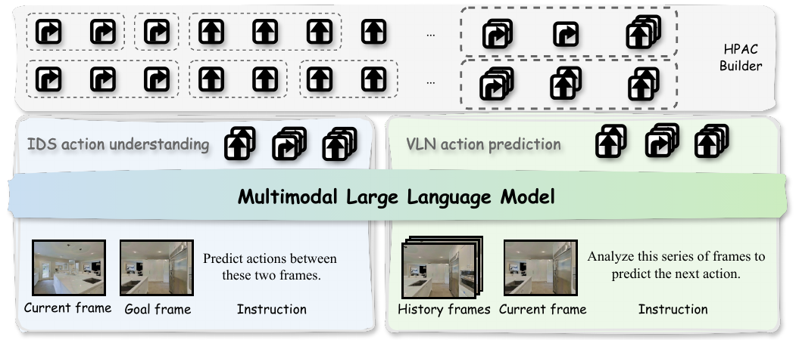
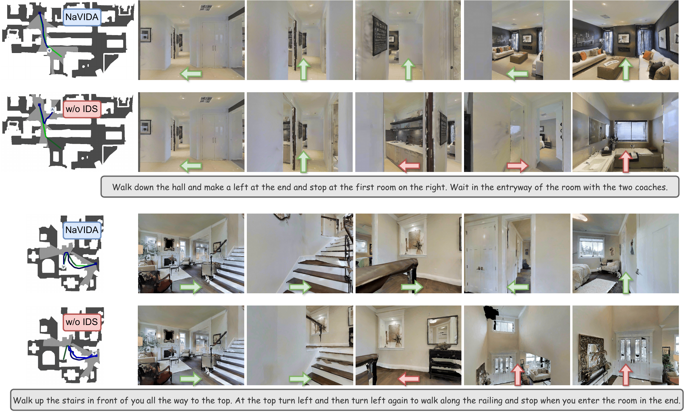
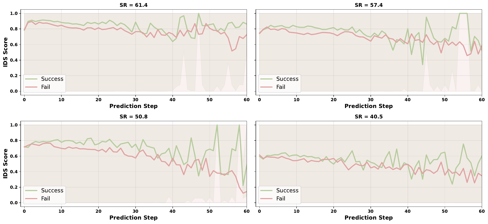

# NaVIDA (arXiv 2026)

<!-- paper-source: https://chengwei920412.github.io/paper_reading/2601.18188_NaVIDA_Vision_Language_Navigation_with_Inverse_Dynamics_Augmentation/technical_report.html -->

> **arXiv ID**：2601.18188  
> **原文标题**：NaVIDA: Vision-Language Navigation with Inverse Dynamics Augmentation  
> **翻译日期**：2026-09-24

---

## 📋 论文概览 {#_1}

### 基本信息 {#_2}

- **作者**：Weiye Zhu、Zekai Zhang、Xiangchen Wang、Hewei Pan、Teng Wang、Tiantian Geng、Rongtao Xu、Feng Zheng
- **机构**：南方科技大学、穆罕默德·本·扎耶德人工智能大学、SpatialTemporal AI
- **发表时间**：2026 年 1 月（arXiv）
- **领域**：具身智能、视觉—语言导航、视觉语言模型、机器人导航

### 核心贡献 {#_3}

NaVIDA 将逆动力学监督（Inverse-Dynamics Supervision，IDS）作为辅助训练目标：模型根据起始与目标视觉帧反推出中间动作，使导航策略显式学习“动作如何改变视觉状态”。论文进一步提出层次概率动作分块（Hierarchical Probabilistic Action Chunking，HPAC），把原子动作随机且分层地合并为变长动作块，从而放大可辨识的视觉变化并扩展有效规划跨度。该设计不增加专用生成器或空间编码器，在单 RGB 输入和 3B 参数规模下取得有竞争力的 VLN-CE 结果，并在两种人形机器人上验证部署可行性。

---

## 🎯 研究背景与动机 {#_4}

### 问题定义 {#_5}

视觉—语言导航（Vision-and-Language Navigation，VLN）要求智能体依据自然语言指令，在连续三维环境中利用第一视角视觉观测选择前进、左转、右转或停止。系统既要理解语言和场景，也要在长时序执行中维持动作与状态变化的一致性。

### 现有方法的局限性 {#_6}

许多 VLN 方法直接学习“历史视觉与指令 → 下一动作”的反应式映射，却没有显式约束动作与其引发的视觉转移。轻微的转向或定位误差因而容易沿轨迹累积，表现为过早停止、路口误判和不可恢复的漂移。

前向动力学建模尝试预测未来图像或视觉特征，但输出空间维度高，容易把算力用于光照、纹理等与决策无关的外观细节，通常还需要额外模块或更长训练。NaVIDA 的关键判断是：导航并不需要重建每个未来像素，只需让模型准确理解“观察到的视觉变化对应什么动作”。

### 本文的创新点 {#_7}

1. **共享动作空间的 IDS**：逆动力学任务和导航任务使用同一套动作语法及共享参数，辅助知识可直接作用于导航解码，而不是通过额外头或事后蒸馏间接传递。
2. **HPAC 变长动作块**：先以概率 \(p\) 合并至多 3 个相邻同类动作，再确定性合并至多 \(n\) 个一级子块。随机边界避免僵硬分段，长短动作块的混合同时提供全局规划线索和局部稳定控制信号。
3. **轻量且可部署**：主模型基于 Qwen2.5-VL-3B，仅训练投影器与 LLM；推理阶段只执行前两个预测动作块。真实机器人通过客户端—服务器架构调用远程 RTX 4090，单次动作序列预测约需 0.93 秒。

---

## 🔬 方法论 {#_8}

### 整体架构 {#_9}

图：NaVIDA 整体框架。共享的视觉语言骨干同时优化导航动作预测与逆动力学监督。

给定导航指令 \(\mathcal{I}\)、历史视觉观测 \(\mathcal{V}_{0:t}\) 和离散动作空间

\[\mathcal{A}=\{\text{Forward},\text{TurnLeft},\text{TurnRight},\text{Stop}\},\]

导航分支根据指令与视觉历史预测下一个 HPAC 动作块；IDS 分支则根据帧对 \((v_t,v_{t+\ell})\) 预测二者之间的动作序列。两项损失联合优化：

\[\mathcal{L}=\sum_{\tau\in D}\left(\mathcal{L}_{\mathrm{VLN}}^{\tau}+\mathcal{L}_{\mathrm{IDS}}^{\tau}\right).\]

### 关键技术 {#_10}

\*\*层次概率动作分块（HPAC）\*\*分为两级。第一级以概率 \(p\) 合并相邻且相同的原子动作，每个子块最多包含 3 个动作；第二级把最多 \(n\) 个连续子块合并为最终动作块，因此一个块覆盖 \(n\) 至 \(3n\) 个原子动作。默认设置为 \(p=0.7,n=3\)。

\*\*逆动力学监督（IDS）\*\*使用 Habitat 中 R2R、RxR、ScaleVLN 和 DAgger 轨迹构建数据。HPAC 产生的相邻航点分别作为当前视图与目标视图，中间动作块作为监督标签，最终得到约 240 万个 IDS 三元组和约 280 万个使用相同动作语法的分块 VLN 样本。

**共享表示与输出语法**是方法有效性的核心。IDS 不是单独的分类器；它与 VLN 都直接生成动作类型及数值 token。这样，视觉转移知识能持续塑造共享表示，并直接迁移到语言条件下的动作预测。

### 算法流程 {#_11}

1. 从连续轨迹中读取原子动作序列。
2. 以概率方式合并连续同类动作，形成一级子块并保留边界多样性。
3. 再将多个一级子块确定性合并为二级变长动作块。
4. 以相邻航点的起止帧和中间动作块构建 IDS 样本。
5. 混合 IDS 与 VLN 数据，共享模型参数并联合优化两项自回归损失。
6. 推理时输入最多 8 帧历史观测与语言指令，预测动作块并执行前两个块。

---

## 📊 实验与结果 {#_12}

### 实验设置 {#_13}

- **数据集**：VLN-CE 的 R2R-CE 与 RxR-CE val-unseen；真实环境使用 AgiBot X2 和 Unitree G1。
- **骨干模型**：Qwen2.5-VL-3B；冻结视觉编码器，训练投影器和 LLM。
- **训练配置**：1 个 epoch，AdamW，学习率 \(2\times10^{-5}\)，全局批大小 64，BF16，Flash Attention v2。
- **指标**：导航误差（NE）、成功率（SR）、Oracle 成功率（OS/OSR）、路径长度加权成功率（SPL）和归一化动态时间规整（nDTW）。

### 主要结果 {#_14}

<table>
<thead>
<tr>
<th>基准</th>
<th>NE ↓</th>
<th>OS/OSR ↑</th>
<th>SR ↑</th>
<th>SPL ↑</th>
<th>nDTW ↑</th>
</tr>
</thead>
<tbody>
<tr>
<td>R2R-CE val-unseen</td>
<td><strong>4.32</strong></td>
<td><strong>69.5</strong></td>
<td><strong>61.4</strong></td>
<td>54.7</td>
<td>—</td>
</tr>
<tr>
<td>RxR-CE val-unseen</td>
<td><strong>5.23</strong></td>
<td>—</td>
<td><strong>57.4</strong></td>
<td><strong>49.6</strong></td>
<td><strong>67.0</strong></td>
</tr>
</tbody>
</table>

在 R2R-CE 上，NaVIDA 相比 8B 的 JanusVLN 将 NE 降低 0.46、OS 提高 4.3、SR 提高 0.9；SPL 为 54.7，低于 JanusVLN 的 56.8。在 RxR-CE 上，NaVIDA 达到并列最佳 SR 57.4，同时取得表中最佳 NE、SPL 和 nDTW。结果支持论文的主要主张：在只有约 35% 参数量且仅使用单 RGB 流时，动作落地监督能够替代一部分模型容量与传感器复杂度。

图：R2R-CE 仿真案例。IDS 有助于减少楼梯附近的过早转向和路口误判。

### 消融实验 {#_15}

- **IDS 数据规模**：仅使用 R2R 时，加入 IDS 将 SR 从 32.0 提高到 40.5；使用 R2R、RxR 和 DAgger 的完整 IDS 后，SR 达到 55.5，NE 降至 4.91。
- **IDS 构造方式**：噪声动作监督使 SR 降至 46.8，说明收益来自正确的动作—视觉转移对应，而非单纯增加样本。多选题式 IDS 的 SR 为 49.8，低于直接生成动作 token；特权蒸馏的 SR 为 52.3，也低于联合训练的 55.5。
- **HPAC**：最大二级块大小为 3 时效果最佳。DINOv2 相似度驱动的确定性分块 SR 仅 44.7，说明语义相似度不能可靠表达导航所需的几何与视角变化。
- **逆向与前向动力学**：IDS 训练 1 个 epoch 即达到 SR 55.5；FDS 训练 1、2、3 个 epoch 的 SR 分别为 44.6、51.0、53.9。FDS 最终超过无动力学监督的基线，但仍落后于 IDS。

图：成功与失败轨迹的 IDS 分数随预测步变化。长时序中较高且稳定的 IDS 分数与导航成功显著相关。

---

## 💡 关键见解 {#_16}

### 理论与机制分析 {#_17}

IDS 的优势来自任务对齐。前向模型学习 \(p(v_{t+1}\mid v_t,a_t)\)，输出是高维视觉空间；逆动力学则学习 \(p(a_t\mid v_t,v_{t+\ell})\)，输出与导航策略完全相同。由于训练目标和下游决策共享动作 token，梯度直接强化“可观察状态变化—动作解释—导航输出”这一闭环。

HPAC 解决了单步逆动力学信号过弱的问题。单个小角度转向可能只产生细微像素变化，而跨多个原子动作的帧对具有更明显的视差和视角变化。与此同时，概率边界形成数据增强，避免模型只适应固定长度的机械分段。

### 实践启示 {#_18}

对于受算力与传感器限制的具身系统，优先设计与控制输出同构的辅助任务，可能比引入图像生成式世界模型更划算。真实部署还表明，模型可以放在远程服务器上，让机器人端仅负责视觉采集和运动 API，但网络时延会成为闭环控制的重要约束。

---

## 🔍 局限性与未来工作 {#_19}

### 当前局限 {#_20}

1. 真实世界评估主要展示定性案例，缺少公开的任务数量、成功率、路径效率、网络时延分布和安全失败统计，难以量化跨平台泛化。
2. IDS 从离线轨迹构建，仍依赖动作标签和可靠的帧间对应；相机时间同步、执行滑移或动力学变化可能造成监督噪声。
3. 逆动力学可能具有多解性：相同起止视觉帧可由不同动作序列产生。论文采用单一轨迹标签，尚未显式建模这种多模态不确定性。
4. HPAC 的两级规则和默认参数来自经验选择。其在更高频控制、更复杂动作空间或动态环境中的适用边界仍需检验。
5. 训练与评估均以有限历史帧和离散动作语法为主，尚未证明方法能直接扩展到连续控制、操作任务或更长时间尺度的记忆。

### 未来方向 {#_21}

- 将 IDS 扩展为多候选或概率化动作序列建模，处理逆动力学多解性。
- 使用在线交互数据自适应更新 IDS，并研究执行偏差下的鲁棒监督。
- 将 HPAC 的边界选择从手工概率规则升级为可学习、受不确定性约束的分段策略。
- 对真实机器人开展标准化、大规模定量评测，并将网络延迟与安全约束纳入闭环策略。
- 在连续动作、移动操作和动态障碍环境中验证“共享输出空间的辅助任务”是否仍能保持优势。

---

## 📚 相关工作对比 {#_22}

<table>
<thead>
<tr>
<th>方法</th>
<th>核心思想</th>
<th>优势</th>
<th>劣势</th>
</tr>
</thead>
<tbody>
<tr>
<td>反应式 VLN</td>
<td>直接从指令与视觉历史预测动作</td>
<td>结构简单、推理开销低</td>
<td>缺少动作后果建模，误差易累积</td>
</tr>
<tr>
<td>前向动力学监督</td>
<td>预测未来图像或视觉特征</td>
<td>显式建模未来状态</td>
<td>高维输出难优化，计算与数据成本高，可能关注无关外观细节</td>
</tr>
<tr>
<td>特权蒸馏</td>
<td>将 IDS 教师的动作分布蒸馏给学生</td>
<td>推理时无需辅助任务</td>
<td>仅在输出层传递知识，动作—视觉对齐对共享表示的塑形较弱</td>
</tr>
<tr>
<td><strong>NaVIDA</strong></td>
<td>IDS 与 VLN 共享表示和动作空间，并使用 HPAC</td>
<td>轻量、训练对齐、数据效率高、长时序更稳定</td>
<td>依赖带动作轨迹，逆动力学多解性与真实评测规模仍有限</td>
</tr>
</tbody>
</table>

---

## 🎓 个人评价 {#_23}

### 优点 {#_24}

论文抓住了一个清晰且工程价值很高的切入点：辅助任务是否真正与控制输出对齐。方法没有堆叠额外生成模块，而是通过数据构造和共享目标提升 3B 模型；噪声 IDS、多选题 IDS、蒸馏、FDS、HPAC 分块方式等消融也较好地支撑了机制解释。把 IDS 分数与成功/失败轨迹关联起来，进一步提供了可诊断性。

### 可改进之处 {#_25}

最明显的不足是真实部署证据仍偏定性。若能给出多场景、多指令、多机器人上的统计结果，以及端到端时延、掉线恢复和碰撞安全数据，结论会更扎实。论文也可增加计算成本表，直接比较 IDS 与 FDS 的训练显存、吞吐和总 GPU 时，从而更完整地量化“轻量”。

### 推荐阅读对象 {#_26}

适合研究视觉—语言导航、具身智能数据构造、视觉语言模型微调、动作分块和机器人部署的读者。对希望在不增加模型结构复杂度的前提下设计辅助监督任务的工程团队也有直接参考价值。

---

## 📎 附录 {#_27}

### 重要公式 {#_28}

IDS 损失：

\[\mathcal{L}_{\mathrm{IDS}}^{\tau}=-\sum_t\sum_{j=1}^{n_t}\log p\!\left(y_{t,j}^{\star}\mid y_{t,&lt;j}^{\star},\mathcal{I}_{\mathrm{IDS}},v_t,v_{t+\ell}\right).\]

VLN 损失：

\[\mathcal{L}_{\mathrm{VLN}}^{\tau}=-\sum_t\sum_{j=1}^{n_t}\log p\!\left(y_{t,j}^{\star}\mid y_{t,&lt;j}^{\star},\mathcal{I}_{\mathrm{NAV}},v_{&lt;t}\right).\]

用于分析动作—状态对齐的 IDS 分数：

\[\mathrm{IDS}_{\mathrm{Score}}=\exp\!\left(-\frac{\Delta_p}{\sigma_p}\right)\exp\!\left(-\frac{\Delta_\theta}{\sigma_\theta}\right),\]

其中 \(\sigma_p=0.1\)，\(\sigma_\theta=\pi/12\)。

### 术语表 {#_29}

<table>
<thead>
<tr>
<th>英文</th>
<th>中文</th>
</tr>
</thead>
<tbody>
<tr>
<td>Vision-and-Language Navigation (VLN)</td>
<td>视觉—语言导航</td>
</tr>
<tr>
<td>Inverse-Dynamics Supervision (IDS)</td>
<td>逆动力学监督</td>
</tr>
<tr>
<td>Hierarchical Probabilistic Action Chunking (HPAC)</td>
<td>层次概率动作分块</td>
</tr>
<tr>
<td>Action-Grounded Visual Dynamics</td>
<td>动作落地视觉动力学</td>
</tr>
<tr>
<td>Forward Dynamics Modeling / Supervision (FDM/FDS)</td>
<td>前向动力学建模 / 监督</td>
</tr>
<tr>
<td>Navigation Error (NE)</td>
<td>导航误差</td>
</tr>
<tr>
<td>Success Rate (SR)</td>
<td>成功率</td>
</tr>
<tr>
<td>Oracle Success Rate (OSR)</td>
<td>Oracle 成功率</td>
</tr>
<tr>
<td>Success-weighted Path Length (SPL)</td>
<td>路径长度加权成功率</td>
</tr>
<tr>
<td>normalized Dynamic Time Warping (nDTW)</td>
<td>归一化动态时间规整</td>
</tr>
</tbody>
</table>

### 参考资源 {#_30}

- **论文原文**：[arXiv](https://arxiv.org/abs/2601.18188)
- **中文翻译 PDF**：[paper_cn.pdf](https://chengwei920412.github.io/paper_reading/2601.18188_NaVIDA_Vision_Language_Navigation_with_Inverse_Dynamics_Augmentation/paper_cn.pdf)
- **中文 Markdown 译文**：[paper_cn.md](https://chengwei920412.github.io/paper_reading/2601.18188_NaVIDA_Vision_Language_Navigation_with_Inverse_Dynamics_Augmentation/paper_cn.html)
- **代码实现**：[NAVIDA GitHub](https://github.com/waynechu1021/NAVIDA)
- **项目主页**：论文未提供独立项目主页
