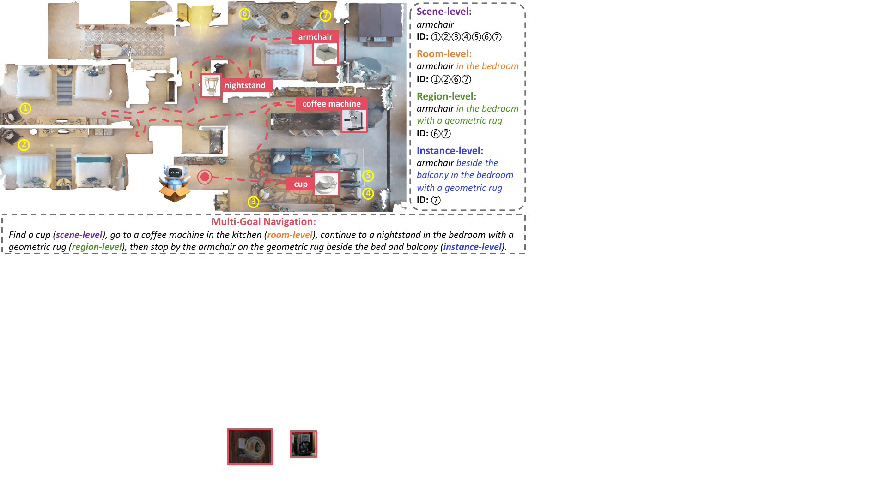
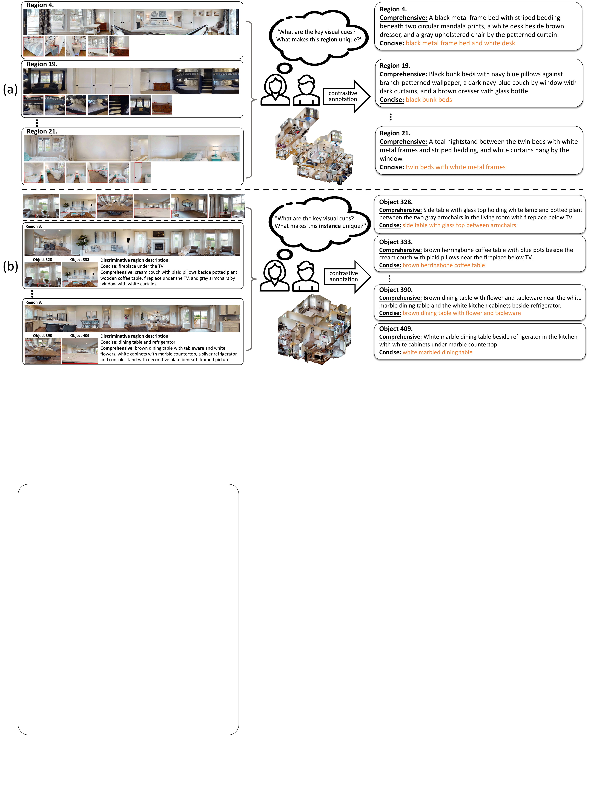
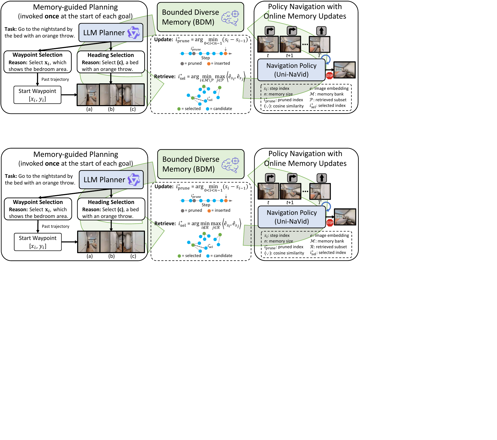

# LangMap (arXiv 2026)

<!-- paper-source: https://chengwei920412.github.io/paper_reading/2602.02220v3_LangMap_A_Human_Verified_Benchmark_for_Hierarchical_Open_Vocabulary_Goal_Navigation/technical_report.html -->

> 原文链接：[LangMap (arXiv 2026)](https://chengwei920412.github.io/paper_reading/2602.02220v3_LangMap_A_Human_Verified_Benchmark_for_Hierarchical_Open_Vocabulary_Goal_Navigation/technical_report.html)

> **arXiv ID**：2602.02220v3  
> **原文标题**：LangMap: A Human-Verified Benchmark for Hierarchical Open-Vocabulary Goal Navigation  
> **翻译日期**：2026-10-06

---

## 📋 论文概览 {#_1}

### 基本信息 {#_2}

- **作者**：Bo Miao、Weijia Liu、Jun Luo、Lachlan Shinnick、Jian Liu、Thomas Hamilton-Smith、Yuhe Yang、Zijie Wu、Vanja Videnovic、Feras Dayoub、Anton van den Hengel
- **机构**：AIML, Adelaide University；East China Normal University；SUTD；The University of Western Australia；Breaker Industries；Metacognition
- **版本**：arXiv v3（2026）
- **领域**：具身智能、目标导向导航、视觉语言模型、开放词汇评估、导航基准

### 一句话总结 {#_3}

论文把语言目标导航从“找到任意一把椅子”扩展为场景、房间、区域、实例四级目标，构建经人工对比核验的 LangMap 基准，并提出无需深度、三维地图或物体掩码的纯 RGB 多目标导航基线 PlaNaVid。

### 核心贡献 {#_4}

1. 提出 **HieraNav**：统一场景级、房间级、区域级和实例级目标的层级开放词汇导航任务。
2. 构建 **LangMap**：覆盖 36 个 HM3D-Sem 验证场景、414 个物体类别，其中 349 个类别用于生成 18,479 项任务；共提供 926 条区域描述和 7,510 条实例描述。
3. 设计对比式人工标注协议：标注者在同场景内比较同类别或语义相近的候选项，撰写简洁与详细描述，并通过交叉审查保证正确性和可辨别性。
4. 提出 **PlaNaVid**：以有界多样性记忆（Bounded Diverse Memory，BDM）为 VLM 高层规划器提供历史上下文，再用 Uni-NaVid 反应式策略完成局部导航。
5. 给出按目标层级、类别频率、路径长度、物体尺寸和失败类型划分的系统诊断。

---

## 🎯 研究背景与动机 {#_5}

### 问题定义 {#_6}

语言条件目标导航（LGN）要求具身智能体根据自然语言目标，在没有逐步路线指令的情况下探索三维环境并在目标附近正确停止。以往 ObjectNav 常把目标简化为类别，例如“椅子”，但现实指令往往包含层级上下文，例如“几何地毯所在卧室里的扶手椅”或“Bluey 床上的手机”。这不仅需要类别识别，还需要房间、区域、实例属性及空间关系的联合消歧。

图：HieraNav 的四级语言目标与单目标、多目标评估形式。

### 现有方法的局限性 {#_7}

- 早期基准通常只有 6--21 个闭集物体类别，主要测试检测能力，难以衡量细粒度语义推理。
- GOAT-Bench 与 PSL 使用 VLM 从物体视图自动生成实例描述，但 VLM 容易遗漏区分性属性和三维空间关系。
- 作者人工检查 GOAT-Bench 十个场景后发现，39.8% 的实例级描述存在语义错误或歧义，其中语义错误占 9.9%，歧义占 29.9%。
- 房间级和区域级语言目标缺少可靠标注，导致现有导航评估无法系统研究层级消歧。
- 多目标导航需要长期记忆，但完整轨迹存储冗余大，VLM 上下文窗口也无法容纳全部历史。

### 本文的创新点 {#_8}

论文的关键判断是：可靠导航基准不仅需要更多目标类别，还需要让语言描述在同一场景内具有唯一指向性。为此，LangMap 不让标注者孤立描述单个目标，而是同时查看目标及其同类别干扰项，以对比方式选择真正能完成消歧的属性与关系。这个设计把“描述自然不自然”转化为更可操作的标准：“描述能否在当前场景中唯一找到目标”。

---

## 🔬 方法论 {#_9}

### HieraNav 任务 {#hieranav}

HieraNav 定义四种目标粒度：

<table>
<thead>
<tr>
<th>级别</th>
<th>目标含义</th>
<th>示例</th>
</tr>
</thead>
<tbody>
<tr>
<td>场景级</td>
<td>场景中目标类别的任意实例</td>
<td>扶手椅</td>
</tr>
<tr>
<td>房间级</td>
<td>指定房间类型中的目标类别</td>
<td>卧室里的扶手椅</td>
</tr>
<tr>
<td>区域级</td>
<td>由上下文描述唯一确定的房间实例中的目标类别</td>
<td>带几何地毯的卧室里的扶手椅</td>
</tr>
<tr>
<td>实例级</td>
<td>由属性或空间关系唯一确定的物体实例</td>
<td>床和阳台旁的扶手椅</td>
</tr>
</tbody>
</table>

每个时间步的输入为 RGB 观测、相对里程计和可选深度；动作包括前进 0.25m、左右转 30° 与停止。智能体需在每个目标最多 500 步内，于任一有效目标 1m 范围内执行停止动作。

### LangMap 数据与标注 {#langmap_1}

LangMap 建于 36 个 HM3D-Sem 验证场景之上。区域标注覆盖 12 个房间类别；物体标注覆盖 414 个类别，其中 349 个类别通过可见性与视点筛选后用于导航任务。任务包含约 1.5 万项单目标任务，以及 720 个每回合五目标的多目标回合，共 18,479 个子任务。

图：区域与实例的对比式标注界面和比较过程。

标注流程包括：

1. 从 HM3D-Sem 的区域—物体关系、标签、位置和边界框提取代表性物体视图与区域全景图。
2. 用 SentenceBERT 聚类语义相近的物体类别，并整理基础类别—细粒度类别层级。
3. 七名研究人员比较同场景内同类别区域或物体实例，分别撰写简洁描述和详细描述。
4. 打乱场景并重新分配审查者，交叉检查正确性、视觉落地性、标签一致性与可辨别性。
5. 约 23% 的首轮标注被修改，标注和审查总计约 630 人时。

### PlaNaVid 整体架构 {#planavid}

图：PlaNaVid 的记忆引导规划与反应式策略导航。

PlaNaVid 将多目标导航分为两个阶段：

1. **记忆引导规划**：BDM 从历史 RGB 快照中检索语义多样的上下文，Qwen2.5-VL-3B/7B 为当前目标选择初始航点与朝向。
2. **策略导航**：Uni-NaVid 根据当前 RGB 观测和目标语言输出低层动作，并在线更新记忆，为后续目标积累信息。

### 有界多样性记忆 {#_10}

BDM 由全局均匀更新（GUU）与语义多样性检索（SDR）组成。

当记忆超过容量 \(N_{\max}\) 时，GUU 删除局部时间间隔最小的条目：

\[i^*_{\mathrm{prune}}=\arg\min_{0&lt;i&lt;n-1}(s_i-s_{i-1}).\]

这一规则减少时间冗余，使保留快照近似均匀覆盖完整轨迹。若最大时间间隔为 \(g_{\max}\)，任意时刻到最近保留快照的最坏误差满足 \(\epsilon_{\max}\le g_{\max}/2\)。论文采用 \(N_{\max}=50\)；对约 700 步的典型轨迹，近似均匀间距约为 14 步，最坏误差约 7 步，平均误差约 3.5 步。

SDR 固定保留最新状态，并用贪心最大—最小准则选择其余 \(K-1\) 个快照：

\[i^*_{\mathrm{select}}=\arg\min_{i\notin\mathcal R}\max_{j\in\mathcal R}
\langle\hat{\mathbf e}_{s_i},\hat{\mathbf e}_{s_j}\rangle.\]

该准则优先选择与已选集合最不相似的快照，以扩大语义覆盖。论文取 \(K=10\)。

---

## 📊 实验与结果 {#_11}

### 实验设置 {#_12}

- **数据集**：LangMap，36 个 HM3D-Sem 验证场景。
- **主要指标**：成功率（SR）、按路径长度加权的成功率（SPL）、序列成功率 SeqSR@\(k\)。
- **对比方法**：3D-Mem、MTU3D、PSL、SenseAct-M、Uni-NaVid。
- **感知设定**：方法间资源并不完全一致；部分对比方法使用全景 RGB-D、物体掩码、三维地图或模拟器最短路径，PlaNaVid 只用单视图 RGB 和学习式局部策略。

### 主要结果 {#_13}

使用简洁描述时的核心结果如下：

<table>
<thead>
<tr>
<th>方法</th>
<th>主要输入/资源</th>
<th>多目标 SR</th>
<th>SeqSR@2</th>
<th>多目标 SPL</th>
<th>单目标 SR</th>
<th>单目标 SPL</th>
</tr>
</thead>
<tbody>
<tr>
<td>3D-Mem-7B</td>
<td>全景 RGB-D、掩码、三维地图</td>
<td>30.1</td>
<td>5.1</td>
<td>17.3</td>
<td>13.7</td>
<td>6.2</td>
</tr>
<tr>
<td>MTU3D</td>
<td>全景 RGB-D、掩码、三维地图、最短路径</td>
<td>41.2</td>
<td>11.0</td>
<td><strong>24.3</strong></td>
<td>29.9</td>
<td>15.3</td>
</tr>
<tr>
<td>Uni-NaVid</td>
<td>单视图 RGB、学习式策略</td>
<td>34.4</td>
<td>10.4</td>
<td>15.0</td>
<td>30.3</td>
<td>15.3</td>
</tr>
<tr>
<td>PlaNaVid-3B</td>
<td>单视图 RGB、BDM</td>
<td>41.5</td>
<td>14.4</td>
<td>17.5</td>
<td>31.3</td>
<td>15.2</td>
</tr>
<tr>
<td><strong>PlaNaVid-7B</strong></td>
<td>单视图 RGB、BDM</td>
<td><strong>42.8</strong></td>
<td><strong>14.6</strong></td>
<td>18.1</td>
<td><strong>31.7</strong></td>
<td><strong>15.4</strong></td>
</tr>
</tbody>
</table>

PlaNaVid-7B 的多目标 SR 比同为单视图 RGB 的 Uni-NaVid 高 8.4 个百分点；相比水平视场匹配的 MTU3D，多目标 SR 高 4.8 个百分点。其优势主要体现在成功率与序列可靠性，而非路径效率：MTU3D 的多目标 SPL 仍明显更高。

### 标注质量 {#_14}

<table>
<thead>
<tr>
<th>评估器</th>
<th>描述来源</th>
<th>平均词数</th>
<th>匹配准确率</th>
<th>独有胜出</th>
</tr>
</thead>
<tbody>
<tr>
<td>GPT-4o</td>
<td>GOAT-Bench</td>
<td>21.1</td>
<td>58.4%</td>
<td>6.2%</td>
</tr>
<tr>
<td>GPT-4o</td>
<td><strong>LangMap</strong></td>
<td><strong>5.2</strong></td>
<td><strong>81.3%</strong></td>
<td><strong>29.1%</strong></td>
</tr>
<tr>
<td>Qwen3-VL</td>
<td>GOAT-Bench</td>
<td>21.1</td>
<td>55.9%</td>
<td>5.3%</td>
</tr>
<tr>
<td>Qwen3-VL</td>
<td><strong>LangMap</strong></td>
<td><strong>5.2</strong></td>
<td><strong>79.7%</strong></td>
<td><strong>29.1%</strong></td>
</tr>
</tbody>
</table>

LangMap 用约四分之一的词数获得约 23 个百分点的准确率提升。独立人工审计让十名审计者在每条描述对应的 5--10 个同场景干扰项中选择目标，200 次判断中有 92.5% 得到唯一且正确的匹配。

### 失败诊断 {#_15}

PlaNaVid-7B 的进入成功半径率（OSR）从场景级的 69.9% 降到实例级的 36.7%。失败结构也随层级变化：

<table>
<thead>
<tr>
<th>目标级别</th>
<th>OSR</th>
<th>探索失败</th>
<th>层级消歧失败</th>
<th>终止/控制失败</th>
</tr>
</thead>
<tbody>
<tr>
<td>场景</td>
<td>69.9</td>
<td>24.3</td>
<td>--</td>
<td>75.7</td>
</tr>
<tr>
<td>房间</td>
<td>67.2</td>
<td>22.1</td>
<td>12.1</td>
<td>65.8</td>
</tr>
<tr>
<td>区域</td>
<td>61.7</td>
<td>28.1</td>
<td>10.8</td>
<td>61.1</td>
</tr>
<tr>
<td>实例</td>
<td>36.7</td>
<td>48.9</td>
<td>19.7</td>
<td>31.4</td>
</tr>
</tbody>
</table>

粗粒度目标的主要问题是“看到目标但没正确停下”；到实例级后，主要问题转为探索不足，其次是未能利用属性或空间关系完成消歧。

### 消融实验 {#_16}

- 反应式基线的多目标 SR 为 34.4%。
- 使用完整轨迹记忆后提高到 40.4%，但平均需存 656 帧。
- 仅加入 GUU，可把记忆压缩到 50 帧且 SR 为 40.9%。
- 仅加入 SDR，SR 达到 42.0%，但仍保留约 629 帧。
- GUU 与 SDR 结合后，50 帧预算下获得最高的 42.8% SR 与 14.6% SeqSR@2。

长期序列仍很困难：PlaNaVid-7B 的 SeqSR@5 仅为 1.7%，说明单个目标成功率的提升尚未转化为可靠的完整五目标回合完成能力。

---

## 💡 关键见解 {#_17}

### 理论与方法理解 {#_18}

BDM 的价值不在于建立精确地图，而在于为高层规划器保留“时间上覆盖全局、语义上互不重复”的少量视觉证据。GUU 处理时间覆盖，SDR 处理内容多样性，两者分别对应“不要忘记轨迹的早期部分”和“不要反复给规划器看相似画面”。这使系统能在不建立显式三维场景图的情况下，为后续目标复用先前探索到的信息。

### 实践启示 {#_19}

- 对导航数据集而言，描述数量和长度不等同于标注质量；场景内唯一性与可辨别性更关键。
- 多目标导航应单独报告 SeqSR，而不能只用逐目标 SR，因为序列成功率会随目标数快速累乘下降。
- 单纯提升目标识别还不够，停止策略是粗粒度目标上的主要瓶颈。
- 实例级目标同时暴露探索覆盖与语义消歧问题，适合检验具身智能体是否真正把语言、视觉与空间关系结合起来。

---

## 🔍 局限性与未来工作 {#_20}

### 当前局限 {#_21}

1. **场景范围有限**：基准只覆盖 36 个静态室内 HM3D-Sem 验证场景，尚不能代表室外、动态或有人交互的真实环境。
2. **人工成本较高**：标注与复核约耗费 630 人时；扩大到更多场景和更长尾的物体类别时，成本会快速增长。
3. **标注者偏好**：描述选择哪些属性作为主要线索仍可能受标注者主观偏好影响。
4. **对比公平性有限**：各方法使用的输入模态、局部导航器、预训练规模与模拟器资源不同，表格中的横向差异不能完全归因于高层方法本身。
5. **序列可靠性仍低**：即使最佳方法的 SeqSR@5 也接近零，距离可部署的多步骤家庭任务还有显著差距。
6. **缺少动态记忆验证**：BDM 主要在静态场景中验证；当物体移动、房间状态变化或历史观测过期时，均匀保留旧记忆未必最优。

### 未来方向 {#_22}

- 用 VLM 生成候选描述，再以定向人工核验替代全人工撰写，降低扩展成本。
- 扩展到室外、动态场景、可交互物体及人机协作任务。
- 研究能检测记忆过期、处理环境变化的时变记忆机制。
- 将层级消歧显式纳入规划器，让智能体先确定房间与区域，再定位实例。
- 联合优化探索、停止与序列恢复策略，特别是在某个子目标失败后继续完成后续目标。
- 使用统一感知输入、局部导航器与训练预算，开展更严格的受控对比。

---

## 📚 相关工作对比 {#_23}

<table>
<thead>
<tr>
<th>方法/基准</th>
<th>核心思想</th>
<th>优势</th>
<th>局限</th>
</tr>
</thead>
<tbody>
<tr>
<td>GOAT-Bench</td>
<td>VLM 生成实例描述，统一类别与实例导航</td>
<td>自动化程度高，覆盖多种目标形式</td>
<td>描述可能含语义错误或歧义，缺少区域级标注</td>
</tr>
<tr>
<td>HM3D-OVON</td>
<td>开放词汇 ObjectNav</td>
<td>类别覆盖广，适合零样本检测与导航</td>
<td>仍以类别级目标为主，细粒度语义推理有限</td>
</tr>
<tr>
<td>3D-Mem</td>
<td>VLM 推理结合占据地图与三维物体特征</td>
<td>显式空间记忆，便于高层推理</td>
<td>依赖 RGB-D、掩码与三维表示，延迟较高</td>
</tr>
<tr>
<td>MTU3D</td>
<td>全景 RGB-D 与地图推理</td>
<td>路径效率高，多目标 SPL 最佳</td>
<td>依赖深度、掩码、地图和最短路径局部导航</td>
</tr>
<tr>
<td><strong>LangMap + PlaNaVid</strong></td>
<td>人工对比核验四级目标；BDM 引导纯 RGB 导航</td>
<td>标注可靠、目标层级完整、无需深度与三维地图</td>
<td>场景规模有限，人工成本高，长序列成功率仍低</td>
</tr>
</tbody>
</table>

---

## 🎓 综合评价 {#_24}

### 优点 {#_25}

- 论文首先验证现有描述噪声，再据此设计标注协议，问题与解决方案衔接紧密。
- 数据集不只增加类别数量，还引入房间、区域和实例层级，能分离探索、层级消歧和停止失败。
- 标注质量同时通过两个 VLM 评估器和独立人工审计验证，并报告描述长度，证据较完整。
- PlaNaVid 的结构简洁，BDM 消融能清楚分离时间压缩与语义多样性带来的贡献。
- 公开数据、任务定义与代码，附录还给出许可证、Responsible AI 元数据和数据字段说明。

### 可改进之处 {#_26}

- 应提供更多跨场景、跨建筑类型或跨数据集验证，检验人工描述风格是否迁移。
- 需要更严格的等资源基线，例如统一 RGB 视场、局部导航器、规划器规模和推理调用次数。
- 对 92.5% 人工匹配率可进一步报告按目标层级、类别频率和描述类型划分的置信区间。
- BDM 的近似均匀时间覆盖具有直观误差界，但与任务相关的最优记忆选择并不等价；后续可研究学习式记忆价值估计。

### 推荐阅读对象 {#_27}

适合从事具身智能、开放词汇导航、视觉语言模型评估、三维场景理解、长程记忆和机器人基准设计的研究者与工程人员。若关注如何把“数据标注可靠性”与“智能体失败诊断”连接起来，这篇论文尤其值得阅读。

---

## 📎 附录 {#_28}

### 术语表 {#_29}

<table>
<thead>
<tr>
<th>英文</th>
<th>中文</th>
<th>含义</th>
</tr>
</thead>
<tbody>
<tr>
<td>Language-Conditioned Goal Navigation (LGN)</td>
<td>语言条件目标导航</td>
<td>根据语言目标自主探索并导航</td>
</tr>
<tr>
<td>Hierarchical Open-Vocabulary Goal Navigation</td>
<td>层级开放词汇目标导航</td>
<td>同时覆盖场景、房间、区域与实例级开放词汇目标</td>
</tr>
<tr>
<td>Contrastive Annotation</td>
<td>对比式标注</td>
<td>对照同场景干扰项撰写唯一指向目标的描述</td>
</tr>
<tr>
<td>Bounded Diverse Memory (BDM)</td>
<td>有界多样性记忆</td>
<td>在固定容量下兼顾时间覆盖与语义多样性的视觉记忆</td>
</tr>
<tr>
<td>Global-Uniform Update (GUU)</td>
<td>全局均匀更新</td>
<td>通过间隔对齐剪枝维持近似均匀时间覆盖</td>
</tr>
<tr>
<td>Semantic-Diverse Retrieval (SDR)</td>
<td>语义多样性检索</td>
<td>用最大—最小相似度准则选取互补历史快照</td>
</tr>
<tr>
<td>Sequence Success Rate (SeqSR)</td>
<td>序列成功率</td>
<td>前 \(k\) 个目标均按顺序完成的回合比例</td>
</tr>
<tr>
<td>Hierarchical Disambiguation</td>
<td>层级消歧</td>
<td>区分正确房间、区域或物体实例</td>
</tr>
</tbody>
</table>

### 参考资源 {#_30}

- **论文原文**：[arXiv 2602.02220v3](https://arxiv.org/abs/2602.02220v3)
- **中文翻译 PDF**：[paper_cn.pdf](https://chengwei920412.github.io/paper_reading/2602.02220v3_LangMap_A_Human_Verified_Benchmark_for_Hierarchical_Open_Vocabulary_Goal_Navigation/paper_cn.pdf)
- **中文 Markdown 译文**：[paper_cn.md](https://chengwei920412.github.io/paper_reading/2602.02220v3_LangMap_A_Human_Verified_Benchmark_for_Hierarchical_Open_Vocabulary_Goal_Navigation/paper_cn.html)
- **代码实现**：[bo-miao/LangMap](https://github.com/bo-miao/LangMap)
- **项目主页**：[LangMap 项目主页](https://bo-miao.github.io/LangMap/)
