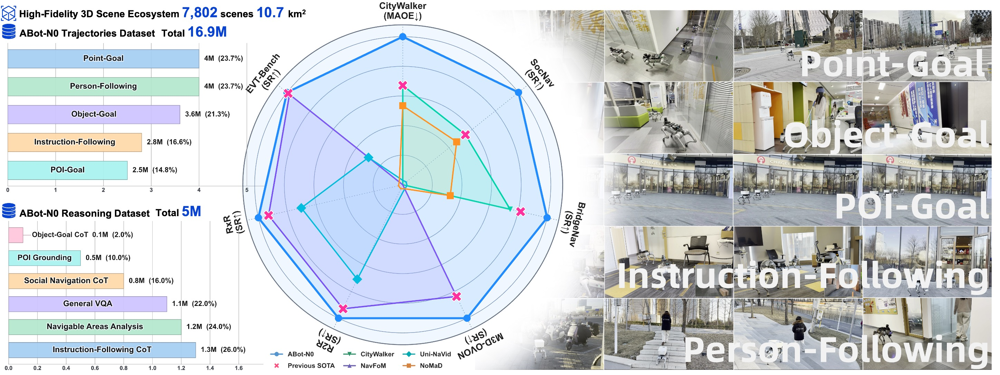
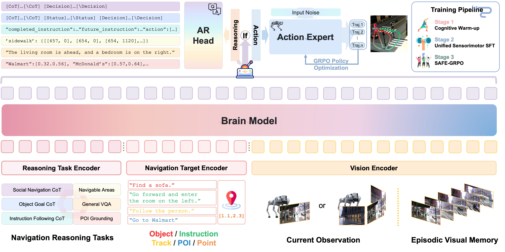
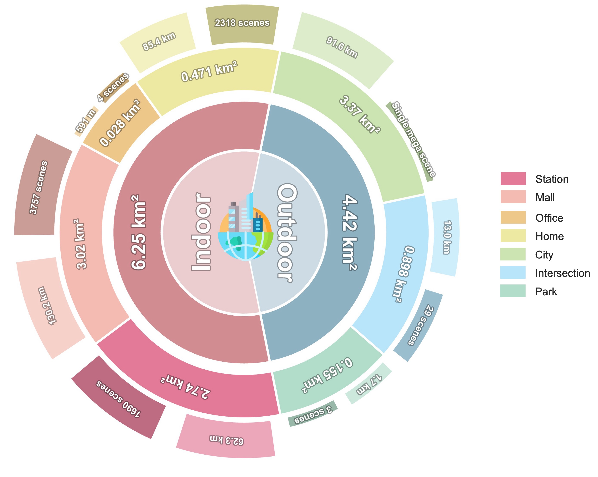
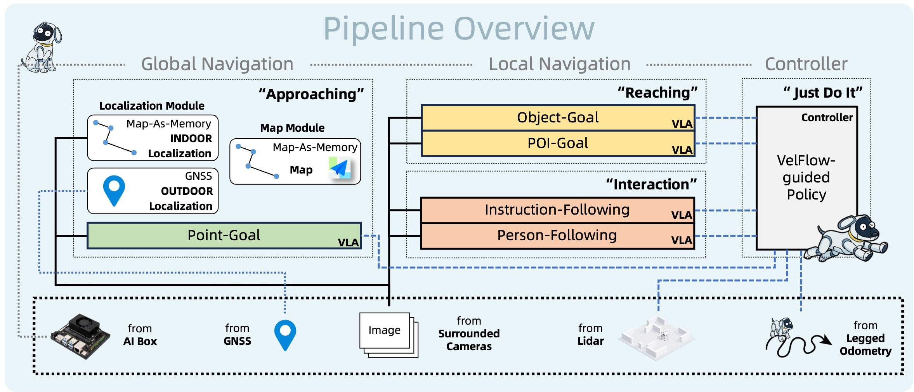

# ABot-N0 (arXiv 2026)

<!-- paper-source: https://chengwei920412.github.io/paper_reading/2602.11598_ABot_N0_Technical_Report_on_the_VLA_Foundation_Model_for_Versatile_Embodied_Navigation/technical_report.html -->

> **arXiv ID**: 2602.11598  
> **原文标题**: ABot-N0: Technical Report on the VLA Foundation Model for Versatile Embodied Navigation  
> **翻译日期**: 2026-10-08

---

## 📋 论文概览 {#_1}

### 基本信息 {#_2}

- **作者**: AMAP CV Lab；论文撰写者为 Zedong Chu、Shichao Xie、Xiaolong Wu，项目负责人为 Mu Xu、Xiaolong Wu
- **机构**: AMAP CV Lab
- **发表时间**: 2026年2月（arXiv预印本）
- **领域**: 具身智能、视觉—语言—动作模型、机器人导航、多任务学习、社会导航

### 核心贡献 {#_3}

ABot-N0试图把长期分散发展的具身导航任务统一为一个视觉—语言—动作（Vision-Language-Action，VLA）基础模型。其主要贡献包括：

1. **单一模型统一五项导航任务**：覆盖点目标、物体目标、指令跟随、兴趣点目标和人员跟随，统一处理几何目标、文本目标、静态目标与动态目标。
2. **“认知大脑—动作专家”分层架构**：以Qwen3-4B为认知大脑，以流匹配动作专家生成连续轨迹，在语义推理与精细运动控制之间建立显式分工。
3. **大规模数据引擎**：汇集7,802个高保真三维场景、1,690万条专家轨迹和500万个认知推理样本，并把五类任务映射到共享轨迹表示。
4. **七项基准上的强性能**：覆盖CityWalker、SocNav、R2R-CE、RxR-CE、HM3D-OVON、BridgeNav和EVT-Bench；在多数核心指标上达到最先进水平。
5. **从模型到系统的真实部署**：通过自主规划器、拓扑记忆、自我反思和高速神经控制器，将模型部署在宇树Go2 X四足机器人上，形成长时程室内外导航系统。

图1：ABot-N0整体概览。大规模轨迹与推理数据共同支撑五类导航任务，并进一步扩展为真实世界自主导航系统。

---

## 🎯 研究背景与动机 {#_4}

### 问题定义 {#_5}

具身导航的目标，是让智能体根据视觉观测、自然语言或几何坐标，在开放、动态且部分可观测的环境中安全到达目标。不同任务对能力的要求差异明显：

- 点目标导航强调度量坐标、避障与连续控制；
- 物体目标导航要求语义搜索与对未见类别的泛化；
- 指令跟随要求把长时程语言描述与视觉进度对齐；
- 兴趣点目标导航要求把店铺、设施等语义目标定位到可进入的物理入口；
- 人员跟随还涉及动态目标预测、重识别和社会交互。

论文要解决的核心问题是：能否用同一套模型、动作表示和训练流程覆盖上述任务，同时保持每项任务上的专用模型级性能，并能在真实机器人上实时运行。

### 现有方法的局限性 {#_6}

1. **任务割裂**：PointNav、ObjectNav、VLN和人员跟随通常使用彼此独立的架构、数据格式与动作空间，难以共享物理先验。
2. **语义与控制脱节**：大型语言模型擅长语义理解，却不天然具备连续、精确且动力学可行的运动生成能力；纯运动策略又缺少开放词汇与常识推理。
3. **数据分布狭窄**：单一仿真器或任务数据集难以覆盖室内外、静态与动态、短程与长程、理想轨迹与真实传感器噪声。
4. **模仿学习的规范性不足**：模仿学习可以复现专家行为，却未必理解“几何上可通行”与“社会规范允许通行”的差别。
5. **端到端长时程执行脆弱**：单次高层指令可能跨越多种导航阶段，且会遭遇目标缺失、道路变化和局部失败，仅依赖单一策略难以恢复。

### 本文的创新点 {#_7}

- 设计统一多模态编码接口，把RGB观测、视觉历史、文本目标和点坐标都转换为LLM可处理的词元。
- 将推理头与动作头设计为任务条件分支，而非要求推理链与动作生成严格串行执行，降低在线推理开销。
- 以流匹配建模多解轨迹分布，避免确定性回归把“从左绕行”和“从右绕行”等有效模式平均成碰撞路径。
- 将认知预热、统一传感—运动监督微调和SAFE-GRPO价值对齐组织为三阶段课程学习。
- 以Topo-Memory把地图改造成可维护的长期外部记忆，再用规划、反思与重新规划组织五类基础能力。

---

## 🔬 方法论 {#_8}

### 整体架构 {#_9}

ABot-N0由三部分组成：

1. **通用多模态编码器**：接收当前RGB观测、情景视觉记忆与异构导航目标，并映射到共享词元序列。
2. **认知大脑**：以预训练Qwen3-4B为骨干，编码场景、目标与历史上下文；推理头执行语义和空间推理，动作头为运动生成提供条件。
3. **动作专家**：使用条件流匹配生成局部鸟瞰图坐标系中的短期轨迹。每次预测5个航点，每个航点包含二维位置和偏航角。

图2：ABot-N0的“认知大脑—动作专家”架构。不同传感配置与目标类型先被统一编码，再由认知大脑和流匹配动作专家协同生成轨迹。

### 关键技术 {#_10}

#### 1. 灵活视觉接口 {#1}

- **全景模式**：左、前、右三个视图分别进入视觉编码器，以视图专属词元区分方向，避免图像拼接引入几何畸变。
- **前视模式**：仅处理单幅前向图像，适配相机配置更简单的机器人。
- **情景视觉记忆**：把相关历史帧追加到上下文窗口，使模型能在部分可观测条件下保持目标、路径和遮挡信息。

#### 2. 异构导航目标编码 {#2}

- 指令、物体类别、POI名称与人员描述等语义目标直接使用LLM文本分词器编码。
- 点目标坐标\((x,y)\)在局部鸟瞰图坐标系中定义，经多层感知机投影后作为伪词元输入LLM。
- 推理任务编码器注入“目标在哪里”“何处可通行”等辅助任务描述，激活与导航相关的认知表征。

#### 3. 任务条件双头设计 {#3}

推理头和动作头是由任务词元选择的两个分支。训练时，显式推理任务用于塑造场景几何、语义地标与社会规范表征；执行导航时，动作专家直接以这些物理落地的潜在表征为条件。该设计与“先生成长推理链、再生成动作”的严格串行方案不同。

#### 4. 流匹配动作专家 {#4}

动作专家预测的局部航点集合为：

\[\mathcal{W}=\{(x_1,y_1,\theta_1),(x_2,y_2,\theta_2),\ldots,(x_5,y_5,\theta_5)\}.\]

流匹配的作用有两点：一是生成平移与旋转的高精度连续值；二是保留专家演示中的多模态决策分布，而不是输出多个合理解的均值。

### 数据引擎 {#_11}

#### 高保真三维场景生态系统 {#_12}

场景库包含7,802个场景，总面积约\(10.7\,\mathrm{km}^2\)，其中室内\(6.25\,\mathrm{km}^2\)、室外\(4.42\,\mathrm{km}^2\)。导航图总长度为384,754米。数据来源包括HM3D、InteriorGS、自有3DGS办公室/商场/车站扫描、37个真实室外扫描场景，以及支持动态行人和车辆的SocCity。

所有场景都带有人工可通行路网标注。该步骤把视觉重建资产转化为可生成无碰撞、符合社会规范的专家轨迹的仿真环境。

图3：三维场景生态系统的规模、面积、场景类型及导航图统计。

#### 1,690万条轨迹的组成 {#1690}

<table>
<thead>
<tr>
<th>任务</th>
<th>规模</th>
<th>主要来源与构建方式</th>
</tr>
</thead>
<tbody>
<tr>
<td>点目标</td>
<td>400万</td>
<td>200万条互联网第一人称视频伪轨迹、170万条三维场景合成轨迹、34万条真实机器人演示；分项为近似值</td>
</tr>
<tr>
<td>指令跟随</td>
<td>280万</td>
<td>VLN-CE R2R/RxR 150万、门洞穿越30万、语言引导人员搜索20万、短时域原子任务80万</td>
</tr>
<tr>
<td>物体目标</td>
<td>360万</td>
<td>HM3D/OVON 180万、OVON-sub 20万、InteriorGS 160万</td>
</tr>
<tr>
<td>兴趣点目标</td>
<td>250万</td>
<td>以分割、深度、A*路径和Wan2.1-I2V视频生成构造第一人称轨迹</td>
</tr>
<tr>
<td>人员跟随</td>
<td>400万</td>
<td>三种目标距离、STT/DT/AT三类挑战及40万目标缺失样本</td>
</tr>
<tr>
<td><strong>合计</strong></td>
<td><strong>1,690万</strong></td>
<td>统一为共享的连续轨迹表示</td>
</tr>
</tbody>
</table>

点目标数据尤其体现了数据引擎的多源设计：\(pi^3\)从单目视频恢复三维结构，MoGe负责度量尺度对齐；仿真数据加入偏航、近碰撞等恢复状态；真实机器人日志则补充非完整运动约束、传感器噪声和执行延迟。

#### 500万个认知推理样本 {#500}

<table>
<thead>
<tr>
<th>推理类型</th>
<th>明确披露规模</th>
<th>目标</th>
</tr>
</thead>
<tbody>
<tr>
<td>可导航区域分析</td>
<td>120万</td>
<td>区分物理可通行区域与社会规范允许通行区域</td>
</tr>
<tr>
<td>社会导航思维链</td>
<td>80万</td>
<td>学习礼让行人、遵守信号灯等决策依据</td>
</tr>
<tr>
<td>指令跟随推理</td>
<td>130万</td>
<td>以“里程碑节点”把长指令进度与视觉观测对齐</td>
</tr>
<tr>
<td>物体目标推理</td>
<td>10万</td>
<td>约束目标可见性、空间关系、路径规划和原子动作</td>
</tr>
<tr>
<td>POI定位</td>
<td>50万</td>
<td>把语义POI名称定位到入口像素坐标\((u,v)\)</td>
</tr>
<tr>
<td>通用VQA及其他通用知识</td>
<td>未单列</td>
<td>论文报告推理集总量为500万，但正文未给出该部分的独立规模</td>
</tr>
</tbody>
</table>

显式列出的五个子集共390万条，与500万总量之间还有110万条未在正文中细分，这是数据说明完整性上的一个缺口。

### 训练流程 {#_13}

#### 阶段1：认知预热 {#1_1}

使用认知推理数据集使LLM骨干适应具身领域。视觉编码器、文本分词器和动作专家保持冻结，以下一词元预测损失训练LLM核心，使其学习视觉理解、文本—实体定位、空间推理和社会规范。

#### 阶段2：统一传感—运动监督微调 {#2_1}

将五类轨迹混合训练，并加入约20%的推理数据回放，以降低灾难性遗忘。自回归推理头与流匹配动作专家联合优化：

\[\mathcal{L}_{\mathrm{Phase2}}
=\lambda_{\mathrm{txt}}\mathcal{L}_{\mathrm{NTP}}(\theta_{\mathrm{brain}})
+\lambda_{\mathrm{flow}}\mathcal{L}_{\mathrm{CFM}}(\theta_{\mathrm{action}}\mid\theta_{\mathrm{brain}}).\]

其中，\(\mathcal{L}_{\mathrm{NTP}}\)是文本生成交叉熵损失，\(\mathcal{L}_{\mathrm{CFM}}\)是轨迹生成的条件流匹配损失。

#### 阶段3：SAFE-GRPO价值对齐 {#3safe-grpo}

模仿学习容易复现行为表象，却未必理解社会规范背后的因果约束。第三阶段冻结认知大脑，仅使用SocCity专家轨迹微调动作专家，并以社会感知流探索组相对策略优化（Socially-Aware Flow Exploration Group Relative Policy Optimization，SAFE-GRPO）最大化复合奖励：

\[\mathcal{R}=w_{\mathrm{soc}}\mathcal{R}_{\mathrm{social}}
+w_{\mathrm{exp}}\mathcal{R}_{\mathrm{expert}}
+w_{\mathrm{sm}}\mathcal{R}_{\mathrm{smooth}}
+w_{\mathrm{eff}}\mathcal{R}_{\mathrm{eff}}.\]

- \(\mathcal{R}_{\mathrm{social}}\)根据语义占据图惩罚草坪、机动车道和行人等不可通行或受限区域；
- \(\mathcal{R}_{\mathrm{expert}}\)约束策略不要偏离专家分布，降低奖励作弊；
- \(\mathcal{R}_{\mathrm{smooth}}\)和\(\mathcal{R}_{\mathrm{eff}}\)分别约束运动平滑性与目标推进效率。

### 算法流程 {#_14}

从用户指令到机器人运动的完整流程如下：

1. 多模态编码器把视觉、历史和目标转换为统一词元。
2. 认知大脑形成具备语义、空间与社会规范信息的上下文表征。
3. 动作专家以2Hz频率输出5航点局部轨迹。
4. 神经控制器融合最新航点与LiDAR占据图，以超过10Hz频率输出\((v_x,v_y,v_{\mathrm{yaw}})\)速度指令。
5. 对长时程任务，自主规划器先查询Topo-Memory，再把高层意图分解为点目标、物体目标、POI目标、指令跟随或人员跟随子任务。
6. 每个子任务结束后，自我反思器判断成功与否；失败时生成自然语言反馈并触发重新规划。

---

## 📊 实验与结果 {#_15}

### 实验设置 {#_16}

- **数据集**: CityWalker、SocNav、VLN-CE R2R/RxR、HM3D-OVON、BridgeNav、EVT-Bench
- **评估指标**: MAOE、NE、SR、RC、SPL、OS、DCR、TCR、TR、CR及不同入口距离阈值下的成功率
- **对比方法**: GNM、ViNT、NoMaD、CityWalker、NaVid、Uni-NaVid、NaVILA、StreamVLN、InternVLA-N1、NavFoM、VLFM、MTU3D、OmniNav、TrackVLA、TrackVLA++等

### 主要结果 {#_17}

<table>
<thead>
<tr>
<th>任务/基准</th>
<th>ABot-N0关键结果</th>
<th>代表性对比</th>
<th>结论</th>
</tr>
</thead>
<tbody>
<tr>
<td>点目标 / CityWalker</td>
<td>平均MAOE 11.2；全样本MAOE 7.6</td>
<td>CityWalker为15.2 / 11.5</td>
<td>预测方向误差显著降低</td>
</tr>
<tr>
<td>点目标 / SocNav</td>
<td>SR 88.3、SPL 79.2、DCR 85.1、TCR 85.4</td>
<td>CityWalker为47.8、44.7、36.1、36.6</td>
<td>成功率与社会规范遵循性均大幅提高</td>
</tr>
<tr>
<td>指令跟随 / R2R-CE</td>
<td>NE 3.78、SR 66.4、SPL 63.9</td>
<td>NavFoM为4.61、61.7、55.3</td>
<td>未见环境中的成功率和效率更高</td>
</tr>
<tr>
<td>指令跟随 / RxR-CE</td>
<td>NE 3.83、SR 69.3、SPL 60.0</td>
<td>NavFoM为4.74、64.4、56.2</td>
<td>长指令上的优势保持一致</td>
</tr>
<tr>
<td>物体目标 / HM3D-OVON Val-Unseen</td>
<td>SR 54.0、SPL 30.5</td>
<td>NavFoM为45.2、31.9；MTU3D为40.8、12.1</td>
<td>SR最佳，但SPL不是表中最高</td>
</tr>
<tr>
<td>POI目标 / BridgeNav</td>
<td>SR@0.1/0.2/0.3m为32.14/71.50/88.68；平均偏差9.84</td>
<td>OmniNav为18.78/46.99/72.39；平均偏差14.16</td>
<td>入口定位和路径精度均明显改善</td>
</tr>
<tr>
<td>人员跟随 / EVT-Bench</td>
<td>STT SR/TR为86.9/87.6；DT为66.7/75.4；AT为67.3/79.5</td>
<td>TrackVLA++的SR/TR分别为86.0/81.0、66.5/68.8、51.2/63.4</td>
<td>遮挡和身份歧义下的优势最明显</td>
</tr>
</tbody>
</table>

这些结果支持“多任务联合训练没有必然牺牲单任务性能”的核心主张。尤其是SocNav中的SR、DCR和TCR同时提升，说明模型不只是更快到达目标，也更倾向于选择符合社会规范的区域。

但“所有指标全面领先”需要谨慎理解：R2R-CE的OS指标由NavFoM取得最高值72.1，而ABot-N0为70.8；HM3D-OVON未见集上的SPL由NavFoM取得31.9，ABot-N0为30.5。人员跟随任务中，ABot-N0的成功率和跟踪率领先，但碰撞率并非最优。

### 消融实验 {#_18}

论文没有提供系统的组件消融表，因而无法定量分离以下因素的独立贡献：多任务联合训练、认知推理数据、视觉历史、流匹配动作头、20%推理数据回放、SAFE-GRPO、Topo-Memory以及自我反思器。

与消融最接近的证据有两类：

- SocNav上的社会规范指标相对模仿学习基线大幅提高，与SAFE-GRPO的设计目标一致，但缺少“移除SAFE-GRPO”的同模型对照。
- 边缘侧采用93M SigLIP-B/16和词元合并后达到2Hz，仅报告约3%的性能下降，但未给出不同压缩率、吞吐、功耗与各任务精度的完整曲线。

### 安全性结果的细读 {#_19}

EVT-Bench结果揭示了成功率与安全指标之间的张力：

- STT中ABot-N0碰撞率为8.54，高于TrackVLA的1.65和TrackVLA++的2.10；
- DT中碰撞率为11.6，高于TrackVLA++的4.71；
- AT中碰撞率为7.05，优于TrackVLA++的15.9，但仍不及IBVS的4.90。

因此，论文证明了更强的目标保持与重识别能力，但尚不能据此认定人员跟随安全性全面达到最佳。真实部署前仍需要显式的安全约束、紧急制动和更全面的碰撞测试。

---

## 🤖 真实世界部署 {#_20}

### 自主导航系统 {#_21}

系统由四个高层模块构成：自主规划器、执行器、短期情景记忆和长期Topo-Memory。规划器根据空间上下文把任务拆为三类阶段：

- **接近（Approaching）**：使用点目标穿越已知空间；
- **抵达（Reaching）**：使用物体目标或POI目标完成局部精确搜索；
- **交互（Interaction）**：使用指令跟随或人员跟随完成动态交互。

Topo-Memory包含区块层、道路层、功能层和物体/POI层，并将高德全局路径规划与实时视觉决策统一在“一张图”中。任务产生的观测、轨迹和交互结果会回写拓扑图，临时封路、施工和拥堵则通过图结构或边权更新反映。

自主规划器形式化为：

\[G=\mathcal{P}(I,M_L,M_S,O_t),\]

其中\(I\)是用户指令，\(M_L\)与\(M_S\)分别表示长期拓扑记忆和短期情景视觉记忆，\(O_t\)是当前观测。由粗到细的任务执行可写为：

\[P(W\mid I,M_L,M_S)
=P(G\mid I,M_L,M_S)
\prod_{j=1}^{N}P(\mathcal{W}_j\mid g_j,M_L,M_S).\]

图4：自主导航系统的分层执行流程。全局阶段依赖拓扑记忆，局部阶段调用不同导航原语，神经控制器负责高频动力学执行。

### 闭环反思与纠错 {#_22}

子任务结束后，自我反思器输出完成状态\(r\)和反馈\(f\)：

\[(r,f)=\mathcal{S}(M_L,M_S,g_i).\]

若\(r=\mathrm{False}\)，规划器使用失败反馈重新生成任务序列：

\[G&#x27;=\mathcal{P}(I,M_L,M_S,O_t,f).\]

论文展示的“寻找可乐”案例中，系统先前往零食架；确认目标不存在后，再规划至自动售货机。这比把整个任务压缩为单次端到端动作预测更接近可维护的工程系统。

### 硬件与云边协同 {#_23}

- **机器人**：宇树Go2 X四足机器人，12个主动自由度；
- **视觉**：三台滚动快门单目RGB相机，每台视野\(H120^\circ\times V90^\circ\)，组合水平视野约\(270^\circ\)；
- **几何感知**：宇树4D LiDAR L2和自研实时占据栅格流程；
- **全局定位**：RTK-GNSS；
- **边缘计算**：NVIDIA Jetson Orin NX，157 TOPS、16GB内存；
- **云端规划**：NVIDIA RTX 4090；
- **运行频率**：VLA航点推理2Hz，神经控制器超过10Hz；
- **边缘优化**：93M参数SigLIP-B/16视觉骨干、MLP投影器、合并大小为4的视觉词元压缩，代价约为3%的性能下降。

神经控制器基于CE-Nav，以预训练VelFlow条件归一化流为先验，在Isaac Sim中通过强化学习微调动力学感知精化器。它融合VLA航点与LiDAR占据图，将高层轨迹转化为机体速度指令，补偿2Hz高层模型无法及时处理动态障碍物的问题。

### 部署证据与边界 {#_24}

论文给出了五项基础任务、跨室内外长时程任务、自我反思，以及智能跟随与载物、引导辅助、AI陪伴等概念验证。展示证明了系统集成的可行性，但没有报告真实世界测试回合数、成功率、碰撞率、人工接管率、续航功耗、不同网络条件下时延或统计置信区间。因此，部署部分更适合被视为有说服力的工程原型，而非充分量化的产品级验证。

---

## 💡 关键见解 {#_25}

### 理论分析 {#_26}

1. **统一的关键不只是共享骨干，而是共享“目标—轨迹”接口**。文本、坐标、物体与人员目标被映射到同一上下文空间，动作端统一输出短时局部航点，才使异构任务可以共同训练。
2. **认知与动作并不必然串行**。ABot-N0用辅助推理任务塑造潜在表征，执行时可让动作专家直接读取该表征，避免每个控制周期都生成自然语言推理链。
3. **流匹配适合导航中的多解性**。局部避障常存在多个同样合理的轨迹模式；学习分布比回归单一点估计更不容易产生模式平均。
4. **社会规范需要显式的环境语义与奖励**。仅靠无标签轨迹模仿很难区分草坪、机动车道和人行道的规范属性；语义占据图和SAFE-GRPO把这类约束直接注入优化目标。
5. **长时程能力来自系统分层，而不只来自更大的端到端模型**。拓扑记忆负责跨尺度定位，规划器负责任务分解，VLA负责局部语义运动，神经控制器负责高频安全执行。

### 实践启示 {#_27}

- 构建通用导航模型时，应优先统一动作表示和传感接口，再扩展任务数量。
- 被动互联网视频、仿真最优轨迹与真实机器人日志具有互补性：分别贡献视觉长尾、可控覆盖和真实动力学。
- 推理数据回放是缓解“学会动作后忘记语义”的直接工程手段，但其比例仍需消融确定。
- 高层模型的低频推理应与高频局部控制解耦；2Hz航点规划与10Hz以上安全控制是较实际的系统划分。
- 地图可以从静态定位资产升级为可更新的长期记忆，但必须设计陈旧信息检测、版本管理和错误回滚机制。

---

## 🔍 局限性与未来工作 {#_28}

### 当前局限 {#_29}

1. **缺少系统消融**：无法判断性能主要来自数据规模、多任务协同、架构、流匹配还是SAFE-GRPO。
2. **复现条件不充分**：代码、模型权重、自有场景、完整训练配方和若干数据构建细节未公开。
3. **数据统计披露不完整**：500万推理样本中，正文明确细分的部分合计390万，通用VQA等剩余数据没有单独说明。
4. **合成数据风险**：MLLM生成推理链、扩散模型生成导航视频、互联网视频恢复轨迹都可能引入幻觉、尺度误差、偏见与仿真到现实偏移。
5. **安全指标不全面占优**：人员跟随的碰撞率在STT和DT上明显高于部分专用方法，目标保持能力与运动安全之间仍有权衡。
6. **真实部署缺少统计评测**：演示丰富，但缺少大样本、可复核的成功率与失败模式分析。
7. **云端依赖仍然存在**：虽然VLA和控制器可在边缘运行，自主规划器与反思器依赖RTX 4090云端；断网时可维持局部导航，但复杂新任务的高层重规划能力可能受限。
8. **记忆错误可能累积**：Topo-Memory持续回写经验，若目标识别或任务完成判断出错，错误空间知识可能长期保留并影响后续任务。
9. **闭环验证范围有限**：七项基准覆盖面广，但不同任务的观察模态、仿真器和基线训练资源并不完全一致，跨表比较需谨慎。

### 未来方向 {#_30}

- 进行完整因子消融与缩放实验，量化场景数、轨迹数、推理样本数和任务数量对泛化的边际收益。
- 设计带硬约束的安全层，把碰撞避免、人员安全距离和交通规则从软奖励升级为可验证约束。
- 建立真实世界统一评测协议，报告成功率、人工接管率、碰撞/近碰撞率、时延、能耗和长时运行稳定性。
- 研究Topo-Memory的不确定性估计、证据溯源、冲突消解、过期检测和可撤销更新。
- 将高层规划器进一步压缩到端侧，或设计断网条件下的本地降级规划与恢复策略。
- 对合成推理链和视频轨迹引入自动一致性验证、因果反事实测试与人工审计。
- 扩展到楼梯、电梯、复杂地形、多机器人协作和需要物理操作的移动—操作联合任务。
- 公开可复现子集、模型权重和评测脚本，验证多任务统一能力是否可迁移到不同机器人形态与传感器配置。

---

## 📚 相关工作对比 {#_31}

<table>
<thead>
<tr>
<th>方法</th>
<th>核心思想</th>
<th>优势</th>
<th>劣势</th>
</tr>
</thead>
<tbody>
<tr>
<td>GNM / ViNT / NoMaD</td>
<td>从多机器人导航数据学习通用目标条件策略</td>
<td>跨机器人迁移能力较强，点目标控制成熟</td>
<td>语义推理、开放词汇目标与长时程任务分解有限</td>
</tr>
<tr>
<td>CityWalker / SocialNav</td>
<td>面向真实城市场景与社会规范的点目标导航</td>
<td>强调人行道、道路规则及动态社会环境</td>
<td>任务范围仍以点目标和社会导航为主</td>
</tr>
<tr>
<td>NaVid / Uni-NaVid / NaVILA / StreamVLN</td>
<td>以视觉语言模型处理连续指令跟随</td>
<td>语言定位和长指令执行能力较强</td>
<td>通常聚焦VLN，难以覆盖动态人员跟随和精确POI入口</td>
</tr>
<tr>
<td>VLFM / MTU3D</td>
<td>结合视觉语言基础模型与探索/地图进行开放词汇物体导航</td>
<td>未见类别和开放词汇泛化较好</td>
<td>依赖任务专用搜索流程，连续控制和多任务共享有限</td>
</tr>
<tr>
<td>TrackVLA / TrackVLA++</td>
<td>用VLA策略跟踪动态人员并处理遮挡与干扰</td>
<td>人员跟随专用性能与安全性强</td>
<td>难以直接承担点目标、POI或长指令任务</td>
</tr>
<tr>
<td>NavFoM</td>
<td>面向多类导航任务的通用基础模型</td>
<td>是与ABot-N0最接近的统一模型基线，在部分SPL/OS指标上仍有优势</td>
<td>论文所展示的任务覆盖、社会规范对齐和自主系统集成较少</td>
</tr>
<tr>
<td><strong>ABot-N0</strong></td>
<td>统一编码五类目标，以LLM认知大脑、流匹配动作专家和自主导航系统连接语义、轨迹与部署</td>
<td>任务覆盖广、数据规模大，多数基准领先，具备真实四足机器人部署</td>
<td>缺少消融与开放实现；真实部署统计不足；部分碰撞率和SPL指标并非最佳</td>
</tr>
</tbody>
</table>

---

## 🎓 个人评价 {#_32}

### 优点 {#_33}

1. **问题选择重要且工程闭环完整**：论文不只提出模型，还覆盖数据、训练、基准、记忆、规划、控制和硬件部署。
2. **统一范围有实质难度**：五项任务横跨几何、语言、语义搜索、入口定位和动态目标跟踪，明显超过简单的多数据集联合训练。
3. **数据设计具有互补性**：互联网视频、三维仿真和真实机器人日志分别补足长尾视觉、密集标注和真实动力学。
4. **实验覆盖广**：七项基准同时评估导航精度、效率、社会规范、开放词汇泛化和动态跟踪。
5. **部署架构务实**：低频VLA、高频神经控制器、云端规划和边缘执行的分层，符合真实机器人系统的时延与安全需求。

### 可改进之处 {#_34}

最需要补充的是可归因性与可复现性。若没有单任务/多任务、回放比例、推理数据、流匹配、SAFE-GRPO和Topo-Memory的逐项消融，就难以确定“大一统”性能究竟来自何种机制。其次，真实部署应提供定量协议，特别是人员附近的碰撞与近碰撞统计。最后，数据引擎应披露完整组成、许可、质量过滤和隐私治理流程，并公开足以复核主要结论的模型或数据子集。

综合来看，ABot-N0是一项系统性很强的具身导航工程与研究工作。其最有价值的贡献不是某个孤立模块，而是展示了如何用统一目标接口、共享轨迹表示、大规模异构数据和分层自主系统，把多个导航子领域连接起来。论文对“通用导航基础模型”的方向具有较强参考价值，但“基础模型能力已经充分验证”的结论仍有赖于消融、公开复现和大规模真实世界测试。

### 推荐阅读对象 {#_35}

- 研究视觉语言导航、ObjectNav、社会导航或VLA模型的研究人员；
- 构建室内外移动机器人、四足机器人和服务机器人系统的工程团队；
- 关注多任务数据引擎、合成数据和仿真到现实迁移的研究者；
- 研究长期记忆、自主规划、反思和具身智能体系统的读者。

---

## 📎 附录 {#_36}

### 重要公式 {#_37}

#### 1. 五航点动作表示 {#1_2}

\[\mathcal{W}=\{(x_1,y_1,\theta_1),(x_2,y_2,\theta_2),\ldots,(x_5,y_5,\theta_5)\}.\]

\(x_i,y_i\)为局部鸟瞰图坐标，\(\theta_i\)为第\(i\)个航点的局部航向角。

#### 2. 第二阶段联合训练目标 {#2_2}

\[\mathcal{L}_{\mathrm{Phase2}}
=\lambda_{\mathrm{txt}}\mathcal{L}_{\mathrm{NTP}}(\theta_{\mathrm{brain}})
+\lambda_{\mathrm{flow}}\mathcal{L}_{\mathrm{CFM}}(\theta_{\mathrm{action}}\mid\theta_{\mathrm{brain}}).\]

该式同时优化语言推理与连续轨迹分布。

#### 3. SAFE-GRPO复合奖励 {#3-safe-grpo}

\[\mathcal{R}=w_{\mathrm{soc}}\mathcal{R}_{\mathrm{social}}
+w_{\mathrm{exp}}\mathcal{R}_{\mathrm{expert}}
+w_{\mathrm{sm}}\mathcal{R}_{\mathrm{smooth}}
+w_{\mathrm{eff}}\mathcal{R}_{\mathrm{eff}}.\]

四项分别约束社会规范、专家相似性、平滑性和导航效率。

#### 4. 高层任务分解 {#4_1}

\[G=\mathcal{P}(I,M_L,M_S,O_t).\]

规划器把指令、长期记忆、短期记忆和当前观测映射为子任务序列。

#### 5. 分层导航概率分解 {#5}

\[P(W\mid I,M_L,M_S)
=P(G\mid I,M_L,M_S)
\prod_{j=1}^{N}P(\mathcal{W}_j\mid g_j,M_L,M_S).\]

第一项表示自主规划，第二项表示ABot-N0对每个子任务生成局部轨迹。

#### 6. 反思与重新规划 {#6}

\[(r,f)=\mathcal{S}(M_L,M_S,g_i),\]

\[G&#x27;=\mathcal{P}(I,M_L,M_S,O_t,f).\]

自我反思器给出完成状态与反馈，失败反馈随后成为重新规划的输入。

### 术语表 {#_38}

<table>
<thead>
<tr>
<th>英文术语</th>
<th>中文译名</th>
<th>含义</th>
</tr>
</thead>
<tbody>
<tr>
<td>Embodied Navigation</td>
<td>具身导航</td>
<td>智能体在物理或仿真环境中依据感知与目标执行移动</td>
</tr>
<tr>
<td>Vision-Language-Action, VLA</td>
<td>视觉—语言—动作模型</td>
<td>联合处理视觉、语言目标与动作生成的模型</td>
</tr>
<tr>
<td>Point-Goal Navigation</td>
<td>点目标导航</td>
<td>导航至局部或全局坐标指定的位置</td>
</tr>
<tr>
<td>Object-Goal Navigation</td>
<td>物体目标导航</td>
<td>在未见环境中搜索并到达指定类别物体</td>
</tr>
<tr>
<td>Instruction-Following Navigation</td>
<td>指令跟随导航</td>
<td>根据自然语言路径描述持续导航</td>
</tr>
<tr>
<td>POI-Goal Navigation</td>
<td>兴趣点目标导航</td>
<td>定位POI并到达其可进入的实体入口</td>
</tr>
<tr>
<td>Person-Following Navigation</td>
<td>人员跟随导航</td>
<td>在遮挡和干扰条件下持续跟随动态人员</td>
</tr>
<tr>
<td>Universal Multi-Modal Encoder</td>
<td>通用多模态编码器</td>
<td>把视觉、历史、文本和坐标统一为共享词元</td>
</tr>
<tr>
<td>Cognitive Brain</td>
<td>认知大脑</td>
<td>基于LLM的高层语义与空间推理模块</td>
</tr>
<tr>
<td>Action Expert</td>
<td>动作专家</td>
<td>根据认知上下文生成连续轨迹的模块</td>
</tr>
<tr>
<td>Flow Matching</td>
<td>流匹配</td>
<td>学习从简单分布到目标动作分布连续变换的生成方法</td>
</tr>
<tr>
<td>Reasoning Head</td>
<td>推理头</td>
<td>执行显式语义、空间和社会规范推理的分支</td>
</tr>
<tr>
<td>Action Head</td>
<td>动作头</td>
<td>为连续运动规划提供条件的任务分支</td>
</tr>
<tr>
<td>SAFE-GRPO</td>
<td>社会感知流探索组相对策略优化</td>
<td>通过强化学习使流策略对齐社会规范的方法</td>
</tr>
<tr>
<td>Topo-Memory</td>
<td>拓扑记忆</td>
<td>持久保存多尺度空间关系的分层拓扑图</td>
</tr>
<tr>
<td>Map-as-Memory</td>
<td>地图即记忆</td>
<td>把地图视为可积累、可更新外部记忆的理念</td>
</tr>
<tr>
<td>Episodic Visual Memory</td>
<td>情景视觉记忆</td>
<td>保存当前任务近期视觉观测的短期记忆</td>
</tr>
<tr>
<td>MAOE</td>
<td>最大平均朝向误差</td>
<td>衡量预测动作相对真值的最大平均角度偏差，越低越好</td>
</tr>
<tr>
<td>SR</td>
<td>成功率</td>
<td>成功完成任务的回合占比</td>
</tr>
<tr>
<td>SPL</td>
<td>路径长度加权成功率</td>
<td>同时衡量任务成功与路径效率</td>
</tr>
<tr>
<td>DCR / TCR</td>
<td>距离/时间合规率</td>
<td>在社会规范允许区域内移动的距离或时间占比</td>
</tr>
<tr>
<td>NE</td>
<td>导航误差</td>
<td>终点与目标之间的平均测地距离，越低越好</td>
</tr>
<tr>
<td>TR / CR</td>
<td>跟踪率/碰撞率</td>
<td>人员跟随稳定性与安全性指标</td>
</tr>
</tbody>
</table>

### 参考资源 {#_39}

- **论文原文**: [arXiv链接](https://arxiv.org/abs/2602.11598)
- **中文翻译 PDF**: [paper_cn.pdf](https://chengwei920412.github.io/paper_reading/2602.11598_ABot_N0_Technical_Report_on_the_VLA_Foundation_Model_for_Versatile_Embodied_Navigation/paper_cn.pdf)
- **中文 Markdown 译文**: [paper_cn.md](https://chengwei920412.github.io/paper_reading/2602.11598_ABot_N0_Technical_Report_on_the_VLA_Foundation_Model_for_Versatile_Embodied_Navigation/paper_cn.html)
- **代码实现**: 未公开/论文未提供
- **项目主页**: [ABot-N0 Project Page](https://amap-cvlab.github.io/ABot-Navigation/ABot-N0/)
