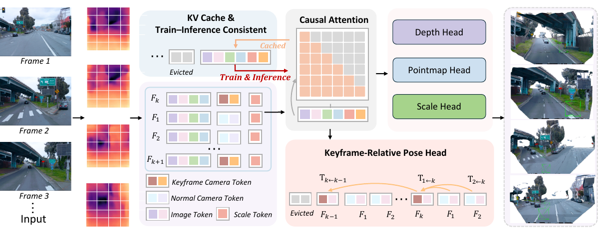
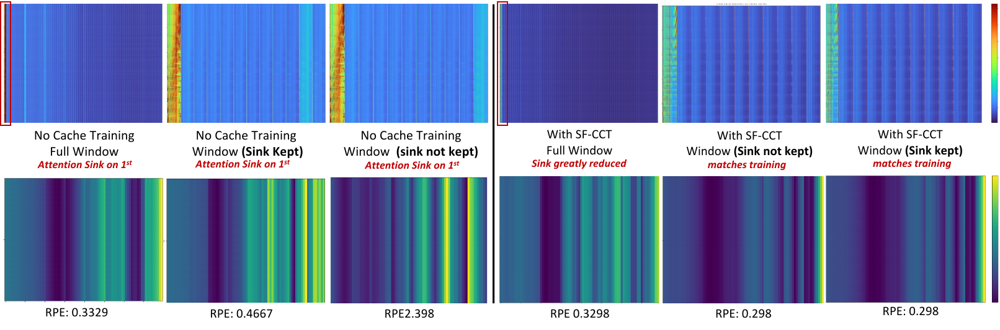
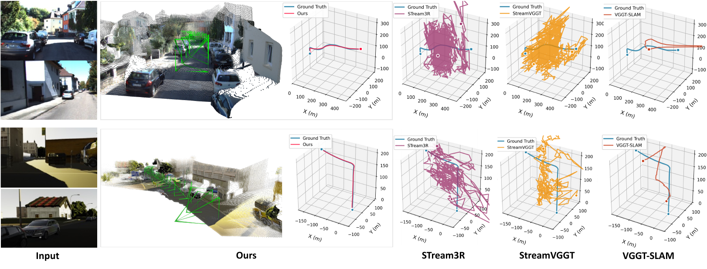
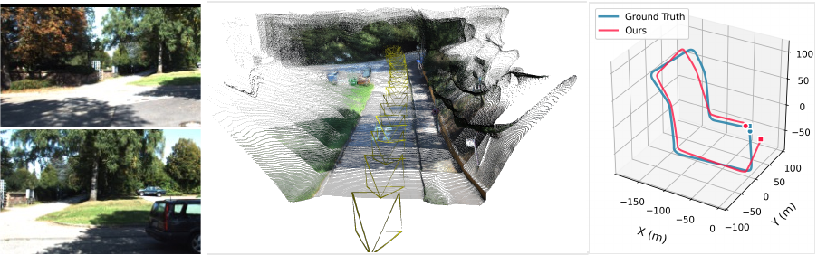

# LongStream (CVPR 2026)

<!-- paper-source: https://chengwei920412.github.io/paper_reading/2602.13172_LongStream_Long_Sequence_Streaming_Autoregressive_Visual_Geometry/technical_report.html -->

> **arXiv ID**：2602.13172  
> **原文标题**：LongStream: Long-Sequence Streaming Autoregressive Visual Geometry  
> **版本**：v2（2026-03-13 更新，CVPR 2026 接收）  
> **翻译日期**：2026-09-29

---

## 📋 论文概览 {#_1}

### 基本信息 {#_2}

- **作者**：Chong Cheng、Xianda Chen、Tao Xie、Wei Yin、Weiqiang Ren、Qian Zhang、Xiaoyang Guo、Hao Wang
- **机构**：香港科技大学（广州）、地平线机器人、浙江大学、中南大学
- **首次提交**：2026-02-13
- **领域**：计算机视觉；在线三维重建；视觉里程计与 SLAM；视觉几何基础模型

### 核心贡献 {#_3}

LongStream 解决的是“训练短序列、推理超长序列”造成的外推失效。作者把问题拆成两个彼此关联但应独立处理的规范自由度：用关键帧相对位姿消除全局 \(SE(3)\) 坐标锚点，用独立尺度头与尺度不变几何损失解耦 \(Sim(3)\) 尺度；同时用缓存一致训练（CCT）和周期性缓存刷新缓解注意力汇聚点依赖与 KV 缓存污染。系统可在严格在线、不可访问未来帧的条件下，以 18 FPS 处理数千帧乃至公里级轨迹。

---

## 🎯 研究背景与动机 {#_4}

### 问题定义 {#_5}

输入按时间到达的图像流，系统需要在线联合估计相机位姿、深度、三维点图及全局度量尺度。与离线多视图方法不同，每个时刻只能使用当前帧和历史缓存，不能重跑完整序列，也不能访问未来帧。

### 现有方法的局限性 {#_6}

- 离线 Transformer 方法精度较高，但新增一帧往往要重新处理整段序列，计算和显存随序列长度快速增长。
- 现有流式方法通常把所有位姿锚定到第一帧，训练时只见过小帧索引，推理到长序列时便需要进行分布外的远距离外推。
- 固定首帧同时容易形成注意力汇聚点；长期保留的 KV 特征逐渐陈旧并污染注意力，使轨迹误差呈非线性增长。
- 几何形状与度量尺度共同优化时容易纠缠，导致尺度漂移。

### 本文的创新点 {#_7}

1. **关键帧相对位姿**：把相对于固定首帧的远距离回归改成相对于最近关键帧的局部估计，任务难度不再随序列长度增长。
2. **正交尺度学习**：几何分支在归一化空间学习形状，尺度头单独预测正尺度 \(s\)；几何损失对 \(s\) 的梯度为零。
3. **缓存一致训练**：训练阶段显式传递并裁剪 KV 缓存，使分块训练的可见上下文与逐帧推理一致。
4. **周期性缓存刷新**：定期清除陈旧上下文，利用关键帧相对坐标表述在不破坏局部几何连续性的前提下重置缓存。

---

## 🔬 方法论 {#_8}

### 整体架构 {#_9}

图：LongStream 整体架构。ViT 编码器生成图像块词元，并加入相机、寄存器和尺度词元；因果聚合器通过共享 KV 缓存融合历史信息，多个任务头输出相对位姿、深度、点图与尺度。

骨干网络从 VGGT 初始化，共 24 层、约 13 亿参数。对第 \(i\) 帧，模型预测相对于参考关键帧 \(k\) 的位姿

\[\mathbf{T}_{i\leftarrow k}=\mathbf{T}_i\mathbf{T}_k^{-1},\]

以及深度 \(D_i\)、点图 \(X_i\) 和全局尺度 \(s\)。局部相对位姿可通过关键帧链组合到全局轨迹中，但学习目标本身不依赖任意世界坐标系。

### 关键技术 {#_10}

**1. \(SE(3)\) 规范不变性。** 若世界坐标系经 \(\mathbf{G}\in SE(3)\) 重参数化，则绝对位姿变为 \(\mathbf{T}&#x27;=\mathbf{T}\mathbf{G}^{-1}\)。相对位姿满足

\[\mathbf{T}&#x27;_{i\leftarrow k}
=(\mathbf{T}_i\mathbf{G}^{-1})(\mathbf{T}_k\mathbf{G}^{-1})^{-1}
=\mathbf{T}_i\mathbf{T}_k^{-1},\]

因此监督目标与全局坐标选择无关。

**2. \(Sim(3)\) 尺度正交解耦。** 尺度头输出 \(s=\exp(\mathbf{w}^{\top}\mathbf{h}_{\text{scale}})\)。由于归一化算子是一阶齐次函数，\(s\) 会在 \(\hat X/\mathrm{Norm}(\hat X)\) 中抵消，所以几何损失不更新尺度头；尺度仅由对数尺度损失监督。

**3. 参考帧感知注意力。** 普通帧只关注参考关键帧及两者之间的局部历史；关键帧只关注前一个关键帧区间，从架构上限制无关远期上下文。

**4. 训练—推理一致缓存。** 每个训练块接收前一块的裁剪缓存，复现推理时的滑动窗口。作者观察到，这会显著削弱模型对第一帧注意力汇聚点的依赖。

图：CCT 前后的注意力与相对位姿误差。CCT 使注意力更集中于时间邻近帧，并降低不同窗口推理设置下的误差。

### 算法流程 {#_11}

1. 对当前图像编码，生成图像块词元、相机词元、寄存器词元与尺度词元。
2. 使用因果掩码和有限滑动窗口，将当前词元与裁剪后的 KV 缓存送入聚合器。
3. 相对位姿头融合当前帧与参考关键帧特征，迭代输出平移、四元数和焦距偏移。
4. 深度头与点图头在尺度不变空间预测几何；尺度头独立恢复度量因子。
5. 将新特征写入缓存；每隔若干关键帧刷新缓存，抑制长期饱和。

---

## 📊 实验与结果 {#_12}

### 实验设置 {#_13}

- **数据集**：训练覆盖 Kubric、WildRGB、ScanNet、HyperSim、Mapillary、Replica、MVS-Synth、PointOdyssey、vKITTI、Aria、Objaverse、Spring、Waymo 等；测试覆盖 KITTI、vKITTI、Waymo、TUM-RGBD、Oxford Spires 和 7Scenes。
- **评估指标**：绝对轨迹误差（ATE）、相对位姿误差（RPE）、Chamfer 距离（CD）、F1@0.25、尺度误差。
- **对比方法**：FastVGGT、MASt3R-SLAM、VGGT-SLAM、CUT3R、TTT3R、STream3R、StreamVGGT。
- **训练配置**：第一阶段批大小 22，训练 5 万步，使用 32 张 A100 约三天；第二阶段进行 KV 缓存一致训练，序列长度 10–80，默认关键帧间隔与缓存窗口均为 10。

### 主要结果 {#_14}

图：KITTI 与 vKITTI 长序列轨迹对比。LongStream 在数百米轨迹和大回环运动下仍保持轨迹连续。

<table>
<thead>
<tr>
<th>数据集/指标</th>
<th>LongStream</th>
<th>最佳对比结果</th>
<th>观察</th>
</tr>
</thead>
<tbody>
<tr>
<td>KITTI 平均 ATE ↓</td>
<td><strong>51.90</strong></td>
<td>177.73（TTT3R）</td>
<td>相对降低约 70.8%</td>
</tr>
<tr>
<td>vKITTI 平均 ATE ↓</td>
<td><strong>1.610</strong></td>
<td>23.667（VGGT-SLAM）</td>
<td>相对降低约 93.2%</td>
</tr>
<tr>
<td>TUM ATE ↓</td>
<td><strong>0.076</strong></td>
<td>0.082（MASt3R-SLAM）</td>
<td>小幅领先</td>
</tr>
<tr>
<td>Oxford Spires ATE ↓</td>
<td><strong>19.815</strong></td>
<td>31.003（VGGT-SLAM）</td>
<td>相对降低约 36.1%</td>
</tr>
<tr>
<td>Waymo ATE ↓</td>
<td><strong>0.737</strong></td>
<td>1.281（FastVGGT）</td>
<td>相对降低约 42.5%</td>
</tr>
<tr>
<td>vKITTI 尺度比</td>
<td><strong>0.9905</strong></td>
<td>真值为 1</td>
<td>度量尺度较稳定</td>
</tr>
</tbody>
</table>

三维重建结果更为复杂：LongStream 在 7Scenes 上取得最低 CD（2.260），但 F1@0.25 为 0.641，低于 FastVGGT 的 0.710；在 TUM 上，CD 0.225、F1 0.673，也不及最优的 MASt3R-SLAM（0.057、0.954）。这说明论文最强证据集中在长序列在线位姿稳定性，而不是所有室内稠密重建指标都全面领先。

### 消融实验 {#_15}

<table>
<thead>
<tr>
<th>配置</th>
<th>ATE ↓</th>
<th>RPE ↓</th>
<th>尺度误差 ↓</th>
</tr>
</thead>
<tbody>
<tr>
<td>基线</td>
<td>8.043</td>
<td>2.207</td>
<td>—</td>
</tr>
<tr>
<td>+ 相对位姿</td>
<td>2.819</td>
<td>0.750</td>
<td>—</td>
</tr>
<tr>
<td>+ 尺度头</td>
<td>2.645</td>
<td>0.484</td>
<td>0.010</td>
</tr>
<tr>
<td>+ CCT</td>
<td>0.984</td>
<td>0.454</td>
<td>0.032</td>
</tr>
<tr>
<td>+ 周期性刷新</td>
<td><strong>0.115</strong></td>
<td><strong>0.126</strong></td>
<td>0.035</td>
</tr>
</tbody>
</table>

相对位姿表述贡献最大的一次单步改进；周期性刷新又把 ATE 从 0.984 降至 0.115。补充实验中，无缓存刷新的模型在 KITTI 801 帧序列上 ATE 为 20.83，完整模型为 3.81，直接支持“陈旧缓存导致长时域退化”的判断。

---

## 💡 关键见解 {#_16}

### 理论分析 {#_17}

论文最重要的视角是：长序列失败并不只是“模型记不住”，而是学习目标包含不必要的全局规范。固定首帧绝对位姿让目标值随行程增长，并把训练从局部估计变成索引相关的远距离外推；改用规范不变的局部目标后，缓存管理才真正成为可控的时序建模问题。

尺度分支的设计也体现了相同思想：先明确哪些自由度不应进入几何损失，再为度量尺度建立独立监督路径。这比让单一损失同时解释形状与尺度更易分析，也更适合混合有度量标注和无度量标注的数据集。

### 实践启示 {#_18}

- 对在线视觉 Transformer，仅在推理时裁剪缓存通常不够；训练时必须复现同样的缓存生命周期。
- 长时缓存不一定带来更好结果。若特征随时间失配，受控遗忘比无限累积更稳健。
- 把全局问题改写为可组合的局部预测，可同时降低分布外外推难度和缓存重置成本。
- 在工程落地中仍需要额外的回环闭合或全局图优化，以纠正局部误差长期积分后的残余漂移。

---

## 🔍 局限性与未来工作 {#_19}

### 当前局限 {#_20}

- 模型假设世界大体静态，动态物体与非刚体场景的影响尚未系统评估。
- 关键帧间隔固定且带启发式色彩；补充实验显示过短或过长都会明显降低精度。
- 周期性硬刷新虽然有效，但不是内容自适应的记忆管理机制。
- 没有显式回环闭合，重访区域仍会产生可见漂移。
- 模型约 13 亿参数，训练使用 32 张 A100；论文未充分分析更小模型、不同硬件下的吞吐率、功耗与部署成本。
- 部分测试集与训练分布存在重叠或关联，例如 vKITTI 同时用于训练和评估；更严格的跨域长序列测试仍有价值。

图：没有显式回环闭合时，模型重访同一位置仍出现轻微漂移。

### 未来方向 {#_21}

1. 引入轻量级在线回环检测与位姿图优化，同时保持严格在线和常数级内存。
2. 让关键帧选择、缓存刷新和窗口长度由场景运动、重叠率或不确定性自适应控制。
3. 为动态物体建立独立运动模型，避免其特征污染静态几何缓存。
4. 研究低秩缓存、词元摘要或分层记忆，以替代固定窗口中的硬删除。
5. 在更长、更动态且跨地域的数据上报告误差随距离、时间和回环次数的增长曲线。

---

## 📚 相关工作对比 {#_22}

<table>
<thead>
<tr>
<th>方法</th>
<th>核心思想</th>
<th>优势</th>
<th>劣势</th>
</tr>
</thead>
<tbody>
<tr>
<td>VGGT / FastVGGT</td>
<td>多视图前馈视觉几何</td>
<td>多任务统一、短序列精度高</td>
<td>长序列显存增长，固定参考坐标偏置</td>
</tr>
<tr>
<td>STream3R / StreamVGGT</td>
<td>因果 Transformer 与 KV 缓存</td>
<td>支持逐帧在线处理</td>
<td>首帧汇聚点与缓存污染导致长时域崩溃</td>
</tr>
<tr>
<td>MASt3R-SLAM / VGGT-SLAM</td>
<td>学习特征结合在线优化</td>
<td>局部几何和室内重建精度较强</td>
<td>优化开销大，部分设置使用块内未来帧或在长序列上内存不足</td>
</tr>
<tr>
<td><strong>LongStream</strong></td>
<td>规范解耦相对位姿、独立尺度、CCT 与缓存刷新</td>
<td>公里级轨迹稳定、18 FPS、度量尺度输出</td>
<td>缺少显式回环闭合，模型规模大，动态场景能力有限</td>
</tr>
</tbody>
</table>

---

## 🎓 评价 {#_23}

### 优点 {#_24}

- 研究问题明确，理论表述、网络设计、训练策略和长序列实验围绕同一失效机理展开。
- \(SE(3)\) 与 \(Sim(3)\) 解耦给出了易验证的数学理由，不只是经验性的网络改动。
- 消融和注意力可视化同时支持相对位姿、CCT 与缓存刷新的作用。
- 评估包含数百米到数公里的真实长序列，比仅在短室内片段上比较更贴近在线重建需求。

### 可改进之处 {#_25}

- 应报告多次运行方差、训练第二阶段时长、显存、功耗和不同 GPU 的速度，便于判断 18 FPS 的可复现性。
- 室内三维重建指标并非全面最佳，正文对这一点的讨论可以更直接。
- 周期性刷新与滑动窗口在部分消融中绑定出现，难以完全分离二者的独立贡献。
- 缺少动态场景、恶劣成像条件和真实闭环路线上的系统鲁棒性分析。

### 推荐阅读对象 {#_26}

适合研究在线三维重建、视觉里程计/SLAM、视觉几何基础模型、长上下文 Transformer 与缓存管理的读者。论文也适合作为“如何用不变性重新定义学习目标”的工程案例。

---

## 📎 附录 {#_27}

### 重要公式 {#_28}

相对位姿目标：

\[\mathbf{T}_{i\leftarrow k}=\mathbf{T}_i\mathbf{T}_k^{-1}.\]

尺度头：

\[s=\exp(\mathbf{w}^{\top}\mathbf{h}_{\text{scale}}).\]

尺度不变几何：

\[\tilde{X}_{\mathrm{pred}}
=\frac{\hat X_{\mathrm{raw}}}{\mathrm{Norm}(\hat X_{\mathrm{raw}})},
\qquad
\frac{\partial \mathcal{L}_{\mathrm{geom}}}{\partial s}=0.\]

尺度损失：

\[\mathcal{L}_{\mathrm{scale}}
=\left\lVert\log \hat s-\log s_{\mathrm{gt}}\right\rVert_1.\]

### 术语表 {#_29}

<table>
<thead>
<tr>
<th>英文</th>
<th>中文</th>
</tr>
</thead>
<tbody>
<tr>
<td>Gauge-Decoupled</td>
<td>规范解耦</td>
</tr>
<tr>
<td>Keyframe-Relative Pose</td>
<td>关键帧相对位姿</td>
</tr>
<tr>
<td>Orthogonal Scale Learning</td>
<td>正交尺度学习</td>
</tr>
<tr>
<td>Metric Scale</td>
<td>度量尺度</td>
</tr>
<tr>
<td>Attention Sink</td>
<td>注意力汇聚点</td>
</tr>
<tr>
<td>Cache-Consistent Training</td>
<td>缓存一致训练</td>
</tr>
<tr>
<td>Periodic Cache Refresh</td>
<td>周期性缓存刷新</td>
</tr>
<tr>
<td>Pointmap</td>
<td>点图</td>
</tr>
<tr>
<td>Absolute Trajectory Error</td>
<td>绝对轨迹误差</td>
</tr>
<tr>
<td>Relative Pose Error</td>
<td>相对位姿误差</td>
</tr>
</tbody>
</table>

### 参考资源 {#_30}

- **论文原文**：[arXiv 2602.13172](https://arxiv.org/abs/2602.13172)
- **中文翻译 PDF**：[paper_cn.pdf](https://chengwei920412.github.io/paper_reading/2602.13172_LongStream_Long_Sequence_Streaming_Autoregressive_Visual_Geometry/paper_cn.pdf)
- **中文 Markdown 译文**：[paper_cn.md](https://chengwei920412.github.io/paper_reading/2602.13172_LongStream_Long_Sequence_Streaming_Autoregressive_Visual_Geometry/paper_cn.html)
- **项目主页**：[LongStream](https://3dagentworld.github.io/longstream/)
- **代码实现**：论文源码未提供独立代码仓库链接
