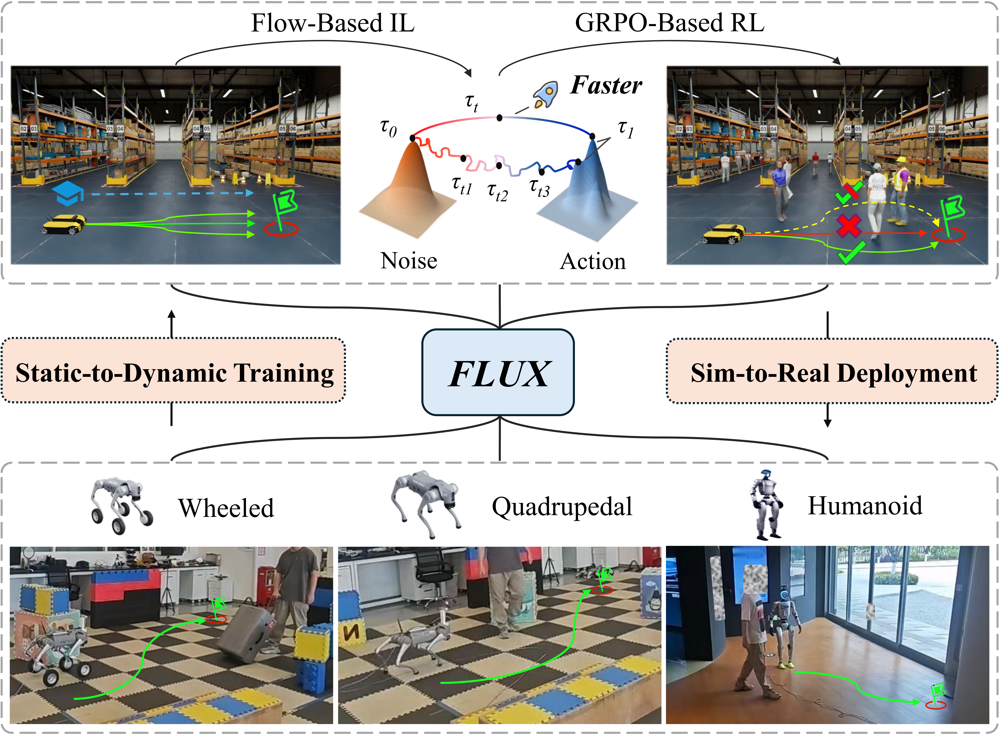
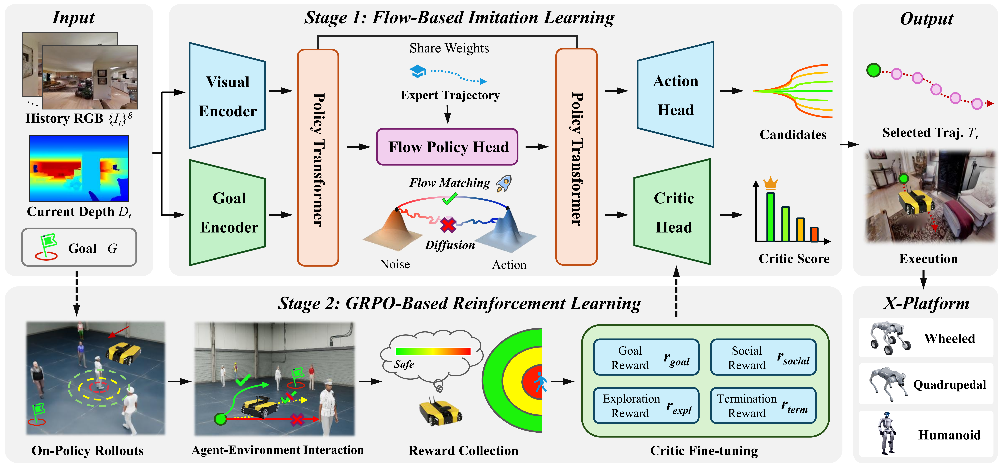
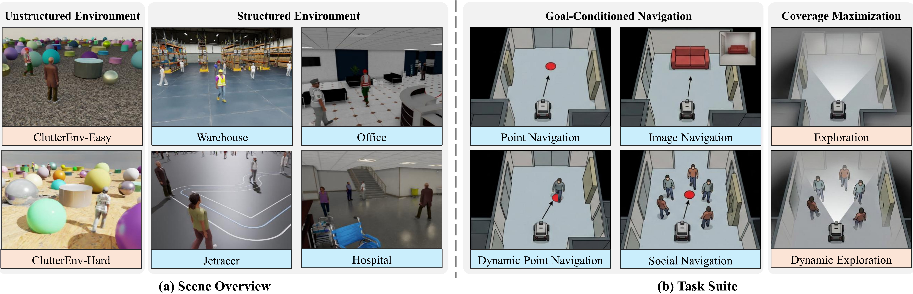
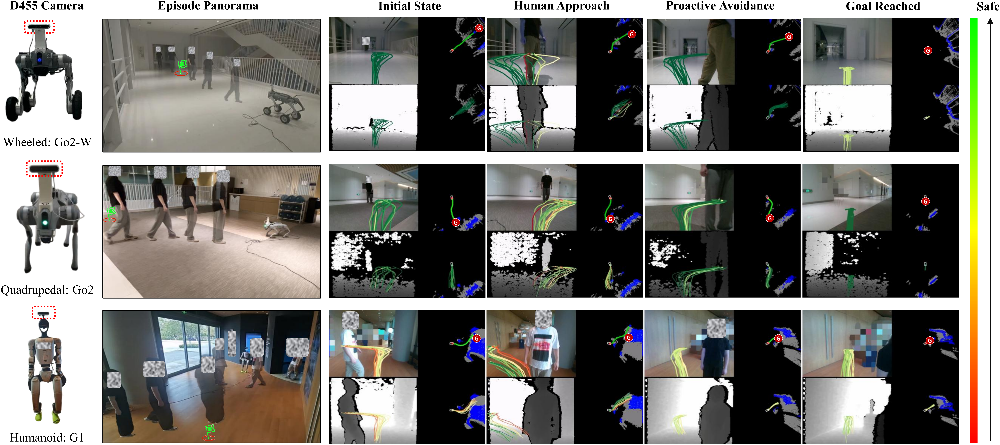

# FLUX (arXiv 2026)

<!-- paper-source: https://chengwei920412.github.io/paper_reading/2603.12806_FLUX_Accelerating_Cross_Embodiment_Generative_Navigation_Policies_via_Rectified_Flow_and_Static_to_Dynamic_Learning/technical_report.html -->

> 原文链接：[FLUX (arXiv 2026)](https://chengwei920412.github.io/paper_reading/2603.12806_FLUX_Accelerating_Cross_Embodiment_Generative_Navigation_Policies_via_Rectified_Flow_and_Static_to_Dynamic_Learning/technical_report.html)

> **arXiv ID**：2603.12806  
> **原文标题**：FLUX: Accelerating Cross-Embodiment Generative Navigation Policies via Rectified Flow and Static-to-Dynamic Learning  
> **翻译日期**：2026-10-13

---

## 📋 论文概览 {#_1}

### 基本信息 {#_2}

- **作者**：Zeying Gong、Yangyi Zhong、Yiyi Ding、Tianshuai Hu、Guoyang Zhao、Lingdong Kong、Rong Li、Jiadi You、Junwei Liang
- **机构**：香港科技大学（广州）、香港科技大学、新加坡国立大学
- **提交时间**：2026 年 3 月 13 日
- **领域**：机器人学、视觉导航、生成式策略、社会导航、仿真到现实迁移

### 核心贡献 {#_3}

1. 提出首个基于流的统一导航策略 **FLUX**，用校正流的近直线概率传输替代扩散模型的迭代去噪，在保持轨迹多样性的同时降低推理开销。
2. 提出动态导航基准 **DynBench**，以物理有效的人群仿真补足静态导航协议，在同一框架中覆盖点目标导航、图像目标导航、探索、动态点目标导航、动态探索和社会导航六项任务。
3. 构建“静态模仿学习预训练—动态强化学习后训练”的课程：先学习几何先验，再通过动态人群交互学习恢复、避让和社会规范。
4. 在六项任务上取得统一策略的当前最佳结果，并在轮式、四足和人形机器人上展示无需平台微调的零样本仿真到现实迁移。

图 1：FLUX 的静态到动态训练与跨本体部署概览。

---

## 🎯 研究背景与动机 {#_4}

### 问题定义 {#_5}

现有视觉导航研究通常分为两条相互割裂的路线：静态导航重视目标到达和探索效率，社会导航重视动态人群中的安全与礼仪。前者很少在社会约束下评测，后者又常局限于单一任务和单一机器人形态。因此，研究者难以判断同一策略能否同时掌握静态目标到达、动态追踪、探索和人群避让等能力。

论文把任务统一为两类优化问题。目标条件导航在无碰撞轨迹集合 \(\mathcal{T}\) 中权衡目标到达代价与社会代价：

\[\tau^*=\arg\min_{\tau\in\mathcal{T}}c_{goal}(\tau,g)+\beta\,c_{social}(\tau,\tau_{1:N}).\]

探索任务则在没有显式目标时最大化覆盖面积：

\[\tau^*=\arg\max_{\tau\in\mathcal{T}}\mathcal{E}(\tau).\]

当动态主体数 \(N=0\) 时，问题退化为静态导航；当 \(N&gt;0\) 且社会代价权重 \(\beta&gt;0\) 时，问题涵盖社会导航。这个统一视角是“静态环境是动态环境的退化特例”这一核心假设的形式化表达。

### 现有方法的局限性 {#_6}

- 传统规划器可解释，但依赖大量手工参数，跨任务复用困难。
- 端到端强化学习往往针对特定奖励和任务优化，泛化能力有限。
- 静态模仿学习可以跨任务，却缺少人群交互所需的恢复与主动避让样本。
- 扩散式生成策略能表达多模态动作分布，但多步去噪带来较高时延。
- 既有社会导航基准常使用随机游走、规则脚本或理想化 ORCA 协作，难以形成自然且可复现的人群交互。

### 本文的创新点 {#_7}

FLUX 没有在“确定性但快速”和“生成式但缓慢”之间二选一，而是用校正流学习从噪声到专家轨迹的近直线映射，再利用一组候选轨迹天然形成 GRPO 的相对比较组。静态阶段提供几何先验，动态阶段补充社会约束和失败恢复分布，二者共同形成统一策略。

---

## 🔬 方法论 {#_8}

### 整体架构 {#_9}

图 2：FLUX 两阶段框架。上半部分通过静态专家轨迹进行基于流的模仿学习；下半部分在 DynBench 中用 GRPO 后训练。

策略接收 8 帧 RGB 历史、当前深度和任务目标，经 16 层 Transformer 解码器编码后，由流策略头从潜变量噪声生成 \(M\) 条候选轨迹，再由共享的评价头选择最优轨迹。训练分为两个阶段：

1. **基于流的模仿学习**：在静态专家数据上建立目标到达、避障和探索的几何先验。
2. **基于 GRPO 的强化学习**：在动态点目标导航、动态探索和社会导航上进行回合级后训练，强化社会安全性与恢复能力。

### 关键技术一：校正流轨迹生成 {#_10}

条件流匹配通过速度场 \(v_\theta\) 将噪声 \(\tau_0\) 传输到专家轨迹 \(\tau_1\)。FLUX 采用线性插值：

\[\tau_t=(1-t)\tau_0+t\tau_1,\qquad u_t=\tau_1-\tau_0.\]

相应的校正流损失为：

\[\mathcal{L}_{\mathrm{RF}}=\mathbb{E}_{t,\tau_0,\tau_1}\left[\left\|v_\theta(t,\tau_t,\mathbf e_t)-(\tau_1-\tau_0)\right\|_2^2\right].\]

与扩散模型在每一步预测噪声不同，这里的监督目标是恒定速度 \(\tau_1-\tau_0\)。推理时只需用 \(K\) 次欧拉积分更新轨迹：

\[\tau^{(k+1)}=\tau^{(k)}+\frac{1}{K}v_\theta\left(\frac{k}{K},\tau^{(k)},\mathbf e_t\right).\]

默认设置为 \(M=16\) 条候选轨迹、\(K=6\) 个采样步。候选数从 1 增至 16 时性能明显提升，继续增加趋于饱和；增加采样步则很快出现边际收益递减。

### 关键技术二：面向连续导航的 GRPO {#grpo}

静态数据偏向最短路径，不会充分惩罚贴近行人、错误预判移动障碍或陷入局部僵局。FLUX 在动态环境中使用 GRPO 后训练，并把同一状态生成的 \(M\) 条候选轨迹作为自然的相对比较组，从而不需要单独的价值函数网络。

论文针对连续导航修改了优势估计：梯度更新仅在回合结束时触发，先计算整回合折扣回报

\[G_t=\sum_{k=t}^{T}\gamma^{k-t}r_k,\]

再对回合内所有 \(G_t\) 做 Z-score 标准化并截断到 \([-3,3]\)。最终使用裁剪的策略梯度目标：

\[\mathcal{L}_{\mathrm{GRPO}}=-\mathbb{E}_t\left[\min\left(\rho_t\hat G_t,\operatorname{clip}(\rho_t,1-\varepsilon,1+\varepsilon)\hat G_t\right)\right].\]

目标条件任务的奖励结合目标成功、非对称进度、人际距离和终止惩罚；动态探索则使用基于 \(0.5\) m 网格的首次访问奖励，避免仅靠方向多样性导致原地摆动。

### 关键技术三：DynBench {#dynbench}

图 3：DynBench 的环境与六任务评测套件。

DynBench 使用 20 个非结构化场景生成 20,000 个训练回合，并在 NVIDIA Isaac Sim 中选择 6 个高保真结构化场景进行 600 个评测回合。行人通过 NavMesh 全局规划和几何局部避碰移动，并在 GoTo、Idle、LookAround 三种状态间按马尔可夫矩阵随机转换；固定三角形长程路线带来多方向交叉，而机器人 \(0.5\) m/s、行人 \(1.1\) m/s 的速度不对称迫使策略进行主动预测。

---

## 📊 实验与结果 {#_11}

### 实验设置 {#_12}

- **数据集与场景**：Gibson 静态专家轨迹子集、NavDP 静态协议、DynBench 动态人群场景。
- **训练规模**：阶段一仅使用 3,000 条 Gibson 轨迹，约为 NavDP 近 56,000 条数据的 5%；AdamW 学习率为 \(5\times10^{-5}\)，训练 30 轮。
- **动态后训练**：每次更新采样 16 条轨迹，学习率为 \(5\times10^{-6}\)，按回合边界更新。
- **硬件**：训练在单张 NVIDIA RTX 4090 上完成；真实机器人推理使用远程 RTX 4060。
- **指标**：成功率（SR）、路径长度加权成功率（SPL）、探索时间（ET）、探索面积（EA）、成功轨迹长度（S-TL）、碰撞次数（Coll.）、社会空间侵入比例（SC）和最小人机距离（MinDist）。
- **对比方法**：DWA、FBE、DD-PPO、Falcon、iPlanner、ViPlanner、GNM、ViNT、NoMaD、FlowNav、NavDP。

### 主要结果 {#_13}

<table>
<thead>
<tr>
<th>任务</th>
<th>关键指标</th>
<th>NavDP</th>
<th>FLUX</th>
<th>变化</th>
</tr>
</thead>
<tbody>
<tr>
<td>PointNav</td>
<td>SR / SPL</td>
<td>77.8 / 74.8</td>
<td><strong>80.9 / 78.6</strong></td>
<td>+3.1 / +3.8 个百分点</td>
</tr>
<tr>
<td>Exploration</td>
<td>ET / EA</td>
<td>72.5 / 167.2</td>
<td><strong>73.7 / 172.8</strong></td>
<td>+1.2 s / +5.6 m²</td>
</tr>
<tr>
<td>ImageNav</td>
<td>SR / SPL</td>
<td>43.4 / 43.4</td>
<td><strong>44.0 / 44.4</strong></td>
<td>+0.6 / +1.0 个百分点</td>
</tr>
<tr>
<td>Dyn. PointNav</td>
<td>SR / S-TL</td>
<td>38.7 / 31.9</td>
<td><strong>42.4 / 20.6</strong></td>
<td>成功率提高且成功路径更短</td>
</tr>
<tr>
<td>Dyn. Exploration</td>
<td>ET / EA</td>
<td>43.6 / 93.7</td>
<td><strong>55.1 / 128.7</strong></td>
<td>+26.4% / +37.4%</td>
</tr>
<tr>
<td>SocialNav</td>
<td>SR / Coll. / SC</td>
<td>59.3 / 21 / 5.5</td>
<td><strong>64.0 / 16 / 4.4</strong></td>
<td>成功率与社会安全性同时改善</td>
</tr>
</tbody>
</table>

结果最值得关注的不是某个单项峰值，而是同一策略在六项任务上同时领先。动态训练还反向提高静态任务，支持“动态分布包含更丰富恢复行为，因而可正迁移到静态环境”的经验结论。

### 消融实验 {#_14}

<table>
<thead>
<tr>
<th>配置</th>
<th>PointNav SR / SPL</th>
<th>SocialNav SR / Coll. / SC</th>
<th>Dyn. Exploration ET / EA</th>
</tr>
</thead>
<tbody>
<tr>
<td>确定性回归基线</td>
<td>53.6 / 50.0</td>
<td>49.3 / 18 / 4.9</td>
<td>30.5 / 71.0</td>
</tr>
<tr>
<td>DDPM + IL</td>
<td>77.8 / 74.8</td>
<td>59.3 / 21 / 5.5</td>
<td>43.6 / 93.7</td>
</tr>
<tr>
<td>CFM + IL</td>
<td>78.9 / 75.6</td>
<td>60.6 / 20 / 5.9</td>
<td>43.8 / 95.2</td>
</tr>
<tr>
<td>RF + IL</td>
<td>80.4 / 78.0</td>
<td>62.8 / 17 / 5.8</td>
<td>48.0 / 106.4</td>
</tr>
<tr>
<td>RF + IL + GRPO</td>
<td><strong>80.9 / 78.6</strong></td>
<td><strong>64.0 / 16 / 4.4</strong></td>
<td><strong>55.1 / 128.7</strong></td>
</tr>
</tbody>
</table>

消融表明三件事：动作分布的随机性对复杂导航确有必要；仅将 DDPM 换成一般 CFM 并不能保证社会指标稳定改善；校正流带来更一致的轨迹后，GRPO 才进一步把动态任务收益扩展到社会安全和静态鲁棒性。

### 推理效率 {#_15}

<table>
<thead>
<tr>
<th>方法</th>
<th>类型</th>
<th>步数 \(K\)</th>
<th>推理时间</th>
</tr>
</thead>
<tbody>
<tr>
<td>NoMaD</td>
<td>扩散</td>
<td>10</td>
<td>468.4 ms</td>
</tr>
<tr>
<td>NavDP</td>
<td>扩散</td>
<td>10</td>
<td>305.2 ms</td>
</tr>
<tr>
<td>FlowNav</td>
<td>流</td>
<td>10</td>
<td>408.6 ms</td>
</tr>
<tr>
<td>FLUX</td>
<td>流</td>
<td>10</td>
<td>244.9 ms</td>
</tr>
<tr>
<td>FLUX</td>
<td>流</td>
<td>6</td>
<td><strong>216.5 ms</strong></td>
</tr>
</tbody>
</table>

在相同 10 步预算下，FLUX 相对 NavDP 和 FlowNav 分别减少 19.8% 和 40.1% 的时延；使用默认 6 步时，相对 NavDP 加速 29.1%。论文摘要所称相对先前流方法每步效率提高 47%、相对扩散方法提高 29%，强调的是线性概率传输带来的控制周期收益。

### 真实世界部署 {#_16}

图 4：FLUX 在 Go2-W、Go2 和 G1 三种平台上的真实部署。

三种机器人仅使用 Intel RealSense D455 RGB-D 相机。四足机器人的周期步态会引起相机振动，人形机器人的俯仰/横滚和约 1.3 m 的相机高度则显著偏离训练视角。尽管如此，策略无需平台特定微调即可在走廊、办公室和大厅中完成静态避障与动态行人交互；评价头也倾向于为更大安全间距的候选轨迹赋予更高分数。

---

## 💡 关键见解 {#_17}

### 理论与方法层面 {#_18}

1. **直线概率路径同时改善学习目标与推理成本**：校正流把目标速度变为常量，减少路径曲率和函数评估次数，但仍保留从噪声采样带来的多模态性。
2. **动态环境可视为更丰富的数据分布**：它不仅增加人群避让约束，还显式暴露失败恢复、重新规划和安全间距选择，因此能改善静态任务鲁棒性。
3. **候选轨迹组与 GRPO 结构天然匹配**：生成策略一次给出多条候选轨迹，恰好提供组内相对优势估计所需的比较对象，免去额外价值网络。
4. **统一评测比单项领先更重要**：六项任务横跨目标条件导航和覆盖最大化，使论文能够检验“通用导航策略”而非特定任务专家。

### 实践启示 {#_19}

- 在机器人控制中，生成模型的价值不仅是生成更“多样”的动作，而是为僵局恢复和主动避让提供多个可选解。
- 若实时性是主要约束，采样步数不应机械增加；本实验中 \(K=6\) 已接近性能饱和点。
- 静态预训练仍然重要：它以较低成本建立几何先验，动态强化学习更适合作为分布扩展和安全校准阶段。
- 跨本体迁移并不等于完全消除动力学差异；本文策略输出高层轨迹，实际部署仍依赖各平台底层控制器执行。

---

## 🔍 局限性与未来工作 {#_20}

### 当前局限 {#_21}

1. **缺少显式社会推理**：策略主要从距离与轨迹回报中学习避让，尚不能解释非语言意图、群体关系或隐式礼仪，轨迹决策的可解释性有限。
2. **场景覆盖有限**：评测集中在室内行人环境，只有 6 个结构化评测场景，动态主体类型也基本局限于行人。
3. **真实评测规模未充分量化**：论文展示了三种平台和多类场景，但没有给出与仿真表格同等规模的真实世界统计、失败率和置信区间。
4. **社会指标仍是代理量**：SC、碰撞次数和最小距离主要衡量空间接近程度，无法完整表达舒适度、可预测性、礼让和文化差异。
5. **基准与方法耦合较强**：FLUX 在自建 DynBench 上训练和评测，未来需要在独立社会导航基准上检验结论的外部有效性。

### 未来方向 {#_22}

- 引入真实社会交互轨迹、群体形成、会合、让行和目光/姿态等信号，学习更高层的人类意图。
- 扩展到户外、交通参与者、推车和其他机器人等异质动态主体。
- 报告大规模真实机器人成功率、近失事件、控制频率和端到端时延，并进行跨地点复现。
- 将不确定性校准、安全约束或形式化屏障函数接入候选轨迹评价头。
- 研究校正流蒸馏、单步生成或自适应采样步数，进一步降低 216.5 ms 的规划时延。

---

## 📚 相关工作对比 {#_23}

<table>
<thead>
<tr>
<th>方法</th>
<th>核心思想</th>
<th>优势</th>
<th>劣势</th>
</tr>
</thead>
<tbody>
<tr>
<td>NavDP</td>
<td>扩散式导航策略</td>
<td>多模态轨迹、已有静态基准基础</td>
<td>迭代去噪时延较高，动态社会训练不足</td>
</tr>
<tr>
<td>FlowNav</td>
<td>条件流匹配与深度先验</td>
<td>比扩散方法更接近连续流建模</td>
<td>仍有残余路径曲率，任务与目标形式受限</td>
</tr>
<tr>
<td>确定性回归策略</td>
<td>直接预测单条轨迹</td>
<td>快、实现简单</td>
<td>无法表达多模态恢复和避让选择</td>
</tr>
<tr>
<td><strong>FLUX</strong></td>
<td>校正流 + 静态 IL + 动态 GRPO</td>
<td>统一六任务、推理更快、可跨本体迁移</td>
<td>社会推理仍隐式，真实与跨基准证据有限</td>
</tr>
</tbody>
</table>

---

## 🎓 个人评价 {#_24}

### 优点 {#_25}

- 问题设定、方法和基准相互呼应：不是只替换生成器，而是用动态基准检验训练分布对通用导航的影响。
- 消融链条完整地覆盖确定性回归、DDPM、CFM、RF 与 GRPO，能较清楚地区分多模态性、流路径和动态后训练的贡献。
- 数据效率突出：静态阶段只用 NavDP 约 5% 的轨迹数据，仍能在统一任务上超过基线。
- 跨轮式、四足、人形平台的零样本部署说明高层视觉—轨迹接口具有一定形态鲁棒性。

### 可改进之处 {#_26}

- 应增加独立基准与更多随机种子，并报告均值、方差或置信区间。
- 需要更严谨地区分“社会规范遵从”与“保持距离”，加入人类偏好评测或真实行人主观评价。
- 可补充失败案例：例如密集双向人流、突然横穿、群体封堵、视野遮挡和长期僵局。
- 应量化远程 RTX 4060 推理的通信时延和底层控制延迟，避免仅以模型前向时间代表端到端实时性。

### 推荐阅读对象 {#_27}

适合从事视觉导航、社会机器人、生成式策略、流匹配、强化学习后训练、Isaac Sim 基准构建和跨机器人部署的研究者与工程师。若关注生成模型在连续控制中的实时应用，论文关于校正流和候选轨迹组 GRPO 的组合尤其值得参考。

---

## 📎 附录 {#_28}

### 术语表 {#_29}

<table>
<thead>
<tr>
<th>英文</th>
<th>中文</th>
</tr>
</thead>
<tbody>
<tr>
<td>Rectified Flow (RF)</td>
<td>校正流</td>
</tr>
<tr>
<td>Conditional Flow Matching (CFM)</td>
<td>条件流匹配</td>
</tr>
<tr>
<td>Group Relative Policy Optimization (GRPO)</td>
<td>组相对策略优化</td>
</tr>
<tr>
<td>Cross-Embodiment</td>
<td>跨本体</td>
</tr>
<tr>
<td>Generative Navigation Policy</td>
<td>生成式导航策略</td>
</tr>
<tr>
<td>Social Compliance</td>
<td>社会规范遵从性</td>
</tr>
<tr>
<td>Proxemics</td>
<td>人际空间学</td>
</tr>
<tr>
<td>Number of Function Evaluations (NFE)</td>
<td>函数评估次数</td>
</tr>
<tr>
<td>Sim-to-Real Transfer</td>
<td>仿真到现实迁移</td>
</tr>
</tbody>
</table>

### 参考资源 {#_30}

- **论文原文**：[arXiv 页面](https://arxiv.org/abs/2603.12806)
- **项目主页**：[FLUX Project](https://zeying-gong.github.io/projects/flux/)
- **中文翻译 PDF**：[paper_cn.pdf](https://chengwei920412.github.io/paper_reading/2603.12806_FLUX_Accelerating_Cross_Embodiment_Generative_Navigation_Policies_via_Rectified_Flow_and_Static_to_Dynamic_Learning/paper_cn.pdf)
- **中文 Markdown 译文**：[paper_cn.md](https://chengwei920412.github.io/paper_reading/2603.12806_FLUX_Accelerating_Cross_Embodiment_Generative_Navigation_Policies_via_Rectified_Flow_and_Static_to_Dynamic_Learning/paper_cn.html)
- **代码实现**：论文与项目页未提供公开代码仓库链接
