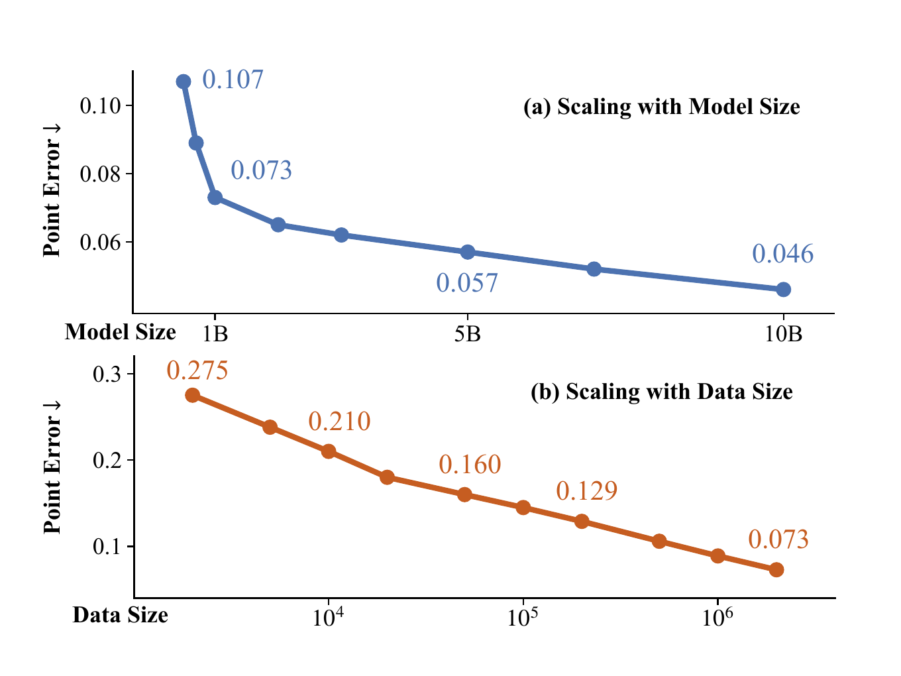
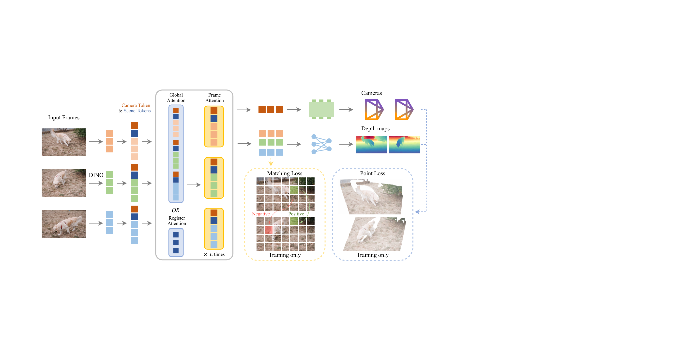
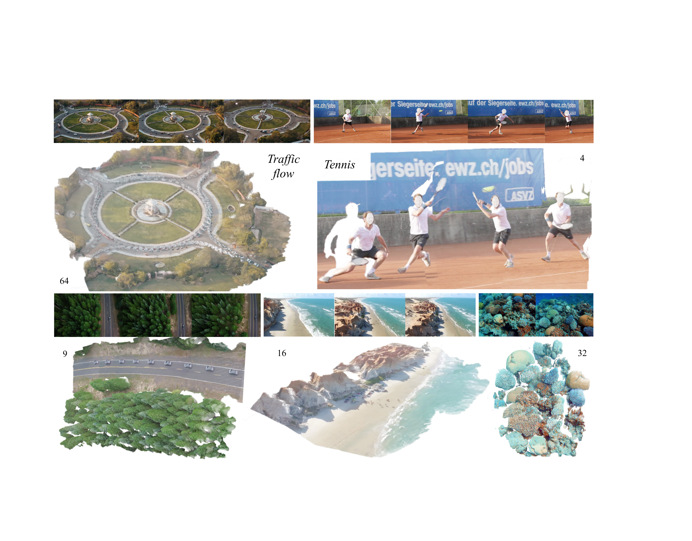
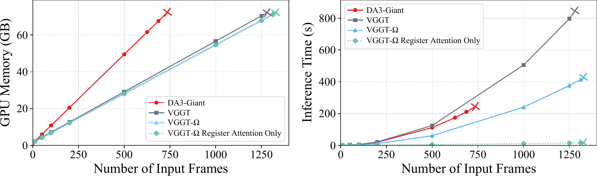
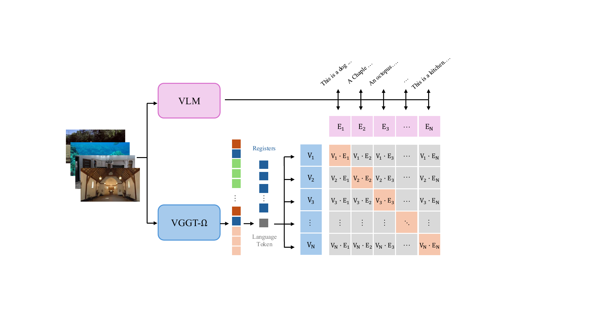

# VGGT-Omega (arXiv 2026)

<!-- paper-source: https://chengwei920412.github.io/paper_reading/2605.15195_VGGT_Omega/technical_report.html -->

> arXiv:2605.15195 · 原题：*VGGT-Ω* · 翻译日期：2026-10-12

## 论文信息 {#_1}

- 作者：Jianyuan Wang、Minghao Chen、Shangzhan Zhang、Nikita Karaev、Johannes Schönberger、Patrick Labatut、Piotr Bojanowski、David Novotny、Andrea Vedaldi、Christian Rupprecht
- 单位：牛津大学视觉几何组、Meta AI
- 方向：三维/四维视觉、前馈式场景重建、基础模型、动态场景理解
- 项目主页：[vggt-omega.github.io](http://vggt-omega.github.io/)
- 原文：[arXiv:2605.15195](https://arxiv.org/abs/2605.15195)

## 一句话概括 {#_2}

VGGT-Ω 将前馈式多视图重建扩展到 100 亿参数、数百万有监督序列和海量无标注视频，在静态与动态场景中同时预测相机与深度，并把用于跨帧聚合的“场景词元”发展为可迁移到机器人控制和语言对齐的几何表征。

## 核心贡献 {#_3}

1. **验证可预测的规模扩展规律。** 模型规模从 0.2B 扩展到 10B，训练序列从 2K 扩展到 2M，平均三维点误差持续下降；数据量每扩大一个数量级，消融实验中的点误差由 0.275 单调降至 0.073。
2. **降低大模型重建的训练成本。** 只保留一个稠密深度预测头，并用损失继续监督点图与匹配任务；高分辨率 DPT 卷积被 MLP 加像素重排替代。训练显存约为前代 VGGT 的 30%。
3. **提出寄存器注意力。** 每帧加入 16 个场景词元，并用它们承担部分跨帧信息交换。默认将 25% 的全局注意力层换成寄存器注意力，点误差基本不变（0.071→0.073），同时降低计算与训练显存。
4. **把动态互联网视频纳入训练。** 构建由 VLM 预筛选、动态区域屏蔽、多特征匹配、COLMAP 重建、多视图一致性和学习式质量过滤组成的数据流水线，最终获得约 20 万动态序列与 60 万静态序列。
5. **展示几何表征的迁移价值。** 冻结的场景词元把 OpenVLA-OFT 在 LIBERO 上的平均成功率从 97.1% 提升至 98.5%；短程语言对齐后，视频文本检索达到 76.8% top-1、97.0% top-3。

## 方法拆解 {#_4}

### 输入、输出与词元 {#_5}

模型接收 \(N\) 张图像 \(I_1,\ldots,I_N\)，一次前向传播输出每帧深度 \(D_i\) 和相机参数 \(\mathbf g_i=(\mathbf q_i,\mathbf t_i,\mathbf f_i)\)：

\[((\mathbf g_1,D_1),\ldots,(\mathbf g_N,D_N))=f(I_1,\ldots,I_N).\]

DINOv3 将每张图像编码为图像词元；模型再为每帧附加 1 个相机词元和 16 个场景词元。相机词元用于回归旋转、平移和视场角，场景词元则充当紧凑的跨帧通信通道。

### 寄存器注意力为何有效 {#_6}

原始 VGGT 在全局注意力层中让所有帧的全部图像词元彼此交互，计算量随总词元数平方增长。论文观察到全局注意力图通常很稀疏，因此在部分层中只让所有帧的场景词元互相注意：

\[(\mathbf z^{\mathrm{scene}\prime}_1,\ldots,\mathbf z^{\mathrm{scene}\prime}_N)
=\operatorname{attn}(\mathbf z^{\mathrm{scene}}_1,\ldots,\mathbf z^{\mathrm{scene}}_N).\]

后续帧内注意力再把已聚合的全局信息传播回图像词元。默认 25% 替换方案在精度与效率间最均衡；若把全部全局注意力都替换掉，FLOPs 可降到原模型的 6%，但精度退回原始 VGGT 水平。

### 单头、多任务监督 {#_7}

模型直接输出相机与深度，但训练时仍保留四类监督：

\[\mathcal L=\lambda_{\mathrm{cam}}\mathcal L_{\mathrm{cam}}+
\lambda_{\mathrm{depth}}\mathcal L_{\mathrm{depth}}+
\lambda_{\mathrm{point}}\mathcal L_{\mathrm{point}}+
\lambda_{\mathrm{match}}\mathcal L_{\mathrm{match}}.\]

点图由深度和相机反投影得到，因此不再需要独立的点图预测头；匹配损失直接约束最后一层图像词元。这一设计保留了多任务学习收益，同时减少高分辨率激活和预测头数量。

### 自监督教师—学生训练 {#_8}

教师由学生参数的指数移动平均更新：

\[\theta^{\mathrm T}\leftarrow m\theta^{\mathrm T}+(1-m)\theta^{\mathrm S}.\]

教师与学生观察同一批视频帧，但使用独立的颜色、模糊、旋转、掩码和帧序增强；训练对齐多层词元以及相机、深度输出。为避免坍塌，自监督阶段冻结预测头。作者认为它主要改善分布外泛化，对多数标准基准的直接增益有限，自监督重建仍是开放问题。

## 数据流水线 {#_9}

公开与内部数据合计约 300 万个序列，每个序列含 10 至 20,000 张图像。另有约 4,000 万个互联网风格视频进入预筛选：VLM 淘汰多镜头、严重模糊、水印覆盖等内容；随后屏蔽潜在动态物体区域，结合 SIFT、SuperPoint/SuperGlue、ALIKED/LightGlue 和 VGGSfM Tracker 建立对应关系；再用 COLMAP、束调整、多视图深度一致性及质量分类器严格筛选。

这一流程的关键取舍是“质量优先”：它会排除极端动态、剧烈变焦或注册率不足的序列，而不是把所有视频强行转成伪标签。最终高质量标注集约含 80 万个序列，其中动态场景约 20 万、静态场景约 60 万；通过预筛的视频还可用于自监督训练。

## 实验结果 {#_10}

### 相机与深度 {#_11}

10B 模型在六个静态/动态数据集上均取得最优结果。最突出的是 Sintel：严格 \(3^\circ\) 阈值下的相机 AUC 从此前最佳 22.5 提升到 40.0，相对提升 77%；深度 \(\delta_{1.25}\) 从 86.1 提升到 93.5，AbsRel 从 0.118 降到 0.081。

<table>
<thead>
<tr>
<th>数据集</th>
<th>相机 AUC@3°</th>
<th>相机 AUC@30°</th>
<th>深度 \(\delta_{1.25}\)</th>
<th>深度 AbsRel</th>
</tr>
</thead>
<tbody>
<tr>
<td>7 Scenes</td>
<td>36.4</td>
<td>88.2</td>
<td>96.3</td>
<td>0.050</td>
</tr>
<tr>
<td>NRGBD</td>
<td>92.5</td>
<td>99.1</td>
<td>99.7</td>
<td>0.007</td>
</tr>
<tr>
<td>ETH3D</td>
<td>56.3</td>
<td>90.4</td>
<td>99.8</td>
<td>0.009</td>
</tr>
<tr>
<td>DyCheck</td>
<td>43.7</td>
<td>90.9</td>
<td>98.7</td>
<td>0.030</td>
</tr>
<tr>
<td>Sintel</td>
<td>40.0</td>
<td>79.1</td>
<td>93.5</td>
<td>0.081</td>
</tr>
<tr>
<td>TUM-Dynamic</td>
<td>36.4</td>
<td>87.5</td>
<td>98.3</td>
<td>0.035</td>
</tr>
</tbody>
</table>

### 效率与长序列 {#_12}

修正 VGGT 推理时不必要的中间特征缓存后，VGGT 与 VGGT-Ω 都能在单块 80GB A100 上处理超过 1,000 帧。VGGT-Ω 使用 16 像素图块和 25% 寄存器注意力，推理速度更快；论文测试中 DA3 约在 750 帧耗尽显存，而前两者可达到约 1,250 帧。全寄存器注意力变体可把 1,000 帧运行时间从 240.2 秒降至 11.7 秒，但精度明显下降。

### 表征迁移 {#_13}

- 在 LIBERO 机器人任务上，把冻结场景词元接入 OpenVLA-OFT 后，空间、物体、目标、长程四类成功率分别达到 99.3%、99.2%、99.0%、96.7%，平均 98.5%。
- 场景词元只通过一个新语言词元读出并对齐到 VLM 文本空间，10K 次微调后便取得 76.8% top-1 和 97.0% top-3 视频文本检索准确率。
- 换用未参与训练的 Qwen3 纯文本嵌入进行零样本迁移，仍有 47.5% top-1 和 77.8% top-3，说明场景词元不只记忆几何数值，也包含场景级语义。

## 关键洞见 {#_14}

1. **三维重建已出现类似基础模型的规模效应。** 论文不只是把参数做大，而是同时扩大数据、简化输出空间并控制训练内存，使规模曲线可实际测量。
2. **瓶颈词元既是效率机制，也是表征接口。** 寄存器把跨帧信息压缩到少量词元，既减少注意力成本，又为语言、VLA 和其他序列级任务提供统一读出点。
3. **动态重建的关键不一定是显式运动建模。** 模型只预测相机和深度，却能在中间层自然形成运动敏感簇；这支持“用大规模数据学习运动先验”的路线。
4. **伪标签质量决定规模化上限。** 数据流水线大量拒绝低质量样本，说明更多视频并不等于更多有效几何监督；筛选、静动态分离和跨视图一致性与模型本身同样重要。

## 局限与复现风险 {#_15}

- 自监督阶段依赖已有监督检查点，尚不能从无标注视频从头学出稳定重建能力；其标准基准增益也有限。
- 纯 MLP 稠密头会在远景、天空等无界深度区域产生块状伪影，因此最终仍保留少量低分辨率卷积。
- 视频标注流程会被强运动模糊、镜头突变、剧烈变焦、严重畸变和动态遮挡破坏，并可能继承基础模型或伪标签系统的偏差。
- 论文的 10B 训练使用 128 块 96GB H100、24 万步训练，完整复现门槛很高；数据中还包含内部来源，无法仅靠公开数据严格复现。
- 全寄存器注意力的极致效率以明显精度下降为代价，不能把 6% FLOPs 理解为默认模型的免费收益。

## 与相关路线的比较 {#_16}

<table>
<thead>
<tr>
<th>路线</th>
<th>代表方法</th>
<th>优势</th>
<th>主要不足</th>
</tr>
</thead>
<tbody>
<tr>
<td>传统优化</td>
<td>COLMAP、束调整</td>
<td>条件良好时相机精度极高，几何约束明确</td>
<td>对低视差、动态区域和初始化敏感，速度较慢</td>
</tr>
<tr>
<td>动态优化</td>
<td>MegaSaM、MonST3R</td>
<td>显式考虑动态场景，部分困难视频表现稳健</td>
<td>宽基线、低纹理场景可能失效，优化成本高</td>
</tr>
<tr>
<td>前馈重建</td>
<td>VGGT、DA3、PI3</td>
<td>推理快、鲁棒，可学习通用特征</td>
<td>大规模训练昂贵；相机极限精度仍可能不及精调优化</td>
</tr>
<tr>
<td>本文</td>
<td>VGGT-Ω</td>
<td>静动态统一、规模扩展明确、长序列效率好、寄存器可迁移</td>
<td>依赖大规模私有数据与算力，自监督和纯 MLP 解码仍未解决</td>
</tr>
</tbody>
</table>

## 个人评价 {#_17}

这篇工作的价值不只在刷新六个数据集的数值，而在于把前馈重建重新定义成一种“空间表征预训练任务”。寄存器注意力是全篇最有延展性的设计：它同时承担高效跨帧通信和下游接口，因而比单纯削减 FLOPs 更重要。论文也相当坦诚地报告了失败路线，如全寄存器注意力、纯 MLP 深度头和多种自监督重建方案，这些负结果对后续研究很有参考意义。

需要谨慎看待的是，规模律证据目前仍局限于同一训练体系和有限规模点，且 10B 结果与内部数据、巨大算力绑定。若后续能在公开数据上复现趋势，并证明场景词元对更多空间推理任务具有稳定增益，VGGT-Ω 才会真正成为类似二维视觉骨干的通用三维基础模型。

## 术语速查 {#_18}

<table>
<thead>
<tr>
<th>英文</th>
<th>中文</th>
<th>含义</th>
</tr>
</thead>
<tbody>
<tr>
<td>Feed-forward reconstruction</td>
<td>前馈式重建</td>
<td>通过一次网络前向传播直接预测相机和几何</td>
</tr>
<tr>
<td>Scene token / register</td>
<td>场景词元 / 寄存器</td>
<td>汇聚一帧及跨帧场景信息的可学习词元</td>
</tr>
<tr>
<td>Register attention</td>
<td>寄存器注意力</td>
<td>仅让各帧寄存器执行跨帧注意力</td>
</tr>
<tr>
<td>Camera token</td>
<td>相机词元</td>
<td>用于预测每帧相机参数的专用词元</td>
</tr>
<tr>
<td>Point map</td>
<td>点图</td>
<td>为每个像素给出三维坐标的稠密表示</td>
</tr>
<tr>
<td>AbsRel</td>
<td>绝对相对误差</td>
<td>深度预测误差指标，越低越好</td>
</tr>
<tr>
<td>AUC</td>
<td>曲线下面积</td>
<td>相机位姿误差阈值曲线指标，越高越好</td>
</tr>
<tr>
<td>Aleatoric uncertainty</td>
<td>偶然不确定性</td>
<td>由观测噪声引起、模型可显式估计的不确定性</td>
</tr>
</tbody>
</table>

## 交付文件 {#_19}

- [中文翻译 PDF](https://chengwei920412.github.io/paper_reading/2605.15195_VGGT_Omega/paper_cn.pdf)
- [完整中文 Markdown](https://chengwei920412.github.io/paper_reading/2605.15195_VGGT_Omega/paper_cn.html)
- [中文 LaTeX 源码](https://chengwei920412.github.io/paper_reading/2605.15195_VGGT_Omega/paper_cn/main.tex)
- [图像资源目录](https://chengwei920412.github.io/paper_reading/2605.15195_VGGT_Omega/assets/)
