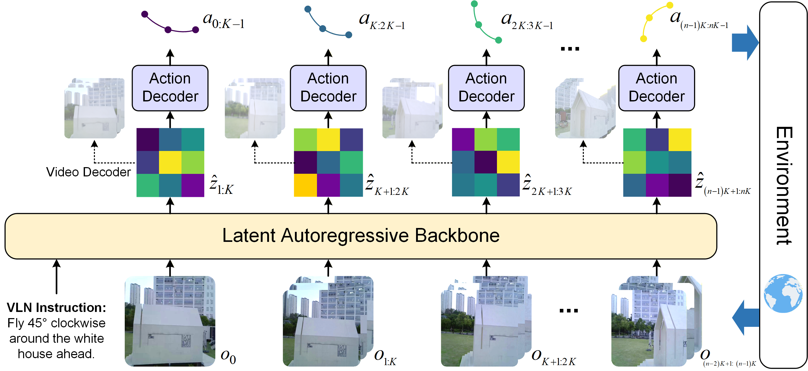
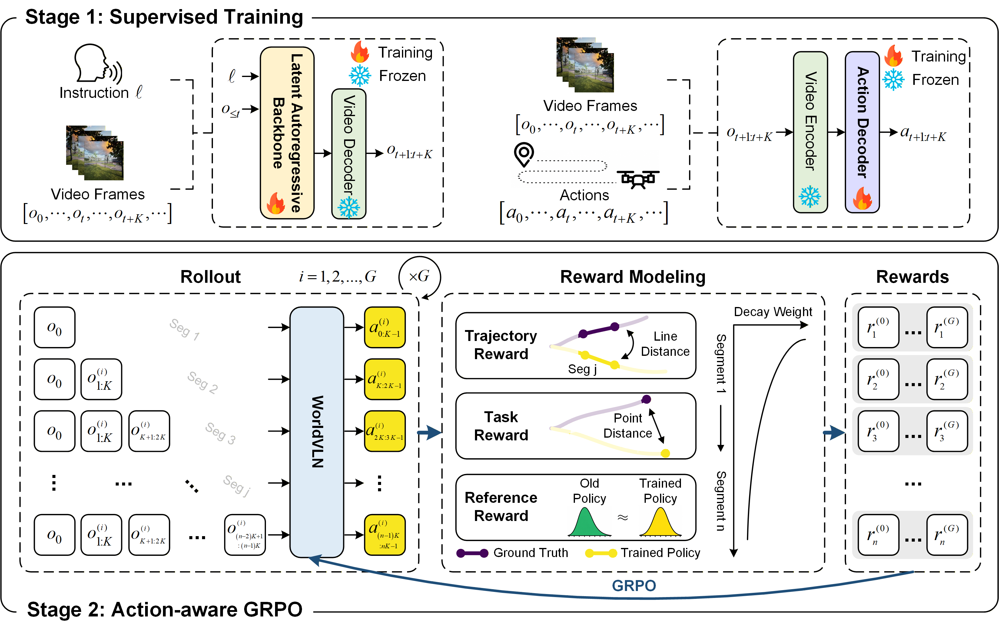
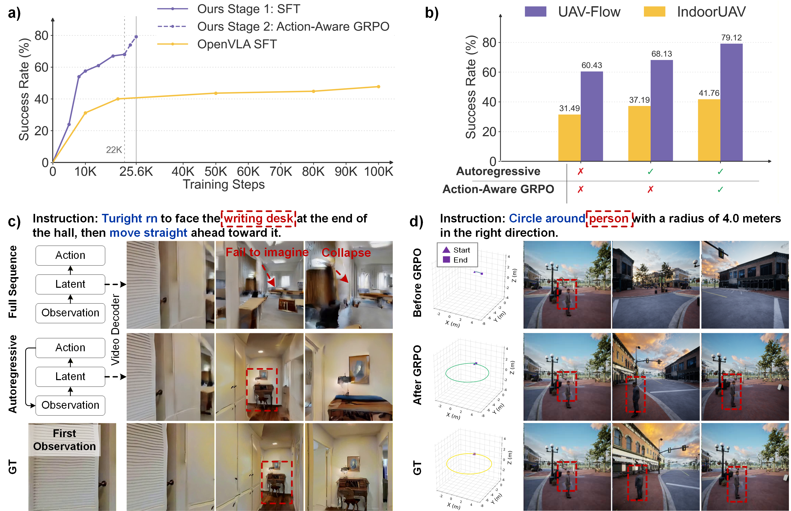
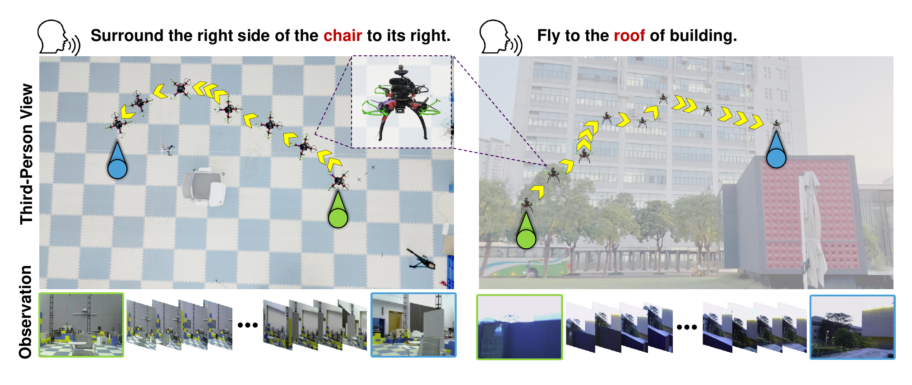

# WorldVLN (arXiv 2026)

<!-- paper-source: https://chengwei920412.github.io/paper_reading/2605.15964_WorldVLN_Autoregressive_World_Action_Model_for_Aerial_Vision_Language_Navigation/technical_report.html -->

> **arXiv ID**：2605.15964  
> **原文标题**：WorldVLN: Autoregressive World Action Model for Aerial Vision-Language Navigation  
> **翻译日期**：2026-09-23

---

## 📋 论文概览 {#_1}

### 基本信息 {#_2}

- **作者**：Baining Zhao、Jiacheng Xu、Weicheng Feng、Xin Zhang 等 16 人
- **机构**：清华大学、山东大学、Manifold AI、北京理工大学、东北大学
- **公开时间**：2026 年 5 月 15 日（arXiv v1）
- **领域**：航拍视觉-语言导航、世界模型、视觉-语言-动作模型、强化学习

### 核心贡献 {#_3}

WorldVLN 将航拍视觉-语言导航从“观测到动作的直接映射”重述为“预测世界变化并据此行动”的问题。其主要贡献包括：

1. 提出首个面向航拍 VLN 的自回归世界动作模型（World Action Model, WAM），以短时域潜在世界状态转移为中介直接解码航点动作。
2. 构建“执行动作—接收真实观测—更新自回归上下文”的闭环推理机制，避免长时域生成中的语义漂移与误差积累。
3. 提出动作感知组相对策略优化（Action-aware GRPO），以轨迹一致性、任务进展和参考策略对齐三类奖励优化动作后果。
4. 在 UAV-Flow-Sim 与 IndoorUAV-VLA 上显著超过 VLA 基线，并展示从模拟器到真实无人机的零样本迁移。

---

## 🎯 研究背景与动机 {#_4}

### 问题定义 {#_5}

航拍 VLN 要求无人机依据自然语言指令，在仅能获得局部第一视角观测的三维环境中连续生成四自由度航点动作：

\[a_t=(\Delta x_t,\Delta y_t,\Delta z_t,\Delta\psi_t)\in\mathbb{R}^4.\]

策略不仅要理解指令和场景，还要推断当前动作将如何改变视角、空间关系和后续可见状态。

### 现有方法的局限性 {#_6}

- VLA 模型擅长识别物体与解析语言，却通常缺乏显式的动作条件世界动力学建模。
- 全序列视频生成采用双向生成方式，而导航需要因果的“观测—行动—更新”闭环。
- 仅以视觉合理性训练视频模型，无法保证预测表征具备几何一致性、动作可解码性和目标导向性。
- 监督模仿容易受协变量偏移影响，连续执行后会累积误差。

### 本文的创新点 {#_7}

论文把视频生成骨干网络预测的潜变量重新解释为“动作引起的短时域世界状态变化”，并直接从中解码动作。每执行一段动作后，模型用真实新观测替换预测潜变量，再进行下一轮预测，从结构上把世界建模与闭环控制统一起来。

---

## 🔬 方法论 {#_8}

### 整体架构 {#_9}

图：WorldVLN 根据指令与真实观测历史预测短时域潜在世界状态转移，再由动作解码器生成航点动作。

世界模型骨干网络由文本编码器 \(\psi\)、视频 VAE 编码器 \(\mathcal{E}_{\mathrm{vid}}\) 和潜在自回归 Transformer \(p_\theta\) 组成：

\[\hat z_{t+1:t+K}\sim p_\theta(\cdot\mid e_\ell,z_{\le t}),
\qquad
a_{t:t+K-1}=D_\phi(\hat z_{t+1:t+K}).\]

动作执行后，真实观测被重新编码为 \(z_{t+1:t+K}\) 并写回上下文，形成闭环：

\[(e_\ell,z_0)\rightarrow\hat z_{1:K}\rightarrow a_{0:K-1}
\rightarrow o_{1:K}\rightarrow z_{1:K}\rightarrow\hat z_{K+1:2K}\rightarrow\cdots.\]

### 关键技术 {#_10}

1. **潜在世界状态预测**：不生成最终 RGB 视频，而是在压缩潜在空间中预测与动作有关的未来状态变化。
2. **动作解码器**：通过视觉嵌入、分解式时间/空间注意力和 MLP 回归头，将潜在状态转移映射为连续无人机动作。
3. **真实观测回灌**：每个动作片段结束后以真实观测替换预测状态，抑制长时域漂移。
4. **两阶段训练**：阶段 1 用监督目标建立导航动力学与动作解码能力；阶段 2 用在线轨迹展开对动作后果做强化学习优化。

### 算法流程 {#_11}

图：监督训练与 Action-aware GRPO 组成的两阶段训练框架。

阶段 1 分别优化世界模型损失和动作损失：

\[\mathcal L_{\mathrm{wm}}=-\sum\log p_\theta(z_{t+1:t+K}\mid e_\ell,z_{\le t}),\]

\[\mathcal L_{\mathrm{act}}=\sum\left\|D_\phi(\mathcal E_{\mathrm{vid}}(o_{t+1:t+K}))-a^*_{t:t+K-1}\right\|.\]

阶段 2 对每个样例采样 \(G=4\) 条在线自回归轨迹，片段奖励为：

\[r_j^{(i)}=\gamma^{j-1}\left(
\lambda_{\mathrm{traj}}r_{\mathrm{traj},j}^{(i)}+
\lambda_{\mathrm{task}}r_{\mathrm{task},j}^{(i)}+
\lambda_{\mathrm{ref}}r_{\mathrm{ref},j}^{(i)}
\right).\]

实验采用 \(\lambda_{\mathrm{traj}}=0.2\)、\(\lambda_{\mathrm{task}}=0.7\)、\(\lambda_{\mathrm{ref}}=0.1\) 与时间衰减 \(\gamma=0.9\)。轨迹奖励约束局部几何精度，任务奖励评价终点目标达成，参考奖励抑制策略偏离原有视频先验。

---

## 📊 实验与结果 {#_12}

### 实验设置 {#_13}

- **数据集**：UAV-Flow-Sim、IndoorUAV-VLA
- **评估指标**：成功率（SR）、归一化动态时间规整（NDTW）
- **对比方法**：Seq2Seq、CMA、Travel-UAV、OpenVLA、\(\pi_0\)、NaVid、GPT-4o 等
- **训练资源**：8 张 NVIDIA A800 80GB；模拟器轨迹展开放在 RTX 4090 工作站上执行
- **真实平台**：250 mm 轴距四旋翼、Logi C270 RGB 相机、Jetson Orin NX 16GB、CUAV PX4 飞控；高层策略在地面站服务器推理

### 主要结果 {#_14}

<table>
<thead>
<tr>
<th>基准与设置</th>
<th>WorldVLN</th>
<th>最强基线</th>
<th>绝对提升</th>
</tr>
</thead>
<tbody>
<tr>
<td>UAV-Flow-Sim 固定模板平均 SR</td>
<td>79.12%</td>
<td>65.61%</td>
<td>+13.51 个百分点</td>
</tr>
<tr>
<td>UAV-Flow-Sim 开放词汇平均 SR</td>
<td>78.02%</td>
<td>65.78%</td>
<td>+12.24 个百分点</td>
</tr>
<tr>
<td>IndoorUAV-VLA 全集 SR</td>
<td>41.76%</td>
<td>27.16%</td>
<td>+14.60 个百分点</td>
</tr>
<tr>
<td>IndoorUAV-VLA 困难划分 SR</td>
<td>41.19%</td>
<td>7.55%</td>
<td>+33.64 个百分点</td>
</tr>
</tbody>
</table>

WorldVLN 的收益在需要精确空间关系和动作组合的场景中更大，例如 UAV-Flow 的接近、降落、移动和平移任务，以及 IndoorUAV-VLA 的中等、困难划分。这支持论文的核心判断：预测动作后果比直接拟合观测到动作的映射更适合复杂航拍导航。

### 消融实验 {#_15}

图：自回归建模、Action-aware GRPO 与潜在预测质量的消融分析。

- 在相同训练步数预算下，阶段 1 的 WorldVLN-SFT 已超过 OpenVLA-SFT，说明 WAM 结构具有更好的样本/训练效率。
- 自回归 SFT 相比全序列 SFT 在两个基准上均提升至少 5.7 个百分点；可视化显示真实观测回灌能减轻语义漂移与场景坍缩。
- 在阶段 1 性能接近饱和后，Action-aware GRPO 进一步带来超过 10 个百分点的增益，并改善“绕目标一周”等几何动作的轨迹精度。

### 真实部署 {#_16}

图：模型仅在模拟环境中训练，随后零样本部署到室内外真实无人机平台。

模型只以第一视角 RGB 与语言指令作出高层决策；动作捕捉、GPS 和激光雷达仅服务于低层飞行稳定与轨迹记录。真实实验展示了从模拟到现实的可执行性，但尚未构成大规模、开放环境下的系统性鲁棒性验证。

---

## 💡 关键见解 {#_17}

### 理论分析 {#_18}

WorldVLN 的关键不在于“生成更逼真的未来视频”，而在于学习对动作决策有用的潜在状态转移。真实观测回灌把开放环生成改造成模型预测控制式的闭环过程；Action-aware GRPO 又把表征学习目标从视觉似真性推进到动作后果与任务成败。时间衰减则反映了自回归导航中的非对称信用分配：越早的错误影响越长的后续链路。

### 实践启示 {#_19}

- 视频生成模型的时空先验可作为具身控制的初始化，但需要动作解码接口与任务级后训练。
- 对长序列控制而言，频繁用真实观测校正潜在上下文比一次性预测完整未来更稳健。
- 奖励组合必须兼顾局部几何、全局任务与参考策略约束；仅优化成功率可能损害世界模型的潜在想象能力。
- 模型规模和推理延迟仍是机载部署的关键瓶颈。

---

## 🔍 局限性与未来工作 {#_20}

### 当前局限 {#_21}

1. 研究集中于短距离导航和短时域航点生成，尚未验证长时域、多阶段复杂指令。
2. 训练主要依赖模拟器和公开基准，真实实验规模有限，未覆盖恶劣天气、动态障碍、拥挤环境和无 GPS 场景。
3. 8B 世界骨干网络仍需服务器端推理，无法完全机载运行。
4. 论文未开展大规模多随机种子实验，统计稳定性与复现实验方差尚不充分。
5. 真实部署只展示代表性案例，没有报告系统化的真实世界成功率、延迟、能耗与失效分布。

### 未来方向 {#_22}

- 研究分层记忆、状态摘要或事件级自回归机制，以支持长时域导航。
- 通过蒸馏、量化、稀疏化和轻量动作头实现低延迟机载推理。
- 引入安全约束、风险敏感奖励、地理围栏与不确定性估计。
- 扩展到动态环境、多智能体协同、目标搜索及机器人操作。
- 在真实环境中进行多种子、大规模、跨天气与跨硬件评估。

---

## 📚 相关工作对比 {#_23}

<table>
<thead>
<tr>
<th>方法</th>
<th>核心思想</th>
<th>优势</th>
<th>局限</th>
</tr>
</thead>
<tbody>
<tr>
<td>VLA（OpenVLA、\(\pi_0\)）</td>
<td>从观测和语言直接预测动作</td>
<td>结构直接，可继承 VLM 语义先验</td>
<td>动作条件世界动力学较弱，复杂空间行为易失效</td>
</tr>
<tr>
<td>想象—排序式世界模型</td>
<td>生成多条候选未来，再选择最优路线</td>
<td>可显式检查候选后果</td>
<td>推理成本高，动作恢复链路间接</td>
</tr>
<tr>
<td>全序列 WAM</td>
<td>一次性预测完整潜在未来并解码动作</td>
<td>能利用视频时空先验</td>
<td>长时域易漂移，缺乏真实观测校正</td>
</tr>
<tr>
<td><strong>WorldVLN</strong></td>
<td>短时域潜在预测、动作解码、真实观测回灌、Action-aware GRPO</td>
<td>闭环、因果、动作后果导向，在困难任务上增益明显</td>
<td>模型较大，真实验证规模与长时域能力有限</td>
</tr>
</tbody>
</table>

---

## 🎓 综合评价 {#_24}

### 优点 {#_25}

- 问题重述清晰：把航拍 VLN 从条件映射转变为动作后果预测。
- 架构与训练目标相互配合，闭环自回归和 Action-aware GRPO 均有消融支持。
- 同时覆盖室外、室内、固定模板、开放词汇和真实无人机案例。
- 在困难划分上的增益显著，说明方法并非只改善简单动作。

### 可改进之处 {#_26}

- 需要报告真实平台上的定量成功率、端到端延迟、通信中断与安全失效案例。
- 应增加多随机种子结果、置信区间和对训练算力更严格的归一化比较。
- 参考奖励如何在“保持视频先验”与“允许任务适应”之间权衡，仍需更细致的消融。
- 未来应验证对更长指令、更开放环境及跨无人机平台的泛化。

### 推荐阅读对象 {#_27}

适合关注具身智能、视觉-语言导航、视频世界模型、无人机自主导航、VLA/WAM 与强化学习后训练的研究者和工程师。

---

## 📎 附录 {#_28}

### 术语表 {#_29}

<table>
<thead>
<tr>
<th>英文</th>
<th>中文</th>
</tr>
</thead>
<tbody>
<tr>
<td>Aerial Vision-Language Navigation (VLN)</td>
<td>航拍视觉-语言导航</td>
</tr>
<tr>
<td>World Action Model (WAM)</td>
<td>世界动作模型</td>
</tr>
<tr>
<td>Vision-Language-Action (VLA)</td>
<td>视觉-语言-动作模型</td>
</tr>
<tr>
<td>Action-aware GRPO</td>
<td>动作感知组相对策略优化</td>
</tr>
<tr>
<td>Waypoint Action</td>
<td>航点动作</td>
</tr>
<tr>
<td>Latent World-State Transition</td>
<td>潜在世界状态转移</td>
</tr>
<tr>
<td>Autoregressive Rollout</td>
<td>自回归轨迹展开</td>
</tr>
<tr>
<td>Closed-Loop Updating</td>
<td>闭环更新</td>
</tr>
</tbody>
</table>

### 参考资源 {#_30}

- **论文原文**：[arXiv:2605.15964](https://arxiv.org/abs/2605.15964)
- **中文翻译 PDF**：[paper_cn.pdf](https://chengwei920412.github.io/paper_reading/2605.15964_WorldVLN_Autoregressive_World_Action_Model_for_Aerial_Vision_Language_Navigation/paper_cn.pdf)
- **中文 Markdown 译文**：[paper_cn.md](https://chengwei920412.github.io/paper_reading/2605.15964_WorldVLN_Autoregressive_World_Action_Model_for_Aerial_Vision_Language_Navigation/paper_cn.html)
- **代码实现**：[EmbodiedCity/WorldVLN.code](https://github.com/EmbodiedCity/WorldVLN.code)
- **项目主页**：[WorldVLN](https://embodiedcity.github.io/WorldVLN/)
