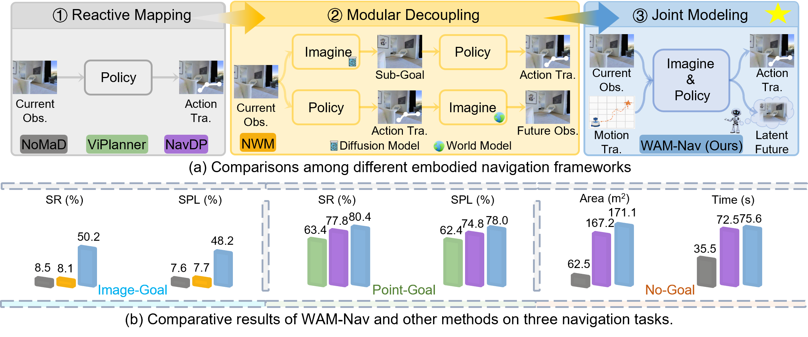
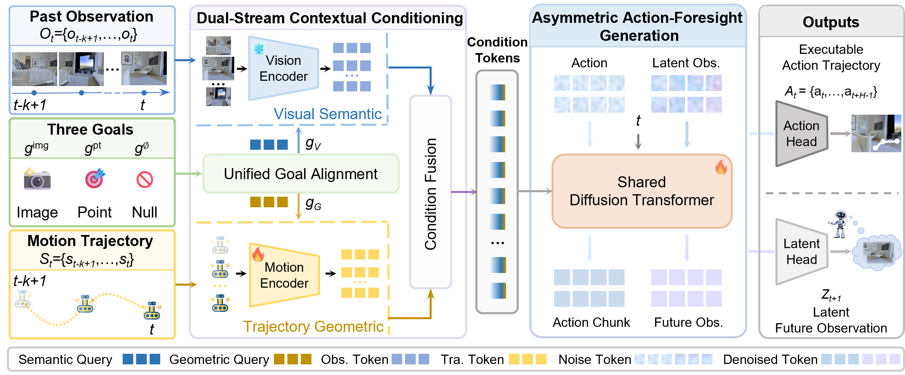
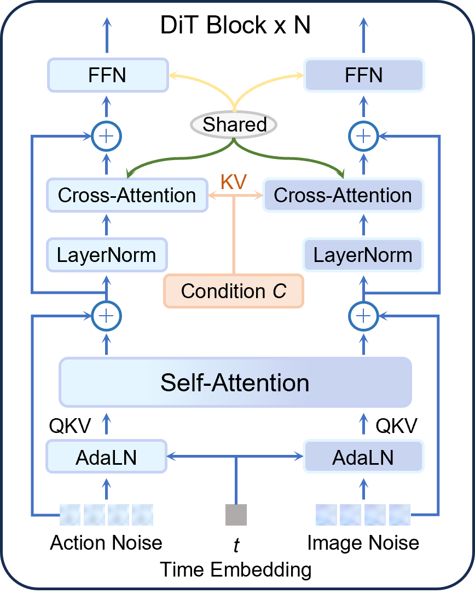
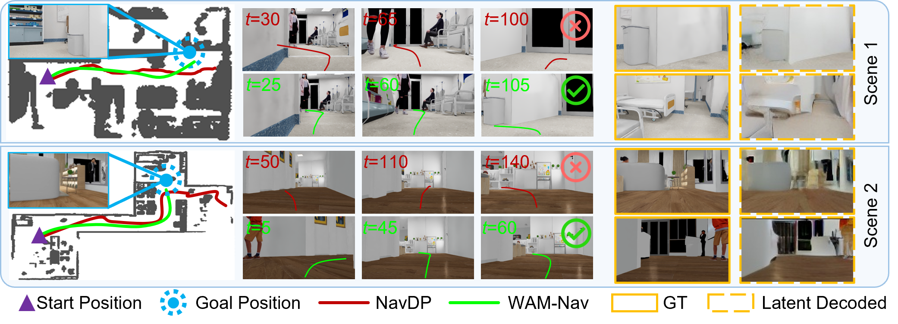
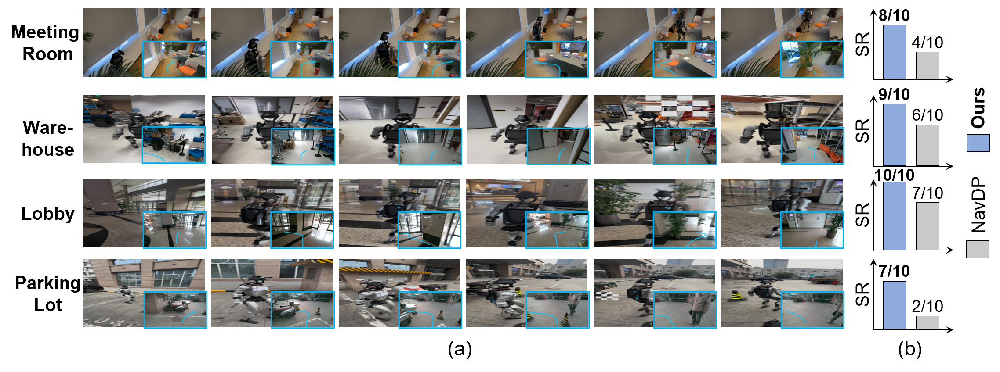
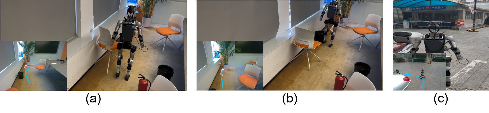

# WAM-Nav (arXiv 2026)

<!-- paper-source: https://chengwei920412.github.io/paper_reading/2606.04907_WAM-Nav_Asymmetric_Latent_World-Action_Modeling_for_Unified_Visual_Navigation/2606.04907_%E9%98%85%E8%AF%BB%E6%8A%A5%E5%91%8A.html -->

## 0. 基本信息 {#0}

- 论文标题：WAM-Nav: Asymmetric Latent World-Action Modeling for Unified Visual Navigation
- 作者：Ning Yang, Yan Huang, Kaiwen Peng, Ziheng He, Kai Wang, Cui Miao, Kailin Lyu, Guo Li, Xiaofeng Wang, Zheng Zhu, Jing Liu, Nianfeng Liu
- 机构：Nanjing University；Institute of Automation, Chinese Academy of Sciences；University of Chinese Academy of Sciences；FiveAges；National University of Defense Technology；Tsinghua University；GigaAI
- 来源（会议 / arXiv / 期刊）：arXiv preprint，CoRL 2026 style preprint
- 年份：2026
- 原始输入链接：https://arxiv.org/abs/2606.04907
- 最终使用的 arXiv 版本化 ID：2606.04907v2
- 原论文 arXiv 链接：https://arxiv.org/abs/2606.04907v2
- 幻觉翻译链接（hjfy）：https://hjfy.top/arxiv/2606.04907v2
- Cool Papers 链接：https://papers.cool/arxiv/2606.04907v2
- 论文研究方向：具身视觉导航、世界模型、动作扩散、flow matching、统一目标导航、sim-to-real
- 本文一句话概括：WAM-Nav 把视觉导航从“只反应当前观测”或“先想象再规划”的解耦范式，改成在共享 DiT 中同时生成长时域动作和短时域潜在视觉前瞻，从而用较低延迟支持 Image-Goal、Point-Goal 和 No-Goal 三类导航任务。

## 1. 论文核心观点与主张的系统梳理 {#1}

### 1.1 研究背景与动机 {#11}

论文针对 embodied visual navigation 的核心矛盾展开：机器人需要在复杂、未知、障碍密集环境中生成平滑、无碰撞、可执行轨迹，但主流学习式方法仍存在明显分裂。

第一类是 reactive end-to-end policy，例如 GNM、ViNT、NoMaD、NavDP 等。它们直接从视觉观测到动作，推理快、部署简单，但缺少对未来观测后果的显式建模。论文认为这种即时反应式策略容易在 cluttered environments 中陷入局部最优、靠近障碍后才急转，导致轨迹抖动或碰撞。

第二类是 world-model / visual imagination 方法，例如 Pathdreamer、Navigation World Models、NavigateDiff 等。它们提供前瞻能力，但常把未来视觉预测和动作决策拆成两个模块：先生成未来图像或视觉子目标，再用 inverse dynamics 或额外策略执行。作者指出这种解耦会带来两个问题：视觉预测误差在多步 rollout 中累积，且多模块推理延迟较高。

第三个问题是目标类型不统一。很多导航策略只适配 Image-Goal、Point-Goal 或 No-Goal 中的一类；即使 NavDP 支持多任务，作者认为其 unimodal alignment 会造成不同任务性能不均衡。因此 WAM-Nav 的动机是同时解决“前瞻性、实时性、轨迹平滑性、多目标统一”四个工程瓶颈。

Figure 1 对比了 reactive mapping、modular decoupling 和 WAM-Nav 的 joint modeling。图中最关键的信息是：WAM-Nav 不把 future observation 当成单独模块的长序列输出，而是在策略内部以 latent future 形式与 action trajectory 共同生成；下方柱状图则对应三类任务上的整体性能优势。

### 1.2 问题设定 {#12}

论文研究的是 mapless visual navigation，目标形式包括 Image-Goal \(g^{\mathrm{img}}\)、Point-Goal \(g^{\mathrm{pt}}\) 和 No-Goal exploration \(g^{\varnothing}\)。在时刻 \(t\)，agent 接收历史视觉观测 \(\mathcal{O}_t=\{o_{t-k+1},\ldots,o_t\}\)、动作累积得到的 ego-motion 历史 \(\mathcal{S}_t=\{s_{t-k+1},\ldots,s_t\}\)，以及目标条件 \(g\)。

附录中的问题定义把策略写成条件联合生成：

\[p_\theta(\mathbf{A}_t,\mathbf{Z}_{t+1:t+H_{\mathrm{vis}}}\mid C)\]

这条公式负责定义 WAM-Nav 的核心任务：给定上下文 \(C\)，同时预测未来动作轨迹 \(\mathbf{A}_t=\{a_t,\ldots,a_{t+H_{\mathrm{act}}-1}\}\) 和短时域潜在视觉前瞻 \(\mathbf{Z}_{t+1:t+H_{\mathrm{vis}}}=\{z_{t+1},\ldots,z_{t+H_{\mathrm{vis}}}\}\)。自然语言直译是：机器人一边规划接下来怎么走，一边在 latent space 里估计短期未来会看到什么。工程上，\(C\) 是由视觉历史、运动历史和目标编码融合得到的 Transformer conditioning tokens。

### 1.3 核心观点（Claims）的逐条梳理 {#13-claims}

Claim 1：联合建模 action generation 和 latent visual foresight 比 reactive policy 更适合复杂导航。对应位置是 Introduction、Asymmetric Action-Foresight Generation 和 Image-Goal 主结果。实验中 WAM-Nav 在 Image-Goal 平均 SR 为 50.2%，NavDP 为 43.4%，提升 6.8 个百分点；相对更弱的 GNM、ViNT、NoMaD、NWM 差距更大。

Claim 2：不应采用长时域视觉 rollout，而应采用长时域动作 + 短时域视觉前瞻的不对称设计。对应位置是 Method 3.3 和 visual horizon ablation。作者的证据是固定 \(H_{\mathrm{act}}=24\) 时，\(H_{\mathrm{vis}}=1\) 的 SR/SPL 为 50.2/48.2，扩展到 4、8、24 后持续下降。

Claim 3：Dual-Stream Contextual Conditioning 同时需要视觉记忆和运动历史。对应位置是 Method 3.2 和 component ablation。消融显示 latent prediction alone 从 42.1% SR 提升到 45.7%，motion trajectory alone 为 43.9%，两者结合达到 50.2%。

Claim 4：Unified Goal Alignment 能让单一策略支持 Image-Goal、Point-Goal 和 No-Goal，而不是为每种任务重训。对应位置是 Method 3.1、主结果表和 goal alignment ablation。证据是 WAM-Nav 在三类任务平均值上均优于或接近强基线，并且 \(g_V+g_G\) 在 No-Goal 上最好、在 Image/Point 之间取得较平衡性能。

Claim 5：WAM-Nav 能保持实时效率并实现真实机器人零样本部署。对应位置是 efficiency table、real-world deployment 和硬件附录。论文报告 WAM-Nav 推理延迟 0.26 s、0.7 TFLOPs，在 Unitree G1 上 1 Hz 推理、50 Hz 控制，四个真实场景平均成功率 85%。

### 1.4 创新性与贡献边界 {#14}

论文的实质创新在三个机制组合：第一，把世界模型前瞻压缩到 latent visual foresight，并与动作轨迹在 shared DiT 内做 joint diffusion；第二，用 asymmetric horizon 约束未来视觉只预测短期，避免导航中大视角变化带来的长 rollout 误差；第三，用 \(g_V\) 和 \(g_G\) 分流保留目标的视觉语义与几何导向信息。

边界也需要明确。WAM-Nav 没有提出新的 flow matching 理论、DiT 基础结构或 DINOv2/Stable Diffusion VAE 预训练方法；它使用这些成熟组件构造导航策略。它也没有从理论上证明 latent foresight 必然降低碰撞率，主要依赖实验对比和消融证明机制有效。

## 2. 关键论据、理论基础与数学方法的深度解析 {#2}

### 2.1 理论基础与学术渊源 {#21}

论文建立在五类工作之上。第一是传统 SLAM / mapping-and-planning，如 ORB-SLAM3、RTAB-Map 和 Active Neural SLAM，它们代表显式建图路线。第二是 end-to-end visual navigation，包括 GNM、ViNT、NoMaD、NavDP、iPlanner、ViPlanner、DD-PPO 等，它们是主实验基线。第三是 world model / visual imagination，如 Pathdreamer、Navigation World Models、NavigateDiff、WMNav 和 RAE-NWM，这些工作为“未来视觉预测辅助导航”提供背景。第四是生成式策略学习，包括 diffusion policy、flow matching 和 Streaming Flow Policy。第五是视觉表征和潜空间压缩，包括 DINOv2 和 Stable Diffusion VAE。

WAM-Nav 对这些理论的继承是工程性的：用 DINOv2 编码视觉 patch；用 VAE latent 表示未来视觉；用 flow matching 训练从噪声到动作/视觉 latent 的速度场；用 InfoNCE 对齐多目标表示。论文没有提出新的定理或收敛证明。

### 2.2 问题形式化与建模选择 {#22}

统一目标对齐首先把异构目标编码成 base embedding，再投影到两个功能空间。式 (1) 为：

\[g_V = \psi_V(e_g), \quad g_G = \psi_G(e_g), \quad \text{with} \quad e_g = E_{\phi}(g)\]

这条公式负责把 Image-Goal、Point-Goal、No-Goal 变成统一接口。\(E_\phi\) 随目标模态变化：image goal 使用从头训练的 ViT，relative coordinate 使用 sinusoidal positional encoding，goal-free exploration 使用 masked zero-state representation。\(g_V\) 用于视觉语义检索，\(g_G\) 用于轨迹几何导向。代码中通常对应三个 encoder 分支和两个 linear projection head。若只保留 \(g_V\)，Image-Goal 更强但 Point-Goal 变弱；若只保留 \(g_G\)，Point-Goal 更强但 Image-Goal 变弱，这与附录 goal alignment 消融一致。

极简例子：若目标是一张终点图像，\(e_g\) 包含“沙发旁门口”的视觉语义，\(g_V\) 应帮助历史视觉 patch 找到相似区域；若目标是相对坐标 \((3,1)\)，\(g_G\) 应更强调“向前 3 米、右侧 1 米”的几何方向。把二者混成单一 token 容易让某一类目标主导训练。

### 2.3 核心推导与算法构造 {#23}

Figure 2 展示了 WAM-Nav 的完整流水线：过去观测、三类目标和运动轨迹进入 DSCC；目标被分成 visual semantic 与 trajectory geometric 两类查询；融合后的 context \(C\) 条件化 shared Diffusion Transformer；最后输出 action head 和 latent head。该图支撑论文最核心的系统主张：视觉前瞻不是外置模块，而是动作生成的一部分。

视觉记忆通过目标相关性加权。式 (2) 为：

\[\alpha = \sigma\left(\frac{g_V V^\top}{\sqrt{D}}\right) \in \mathbb{R}^{B\times(k\cdot P)\times1}\]

这里 \(V\) 是由 DINOv2 从历史 RGB 观测得到的 patch memory，\(B\) 是 batch size，\(k\) 是历史窗口长度，\(P\) 是每帧 patch 数，\(D\) 是隐维度。自然语言直译：用视觉目标查询 \(g_V\) 去给历史视觉 patch 打相关性分数。它类似 scaled dot-product attention，但用 sigmoid 得到每个 patch 的独立门控，而不是 softmax 归一化。

式 (3) 用 residual gating 更新视觉记忆：

\[\tilde{V}=V+\alpha\odot V\]

如果某个 patch 与目标高度相关，\(\alpha\) 接近 1，该 patch 特征约变成 \(2V\)；若不相关，\(\alpha\) 接近 0，则保留原特征。极简数值例子：若某 patch 与 \(g_V\) 的缩放点积为 2，\(\sigma(2)\approx0.88\)，更新后强度为 \(1.88V\)；若为 -2，\(\sigma(-2)\approx0.12\)，更新后为 \(1.12V\)。这说明该模块不是删除无关 patch，而是增强相关 patch。

运动历史通过 causal Transformer 编码后，用几何目标查询。式 (4) 为：

\[o_{\mathrm{kin}}=\mathrm{CrossAttn}(g_G,H,H)\in\mathbb{R}^{B\times D}\]

这条公式把过去 \(k\) 步的相对位姿序列压缩成一个目标相关的运动 token。\(H\) 是 motion Transformer 的输出，query 是 \(g_G\)，key/value 都是 \(H\)。工程上，它让模型知道“当前朝向、历史速度趋势和目标方向是否一致”。若删去这一路，论文消融显示只靠视觉前瞻的整体 Image-Goal SR 为 45.7%，不如完整模型 50.2%。

条件融合用 motion token 去偏置 learnable queries。式 (5) 为：

\[C=\mathrm{TransformerDecoder}(Q_c+\phi(o_{\mathrm{kin}}),\tilde{V},\tilde{V})\]

这条公式的作用是构造最终 conditioning context \(C\)。直译是：把运动状态注入查询 token，再去读取目标增强后的视觉记忆。代码中对应 Transformer decoder，其中 query 来自 \(Q_c+\phi(o_{\mathrm{kin}})\)，key/value 来自 \(\tilde{V}\)。这种设计让运动连续性主动约束视觉检索，而不是简单 concat。

Asymmetric Action-Foresight Generation 使用 flow matching。式 (6) 为：

\[\mathbf{A}_{\tau}=(1-\tau)\mathbf{A}_0+\tau\mathbf{A}_1,\quad \mathbf{Z}_{\tau}=(1-\tau)\mathbf{Z}_0+\tau\mathbf{Z}_1\]

其中 \((\mathbf{A}_0,\mathbf{Z}_0)\) 来自标准高斯噪声，\((\mathbf{A}_1,\mathbf{Z}_1)\) 是真实动作轨迹和真实未来视觉 latent，\(\tau\in[0,1]\) 是流时间。自然语言直译：在噪声和真实数据之间做线性插值，让网络学习“应该往哪个方向流向真实样本”。这与传统 denoising diffusion 的噪声预测形式不同，训练目标是速度场。

式 (7) 定义 shared DiT 的速度预测：

\[\hat{u}_A,\hat{u}_Z=f_\theta(\mathbf{A}_{\tau},\mathbf{Z}_{\tau},\tau,C)\]

这里 \(\hat{u}_A\) 是动作速度场预测，\(\hat{u}_Z\) 是视觉 latent 速度场预测。共享 DiT 让 action tokens 和 latent visual tokens 在 self-attention 中交互，使视觉前瞻成为动作生成的约束。若改成 decoupled DiT，附录消融中 SR/SPL 为 45.9/44.6；fully shared DiT 为 50.2/48.2。

Figure 5 展示了 shared DiT block：action tokens 与 latent foresight tokens 分别通过 adaLN 分支调制，但共享 self-attention、cross-attention 和 FFN。这个结构解释了“asymmetric”不是两个完全独立模块，而是在共享参数中处理不同 horizon 和不同 token 类型。

训练目标见式 (8)：

\[\mathcal{L}_{\mathrm{total}}=\mathbb{E}_{\tau,\mathbf{A}_0,\mathbf{Z}_0}\left[\|\hat{u}_A-u_A\|_2^2+\lambda_{\mathrm{img}}\|\hat{u}_Z-u_Z\|_2^2\right]+\lambda_{\mathrm{align}}\mathcal{L}_{\mathrm{align}}\]

这条公式同时优化三件事：动作速度场回归、视觉 latent 速度场回归、多目标对齐。\(\lambda_{\mathrm{img}}=0.25\)，\(\lambda_{\mathrm{align}}=0.1\) 来自附录超参数表。工程上，第一项对应 action head 的 MSE，第二项对应 latent head 的 MSE，第三项是 symmetric contrastive InfoNCE。若 \(\lambda_{\mathrm{img}}\) 太大，模型可能过度拟合视觉预测；若太小，latent foresight 对动作的正则作用不足。论文没有给出 loss weight 敏感性。

### 2.4 理论结论的适用范围 {#24}

WAM-Nav 的理论适用范围是：视觉历史和运动历史可观测、训练数据覆盖足够多的室内导航动态、目标模态可被 \(E_\phi\) 编码、短时域视觉 latent 足以约束局部几何。它没有证明 flow matching 训练出的联合分布一定能提高安全性，也没有证明 \(H_{\mathrm{vis}}=1\) 在所有平台上最优。

论文中最强的理论假设是 latent visual foresight 能作为 action generation 的 perception-grounded regularizer。实验支持这一点，但这仍是经验命题。真实环境中，如果 DINOv2 特征对透明玻璃、低矮障碍、强反光、动态行人不稳，latent foresight 可能不能提供可靠约束。

## 3. 实验设计与实验结果的充分性分析 {#3}

### 3.1 实验目标与论文主张的对应关系 {#31}

论文围绕五个研究问题组织实验。Q1 检验三类任务的零样本泛化与平衡性；Q2 检验 cluttered environment 中前瞻避障机制；Q3 检验推理效率；Q4 检验组件贡献；Q5 检验真实机器人 sim-to-real。

训练数据是 VLN-N1，包含 Replica、Matterport3D、Gibson、3D-FRONT、HSSD、HM3D 等六类 3D scene assets，经过 domain randomization 生成超过 400 小时、200K+ collision-free smooth first-person navigation trajectories。评估在 IsaacSim 中使用 ClearPath Dingo，场景为 ClutterScenes 和 InternScenes，共 60 个场景类型组合、每场景 100 episode，总计 6000 episodes。所有方法使用原始 pretrained weights，不额外 finetune。

评价指标与任务对应：Image-Goal / Point-Goal 使用 SR 和 SPL；No-Goal 使用 explored Area 和 episode Time，120 秒封顶，局部卡住提前终止。指标能反映任务完成、效率和探索覆盖，但不能完整衡量碰撞严重程度、身体可通过性、能耗、动态避障和控制稳定性。

### 3.2 实验设置合理性 {#32}

基线覆盖较广。Image-Goal 对比 GNM、ViNT、NoMaD、NWM、NavDP；Point-Goal 对比 DD-PPO、iPlanner、ViPlanner、NavDP；No-Goal 对比 GNM、ViNT、NoMaD、NavDP。这个设置能覆盖 RL、reactive foundation navigation、diffusion policy、world model 和 local planner。

不足是：论文没有明确说明每个 baseline 是否在完全相同传感器输入、动作频率、碰撞终止规则和控制器设置下运行；尤其 NWM 和 WAM-Nav 都涉及未来视觉预测，但一个是 modular world model，一个是 latent joint model，公平对比需要清楚说明 rollout budget、candidate 数和推理步数。附录给出 baseline 描述，但主文没有足够细节。

### 3.3 实验结果的解释力度 {#33}

三任务主结果如下。为便于正文阅读，表格保留各场景平均与全局平均；完整分场景值见附录 A。

<table>
<thead>
<tr>
<th>任务</th>
<th>方法</th>
<th>Average 指标 1</th>
<th>Average 指标 2</th>
<th>指标含义</th>
</tr>
</thead>
<tbody>
<tr>
<td>Image-Goal</td>
<td>GNM</td>
<td>16.3</td>
<td>15.7</td>
<td>SR / SPL</td>
</tr>
<tr>
<td>Image-Goal</td>
<td>ViNT</td>
<td>12.6</td>
<td>11.8</td>
<td>SR / SPL</td>
</tr>
<tr>
<td>Image-Goal</td>
<td>NoMaD</td>
<td>8.5</td>
<td>7.6</td>
<td>SR / SPL</td>
</tr>
<tr>
<td>Image-Goal</td>
<td>NWM</td>
<td>8.1</td>
<td>7.7</td>
<td>SR / SPL</td>
</tr>
<tr>
<td>Image-Goal</td>
<td>NavDP</td>
<td>43.4</td>
<td>41.4</td>
<td>SR / SPL</td>
</tr>
<tr>
<td>Image-Goal</td>
<td>WAM-Nav</td>
<td>50.2</td>
<td>48.2</td>
<td>SR / SPL</td>
</tr>
<tr>
<td>Point-Goal</td>
<td>DD-PPO</td>
<td>1.4</td>
<td>1.4</td>
<td>SR / SPL</td>
</tr>
<tr>
<td>Point-Goal</td>
<td>iPlanner</td>
<td>66.8</td>
<td>65.1</td>
<td>SR / SPL</td>
</tr>
<tr>
<td>Point-Goal</td>
<td>ViPlanner</td>
<td>63.4</td>
<td>62.4</td>
<td>SR / SPL</td>
</tr>
<tr>
<td>Point-Goal</td>
<td>NavDP</td>
<td>77.8</td>
<td>74.8</td>
<td>SR / SPL</td>
</tr>
<tr>
<td>Point-Goal</td>
<td>WAM-Nav</td>
<td>80.4</td>
<td>78.0</td>
<td>SR / SPL</td>
</tr>
<tr>
<td>No-Goal</td>
<td>GNM</td>
<td>27.8</td>
<td>22.1</td>
<td>Area / Time</td>
</tr>
<tr>
<td>No-Goal</td>
<td>ViNT</td>
<td>36.2</td>
<td>24.4</td>
<td>Area / Time</td>
</tr>
<tr>
<td>No-Goal</td>
<td>NoMaD</td>
<td>62.5</td>
<td>35.5</td>
<td>Area / Time</td>
</tr>
<tr>
<td>No-Goal</td>
<td>NavDP</td>
<td>167.2</td>
<td>72.5</td>
<td>Area / Time</td>
</tr>
<tr>
<td>No-Goal</td>
<td>WAM-Nav</td>
<td>171.1</td>
<td>75.6</td>
<td>Area / Time</td>
</tr>
</tbody>
</table>

结果解释要分任务看。Image-Goal 是 WAM-Nav 最有说服力的部分：相对最强 baseline NavDP，SR 从 43.4 到 50.2，SPL 从 41.4 到 48.2，说明 latent foresight 对视觉目标导航确实有帮助。Point-Goal 的提升较小，SR 从 77.8 到 80.4，SPL 从 74.8 到 78.0，说明 WAM-Nav 在几何目标上是增益而非颠覆。No-Goal 的提升也较小，Area 从 167.2 到 171.1，Time 从 72.5 到 75.6；它支持“统一策略不牺牲探索”，但不足以单独证明 foresight 对探索有大幅优势。

Figure 3 对比 NavDP 与 WAM-Nav 在 Image-Goal 中的轨迹。作者强调 WAM-Nav 轨迹更平滑、避障更提前，decoded latent foresight 与 ground truth observation 较一致。这个图能解释为什么 Image-Goal 提升更明显，但它仍是定性案例，不能替代碰撞率或轨迹曲率统计。

效率表如下：

<table>
<thead>
<tr>
<th>方法</th>
<th>Inference Latency (s)</th>
<th>Total Params</th>
<th>Trainable Params</th>
<th>TFLOPs</th>
</tr>
</thead>
<tbody>
<tr>
<td>NWM</td>
<td>1.43</td>
<td>154.4M</td>
<td>68.3M</td>
<td>8.3</td>
</tr>
<tr>
<td>NavDP</td>
<td>0.16</td>
<td>136.4M</td>
<td>136.4M</td>
<td>1.3</td>
</tr>
<tr>
<td>WAM-Nav</td>
<td>0.26</td>
<td>234.9M</td>
<td>129.2M</td>
<td>0.7</td>
</tr>
</tbody>
</table>

这个表支持作者关于效率的主张。WAM-Nav 总参数多于 NavDP，主要因为冻结视觉先验；但 trainable parameters 接近，TFLOPs 更低。延迟 0.26 s 比 NavDP 慢 0.10 s，但远低于 NWM 的 1.43 s。需要注意的是，延迟与硬件、实现、batch、候选轨迹数和 ODE step 数有关，论文没有给跨硬件统计。

真实部署如下：

Figure 4 展示 WAM-Nav 在 meeting room、warehouse、lobby、parking lot 四类真实环境中的部署，并给出与 NavDP 的柱状对比。论文正文只明确报告 WAM-Nav 平均成功率为 85%，每个场景 10 trials；图中分场景数值没有在文本表格中完整列出，因此本报告不复写不可精确读取的分场景数字。该实验支持 sim-to-real 可行性，但总共约 40 次真实试验，规模仍偏小。

### 3.4 潜在未讨论因素 {#34}

组件消融如下：

<table>
<thead>
<tr>
<th>Motion Traj.</th>
<th>Latent Pred.</th>
<th>Clutter SR</th>
<th>Clutter SPL</th>
<th>Intern SR</th>
<th>Intern SPL</th>
<th>Avg SR</th>
<th>Avg SPL</th>
</tr>
</thead>
<tbody>
<tr>
<td>否</td>
<td>否</td>
<td>51.0</td>
<td>49.9</td>
<td>33.2</td>
<td>31.7</td>
<td>42.1</td>
<td>40.8</td>
</tr>
<tr>
<td>否</td>
<td>是</td>
<td>57.4</td>
<td>55.5</td>
<td>34.0</td>
<td>32.2</td>
<td>45.7</td>
<td>43.8</td>
</tr>
<tr>
<td>是</td>
<td>否</td>
<td>57.9</td>
<td>57.1</td>
<td>30.0</td>
<td>28.6</td>
<td>43.9</td>
<td>42.9</td>
</tr>
<tr>
<td>是</td>
<td>是</td>
<td>60.9</td>
<td>59.0</td>
<td>39.5</td>
<td>37.5</td>
<td>50.2</td>
<td>48.2</td>
</tr>
</tbody>
</table>

该表说明 latent prediction 和 motion trajectory 都有贡献，但贡献形态不同。motion trajectory 在 ClutterScenes 上提升明显，在 InternScenes 上单独使用反而下降，说明运动平滑信息不能替代语义/视觉前瞻。完整模型在两个环境族上都最好，支持 DSCC 的互补性。

附加消融如下：

<table>
<thead>
<tr>
<th>消融主题</th>
<th>设置</th>
<th>SR</th>
<th>SPL</th>
<th>结论</th>
</tr>
</thead>
<tbody>
<tr>
<td>Memory Window</td>
<td>\(k=4\)</td>
<td>46.6</td>
<td>44.1</td>
<td>历史不足，运动上下文有限</td>
</tr>
<tr>
<td>Memory Window</td>
<td>\(k=8\)</td>
<td>50.2</td>
<td>48.2</td>
<td>最优设置</td>
</tr>
<tr>
<td>Memory Window</td>
<td>\(k=16\)</td>
<td>44.9</td>
<td>42.3</td>
<td>历史过长，响应性下降</td>
</tr>
<tr>
<td>DSCC</td>
<td>w/o GI</td>
<td>44.5</td>
<td>42.2</td>
<td>去掉 goal injection 明显下降</td>
</tr>
<tr>
<td>Action-Foresight</td>
<td>Decoupled DiT</td>
<td>45.9</td>
<td>44.6</td>
<td>解耦不如共享</td>
</tr>
<tr>
<td>Action-Foresight</td>
<td>Partially DiT</td>
<td>47.5</td>
<td>45.4</td>
<td>部分共享不如完全共享</td>
</tr>
<tr>
<td>Action-Foresight</td>
<td>Ours</td>
<td>50.2</td>
<td>48.2</td>
<td>共享 DiT 最好</td>
</tr>
</tbody>
</table>

visual horizon 消融如下：

<table>
<thead>
<tr>
<th>设置</th>
<th>SR</th>
<th>SPL</th>
</tr>
</thead>
<tbody>
<tr>
<td>\(H_{\mathrm{act}}=24,\;H_{\mathrm{vis}}=1\)</td>
<td>50.2</td>
<td>48.2</td>
</tr>
<tr>
<td>\(H_{\mathrm{act}}=24,\;H_{\mathrm{vis}}=4\)</td>
<td>46.2</td>
<td>43.8</td>
</tr>
<tr>
<td>\(H_{\mathrm{act}}=24,\;H_{\mathrm{vis}}=8\)</td>
<td>39.6</td>
<td>37.3</td>
</tr>
<tr>
<td>\(H_{\mathrm{act}}=24,\;H_{\mathrm{vis}}=24\)</td>
<td>30.4</td>
<td>28.1</td>
</tr>
</tbody>
</table>

这是论文最关键的机制证据之一：导航中的大视角变化使长视觉 rollout 不可靠，因此短期 latent foresight 更好。这里的潜在问题是只固定 \(H_{\mathrm{act}}=24\)，没有展示不同 action horizon 下的交互效应。

失败案例如下：

Figure 8 和论文 Limitations 指出两类主要失败：低机位和有限视场导致近场低矮障碍感知弱，机器人可能忽略障碍并碰撞；另一个是策略没有显式建模机器人本体形状，只保证相机视角路径可过，导致身体与侧向障碍碰撞。这一点非常关键，因为它直接限制从 wheeled Dingo 仿真到 humanoid G1 的安全迁移。

## 4. 与当前领域主流共识及反对观点的关系 {#4}

### 4.1 与主流观点的一致性 {#41}

WAM-Nav 延续了视觉导航领域从显式建图到学习式策略、再到 foundation / diffusion / world model 的趋势。GNM 和 ViNT 证明大规模异构导航数据可形成通用视觉导航 prior；NoMaD 和 NavDP 证明 diffusion policy 能生成多模态轨迹并支持 sim-to-real；NWM、Pathdreamer、NavigateDiff 证明 future visual prediction 对导航前瞻有价值；WAM-Nav 则接受这些共识，并把视觉预测从外置模块压缩进 shared latent joint generation。

它也与 flow matching / diffusion policy 的主流方向一致：不直接回归单条动作，而是建模动作轨迹分布。论文中的 straight-line probability path 和 velocity regression 与 Flow Matching for Generative Modeling、Streaming Flow Policy 的思想一致。

### 4.2 与反对或竞争观点的分歧 {#42}

与 reactive policy 的分歧：WAM-Nav 认为直接从当前/历史观测到动作缺乏 predictive reasoning，因此在 clutter 中反应滞后。NavDP 作为最强 reactive/diffusion baseline，在 Image-Goal 上仍落后 6.8 个 SR 点，是论文支撑该分歧的主要证据。

与 modular world model 的分歧：NWM 等方法通过未来视觉 rollout 评估或辅助规划，但 WAM-Nav 认为解耦结构增加延迟和误差累积。效率表中 NWM 延迟 1.43 s、8.3 TFLOPs，WAM-Nav 为 0.26 s、0.7 TFLOPs，支持“latent short-horizon joint foresight 更高效”的观点。

与长时域视觉预测的分歧：论文通过 \(H_{\mathrm{vis}}\) 消融明确反驳“预测越长越好”。当 \(H_{\mathrm{vis}}\) 从 1 增至 24，SR 从 50.2 降到 30.4，说明在导航中长视觉 rollout 可能因大视角变化积累误差。

### 4.3 论文在学术版图中的定位 {#43}

WAM-Nav 是 world-action model 思路在视觉导航中的定制化落地。它不像传统 SLAM 那样追求显式地图可靠性，也不是纯 foundation reactive policy；它处于“生成式策略 + 潜在世界模型 + 多目标统一导航”的交叉位置。更准确地说，它是对 NavDP / NWM / NavigateDiff 的机制级改进，而不是完全平行替代路径。

### 4.4 文献检索说明 {#44}

- 检索范围：论文主文与附录引用、arXiv / ar5iv / papers.cool 页面、公开学术页面中可确认的 GNM、ViNT、NoMaD、NavDP、NWM、DINOv2、Flow Matching、DD-PPO、Pathdreamer 等代表性文献。
- 检索结论可信度：论文引用的核心外部工作大多可在公开学术页面或 arXiv 页面中确认。papers.cool 页面已访问，但当前未获得可确认的 REL 相关论文列表；相关论文表主要依据原论文引用与独立可确认文献整理。

### 4.5 相关论文补充表 {#45}

<table>
<thead>
<tr>
<th>序号</th>
<th>论文标题</th>
<th>作者 / 年份</th>
<th>来源</th>
<th>与原论文关系</th>
<th>一句话概述</th>
</tr>
</thead>
<tbody>
<tr>
<td>1</td>
<td>GNM: A General Navigation Model to Drive Any Robot</td>
<td>Shah et al., 2023</td>
<td>ICRA</td>
<td>reactive foundation baseline</td>
<td>用跨本体数据训练通用导航模型，是 WAM-Nav 的早期学习式导航基线。</td>
</tr>
<tr>
<td>2</td>
<td>ViNT: A Foundation Model for Visual Navigation</td>
<td>Shah et al., 2023</td>
<td>CoRL</td>
<td>reactive Transformer baseline</td>
<td>用 Transformer 建模视觉导航序列，增强长时域导航能力。</td>
</tr>
<tr>
<td>3</td>
<td>NoMaD: Goal Masking Diffusion Policies for Navigation and Exploration</td>
<td>Sridhar et al., 2024</td>
<td>ICRA</td>
<td>diffusion navigation baseline</td>
<td>用 goal masking diffusion policy 统一目标导航与探索。</td>
</tr>
<tr>
<td>4</td>
<td>NavDP: Learning Sim-to-Real Safe Navigation with Diffusion Policy and Critic Score</td>
<td>Cai et al., 2025</td>
<td>ICRA</td>
<td>最强主要 baseline</td>
<td>用 diffusion policy 和 critic score 做安全导航，是论文最重要对照。</td>
</tr>
<tr>
<td>5</td>
<td>Navigation World Models</td>
<td>Bar et al., 2025</td>
<td>CVPR</td>
<td>modular world model baseline</td>
<td>生成未来 egocentric observations 辅助导航规划。</td>
</tr>
<tr>
<td>6</td>
<td>NavigateDiff: Visual Predictors are Zero-Shot Navigation Assistants</td>
<td>Qin et al., 2025</td>
<td>ICRA</td>
<td>visual imagination 相关</td>
<td>先生成视觉子目标，再由策略执行，代表解耦式 imagination。</td>
</tr>
<tr>
<td>7</td>
<td>Pathdreamer: A World Model for Indoor Navigation</td>
<td>Koh et al., 2021</td>
<td>ICCV</td>
<td>早期世界模型导航</td>
<td>学习室内导航未来视觉预测。</td>
</tr>
<tr>
<td>8</td>
<td>DD-PPO: Learning Near-Perfect PointGoal Navigators from 2.5 Billion Frames</td>
<td>Wijmans et al., 2020</td>
<td>ICLR</td>
<td>Point-Goal RL baseline</td>
<td>Habitat 中经典 PointGoal 强 RL baseline。</td>
</tr>
<tr>
<td>9</td>
<td>DINOv2: Learning Robust Visual Features without Supervision</td>
<td>Oquab et al., 2023</td>
<td>arXiv</td>
<td>视觉编码基础</td>
<td>WAM-Nav 用作冻结视觉 backbone。</td>
</tr>
<tr>
<td>10</td>
<td>Flow Matching for Generative Modeling</td>
<td>Lipman et al., 2023</td>
<td>arXiv / ICLR 相关</td>
<td>生成训练理论基础</td>
<td>提供速度场匹配的生成建模框架。</td>
</tr>
</tbody>
</table>

## 5. 对论文理论体系的严肃反驳与系统性质疑 {#5}

### 5.1 核心假设层面的质疑 {#51}

第一，论文假设短时域 latent foresight 足以约束动作安全，但 latent space 中的几何约束是否总能对应真实碰撞风险并不清楚。失败案例已经显示：低矮障碍和侧向障碍可能在相机视角中弱化，latent foresight 也会继承这种感知盲区。

第二，论文假设统一目标对齐能平衡三类任务，但 goal alignment 消融显示 only \(g_V\) 在 Image-Goal 上反而高于完整模型，only \(g_G\) 在 Point-Goal 上也高于完整模型。完整模型的价值是均衡多任务，而不是每个单任务最优。这个边界需要在结论中更清楚地区分。

第三，论文假设从 Dingo 仿真到 G1/H2 humanoid 的跨本体迁移可通过视觉-动作 prior 自然实现，但真实失败案例恰恰说明 embodiment geometry 未建模会造成身体碰撞。跨本体实验支持“有一定泛化”，不支持“本体无关安全”。

### 5.2 数学推导与理论主张的边界 {#52}

论文的数学部分主要是建模定义和损失函数，而不是可验证理论。式 (1) 到式 (8) 说明如何构建模型，但没有证明 shared DiT 一定优于 decoupled DiT，也没有推导 \(H_{\mathrm{vis}}=1\) 的最优性。visual horizon 的结论来自经验消融。

InfoNCE alignment 被描述为最大化 equivalent objectives 的 mutual information，但论文未给出正负样本构造细节、batch 内负样本是否足够、不同目标模态是否存在 shortcut。若对齐损失主要学到数据集偏差，可能并不能泛化到新的目标表达。

### 5.3 工程实现与实际适用性 {#53}

WAM-Nav 真实部署使用 Unitree G1、RealSense D455、RTX 4060、1 Hz 模型推理和 50 Hz MPC 控制。这个链路可运行，但 1 Hz 对动态人群和快速变化障碍可能不足。论文的真实场景包括 meeting room、warehouse、lobby、parking lot，但每个场景只有 10 trials，且没有系统报告动态障碍、多人干扰、照明变化、湿滑地面、透明障碍、镜面反射等条件。

另外，模型训练成本约 \(8\times120\) GPU hours，虽然可接受，但并不轻量。它依赖 VLN-N1 大规模仿真轨迹、DINOv2、Stable Diffusion VAE、DiT 和 MPC 控制器；开源数据、训练细节和部署栈的完整性会显著影响复现难度。

### 5.4 整体理论体系的稳健性 {#54}

整体上，WAM-Nav 的机制链条是合理的：目标分流解决多任务表达，DSCC 解决视觉与运动上下文融合，shared DiT 让动作与 latent foresight 相互约束，asymmetric horizon 控制视觉 rollout 误差。实验也基本覆盖主张。

但它的稳健性仍是经验性的。一个更简单的替代解释是：提升主要来自“更强的上下文编码 + 合适的历史窗口 + 更多训练数据/结构容量”，而 latent foresight 本身只是额外正则。虽然消融显示 latent prediction 有贡献，但没有给出预测质量与碰撞减少之间的定量相关性，也没有把 latent head 移除但保持参数量相近的严格控制实验。

## 6. 最终结论 {#6}

### 6.1 论文价值总结 {#61}

WAM-Nav 是一篇机制完整、实验覆盖较广的视觉导航论文。它抓住了当前导航 world model 的关键痛点：长视觉 rollout 慢且容易错，reactive policy 又缺少前瞻。论文提出的 asymmetric latent world-action modeling 是一个务实折中，用短期潜在视觉预测约束长期动作生成，同时保持接近实时的推理效率。

### 6.2 一句话总评 {#62}

WAM-Nav 在 Image-Goal 和跨任务统一导航上有明确实证价值，但其理论保证较弱，真实部署规模仍小，且本体几何和近场感知问题尚未解决。

### 6.3 综合评分（10 分制） {#63-10}

- 创新性：8.0
- 技术严谨性：7.5
- 实验说服力：8.0
- 工程价值：7.5
- 总体评分：7.8

### 6.4 最关键的三条优点 {#64}

1. 机制设计清楚：用 shared DiT 联合建模动作与 latent foresight，避免完全解耦的世界模型规划。
2. 实验覆盖较全：三任务、两大仿真 benchmark、效率、组件消融、visual horizon、跨本体和真实部署都有结果。
3. 不对称 horizon 证据强：\(H_{\mathrm{vis}}=1\) 明显优于长视觉 horizon，直接支撑论文核心设计。

### 6.5 最关键的三条问题 {#65}

1. 理论证明不足：核心结论主要来自经验消融，没有安全性、收敛性或最优 horizon 的理论解释。
2. 真实实验规模有限：四个场景、每场景 10 trials，只能说明初步 sim-to-real 可行性。
3. 本体与近场感知未建模：失败案例表明相机可过不等于身体可过，低矮障碍和侧向障碍仍是关键风险。

## 附录 A：关键实验表与消融实验表 {#a}

### A.1 主 benchmark 对比表 {#a1-benchmark}

<table>
<thead>
<tr>
<th>任务</th>
<th>场景</th>
<th>方法</th>
<th>指标 1</th>
<th>指标 2</th>
</tr>
</thead>
<tbody>
<tr>
<td>Image-Goal</td>
<td>Average</td>
<td>GNM</td>
<td>16.3</td>
<td>15.7</td>
</tr>
<tr>
<td>Image-Goal</td>
<td>Average</td>
<td>ViNT</td>
<td>12.6</td>
<td>11.8</td>
</tr>
<tr>
<td>Image-Goal</td>
<td>Average</td>
<td>NoMaD</td>
<td>8.5</td>
<td>7.6</td>
</tr>
<tr>
<td>Image-Goal</td>
<td>Average</td>
<td>NWM</td>
<td>8.1</td>
<td>7.7</td>
</tr>
<tr>
<td>Image-Goal</td>
<td>Average</td>
<td>NavDP</td>
<td>43.4</td>
<td>41.4</td>
</tr>
<tr>
<td>Image-Goal</td>
<td>Average</td>
<td>WAM-Nav</td>
<td>50.2</td>
<td>48.2</td>
</tr>
<tr>
<td>Point-Goal</td>
<td>Average</td>
<td>DD-PPO</td>
<td>1.4</td>
<td>1.4</td>
</tr>
<tr>
<td>Point-Goal</td>
<td>Average</td>
<td>iPlanner</td>
<td>66.8</td>
<td>65.1</td>
</tr>
<tr>
<td>Point-Goal</td>
<td>Average</td>
<td>ViPlanner</td>
<td>63.4</td>
<td>62.4</td>
</tr>
<tr>
<td>Point-Goal</td>
<td>Average</td>
<td>NavDP</td>
<td>77.8</td>
<td>74.8</td>
</tr>
<tr>
<td>Point-Goal</td>
<td>Average</td>
<td>WAM-Nav</td>
<td>80.4</td>
<td>78.0</td>
</tr>
<tr>
<td>No-Goal</td>
<td>Average</td>
<td>GNM</td>
<td>27.8</td>
<td>22.1</td>
</tr>
<tr>
<td>No-Goal</td>
<td>Average</td>
<td>ViNT</td>
<td>36.2</td>
<td>24.4</td>
</tr>
<tr>
<td>No-Goal</td>
<td>Average</td>
<td>NoMaD</td>
<td>62.5</td>
<td>35.5</td>
</tr>
<tr>
<td>No-Goal</td>
<td>Average</td>
<td>NavDP</td>
<td>167.2</td>
<td>72.5</td>
</tr>
<tr>
<td>No-Goal</td>
<td>Average</td>
<td>WAM-Nav</td>
<td>171.1</td>
<td>75.6</td>
</tr>
</tbody>
</table>

注：Image-Goal / Point-Goal 的指标 1/2 为 SR/SPL；No-Goal 的指标 1/2 为 Area/Time。

### A.2 扩展指标 / 扩展 benchmark 表 {#a2-benchmark}

<table>
<thead>
<tr>
<th>Embodiment</th>
<th>方法</th>
<th>Image SR</th>
<th>Image SPL</th>
<th>Point SR</th>
<th>Point SPL</th>
<th>No-Goal Area</th>
<th>No-Goal Time</th>
</tr>
</thead>
<tbody>
<tr>
<td>Dingo</td>
<td>NavDP</td>
<td>43.4</td>
<td>41.4</td>
<td>77.8</td>
<td>74.8</td>
<td>167.2</td>
<td>72.5</td>
</tr>
<tr>
<td>Dingo</td>
<td>WAM-Nav</td>
<td>50.2</td>
<td>48.2</td>
<td>80.4</td>
<td>78.0</td>
<td>171.1</td>
<td>75.6</td>
</tr>
<tr>
<td>G1</td>
<td>NavDP</td>
<td>37.2</td>
<td>35.6</td>
<td>60.3</td>
<td>56.8</td>
<td>133.0</td>
<td>65.2</td>
</tr>
<tr>
<td>G1</td>
<td>WAM-Nav</td>
<td>42.9</td>
<td>42.5</td>
<td>64.8</td>
<td>63.1</td>
<td>147.6</td>
<td>68.3</td>
</tr>
<tr>
<td>H2</td>
<td>NavDP</td>
<td>32.7</td>
<td>31.3</td>
<td>47.9</td>
<td>46.5</td>
<td>142.4</td>
<td>67.6</td>
</tr>
<tr>
<td>H2</td>
<td>WAM-Nav</td>
<td>35.5</td>
<td>34.9</td>
<td>52.7</td>
<td>50.5</td>
<td>145.4</td>
<td>70.6</td>
</tr>
</tbody>
</table>

### A.3 数据规模 / scaling law / 泛化表 {#a3-scaling-law}

<table>
<thead>
<tr>
<th>设置</th>
<th>数据规模 / 迁移设置</th>
<th>指标1</th>
<th>指标2</th>
<th>关键观察</th>
</tr>
</thead>
<tbody>
<tr>
<td>VLN-N1 training</td>
<td>400+ 小时，200K+ 轨迹</td>
<td>训练成本</td>
<td>\(8\times120\) GPU hours</td>
<td>大规模仿真数据是零样本泛化基础</td>
</tr>
<tr>
<td>Real-world deployment</td>
<td>4 场景，每场景 10 trials</td>
<td>平均 SR</td>
<td>85%</td>
<td>支持初步 sim-to-real，但样本量有限</td>
</tr>
<tr>
<td>Difficulty split</td>
<td>Image-Goal easy/medium/hard</td>
<td>Hard SR</td>
<td>25.0 vs NavDP 17.4</td>
<td>难任务上 WAM-Nav 优势扩大</td>
</tr>
</tbody>
</table>

### A.4 关键消融实验表 {#a4}

<table>
<thead>
<tr>
<th>消融项</th>
<th>设置</th>
<th>指标</th>
<th>原始数值</th>
<th>变化后数值</th>
<th>结论</th>
</tr>
</thead>
<tbody>
<tr>
<td>Latent prediction</td>
<td>full vs w/o latent</td>
<td>Avg SR</td>
<td>50.2</td>
<td>43.9</td>
<td>latent foresight 对整体性能有贡献</td>
</tr>
<tr>
<td>Motion trajectory</td>
<td>full vs w/o motion</td>
<td>Avg SR</td>
<td>50.2</td>
<td>45.7</td>
<td>运动历史提升平滑与目标一致性</td>
</tr>
<tr>
<td>两者全去掉</td>
<td>full vs w/o both</td>
<td>Avg SR</td>
<td>50.2</td>
<td>42.1</td>
<td>DSCC 两路信息都重要</td>
</tr>
<tr>
<td>Memory window</td>
<td>\(k=8\) vs \(k=4\)</td>
<td>SR</td>
<td>50.2</td>
<td>46.6</td>
<td>历史窗口太短不足</td>
</tr>
<tr>
<td>Memory window</td>
<td>\(k=8\) vs \(k=16\)</td>
<td>SR</td>
<td>50.2</td>
<td>44.9</td>
<td>历史窗口太长降低响应性</td>
</tr>
<tr>
<td>Goal injection</td>
<td>full vs w/o GI</td>
<td>SR</td>
<td>50.2</td>
<td>44.5</td>
<td>goal-aware modulation 必要</td>
</tr>
<tr>
<td>DiT sharing</td>
<td>full vs decoupled</td>
<td>SR</td>
<td>50.2</td>
<td>45.9</td>
<td>完全解耦破坏 action-foresight 交互</td>
</tr>
<tr>
<td>Visual horizon</td>
<td>\(H_{\mathrm{vis}}=1\) vs 24</td>
<td>SR</td>
<td>50.2</td>
<td>30.4</td>
<td>长视觉 rollout 显著退化</td>
</tr>
</tbody>
</table>

### A.5 其他支撑正文结论的关键表 {#a5}

<table>
<thead>
<tr>
<th>表格主题</th>
<th>关键列</th>
<th>结论</th>
</tr>
</thead>
<tbody>
<tr>
<td>Efficiency</td>
<td>latency / params / TFLOPs</td>
<td>WAM-Nav 比 NavDP 稍慢但比 NWM 快得多，TFLOPs 最低</td>
</tr>
<tr>
<td>Unified goal alignment</td>
<td>only \(g_V\) / only \(g_G\) / both</td>
<td>双查询不是单任务最优，但多任务更均衡</td>
</tr>
<tr>
<td>Hyperparameters</td>
<td>\(k=8\)、\(H_{\mathrm{act}}=24\)、\(H_{\mathrm{vis}}=1\)、DiT 16 layers</td>
<td>关键设计与消融结果一致</td>
</tr>
<tr>
<td>Failure cases</td>
<td>near-field low obstacle / side obstacle</td>
<td>当前模型未显式处理视场盲区和机器人本体几何</td>
</tr>
</tbody>
</table>

## 附录 B：本报告引用的关键外部文献 {#b}

1. Dhruv Shah et al. GNM: A General Navigation Model to Drive Any Robot. ICRA 2023.
2. Dhruv Shah et al. ViNT: A Foundation Model for Visual Navigation. CoRL 2023.
3. Ajay Sridhar et al. NoMaD: Goal Masking Diffusion Policies for Navigation and Exploration. ICRA 2024.
4. Wenzhe Cai et al. NavDP: Learning Sim-to-Real Safe Navigation with Diffusion Policy and Critic Score. ICRA 2025.
5. Amir Bar et al. Navigation World Models. CVPR 2025.
6. Yiran Qin et al. NavigateDiff: Visual Predictors are Zero-Shot Navigation Assistants. ICRA 2025.
7. Jing Yu Koh et al. Pathdreamer: A World Model for Indoor Navigation. ICCV 2021.
8. Erik Wijmans et al. DD-PPO: Learning Near-Perfect PointGoal Navigators from 2.5 Billion Frames. ICLR 2020.
9. Maxime Oquab et al. DINOv2: Learning Robust Visual Features without Supervision. arXiv 2023.
10. Yaron Lipman et al. Flow Matching for Generative Modeling. arXiv 2023.
11. Michael Janner et al. Policy Learning via Action Diffusion. RSS 2023.
12. Julian Straub et al. The Replica Dataset: A Digital Replica of Indoor Spaces. arXiv 2019.
13. Angel Chang et al. Matterport3D: Learning From RGB-D Data in Indoor Environments. 3DV 2017.
14. Santhosh K. Ramakrishnan et al. Habitat-Matterport 3D Dataset (HM3D): 1000 Large-scale 3D Environments for Embodied AI. NeurIPS Datasets and Benchmarks 2021.
