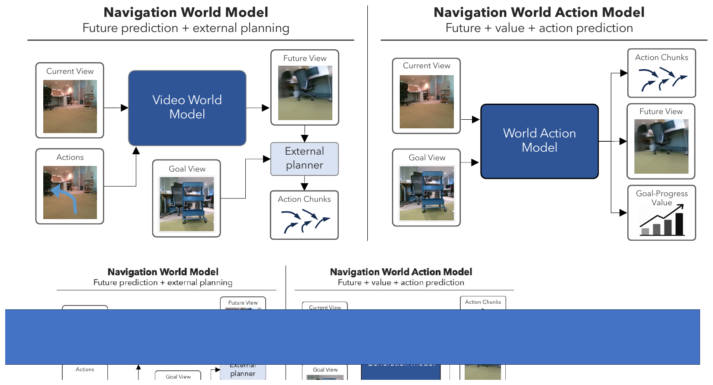
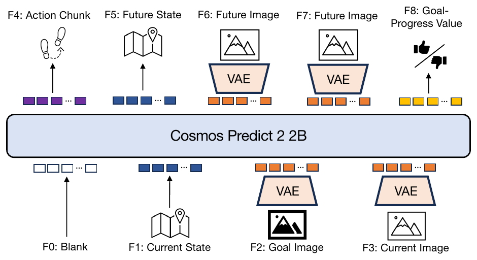
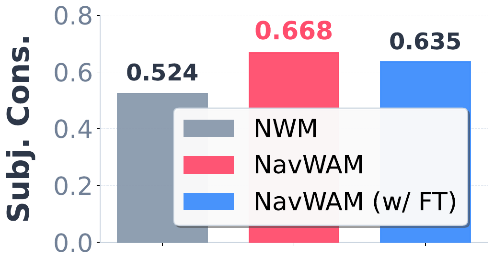
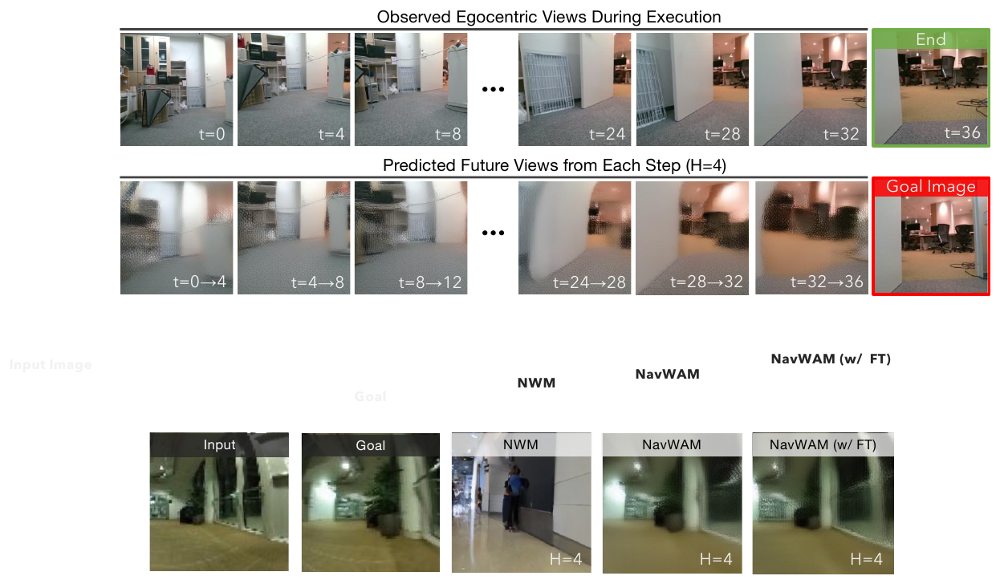
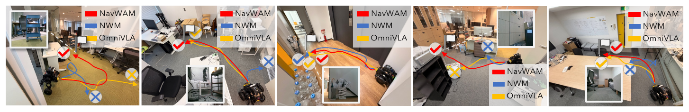
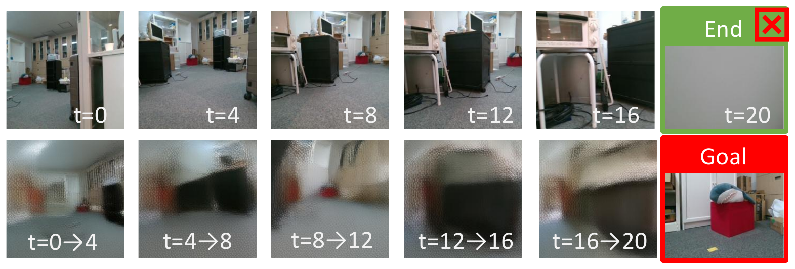

# NavWAM (arXiv 2026)

<!-- paper-source: https://chengwei920412.github.io/paper_reading/2606.13494_NavWAM_A_Navigation_World_Action_Model_for_Goal_Conditioned_Visual_Navigation/technical_report.html -->

> 原文链接：[NavWAM (arXiv 2026)](https://chengwei920412.github.io/paper_reading/2606.13494_NavWAM_A_Navigation_World_Action_Model_for_Goal_Conditioned_Visual_Navigation/technical_report.html)

> **arXiv ID**: 2606.13494
> **原文标题**: NavWAM: A Navigation World Action Model for Goal-Conditioned Visual Navigation
> **翻译日期**: 2026-08-26

---

## 📋 论文概览 {#_1}

### 基本信息 {#_2}

- **作者**: Daichi Azuma, Taiki Miyanishi, Koya Sakamoto, Shuhei Kurita, Yaonan Zhu, Petr Khrapchenkov, Motoaki Kawanabe, Yusuke Iwasawa, Yutaka Matsuo
- **机构**: 东京大学、国立信息学研究所、AIRoA、ATR
- **发表时间**: 2026 年 6 月（CoRL 2026 preprint）
- **领域**: 机器人视觉导航、世界模型、扩散策略、具身智能

### 核心贡献 {#_3}

1. **NavWAM**：把 NWM 式的"预测未来视图"从一个需要外部规划器的预测模块，改造成能直接输出动作的闭环导航策略。
2. **共享潜在画布（Latent Canvas）建模**：把当前观测、目标图像、机器人状态、动作块、未来第一人称观测、目标进展价值统一表示为同一个扩散 Transformer 序列中的 9 个潜在帧，从而把导航变成一个**联合去噪问题**，而不是"预测 + 规划"两段式流程。
3. **实证结论**：在默认策略模式下（不使用 CEM 搜索、不使用 Best-of-\(N\) 采样），NavWAM 在 GO STANFORD 上把 ATE 从 NWM 的 0.453 降到 0.192，真机 24 回合成功率从 16.7% 提升到 79.2%，并且推理开销比 CEM 基线低约 3 个数量级。

---

## 🎯 研究背景与动机 {#_4}

### 问题定义 {#_5}

目标条件视觉导航（Goal-Conditioned Visual Navigation）的设定：在时刻 \(t\)，机器人只拿到一张第一人称 RGB 图像 \(o_t\) 和一个目标指定 \(g\)（本文中 \(g\) 是在目标位置拍摄的目标图像），需要输出一段可执行的动作块 \(a_{t:t+H-1}\)。

由于环境**部分可观测**，仅"看当前帧 → 输出动作"是不够的：机器人必须预判"我这样动之后会看到什么"，以及"那个未来是否更接近目标"。

### 现有方法的局限性 {#_6}

论文把已有工作分成两类，并指出它们各自缺的那一半：

<table>
<thead>
<tr>
<th>路线</th>
<th>建模方式</th>
<th>缺什么</th>
</tr>
</thead>
<tbody>
<tr>
<td><strong>直接策略</strong>（GNM / ViNT / NoMaD / OmniVLA）</td>
<td>\(\pi_\theta(a_{t:t+H-1} \mid o_t, g)\)</td>
<td>测试时高效，但从未被显式训练去预测"动作的视觉后果"，前瞻只能隐式获得</td>
</tr>
<tr>
<td><strong>导航世界模型 NWM</strong>（含 PathDreamer / NavDreamer 等像素空间方法）</td>
<td>\(p_\theta(o_{t+H} \mid o_t, a_{t:t+H-1})\)</td>
<td>只是<strong>预测模块</strong>：必须外接一个规划器（如 CEM）来采样候选动作、预测各自未来、打分、选一个执行</td>
</tr>
</tbody>
</table>

NWM 这种解耦带来三个具体代价：
1. **测试时算力爆炸**：CEM 开销随候选数 \(N\) 线性增长（论文实测 \(N{=}120\) 时单个动作要 14,521 TF、233.8 秒）。
2. **闭环行为不由所学模型决定**，而由规划器、打分目标、候选动作分布、测试时优化预算共同决定。
3. 开环推演累积朝向误差，真机上表现为**漂移**。

### 本文的创新点 {#_7}

不再问"如何为世界模型配一个更好的规划器"，而是问"**能否把规划这一步摊销（amortize）进模型自身**"。做法是把动作和价值也当成视频帧塞进同一个潜在序列，让预训练视频世界模型在一次去噪里同时给出"会看到什么 / 进展如何 / 该做什么"。

---

## 🔬 方法论 {#_8}

### 整体架构 {#_9}

图 1：已有导航世界模型为候选动作预测未来视图并依赖外部规划；NavWAM 则在单一策略表示中同时预测未来第一人称视图、目标进展价值与可执行动作块。

骨干网络是 **Cosmos Predict2（2B）** —— 一个预训练的扩散 Transformer 视频世界模型，提供因果 VAE、DiT 骨干与文本条件接口。关键设计遵循 Cosmos Policy 的"潜在帧建模"原则：**不额外挂动作头 / 价值头**，而是把非视觉变量归一化后广播到潜在空间网格，作为普通潜在帧参与去噪，预测时对该帧去噪结果做空间平均即可读出。

### 关键技术 {#_10}

#### 1. 九帧世界-动作潜在画布 {#1-}

图 2：NavWAM 总览。底部 4 帧为条件（观测）帧，顶部 5 帧为预测（生成）帧。

<table>
<thead>
<tr>
<th>帧</th>
<th>内容</th>
<th>维度</th>
<th>角色</th>
</tr>
</thead>
<tbody>
<tr>
<td>0</td>
<td>空白（因果 VAE 时间填充）</td>
<td>—</td>
<td>观测</td>
</tr>
<tr>
<td>1</td>
<td>当前状态 \(s_t = [x, y, \psi]\)</td>
<td>3</td>
<td>观测</td>
</tr>
<tr>
<td>2</td>
<td>目标图像 \(g\)（IG 变体）或 \(o_{t-1}\)（WM 变体）</td>
<td>\(3{\times}224{\times}224\)</td>
<td>观测</td>
</tr>
<tr>
<td>3</td>
<td>当前观测 \(o_t\)</td>
<td>\(3{\times}224{\times}224\)</td>
<td>观测</td>
</tr>
<tr>
<td>4</td>
<td>动作块 \(a_{t:t+H-1}\)</td>
<td>\(3H\)</td>
<td><strong>预测</strong></td>
</tr>
<tr>
<td>5</td>
<td>未来状态 \(s_{t+H}\)</td>
<td>3</td>
<td><strong>预测</strong></td>
</tr>
<tr>
<td>6</td>
<td>未来观测 \(o_{t+H-1}\)</td>
<td>\(3{\times}224{\times}224\)</td>
<td><strong>预测</strong></td>
</tr>
<tr>
<td>7</td>
<td>未来观测 \(o_{t+H}\)</td>
<td>\(3{\times}224{\times}224\)</td>
<td><strong>预测</strong></td>
</tr>
<tr>
<td>8</td>
<td>目标进展价值 \(v_{t+H} \in [0,1]\)</td>
<td>1</td>
<td><strong>预测</strong></td>
</tr>
</tbody>
</table>

因果 VAE 采用 \(4{:}1\) 时间压缩，因此 9 帧潜在画布对应 1 个填充帧 + \(8 \times 4 = 32\) 个原始帧，即 33 帧的 VAE 时间分块。

这个布局的巧妙之处在于：**动作帧以"重复填充"方式存放在第 4 帧内**，所以从仿真预训练的 \(H{=}16\) 切到真机微调的 \(H{=}4\) 时，画布维度不变、权重无需重新初始化。

#### 2. 联合世界-动作预测目标 {#2-}

从 NWM 的条件分布：

\[p_\theta(o_{t+H} \mid o_t, a_{t:t+H-1})\]

变为 NavWAM 的联合分布（注意 \(a\) 从**条件**变成了**被预测量**）：

\[p_\theta\left(a_{t:t+H-1},\; s_{t+H},\; o_{t+H-1:t+H},\; v_{t+H} \mid o_t, g\right)\]

训练目标是标准的扩散去噪损失，仅作用于生成帧：

\[\mathcal{L}_{\mathrm{diff}} = \mathbb{E}_{\sigma,\epsilon}\left[w(\sigma)\left\| x_0 - F_\theta(x_\sigma,\sigma, c)\right\|_2^2\right]\]

一个必要的工程细节：**动作帧的损失需上调权重（\(\lambda{=}5\)）**，否则 3 维的低维动作信号会被 \(3{\times}224{\times}224\) 的逐像素图像重建损失淹没。

#### 3. 目标进展价值的定义 {#3}

价值帧不是通用的"剩余回报（Reward-to-Go）"，而是一个有界的几何进展量：

\[v_{t+H} \;=\; \mathrm{clip}\!\left(1 - \frac{\bigl\| p_\text{end} - p_t \bigr\|_{2}}{d_{\max}},\;0,\;1\right)\]

其中 \(p_\text{end}\) 是记录轨迹的终点，\(d_{\max}\) 取训练数据轨迹长度的高分位数。真机数据集（RECON / SACSON / SCAND / GO STANFORD）用欧氏距离，HM3D 仿真预训练用 Habitat 最短路径 API 算的测地距离版本。

标签直接来自各数据集自带的轨迹元数据 —— 这是让"价值监督"能在大规模离线导航数据上零成本获得的关键。

#### 4. 三模式条件混合（单权重多用途） {#4}

同一组权重按 **50/25/25** 的比例在三种"观测帧/生成帧"排布上训练：

<table>
<thead>
<tr>
<th>模式</th>
<th>条件帧</th>
<th>预测帧</th>
<th>采样比例</th>
</tr>
</thead>
<tbody>
<tr>
<td><strong>策略模式</strong></td>
<td>0–3</td>
<td>4–8（动作、未来状态、未来图像、价值）</td>
<td>50%</td>
</tr>
<tr>
<td><strong>世界模型模式</strong></td>
<td>0–4（额外含动作）</td>
<td>5–8</td>
<td>25%</td>
</tr>
<tr>
<td><strong>价值模式</strong></td>
<td>0–7</td>
<td>8（标量价值）</td>
<td>25%</td>
</tr>
</tbody>
</table>

**所有报告的主结果只用策略模式推理**；世界模型模式与价值模式是辅助训练模式，仅在可选的价值引导 Best-of-\(N\) 采样时才会用到（正文未启用）。这一点值得强调：论文的主要结论**不依赖**任何测试时搜索。

### 算法流程 {#_11}

**训练**（三阶段课程，每阶段从上一阶段权重初始化）：

1. **阶段 1 — HM3D 仿真预训练**：在自研导航策略生成的成功轨迹上训练，块大小 \(H{=}16\)（长时域前瞻），以 0.5 概率混入推演示范。
2. **阶段 2 — 真机联合微调**：在 RECON（11,835 轨迹）、SACSON（2,000）、SCAND（372）上联合微调，\(H{=}4\)。IG 与 WM 变体在此分叉（仅第 2 帧内容不同）。此阶段产出即 GO STANFORD 上的"零样本"结果。
3. **阶段 3 — 可选域内微调**：在 GO STANFORD 训练划分上微调，产出 "w/ FT" 结果。

**推理**（策略模式）：给定 \(o_t\) 和 \(g\) → 单条去噪链 → 读出 \(\hat{a}_{t:t+H-1}\) → 滚动时域执行 → 动作耗尽后用新观测重新查询。未来图像与价值一并产出，但**执行不需要它们**，仅作可解释的前瞻输出。

---

## 📊 实验与结果 {#_12}

### 实验设置 {#_13}

- **数据集**：
- **GO STANFORD**（30 回合测试划分）—— 遵循 NWM 协议，便于直接对比。30 回合是"能在计算预算内复现 \(N{=}120\) CEM 协议"的最大规模。
- **SIT**（14 片段 × 100 = 1,400 回合）—— 因为 OmniVLA 把 GO STANFORD 用作训练数据，所以用 SIT 作为更干净的留出基准来做直接策略对比。
- **真机**：Diablo 移动机器人（RealSense D455 + Livox Mid-360 + Jetson AGX Orin，ROS 2 `cmd_vel` 控制），4 个室内环境共 24 个闭环回合。
- **评估指标**：ATE（绝对轨迹误差）、RPE（相对位姿误差），评估时域 \(h \in \{4,8\}\)；SR@1.0m；主体一致性（Subject Consistency，DINO 特征相似度）衡量未来视图质量。
- **对比方法**：NWM（1B CDiT-XL + CEM，主基线）、Cosmos Predict2 + CEM（同骨干网络的规划基线，用于隔离"骨干"与"CEM"的贡献）、OmniVLA（7B OpenVLA 骨干的直接策略）。

### 主要结果 {#_14}

**（1）离线轨迹精度（GO STANFORD）**

<table>
<thead>
<tr>
<th>方法</th>
<th>ATE ↓</th>
<th>RPE ↓</th>
</tr>
</thead>
<tbody>
<tr>
<td>Cosmos Predict2 + CEM</td>
<td>0.455</td>
<td>0.109</td>
</tr>
<tr>
<td>NWM（CEM, \(N{=}120\)）</td>
<td>0.453</td>
<td>0.107</td>
</tr>
<tr>
<td>NavWAM（零样本）</td>
<td>0.324</td>
<td>0.099</td>
</tr>
<tr>
<td><strong>NavWAM w/ FT</strong></td>
<td><strong>0.192</strong></td>
<td><strong>0.070</strong></td>
</tr>
</tbody>
</table>

值得注意的是**零样本 NavWAM 就已优于两个 CEM 规划基线**：GO STANFORD 完全没出现在阶段 2 训练中，说明增益不是靠域内数据拟合。

**（2）视觉前瞻没有被牺牲**

图 3：主体一致性对比。NWM 0.524 → NavWAM 0.668（零样本）→ 0.635（w/ FT）。

这是论文一个反直觉的发现：把世界模型改造成输出动作的策略，**未来视图预测质量反而提升了**（0.524 → 0.668）。

图 4：GO STANFORD 上的定性未来视图预测。NavWAM 预测的未来更贴近目标场景；NWM 会漂移到视觉上不一致的未来。

**（3）与更大直接策略的对比（SIT，留出集）**

<table>
<thead>
<tr>
<th>方法</th>
<th>ATE ↓ (\(h{=}4\))</th>
<th>ATE ↓ (\(h{=}8\))</th>
<th>SR (%) ↑ (\(h{=}4\))</th>
<th>SR (%) ↑ (\(h{=}8\))</th>
</tr>
</thead>
<tbody>
<tr>
<td>OmniVLA（7B OpenVLA 骨干）</td>
<td>0.086</td>
<td>0.162</td>
<td>45.4</td>
<td>12.1</td>
</tr>
<tr>
<td><strong>NavWAM（2B 视频骨干）</strong></td>
<td><strong>0.077</strong></td>
<td><strong>0.144</strong></td>
<td><strong>46.3</strong></td>
<td><strong>15.9</strong></td>
</tr>
</tbody>
</table>

用 2B 骨干打平/略超 7B 骨干，且额外产出未来视图与价值。不过要客观看待：\(h{=}4\) 时成功率差距只有 0.9 个百分点，\(h{=}8\) 时 3.8 个百分点，论文的措辞也只是"remains competitive"。

**（4）真机闭环部署（最显著的差距）**

图 5：Diablo 机器人上的真机推演。

<table>
<thead>
<tr>
<th>方法</th>
<th>办公室</th>
<th>储物间</th>
<th>会议室</th>
<th>走廊</th>
<th>成功率</th>
<th>95% Wilson CI</th>
</tr>
</thead>
<tbody>
<tr>
<td>NWM</td>
<td>1/8</td>
<td>0/6</td>
<td>1/6</td>
<td>2/4</td>
<td>16.7%</td>
<td>[6.7, 35.9]</td>
</tr>
<tr>
<td>OmniVLA</td>
<td>4/8</td>
<td>4/6</td>
<td>3/6</td>
<td><strong>3/4</strong></td>
<td>58.3%</td>
<td>[38.8, 75.5]</td>
</tr>
<tr>
<td><strong>NavWAM</strong></td>
<td><strong>6/8</strong></td>
<td><strong>6/6</strong></td>
<td><strong>4/6</strong></td>
<td><strong>3/4</strong></td>
<td><strong>79.2%</strong></td>
<td>[59.5, 90.8]</td>
</tr>
</tbody>
</table>

论文诚实地给出了 Wilson 置信区间并说明"试验次数有限"。注意 NavWAM 与 OmniVLA 的置信区间有重叠（[59.5, 90.8] vs [38.8, 75.5]），所以这个对比的统计强度不如与 NWM 的对比（后者区间完全不重叠）。

**（5）推理效率 —— 结构性优势**

<table>
<thead>
<tr>
<th>方法</th>
<th>推理方式</th>
<th>ATE ↓</th>
<th>FLOPs/动作 [TF]</th>
<th>延迟 [ms]</th>
<th>峰值 GPU [GB]</th>
</tr>
</thead>
<tbody>
<tr>
<td>NWM</td>
<td>CEM, \(N{=}8\)</td>
<td>0.464</td>
<td>1,005</td>
<td>26,168</td>
<td>17.45</td>
</tr>
<tr>
<td>NWM</td>
<td>CEM, \(N{=}120\)</td>
<td>0.452</td>
<td>14,521</td>
<td>233,831</td>
<td>51.65</td>
</tr>
<tr>
<td>NWM</td>
<td>CEM, \(N{=}240\)</td>
<td>0.470</td>
<td>28,993</td>
<td>469,320</td>
<td>52.53</td>
</tr>
<tr>
<td>Cosmos Predict2</td>
<td>CEM, \(N{=}120\)</td>
<td>0.455</td>
<td>18,114</td>
<td>887,606</td>
<td>20.04</td>
</tr>
<tr>
<td><strong>NavWAM (2B)</strong></td>
<td>零样本</td>
<td>0.324</td>
<td><strong>4.45</strong></td>
<td><strong>205.7</strong></td>
<td><strong>4.82</strong></td>
</tr>
<tr>
<td><strong>NavWAM (2B)</strong></td>
<td>w/ FT</td>
<td><strong>0.192</strong></td>
<td><strong>4.45</strong></td>
<td><strong>205.7</strong></td>
<td><strong>4.82</strong></td>
</tr>
</tbody>
</table>

三点结论：
- **CEM 精度早已饱和**：\(N\) 从 8 到 240，ATE 在 0.452–0.470 间横盘，\(N{=}240\) 甚至比 \(N{=}120\) 更差。加算力买不到精度。
- **开销差距是结构性的**：CEM 随 \(N\) 线性增长，NavWAM 是与候选预算无关的单条去噪链 —— 4.45 TF vs 14,521 TF，约 **3,260 倍**。
- **实时性**：NavWAM 约 5 Hz，CEM 基线在 \(N{=}120\) 下是亚赫兹（NWM 234 秒/动作，Cosmos Predict2 888 秒/动作）。

### 消融实验 {#_15}

**（A）正文表 2：从"仅图像"往上加监督头**

<table>
<thead>
<tr>
<th>图像</th>
<th>动作</th>
<th>状态</th>
<th>价值</th>
<th>推理</th>
<th>ATE (\(h{=}4\))</th>
<th>ATE (\(h{=}8\))</th>
<th>RPE (\(h{=}4\))</th>
<th>RPE (\(h{=}8\))</th>
</tr>
</thead>
<tbody>
<tr>
<td>✓</td>
<td></td>
<td></td>
<td></td>
<td>规划（CEM \(N{=}120\)）</td>
<td>0.326</td>
<td>0.569</td>
<td>0.133</td>
<td>0.135</td>
</tr>
<tr>
<td>✓</td>
<td>✓</td>
<td>✓</td>
<td></td>
<td>策略（单次前向）</td>
<td>0.107</td>
<td>0.287</td>
<td>0.054</td>
<td>0.098</td>
</tr>
<tr>
<td>✓</td>
<td>✓</td>
<td>✓</td>
<td>✓</td>
<td>策略（单次前向）</td>
<td><strong>0.076</strong></td>
<td><strong>0.192</strong></td>
<td><strong>0.037</strong></td>
<td><strong>0.070</strong></td>
</tr>
</tbody>
</table>

仅有未来图像监督 + CEM 规划**远不足以**支撑导航（\(h{=}8\) 时 ATE 0.569）；加入动作与状态监督后骤降到 0.287；再加价值监督到 0.192。

**（B）附录表 S5：从"完整策略"往下减未来视图（反向验证）**

<table>
<thead>
<tr>
<th>变体</th>
<th>ATE (\(h{=}4\))</th>
<th>ATE (\(h{=}8\))</th>
<th>RPE (\(h{=}4\))</th>
<th>RPE (\(h{=}8\))</th>
</tr>
</thead>
<tbody>
<tr>
<td>NavWAM（无未来图像损失）</td>
<td>0.090</td>
<td>0.262</td>
<td>0.045</td>
<td>0.103</td>
</tr>
<tr>
<td><strong>NavWAM（完整）</strong></td>
<td><strong>0.076</strong></td>
<td><strong>0.192</strong></td>
<td><strong>0.037</strong></td>
<td><strong>0.070</strong></td>
</tr>
</tbody>
</table>

这个消融设计得很干净：两行共享同一骨干、同一画布、同一课程、同一数据集、同一训练步数，**第 6/7 帧依然被模型生成，只是损失项被置零** —— 所以差距只能归因于监督信号，不能归因于模型容量。结果：\(h{=}8\) 时 ATE −27%、RPE −32%；\(h{=}4\) 时 ATE −16%。

两个消融从两侧夹逼出同一个结论：**未来视图预测既不足以单独成立，与动作/价值监督配合后也不冗余**。让视觉前瞻真正可用于控制的是"联合建模"这件事本身，而非任何单一预测目标。

**（C）失败模式分解（真机 24 回合）**

<table>
<thead>
<tr>
<th>方法</th>
<th>漂移</th>
<th>碰撞</th>
<th>成功</th>
</tr>
</thead>
<tbody>
<tr>
<td>NWM</td>
<td>13</td>
<td>7</td>
<td>4/24</td>
</tr>
<tr>
<td>OmniVLA</td>
<td><strong>3</strong></td>
<td>7</td>
<td>14/24</td>
</tr>
<tr>
<td><strong>NavWAM</strong></td>
<td><strong>3</strong></td>
<td><strong>2</strong></td>
<td><strong>19/24</strong></td>
</tr>
</tbody>
</table>

这张表是全文最有信息量的诊断：三种方法的失败**在性质上不同**，而且与各自的控制结构一一对应。
- NWM 以**漂移**为主（13 vs 7）—— 开环 CEM 推演累积朝向误差。
- OmniVLA 以**碰撞**为主（3 vs 7）—— 短程直接轨迹抑制了漂移，但缺乏障碍物感知的前瞻。
- NavWAM 在**两种失败上都最低**（3 / 2）—— 闭环重规划把漂移压到 OmniVLA 水平，联合的动作–未来–价值监督把碰撞压下去。

---

## 💡 关键见解 {#_16}

### 理论分析 {#_17}

**核心洞见：把规划摊销进模型。** NWM 的 CEM 搜索本质上是在测试时用采样近似 \(\arg\max_a \text{score}(p_\theta(o_{t+H} \mid o_t, a))\)。NavWAM 的做法是把这个 \(\arg\max\) 在训练时就学进条件分布 \(p_\theta(a \mid o_t, g)\) 里 —— 这就是经典的"摊销推断（Amortized Inference）"思路，只是用扩散去噪 + 潜在帧的形式落在了视频世界模型上。

**为什么 CEM 精度会饱和？** 论文的数据（\(N{=}8\) 到 \(240\)，ATE 横盘在 0.452–0.470）暗示瓶颈不在候选动作的覆盖度，而在**打分函数**：用"预测未来图像与目标图像的相似度"给轨迹打分，本身就是一个有偏且高方差的代理目标。多采样只是在同一个坏目标上找更好的解。NavWAM 用带标签的目标进展价值直接替代了这个手工打分函数，这才是精度提升的来源。

**为什么未来视图监督能帮到动作精度？** 论文给了两条机制，都站得住：
1. **密集辅助监督维持骨干表示**：动作/状态/价值目标在观测空间上几乎不提供梯度；未来视图损失恢复了与 Cosmos Predict2 预训练目标对齐的密集重建信号，防止微调把预训练表示破坏掉。
2. **内化目标条件状态转移**：目标是一张远处的单帧，智能体必须选那些"结果观测尚不可见"的动作。强制预测第 6/7 帧等于要求模型维持"几步后应看到什么"的内部估计，给动作头一个与目标一致的视觉锚点。

第 2 条有一个可检验的推论：增益应在长时域更明显。数据吻合（\(h{=}8\) 时 −27% vs \(h{=}4\) 时 −16%）—— 这种"机制预测 + 数据验证"的写法比单纯报数字更有说服力。

### 实践启示 {#_18}

1. **动作损失权重是必须调的**：\(\lambda{=}5\)。把低维动作和高维图像放进同一个去噪损失时，量纲失衡是首要工程陷阱。
2. **重复填充动作帧换来了课程灵活性**：\(H{=}16 \to H{=}4\) 无需改画布、无需重初始化，这个技巧对"仿真长时域预训练 + 真机短时域微调"的范式很通用。
3. **价值标签几乎免费**：\(1 - \|p_\text{end} - p_t\| / d_{\max}\) 只需轨迹元数据，任何 NWM 式离线导航数据集都能直接算，不需要额外标注或奖励模型。
4. **不挂 MLP 头反而更好**：附录明确说尝试过在去噪帧上加独立 MLP 头，"没有提升且增加复杂度"。这是一个有用的负面结果 —— 保持预训练视频模型的原生接口本身有价值。

---

## 🔍 局限性与未来工作 {#_19}

### 当前局限 {#_20}

论文自己列出的（正文 + 附录 D）：

1. **评估广度**：只做了图像目标导航。语言目标、物体目标、指令跟随、具身问答均未评估 —— 尽管画布设计上第 2 帧或文本条件接口原则上能支持。
2. **真机规模**：24 回合、4 个环境、1 个机器人平台。跨相机、跨控制频率的平台迁移未验证。
3. **推理开销由扩散链长度主导**：缩短链长会沿标准扩散曲线以精度换延迟，激进的步数削减未研究。
4. **价值函数校准**：价值针对微调所见的室内轨迹分布校准，绝对数值在不同尺度的数据集间不可直接比较；短程真机推演上动态范围被压缩。
5. **未验证场景**：动态障碍物（部署仅限静态场景）、长时域导航（跨房间/跨楼层）。
6. **典型失败机制**：位姿漂移（车轮摩擦导致过度旋转 → 后续 FPV 落在训练分布外 → 未来预测退化 → 动作块跟着错）；以及障碍物附近或视觉模糊区域的预测退化。

图 S4：典型真机失败案例。\(t{=}8\) 前预测与执行相符；\(t{=}12\) 时机器人向左过度旋转偏离预测，随后预测出不一致的未来并被动作块跟随，最终漂移碰撞。

### 我认为论文未充分讨论的局限 {#_21}

1. **固定长度动作块限制反应性**：滚动时域执行 \(H{=}4\) 的固定块，块执行期间不重规划。这对动态障碍物几乎是致命的 —— 论文把"动态障碍物"列为未验证场景，但没讨论固定块长度正是其结构性障碍。
2. **失败模式标签是人工赋予的单一主导标签**，且由作者团队自行标注（"通过检视机载视频与动作流"），没有交叉标注一致性检验。表 S6 的定性结论虽然合理，但证据强度弱于其他表。
3. **主体一致性提升的解释不足**：零样本 NavWAM（0.668）竟然高于微调后（0.635），论文只是陈述"仍高于 NWM"，没有解释为什么域内微调会**降低**未来视图一致性。一个合理猜测是微调把容量更多分配给动作精度，但论文没验证。
4. **未与 Cosmos Policy 直接对比**：Cosmos Policy 被论文自己认定为"模型设计上最接近"的工作，但只作为设计原则被引用，没有作为基线跑在导航任务上。附录目录注释里出现过 "Cosmos Policy delta" 的章节计划，最终版本中没有保留。

### 未来方向 {#_22}

- **变长动作块 / 不确定性感知的重规划触发**：把"何时该重新查询模型"也交给模型（例如用价值帧或未来视图预测的置信度触发），直接对上局限 7 与动态障碍物场景。
- **启用价值引导 Best-of-\(N\) 采样**：论文训练了世界模型模式与价值模式却在主结果中完全不用。已有 4.45 TF 的单次开销，即使 \(N{=}8\) 也只有 35.6 TF，仍比 CEM 基线低两个数量级 —— 这是一个成本很低、论文自己点名"留待未来研究"的方向。
- **语言/物体目标的统一画布**：第 2 帧 + 文本条件接口已经在 WM 变体里用过（论文提到 WM 变体用于"语言目标导航"，但正文未报告结果），补齐这部分能大幅拓宽适用面。
- **长时域记忆**：当前画布只含 \(o_t\)（IG 变体）或 \(o_{t-1}, o_t\)（WM 变体），没有更长的观测历史。跨房间导航很可能需要显式记忆或拓扑地图与画布的结合。
- **诊断"预训练表示保持"假说**：机制 (i) 声称未来视图损失让骨干保持接近预训练表示，这可以用表示相似度（如 CKA）直接测量，从而把解释从推测变成证据。

---

## 📚 相关工作对比 {#_23}

<table>
<thead>
<tr>
<th>方法</th>
<th>核心思想</th>
<th>优势</th>
<th>劣势</th>
</tr>
</thead>
<tbody>
<tr>
<td><strong>NWM</strong> [9]</td>
<td>学动作条件的未来图像预测，用 CEM 搜索候选动作并按目标图像相似度打分</td>
<td>视觉前瞻显式、可解释；世界模型可复用</td>
<td>只是预测模块；测试时开销随 \(N\) 线性增长；行为受规划器/打分函数支配；开环推演漂移严重（真机 16.7%）</td>
</tr>
<tr>
<td><strong>Cosmos Predict2 + CEM</strong> [13]</td>
<td>通用视频世界模型 + 与 NWM 相同的 CEM 协议</td>
<td>隔离出"骨干 vs CEM"的贡献，是很好的对照组</td>
<td>换更强骨干几乎没改善 ATE（0.455 vs 0.453），说明瓶颈在打分/规划而非预测质量</td>
</tr>
<tr>
<td><strong>OmniVLA</strong> [5]</td>
<td>7B OpenVLA 骨干的直接视觉-语言-动作导航策略</td>
<td>闭环反应快、漂移少（真机漂移仅 3 次）；支持多模态目标</td>
<td>无显式未来监督，缺障碍物感知前瞻（碰撞 7 次）；不输出可解释的未来/价值；骨干大 3.5 倍</td>
</tr>
<tr>
<td><strong>PathDreamer / NavDreamer / Schrödinger's Navigator</strong> [6, 7, 8]</td>
<td>像素空间合成候选路径上的未来观测</td>
<td>前瞻显式</td>
<td>仍需外部规划器、价值地图或打分函数把未来转成动作</td>
</tr>
<tr>
<td><strong>Cosmos Policy</strong> [12]</td>
<td>在预训练视频模型中把动作、未来状态、价值编码为潜在帧（面向机械臂操作）</td>
<td>模型设计上与本文最接近，验证了潜在帧建模的可行性</td>
<td>面向机械臂操作，不处理"视点改变的第一人称预测 + 目标进展估计 + 局部坐标系动作"这一导航特有的耦合；本文未将其作为基线实测</td>
</tr>
<tr>
<td><strong>本文方法 NavWAM</strong></td>
<td>把观测、目标、状态、动作块、未来观测、目标进展价值统一为 9 帧潜在画布，做联合去噪</td>
<td>单次前向出动作，无需 CEM（4.45 TF、~5 Hz、4.82 GB）；漂移与碰撞双低；额外产出可解释前瞻与价值；2B 打平 7B</td>
<td>固定长度动作块限制反应性；仅验证图像目标、静态场景、短中程；真机 24 回合样本量小（与 OmniVLA 置信区间重叠）；价值不跨数据集可比</td>
</tr>
</tbody>
</table>

---

## 🎓 个人评价 {#_24}

### 优点 {#_25}

1. **问题切得准，方案落得实。** "世界模型很好但需要外挂规划器"是导航领域一个真实且具体的痛点，论文没有绕道去改进规划器，而是直接把动作纳入生成目标。这个转变在形式上只是"把 \(a\) 从条件位移到被预测位"，但带来了 3 个数量级的推理开销下降。
2. **消融做成了双向夹逼。** 正文"从仅图像往上加"和附录"从完整往下减未来视图"两个方向的消融，共同支撑了"联合建模才是关键"这一论断。特别是表 S5 的设计 —— 第 6/7 帧仍生成、只把损失置零 —— 干净地排除了模型容量这个混淆变量，这是很多消融实验做不到的严谨度。
3. **推理效率表格有独立价值。** 扫 \(N \in \{8,...,240\}\) 揭示了 CEM 精度早已饱和，同时加上同骨干的 Cosmos Predict2 + CEM 对照，把"骨干贡献"和"规划贡献"分离开。这个发现（换更强骨干不改善 CEM 结果）对整个基于规划的世界模型路线都有参考意义。
4. **失败模式分解提供了机制层面的证据。** 漂移/碰撞的分布差异与三种方法的控制结构（开环 CEM / 短程直接 / 闭环 + 联合监督）一一对应，把"我们更好"变成了"我们为什么更好"。
5. **报告规范。** 真机结果给了 Wilson 置信区间并明确写"试验次数有限"；附录 A/B 给出了足以复现的超参数（含具体的噪声调度参数、路径点间距、\(\lambda{=}5\)）；连"加 MLP 头没用"这样的负面结果也写了出来。

### 可改进之处 {#_26}

1. **真机对比的统计强度不足以支撑最强的表述。** 79.2% vs 58.3% 的 95% 置信区间重叠（[59.5, 90.8] vs [38.8, 75.5]）。与 NWM 的对比是稳健的（区间不重叠），但与 OmniVLA 的对比在 24 回合下只能算趋势。论文的措辞（"remains competitive"、"observed success rate"）是克制的，但摘要里的"substantially raises real-world success rate"（早期版本）就偏强了。
2. **缺 Cosmos Policy 基线。** 论文自认这是设计上最近的工作，却只在相关工作里引用。若能把 Cosmos Policy 适配到图像目标导航接口跑一遍，"导航特有的耦合是否真的需要专门设计"这个问题才算回答了。
3. **主体一致性的非单调现象未解释。** 零样本 0.668 > 微调后 0.635，这个反常需要一句解释。
4. **辅助模式训练了却不用，是设计上的浪费。** 50% 的训练算力花在世界模型模式和价值模式上，但主结果只用策略模式。要么给出启用 Best-of-\(N\) 的结果，要么论证这 50% 对策略模式本身有正则化收益 —— 目前两者都缺。
5. **固定块长度与"动态障碍物未验证"之间的因果关系没点明。** 这不只是"未评估"，而是当前设计的结构性限制，值得在局限性里明说。

### 推荐阅读对象 {#_27}

- **做视觉导航 / 具身智能**的研究者：这是"世界模型 → 策略"这条路线上目前最完整的一份工程 + 实证参考，尤其是三阶段课程和潜在帧布局的细节。
- **做视频世界模型改造为机器人策略**的研究者：潜在帧建模（不挂独立头）+ 动作损失上调 + 重复填充换课程灵活性，这三个技巧是可直接迁移的。
- **关注推理效率 / 部署可行性**的工程师：表 S4 是一份少见的、把精度与 FLOPs/延迟/显存放在同一张表里的对比，且揭示了测试时搜索的收益天花板。
- **不太适合**：想找严格理论保证的读者（论文是纯经验性的）；关注大规模真机评估的读者（24 回合偏小）。

---

## 📎 附录 {#_28}

### 重要公式 {#_29}

**1. 直接策略（对照）**

\[\pi_\theta(a_{t:t+H-1} \mid o_t, g)\]

**2. 导航世界模型 NWM（对照）**

\[p_\theta(o_{t+H} \mid o_t, a_{t:t+H-1})\]

**3. NavWAM 的联合世界-动作预测（核心）**

\[p_\theta\left(a_{t:t+H-1},\; s_{t+H},\; o_{t+H-1:t+H},\; v_{t+H} \mid o_t, g\right)\]

**4. 扩散去噪目标**（仅作用于画布的生成帧，动作帧权重 \(\times \lambda{=}5\)）

\[\mathcal{L}_{\mathrm{diff}} = \mathbb{E}_{\sigma,\epsilon}\left[w(\sigma)\left\| x_0 - F_\theta(x_\sigma,\sigma, c)\right\|_2^2\right]\]

**5. 目标进展价值标签**

\[v_{t+H} \;=\; \mathrm{clip}\!\left(1 - \frac{\bigl\| p_\text{end} - p_t \bigr\|_{2}}{d_{\max}},\;0,\;1\right)\]

**6. 机器人状态与动作块的编码**

\[s_t \;=\; \bigl[\, x_t / 100,\;\; y_t / 100,\;\; \psi_t / \pi \,\bigr] \in \mathbb{R}^3\]

\[a_i \;=\; \bigl(\Delta x_i,\; \Delta y_i,\; \Delta \psi_i\bigr) \in \mathbb{R}^3, \qquad i = t,\ldots,t+H-1\]

### 术语表 {#_30}

<table>
<thead>
<tr>
<th>英文</th>
<th>中文</th>
<th>说明</th>
</tr>
</thead>
<tbody>
<tr>
<td>Navigation World Action Model (NavWAM)</td>
<td>导航世界动作模型</td>
<td>本文方法：把未来预测、价值估计、动作生成统一在一个策略表示里</td>
</tr>
<tr>
<td>Navigation World Model (NWM)</td>
<td>导航世界模型</td>
<td>主基线：动作条件的未来图像预测 + 外部 CEM 规划</td>
</tr>
<tr>
<td>Latent Canvas</td>
<td>潜在画布</td>
<td>9 帧的共享潜在序列，是本文的核心建模载体</td>
</tr>
<tr>
<td>Action Chunk</td>
<td>动作块</td>
<td>\(H\) 个局部坐标系路径点增量 \((\Delta x, \Delta y, \Delta \psi)\)</td>
</tr>
<tr>
<td>Goal-Progress Value</td>
<td>目标进展价值</td>
<td>\([0,1]\) 有界标量，衡量是否朝目标推进；非通用剩余回报</td>
</tr>
<tr>
<td>Cross-Entropy Method (CEM)</td>
<td>交叉熵方法</td>
<td>NWM 用的测试时轨迹搜索；开销随候选数 \(N\) 线性增长</td>
</tr>
<tr>
<td>Receding-Horizon</td>
<td>滚动时域</td>
<td>执行完动作块后用新观测重新查询模型</td>
</tr>
<tr>
<td>Visual Foresight</td>
<td>视觉前瞻</td>
<td>对"动作后会看到什么"的显式预测</td>
</tr>
<tr>
<td>Policy / World-Model / Value Mode</td>
<td>策略 / 世界模型 / 价值模式</td>
<td>三种观测-生成帧排布，按 50/25/25 混合训练</td>
</tr>
<tr>
<td>Absolute / Relative Pose Error (ATE / RPE)</td>
<td>绝对轨迹误差 / 相对位姿误差</td>
<td>轨迹级评估指标，越低越好</td>
</tr>
<tr>
<td>Subject Consistency</td>
<td>主体一致性</td>
<td>预测未来观测与真值的视觉特征相似度（DINO），越高越好</td>
</tr>
<tr>
<td>IG / WM Variant</td>
<td>IG / WM 变体</td>
<td>第 2 帧放目标图像（IG）或上一步观测（WM，目标走文本接口）</td>
</tr>
<tr>
<td>Rectified Flow</td>
<td>修正流</td>
<td>Cosmos Predict2 骨干的扩散缩放方式</td>
</tr>
<tr>
<td>Drift / Collision</td>
<td>漂移 / 碰撞</td>
<td>真机两类失败模式；三种方法的分布差异对应其控制结构</td>
</tr>
</tbody>
</table>

### 参考资源 {#_31}

- **论文原文**: [arXiv:2606.13494](https://arxiv.org/abs/2606.13494)
- **中文翻译 PDF**: [paper_cn.pdf](https://chengwei920412.github.io/paper_reading/2606.13494_NavWAM_A_Navigation_World_Action_Model_for_Goal_Conditioned_Visual_Navigation/paper_cn.pdf)
- **中文 Markdown 译文**: [paper_cn.md](https://chengwei920412.github.io/paper_reading/2606.13494_NavWAM_A_Navigation_World_Action_Model_for_Goal_Conditioned_Visual_Navigation/paper_cn.html)
- **项目主页**: <https://dachii-azm.github.io/navwam/>
- **骨干网络**: Cosmos Predict2（NVIDIA）
- **数据集**: HM3D、RECON、SACSON、SCAND、GO STANFORD、SIT
