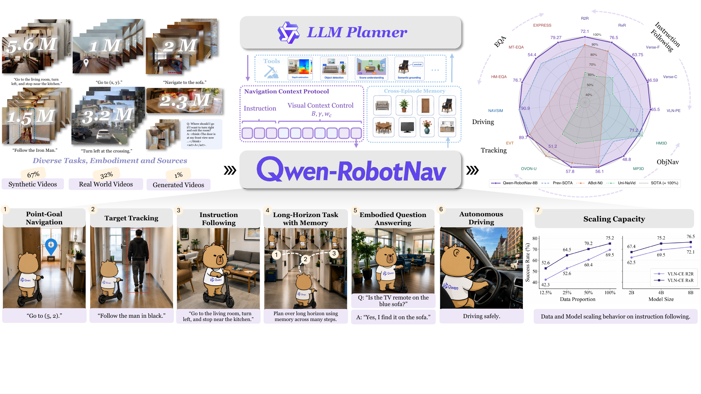
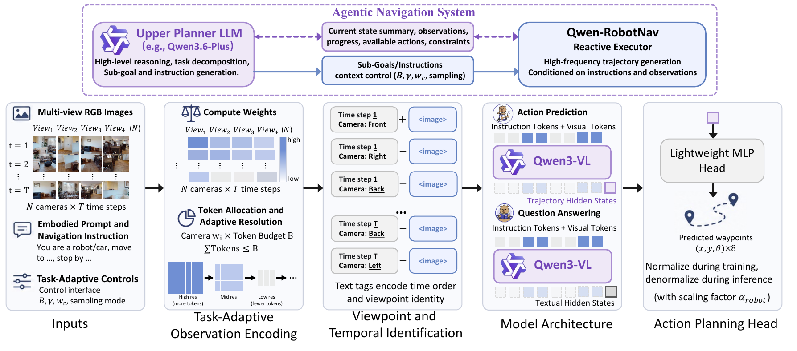
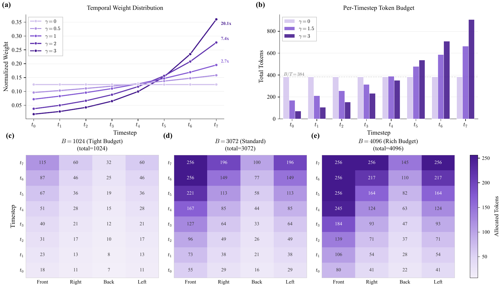
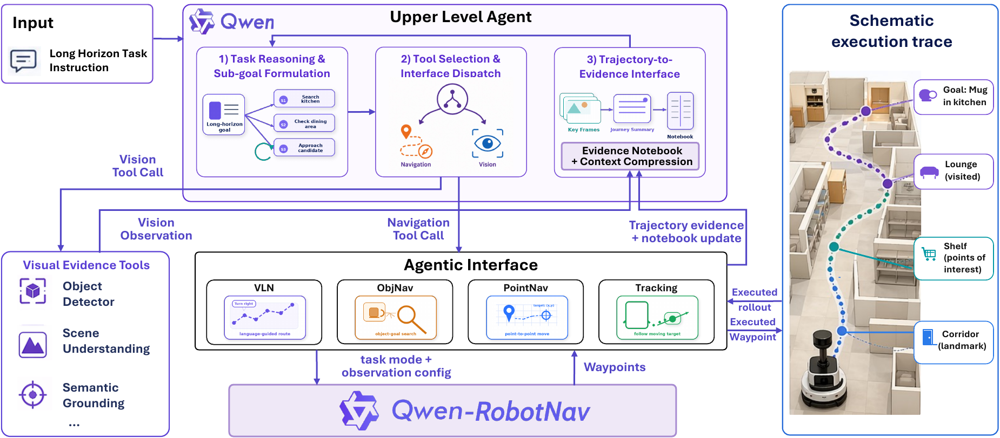
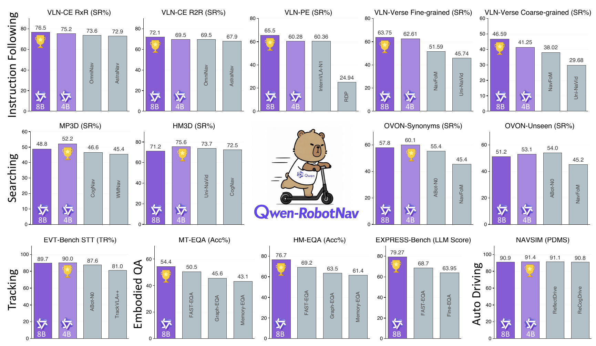
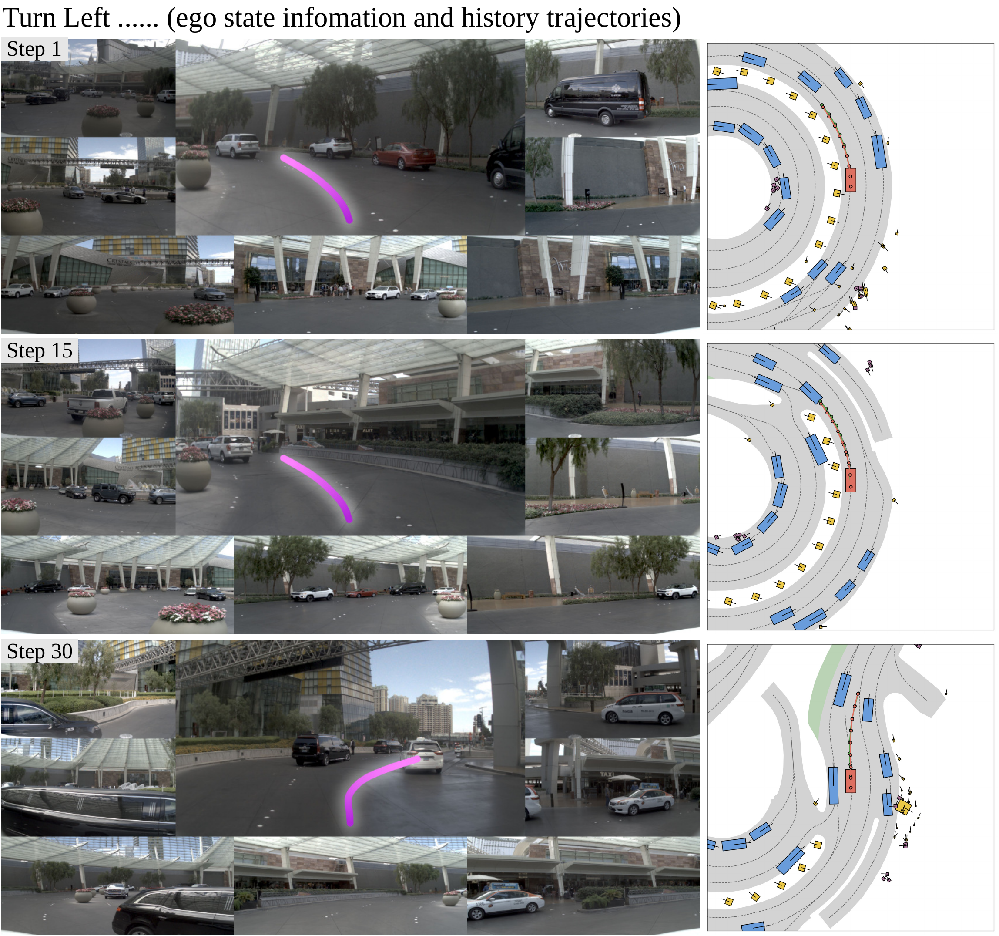

# Qwen-RobotNav (arXiv 2026)

<!-- paper-source: https://chengwei920412.github.io/paper_reading/2606.18112_Qwen_RobotNav_Technical_Report_A_Scalable_Navigation_Model_Designed_for_an_Agentic_Navigation_System/technical_report.html -->

> **arXiv ID**：2606.18112  
> **原文标题**：Qwen-RobotNav Technical Report: A Scalable Navigation Model Designed for an Agentic Navigation System  
> **翻译日期**：2026-10-08

---

## 📋 论文概览 {#_1}

### 基本信息 {#_2}

- **作者**：Qwen Team
- **发表时间**：2026 年 6 月
- **领域**：具身智能、视觉语言导航、机器人学习、自动驾驶、多模态大模型
- **基础模型**：Qwen3-VL
- **训练规模**：1,560 万个样本，其中 85% 为导航轨迹，15% 为导航相关视觉语言推理数据

### 核心贡献 {#_3}

1. 提出统一导航模型 Qwen-RobotNav，将指令跟随、点目标导航、对象目标导航、目标跟踪和自动驾驶统一表述为航点轨迹预测。
2. 将多任务导航的关键矛盾归结为“如何消费观测历史”，并设计任务自适应观测编码：通过视觉 token 预算、时间衰减、相机权重和采样模式，在推理时外部控制上下文策略。
3. 用自然语言标签表达相机视点、时间步与具身形态，不增加位置嵌入或任务专用模型头。
4. 将同一模型封装成可配置导航工具，由上层规划器动态切换任务模式与上下文配置，并用轨迹证据和跨回合记忆支持长时程任务。
5. 在 VLN、对象搜索、主动跟踪、具身问答和自动驾驶等多类基准上取得最先进或有竞争力的结果，并展示面向真实机器人的零样本迁移。

图：Qwen-RobotNav 的数据、模型、上下文协议与自主导航系统概览。

---

## 🎯 研究背景与动机 {#_4}

### 问题定义 {#_5}

不同导航任务共享感知与规划主干，却需要截然不同的记忆范围。指令跟随需要回看较长历史以重新定位地标；目标跟踪更依赖最近几帧；对象搜索则会在全局探索与局部接近之间切换。若使用固定滑动窗口或固定下采样，模型无法随任务和阶段调整信息分配。

论文的目标不是为每类任务增加专用网络，而是让一个统一模型在推理时接收外部配置：任务模式决定“做什么”，观测参数决定“看多少历史、重点看哪些帧和相机”。

### 现有方法的局限性 {#_6}

- 统一导航模型通常使用固定观测策略，难以由外层智能体动态调度。
- 长历史会导致视觉 token 数随时间步和相机数近似按 \(O(TN)\) 增长，迅速耗尽上下文预算。
- 仅用动作轨迹微调视觉语言模型，容易退化为反应式动作映射器并损害开放世界语义理解。
- 把完整视觉流返回上层规划器会造成上下文膨胀，而仅返回成功标志又会丢失后续推理所需的证据。

### 本文的创新点 {#_7}

最关键的创新是把“观测上下文”提升为一等、可外部控制的变量。模型训练时随机化全部观测配置，部署时便可在不重新训练、不改变架构的前提下切换策略。这个接口同时连接了低层导航与高层规划：规划器通过参数调用同一执行器，复杂长时程行为由多次简单导航调用组合而成。

---

## 🔬 方法论 {#_8}

### 整体架构 {#_9}

图：模型接收多相机、多时间步观测与自然语言指令，经任务自适应 token 分配和视点/时间标签组织后输入 Qwen3-VL，最后由轻量级 MLP 动作头回归 8 个航点。

Qwen-RobotNav 由三部分组成：继承自 Qwen3-VL 的视觉编码器、处理视觉与语言 token 的 LLM 主干，以及四层 MLP 动作头。动作头输出 24 维向量，对应 8 个航点的 \((x_k,y_k,\theta_k)\)。

### 关键技术 {#_10}

**1. 任务自适应观测编码**

对时间步 \(t\) 定义权重：

\[\omega_t=\exp\left(\gamma\frac{t}{T&#x27;-1}\right)\]

再结合相机权重 \(w_c\) 构造联合权重：

\[\mathbf{W}[t,c]=\omega_t w_c\]

总 token 预算 \(B\) 先为每个时间步—相机单元分配下限 \(b_{\min}\)，剩余预算按 \(\mathbf{W}\) 比例分配；超出单图上限 \(b_{\max}\) 的部分继续迭代重分配。较大的 \(\gamma\) 更偏向近期帧，较大的 \(B\) 保留更多视觉细节。

图：时间衰减、总 token 预算与逐相机权重共同决定每幅图像的 token 分配。

**2. 自然语言视点与时间标识**

模型用 `Time step 1`、`Front View`、`Back Right View` 等普通词汇把视觉 token 与相机和时间关联起来。优势是复用预训练语言知识，不引入新的位置编码结构；新增机器人平台也只需编写新的提示模板。

**3. 训练时配置随机化与联合训练**

训练中随机采样 \(B\)、\(\gamma\)、\(w_c\)、\(b_{\min}\)、\(b_{\max}\) 和帧采样模式，使模型不能依赖固定配置。损失函数为：

\[\mathcal{L}=\mathcal{L}_{\mathrm{traj}}+\lambda\mathcal{L}_{\mathrm{VL}},\qquad \lambda=1\]

轨迹损失监督航点回归，视觉语言损失保留语义理解与开放世界感知能力。

**4. 面向智能体的导航接口**

一次导航调用可抽象为：

\[\mathcal{W}_i=\texttt{nav\_qwennav}(\mathcal{L}_i,\tau_i,\Phi_i)\]

其中 \(\mathcal{L}_i\) 是子目标指令，\(\tau_i\) 是 VLN、PointNav、ObjNav 或 Tracking 等任务模式，\(\Phi_i\) 是观测配置。上层规划器可在同一回合中切换模式，例如先用大预算、长历史进行对象搜索，发现候选目标后再切换为重近期信息的 Tracking 或局部 PointNav。

图：上层规划器分解任务并配置 Qwen-RobotNav；执行框架把稠密轨迹压缩为关键帧、进度摘要和可审计证据笔记。

### 算法流程 {#_11}

1. 上层规划器把长时程目标分解为子目标。
2. 为子目标选择任务模式 \(\tau_i\) 和观测配置 \(\Phi_i\)。
3. 按时间衰减与相机权重分配视觉 token，并在预算约束内缩放图像。
4. 插入自然语言视点/时间标签，与任务指令共同输入 Qwen3-VL。
5. 动作头预测 8 个航点，机器人执行对应轨迹。
6. 导航执行框架生成轨迹证据、关键帧索引和证据笔记；规划器据此决定下一次调用。

---

## 📊 实验与结果 {#_12}

### 实验设置 {#_13}

- **导航**：VLN-CE R2R/RxR、VLNVerse、VLN-PE、MP3D、HM3D、HM3D-OVON
- **跟踪**：EVT-Bench
- **具身问答**：HM-EQA、MT-HM3D、EXPRESS-Bench
- **自动驾驶**：NAVSIM、AlpaSim
- **模型规模**：2B、4B、8B；8B 模型端到端微调消耗 2,816 个 H100 GPU 小时
- **主要基线**：NavFoM、ABot-N0、InternVLA-N1、Uni-NaVid、TrackVLA++、FAST-EQA、ReCogDrive 等

### 主要结果 {#_14}

<table>
<thead>
<tr>
<th>任务/基准</th>
<th>代表结果</th>
<th>结论</th>
</tr>
</thead>
<tbody>
<tr>
<td>VLN-CE R2R</td>
<td>72.1% SR，66.6% SPL</td>
<td>8B 全景设置超过 NavFoM 和 ABot-N0</td>
</tr>
<tr>
<td>VLN-CE RxR</td>
<td>76.5% SR，72.5 nDTW</td>
<td>长时程指令增益明显</td>
</tr>
<tr>
<td>VLN-PE</td>
<td>65.50% SR，61.19% SPL</td>
<td>同时取得最低导航误差 3.73 m</td>
</tr>
<tr>
<td>HM3D v2 ObjectNav</td>
<td>75.6% SR</td>
<td>4B 仅用 RGB 即建立新的最先进结果</td>
</tr>
<tr>
<td>EVT-Bench</td>
<td>90.0% TR</td>
<td>4B 取得最高跟踪率</td>
</tr>
<tr>
<td>HM-EQA</td>
<td>76.7 SR</td>
<td>Qwen3.6-Plus + Qwen-RobotNav 最佳</td>
</tr>
<tr>
<td>MT-HM3D</td>
<td>54.4 SR</td>
<td>超过 FAST-EQA 等强基线</td>
</tr>
<tr>
<td>EXPRESS-Bench</td>
<td>79.27 LLM Score</td>
<td>相对 FAST-EQA 提高 10.57 个百分点</td>
</tr>
<tr>
<td>NAVSIM</td>
<td>91.4 PDMS</td>
<td>4B 超过 NavFoM 7.1 分</td>
</tr>
</tbody>
</table>

图：多任务基准结果汇总。

自动驾驶实验还表明，短期自车轨迹历史十分关键：加入前三帧真实轨迹作为历史先验后，4B 和 8B 的 NAVSIM PDMS 均提升 11 分以上。

图：NAVSIM 左转场景的闭环规划，预测轨迹随时间保持连贯并逐步对齐驶出车道。

### 消融实验 {#_15}

- 数据量从 12.5% 增加到 100% 时，多数任务持续提升，长时程 VLN 增益最明显；短时程跟踪更早饱和。
- 在 VLN-CE R2R 上，token 预算由 2048 增至 4608 时，SR 从 70.8% 提升至 74.6%，但高预算区间收益并不严格单调。
- 固定 \(B=3072\) 时，增加 \(\gamma\) 能提高近期帧权重；OSR 从 \(\gamma=0.5\) 时的 78.8% 升至 \(\gamma=3.5\) 时的 82.6%，而严格 SR 在 \(\gamma=3.0\) 附近达到峰值后略降。
- 结果说明“更多上下文”并非总是更好，近期细节与长期记忆之间存在任务相关的最优平衡。

---

## 💡 关键见解 {#_16}

### 理论与系统层面的认识 {#_17}

论文没有提出新的 Transformer 主干，而是把上下文分配设计成控制面。这一选择很务实：如果多个任务共享同一感知—规划能力，差异更可能来自信息选择，而不是必须用不同网络表达。训练时配置随机化相当于让模型学习一个条件策略族，部署时参数接口负责选择其中的工作点。

两级记忆同样重要。轨迹证据把连续视觉流压缩成可读、可检索的记录；关键帧索引保留回到原始证据的通道；跨回合笔记则保存已搜索区域和被否定假设。它在“全部保留”与“只给成功标志”之间取得了工程上可行的平衡。

### 实践启示 {#_18}

- 构建具身智能体时，可优先把统一模型暴露为参数化工具，而不是为每个任务训练独立策略。
- 上层规划器最值得控制的变量是 token 预算、近期性偏置和采样模式；相机权重等参数可固定为平台默认值。
- 仅用导航轨迹微调 VLM 有灾难性遗忘风险，保留一定比例的视觉语言推理数据很有必要。
- 云端推理平均速度略快，但设备端延迟更稳定；目标跟踪等实时任务更看重尾延迟而非平均延迟。

---

## 🔍 局限性与未来工作 {#_19}

### 当前局限 {#_20}

1. token 分配本质上仍是手工设计的启发式算法，依赖指数时间权重和预设相机权重，尚未学习“哪些观测最值得保留”。
2. 训练成本较高，8B 模型需要 2,816 个 H100 GPU 小时，复现门槛不低。
3. 部分基准存在设置差异。例如 HM3D v1/v2、单目/全景观测和不同控制器会影响横向比较的严格性。
4. EVT-Bench 中跟踪率最高，但回合成功率仍低于专用跟踪器，说明统一多任务训练存在能力权衡。
5. AlpaSim 零样本结果仍落后于专用驾驶模型，跨域闭环稳定性还有明显提升空间。
6. 自主层依赖文本化证据摘要；如果摘要漏掉关键细节，错误可能被写入长期记忆并累积。

### 未来方向 {#_21}

- 用学习式重要性估计或强化学习替代启发式 token 分配，并显式优化任务收益与计算成本。
- 让规划器根据不确定性主动调整 \(B\)、\(\gamma\) 和相机权重，而非仅依赖固定规则。
- 研究证据笔记的置信度、冲突消解、遗忘机制和跨回合纠错。
- 在更多真实机器人和恶劣网络条件下评估安全性、尾延迟与故障恢复能力。
- 统一不同基准的传感器、控制器和场景版本，开展更严格的等设置比较。

---

## 📚 相关工作对比 {#_22}

<table>
<thead>
<tr>
<th>方法</th>
<th>核心思想</th>
<th>优势</th>
<th>劣势</th>
</tr>
</thead>
<tbody>
<tr>
<td>NavFoM</td>
<td>统一导航基础模型，固定帧采样</td>
<td>多任务能力强</td>
<td>上下文策略不易由外部动态重配</td>
</tr>
<tr>
<td>ABot-N0</td>
<td>通用导航模型与滑动窗口历史</td>
<td>在部分跟踪/导航指标上强</td>
<td>固定窗口隐含单一时间策略</td>
</tr>
<tr>
<td>TrackVLA++</td>
<td>面向主动视觉跟踪的专用 VLA</td>
<td>回合成功率高</td>
<td>任务范围较窄</td>
</tr>
<tr>
<td><strong>Qwen-RobotNav</strong></td>
<td>统一航点预测 + 参数化观测接口 + 自主规划器</td>
<td>可在推理时切换任务与上下文策略，覆盖任务广</td>
<td>token 分配仍偏启发式，统一训练存在任务权衡</td>
</tr>
</tbody>
</table>

---

## 🎓 个人评价 {#_23}

### 优点 {#_24}

- 问题定位清晰：把多任务差异归结为上下文选择，而非无限扩展架构。
- 接口设计可落地，参数具有明确物理含义，便于上层智能体调用与调试。
- 实验覆盖从室内导航到自动驾驶、从模拟到真实机器人，广度较高。
- 同时报告模型效果、数据缩放、配置消融和部署延迟，工程信息较完整。

### 可改进之处 {#_25}

- 应增加严格等传感器、等控制器、等场景版本的消融，以隔离模型结构与评估设置的贡献。
- 可报告不同任务组合下的负迁移程度，以及针对统一模型的任务采样敏感性。
- 长时程记忆部分需要更系统的错误分析，例如摘要遗漏、错误候选目标和跨回合污染。

### 推荐阅读对象 {#_26}

适合研究具身智能、视觉语言导航、机器人基础模型、多模态智能体和端到端自动驾驶的读者，也适合需要设计“上层规划器 + 可配置低层执行器”系统的工程团队。

---

## 📎 附录 {#_27}

### 术语表 {#_28}

<table>
<thead>
<tr>
<th>英文</th>
<th>中文</th>
</tr>
</thead>
<tbody>
<tr>
<td>Agentic Navigation System</td>
<td>自主导航系统</td>
</tr>
<tr>
<td>Task-Adaptive Observation Encoding</td>
<td>任务自适应观测编码</td>
</tr>
<tr>
<td>Visual Token Budget</td>
<td>视觉 token 预算</td>
</tr>
<tr>
<td>Temporal Decay</td>
<td>时间衰减</td>
</tr>
<tr>
<td>Per-Camera Importance Weighting</td>
<td>逐相机重要性加权</td>
</tr>
<tr>
<td>Waypoint Trajectory Prediction</td>
<td>航点轨迹预测</td>
</tr>
<tr>
<td>Trajectory Evidence</td>
<td>轨迹证据</td>
</tr>
<tr>
<td>Context Compression</td>
<td>上下文压缩</td>
</tr>
<tr>
<td>Cross-Episode Memory</td>
<td>跨回合记忆</td>
</tr>
<tr>
<td>Embodied Question Answering</td>
<td>具身问答</td>
</tr>
</tbody>
</table>

### 参考资源 {#_29}

- **论文原文**：[arXiv:2606.18112](https://arxiv.org/abs/2606.18112)
- **中文翻译 PDF**：[paper_cn.pdf](https://chengwei920412.github.io/paper_reading/2606.18112_Qwen_RobotNav_Technical_Report_A_Scalable_Navigation_Model_Designed_for_an_Agentic_Navigation_System/paper_cn.pdf)
- **中文 Markdown 译文**：[paper_cn.md](https://chengwei920412.github.io/paper_reading/2606.18112_Qwen_RobotNav_Technical_Report_A_Scalable_Navigation_Model_Designed_for_an_Agentic_Navigation_System/paper_cn.html)
- **代码实现**：[QwenLM/Qwen-RobotNav](https://github.com/QwenLM/Qwen-RobotNav)
- **项目主页**：[Qwen RobotNav Blog](https://qwen.ai/blog?id=qwen-robotnav)
