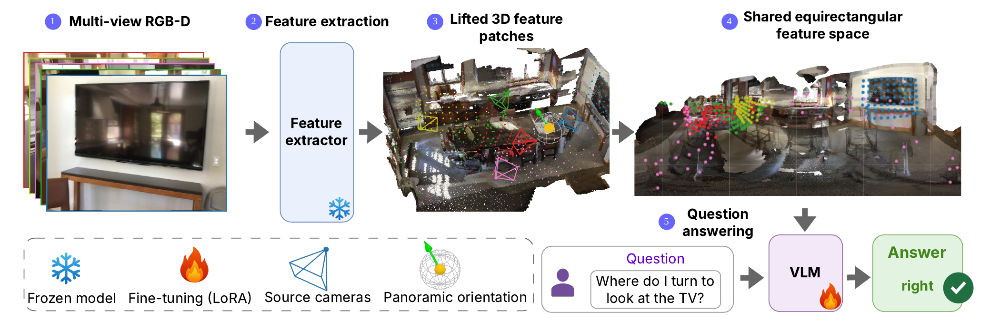
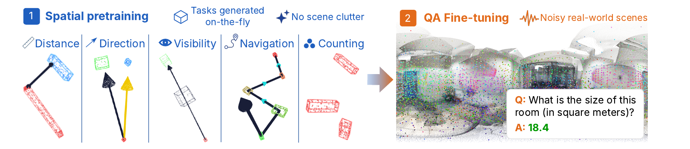
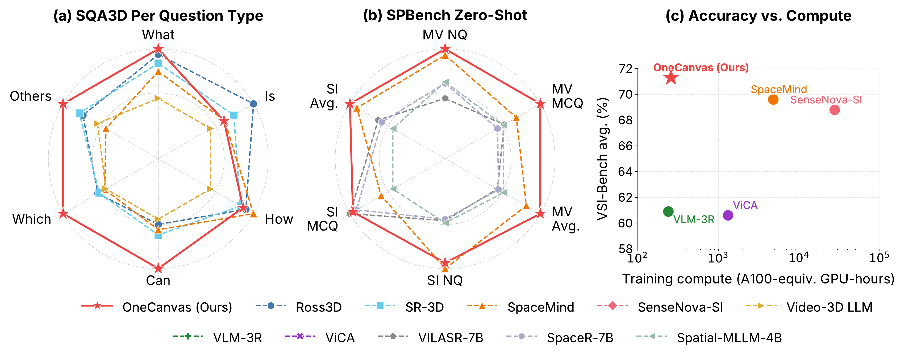

# OneCanvas (arXiv 2026)

<!-- paper-source: https://chengwei920412.github.io/paper_reading/2606.19253_OneCanvas_3D_Scene_Understanding_via_Panoramic_Reprojection/technical_report.html -->

> **arXiv ID**: 2606.19253
> **原文标题**: OneCanvas: 3D Scene Understanding via Panoramic Reprojection
> **翻译日期**: 2026-10-16

---

## 📋 论文概览 {#_1}

### 基本信息 {#_2}

- **作者**: Bartłomiej Baranowski¹、Dave Zhenyu Chen²、Matthias Nießner¹
- **机构**: ¹慕尼黑工业大学（Technical University of Munich）、²华为（Huawei）
- **发表时间**: 2026 年（NeurIPS 2026 投稿版本，arXiv 预印本 2606.19253）
- **领域**: 3D 视觉语言模型 / 空间推理 / 具身智能

### 核心贡献 {#_3}

本文提出 **OneCanvas**，一种把 3D 场景理解重新表述为"全景画布上的 2D 空间推理"的表示方法。核心主张是：**3D 理解能力可以来自输入的组织方式，而非新的架构组件**。

两项贡献：

1. **全景特征重投影（Panoramic Feature Reprojection）**。把来自所有视角的图块（patch）特征聚合到单张等距圆柱（equirectangular）全景画布上。每个图块由其深度与相机位姿反投影到 3D 世界坐标，再按该点相对画布原点所见的连续经纬度放置——不做栅格化，也不跨重叠视角聚合。每个图块额外获得一个编码其度量坐标的可加 3D 位置嵌入。画布原点与朝向可自由选择，因此同一表示既能做以场景为中心的推理，也能做以位姿为中心的情境化推理。
2. **由该表示支持的空间预训练课程（Spatial Pretraining Curriculum）**。在空画布上按程序化方式放置取自真实图像的物体图块特征，即时生成覆盖度量距离、方向、导航、可观测性、计数、包围盒读出六大任务族的监督信号，并刻意控制答案分布以抑制场景统计捷径与类别先验捷径。

与需要专用几何编码器或大规模空间 QA 数据的两类主流路线相比，OneCanvas **不引入任何新架构组件、不含辅助损失项、也不使用专用 3D 编码器**，训练算力比性能最接近的竞争者低一个数量级。

---

## 🎯 研究背景与动机 {#_4}

### 问题定义 {#_5}

机器人在人类环境中行动、AR 助手把指令锚定到用户物理环境、自主智能体在陌生空间中规划轨迹——这些任务都需要回答**本质上三维**的问题：物体*在哪里*、彼此相距多远、朝向哪个方向才能面对它、从给定视点看什么可见什么不可见。构建能从场景的普通视频可靠回答这类问题的 VLM，就是 3D 场景理解的目标。

多数现有 3D-aware VLM 建立在预训练的 2D 视觉语言骨干网络之上，本身没有空间推理机制，因此必须通过某种方式"教会"它们几何。

### 现有方法的局限性 {#_6}

论文把现有路线归为两族，并指出两者各自的代价：

**（一）架构扩展族。** 为 VLM 增加专门的几何模块，包括点云分词器（LL3DA、LEO、Chat-3D、PQ3D）、深度条件化的视频位置编码（Video-3D LLM、LLaVA-3D）、以及 VLM-3R、SpaceMind 等融合几何编码器。代价是：新增模块必须在大规模上联合训练，才能把几何编码器与语言骨干对齐。

**（二）数据扩展族。** SenseNova-SI、Cambrian-S 等整理百万量级空间 QA 对，靠纯粹的数据暴露让几何上毫无特殊设计的 VLM 学会推理距离与方向。代价是：需要整理筛选海量高质量空间问答对。

论文指出的更本质问题在于——**两族方法都没有真正解决问题**。近期审计 [ma2026real3dqa] 发现，在广泛引用的基准（含 SQA3D）上，纯文本基线已能追平甚至接近最先进的几何感知模型。这说明模型依赖的是问题与场景类别的统计规律，而非对所给几何输入的推理。两族方法仍只能逐帧、零散地观察场景，也无法明确把握输入中究竟哪些信号编码了空间关系。

### 本文的创新点 {#_7}

OneCanvas 的洞察是：**与其让模型从像素中隐式地学几何，不如直接把几何"写进"输入的坐标结构里**，同时保持输入格式仍是骨干网络预训练时见过的普通图像。

关键设计选择及其理由：

<table>
<thead>
<tr>
<th>设计选择</th>
<th>替代方案</th>
<th>选择理由</th>
</tr>
</thead>
<tbody>
<tr>
<td>连续角位置</td>
<td>栅格化到固定网格</td>
<td>栅格化会把投影到相近角位置的图块合并（如沿同一视线的被遮挡表面），破坏表面区分，且用固定归约取代预训练注意力的判断</td>
</tr>
<tr>
<td>保留全部图块为独立词元</td>
<td>渲染等距圆柱像素图</td>
<td>渲染需视觉塔重新编码一个它没预训练过的畸变图像，且可见性测试会丢失被遮挡/重合的观测</td>
</tr>
<tr>
<td>3D 位置嵌入加在特征空间</td>
<td>增加 RoPE 维度</td>
<td>保持 3D-RoPE 预训练的角向与时间语义不变（关键：4.3 节消融显示去掉它主要损失度量类能力）</td>
</tr>
<tr>
<td>合成框 + 内联图块引用</td>
<td>真实物体 + 类名引用</td>
<td>门的高度往往一致、卫生间尺寸相差不多，模型可仅凭类别身份答题；去掉身份捷径后任务必须依赖几何</td>
</tr>
</tbody>
</table>

---

## 🔬 方法论 {#_8}

### 整体架构 {#_9}

图：方法概览。多视角图像由 Qwen3-VL 的冻结视觉编码器编码，提升后的图块落在共享等距圆柱全景图上的连续位置。VLM 通过其原生注意力层消费该表示。

输入是一组 \(K\) 张带位姿的 RGB 图像 \(\{I_k\}_{k=1}^{K}\)、度量深度图 \(\{D_k\}\)，以及针孔相机内参 \(C_k=(f_x,f_y,c_x,c_y)\)。流程分两步：

**步骤 1 — 特征提取与 3D 提升。** 每张图像 \(I_k\) 经 Qwen3-VL 冻结视觉编码器得到图块级特征图 \(F_k \in \mathbb{R}^{H_f \times W_f \times D}\)。每个图块 \((u,v)\) 用其深度 \(z = D_k(u,v)\)、缩放到特征图分辨率的内参、以及相机到世界位姿 \(T_k \in \text{SE}(3)\) 提升到世界坐标：

\[\mathbf{p}^{\text{world}}_{u,v} = T_k \begin{pmatrix} (u - c_x)\,z/f_x \\ (v - c_y)\,z/f_y \\ z \end{pmatrix}\]

**符号说明**：\((u,v)\) 是图块在特征图上的像素坐标，\(z\) 是该处度量深度（单位：米），\((c_x,c_y)\) 是主点，\((f_x,f_y)\) 是焦距，因此 \(\big((u-c_x)z/f_x,\ (v-c_y)z/f_y,\ z\big)\) 是相机坐标系下的 3D 点（遵循 OpenCV 约定：x 右、y 下、z 前），\(T_k\) 把它旋转平移变换到世界坐标系。\(T_k\) 的作用定义为 \(T_k\mathbf{x} = R_k\mathbf{x}+\mathbf{t}_k\)，即先旋转 \(R_k\) 再平移 \(\mathbf{t}_k\)。

提升全部 \(K\) 个视角后得到集合 \(\mathcal{P} = \{(\mathbf{p}_i, \mathbf{f}_i, t_i)\}\)：世界坐标 \(\mathbf{p}_i \in \mathbb{R}^3\)、特征 \(\mathbf{f}_i \in \mathbb{R}^D\)、以及记录源帧位置的逐图块时间索引 \(t_i \in \{1,\dots,K\}\)。

**步骤 2 — 全景画布与位置编码。** 画布由原点 \(\mathbf{c} \in \mathbb{R}^3\) 与朝向 \(R \in \text{SO}(3)\) 定义。对每个提升图块，先算画布坐标系下的局部偏移 \(\mathbf{q}_i = R^\top(\mathbf{p}_i - \mathbf{c}) = (q_x,q_y,q_z)\)，再算连续球坐标：

\[\theta_i = \operatorname{atan2}(q_x, q_z), \qquad \phi_i = \arctan\!\left(\frac{-q_y}{\sqrt{q_x^2 + q_z^2}}\right)\]

**为什么纬度是 \(-q_y\)**：图像 y 轴在相机坐标系中指向下方，所以 \(q_y\) 度量的是"向下"的量；取负号后正纬度才朝上，符合地理直觉。

### 关键技术 {#_10}

**（1）位置编码：复用 3D-RoPE，只改内容。** VLM 原样使用自带的 3D 旋转位置编码，唯一改动是位置索引的*内容*：宽度轴 \(W\) ← 经度 \(\theta_i \in [-\pi,\pi]\)，高度轴 \(H\) ← 纬度 \(\phi_i \in [-\pi/2,\pi/2]\)，时间轴 \(T\) ← 源帧索引 \(t_i \in \{1,\dots,K\}\)。三者线性重缩放到 \([0,100]\)，以落在模型预训练时的有效位置分布内。\(T\) 沿用视频中标准的"时间/帧序"语义。**这是全文最关键的一步**：因为 Qwen3-VL 的三维 RoPE 本来就有时间、高度、宽度三个维度，把高度/宽度重新解释为纬度/经度不需要任何权重改动，预训练的注意力模式直接可用。

**（2）3D 位置嵌入：把度量尺度注入特征空间。** 2D VLM 只能从像素学到依赖类别的尺度先验，而非真实的度量读数。因此论文显式编码画布坐标系偏移 \(\mathbf{q}_i=(q_x,q_y,q_z)\)，由三部分拼接：

- 各轴正弦项 \(\{\sin(\omega_k q_a), \cos(\omega_k q_a), q_a\}\)，\(a\in\{x,y,z\}\)，16 个对数间隔频率 \(\omega_k \in [0.1,100]\) rad/m
- 径向基量 \(\|\mathbf{q}_i\|\) 与 \(r_{xz}=\sqrt{q_x^2+q_z^2}\) 的相同形式，8 个对数间隔频率 \(\nu_k \in [0.1,10]\) rad/m
- 单位光线方向 \(\mathbf{q}_i/\|\mathbf{q}_i\|\) 直通

共 136 通道，经隐层宽度 64 的 2 层 MLP 投影，通过学习到的标量门控加到图块特征上。

**设计要点**：径向基量（\(\|\mathbf{q}_i\|\)、\(r_{xz}\)）被直接送入，而不是让模型从三个轴分量自行合成——因为成对距离和占地面积（水平径向读数）正是下游任务高频询问的量，直接暴露可降低学习难度。

**（3）空间预训练课程。** 动机是一个训练动力学问题：仅靠下游 QA，监督是间接的、目标分布狭窄，在几何读数形成前场景外观线索主导梯度，模型会先拟合逐模板的答案边缘分布；一旦这个先验被吸收就难以撼动，因为转向几何读数需要一次暂时性的精度下降，而 QA 梯度不足以奖励这种转变。因此需要一个答案由输入几何**因果决定**、且不存在语言先验或场景记忆捷径的监督信号。全景画布恰是这种监督的自然载体：任意 3D 内容都可放到任意世界位置，度量坐标由逐图块嵌入携带。

**课程物体的关键设计**：在画布上填入从真实场景采样的**单个特征图块**（而非真实物体），并在提示中于类别名出现处**插入同一图块**来指代该放置。这一内联副本保留其在提示文本槽位的 MRoPE 位置（而非画布的经纬度位置），同样接收 3D 位置嵌入。图块取自预计算激活池（来自 ScanNet、ScanNet++、ARKitScenes），因此视觉编码器视其为普通视觉内容。

**六类任务族**（族内扁平加权，每族在每批次占相同份额）：

<table>
<thead>
<tr>
<th>任务族</th>
<th>具体任务</th>
</tr>
</thead>
<tbody>
<tr>
<td>度量测量</td>
<td>成对距离（面到面最短距离，一位小数回归）、四者中的最近者（4 选 1，约束最优先/次优差 ≥5cm）、非矩形占地面积（L/T 形，平方米回归）</td>
</tr>
<tr>
<td>自我中心方向</td>
<td>二分类（左/右）、三分类（左/右/后，&gt;135° 判后）、四分类对角、四分类基本方位（±45° 边界）、相机坐标系方向（易/中/难）、钟面方位（1–12）</td>
</tr>
<tr>
<td>多轮导航</td>
<td>\(N\) 轮路径规划，\(N\in\{1,2,3,4\}\)，答案为转向动作序列（首轮含 Turn Back）</td>
</tr>
<tr>
<td>可观测性</td>
<td>出现顺序（4 框首现 \(T\) 起点为 \(\{k,k+1,k+2,k+3\}\)，4 选 1）、视线可达性（是/否，遮挡框可达比例 ≥10%）</td>
</tr>
<tr>
<td>计数</td>
<td>物体计数、奇偶性、能否被三整除、按方位计数（右/左/前/后）</td>
</tr>
<tr>
<td>多目标包围盒读出</td>
<td>2–4 个框，按由近及远顺序输出轴对齐 3D 包围盒</td>
</tr>
</tbody>
</table>

**抗捷径设计**：每个样本加入 6–12 个提示从不引用的干扰框，各自抽取不同特征，因此既无法靠"唯一不同者"也无法靠"一致的类别"走捷径；奇偶与整除任务的放置数量经采样使两个标签等概率；占地面积任务不加干扰框（额外的框会改变被询问的量）。

**（4）两阶段训练。**

图：两阶段训练。第一阶段在空间预训练课程上训练 LoRA 适配器与 3D 位置嵌入；第二阶段把第一阶段的适配器合并回基础语言模型，并在真实场景下游问答上训练一个全新的更小适配器。两个阶段中词元嵌入始终保持冻结。

- **阶段 1（空间预训练）**：仅用课程训练，LoRA 秩 \(r{=}256\)（\(\alpha{=}512\)，dropout 0.05），有效批大小 16，学习率 \(2\times10^{-5}\)，余弦调度 + 3% 预热。3D 位置嵌入以基础学习率的 50 倍联合训练，且**每次前向传播都被重缩放到视觉特征平均范数的一半**——这样它只学方向不学幅度。每样本放置物体图块数上限 200，每框至少 8 个图块以保留形状。课程样本词元数远少于完整场景，因此阶段 1 便宜，可承担长训练计划。
- **阶段 2（目标适配）**：把阶段 1 的 LoRA 权重**合并**进基础权重（相当于固化进基座），再训练一个全新的低秩 LoRA（\(r{=}64\)，\(\alpha{=}128\)），10k 步，有效批大小 32。数据为 VLM-3R-VSIBench、SQA3D、ViCA 的加权混合（约 70/15/15）。

**阶段 2 低秩的用意**：合并使阶段 1 的几何读取能力成为基座的一部分，而较小的秩限制了阶段 2 偏离该能力的程度，同时仍允许答案格式适配——这是一种"防遗忘"的正则化设计。

### 算法流程 {#_11}

**训练**：多视角 RGB-D → 冻结 ViT 编码 → 深度+位姿提升到 3D → 投影到画布得连续 \((\phi,\theta)\) → 设 3D-RoPE（W=经度，H=纬度，T=帧号）+ 加 3D 位置嵌入 → 阶段 1 课程监督（LoRA \(r{=}256\)）→ 合并 → 阶段 2 真实 QA（LoRA \(r{=}64\)）。

**推理**：同样的流程，但画布原点按任务选——SQA3D 用标注的智能体位置（位置+朝向），SPBench 单图查询用被查询的相机位姿，其余用所有相机位置的质心。训练时还会随机化画布位置与朝向（从相机位置抽场景中心，前向轴旋转均匀随机偏航角），这是一种数据增强，也让经度接缝不在固定位置。

---

## 📊 实验与结果 {#_12}

### 实验设置 {#_13}

- **骨干网络**: Qwen3-VL-8B（ViT 视觉编码器 + 三维 RoPE）
- **训练硬件**: 8 × NVIDIA RTX A6000（Ampere，48 GB GDDR6），DeepSpeed ZeRO-2 + Flash Attention 2；阶段 1 约 25.2 h，阶段 2 约 39.6 h，合计约 64.8 h（518 原始 A6000 GPU 小时 = 259 A100 等效 GPU 小时）
- **数据集/基准**:
- **SQA3D**（情境化问答）：\(K{=}32\) 帧，评测分辨率 \(320\times240\)，指标 EM@1 / EM@R1
- **VSI-Bench**（八项空间子任务，数值题+多选题）：\(640\times480\)，因显式数值测量受益于高分辨率
- **SPBench**（单图+多视角空间推理）：\(640\times480\)，零样本评测
- 训练源场景：ScanNet、ScanNet++、ARKitScenes（用于构建课程激活池）
- **几何来源**: 优先使用数据集真值深度与相机位姿；仅在少数真值位姿轨迹损坏的场景上退回前馈重建模型估计。对 ScanNet 从每张图像各边裁去 3%（并调整内参）以避免场景外的虚假提升点
- **对比方法**: 点云类（PQ3D、3D-VisTA、LEO、SIG3D、Scene-LLM、ChatScene）、视频输入类（Video-3D LLM、GPT4Scene-HDM、VLM-3R、SpaceMind、SR-3D、Loc3R-VLM、Ross3D）、数据扩展类（Cambrian-S、SenseNova-SI）、强化学习类（Spacer、ViLaSR）、其他（ViCA、VST、Video-R1、SpaceR-7B、VILASR-7B、Spatial-MLLM）

### 主要结果 {#_14}

图：**OneCanvas 基准对比。** (a) 在 SQA3D 上的分问题类型准确率，与 (b) 在 SPBench（多视角划分与单图划分）上的零样本准确率，均以雷达图形式与基准性能最接近的竞争方法进行对比。(c) 训练算力（A100 等效 GPU 小时，对数坐标）与 VSI-Bench 准确率的对比。

**SQA3D（表 1，测试划分）**

<table>
<thead>
<tr>
<th>方法</th>
<th>What</th>
<th>Is</th>
<th>How</th>
<th>Can</th>
<th>Which</th>
<th>Others</th>
<th>EM@1</th>
<th>EM@R1</th>
</tr>
</thead>
<tbody>
<tr>
<td>Video-3D LLM</td>
<td>51.1</td>
<td>72.4</td>
<td>55.5</td>
<td>69.8</td>
<td>51.3</td>
<td>56.0</td>
<td>58.6</td>
<td>60.8</td>
</tr>
<tr>
<td>GPT4Scene-HDM</td>
<td>55.9</td>
<td>69.9</td>
<td>50.8</td>
<td>68.7</td>
<td>53.3</td>
<td>60.4</td>
<td>59.4</td>
<td>62.4</td>
</tr>
<tr>
<td>VLM-3R</td>
<td>--</td>
<td>--</td>
<td>--</td>
<td>--</td>
<td>--</td>
<td>--</td>
<td>60.7</td>
<td>63.4</td>
</tr>
<tr>
<td>SpaceMind</td>
<td>54.1</td>
<td>74.8</td>
<td><strong>61.7</strong></td>
<td>71.0</td>
<td>51.9</td>
<td>53.6</td>
<td>61.1</td>
<td>63.8</td>
</tr>
<tr>
<td>SR-3D</td>
<td>55.0</td>
<td>76.4</td>
<td>59.8</td>
<td>71.6</td>
<td>54.7</td>
<td>61.1</td>
<td>62.2</td>
<td>--</td>
</tr>
<tr>
<td>Loc3R-VLM</td>
<td>--</td>
<td>--</td>
<td>--</td>
<td>--</td>
<td>--</td>
<td>--</td>
<td>62.8</td>
<td>65.0</td>
</tr>
<tr>
<td>Ross3D</td>
<td>56.0</td>
<td><strong>79.8</strong></td>
<td>60.6</td>
<td>70.4</td>
<td>55.3</td>
<td>60.1</td>
<td>63.0</td>
<td>65.7</td>
</tr>
<tr>
<td><strong>OneCanvas（本文方法）</strong></td>
<td><strong>56.6</strong></td>
<td>74.7</td>
<td>60.2</td>
<td><strong>75.4</strong></td>
<td><strong>72.6</strong></td>
<td><strong>65.7</strong></td>
<td><strong>65.3</strong></td>
<td><strong>68.4</strong></td>
</tr>
</tbody>
</table>

在最直接考察情境化推理的问题类型（*Which*、*Can*、*Others*）上取得最佳，其中 *Which* 领先幅度最大（72.6 vs 次优 55.3，**领先 17.3 个点**）。剩余差距集中在 *Is*（是非题，文本先验承载大部分信号）与 *How*（以计数为主，基线 2D VLM 已充分预训练）。

**SPBench（表 2，零样本）**

<table>
<thead>
<tr>
<th>方法</th>
<th>总体</th>
<th>MV NQ</th>
<th>MV MCQ</th>
<th>MV 平均</th>
<th>SI NQ</th>
<th>SI MCQ</th>
<th>SI 平均</th>
</tr>
</thead>
<tbody>
<tr>
<td>VILASR-7B</td>
<td>54.0</td>
<td>56.2</td>
<td>59.6</td>
<td>57.9</td>
<td>36.6</td>
<td><strong>63.7</strong></td>
<td>50.2</td>
</tr>
<tr>
<td>SpaceMind</td>
<td>67.3</td>
<td>76.2</td>
<td>70.5</td>
<td>73.8</td>
<td><strong>66.3</strong></td>
<td>53.2</td>
<td>59.7</td>
</tr>
<tr>
<td><strong>OneCanvas（本文方法）</strong></td>
<td><strong>72.1</strong></td>
<td><strong>79.0</strong></td>
<td><strong>91.8</strong></td>
<td><strong>81.5</strong></td>
<td>62.8</td>
<td>62.7</td>
<td><strong>62.8</strong></td>
</tr>
</tbody>
</table>

最大增益集中在多视角多选题（**91.8**，比次优 70.5 高出 **21.3 个点**）——与"单张全景画布为多视角问题提供统一参考系，而不必迫使 VLM 拼接若干独立视图"的直觉一致。单图划分的平均准确率同样第一。

**VSI-Bench（表 3）**

<table>
<thead>
<tr>
<th>方法</th>
<th>平均</th>
<th>物体计数</th>
<th>绝对距离</th>
<th>物体尺寸</th>
<th>房间尺寸</th>
<th>相对距离</th>
<th>相对方向</th>
<th>路径规划</th>
<th>出现顺序</th>
</tr>
</thead>
<tbody>
<tr>
<td>ViCA</td>
<td>60.6</td>
<td>68.8</td>
<td>57.0</td>
<td><strong>79.2</strong></td>
<td>75.1</td>
<td>58.5</td>
<td>42.6</td>
<td>34.5</td>
<td>68.8</td>
</tr>
<tr>
<td>VLM-3R</td>
<td>60.9</td>
<td>70.2</td>
<td>49.4</td>
<td>69.2</td>
<td>67.1</td>
<td>65.4</td>
<td>80.5</td>
<td>45.4</td>
<td>40.1</td>
</tr>
<tr>
<td>Cambrian-S</td>
<td>67.5</td>
<td>73.2</td>
<td>50.5</td>
<td>74.9</td>
<td>72.2</td>
<td>71.1</td>
<td>76.2</td>
<td>41.8</td>
<td><strong>80.1</strong></td>
</tr>
<tr>
<td>SenseNova-SI</td>
<td>68.8</td>
<td>72.0</td>
<td>53.5</td>
<td>76.8</td>
<td>72.8</td>
<td>69.6</td>
<td>80.8</td>
<td>48.5</td>
<td>76.4</td>
</tr>
<tr>
<td>SpaceMind</td>
<td>69.6</td>
<td><strong>73.3</strong></td>
<td>61.4</td>
<td>77.3</td>
<td>74.2</td>
<td>67.2</td>
<td><strong>88.4</strong></td>
<td>44.3</td>
<td>70.6</td>
</tr>
<tr>
<td><strong>OneCanvas（本文方法）</strong></td>
<td><strong>71.3</strong></td>
<td>68.9</td>
<td><strong>62.3</strong></td>
<td>75.1</td>
<td><strong>76.8</strong></td>
<td><strong>73.1</strong></td>
<td>88.0</td>
<td><strong>60.8</strong></td>
<td>65.7</td>
</tr>
</tbody>
</table>

平均 71.3 位居第一。**路径规划上领先幅度最大（60.8 vs 次优 48.5，领先 12.3 个点）**——该子任务最直接地考察基于统一全景画布的多步推理。绝对距离、相对距离、房间尺寸同样第一。

**算力对比（表 13/15）**

<table>
<thead>
<tr>
<th>方法</th>
<th>GPU</th>
<th>数量</th>
<th>实际耗时</th>
<th>A100 等效 GPU 小时</th>
<th>相对本文</th>
<th>VSI-Bench</th>
</tr>
</thead>
<tbody>
<tr>
<td><strong>OneCanvas（本文方法）</strong></td>
<td>A6000</td>
<td>8</td>
<td>64.8 h</td>
<td>259</td>
<td>\(1\times\)</td>
<td><strong>71.3</strong></td>
</tr>
<tr>
<td>VLM-3R</td>
<td>H200</td>
<td>16</td>
<td>5 h</td>
<td>240</td>
<td>\(0.9\times\)</td>
<td>60.9</td>
</tr>
<tr>
<td>ViCA</td>
<td>H100</td>
<td>8</td>
<td>55 h</td>
<td>1,320</td>
<td>\(5.1\times\)</td>
<td>60.6</td>
</tr>
<tr>
<td>SpaceMind</td>
<td>H100</td>
<td>64</td>
<td>25 h</td>
<td>4,800</td>
<td>\(19\times\)</td>
<td>69.6</td>
</tr>
<tr>
<td>SenseNova-SI</td>
<td>H100</td>
<td>128</td>
<td>72 h</td>
<td>27,648</td>
<td>\(107\times\)</td>
<td>68.8</td>
</tr>
</tbody>
</table>

**"低一个数量级"的范围**：准确率最接近的两个方法 SpaceMind（69.6）与 SenseNova-SI（68.8）分别用了 19× 与 107× 的峰值归一化算力。作者明确限定这一论断的范围——**不是普遍算力优势**：VLM-3R 的归一化算力（240）甚至略低于本文（259），ViCA 为 5.1×，但二者 VSI-Bench 仅为 60.9 与 60.6；算力相当时 VLM-3R 低 10.4 个点。

### 消融实验 {#_15}

**组件消融（表 4，VSI-Bench）**

<table>
<thead>
<tr>
<th>配置</th>
<th>平均</th>
<th>物体计数</th>
<th>绝对距离</th>
<th>物体尺寸</th>
<th>房间尺寸</th>
<th>相对距离</th>
<th>相对方向</th>
<th>路径规划</th>
<th>出现顺序</th>
</tr>
</thead>
<tbody>
<tr>
<td><strong>完整模型（本文方法）</strong></td>
<td><strong>71.3</strong></td>
<td>68.9</td>
<td><strong>62.3</strong></td>
<td>75.1</td>
<td><strong>76.8</strong></td>
<td>73.1</td>
<td>88.0</td>
<td>60.8</td>
<td><strong>65.7</strong></td>
</tr>
<tr>
<td>完整模型（去掉 3D PE）</td>
<td>70.4</td>
<td>69.3</td>
<td>58.1</td>
<td>76.1</td>
<td>71.3</td>
<td>70.3</td>
<td>88.6</td>
<td><strong>66.0</strong></td>
<td>63.8</td>
</tr>
<tr>
<td>全景 + 3D PE</td>
<td>68.5</td>
<td>68.3</td>
<td>56.6</td>
<td><strong>76.9</strong></td>
<td>74.1</td>
<td><strong>73.2</strong></td>
<td><strong>91.6</strong></td>
<td>45.4</td>
<td>61.3</td>
</tr>
<tr>
<td>仅全景</td>
<td>65.3</td>
<td>68.8</td>
<td>54.8</td>
<td>76.8</td>
<td>56.9</td>
<td>71.6</td>
<td>87.4</td>
<td>45.3</td>
<td>60.4</td>
</tr>
<tr>
<td>基线 VLM（多视角）</td>
<td>65.5</td>
<td><strong>72.5</strong></td>
<td>53.2</td>
<td>75.8</td>
<td>68.6</td>
<td>68.9</td>
<td>77.4</td>
<td>43.9</td>
<td>63.4</td>
</tr>
</tbody>
</table>

三条结论：

1. **去掉空间预训练阶段**（"全景 + 3D PE" 行）→ 路径规划从 60.8 **崩到 45.4**（跌 15.4 点），确认课程对该能力的价值；整体从 71.3 跌至 68.5。
2. **去掉 3D 位置嵌入**（"全景 + 3D PE" vs "仅全景"）→ **房间尺寸从 74.1 崩到 56.9**（跌 17.2 点），而其他度量类问题相对稳定（模型仍可依场景外观推断）；角度类与类别类子任务不受影响。这印证了 3D 位置嵌入充当**度量尺度辅助通道**的定位。注意反直觉的一点：去掉 3D PE 反而让路径规划升到 66.0——纯角度索引可能更利于纯拓扑的多步推理。
3. **统一全景表示 vs 直接送图**（"仅全景" vs "基线 VLM"）→ 需要跨场景不同区域关联物体的任务明显更好，相对方向提升最大（87.4 vs 77.4）。
4. **唯一的例外是物体计数**：基线 VLM 保持微弱领先（72.5 vs 68.9）。作者归因于重排本身使输入偏离骨干预训练时的图像布局，而计数主要取决于有多少词元显示被查询物体、以及这些词元有多集中，而非空间理解。深度粗化对照（粗化至 8× 使 29% 图块落到不同表面，而计数得分稳定在 68.4/68.8/69.3/68.9）排除了"重投影误差打碎/合并实例"这一解释。

**画布原点消融（表 5，SQA3D）**

<table>
<thead>
<tr>
<th>画布原点</th>
<th>What</th>
<th>Is</th>
<th>How</th>
<th>Can</th>
<th>Which</th>
<th>Others</th>
<th>EM@1</th>
<th>EM@R1</th>
</tr>
</thead>
<tbody>
<tr>
<td><strong>智能体位姿</strong></td>
<td><strong>56.6</strong></td>
<td><strong>74.7</strong></td>
<td>60.2</td>
<td><strong>75.4</strong></td>
<td><strong>72.6</strong></td>
<td><strong>65.7</strong></td>
<td><strong>65.3</strong></td>
<td><strong>68.4</strong></td>
</tr>
<tr>
<td>场景中心</td>
<td>54.6</td>
<td>74.2</td>
<td>59.8</td>
<td>68.9</td>
<td>56.7</td>
<td>58.9</td>
<td>61.2</td>
<td>64.3</td>
</tr>
<tr>
<td>随机相机</td>
<td>54.8</td>
<td>74.4</td>
<td><strong>61.3</strong></td>
<td>68.9</td>
<td>55.6</td>
<td>58.9</td>
<td>61.4</td>
<td>64.6</td>
</tr>
<tr>
<td>场景外</td>
<td>54.0</td>
<td>73.6</td>
<td>60.0</td>
<td>68.3</td>
<td>51.3</td>
<td>55.7</td>
<td>59.8</td>
<td>62.7</td>
</tr>
</tbody>
</table>

用智能体位姿在多数任务上明显更好，*Is* 与 *How* 除外（通常与视角无关）。**关键观察：*Which* 从 72.6（智能体位姿）跌到 56.7/55.6（场景中心/随机相机）——而这正是最依赖视角的问题类型**。只有场景外原点使各任务一致下降。这组消融与 SQA3D 主结果中 *Which* 的大幅领先相互印证。

**其他关键对照实验**

- **由 RGB 预测的几何**（附录 B.1，仅推理替换）：用 Depth Anything 3 替换全部真值几何，SQA3D 64.9（−0.4）、VSI-Bench 70.0（−1.3）、SPBench 71.3（−0.8），**仍全部高于表中已有方法**。作者谨慎限定：这只说明对该特定前馈估计器鲁棒，不代表对重建失败免疫或联合训练几何编码器的性能。
- **仅推理栅格化**（附录 B.2）：把连续画布改成固定网格（\(181\times362\) 得 68.2、\(90\times180\) 得 67.7、\(45\times90\) 得 65.8），均低于连续的 71.1。**损失主要出现在最细网格上的出现顺序（62.6 → 39.8，占 2.9 点平均差距中的 2.8 点）**——因为两种归约都只保留每单元一个帧索引，首次出现不再可恢复。把均值池化换成保留一个原始图块得 68.6 而非 68.2，说明平均本身不是主因。
- **特征画布 vs 渲染像素**（附录 B.2，匹配 2000 步）：60.8 vs 52.1，差 8.7 点（大于约 1 点的逐步波动）。作者明确指出这**同时反映两个差异，不应解读为隔离其中任一**：z 缓冲渲染把被遮挡/重合表面压成一个，且渲染组要求透视图像预训练的视觉塔重新编码等距圆柱图像。
- **随机种子复现**（附录 B.3，完整 10,000 步）：VSI-Bench \(70.4\pm0.6\)、SQA3D \(65.1\pm0.9\)、SPBench \(73.2\pm0.3\)，三个种子**全部**超过此前最优（69.6 / 63.0 / 67.3）。这是很有分量的鲁棒性证据。
- **其他骨干网络**（附录 B.4）：ERNIE-4.5-VL-28B-A3B 在匹配 2000 步下 +canvas 比 backbone alone 整体 +6.1（物体计数 +14.6、房间尺寸 +13.6、出现顺序 +10.7）；Qwen3.5-9B 用完整两阶段配方得 69.42 / 67.18 / 69.81。
- **经度接缝探针**（附录 B.5）：接缝把角度间隔小的两物体分开时误差显著（\(15^\circ\) 时 0.14 → 1.23 m），随间隔增大可忽略（\(170^\circ\) 时 0.69 vs 0.71）；影响 0.63% 的 VSI-Bench 绝对距离问题（214 题中的 1 题）。

---

## 💡 关键见解 {#_16}

### 理论分析 {#_17}

**（一）"表示即归纳偏置"这一主张的边界。** 论文的核心论点是 3D 理解可以来自输入组织方式而非架构。消融数据有力地支持了这一点——去掉课程只损失 2.8 点平均（但路径规划 -15.4），去掉 3D PE 只损失 0.9 点平均（但房间尺寸 -17.2）。也就是说，**全景重投影本身（"仅全景" 65.3）就已经达到基线 VLM（65.5）的水平，而三个组件叠加才到 71.3**。真正的贡献不是单点突破，而是三个互补组件各自的针对性增益：课程 → 多步推理，3D PE → 度量读数，统一画布 → 跨区域关联。

**（二）为什么复用 3D-RoPE 是必要条件。** 如果 Qwen3-VL 只有一维位置编码，就需要为角度坐标设计自定义的编码，或者退化为栅格化（而栅格化的代价已由附录 B.2 量化）。三维 RoPE 的存在使"把高度/宽度轴重新解释为纬度/经度"成为零成本的改动。作者也意识到这个依赖——附录 B.2 末尾提到"对于一维位置编码无法赋予任意角度坐标的 VLM，栅格网格仍可能把画布扩展出去"。

**（三）课程设计的反直觉之处：用合成框而非真实物体。** 直觉上，用真实物体配上类名应该更好（还顺带获得文本-物体接地能力）。但附录 A 的对照显示合成框方案在平均上略优（71.3 vs 70.2），且在相对距离（73.1 vs 67.8）与出现顺序（65.7 vs 60.8）上明显更好；真实物体方案只在物体计数（69.8 vs 68.9）与房间尺寸（79.6 vs 76.8）上占优。**这验证了"类别先验是真捷径"这一假设**——真实物体方案重新引入了"门的典型高度、卫生间的典型尺寸"这类可被模型利用的统计规律。

### 实践启示 {#_18}

1. **若已有带 3D-RoPE 的 VLM 骨干，全景重投影是低成本改造**：冻结视觉塔、只训 LoRA 与一个小 MLP 位置嵌入，8 张 A6000 上约 65 小时。
2. **几何质量要求比想象中宽松**：Depth Anything 3 的预测几何只损失 0.4–1.3 点，这对没有真值深度的实际部署很重要。
3. **画布原点应随任务选择**：涉身/情境化任务（"从我的位置看 X 在哪个方向"）必须用智能体位姿为中心；*Which* 类问题在这个选择上敏感度极高（±16 点）。
4. **对计数类任务保持谨慎**：本方法在计数上不及基线 2D VLM，若应用以计数为主，需要在布局保持上做额外处理。
5. **"算力低一个数量级"的表述需按其限定理解**：范围限于与本文准确率相近的方法，不是普遍优势（VLM-3R 的算力更低但准确率低 10.4 点）。

---

## 🔍 局限性与未来工作 {#_19}

### 当前局限 {#_20}

论文自陈的三点（结论节）：

1. **依赖深度与相机位姿**，而纯 RGB 方法无需这两者。位姿估计失败仍可能使画布质量下降（附录 B.1 的仅推理 Depth Anything 3 评测缩小了这一差距，但只是针对该特定前馈估计器，不代表对重建失败免疫）。
2. **单一全局全景图以精细空间精度换紧凑性**，可能限制其在大规模或室外场景中的表现。
3. **预训练课程为人工设计**：要新增一类性质不同的空间技能，就得编写新的任务生成器，而非收集更多数据。

此外，从附录可以读出两点作者未在结论中强调的限制：

1. **经度接缝造成的角度索引不连续**依然存在，影响 0.63% 的绝对距离问题；对跨越接缝的查询很常见的场景，可能需要针对性课程样例或感知环绕的位置编码。
2. **对骨干的位置编码方案有隐含依赖**：方法能零成本落地的前提是骨干具备多维（至少二维）位置编码；一维位置编码的 VLM 需要退化为栅格化，代价见附录 B.2。

### 未来方向 {#_21}

- **课程任务的自动化生成**，以缓解"人工设计课程"这一扩展性瓶颈（例如从下游任务的错误模式反向合成新任务族）。
- **接缝感知的位置编码**，或利用推理时自由的画布偏航角把接缝转到低敏感区域。
- **与强化学习路线结合**：论文指出带空间奖励信号的方法（Spacer、ViLaSR 等）与表示选择正交，原则上可与全景画布结合。
- **扩展到室外/大尺度场景**：当前单一全局全景图对精细精度的牺牲在这一设定下最受考验。
- **与预测几何估计器联合训练**（而非当前的仅推理替换），可能进一步缩小真值几何与预测几何之间的差距。

---

## 📚 相关工作对比 {#_22}

<table>
<thead>
<tr>
<th>方法</th>
<th>核心思想</th>
<th>优势</th>
<th>劣势</th>
</tr>
</thead>
<tbody>
<tr>
<td>点云类 3D VLM（LL3DA、LEO、PQ3D、Chat-3D）</td>
<td>为语言骨干配备专用点云分词器，端到端训练 3D QA</td>
<td>显式几何；验证了 LLM 做 3D 场景推理的可行性</td>
<td>需要点云输入；新增模块须大规模联合训练；SQA3D 多在 47–50</td>
</tr>
<tr>
<td>视频位置编码类（Video-3D LLM、LLaVA-3D）</td>
<td>把深度图算出的 3D 位置编码注入视频表示</td>
<td>无需显式点云编码器，打通视频与 3D</td>
<td>需训练对齐；SQA3D 58.6</td>
</tr>
<tr>
<td>几何融合类（VLM-3R、SpaceMind、Ross3D、SR-3D、GPT4Scene）</td>
<td>从单目视频提取 3D 词元并与视觉特征融合</td>
<td>精度高（SpaceMind VSI-Bench 69.6）；无需深度输入</td>
<td>力算力巨大（SpaceMind 4800 A100 等效小时，19× 本文）；仍逐帧零散观察场景</td>
</tr>
<tr>
<td>数据扩展类（SenseNova-SI、Cambrian-S）</td>
<td>整理百万级空间 QA 对，靠数据暴露教会几何</td>
<td>架构无改动；VSI-Bench 68.8/67.5</td>
<td>算力极高（SenseNova-SI 27648 A100 等效小时，107× 本文）；需海量高质量标注</td>
</tr>
<tr>
<td>全景类（PanoGrounder、PanoEnv、LiftProj）</td>
<td>用全景表示做 3D 定位/拼接；研究 ERP 畸变</td>
<td>360° 视场天然保留长距离关系</td>
<td>需为视觉塔重新渲染等距圆柱图像再编码；PanoEnv 表明 ERP 畸变仍是现成 VLM 的难题</td>
</tr>
<tr>
<td>BEV 方法（LSS 等，自动驾驶）</td>
<td>2D 特征反投影到 3D 再重投影到规范视图</td>
<td>范式成熟</td>
<td>目标是 BEV 栅格，非 VLM 可消费的表示</td>
</tr>
<tr>
<td><strong>本文 OneCanvas</strong></td>
<td>特征级重投影到连续全景画布 + 复用骨干 3D-RoPE + 合成框课程</td>
<td>零架构改动；算力低一个数量级；SQA3D 65.3 / VSI-Bench 71.3 / SPBench 72.1 均最优；Depth Anything 3 几何下仍领先</td>
<td>需深度与位姿；单一全局全景牺牲精细精度；课程人工设计；计数任务不及基线；经度接缝存在局部不连续</td>
</tr>
</tbody>
</table>

---

## 🎓 个人评价 {#_23}

### 优点 {#_24}

1. **方法简洁且论证诚实。** 没有新架构组件、没有辅助损失——这在 3D VLM 领域是罕见的克制。更难得的是论文主动限定了自己的最强论断："算力低一个数量级"明确写为"范围限于与本文准确率相近的方法，而非所有基线"，并主动指出 VLM-3R 的归一化算力（240）甚至略低于本文。
2. **消融设计具有很强的解释力。** 不是简单堆砌"去掉 X 掉 Y 点"，而是让每个组件的失效模式与直觉对应：课程失效 → 路径规划崩（多步推理）；3D PE 失效 → 房间尺寸崩（度量读数）；重排失效 → 相对方向变差（跨区域关联）、计数变差（布局敏感）。这种"失效模式匹配功能假设"的论证方式比单纯的平均分更有说服力。
3. **随机种子复现做得扎实。** 三个种子用完整 10,000 步调度，全部保留并全部超过此前最优，标准差 0.3–0.9。在当前论文普遍只报单次运行的背景下，这是可信度的重要加分。
4. **对不利结果不回避。** 计数任务落后于基线这一事实被明确报告，并配了深度粗化对照来排除一种竞争解释，最后诚实地说"更好的空间表示无法弥补这一代价"。附录 B.2 中 8.7 点的特征/像素差也被明确标注"不应被解读为隔离其中任一差异"。
5. **附录 A 的课程内容对照有价值。** 合成框 vs 真实物体的对照（71.3 vs 70.2）实证了"类别先验是捷径"这一假设，是方法论层面可迁移的结论。

### 可改进之处 {#_25}

1. **对位置编码方案的依赖未被充分讨论。** 方法的关键前提是骨干有 3D（或多维）RoPE。虽然 ERNIE-4.5-VL 和 Qwen3.5-9B 的迁移结果提供了部分证据，但这两个骨干也都具备多维位置编码。**缺少一个真正的一维位置编码骨干对照**，因此"表示与骨干解耦"这一说法在位置编码维度上的适用边界仍不清晰。
2. **"单一全局全景图"这一限制缺少量化。** 结论只说"可能限制其在大规模或室外场景中的表现"，但没有实验支撑（例如随场景尺度/面积增长的性能曲线）。这是最容易被后续工作挑战的一点。
3. **几种仅推理消融的结论强度有上限。** 栅格化对照用的是在连续画布上训练的检查点（作者已声明）；若为网格重新训练，结论可能不同。同理，特征 vs 像素的 8.7 点差距混合了两个变量。这些都被作者诚实标注了，但也意味着这几项对照只能提供"方向性"证据。
4. **深度估计器的选择只测了一种。** 附录 B.1 只用了 Depth Anything 3（DA3NESTED-GIANT-LARGE-1.1），作者自己也说明这只证明对该特定估计器鲁棒。
5. **课程任务族的完备性未论证。** 六族任务是人工设计的（这是论文承认的局限），但缺少对"为什么不选其他任务"或"任务族覆盖哪些空间能力维度"的系统性分析。附录 D 给出了精确的 I/O 格式，这有助于复现，但无助于判断覆盖面。
6. **推理开销未报告。** 9600 个图块词元 vs 基线的多视角输入，序列长度大幅增加。虽然训练算力有详细表格，但**论文完全没有报告推理延迟或显存占用**——这在"比竞争者低一个数量级训练算力"的叙事下是一个显著的信息缺口，因为部署成本主要取决于推理而非训练。

### 推荐阅读对象 {#_26}

- **3D VLM / 空间推理研究者**：本文是"表示优先于架构"这一路线的代表性工作，其消融设计方法值得借鉴。
- **具身智能 / 机器人研究者**：以智能体位姿为画布原点的设计直接对应机器人"从我的视角看"的需求，且 Depth Anything 3 几何下仍领先意味着不依赖真值深度传感器。
- **资源受限的研究团队**：8×A6000 约 65 小时即可复现，代码与模型已开源，是进入 3D VLM 领域的低门槛起点。
- **对空间推理捷径问题感兴趣的读者**：附录 A 的课程内容对照与引言中的审计发现，共同构成对该领域评测有效性的批判性视角。

---

## 📎 附录 {#_27}

### 重要公式 {#_28}

**世界坐标提升**（把像素+深度+位姿映射到世界坐标）：

\[\mathbf{p}^{\text{world}}_{u,v} = T_k \begin{pmatrix} (u - c_x)\,z/f_x \\ (v - c_y)\,z/f_y \\ z \end{pmatrix}\]

其中 \(T_k\mathbf{x} = R_k\mathbf{x}+\mathbf{t}_k\)，\((u,v,z)\) 遵循 OpenCV 约定（x 右、y 下、z 前）。

**球坐标**（画布坐标系下，\(\mathbf{q}_i = R^\top(\mathbf{p}_i-\mathbf{c})\)）：

\[\theta_i = \operatorname{atan2}(q_x, q_z), \qquad \phi_i = \arctan\!\left(\frac{-q_y}{\sqrt{q_x^2 + q_z^2}}\right)\]

若取 \(\mathbf{q}=(1,0,1)\)（右前方 45°、水平），则 \(\theta=\operatorname{atan2}(1,1)=45^\circ\)、\(\phi=\arctan(0)=0^\circ\)。

**位置编码映射**（复用骨干 3D-RoPE，仅改内容）：

\[W \leftarrow \mathrm{scale}_{[0,100]}(\theta_i), \qquad H \leftarrow \mathrm{scale}_{[0,100]}(\phi_i), \qquad T \leftarrow t_i \in \{1,\dots,K\}\]

**A100 等效算力归一化**：

\[\text{A100-equiv. GPU-h} = (\text{\# GPUs}) \times (\text{wall-clock h}) \times \frac{\text{TFLOPS}_{\text{src}}}{\text{TFLOPS}_{\text{A100}}}\]

其中 \(\text{TFLOPS}_{\text{A100}} = 312\)（稠密 BF16，无 2:4 稀疏），A6000 因子 0.5×，H100/H200 因子 3.0×。

### 术语表 {#_29}

<table>
<thead>
<tr>
<th>英文</th>
<th>中文</th>
<th>说明</th>
</tr>
</thead>
<tbody>
<tr>
<td>panoramic canvas</td>
<td>全景画布</td>
<td>本文核心表示，单张等距圆柱图承载全部视角的图块</td>
</tr>
<tr>
<td>equirectangular (ERP)</td>
<td>等距圆柱</td>
<td>全景图的投影方式；经度→宽度、纬度→高度</td>
</tr>
<tr>
<td>patch / patch feature</td>
<td>图块 / 图块特征</td>
<td>ViT 视觉编码器的输出单元</td>
</tr>
<tr>
<td>3D lifting</td>
<td>3D 提升</td>
<td>用深度与位姿把 2D 图块反投影到 3D 世界坐标</td>
</tr>
<tr>
<td>(re)projection</td>
<td>（重）投影</td>
<td>把 3D 点映射到画布的经纬度</td>
</tr>
<tr>
<td>3D-RoPE</td>
<td>三维旋转位置编码</td>
<td>Qwen3-VL 的位置编码方案，含时间/高度/宽度三轴</td>
</tr>
<tr>
<td>MRoPE</td>
<td>MRoPE（保留）</td>
<td>多模态旋转位置编码，指 VLM 中承载多轴位置信息的机制</td>
</tr>
<tr>
<td>3D position embedding</td>
<td>3D 位置嵌入</td>
<td>本文提出的可加嵌入，编码图块度量坐标（136 通道）</td>
</tr>
<tr>
<td>rasterization</td>
<td>栅格化</td>
<td>把图块归约到固定像素网格（本文反对的做法）</td>
</tr>
<tr>
<td>canvas origin</td>
<td>画布原点</td>
<td>\((\mathbf{c}, R)\)，可自由选择以支持不同推理视角</td>
</tr>
<tr>
<td>spatial pretraining curriculum</td>
<td>空间预训练课程</td>
<td>阶段 1 的程序化合成监督</td>
</tr>
<tr>
<td>distractor box</td>
<td>干扰框</td>
<td>提示不引用的放置框，防止"唯一物体"捷径</td>
</tr>
<tr>
<td>situated reasoning</td>
<td>情境化推理</td>
<td>从特定视角出发的空间推理</td>
</tr>
<tr>
<td>longitude seam</td>
<td>经度接缝</td>
<td>经度周期性与位置索引非周期性之间的不连续</td>
</tr>
<tr>
<td>gate</td>
<td>门控</td>
<td>控制 3D 位置嵌入注入强度的可学习标量</td>
</tr>
</tbody>
</table>

### 参考资源 {#_30}

- **论文原文**: [arXiv:2606.19253](https://arxiv.org/abs/2606.19253)
- **中文翻译 PDF**: [paper_cn.pdf](https://chengwei920412.github.io/paper_reading/2606.19253_OneCanvas_3D_Scene_Understanding_via_Panoramic_Reprojection/paper_cn.pdf)
- **中文 Markdown 译文**: [paper_cn.md](https://chengwei920412.github.io/paper_reading/2606.19253_OneCanvas_3D_Scene_Understanding_via_Panoramic_Reprojection/paper_cn.html)
- **代码与模型**: <https://github.com/baranowskibrt/onecanvas>
- **项目主页**: <https://baranowskibrt.github.io/onecanvas/>
