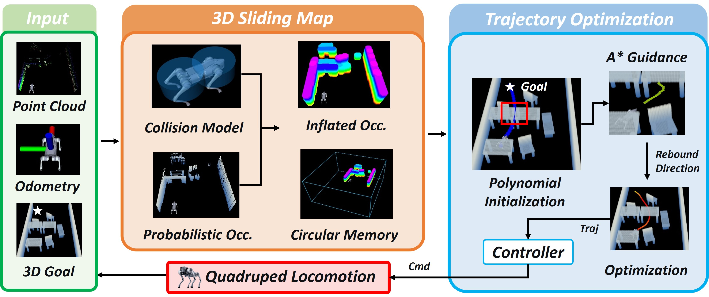

# SCAN Planner (arXiv 2026)

<!-- paper-source: https://chengwei920412.github.io/paper_reading/2606.19555_SCAN_Planner_Spatial_Collision_Aware_Local_Planning_for_Route_Guided_Long_Range_Quadruped_Navigation/technical_report.html -->

> **arXiv ID**：2606.19555  
> **原文标题**：SCAN-Planner: Spatial Collision-Aware Local Planning for Route-Guided Long-Range Quadruped Navigation  
> **翻译日期**：2026-09-15

## 论文概览 {#_1}

论文解决四足机器人在狭窄通道、悬垂三维障碍、楼梯和大尺度路线跟随中进行局部规划的问题。核心系统将偏航感知的双圆柱机身模型、贴地投影 A\(^\ast\) 引导、B 样条反弹优化和循环缓冲滑动占据图整合在一起。

## 方法与创新 {#_2}

1. **双圆柱机身足迹**：不把机器人压缩成单一圆形，而以两圆柱的圆心在三维膨胀图中查询。圆柱随局部轨迹切线旋转，因此碰撞判定能反映机身在不同偏航下的真实横向净空。
2. **高度正则与投影搜索**：初始路径高度按水平弧长从起点线性过渡到目标；A\(^\ast\) 在这张倾斜贴地面上搜索，优化中又抑制 \(z\) 梯度。这避免自由三维搜索把地面机器人“抬”过障碍。
3. **滑动图与回退**：环形缓冲复用离开窗口的体素内存，增量维护膨胀层。图内目标不可达时，虚拟边界层为搜索提供假设出口，出口体素转为真实图内可执行的局部回退目标。

图：输入、滑动图、规划与控制的闭环关系。

## 实验解读 {#_3}

密集障碍场中，SCAN-Planner 的 SR/CR/SPL 为 **1.00 / 0.00 / 0.95**，优于四个对比方法。关键原因不是单纯增大安全半径，而是利用偏航变化后的机身轮廓通过窄道。悬桌场景验证了完整三维占据表达的必要性；楼梯场景表明，较短但越过障碍的自由三维路径并不一定可供接触式地面运动执行。

真实部署覆盖杂乱房间、急弯、动态行人与跨楼层楼梯，并完成 149 米办公楼巡检和 367 米校园配送，说明滑动图的内存有界性与路线引导机制适合长程运行。

## 优点、局限与方向 {#_4}

优点在于模型简洁：不显式优化偏航变量，却能将偏航影响纳入碰撞检查；投影搜索也避免了不必要的三维自由度。局限是双圆柱仍是近似模型，不能表达腿部姿态、复杂载荷或动态可通行性；\(z\) 梯度抑制依赖局部高度趋势正确，极端地形可能需要更强的地形语义与接触约束。后续可将可通行性预测、足端规划、动态障碍预测和自主探索接入该框架。

## 术语表 {#_5}

<table>
<thead>
<tr>
<th>英文</th>
<th>中文</th>
</tr>
</thead>
<tbody>
<tr>
<td>Spatial Collision-Aware</td>
<td>空间碰撞感知</td>
</tr>
<tr>
<td>Yaw-Aware Footprint</td>
<td>偏航感知足迹</td>
</tr>
<tr>
<td>Rebound Optimization</td>
<td>反弹优化</td>
</tr>
<tr>
<td>Projected A\(^\ast\)</td>
<td>投影 A\(^\ast\)</td>
</tr>
<tr>
<td>Sliding Map</td>
<td>滑动地图</td>
</tr>
<tr>
<td>Whole-Body Collision Checking</td>
<td>全身碰撞检查</td>
</tr>
</tbody>
</table>

## 参考资源 {#_6}

- **论文原文**：[arXiv](https://arxiv.org/abs/2606.19555)
- **中文翻译 PDF**：[paper_cn.pdf](https://chengwei920412.github.io/paper_reading/2606.19555_SCAN_Planner_Spatial_Collision_Aware_Local_Planning_for_Route_Guided_Long_Range_Quadruped_Navigation/paper_cn.pdf)
- **中文 Markdown 译文**：[paper_cn.md](https://chengwei920412.github.io/paper_reading/2606.19555_SCAN_Planner_Spatial_Collision_Aware_Local_Planning_for_Route_Guided_Long_Range_Quadruped_Navigation/paper_cn.html)
- **代码实现**：[SCAN-Planner](https://github.com/wuyi2121/SCAN-Planner)
