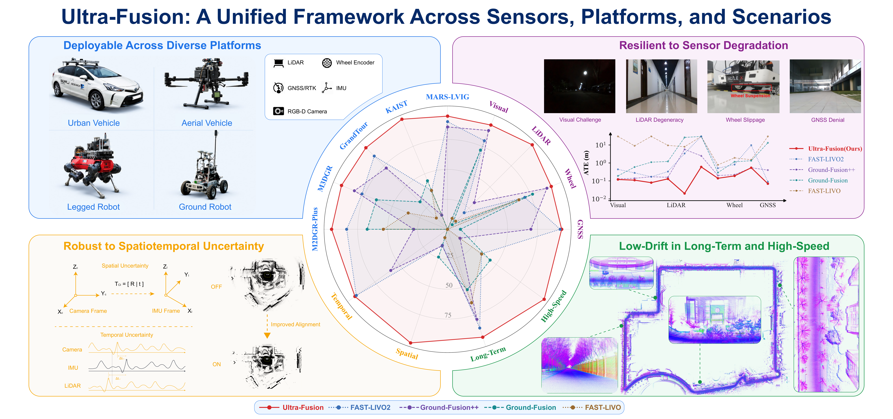
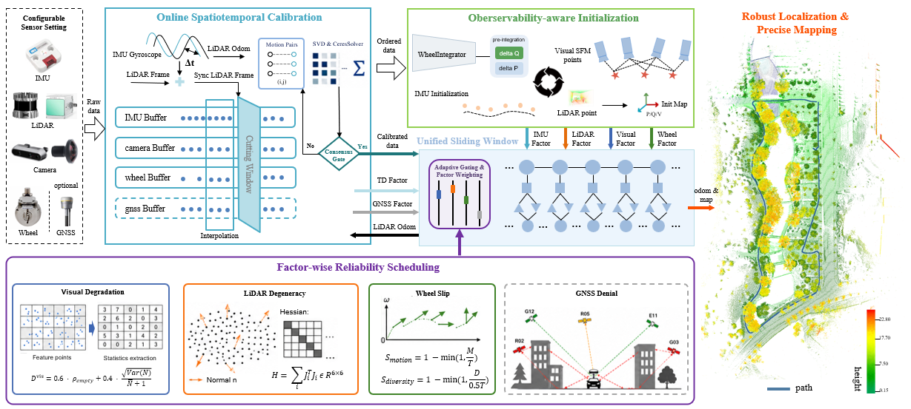
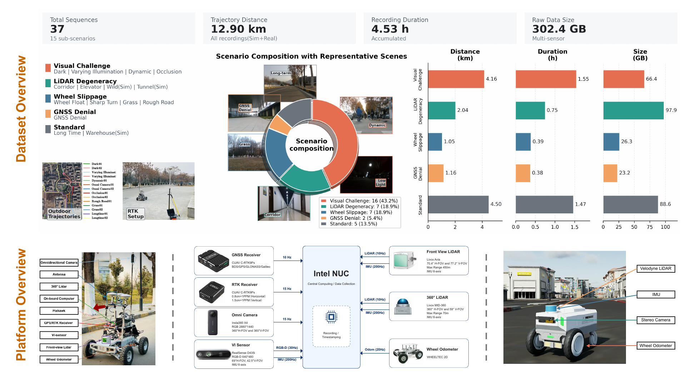
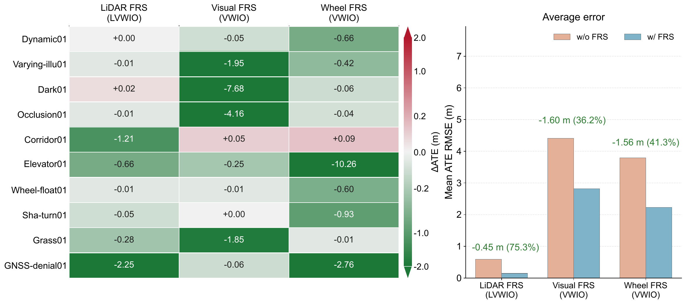
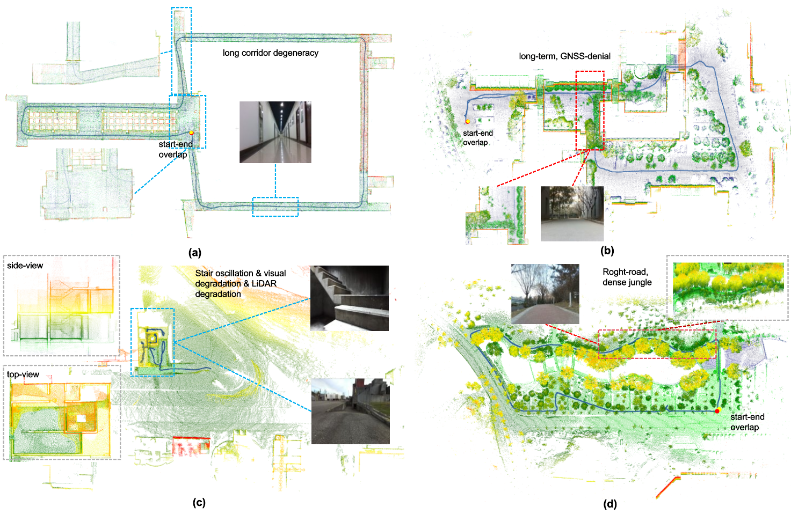
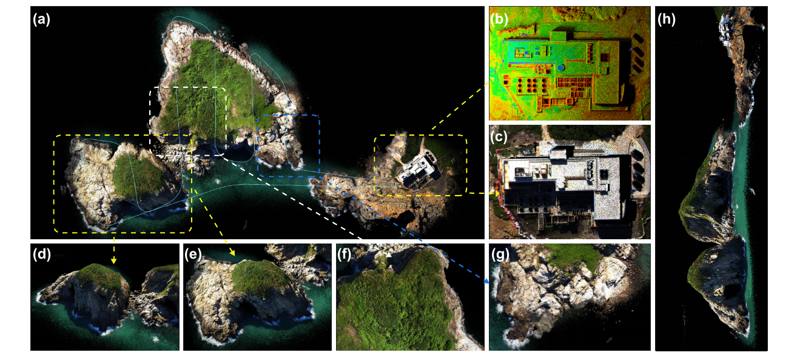

# Ultra-Fusion (arXiv 2026)

<!-- paper-source: https://chengwei920412.github.io/paper_reading/2606.21223_Ultra_Fusion_A_Resilient_Tightly_Coupled_Multi_Sensor_Fusion_SLAM_Framework_under_Sensor_Degradation_and_Spatiotemporal_Perturbation_for_Intelligent_Transportation_Systems/technical_report.html -->

> 原文链接：[Ultra-Fusion (arXiv 2026)](https://chengwei920412.github.io/paper_reading/2606.21223_Ultra_Fusion_A_Resilient_Tightly_Coupled_Multi_Sensor_Fusion_SLAM_Framework_under_Sensor_Degradation_and_Spatiotemporal_Perturbation_for_Intelligent_Transportation_Systems/technical_report.html)

> **arXiv ID**：2606.21223  
> **原文标题**：Ultra-Fusion: A Resilient Tightly-Coupled Multi-Sensor Fusion SLAM Framework under Sensor Degradation and Spatiotemporal Perturbation for Intelligent Transportation Systems  
> **翻译日期**：2026-08-21

## 论文概览 {#_1}

### 基本信息 {#_2}

- **作者**：Yihong Tian、Junjie Zhang、Liuyang Li、Deteng Zhang、Yunfei Zuo、Jie Yin
- **机构**：北京理工大学、重庆大学、四川大学、西北工业大学、上海交通大学
- **研究领域**：多传感器融合、SLAM、状态估计、智能交通与自主机器人

### 核心贡献 {#_3}

Ultra-Fusion 将轮速计、相机、LiDAR、IMU 与 GNSS 的异步观测统一表述为滑动窗口中的可选因子，使 WIO、VIO、LIO、LVIO 及其轮速计/GNSS 增强配置共享状态、初始化、可靠性调度、标定和边缘化逻辑。论文进一步提出可观测性感知初始化（OAI）、逐因子可靠性调度（FRS）和在线时空标定（OSC），并扩展 M3DGR 基准，对 60 余种开源 SLAM 系统开展跨平台、大规模对比。

图：Ultra-Fusion 面向多种传感器、平台和退化场景的总体定位。

## 研究背景与动机 {#_4}

智能交通定位系统必须同时面对传感器配置差异和可靠性随时间变化：车辆会遭遇 GNSS 中断和轮胎打滑，四足机器人受身体振荡与接触滑移影响，无人机则容易遇到高空弱结构和快速视角变化。低照度、运动模糊、动态遮挡、LiDAR 几何退化以及时钟/外参误差还会让固定置信度融合产生系统性偏差。

现有系统往往针对某种传感器组合分别设计状态、初始化和后端，切换配置时需要改动整套流程；同时，强制使用已经退化的观测会污染联合优化。论文的核心观点是：不同配置不应被视为相互独立的流水线，而应统一成“可靠观测按需进入同一个估计问题”的框架。

## 方法论 {#_5}

### 整体架构 {#_6}

异步 ROS 消息先按时间戳排序，各模态前端生成视觉重投影、LiDAR 扫描到地图、IMU 预积分、轮速计和 GNSS 因子。OAI 依据当前可观测性选择启动方式，FRS 对不可靠因子进行门控或协方差膨胀，OSC 在运动激励和传感器质量足够时更新 LiDAR–IMU 时间偏移与旋转外参。保留的因子进入共享滑动窗口，由同一状态和边缘化先验联合优化。

图：Ultra-Fusion 的统一多传感器估计流程。

### 关键技术 {#_7}

1. **统一滑动窗口估计器**：以时间有序的状态节点组织异构观测，每种传感器因子均为可选项；缺失某种传感器不会改变后端接口或边缘化机制。
2. **可观测性感知初始化**：根据静止状态、IMU 激励、轮速计支持、视觉视差和 LiDAR 几何条件，在视觉—惯性、静止/轮速辅助、LiDAR 辅助 MAP 或延迟初始化之间选择。
3. **逐因子可靠性调度**：从视觉特征数量与空间分布、LiDAR 几何条件、IMU 激励、轮速一致性和 GNSS 创新量分别估计可靠性；退化观测被拒绝或降低权重。
4. **在线时空标定**：时间线程搜索 LiDAR–IMU 偏移，外参线程更新旋转；只有在数据重叠、置信度、运动激励和观测可靠性达标时才允许更新，避免欠激励条件下标定漂移。
5. **混合局部地图**：使用优化位姿维护局部几何并对齐彩色 LiDAR 观测，兼顾定位约束和大尺度地图一致性。

### 极简流程 {#_8}

传感器消息进入时间缓冲区后，系统依次执行前端处理、OAI 启动判断、FRS 因子筛选、OSC 条件更新、滑动窗口联合优化和旧状态边缘化。该流程对 WIO/VIO/LIO/LVIO 保持不变，区别仅在于哪些可选因子被激活。

## 数据集与实验 {#_9}

论文在 M3DGR、M2DGR-Plus、KAIST、GrandTour、MARS-LVIG、HILTI22 等数据上评估，覆盖轮式、四足和无人机平台。扩展后的 M3DGR 含 37 条真实与仿真序列，总里程约 12.9 km、时长约 4.53 h、数据量 302.4 GB，场景包括视觉退化、LiDAR 退化、轮滑、GNSS 拒止、长时运行以及 Wild/Warehouse/Tunnel 仿真扰动。

图：M3DGR 的场景规模、采集平台和传感器配置。

主要指标包括绝对轨迹误差（ATE）RMSE、漂移率、相对轨迹误差（RTE）、初始化延迟和单帧运行时间。对比方法覆盖视觉、视觉惯性、LiDAR、LiDAR 惯性、LiDAR—视觉—惯性以及轮速计/GNSS 增强系统。

## 主要结果 {#_10}

### 模块消融 {#_11}

- FRS 分别使 LiDAR、视觉和轮速计配置的平均 ATE 降低 0.45 m（75.3%）、1.60 m（36.2%）和 1.56 m（41.3%）；在 GNSS-denial01 上，GNSS 门控将误差从 2.77 m 降到 1.79 m。
- 完整 OAI 的平均/中位初始化延迟为 0.153/0.150 s，20 s 平均 ATE 为 0.483 m；关闭自适应初始化后，平均延迟增至 4.642 s，平均 ATE 增至 16.808 m。

图：逐因子可靠性调度在 M3DGR 上的消融结果。

### 退化与标定扰动 {#_12}

- 在 Isaac Sim 的 Wild01/Wild02/Tunnel01/Tunnel02 上，完整 Ultra-Fusion 的 ATE RMSE 分别为 0.06、0.70、0.08、2.21 m；Tunnel02 中多种基线达到 14.42–1310.17 m 或失败。
- Wild01 注入 \(\pm300\) ms IMU 时间偏移时，完整系统 RMSE 仍为 0.0319–0.0403 m；关闭 OSC 后最高增至 1.0094 m。
- HILTI22 注入 \(0^\circ\)–\(10^\circ\) 外参旋转误差时，完整系统保持 0.10–0.25 m；FAST-LIVO2 在 \(10^\circ\) 时达到 940.37 m。
- Longtime02 上加入经过完整性检查的 GNSS 因子后，ATE 从 17.40 m 降至 8.45 m，说明绝对定位被作为辅助约束而非系统生存的前提。

图：长走廊退化、GNSS 拒止、四足楼梯运动和粗糙道路等压力场景的重建与轨迹。

### 长时、高速与跨平台验证 {#_13}

- 两条超过 30 min 的 M3DGR 序列上，Ultra-Fusion 的 ATE 分别为 4.3 m 和 2.8 m，均为表中最低。
- KAIST 城市道路序列速度覆盖 25.2–96.9 km/h，LVWIO 平均漂移率为 0.38%。
- GrandTour 四足机器人测试中，Ultra-Fusion 在四条序列中的三条取得最低 RTE。
- MARS-LVIG 无人机测试的平均 RMSE 为 1.40 m、平均排名 1.3，在六条代表性序列中的四条排名第一。
- Intel Core i9-14900K 上，实时配置每次优化耗时 5.48–10.73 ms。

图：MARS-LVIG HKisland03 大尺度无人机序列的三维重建。

## 关键见解 {#_14}

Ultra-Fusion 的优势并非让所有模态始终发挥同等作用，而是显式承认“可用”和“可靠”不同：传感器仍有数据输出时，其因子也可能因弱几何、遮挡、滑移或异常创新量而不应进入优化。统一后端使可靠性判断能够直接作用于同一目标函数，也让标定更新共享估计器对运动激励和残差质量的判断。

另一个工程启示是将配置变化处理成因子集合变化，而非系统结构变化。这样既降低了多平台部署的维护成本，也能在 GNSS 中断或视觉完全失效时保持连续估计。不过，框架的鲁棒性仍受基本可观测性约束：如果所有互补模态同时缺失某个自由度的信息，门控只能防止错误约束，不能凭空恢复状态。

## 局限性与未来工作 {#_15}

论文重点验证定位和几何建图，尚未引入语义场景理解与显式动态目标推理。实验覆盖很广，但不同配置和平台的对比方法、传感器质量及可用序列并不完全相同，因此“统一框架优于专用系统”的结论仍需更多严格配对实验支持。作者还注明两条长时序列、M3DGR Sim、完整源码均计划在论文接收后发布，当前复现性取决于后续开放进度。

后续工作可将因子可靠性扩展到语义与动态对象层面，并研究可靠性估计自身的标定与不确定性；也可在跨域部署中学习传感器质量先验，同时保留当前基于物理可观测性的安全门控。针对长时间运行，进一步纳入回环、地图生命周期管理和标定参数缓慢漂移模型会更贴近量产系统。

## 综合评价 {#_16}

论文最突出的价值是把多配置、退化处理和在线标定放入一个可执行的统一估计框架，并用大规模、跨平台实验检验其工程适用性。消融结果对三个核心模块均给出了明确支持，尤其是初始化延迟与时空扰动实验具有说服力。

需要谨慎看待的是，系统包含较多手工阈值和平台相关门控，补充材料也说明噪声、残差上限和门限会随 LiDAR 类型或运动模式调整；这可能增加迁移时的调参成本。建议读者结合源码发布后的配置组织、失败恢复和边缘化实现评估实际复现难度。

适合多传感器状态估计、自动驾驶定位、移动机器人 SLAM、在线标定和鲁棒因子图方向的研究者与工程师阅读。

## 术语表 {#_17}

<table>
<thead>
<tr>
<th>英文术语</th>
<th>中文译名</th>
</tr>
</thead>
<tbody>
<tr>
<td>Unified Sliding-Window Estimator</td>
<td>统一滑动窗口估计器</td>
</tr>
<tr>
<td>Observability-Aware Initialization (OAI)</td>
<td>可观测性感知初始化</td>
</tr>
<tr>
<td>Factor-Wise Reliability Scheduling (FRS)</td>
<td>逐因子可靠性调度</td>
</tr>
<tr>
<td>Online Spatiotemporal Calibration (OSC)</td>
<td>在线时空标定</td>
</tr>
<tr>
<td>sensor degradation</td>
<td>传感器退化</td>
</tr>
<tr>
<td>spatiotemporal miscalibration</td>
<td>时空标定偏差</td>
</tr>
<tr>
<td>wheel slippage</td>
<td>车轮打滑</td>
</tr>
<tr>
<td>LiDAR degeneracy</td>
<td>LiDAR 退化</td>
</tr>
<tr>
<td>marginalization prior</td>
<td>边缘化先验</td>
</tr>
</tbody>
</table>

## 参考资源 {#_18}

- **论文原文**：[arXiv 2606.21223](https://arxiv.org/abs/2606.21223)
- **中文翻译 PDF**：[paper_cn.pdf](https://chengwei920412.github.io/paper_reading/2606.21223_Ultra_Fusion_A_Resilient_Tightly_Coupled_Multi_Sensor_Fusion_SLAM_Framework_under_Sensor_Degradation_and_Spatiotemporal_Perturbation_for_Intelligent_Transportation_Systems/paper_cn.pdf)
- **中文 Markdown 译文**：[paper_cn.md](https://chengwei920412.github.io/paper_reading/2606.21223_Ultra_Fusion_A_Resilient_Tightly_Coupled_Multi_Sensor_Fusion_SLAM_Framework_under_Sensor_Degradation_and_Spatiotemporal_Perturbation_for_Intelligent_Transportation_Systems/paper_cn.html)
- **代码实现**：[Ultra-Fusion](https://github.com/sjtuyinjie/Ultra-Fusion)
- **数据集**：[M3DGR](https://github.com/sjtuyinjie/M3DGR)
- **项目主页**：[Ultra-Fusion Project](https://sjtuyinjie.github.io/ultrafusion-web/)
