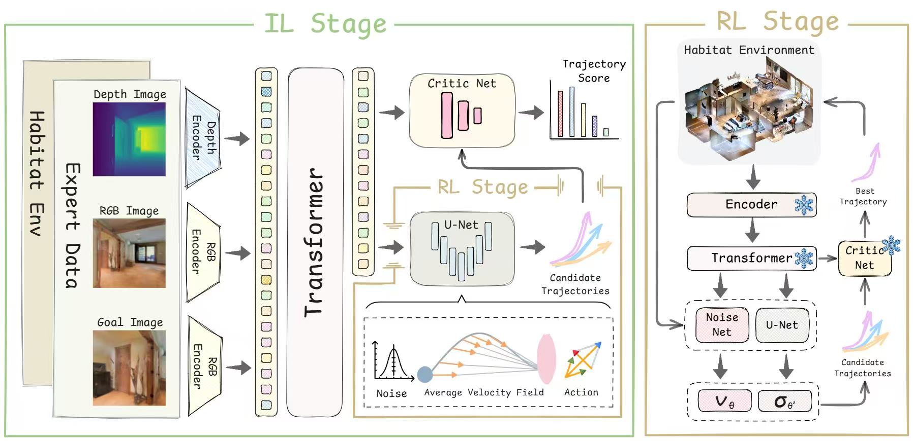
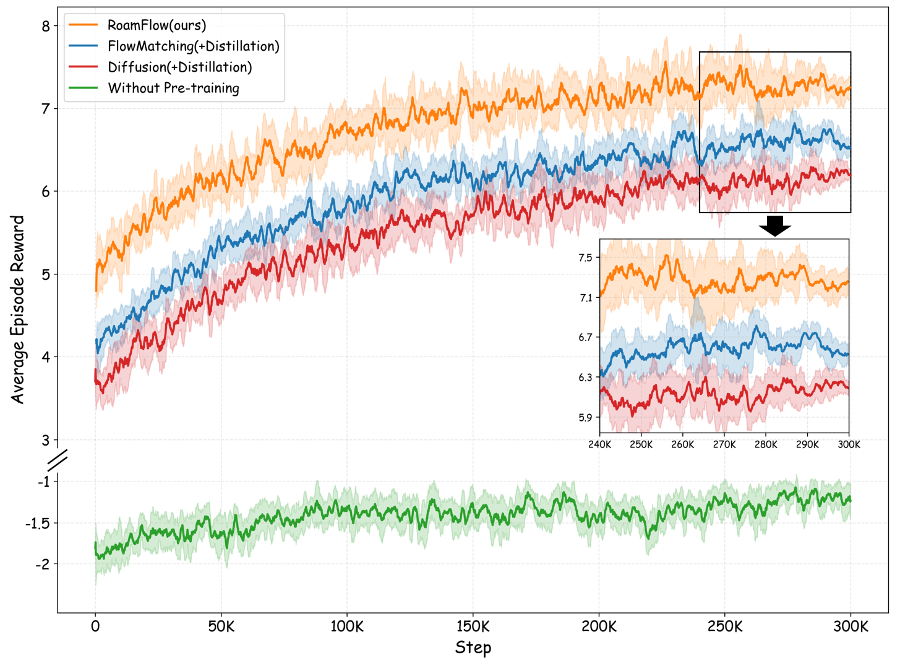
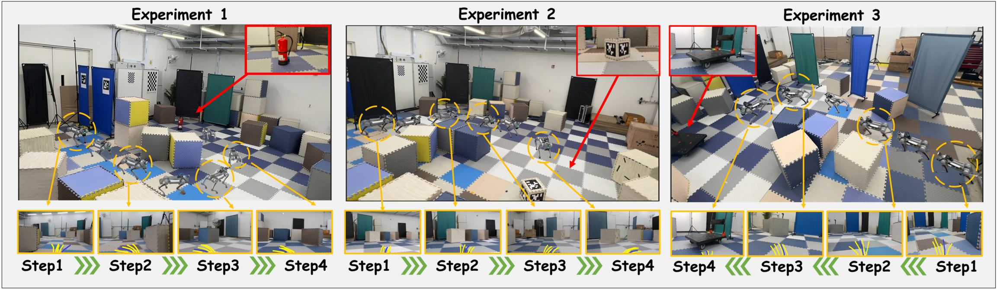

# RoamFlow (arXiv 2026)

<!-- paper-source: https://chengwei920412.github.io/paper_reading/2606.29934_RoamFlow_Reinforcement_Aligned_One_Step_Action_MeanFlow_Policy_for_Image_Goal_Navigation/technical_report.html -->

## 资源 {#_1}

- 中文 PDF：[paper_cn.pdf](https://chengwei920412.github.io/paper_reading/2606.29934_RoamFlow_Reinforcement_Aligned_One_Step_Action_MeanFlow_Policy_for_Image_Goal_Navigation/paper_cn.pdf)
- 完整中文译文：[paper_cn.md](https://chengwei920412.github.io/paper_reading/2606.29934_RoamFlow_Reinforcement_Aligned_One_Step_Action_MeanFlow_Policy_for_Image_Goal_Navigation/paper_cn.html)
- arXiv：<https://arxiv.org/abs/2606.29934>

## 论文概述 {#_2}

本文研究图像目标导航：智能体只给定目标图像，需要依靠当前 RGB-D 观测到达目标位置。核心问题是，传统强化学习策略多为单步动作预测，长时程依赖建模弱；扩散或流匹配导航策略虽然能生成多步轨迹，但推理通常需要多步采样或数值积分，难以满足机载实时部署。

RoamFlow 的解决思路是把轨迹生成建模为 MeanFlow 传输过程，直接预测从噪声到目标动作序列的平均速度场，从而减少传输步数；再用模仿学习初始化策略，用强化学习按任务奖励细化策略，并用轨迹评估器从多条候选轨迹中选择更安全的执行轨迹。

## 方法拆解 {#_3}

RoamFlow 包含三部分：

1. 观测编码器：分别处理当前 RGB、当前深度和目标 RGB 图像，再通过 Transformer 得到条件表示。
2. MeanFlow 轨迹生成器：以高斯噪声和观测条件为输入，预测平均速度场，生成候选轨迹。
3. 轨迹评估器：根据视觉特征和候选轨迹估计可行性分数，推理时选择最高分轨迹。

MeanFlow 的关键公式是平均速度：

\[u(x_t,r,t)=
\frac{1}{t-r}\int_{r}^{t} v(x_\tau,\tau)\, d\tau\]

它用区间位移替代瞬时速度。这样做的工程意义是减少推理时的传输/积分步骤，避免扩散式多步去噪带来的延迟。

强化学习阶段中，作者把确定性传输扩展为带可学习噪声的随机马尔可夫链，从而能计算轨迹似然并使用 PPO 目标优化。奖励由成功奖励、步长惩罚、距离进展和碰撞惩罚组成。

## 实验结论 {#_4}

仿真结果显示，RoamFlow 在 Gibson 和 MP3D 上同时改善成功率、SPL、碰撞率和推理时间。相对最强生成式基线 NavDP，Gibson 上 SR 从 59.3 提升到 68.7，SPL 从 47.5 提升到 61.9，推理时间从 61.1ms 降到 19.6ms。

消融实验表明：

- 没有 IL 预训练时性能大幅下降，说明专家先验对视觉导航冷启动很关键。
- 在同样 IL 初始化上加入 RL 微调能提高 SR/SPL 并降低 CR，说明奖励对齐能补足模仿学习。
- 轨迹评估器主要改善安全性，随机选择候选轨迹会明显增加碰撞率。

真实机器人实验部署在 Unitree Go2 和 Jetson Orin NX 上，RoamFlow 在 20 次跨场景测试中达到 1.00 成功率、0.10 次碰撞/运行、37.2ms 推理时间。

## 复现关注点 {#_5}

论文的主要复现难点不在公式本身，而在系统数据和工程细节：

- 需要构建专家轨迹数据集，包括 NavMesh、Hybrid A\* 规划、RGB-D 同步和目标图像采样。
- 真实数据集缺深度时依赖 Depth Anything V2 生成深度图，这会引入额外域偏差。
- 轨迹评估器依赖距离场和安全间隙监督，若环境几何或碰撞代理设置不同，分数标定可能改变。
- RL 阶段需要 Habitat 环境、PPO 采样和机载控制接口一致，否则实时闭环指标不容易对齐。
- 表中基线经过拓扑框架适配，复现实验时需要明确这些适配是否与原始方法一致。

## 评价 {#_6}

RoamFlow 的贡献点清晰：用 MeanFlow 改善生成式导航策略的实时推理效率，再用 RL 和轨迹评估器补足任务目标对齐与安全选择。实验覆盖仿真、跨域和真机部署，证据链较完整。

主要局限是数据与工程依赖较重，论文没有充分展开轨迹评估器监督构造、拓扑图构建和真实部署控制细节。若要复现或扩展，优先应复现数据生成、轨迹评估器训练和实时推理闭环，而不是只实现 MeanFlow 损失。
