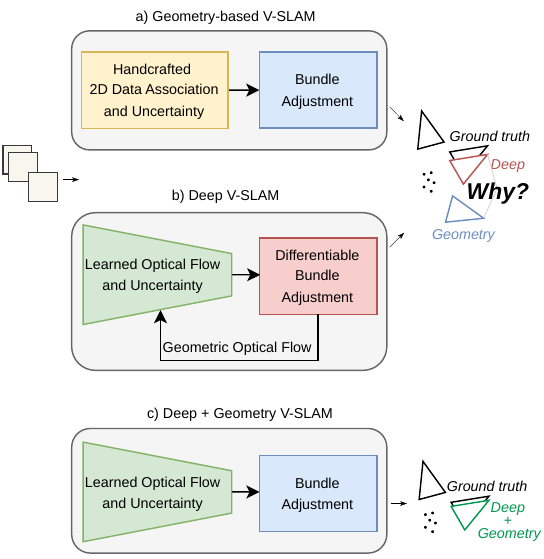
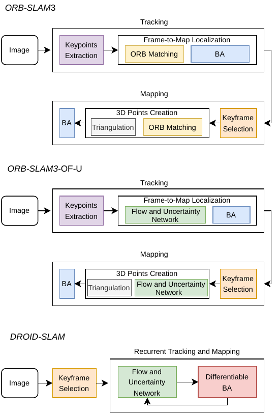
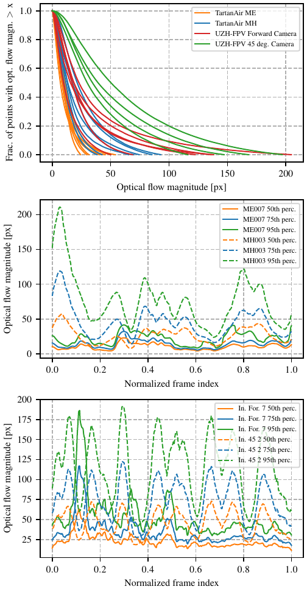

# Why Does Deep Learning Improve Visual SLAM? (arXiv 2026)

<!-- paper-source: https://chengwei920412.github.io/paper_reading/2607.06023_Why_does_Deep_Learning_Improve_Visual_SLAM/technical_report.html -->

> 原文链接：[Why Does Deep Learning Improve Visual SLAM? (arXiv 2026)](https://chengwei920412.github.io/paper_reading/2607.06023_Why_does_Deep_Learning_Improve_Visual_SLAM/technical_report.html)

> **arXiv ID**：2607.06023  
> **原文标题**：Why does Deep Learning Improve Visual SLAM?  
> **翻译日期**：2026-09-29

---

## 📋 论文概览 {#_1}

### 基本信息 {#_2}

- **作者**：Giovanni Cioffi、Davide Scaramuzza
- **机构**：瑞士苏黎世大学信息学系机器人与感知课题组
- **发表时间**：2026（arXiv:2607.06023）
- **领域**：机器人学、计算机视觉、视觉同时定位与建图

### 核心贡献 {#_3}

论文试图回答一个具体问题：现代深度视觉 SLAM 的优势究竟来自学习式二维数据关联、学习式不确定性，还是循环架构本身？作者以成熟的 ORB-SLAM3 为受控基线，只替换前端数据关联模块，并逐步引入 DROID-SLAM 光流网络及其置信度，构造 ORB-SLAM3-OF 与 ORB-SLAM3-OF-U。实验表明，学习式二维数据关联是主要性能来源；在噪声更大、域偏移更明显的条件下，学习式不确定性又是维持鲁棒性的关键。循环架构则不是达到最佳轨迹估计精度的必要条件。

图：论文的核心受控比较——经典几何 V-SLAM、深度 V-SLAM，以及将学习式前端与经典几何后端结合的方案。

---

## 🎯 研究背景与动机 {#_4}

### 问题定义 {#_5}

经典 V-SLAM 通常依赖手工关键点、描述子匹配、光度一致性假设和几何优化。它们可解释、效率高，但在大幅运动、严重运动模糊、弱光与低纹理环境中容易失效。DROID-SLAM、DPVO 和 DPV-SLAM 等深度系统通常同时引入学习式光流、学习式置信度、可微几何优化和循环更新，因此仅比较完整系统无法判断究竟是哪一部分带来了性能提升。

### 现有方法的局限性 {#_6}

端到端位姿回归容易受训练分布限制；经典描述子匹配则依赖恒速模型给出的局部搜索先验，当相邻帧光流过大时，真实对应点可能落在搜索窗外。经典外点剔除还通常依赖固定的 \(\chi^2\) 阈值与鲁棒损失，难以表达不同像素对应关系的异方差不确定性。

### 本文的创新点 {#_7}

作者采用“只换一个组件”的受控实验：保留 ORB-SLAM3 的跟踪、局部建图、关键帧策略、闭环检测和几何光束法平差，仅用 DROID-SLAM 的光流网络替代 ORB 描述子匹配；随后再将网络输出的置信度用于重投影残差加权。这样可以分别测量学习式数据关联和学习式不确定性的净贡献，并与采用循环架构的深度 SLAM 系统直接比较。

---

## 🔬 方法论 {#_8}

### 整体架构 {#_9}

研究比较三组系统：经典基线 ORB-SLAM3；受控变体 ORB-SLAM3-OF 与 ORB-SLAM3-OF-U；深度基线 DROID-VO、DROID-SLAM、DPVO 和 DPV-SLAM。ORB-SLAM3-OF 仅使用学习式光流完成二维对应，所有重投影误差权重均设为 1；ORB-SLAM3-OF-U 进一步使用光流网络的置信度加权误差，并在置信度低于 0.3 时拒绝局部建图中的候选匹配。

图：经典 ORB-SLAM3、接入学习式光流与不确定性的 ORB-SLAM3，以及 DROID-SLAM/DPVO/DPV-SLAM 的公共架构。

### 关键技术 {#_10}

- 光流网络来自 DROID-SLAM，并在 TartanAir 上预训练。输入灰度图下采样至 \(80\times60\)；卷积 GRU 最多迭代 20 次，平均光流修正量低于 0.0625 时提前停止。
- 推理以零光流为初值，避免依赖额外的运动模型先验；最终光流通过双线性插值恢复至原图分辨率。
- 对源帧关键点 \((u_s,v_s)\)，网络预测光流 \((f_u,f_v)\)，目标位置为 \((u_t,v_t)=(u_s+f_u,v_s+f_v)\)；系统在半径 2 像素内选取最近特征建立对应。
- 相邻关键帧的时间间隔不超过 5 帧时采用学习式光流匹配，更大间隔则回退到基于词袋模型的标准匹配。
- ORB-SLAM3-OF-U 以网络置信度加权 BA 中的重投影误差，使低置信区域的错误对应对位姿优化影响更小。

### 算法流程 {#_11}

1. 对相邻帧或帧—关键帧对提取网络特征并构建四维相关体。
2. ConvGRU 迭代修正光流并同时预测置信度。
3. 将光流投影转换为 ORB 关键点之间的二维对应。
4. 使用这些对应执行仅运动 BA；若启用不确定性，则以置信度加权重投影残差。
5. 保留 ORB-SLAM3 原有的局部建图、关键帧管理、全局地图重定位与闭环框架。

---

## 📊 实验与结果 {#_12}

### 实验设置 {#_13}

- **数据集**：TartanAir（大规模仿真、含低纹理与复杂光照）和 UZH-FPV（真实高速无人机、超大光流与剧烈运动）
- **评估指标**：平移绝对轨迹误差 \(\mathrm{ATE}_T\)（m）与旋转绝对轨迹误差 \(\mathrm{ATE}_R\)（deg）；轨迹经 Umeyama 7 自由度相似变换对齐
- **对比方法**：ORB-SLAM3、ORB-SLAM3-OF、ORB-SLAM3-OF-U、DROID-VO、DROID-SLAM、DPVO、DPV-SLAM
- **硬件**：Ubuntu 22.04、Intel Core i9 2.3 GHz、NVIDIA A100 80 GB；每个系统运行三次并报告平均 ATE

### 主要结果 {#_14}

在 TartanAir 上，标准 ORB-SLAM3 无法完整处理多条困难序列；接入学习式光流后，两种变体均可处理全部序列。平均误差从无法统计改善为 ORB-SLAM3-OF 的 \(0.48\,\mathrm{m}/1.01^\circ\) 和 ORB-SLAM3-OF-U 的 \(0.34\,\mathrm{m}/0.87^\circ\)，接近 DROID-SLAM 的 \(0.28\,\mathrm{m}/0.50^\circ\) 与 DPVO 的 \(0.24\,\mathrm{m}/0.42^\circ\)。

在分布外的 UZH-FPV 上，不确定性作用更明显：ORB-SLAM3 与 ORB-SLAM3-OF 都无法完整处理所有序列，而 ORB-SLAM3-OF-U 达到平均 \(0.63\,\mathrm{m}/2.38^\circ\)，优于 DPV-SLAM 的 \(1.08\,\mathrm{m}/2.94^\circ\)、DPVO 的 \(1.38\,\mathrm{m}/3.08^\circ\) 和 DROID-SLAM 的 \(2.87\,\mathrm{m}/6.47^\circ\)。

图：TartanAir 与 UZH-FPV 相邻帧光流幅值分布；UZH-FPV 的光流总体更大，形成更强的分布外挑战。

运行时间方面，TartanAir ME007 上 ORB-SLAM3-OF-U 为 0.050 s/帧，约为标准 ORB-SLAM3 的两倍，但明显快于 DROID-SLAM 的 0.201 s/帧；UZH-FPV Indoor Forward 3 上对应时间为 0.051 s/帧，而 DROID-SLAM 为 0.360 s/帧。

### 消融实验 {#_15}

ORB-SLAM3-OF 与 ORB-SLAM3-OF-U 的差异相当于对学习式不确定性的受控消融。在 TartanAir 上两者总体接近，但动态水下序列 ME004 中，引入不确定性使平移 ATE 改善 33%；在重复植被纹理的 MH005 中改善 55%。在 UZH-FPV 的 45 度俯视和困难室外序列中，未使用置信度的 ORB-SLAM3-OF 多次失去跟踪，而 ORB-SLAM3-OF-U 能完成评估，说明不确定性在大域偏移和低视觉重叠时尤为重要。

---

## 💡 关键见解 {#_16}

### 理论分析 {#_17}

实验支持一种清晰的因果解释：几何后端并未过时，经典系统的主要瓶颈是前端对应关系在困难感知条件下不够鲁棒。学习式光流扩大了有效匹配范围，并从数据中获得对低纹理、弱光和运动模糊的适应性；置信度进一步给出逐对应的异方差信息，使几何优化能区分可靠与不可靠观测。只要前端提供高质量对应与合理权重，经典前馈 SLAM 架构也能达到当前最佳精度。

### 实践启示 {#_18}

下一代 V-SLAM 不必在“纯学习”与“纯几何”之间二选一。更可行的工程路线是用学习模块解决感知与数据关联，用可解释的几何 BA、关键帧管理和闭环优化保持全局一致性。与此同时，训练数据覆盖部署环境的程度会成为新的关键超参数：手工阈值调节负担减少，但数据采集与域泛化的重要性上升。

---

## 🔍 局限性与未来工作 {#_19}

### 当前局限 {#_20}

研究仅考察一个经典主干和一个光流网络家族，结论对其他特征学习器、直接法或视觉—惯性系统的普适性仍需验证。实验集中在 TartanAir 与 UZH-FPV，虽然两者覆盖了极端视觉条件，但不足以代表动态城市、长期运行与跨季节变化。光流网络在 TartanAir 上预训练，因此 UZH-FPV 结果主要反映单一形式的域偏移。受控变体仍继承 ORB-SLAM3 的大量工程启发式，系统级结果不能完全等同于单模块的理论上限。

### 未来方向 {#_21}

后续可比较不同学习式对应网络与不确定性标定方法；引入在线适应或自监督训练以减轻域偏移；把同样的消融设计扩展到双目、RGB-D 和视觉—惯性 SLAM；研究置信度的校准误差如何传播到 BA；以及联合优化前端训练目标，使其直接服务于下游轨迹精度而非单纯的光流误差。

---

## 📚 相关工作对比 {#_22}

<table>
<thead>
<tr>
<th>方法</th>
<th>核心思想</th>
<th>优势</th>
<th>劣势</th>
</tr>
</thead>
<tbody>
<tr>
<td>ORB-SLAM3</td>
<td>手工 ORB 特征匹配 + 几何优化</td>
<td>可解释、实时、完整 SLAM 功能成熟</td>
<td>大运动、弱光和低纹理下匹配易失败</td>
</tr>
<tr>
<td>DROID-SLAM / DPVO / DPV-SLAM</td>
<td>学习式光流或稀疏块匹配 + 循环更新 + 可微 BA</td>
<td>数据关联鲁棒、轨迹精度高</td>
<td>计算与显存成本较高，训练分布影响明显</td>
</tr>
<tr>
<td><strong>ORB-SLAM3-OF-U（本文）</strong></td>
<td>学习式光流与不确定性 + 经典前馈 ORB-SLAM3 后端</td>
<td>在 UZH-FPV 上取得最佳平均结果，兼具几何可解释性与较低运行成本</td>
<td>依赖预训练光流模型，仍包含大量手工系统参数</td>
</tr>
</tbody>
</table>

---

## 🎓 个人评价 {#_23}

### 优点 {#_24}

论文最有价值之处不是再提出一个更大的 SLAM 系统，而是通过控制变量实验拆解“深度 SLAM 为什么有效”。实验设计直接、可证伪，且 TartanAir 与 UZH-FPV 的组合能够区分分布内性能与分布外鲁棒性。将学习式光流和置信度嵌入成熟 ORB-SLAM3，也使结论具有较强工程说服力。

### 可改进之处 {#_25}

论文可以进一步报告置信度校准指标、失败案例的误差分解，以及不同置信度阈值和光流迭代次数的敏感性。若增加多种学习式前端和多个经典后端的交叉实验，就能更有力地区分“DROID 光流网络的特殊优势”与“学习式数据关联的一般优势”。此外，完整的功耗、显存和不同硬件延迟评估会提升部署价值。

### 推荐阅读对象 {#_26}

适合从事视觉 SLAM、视觉里程计、机器人定位、学习式几何视觉与混合神经—几何系统的研究者和工程师，尤其适合希望理解深度 SLAM 中各组件真实贡献、而非只比较排行榜结果的读者。

---

## 📎 附录 {#_27}

### 重要公式 {#_28}

由源帧关键点和网络光流得到目标帧预测位置：

\[(u_t,v_t)=(u_s+f_u,\;v_s+f_v).\]

在 ORB-SLAM3-OF-U 中，可将置信度 \(c_i\) 对重投影残差 \(r_i\) 的作用概括为加权鲁棒优化：

\[\min_{\boldsymbol{\theta}}\sum_i \rho\!\left(c_i\lVert r_i(\boldsymbol{\theta})\rVert^2\right),\]

其中 \(\boldsymbol{\theta}\) 表示待估计位姿等状态，\(\rho\) 为 Huber 鲁棒损失。该式用于解释论文机制，具体实现还结合 \(\chi^2\) 外点检验。

### 术语表 {#_29}

<table>
<thead>
<tr>
<th>英文</th>
<th>中文</th>
</tr>
</thead>
<tbody>
<tr>
<td>Visual Simultaneous Localization and Mapping (V-SLAM)</td>
<td>视觉同时定位与建图</td>
</tr>
<tr>
<td>learned 2D data association</td>
<td>学习式二维数据关联</td>
</tr>
<tr>
<td>learned uncertainty</td>
<td>学习式不确定性</td>
</tr>
<tr>
<td>optical flow</td>
<td>光流</td>
</tr>
<tr>
<td>bundle adjustment (BA)</td>
<td>光束法平差</td>
</tr>
<tr>
<td>reprojection error</td>
<td>重投影误差</td>
</tr>
<tr>
<td>correlation volume</td>
<td>相关体</td>
</tr>
<tr>
<td>recurrent architecture</td>
<td>循环架构</td>
</tr>
<tr>
<td>feed-forward architecture</td>
<td>前馈架构</td>
</tr>
<tr>
<td>absolute trajectory error (ATE)</td>
<td>绝对轨迹误差</td>
</tr>
</tbody>
</table>

### 参考资源 {#_30}

- **论文原文**：[arXiv 页面](https://arxiv.org/abs/2607.06023)
- **中文翻译 PDF**：[paper_cn.pdf](https://chengwei920412.github.io/paper_reading/2607.06023_Why_does_Deep_Learning_Improve_Visual_SLAM/paper_cn.pdf)
- **中文 Markdown 译文**：[paper_cn.md](https://chengwei920412.github.io/paper_reading/2607.06023_Why_does_Deep_Learning_Improve_Visual_SLAM/paper_cn.html)
- **代码实现**：[GitHub 仓库](https://github.com/uzh-rpg/why_does_deep_learning_improve_visual_slam)
- **补充视频**：[YouTube](https://youtu.be/EiuZ7MT0iVc)
