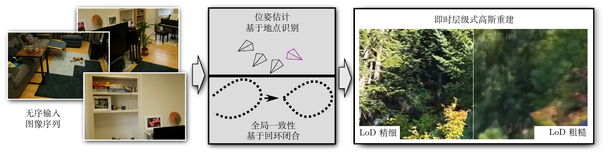
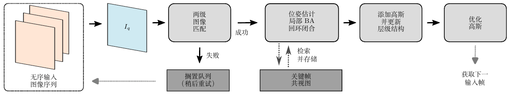
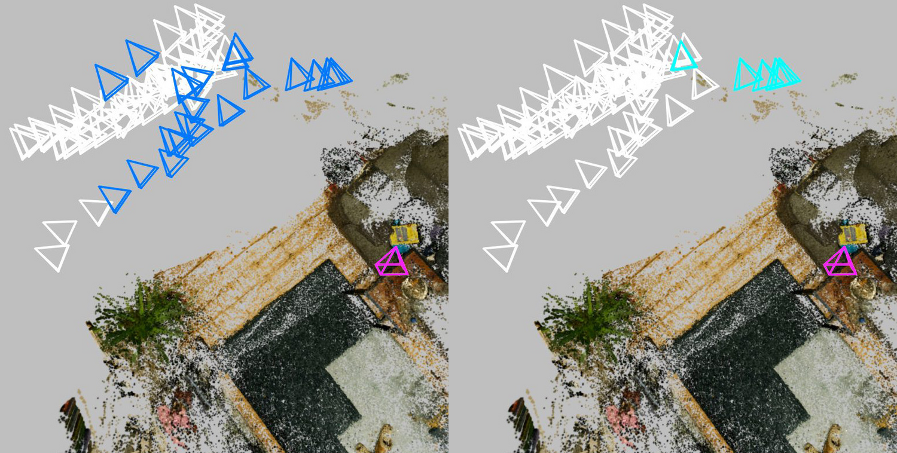
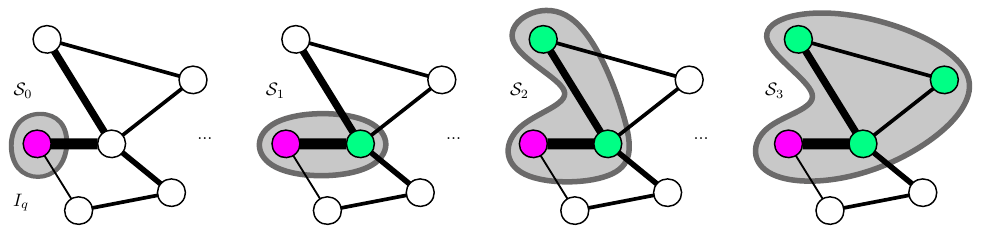
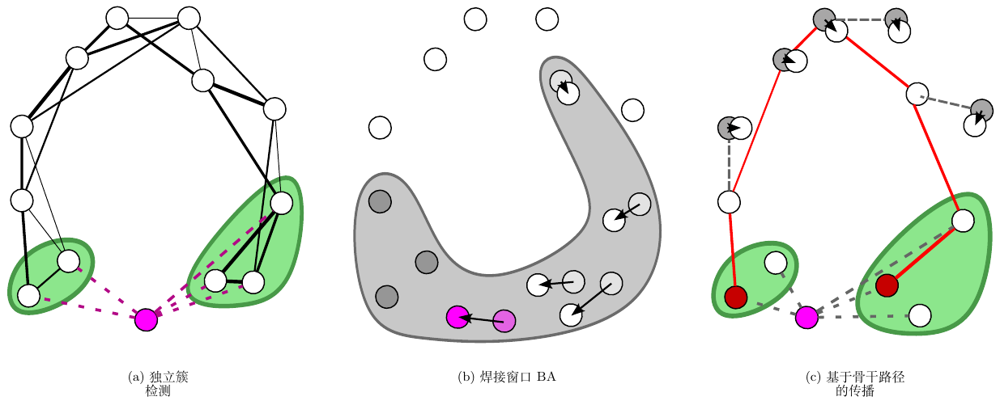
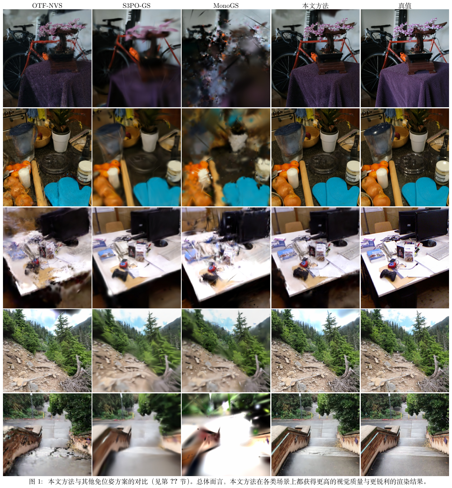
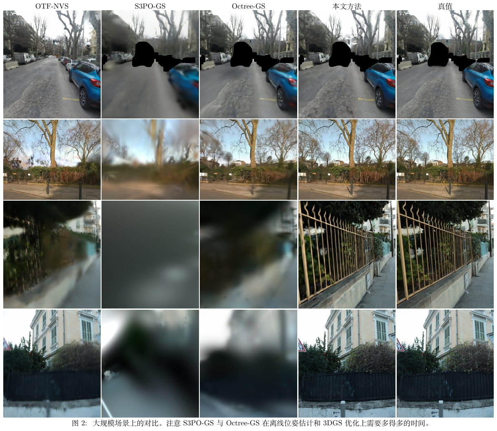
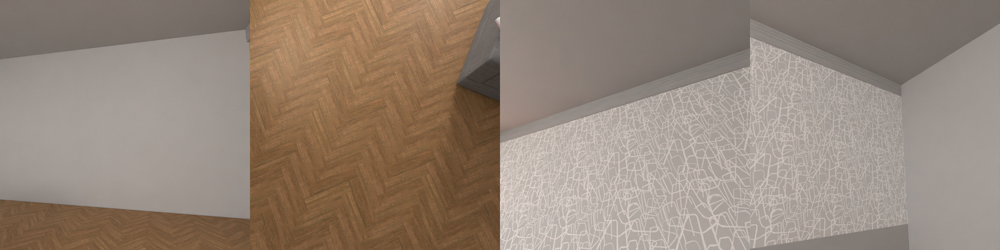
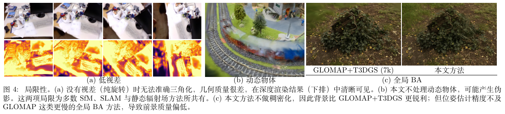

# i3DGS (arXiv 2026)

<!-- paper-source: https://chengwei920412.github.io/paper_reading/2607.14481_Immediate_3D_Gaussian_Splat_Reconstruction_of_Unordered_Input_with_Global_Consistency/technical_report.html -->

> 原文链接：[i3DGS (arXiv 2026)](https://chengwei920412.github.io/paper_reading/2607.14481_Immediate_3D_Gaussian_Splat_Reconstruction_of_Unordered_Input_with_Global_Consistency/technical_report.html)

> **arXiv ID**: 2607.14481
> **原文标题**: Immediate 3D Gaussian Splat Reconstruction of Unordered Input with Global Consistency
> **翻译日期**: 2026-08-28

---

## 📋 论文概览 {#_2}

### 基本信息 {#_3}

- **作者**: Andreas Meuleman、Linus Franke（重要贡献）、Boris Zhestiankin、Camille Montemagni、George Drettakis
- **机构**: Inria / Université Côte d'Azur（法国）；Université de Rennes（法国）；EPFL（瑞士）
- **发表时间**: SIGGRAPH Conference Papers '26（2026 年 7 月，Los Angeles）；DOI 10.1145/3799902.3811167
- **领域**: 三维重建、辐射场渲染、视觉 SLAM 与位姿估计

### 核心贡献 {#_4}

本文解决一个此前无解的组合问题：**乱序采集 + 即时反馈 + 全局一致**。三项技术贡献：

1. **面向无序输入的两级快速匹配 + 加权共视图**：把 VPR（MixVPR）与局部特征（XFeat / LightGlue）组成速度-质量级联，在全部历史关键帧中检索候选；再用共视图的贪心遍历取出强连接关键帧子集，使局部 BA 窗口从以往的 5 帧扩大到 20 帧且仍适配 GPU。
2. **基于簇的回环检测 + 免优化传播**：不依赖时间戳，而是判断匹配帧是否分裂成两个在共视图上相隔 > 5 跳的簇；随后在"焊接窗口"内做 BA，用 Dijkstra 骨干路径把 Sim(3) 修正按测地距离插值分摊到全部位姿与高斯，避免全局 PGO 的迭代开销（约 1 ms vs. PGO 约 200 ms）。
3. **渐进式高斯层级结构**：以屏幕尺寸为唯一判据动态合并亚像素高斯（KL 散度合并 + KNN 分组），层级在重建过程中在线生长（小场景 1 层，CityWalk 8 层），把峰值高斯数与显存压到可控范围，同时支持大场景实时渲染。



图 1：整体设定——无序 RGB 图像序列直接输入，在线完成位姿估计、全局一致性维护与层级式高斯重建。

---

## 🎯 研究背景与动机 {#_5}

### 问题定义 {#_6}

3DGS 的真实采集行为与现有系统的假设之间存在结构性错配。用户为覆盖场景会**突然转向、回头、返回同一位置补拍**，产生的图像流本质上是乱序的。同时，采集时的**即时反馈**是刚需——用户需要当场判断覆盖是否完整、质量是否可接受，否则只能事后返工。

形式上，本文要求的系统需在流式输入下同时满足三个约束：

- **在线性**：每帧处理延迟受限（本文实测 MipNeRF360 平均 324 ms、最大 386 ms）；
- **乱序鲁棒**：新帧可能与任意历史帧重叠，而非仅与最近若干帧；
- **全局一致**：重访时必须校正累积漂移，并同步更新已生成的高斯基元。

### 现有方法的局限性 {#_7}


<table>
<thead>
<tr>
<th>路线</th>
<th>代表</th>
<th>为何不适用</th>
</tr>
</thead>
<tbody>
<tr>
<td>离线 SfM + 3DGS</td>
<td>COLMAP、GLOMAP</td>
<td>需全部图像就绪；全局 BA 的 Schur 补直接解法最坏情况相机数立方复杂度，PCG 迭代数随条件数恶化；Hierarchical Mapper 改善扩展性但仍是离线流程</td>
</tr>
<tr>
<td>视觉 SLAM 及其 3DGS 变体</td>
<td>ORB-SLAM、DROID-SLAM、Photo-SLAM、MonoGS</td>
<td>本质顺序处理，仅用短时间窗口做特征搜索；跟踪与重定位是两套模式，跟踪丢失即暂停重建</td>
</tr>
<tr>
<td>在线 3DGS</td>
<td>On-the-fly NVS</td>
<td>GPU 友好但 BA 只在 <span class="paper-math">\(N=5\)</span> 上高效——每个路标点被窗口内所有关键帧观测，观测数随关键帧数二次增长，无法扩到 <span class="paper-math">\(N=20\)</span></td>
</tr>
<tr>
<td>前馈辐射场</td>
<td>AnySplat、Spann3R、Depth Anything 3</td>
<td>直接图像预测，精度无保证；图像数与分辨率受限（AnySplat 限 <span class="paper-math">\(448\times448\)</span>，H100 上跑 StaticHikes 仍 OOM）</td>
</tr>
<tr>
<td>回环闭合 / 全局一致</td>
<td>LoopSplat、Loopy-SLAM、PGO 类</td>
<td>LoopSplat 面向 RGB-D，无法处理单目固有尺度漂移；PGO 仍是迭代优化</td>
</tr>
<tr>
<td>3DGS 层级结构</td>
<td>H3DGS、Octree-GS</td>
<td>需要预处理步骤构建层级，在线场景负担不起</td>
</tr>
</tbody>
</table>


### 本文的创新点 {#_8}

关键洞察是：**SLAM 社群为回环闭合发明的工具（VPR、共视图、焊接窗口），恰好也是解决"乱序辐射场采集"的正确工具**——只要把它们从"偶发的回环事件"改造成"每帧都走的常规路径"。本文因此不设独立重定位模块，而是让每一帧都执行同样的全局检索流程；跟踪丢失退化为"搁置后重试"，而非模式切换。

---

## 🔬 方法论 {#_9}

### 整体架构 {#_10}



图 8：流程总览。输入图像 <span class="paper-math">\(I_q\)</span> → 两级匹配（失败则搁置）→ 更新共视图 → 回环检测 → 关键帧选择 + 局部 BA →（若回环）焊接 BA + 骨干传播 → 放置高斯并更新层级 → 优化高斯 → 重试搁置帧。

单帧主循环（附录算法 1）为：

```
foreach 输入图像 I_q:
    V, K' ← TwoLevelMatching(I_q, M)        # 4.1
    if V = ∅: Shelf ← Shelf ∪ {I_q}; continue   # 5.3
    UpdateGraph(G, I_q, V)                   # 4.2
    loop, C_1, C_2 ← LoopDetection(I_q, K', G)  # 6.1
    S ← SelectKeyframes({I_q}, G, N=20)      # 4.3
    LocalBA(S)                               # 5.1
    if loop: WeldingBA(C_1,C_2,G); BackbonePropagation(...)  # 6.2/6.3
    PlaceGaussians(I_q, 𝒢)                   # 5.2
    UpdateHierarchy(𝒢, H, I_q)               # 7.1
    OptimizeGaussians(M, 𝒢)                  # 5.2
    RetryShelved(Shelf, M, G)                # 5.3
```

### 关键技术 {#_11}

**（1）两级匹配级联**

三级过滤，每级速度与精度递增，代价由候选集缩减抵消：


<table>
<thead>
<tr>
<th>阶段</th>
<th>方法</th>
<th>速度</th>
<th>输出</th>
</tr>
</thead>
<tbody>
<tr>
<td>L0 检索</td>
<td>MixVPR 4096 维全局描述符 + 余弦相似度</td>
<td>≈1 ms / 1000 pairs</td>
<td>top-<span class="paper-math">\(\mathcal{K}\)</span>，<span class="paper-math">\(\mathcal{K}=20\)</span></td>
</tr>
<tr>
<td>L1 几何初筛</td>
<td>XFeat 暴力匹配，按内点数排序</td>
<td>≈0.5 ms / pair</td>
<td>top-<span class="paper-math">\(\mathcal{K}&#x27;\)</span>，<span class="paper-math">\(\mathcal{K}&#x27;=5\)</span></td>
</tr>
<tr>
<td>L2 精确验证</td>
<td>LightGlue + RANSAC（基础矩阵），混合精度 + CUDA graphs</td>
<td>≈4 ms / pair</td>
<td>内点 &gt; <span class="paper-math">\(\tau_m=500\)</span> 的配对集 <span class="paper-math">\(\mathcal{V}\)</span></td>
</tr>
</tbody>
</table>


<div class="paper-math">\[s(I_q, I_i) = \mathbf{d}_q \cdot \mathbf{d}_i, \qquad \mathcal{V} = \left\{I_i \in \mathcal{K}&#x27; \mid \left|\mathcal{I}_i^{\text{LG}}\right| &gt; \tau_{m}\right\}\]</div>


旋转不变性通过对图像四个 90° 旋转版本提取 MixVPR/XFeat 特征解决；XFeat 关键点只在正立图上提取，特征在四个旋转图上采样，并先用 MixVPR 判定朝向以控制开销。



图 2：MipNeRF360 room 场景。白色为全部已注册帧，洋红为乱序输入的 <span class="paper-math">\(I_q\)</span>；蓝色为 MixVPR 选出的 20 张，青色为暴力匹配后验证通过的 5 张。

**（2）加权共视图与贪心子集提取**

边权取内点数倒数，使"强连接"等价于"最短路"：


<div class="paper-math">\[w_{ij} = \frac{1}{\#\text{inliers}(i,j)}\]</div>


关键帧选择用贪心扩张，每步纳入对当前活跃集累积内点最多的节点：


<div class="paper-math">\[c(I_i, \mathcal{S}_t) = \sum_{I_j \in \mathcal{S}_t} \#\text{inliers}(i,j), \qquad \mathcal{S}_{t+1} = \mathcal{S}_t \cup \left\{\operatorname{argmax}_{I_i \in \mathcal{M} \setminus \mathcal{S}_t} c(I_i, \mathcal{S}_t)\right\}\]</div>


节点度数约 10，因此该贪心遍历开销可忽略。同一子程序在两处复用：局部 BA 选 <span class="paper-math">\(N=20\)</span> 帧（种子为 <span class="paper-math">\(I_q\)</span>），焊接窗口两侧各选 <span class="paper-math">\(N/2\)</span> 帧（种子为两个簇）。



图 3：贪心子集提取示意。

**（3）可扩展的 GPU 局部 BA**

三处设计使 <span class="paper-math">\(N=20\)</span> 的 BA 保持毫秒级：

- **固定问题尺寸**：按观测数做多项式采样，从被 ≥2 个选定关键帧观测的路标点中取 <span class="paper-math">\(K=10000\)</span> 个；
- **限制观测稀疏模式**：每个路标点只被局部窗口内一个**依共视性选定的固定关键帧子集**观测，把观测数从二次增长压回线性——这是相对 On-the-fly NVS 的核心改动；
- **稠密 Schur 补 + 自定义 GPU 核**：残差与雅可比在 GPU 上计算；本文场景下稠密形式优于稀疏求解器，且能优化共享内参（g2o、CudaBA 结构上做不到）。

另有 <span class="paper-math">\(n_f=4\)</span> 个关键帧参与损失但不优化，且**随机选取**而非固定最旧帧。

**（4）基于簇的回环检测与免优化传播**

检测判据（无时间戳）：


<div class="paper-math">\[d_G(\mathcal{C}_1, \mathcal{C}_2) &gt; \tau_{lc} = 5 \quad \text{and} \quad \min(|\mathcal{C}_1|, |\mathcal{C}_2|) &gt; \tau_v\]</div>


其中 <span class="paper-math">\(d_G\)</span> 为两簇间共视图最短跳数。取 <span class="paper-math">\(2K&#x27;\)</span> 个最佳匹配、用连接度上最远的两帧初始化两簇；较小簇若过小则直接丢弃，这同时提升了局部 BA 的鲁棒性。

传播分三步，全程无迭代优化：

1. 焊接窗口 <span class="paper-math">\(\mathcal{W} = \mathcal{S}_{N/2}^{\mathcal{C}_1} \cup \mathcal{S}_{N/2}^{\mathcal{C}_2}\)</span> 内做 BA，固定较旧一侧（更稳定、连接更广），另一侧为*自由簇*；
2. 取两簇内连接度最高的*锚定*帧，计算自由簇锚定帧的 <span class="paper-math">\(\mathbf{T}_\Delta = \mathbf{T}_a^{\text{opt}}(\mathbf{T}_a^{\text{init}})^{-1}\)</span>，并由路标点深度变化估出 <span class="paper-math">\(s_\Delta\)</span>，合成 <span class="paper-math">\(\mathbf{S}_\Delta = \text{Sim3}(\mathbf{T}_\Delta, s_\Delta)\)</span>；
3. Dijkstra 求骨干路径 <span class="paper-math">\(\mathcal{B}\)</span>，按测地距离比例插值分摊修正，再把窗口外每帧对齐到最近骨干节点：


<div class="paper-math">\[\alpha(I_b) = \frac{d_G(I_b, I_a^{2})}{d_G(I_a^{1}, I_a^{2})}, \qquad \mathbf{S}_{\Delta, b} = \text{interp}_{\text{Sim}(3)}(\mathbb{I}, \mathbf{S}_{\Delta}, \alpha(I_b)), \qquad \mathbf{T}_i^{\text{new}} = \mathbf{S}_{\Delta, b^*} \circ \mathbf{T}_i^{\text{old}}\]</div>


旋转用 6D 表示插值，尺度用对数插值（<span class="paper-math">\(s_{\Delta,b} = s_\Delta^{\alpha(I_b)}\)</span>）。**每个高斯记录了生成它的关键帧**，因此施加同一 Sim(3) 即可同步更新高斯位置、尺度与旋转——这是相对 LoopSplat 的关键差异（后者只做刚体变换，无法处理单目尺度漂移）。



图 5：(a) 新帧匹配到两个不相连簇 → 触发回环；(b) 簇扩张成焊接窗口，旧侧固定；(c) 修正沿最小骨干传播。


图 9：MipNeRF360 Counter 场景。左：漂移导致高斯错位，出现尖刺伪影与叠影；右：回环闭合 + 高斯重定位后伪影消除。

**（5）渐进式高斯层级结构**

合并判据只看屏幕尺寸：<span class="paper-math">\(S_i &lt; \tau_l = 0.5\)</span> 像素的高斯为合并候选，且仅当占比 > 20% 才触发（抑制频繁重建层级）。KNN 取 4 个最近邻分组、去重（防多父），用 KL 散度合并 [hierarchicalgaussians24]。若某高斯已有父节点且该父的全部子节点都需合并，则直接复用该父节点而不新建。

回取方向：渲染/优化时从根下降，直到节点细于 <span class="paper-math">\(\tau=1\)</span> 或到叶；合并节点贡献超 <span class="paper-math">\(\tau_h=1\)</span> 时重载细粒度子节点。遍历每步 5–30 ms，双缓冲异步执行以避免卡顿。

在线优化的**帧采样概率**与"该关键帧生成且仍在活跃集中的叶节点数"成正比，至少保留 50 帧提供上下文；贡献低于峰值 5% 的关键帧卸载至 CPU。副作用是中间层节点被自动优化，**无需显式后处理优化步骤**——这正是 H3DGS/Octree-GS 需要预处理的部分。

### 算法流程 {#_12}

高斯放置采用**按图块（tile）局部估计尺度与偏移**再线性插值上采样，替代以往对整图只算一次的全局对齐；随后按 On-the-fly NVS 的方式生成高斯，用基于 Taming 3DGS 的定制可微渲染器训练 30 次迭代（实时采集时改为异步优化到下一关键帧到达）。

无法匹配的帧进入**搁置队列**：持续计算其与已注册集合的最佳 MixVPR 相似度，一旦超过上一张已注册图像即取回重试；采集结束后按相似度从高到低处理。取回与新帧处理交替进行，采集到开始处理的延迟 < 0.8 s（两个关键帧的时间）。因低视差（三角化角判定）而失败的帧直接丢弃。

---

## 📊 实验与结果 {#_13}

### 实验设置 {#_14}

- **数据集**: TUM、MipNeRF360、StaticHikes（正文有序基准）；MipNeRF360 / Tanks and Temples / Deep Blending（无序基准）；SmallCity、Wayve、CityWalk（大规模，最多 4050 帧）；Davis（局限性分析）
- **评估指标**: PSNR↑、SSIM↑、LPIPS↓、端到端 Time↓；位姿用 T.APE / R.APE / T.RPE / R.RPE↓
- **对比方法**: 免位姿类 On-the-fly NVS、Photo-SLAM、DROID-Splat、MonoGS、S3PO-GS、LongSplat、AnySplat、CF-3DGS、Spann3R；离线参考 GLOMAP+Taming 3DGS (7k)、COLMAP+H3DGS、COLMAP+Octree-GS
- **硬件**: Intel Core i9 13900K + 128 GB RAM + NVIDIA RTX 4090；异构配置通过在各机器上跑 Garden 场景折算计时

### 主要结果 {#_15}

**有序场景（表 1）**：本文在 MipNeRF360 与 StaticHikes 上 PSNR/SSIM/LPIPS 全项最优，且时间仅次于 On-the-fly NVS。


<table>
<thead>
<tr>
<th></th>
<th>TUM PSNR↑</th>
<th>TUM Time↓</th>
<th>MipNeRF360 PSNR↑</th>
<th>MipNeRF360 Time↓</th>
<th>StaticHikes PSNR↑</th>
<th>StaticHikes Time↓</th>
</tr>
</thead>
<tbody>
<tr>
<td>Photo-SLAM</td>
<td>19.30</td>
<td>0:02:12</td>
<td>16.54</td>
<td>0:02:11</td>
<td>14.13</td>
<td>0:02:01</td>
</tr>
<tr>
<td>MonoGS</td>
<td>16.60</td>
<td>0:16:18</td>
<td>14.46</td>
<td>0:04:05</td>
<td>15.46</td>
<td>0:09:19</td>
</tr>
<tr>
<td>On-The-Fly NVS</td>
<td>23.02</td>
<td><strong>0:00:50</strong></td>
<td>24.31</td>
<td><strong>0:01:02</strong></td>
<td>20.40</td>
<td><strong>0:01:30</strong></td>
</tr>
<tr>
<td>S3PO-GS（带精修）</td>
<td>21.88</td>
<td>1:29:04</td>
<td>19.82</td>
<td>0:23:29</td>
<td>18.09</td>
<td>0:54:44</td>
</tr>
<tr>
<td>LongSplat</td>
<td><strong>26.51</strong></td>
<td>1:41:08</td>
<td>23.63</td>
<td>2:25:26</td>
<td>20.05</td>
<td>22:40:56</td>
</tr>
<tr>
<td><strong>本文方法</strong></td>
<td>24.77</td>
<td>0:01:22</td>
<td><strong>26.29</strong></td>
<td>0:01:17</td>
<td><strong>22.12</strong></td>
<td>0:02:14</td>
</tr>
<tr>
<td>G+T3DGS (7k)（离线参考）</td>
<td>25.29</td>
<td>0:03:33</td>
<td>27.52</td>
<td>0:08:50</td>
<td>20.23</td>
<td>1:02:34</td>
</tr>
</tbody>
</table>


关键读数：
- **唯一败给 LongSplat 的是 TUM**（26.51 vs 24.77），但 LongSplat 耗时 1h41min vs 本文 1min22sec（约 75×）。LongSplat 的优势局限于低分辨率（≈0.3 Mpx）+ 高帧间重叠；分辨率 > 1 Mpx、基线更宽时反而下降。
- **StaticHikes 上本文超过离线 GLOMAP+Taming3DGS**（22.12 vs 20.23，且快约 28×），因为 Taming3DGS 缺 LoD 与适配大输入的稠密化调度。
- **延迟**：MipNeRF360 平均 324 ms、最大 386 ms，满足"即时反馈"定义。

**大规模场景（表 3）**：Wayve 与 CityWalk 上质量最优；CityWalk 上 22.03 dB / 0:29:38，对比 Octree-GS 的 17.33 dB / 3:11:40 与 H3DGS 的 11.78 dB / 22:09:20。SmallCity 上 Octree-GS 质量略高（24.18 vs 23.56），但需 1h20min vs 本文 2min25sec（约 33×）。

**无序场景（表 2）**：其余免位姿方法在这些场景上**全部失败**，因此只能与 COLMAP+3DGS 对比。本文 MipNeRF360 25.60 / 0:01:28 vs 离线 27.08 / 0:09:57——质量差约 1.5 dB，总时间约 1/6。

**位姿精度（表 4）**：宽基线（MipNeRF360）全项最优（T.APE 8.5、R.APE 0.026）；小基线（TUM）次优，仅落后专用 SLAM 的 DROID-Splat（2.6 vs 1.0）。这与设计取向一致——本文针对辐射场采集的宽基线乱序输入，而非机器人小基线连续视频。

**打乱顺序（表 5）**：把有序 MipNeRF360 随机重排后 PSNR 从 26.29 降至 25.73（−0.56 dB），LPIPS 反而略好（0.238 vs 0.241），说明乱序处理管线本身没有明显退化。

**微调（表 11）**：+20 epochs（+43 s）即达 27.69 dB，超过 G+T3DGS (7k) 的 27.52 dB，总时间 2min00sec vs 8min50sec。这条数据颇具说服力——离线方法的质量优势可用极小的额外在线优化抹平。

**BA 求解器（表 15）**：20 位姿 / 10000 路标点 / 10 次迭代，本文 15.9 ms，对比 g2o 461.4 ms（29×）、CudaBA 78.1 ms（4.9×）、On-the-fly NVS 的 MiniBA 79.7 ms（5.0×）。



图 6：与免位姿方案的定性对比，本文渲染更锐利。



图 7：大规模场景对比。S3PO-GS 与 Octree-GS 在离线位姿估计与 3DGS 优化上耗时高出一个数量级以上。

### 消融实验 {#_16}

**渲染质量（表 6，MipNeRF360 有序场景）**


<table>
<thead>
<tr>
<th>配置</th>
<th>PSNR↑</th>
<th>ΔPSNR</th>
<th>SSIM↑</th>
<th>LPIPS↓</th>
</tr>
</thead>
<tbody>
<tr>
<td>NoVPR（只匹配最近 5 帧）</td>
<td>24.78</td>
<td><strong>−1.51</strong></td>
<td>0.747</td>
<td>0.291</td>
</tr>
<tr>
<td>NoKFSelection（BA 用最近 20 帧）</td>
<td>24.56</td>
<td><strong>−1.73</strong></td>
<td>0.733</td>
<td>0.303</td>
</tr>
<tr>
<td>NoMatchVerif（跳过暴力匹配）</td>
<td>25.36</td>
<td>−0.93</td>
<td>0.812</td>
<td>0.257</td>
</tr>
<tr>
<td>NoLoDepAlgn（全局而非分块深度对齐）</td>
<td>25.41</td>
<td>−0.88</td>
<td>0.823</td>
<td>0.249</td>
</tr>
<tr>
<td>NoGSUpdate（回环后不移动高斯）</td>
<td>25.45</td>
<td>−0.84</td>
<td>0.814</td>
<td>0.267</td>
</tr>
<tr>
<td>NoRandFixed（固定最旧帧）</td>
<td>25.78</td>
<td>−0.51</td>
<td>0.816</td>
<td>0.254</td>
</tr>
<tr>
<td>NoGraphProp（改用 PyPose PGO）</td>
<td>25.81</td>
<td>−0.48</td>
<td>0.822</td>
<td>0.249</td>
</tr>
<tr>
<td><strong>完整方案</strong></td>
<td><strong>26.29</strong></td>
<td>—</td>
<td><strong>0.839</strong></td>
<td><strong>0.241</strong></td>
</tr>
</tbody>
</table>


结论清晰：**VPR 检索与共视图关键帧选择是质量主导因素**（各约 1.5–1.7 dB），其余组件各贡献 0.5–0.9 dB。值得注意的是 NoGraphProp 只掉 0.48 dB，说明免优化传播的价值主要在**速度**（约 1 ms vs PGO 约 200 ms）而非精度——作者也明确承认这一点。

**位姿质量（表 14）**：NoVPR 使 T.APE 从 8.49 升至 10.62、T.RPE 从 14.21 升至 15.33；NoKFSelection 分别升至 10.33 / 15.85。与渲染质量的排序一致，证实两者是同一因果链。

**无序场景消融（表 13）**：完整方案 25.60 dB；NoKFSelection 跌至 23.18（−2.42 dB），比有序场景的 −1.73 dB 更严重——关键帧选择在无序设定下更关键。

**超参数敏感性（表 12）**：<span class="paper-math">\(\tau_{lc} \in \{3, 5, 7\}\)</span> 对应 26.22 / 26.29 / 26.24；<span class="paper-math">\(\tau_v \in \{1, 2, 3\}\)</span> 对应 26.11 / 26.29 / 26.20。波动 ≤ 0.18 dB，方法对回环阈值不敏感。

**层级结构（表 16）**：StaticHikes 峰值高斯 2.1 M → 1.3 M（−38%），显存 8.8 → 6.2 GB。CityWalk 无层级时在 4050 帧中处理到第 795 帧（< 20%）、6.7 M 高斯即 OOM（24 GB）；有层级则峰值 3.7 M / 12.8 GB 完整跑完。层数从小场景 1 层动态增长到 CityWalk 的 8 层。

**VPR 鲁棒性**：得益于几何验证（XFeat+LightGlue+RANSAC），所测场景无一因 VPR 失败。MixVPR top-5 与几何内点 top-5 在 MipNeRF360 上 100% 帧有重叠，在带人工重复结构与低纹理的合成场景上 92%。



图 11：含无纹理区域与人工重复结构的压力测试场景。

---

## 💡 关键见解 {#_17}

### 理论分析 {#_18}

**复杂度是全文的真正主线。** 三处瓶颈被逐一转化：


<table>
<thead>
<tr>
<th>瓶颈</th>
<th>原始复杂度</th>
<th>本文处理</th>
<th>结果</th>
</tr>
</thead>
<tbody>
<tr>
<td>新帧匹配</td>
<td>与全部历史帧 $O(</td>
<td>\mathcal{M}</td>
<td>)$ 次精确匹配</td>
</tr>
<tr>
<td>局部 BA 观测数</td>
<td>每路标点被窗口全部帧观测 → <span class="paper-math">\(O(N^2)\)</span></td>
<td>每路标点固定共视子集观测 + 路标点数固定为 <span class="paper-math">\(K\)</span></td>
<td><span class="paper-math">\(O(N)\)</span>，<span class="paper-math">\(N\)</span> 从 5 扩到 20</td>
</tr>
<tr>
<td>回环后位姿修正</td>
<td>全局 PGO 迭代优化全部位姿</td>
<td>Dijkstra 骨干 + 测地距离插值</td>
<td>一次图遍历，约 1 ms</td>
</tr>
</tbody>
</table>


**共视图是贯穿全文的单一数据结构**，在四处复用：局部 BA 关键帧选择、回环检测的簇分离判据、焊接窗口构造、骨干路径传播。这种复用是工程上的优雅之处——一个 <span class="paper-math">\(O(|\mathcal{M}| \cdot 10)\)</span> 规模的图（节点度约 10）承担了全部全局推理。

**免优化传播的正确性依据**是"分段刚性"假设：把 Sim(3) 修正按测地距离线性分摊，隐含假设漂移沿轨迹近似均匀累积。这在实践中够用（仅比 PGO 差 0.48 dB），但不保证最优——作者也没有声称最优，而是明确定位为速度换精度的取舍。

### 实践启示 {#_19}

1. **级联过滤优于单一强模型**。三级流水线（1 ms / 0.5 ms / 4 ms per unit）总成本由最便宜的一级乘最大候选数决定，这一模式适用于任何"从大集合中检索少量强匹配"的问题。
2. **把稀疏模式作为设计变量**，而非求解器的既定输入。本文最有效的单点改动（观测数从二次降为线性）是通过**主动限制哪个路标点被哪些帧观测**实现的，而不是换求解器。
3. **在线系统的层级结构应以"渲染贡献"为唯一判据**。屏幕尺寸 <span class="paper-math">\(S_i\)</span> 同时决定合并、卸载、回取与帧采样概率，避免了任何离线预处理，中间节点还能被自动优化。
4. **"跟踪丢失"不必是异常路径**。搁置队列把它变成常规重排序机制，使不相连的采集片段最终得以汇合——这比 SLAM 的模式切换更适合非专业用户的采集行为。
5. **微调曲线值得关注**：+43 s 就能追平离线方法质量，说明"在线重建 + 可选短时精修"可能是比"离线全量优化"更好的产品形态。

---

## 🔍 局限性与未来工作 {#_20}

### 当前局限 {#_21}



图 12：(a) 纯旋转无视差 → 三角化失败，深度渲染（下排）可见几何崩坏；(b) 动态物体产生伪影；(c) 本文背景比 GLOMAP+T3DGS 更锐利（不做稠密化），但位姿精度不及全局 BA，前景质量偏低。

1. **纯旋转无法三角化**（TUM fr1/rpy 序列）。这是 COLMAP 到 ORB-SLAM 的共性局限，非本文独有；该序列原为 RGB-D 评估采集，深度信息本可免除三角化需求。
2. **不处理动态物体**（Davis Train 场景）。与多数 SfM / SLAM / 静态辐射场方法共有。
3. **位姿精度不及全局 BA**。作者诚实地指出：图传播不逊于全局 PGO，但仍不及更慢的全局 BA（GLOMAP）。表 4 中 TUM 小基线场景落后 DROID-Splat，图 12(c) 中前景质量偏低即为体现。
4. **质量对离线方法仍有 gap**。无序场景 25.60 vs 27.08 dB（约 1.5 dB），需 +20 epochs 才能追平。
5. **依赖若干固定阈值**（<span class="paper-math">\(\tau_m=500\)</span>、<span class="paper-math">\(\tau_{lc}=5\)</span>、<span class="paper-math">\(\tau_v=2\)</span>、<span class="paper-math">\(\tau_l=0.5\)</span>、<span class="paper-math">\(\tau_h=1\)</span>、20% 合并触发比、5% 帧贡献阈值）。表 12 表明回环阈值不敏感，但层级相关阈值未做敏感性分析。
6. **对前置模型有强依赖**：MixVPR、XFeat、LightGlue、Depth Anything 3 均为外部预训练模型，其域外表现直接决定系统鲁棒性。重复结构场景下 VPR top-5 重叠率已降至 92%。

### 未来方向 {#_22}

- **纯旋转的显式处理**：检测退化运动后切换到单应/球面全景模型，而非直接丢弃低视差帧。
- **动态物体分割**：在高斯放置前引入运动掩码，或让高斯携带时变不透明度。
- **自适应阈值**：把 <span class="paper-math">\(\tau_{lc}\)</span>、<span class="paper-math">\(\tau_v\)</span>、合并触发比按场景规模与连接度统计在线调节。
- **传播的精度上限**：在骨干插值之外引入极轻量的局部非线性校正，试图缩小与全局 BA 的差距，同时保持毫秒级。
- **层级结构的敏感性与理论刻画**：分析 <span class="paper-math">\(\tau_l\)</span>、<span class="paper-math">\(\tau_h\)</span> 与最终质量/显存的权衡曲线，给出层级深度的预测模型。
- **前置模型的联合适配**：把 VPR 与局部特征在辐射场采集分布上微调，或用重建产生的匹配反过来自监督更新描述符。

---

## 📚 相关工作对比 {#_23}


<table>
<thead>
<tr>
<th>方法</th>
<th>核心思想</th>
<th>优势</th>
<th>劣势</th>
</tr>
</thead>
<tbody>
<tr>
<td><strong>COLMAP / GLOMAP</strong></td>
<td>离线增量式 SfM + 全局 BA，穷举匹配</td>
<td>精度最高，全局一致，处理回环</td>
<td>需全部图像就绪；全局 BA 相机数最坏立方复杂度；MipNeRF360 上 GLOMAP 单独耗时 8min21sec</td>
</tr>
<tr>
<td><strong>ORB-SLAM</strong></td>
<td>顺序跟踪 + 词袋重定位 + 共视图回环闭合</td>
<td>实时；共视图与焊接窗口概念是本文直接来源</td>
<td>顺序假设；跟踪/重定位模式切换；CPU BA；无辐射场表示</td>
</tr>
<tr>
<td><strong>DROID-SLAM / DROID-Splat</strong></td>
<td>稠密光流迭代优化 + 外接 3DGS</td>
<td>小基线位姿最准（TUM T.APE 1.0）</td>
<td>稠密性拖累性能；全分辨率 OOM；宽基线精度下降（MipNeRF360 T.APE 11.7）</td>
</tr>
<tr>
<td><strong>On-the-fly NVS</strong></td>
<td>GPU 友好在线 3DGS + MiniBA</td>
<td>最快（MipNeRF360 1min02sec）；本文的直接基线</td>
<td>BA 仅在 <span class="paper-math">\(N=5\)</span> 高效（观测数二次增长）；无回环闭合；要求有序输入</td>
</tr>
<tr>
<td><strong>LongSplat</strong></td>
<td>长视频免位姿 3DGS，重局部优化</td>
<td>TUM 上质量最高（26.51 dB）</td>
<td>慢约 75×（TUM 1h41min，StaticHikes 22h40min）；高分辨率宽基线下退化</td>
</tr>
<tr>
<td><strong>LoopSplat</strong></td>
<td>回环后刚体变换高斯基元</td>
<td>首个把回环闭合与 3DGS 结合</td>
<td>面向 RGB-D；纯刚体变换无法处理单目尺度漂移</td>
</tr>
<tr>
<td><strong>H3DGS / Octree-GS</strong></td>
<td>预计算高斯层级 + LoD</td>
<td>大场景质量好（SmallCity Octree-GS 24.18 dB）</td>
<td>层级需离线预处理；SmallCity 需 1h20min；CityWalk 上质量崩坏（11.78 / 17.33 dB）</td>
</tr>
<tr>
<td><strong>AnySplat / Spann3R</strong></td>
<td>前馈直接预测高斯/点云</td>
<td>极快（25 s）</td>
<td>分辨率限 <span class="paper-math">\(448\times448\)</span>；H100 上 StaticHikes OOM；质量最低（18.05 dB）</td>
</tr>
<tr>
<td><strong>本文方法</strong></td>
<td>VPR + 共视图把 SLAM 的回环工具改造为每帧常规路径；免优化 Sim(3) 传播；在线生长的屏幕尺寸层级</td>
<td>首个"乱序 + 即时反馈 + 全局一致"的完整方案；无序场景上其余免位姿方法全败；MipNeRF360 26.29 dB / 1min17sec；BA 快 5–29×；CityWalk 4050 帧可完整处理</td>
<td>位姿精度不及全局 BA；纯旋转与动态物体失败；离线方法仍有约 1.5 dB 质量优势（+43 s 微调可抹平）；依赖多个外部预训练模型</td>
</tr>
</tbody>
</table>


---

## 🎓 个人评价 {#_24}

### 优点 {#_25}

1. **问题选得准**。"乱序 + 即时反馈 + 全局一致"这个组合确实是真实采集的刚需，而此前无解——论文用"其余免位姿方法在无序场景上全部失败"这一事实把 gap 摆得很清楚。
2. **技术路线诚实且经济**。没有堆新模型，而是把 SLAM 二十年积累的工具（VPR、共视图、焊接窗口、Dijkstra）重新组织到新语境；三处复杂度瓶颈的处理都直指要害，尤其"限制观测稀疏模式"这一改动，用一个设计约束换来 <span class="paper-math">\(N\)</span> 从 5 到 20。
3. **实验覆盖扎实**。6 个数据集、9 个基线、位姿与渲染双指标、7 项消融 + 位姿消融 + 无序消融 + 超参敏感性 + 层级内存 + BA 微基准 + VPR 压力测试。低分辨率与 AnySplat 单列附录处理公平性问题的做法也值得肯定。
4. **对自身局限不遮掩**。明确写出"图传播不逊于全局 PGO，但不及全局 BA"，NoGraphProp 只掉 0.48 dB 这个对自己不利的数字照实给出，并在正文说明该组件"此处关注速度"。
5. **系统工程细节到位**。CUDA graphs、混合精度、双缓冲、异步高斯移动、四旋转特征、搁置队列的交替调度（< 0.8 s 延迟）——这些是能否真正做到"即时"的关键，且都被交代清楚。

### 可改进之处 {#_26}

1. **免优化传播缺乏理论刻画**。按测地距离线性插值分摊 Sim(3) 隐含"漂移沿轨迹均匀累积"假设，论文未讨论该假设何时失效（例如漂移集中在某段快速运动）。给出误差界或失效条件会更有力。
2. **层级阈值未做敏感性分析**。<span class="paper-math">\(\tau_{lc}\)</span>、<span class="paper-math">\(\tau_v\)</span> 有表 12，但 <span class="paper-math">\(\tau_l=0.5\)</span>、<span class="paper-math">\(\tau_h=1\)</span>、20% 合并触发比、5% 帧贡献阈值这四个直接决定显存/质量权衡的参数都只给了取值。
3. **前置模型的失效边界探索不足**。VPR 压力测试只用了一个合成场景（92% 重叠率）。真实的重复结构（走廊、货架、立面）是 VPR 的经典难点，值得更系统的评估。
4. **"immediate"的定义偏宽**。324 ms 平均延迟对照片采集够用，但论文标题的 "immediate" 与交互式实时（< 33 ms）差一个量级，正文对此界定可以更前置。
5. **SmallCity 上不如 OTF-NVS 且更慢**这一点（"本文质量与 OTF-NVS 相当，但计算开销更高"）只用一句话带过，未分析原因——小场景下层级与全局检索的固定开销可能反而是负担。
6. **无消融验证"搁置机制"的价值**。这是处理不相连序列的核心机制，但消融表中没有 NoShelving 配置，其贡献无法量化。

### 推荐阅读对象 {#_27}

- **3DGS / 辐射场重建研究者**：尤其关注在线、大规模、免位姿方向；本文是该交叉点目前最完整的方案。
- **视觉 SLAM 研究者**：本文展示了 SLAM 工具在辐射场语境下的再利用方式，以及"把回环工具常态化"这一思路。
- **BA 与优化系统开发者**：第 5.1 节与附录 A.3 关于稀疏模式设计、稠密 Schur 补、GPU 核的讨论有直接参考价值（表 15 微基准）。
- **三维采集产品工程师**：延迟预算、显存管理、层级卸载/回取、双缓冲、异步调度等工程决策可直接借鉴。
- **不推荐**：只需离线最高质量重建者（用 GLOMAP + 3DGS）；小基线机器人 SLAM 场景（DROID 类更准）。

---

## 📎 附录 {#_28}

### 重要公式 {#_29}

**MixVPR 全局描述符相似度与 top-<span class="paper-math">\(\mathcal{K}\)</span> 检索**


<div class="paper-math">\[s(I_q, I_i) = \mathbf{d}_q \cdot \mathbf{d}_i, \qquad \mathcal{K} = \text{top-K}\{s(I_q, I_i) \mid I_i \in \mathcal{M}\}, \quad \mathcal{K}=20\]</div>


**两级几何验证**


<div class="paper-math">\[\mathcal{K}&#x27; = \text{top-K&#x27;}\left\{\left|\mathcal{I}_i^{\text{BF}}\right| \mid I_i \in \mathcal{K}\right\}, \quad \mathcal{K}&#x27;=5; \qquad \mathcal{V} = \left\{I_i \in \mathcal{K}&#x27; \mid \left|\mathcal{I}_i^{\text{LG}}\right| &gt; \tau_{m}\right\}, \quad \tau_m=500\]</div>


**共视图边权（内点数倒数，使强连接 = 短路）**


<div class="paper-math">\[w_{ij} = \frac{1}{\#\text{inliers}(i,j)}\]</div>


**贪心强连接子集扩张（式 1）**


<div class="paper-math">\[c(I_i, \mathcal{S}_t) = \sum_{I_j \in \mathcal{S}_t} \#\text{inliers}(i,j), \qquad \mathcal{S}_{t+1} = \mathcal{S}_t \cup \left\{\operatorname{argmax}_{I_i \in \mathcal{M} \setminus \mathcal{S}_t} c(I_i, \mathcal{S}_t)\right\}\]</div>


**回环触发判据（式 2）**


<div class="paper-math">\[d_G(\mathcal{C}_1, \mathcal{C}_2) = \min_{I_i \in \mathcal{C}_1, I_j \in \mathcal{C}_2} \text{hops}(I_i, I_j) &gt; \tau_{lc}=5 \quad \text{and} \quad \min(|\mathcal{C}_1|, |\mathcal{C}_2|) &gt; \tau_v=2\]</div>


**焊接窗口与锚定帧（式 3）**


<div class="paper-math">\[\mathcal{W} = \mathcal{S}_{N/2}^{\mathcal{C}_{1}} \cup \mathcal{S}_{N/2}^{\mathcal{C}_{2}}, \qquad I_a^{k} = \operatorname{argmax}_{I \in \mathcal{S}_{N/2}^{\mathcal{C}_{k}}} c(I, \mathcal{W}), \quad k \in \{1,2\}\]</div>


**Sim(3) 修正的构造（式 4）**


<div class="paper-math">\[\mathbf{T}_{\Delta} = \mathbf{T}_a^{\text{opt}} \left( \mathbf{T}_a^{\text{init}} \right)^{-1}, \qquad \mathbf{S}_{\Delta} = \text{Sim3}(\mathbf{T}_{\Delta}, s_{\Delta})\]</div>


**骨干路径与测地插值传播（式 5–7）**


<div class="paper-math">\[\mathcal{B} = \text{Dijkstra}\left(I_a^{1}, I_a^{2}, G\right), \qquad \alpha(I_b) = \frac{d_G\left(I_b, I_a^{2}\right)}{d_G\left(I_a^{1}, I_a^{2}\right)}, \qquad \mathbf{S}_{\Delta, b} = \text{interp}_{\text{Sim}(3)}(\mathbb{I}, \mathbf{S}_{\Delta}, \alpha(I_b))\]</div>


尺度按对数插值：<span class="paper-math">\(s_{\Delta, b} = s_{\Delta}^{\alpha(I_b)}\)</span>；旋转按 6D 表示插值。

**窗口外位姿的对齐与施加（式 8–9）**


<div class="paper-math">\[I_{b^*} = \operatorname{argmin}_{I_b \in \mathcal{B}} d_G(I_i, I_b) \quad \forall I_i \notin \mathcal{W}, \qquad \mathbf{T}_i^{\text{new}} = \mathbf{S}_{\Delta, b^*} \circ \mathbf{T}_i^{\text{old}}\]</div>


**主要超参数一览**


<table>
<thead>
<tr>
<th>符号</th>
<th>含义</th>
<th>取值</th>
</tr>
</thead>
<tbody>
<tr>
<td><span class="paper-math">\(\mathcal{K}\)</span></td>
<td>MixVPR 检索候选数</td>
<td>20</td>
</tr>
<tr>
<td><span class="paper-math">\(\mathcal{K}&#x27;\)</span></td>
<td>XFeat 暴力匹配后保留数</td>
<td>5</td>
</tr>
<tr>
<td><span class="paper-math">\(\tau_m\)</span></td>
<td>LightGlue+RANSAC 配对验证内点阈值</td>
<td>500</td>
</tr>
<tr>
<td><span class="paper-math">\(N\)</span></td>
<td>局部 BA 关键帧数</td>
<td>20</td>
</tr>
<tr>
<td><span class="paper-math">\(n_f\)</span></td>
<td>参与损失但不优化的关键帧数（随机选取）</td>
<td>4</td>
</tr>
<tr>
<td><span class="paper-math">\(K\)</span></td>
<td>局部 BA 路标点采样数</td>
<td>10000</td>
</tr>
<tr>
<td><span class="paper-math">\(\tau_{lc}\)</span></td>
<td>回环判定最小跳数</td>
<td>5</td>
</tr>
<tr>
<td><span class="paper-math">\(\tau_v\)</span></td>
<td>较小簇最小有效配对数</td>
<td>2</td>
</tr>
<tr>
<td><span class="paper-math">\(\tau_l\)</span></td>
<td>高斯合并的屏幕尺寸阈值</td>
<td>0.5 px</td>
</tr>
<tr>
<td><span class="paper-math">\(\tau_h\)</span></td>
<td>合并节点回取的贡献阈值</td>
<td>1</td>
</tr>
<tr>
<td><span class="paper-math">\(\tau\)</span></td>
<td>渲染层级下降的细度阈值</td>
<td>1</td>
</tr>
<tr>
<td>—</td>
<td>触发合并的候选高斯占比</td>
<td>20%</td>
</tr>
<tr>
<td>—</td>
<td>关键帧卸载的贡献阈值</td>
<td>峰值的 5%</td>
</tr>
<tr>
<td>—</td>
<td>每关键帧高斯优化迭代数</td>
<td>30</td>
</tr>
<tr>
<td>—</td>
<td>最少保留关键帧数</td>
<td>50</td>
</tr>
</tbody>
</table>


### 术语表 {#_30}


<table>
<thead>
<tr>
<th>English</th>
<th>中文</th>
</tr>
</thead>
<tbody>
<tr>
<td>3D Gaussian Splatting (3DGS)</td>
<td>三维高斯溅射</td>
</tr>
<tr>
<td>radiance field</td>
<td>辐射场</td>
</tr>
<tr>
<td>unordered / out-of-order</td>
<td>无序 / 乱序</td>
</tr>
<tr>
<td>immediate feedback</td>
<td>即时反馈</td>
</tr>
<tr>
<td>global consistency</td>
<td>全局一致性</td>
</tr>
<tr>
<td>Structure from Motion (SfM)</td>
<td>运动恢复结构</td>
</tr>
<tr>
<td>SLAM</td>
<td>同时定位与建图</td>
</tr>
<tr>
<td>bundle adjustment (BA)</td>
<td>光束法平差</td>
</tr>
<tr>
<td>pose graph optimization (PGO)</td>
<td>位姿图优化</td>
</tr>
<tr>
<td>loop closure / loop detection</td>
<td>回环闭合 / 回环检测</td>
</tr>
<tr>
<td>visual place recognition (VPR)</td>
<td>视觉地点识别</td>
</tr>
<tr>
<td>covisibility graph</td>
<td>共视图</td>
</tr>
<tr>
<td>connectivity</td>
<td>连接度</td>
</tr>
<tr>
<td>keyframe</td>
<td>关键帧</td>
</tr>
<tr>
<td>landmark / observation</td>
<td>路标点 / 观测</td>
</tr>
<tr>
<td>Gaussian primitive</td>
<td>高斯基元</td>
</tr>
<tr>
<td>progressive hierarchy</td>
<td>渐进式层级结构</td>
</tr>
<tr>
<td>level of detail (LoD)</td>
<td>细节层次</td>
</tr>
<tr>
<td>active set</td>
<td>活跃集</td>
</tr>
<tr>
<td>offload</td>
<td>卸载</td>
</tr>
<tr>
<td>welding window / weld</td>
<td>焊接窗口 / 焊接</td>
</tr>
<tr>
<td>cluster / free cluster / fixed cluster</td>
<td>簇 / 自由簇 / 固定簇</td>
</tr>
<tr>
<td>anchor keyframe</td>
<td>锚定关键帧</td>
</tr>
<tr>
<td>backbone path</td>
<td>骨干路径</td>
</tr>
<tr>
<td>drift / drift correction</td>
<td>漂移 / 漂移校正</td>
</tr>
<tr>
<td>optimization-free</td>
<td>免优化</td>
</tr>
<tr>
<td>geodesic distance / hops</td>
<td>测地距离 / 跳数</td>
</tr>
<tr>
<td>Schur complement</td>
<td>Schur 补</td>
</tr>
<tr>
<td>multinomial sampling</td>
<td>多项式采样</td>
</tr>
<tr>
<td>inlier / outlier</td>
<td>内点 / 外点</td>
</tr>
<tr>
<td>geometric verification</td>
<td>几何验证</td>
</tr>
<tr>
<td>global descriptor</td>
<td>全局描述符</td>
</tr>
<tr>
<td>triangulation / parallax</td>
<td>三角化 / 视差</td>
</tr>
<tr>
<td>relocalization</td>
<td>重定位</td>
</tr>
<tr>
<td>shelve / shelf / unshelve</td>
<td>搁置 / 搁置队列 / 取回搁置帧</td>
</tr>
<tr>
<td>rigid body / similarity transformation</td>
<td>刚体变换 / 相似变换</td>
</tr>
<tr>
<td>monocular depth alignment</td>
<td>单目深度对齐</td>
</tr>
<tr>
<td>tile</td>
<td>图块</td>
</tr>
<tr>
<td>densification</td>
<td>稠密化</td>
</tr>
<tr>
<td>pose-free</td>
<td>免位姿</td>
</tr>
<tr>
<td>feed-forward</td>
<td>前馈</td>
</tr>
<tr>
<td>KL-divergence based merging</td>
<td>基于 KL 散度的合并</td>
</tr>
<tr>
<td>double buffering</td>
<td>双缓冲</td>
</tr>
</tbody>
</table>


### 参考资源 {#_31}

- **论文原文**: [arXiv:2607.14481](https://arxiv.org/abs/2607.14481)
- **中文翻译 PDF**: [paper_cn.pdf](https://chengwei920412.github.io/paper_reading/2607.14481_Immediate_3D_Gaussian_Splat_Reconstruction_of_Unordered_Input_with_Global_Consistency/paper_cn.pdf)
- **中文 Markdown 译文**: [paper_cn.md](https://chengwei920412.github.io/paper_reading/2607.14481_Immediate_3D_Gaussian_Splat_Reconstruction_of_Unordered_Input_with_Global_Consistency/paper_cn.html)
- **DOI**: [10.1145/3799902.3811167](https://doi.org/10.1145/3799902.3811167)
- **发表会议**: SIGGRAPH Conference Papers '26, July 19–23, 2026, Los Angeles, CA, USA
- **图片素材**: `assets/` 目录（12 张 PNG，均由中文译文源码渲染）
- **翻译后 TeX 源码**: `paper_cn/`
