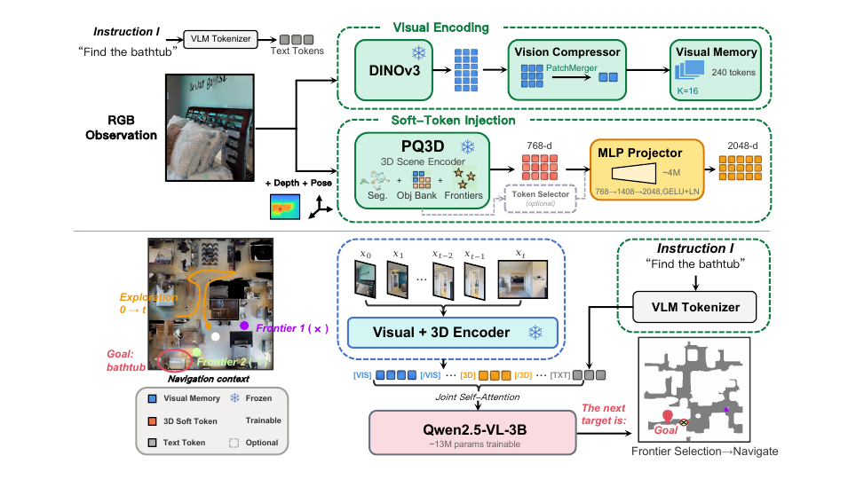
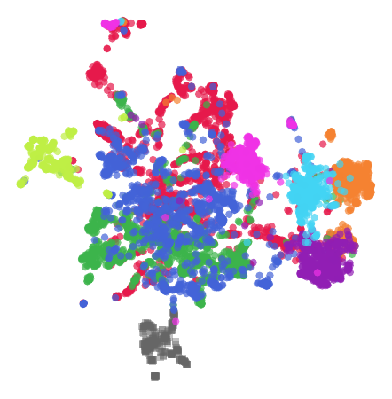
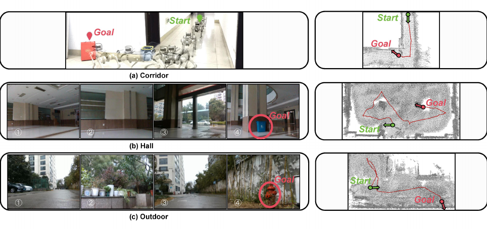

# SoftNav (arXiv 2026)

<!-- paper-source: https://chengwei920412.github.io/paper_reading/2607.14586_SoftNav_Injecting_3D_Scene_Tokens_into_VLMs_for_Embodied_Navigation/technical_report.html -->

> **arXiv ID**：2607.14586  
> **原文标题**：SoftNav: Injecting 3D Scene Tokens into VLMs for Embodied Navigation  
> **翻译日期**：2026-08-22

## 论文概览 {#_1}

### 基本信息 {#_2}

- **作者**：Yi Wu、Junjie An、Xiao Liu、Yiqun Zhou、Yuechen Wu、Xiaoqing Guan、Shuyang Yu、You Wang、Guang Li
- **机构**：浙江大学、山东大学
- **研究领域**：具身智能、开放词汇对象导航、三维视觉语言理解、视觉语言模型
- **评估平台**：Habitat-Sim、Unitree Go2

### 核心贡献 {#_3}

SoftNav 研究的不是“VLM 是否足够大”，而是更基础的接口问题：专用三维编码器产生的连续场景表示，在转写成坐标或自然语言后损失了多少信息。论文通过固定 PQ3D 与 VLM、只替换信息接口的受控实验，给出表示鸿沟的直接证据；随后用两层 MLP 把对象与前沿点嵌入映射为 VLM 软词元，实现结构化三维感知与大模型推理的结合。

在仅 1,187 个监督样本、约 17M 个可训练参数的设置下，SoftNav 在 HM3D-OVON 三个划分上的 SR 达到 74.2%、68.3% 和 66.7%，并零样本迁移到 GOAT-Bench、SG3D 与真实机器人。

## 研究背景与动机 {#_4}

### 问题定义 {#_5}

目标导向具身导航要求智能体在没有先验地图的陌生三维环境中寻找指定对象。系统既要从 RGB-D 流中建立对象、空间与可探索区域的表示，又要根据目标语义决定下一步去哪个前沿点。

现有系统通常采用以下接口之一：

1. 将空间信息栅格化为语义地图，交给专用策略。
2. 将坐标、场景图或观测摘要序列化为文本，交给 LLM/VLM。
3. 将三维连续特征直接送入专用小策略，但放弃 VLM 的开放世界知识与推理能力。

论文指出，第二类方案把高维连续表示压缩为离散文本，可能损失几何、语义与空间关系结构。此前工作虽然大量使用文本接口，却未固定编码器与决策模型来测量这种损失。

### 本文创新 {#_6}

- 首次在同一 PQ3D 后端、同一 VLM 和同一训练数据下，对文本坐标、丰富文本与软词元接口进行受控比较。
- 每个检测对象或前沿点对应一个实体级软词元，而非固定图像网格块。
- 仅训练 MLP 投影器与 LoRA，冻结视觉编码器、三维编码器和 VLM 骨干。
- 使用架构无关的前沿坐标作为监督标签，将 MTU3D 的决策知识迁移给 VLM。

## 方法论 {#_7}

### 整体架构 {#_8}

图：SoftNav 整体架构。视觉流提供最近 16 帧的压缩视觉记忆；三维流提供对象与前沿查询嵌入；二者与导航指令在 VLM 隐空间中联合推理。

系统包含两条并行信息流：

- **视觉流**：冻结 DINOv3 提取图像块特征，CompressionHead 与 PatchMerger 把每帧压缩为 15 个词元；最近 16 帧构成 240 个视觉记忆词元。
- **三维流**：冻结 PQ3D 进行增量三维实例分割、维护对象库并检测探索前沿，为每个对象和前沿点输出一个 768 维查询嵌入。

两层 MLP 将 768 维查询映射到 Qwen2.5-VL-3B 的 2048 维隐空间：

\[\hat q_i=\operatorname{LayerNorm}\left(W_2\operatorname{GELU}(W_1q_i+b_1)+b_2\right).\]

其中 \(W_1\in\mathbb{R}^{1408\times768}\)，\(W_2\in\mathbb{R}^{2048\times1408}\)。最终输入为：

\[\mathcal H_{\text{input}}=[\mathcal M_t;\hat q_1,\ldots,\hat q_N;\mathcal T].\]

### 前沿决策 {#_9}

VLM 自回归生成二维目标坐标，但系统不会直接把它当作最终目标，而是吸附到最近且满足距离保护约束的可达前沿点：

\[f^*=\arg\min_{f_j\in\mathcal F_t}\|\hat c-f_j\|_2,
\qquad
\frac{\|f^*-p_t\|_2}{\min_{f_k}\|f_k-p_t\|_2}\le r,\]

其中 \(r=2\)。该设计把 VLM 的语义决策限制在规划器可执行的候选集合中，避免生成坐标落在障碍物或不可达区域。

### 训练策略 {#_10}

- 训练样本：1,187 个，由 MTU3D 成功回合蒸馏得到。
- 可训练模块：MLP 投影器约 4M 参数；LoRA 约 13M 参数。
- 冻结模块：DINOv3、PQ3D、Qwen2.5-VL-3B 主干。
- 训练：6 个轮次，有效批大小 16，单张 RTX 4090。
- 监督目标：教师系统在每个决策时刻选择的前沿坐标字符串。

## 实验与结果 {#_11}

### 基准与指标 {#_12}

- **HM3D-OVON**：开放词汇对象目标导航，三个划分各 120 个回合。
- **GOAT-Bench**：类别、描述和图像目标组成的多模态终身导航，每个划分 30 个回合。
- **SG3D**：基于场景图的序列导航，338 个回合、1,351 个子任务。
- **指标**：SR、SPL；SG3D 另报告子任务 s-SR 与完整任务 t-SR。

### 主要结果 {#_13}

<table>
<thead>
<tr>
<th>基准/划分</th>
<th>SoftNav</th>
<th>此前最佳</th>
<th>提升或差异</th>
</tr>
</thead>
<tbody>
<tr>
<td>OVON <code>val_seen</code> SR</td>
<td><strong>74.2</strong></td>
<td>55.0</td>
<td>+19.2 pp</td>
</tr>
<tr>
<td>OVON <code>val_seen_synonyms</code> SR</td>
<td><strong>68.3</strong></td>
<td>45.0</td>
<td>+23.3 pp</td>
</tr>
<tr>
<td>OVON <code>val_unseen</code> SR</td>
<td><strong>66.7</strong></td>
<td>40.8</td>
<td>+25.9 pp</td>
</tr>
<tr>
<td>GOAT <code>val_seen</code> SR</td>
<td><strong>67.2</strong></td>
<td>52.2</td>
<td>+15.0 pp</td>
</tr>
<tr>
<td>GOAT <code>val_unseen</code> SR</td>
<td><strong>64.2</strong></td>
<td>52.0</td>
<td>+12.2 pp</td>
</tr>
<tr>
<td>SG3D s-SR</td>
<td><strong>47.2</strong></td>
<td>23.8</td>
<td>+23.4 pp</td>
</tr>
<tr>
<td>SG3D t-SR</td>
<td><strong>16.6</strong></td>
<td>8.0</td>
<td>+8.6 pp</td>
</tr>
</tbody>
</table>

OVON 上的 SPL 也在三个划分中全部最佳。GOAT 与 SG3D 上则出现成功率显著提高、路径效率略低的权衡：GOAT 的 SPL 为 29.0%，低于 MTU3D 的 30.5%；SG3D 的 SPL 为 14.7%，低于 MTU3D 的 16.5%。这说明零样本策略更容易找到目标，但在新布局中不一定沿最短路线前进。

### 表示鸿沟消融 {#_14}

<table>
<thead>
<tr>
<th>VLM 输入</th>
<th>已见 SR</th>
<th>已见 SPL</th>
<th>已见同义词 SR</th>
<th>已见同义词 SPL</th>
<th>未见 SR</th>
<th>未见 SPL</th>
</tr>
</thead>
<tbody>
<tr>
<td>Text-Hint</td>
<td>66.7</td>
<td>24.7</td>
<td>66.7</td>
<td>27.0</td>
<td>63.3</td>
<td>28.3</td>
</tr>
<tr>
<td>Rich-Text</td>
<td>65.0</td>
<td>24.9</td>
<td>62.5</td>
<td>26.1</td>
<td>70.0</td>
<td>27.9</td>
</tr>
<tr>
<td>Text-Hint + LoRA</td>
<td>68.3</td>
<td>26.9</td>
<td>60.8</td>
<td>23.6</td>
<td>64.2</td>
<td>23.1</td>
</tr>
<tr>
<td><strong>软词元</strong></td>
<td><strong>74.2</strong></td>
<td><strong>33.9</strong></td>
<td><strong>68.3</strong></td>
<td><strong>28.6</strong></td>
<td><strong>66.7</strong></td>
<td><strong>25.7</strong></td>
</tr>
</tbody>
</table>

核心比较中，软词元在 `val_seen` 上使 SPL 增加 9.2 个百分点（\(p&lt;0.0001\)），SR 增加 7.5 个百分点（\(p=0.028\)）。仅给文本基线加 LoRA 的收益很小，Rich-Text 增加距离、方向与置信度后也没有稳定改善。这支持论文的主要判断：瓶颈主要来自表示模态，而非文本字段数量或额外可训练容量。

### 嵌入结构与逐回合行为 {#_15}

图：MLP 投影后的 2048 维查询嵌入仍保持聚类结构。原始 PQ3D 嵌入与文本序列化的完整对比见中文译文。

在 `val_seen` 的 74 个共同成功回合中，SoftNav 的平均 SPL 为 0.445，Text-Hint 为 0.371；SoftNav 还额外解决了 15 个测地距离更大的回合。在 `val_unseen` 上，SoftNav 虽额外解决 11 个回合，但共同成功回合路径更长，说明语义迁移比空间路径优化更稳健。

### 真实世界部署 {#_16}

图：Unitree Go2 在走廊、大厅和室外环境中的部署结果。

导航策略完全在 Habitat 中训练，未经领域适配或微调即部署到配备 RealSense D435i 的 Unitree Go2。在走廊、大厅与室外各测试 10 次，共成功 19/30 次：8/10、6/10、5/10。室外环境超出室内训练分布，因此 50% 的成功率虽不高，却提供了跨域可用性的初步证据。

## 关键见解 {#_17}

1. **接口可能比模型更重要。** 同一编码器与 VLM 下，仅替换文本接口便带来显著差异，说明端到端系统的瓶颈可能位于模块连接方式。
2. **实体级词元是合适的中间粒度。** 每个词元对应一个对象或前沿点，比固定图像块更接近导航决策所需的实体与候选动作。
3. **连续嵌入同时携带语义与空间结构。** UMAP 结果表明投影器保留聚类，而文本序列化破坏结构；但未见布局上的 SPL 下降也说明空间信息的有效利用仍依赖适配质量。
4. **小样本知识迁移可行。** 架构无关的前沿坐标让专用导航策略的决策知识可以蒸馏到 VLM，无需复制教师内部网络。

## 局限性与未来工作 {#_18}

### 当前局限 {#_19}

- **编码器单一**：表示鸿沟实验只使用 PQ3D。固定编码器能证明接口差异，但不能证明任意三维编码器都获得同等收益。
- **数据量小且来源单一**：1,187 个样本均来自 MTU3D 成功回合，可能继承教师偏差，并限制新布局中的空间适配。
- **零样本 SPL 不稳定**：GOAT 与 SG3D 的成功率领先，但路径效率低于最强基线。
- **真实实验规模有限**：共 30 次人工判定试验，缺少置信区间、目标类别分层与失败类型统计。
- **推理延迟**：每个高层决策约 1 秒，主要开销来自 PQ3D 与 VLM。
- **图中模块表述需谨慎**：框架图含可选 Token Selector，但完整模型的最佳结果实际上来自不进行选择、注入全部 128 个词元。

### 后续方向 {#_20}

- 用不同三维编码器和不同 VLM 骨干复现实验，建立接口收益的适用边界。
- 扩大训练数据，并加入路径长度或进展奖励，改善未见布局的 SPL。
- 研究可微分稀疏选择、软路由或层次词元，降低词元数量而不破坏梯度流。
- 引入不确定性估计；当三维编码器未可靠检测目标时，让 VLM 主动请求新视角或触发探索策略。
- 在更多机器人、传感器噪声与动态环境中进行规模化真实评估。

## 相关方法对比 {#_21}

<table>
<thead>
<tr>
<th>方法</th>
<th>核心思想</th>
<th>优势</th>
<th>局限</th>
</tr>
</thead>
<tbody>
<tr>
<td>文本接口导航</td>
<td>将坐标、场景图或摘要写入提示</td>
<td>易接入现有 LLM/VLM</td>
<td>连续几何与嵌入结构损失明显</td>
</tr>
<tr>
<td>MTU3D</td>
<td>PQ3D 查询嵌入直接输入专用策略</td>
<td>三维感知强、效率较高</td>
<td>缺少通用 VLM 推理</td>
</tr>
<tr>
<td>Dynam3D</td>
<td>将二维视觉特征投影为分层三维词元</td>
<td>支持视觉语言导航</td>
<td>非专用三维场景编码器，任务设定不同</td>
</tr>
<tr>
<td><strong>SoftNav</strong></td>
<td>实体级 PQ3D 嵌入投影为 VLM 软词元</td>
<td>同时利用结构化三维感知与 VLM 推理；小样本训练</td>
<td>依赖 PQ3D；零样本路径效率仍有不足</td>
</tr>
</tbody>
</table>

## 综合评价 {#_22}

SoftNav 最有价值之处是把一个常被视为实现细节的“模块接口”提升为可检验的研究问题，并通过严格控制编码器、VLM 与训练数据建立因果证据。实验结果不仅展示更高成功率，还用显著性检验、逐回合分析和嵌入可视化解释收益来源。

需要保持克制的是，论文证明的是“在所测试 PQ3D–Qwen 配置及文本序列化格式中存在表示鸿沟”，而非所有文本接口都必然劣于所有连续接口。Rich-Text 也只覆盖距离、方向与置信度，尚未测试程序化结构、工具调用或高精度量化编码。真实部署结果很有吸引力，但样本规模仍不足以支持强泛化结论。

总体而言，这是一项问题定义清晰、工程路径简洁、实验链条完整的工作，适合关注具身导航、三维 VLM、多模态接口设计与小样本策略蒸馏的读者。

## 术语表 {#_23}

<table>
<thead>
<tr>
<th>英文</th>
<th>中文</th>
</tr>
</thead>
<tbody>
<tr>
<td>Embodied Navigation</td>
<td>具身导航</td>
</tr>
<tr>
<td>Representation Gap</td>
<td>表示鸿沟</td>
</tr>
<tr>
<td>Soft Token</td>
<td>软词元</td>
</tr>
<tr>
<td>Frontier</td>
<td>前沿点 / 探索前沿</td>
</tr>
<tr>
<td>Query Embedding</td>
<td>查询嵌入</td>
</tr>
<tr>
<td>Success Rate (SR)</td>
<td>成功率</td>
</tr>
<tr>
<td>Success weighted by Path Length (SPL)</td>
<td>按路径长度加权的成功率</td>
</tr>
<tr>
<td>Zero-Shot Generalization</td>
<td>零样本泛化</td>
</tr>
<tr>
<td>Cross-Architecture Knowledge Transfer</td>
<td>跨架构知识迁移</td>
</tr>
</tbody>
</table>

## 参考资源 {#_24}

- **论文原文**：[arXiv 2607.14586](https://arxiv.org/abs/2607.14586)
- **中文翻译 PDF**：[paper_cn.pdf](https://chengwei920412.github.io/paper_reading/2607.14586_SoftNav_Injecting_3D_Scene_Tokens_into_VLMs_for_Embodied_Navigation/paper_cn.pdf)
- **中文 Markdown 译文**：[paper_cn.md](https://chengwei920412.github.io/paper_reading/2607.14586_SoftNav_Injecting_3D_Scene_Tokens_into_VLMs_for_Embodied_Navigation/paper_cn.html)
