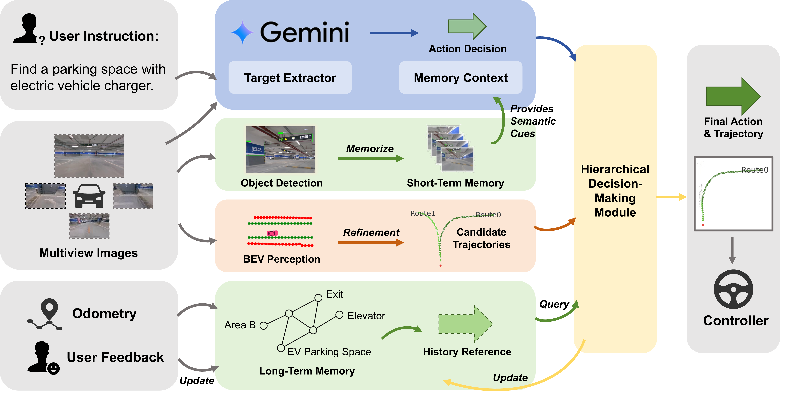
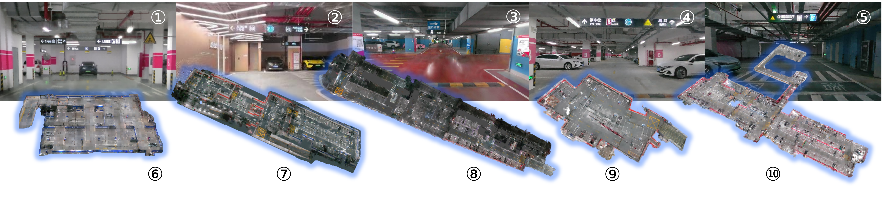
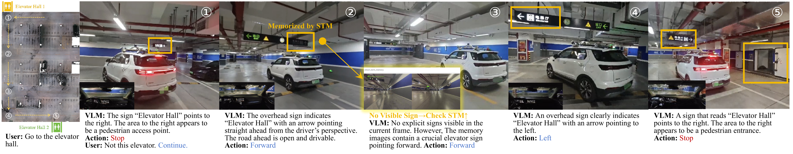

# VLN-AVP (arXiv 2026)

<!-- paper-source: https://chengwei920412.github.io/paper_reading/2607.17767_VLN_AVP_Zero_Shot_Vision_Language_Navigation_with_Hybrid_Long_Short_Term_Memory_for_Autonomous_Valet_Parking/technical_report.html -->

> **arXiv ID**: 2607.17767  
> **原文标题**: VLN-AVP: Zero-Shot Vision-Language Navigation with Hybrid Long-Short-Term Memory for Autonomous Valet Parking  
> **翻译日期**: 2026-07-29

## 论文概览 {#_1}

### 基本信息 {#_2}

- **作者**: Yijian Li, Xiangru Mu, Changze Li, Hantian Shi, Jiyuan Cai, Jia Cai, Xiaoxue Liu, Yajing Sun, Ming Yang, Tong Qin
- **机构**: 上海交通大学、引望智能技术有限公司
- **领域**: 自主代客泊车、视觉语言导航、视觉语言模型、零样本导航、长期记忆
- **任务**: 在未知地下停车场中，根据自然语言指令完成开放目标导航和泊车。

### 核心贡献 {#_3}

1. 提出 VLN-AVP，将 VLN 范式引入 AVP，使车辆无需预构建地图即可根据自然语言指令在地下停车场中导航。
2. 结合 BEV 感知、VLM 高层推理和车辆运动学可行轨迹，避免传统 VLN 方法在真实车辆上不可执行的问题。
3. 设计混合长短期记忆：STM 缓存近期语义视觉线索，LTM 以拓扑图沉淀成功导航经验。
4. 构建 VLN-AVP 数据集和基准，包含 10 个高保真地下停车场场景和 1,000 多个导航 Episode。

## 研究背景与动机 {#_4}

### 问题定义 {#_5}

传统 AVP 通常依赖高精地图或向量地图，适合“去指定车位”这类封闭目标，但不擅长处理“去出口”“停在电梯附近”“找带充电桩的车位”等开放语义目标。论文要解决的问题是：在未知、无预构建地图的地下停车场中，让车辆根据自然语言指令完成闭环导航。

### 现有方法局限 {#_6}

- **传统 AVP**: 依赖预采集地图，扩展到新车库成本高，开放目标能力弱。
- **通用 VLN**: 面向移动机器人，动作空间和运动学与车辆差异大，常产生真实车辆不可执行的掉头或全向移动。
- **VLM 自动驾驶方法**: 多面向开放道路高速驾驶，难以直接泛化到封闭、低速、标志密集的地下停车环境。
- **单帧 VLM 决策**: 容易错过短暂出现的标志牌，也缺少时空连续性。

## 方法论 {#_7}

### 整体架构 {#_8}

VLN-AVP 包含四个模块：高频 BEV 感知和候选轨迹生成；低频 VLM 高层决策；混合长短期记忆；分层决策模块。核心思想是让 VLM 负责语义决策，让 BEV 和车辆运动学模块负责可行驶轨迹，从而把“理解目标”和“执行可行驾驶”分离。

### 关键技术 {#_9}

- **BEV 感知**: 使用 MapTR 从四个环视相机图像中预测 BEV 空间的车道中心线。
- **候选轨迹生成**: 将中心线、RS 曲线和车辆运动学模型结合，生成可行驶候选轨迹集合。
- **短期记忆 STM**: 使用 Grounding DINO 高频检测标志牌等导航线索，并用目标、方向、时间过滤维持近期有效观测。
- **高层 VLM 决策**: 将当前前视图像、STM 检测图像、系统提示和当前子目标组合成提示，让 VLM 输出 forward/left/right/stop。
- **长期拓扑记忆 LTM**: 用路口节点、地标节点和带方向向量的边表示历史成功导航经验。
- **分层决策**: 优先查询 LTM；若无有效长期经验，则使用缓存的 VLM 决策选择候选轨迹。

## 关键公式 {#_10}

BEV 感知输入为四路环视图像：

\[\mathcal{I}_{t} = \{I_{t}^{\text{front}}, I_{t}^{\text{rear}}, I_{t}^{\text{left}}, I_{t}^{\text{right}}\}\]

MapTR 输出中心线：

\[\mathcal{L}_{t} = \text{MapTR}(\mathcal{I}_{t})\]

轨迹优化器生成候选轨迹：

\[\mathcal{T}_{t} = f_{\text{optim}}(\mathcal{L}_{t}) = \{\tau_{i}\}_{i=1}^{N_t}\]

每条候选轨迹由 BEV 坐标中的二维路点组成：

\[\tau_{i} = \{ p_{j} \}_{j=1}^{M}, \text{ where }p_{j} \in \mathbb{R}^{2}\]

VLM 复合提示为：

\[\mathcal{P}= [I_{front} \oplus \{I_{detect, j}\}_{j=1}^{K_{\text{STM}}} \oplus S \oplus g]\]

长期记忆边方向向量为：

\[\mathbf{d} = \frac{p_{M}- p_{M-4}}{\| p_{M}- p_{M-4}\|_{2}}\]

该方向向量比 left/right 命令更稳健，因为同一个路口从不同方向驶入时，相对转向命令会变化，但拓扑边的几何方向更稳定。

## 实验与结果 {#_11}

### 数据集 {#_12}

VLN-AVP 数据集包含 10 个地下停车场场景，使用真实车库扫描数据和 3DGS 构建。相比 SUPS、SUSTech-COE、GarageWorld、GarageNet，它是首个提供地下停车场 VLN Episode 的基准。

### 仿真主结果 {#_13}

<table>
<thead>
<tr>
<th>任务</th>
<th>方法</th>
<th>SR</th>
<th>OSR</th>
<th>SPL</th>
<th>NE</th>
</tr>
</thead>
<tbody>
<tr>
<td>Regular</td>
<td>LaMPilot</td>
<td>49.7</td>
<td>54.4</td>
<td>34.8</td>
<td>19.5</td>
</tr>
<tr>
<td>Regular</td>
<td>DiLu</td>
<td>47.4</td>
<td>50.2</td>
<td>31.5</td>
<td>22.6</td>
</tr>
<tr>
<td>Regular</td>
<td><strong>VLN-AVP</strong></td>
<td><strong>65.2</strong></td>
<td><strong>74.6</strong></td>
<td><strong>43.1</strong></td>
<td><strong>13.2</strong></td>
</tr>
<tr>
<td>Challenging</td>
<td>LaMPilot</td>
<td>33.6</td>
<td>40.3</td>
<td>24.7</td>
<td>27.8</td>
</tr>
<tr>
<td>Challenging</td>
<td>DiLu</td>
<td>30.2</td>
<td>41.1</td>
<td>23.5</td>
<td>29.2</td>
</tr>
<tr>
<td>Challenging</td>
<td><strong>VLN-AVP</strong></td>
<td><strong>45.4</strong></td>
<td><strong>59.7</strong></td>
<td><strong>33.2</strong></td>
<td><strong>18.4</strong></td>
</tr>
</tbody>
</table>

在常规任务中，VLN-AVP 相比最强 AD 基线 LaMPilot 的 SR 高 15.5 个百分点；在挑战任务中高 11.8 个百分点。相比 VLN 基线，提升更明显，说明车辆运动学约束和泊车场景记忆对任务适配非常关键。

### 真实世界结果 {#_14}

<table>
<thead>
<tr>
<th>方法</th>
<th>SR</th>
<th>OSR</th>
</tr>
</thead>
<tbody>
<tr>
<td>LaMPilot</td>
<td>36.7</td>
<td>40.0</td>
</tr>
<tr>
<td>VLN-AVP w/o LTM</td>
<td>53.3</td>
<td>70.0</td>
</tr>
<tr>
<td><strong>VLN-AVP</strong></td>
<td><strong>63.3</strong></td>
<td><strong>73.3</strong></td>
</tr>
</tbody>
</table>

真实世界实验在 2 个地下停车库、30 次导航试验中进行。VLN-AVP 取得最高成功率，并展示了根据用户反馈从错误电梯厅继续导航到正确目标的交互纠错能力。

### 消融实验 {#_15}

<table>
<thead>
<tr>
<th>任务</th>
<th>方法</th>
<th>SR</th>
<th>OSR</th>
<th>SPL</th>
<th>NE</th>
</tr>
</thead>
<tbody>
<tr>
<td>Regular</td>
<td>VLN-AVP</td>
<td>65.2</td>
<td>74.6</td>
<td>43.1</td>
<td>13.2</td>
</tr>
<tr>
<td>Regular</td>
<td>w/o LTM</td>
<td>56.8</td>
<td>70.4</td>
<td>36.5</td>
<td>15.6</td>
</tr>
<tr>
<td>Regular</td>
<td>w/o LTM &amp; STM</td>
<td>42.2</td>
<td>49.3</td>
<td>30.9</td>
<td>23.2</td>
</tr>
<tr>
<td>Challenging</td>
<td>VLN-AVP</td>
<td>45.4</td>
<td>59.7</td>
<td>33.2</td>
<td>18.4</td>
</tr>
<tr>
<td>Challenging</td>
<td>w/o LTM</td>
<td>38.7</td>
<td>52.9</td>
<td>28.5</td>
<td>24.1</td>
</tr>
<tr>
<td>Challenging</td>
<td>w/o LTM &amp; STM</td>
<td>31.1</td>
<td>39.5</td>
<td>22.6</td>
<td>29.9</td>
</tr>
</tbody>
</table>

LTM 和 STM 都有明确贡献。STM 主要改善短时语义线索识别，尤其是标志牌；LTM 主要提升重复场景中的效率、稳定性和成本表现。

表：长期记忆对成本的影响。

<table>
<thead>
<tr>
<th>方法</th>
<th>VLM 调用次数</th>
<th>平均时间 (sec)</th>
<th>成本 ($)</th>
</tr>
</thead>
<tbody>
<tr>
<td>VLN-AVP w/o LTM</td>
<td>1403</td>
<td>262.7</td>
<td>1.06</td>
</tr>
<tr>
<td>VLN-AVP</td>
<td>317</td>
<td>161.7</td>
<td>0.24</td>
</tr>
</tbody>
</table>

LTM 将 10 个 Episode 中的 VLM 调用从 1403 次降到 317 次，同时平均导航时间从 262.7 秒降到 161.7 秒，API 成本从 1.06 美元降到 0.24 美元。

## 关键见解 {#_16}

1. AVP 的核心难点不只是定位，而是开放语义目标、地图依赖和车辆运动学三者的耦合。
2. 直接把通用 VLN 方法迁移到车辆场景会失败，因为动作空间和可行轨迹约束不同。
3. VLM 适合高层语义判断，但不适合高频控制；通过缓存和分层决策解耦频率是关键工程设计。
4. STM 解决“看见过但当前帧看不到”的问题，LTM 解决“来过这里就不必重复问 VLM”的问题。
5. 拓扑记忆比完整 HD map 更轻量，但仍能积累有效的可复用导航经验。

## 局限性与未来工作 {#_17}

- VLM 在方向和空间推理上仍有限，论文也计划通过额外训练改善这一点。
- 真实世界实验规模较小，30 次试验不足以覆盖复杂动态停车库的全部长尾情况。
- 方法依赖外部 VLM API 时会引入成本、延迟和稳定性问题，虽然 LTM 可降低调用次数。
- 数据集尚计划进一步完善和公开发布，复现实验仍依赖数据和工程系统开放程度。

## 术语表 {#_18}

<table>
<thead>
<tr>
<th>英文</th>
<th>中文</th>
</tr>
</thead>
<tbody>
<tr>
<td>Autonomous Valet Parking (AVP)</td>
<td>自主代客泊车</td>
</tr>
<tr>
<td>Vision-Language Navigation (VLN)</td>
<td>视觉语言导航</td>
</tr>
<tr>
<td>Vision-Language Model (VLM)</td>
<td>视觉语言模型</td>
</tr>
<tr>
<td>Bird's-Eye-View (BEV)</td>
<td>鸟瞰图</td>
</tr>
<tr>
<td>Short-Term Memory (STM)</td>
<td>短期记忆</td>
</tr>
<tr>
<td>Long-Term Topological Memory (LTM)</td>
<td>长期拓扑记忆</td>
</tr>
<tr>
<td>Success Rate (SR)</td>
<td>成功率</td>
</tr>
<tr>
<td>Oracle Success Rate (OSR)</td>
<td>Oracle 成功率</td>
</tr>
<tr>
<td>Success weighted by Path Length (SPL)</td>
<td>按路径长度加权的成功率</td>
</tr>
<tr>
<td>Navigation Error (NE)</td>
<td>导航误差</td>
</tr>
</tbody>
</table>

## 参考资源 {#_19}

- **论文原文**: [arXiv 链接](https://arxiv.org/abs/2607.17767)
- **中文翻译 PDF**: [paper_cn.pdf](https://chengwei920412.github.io/paper_reading/2607.17767_VLN_AVP_Zero_Shot_Vision_Language_Navigation_with_Hybrid_Long_Short_Term_Memory_for_Autonomous_Valet_Parking/paper_cn.pdf)
- **中文 Markdown 译文**: [paper_cn.md](https://chengwei920412.github.io/paper_reading/2607.17767_VLN_AVP_Zero_Shot_Vision_Language_Navigation_with_Hybrid_Long_Short_Term_Memory_for_Autonomous_Valet_Parking/paper_cn.html)
