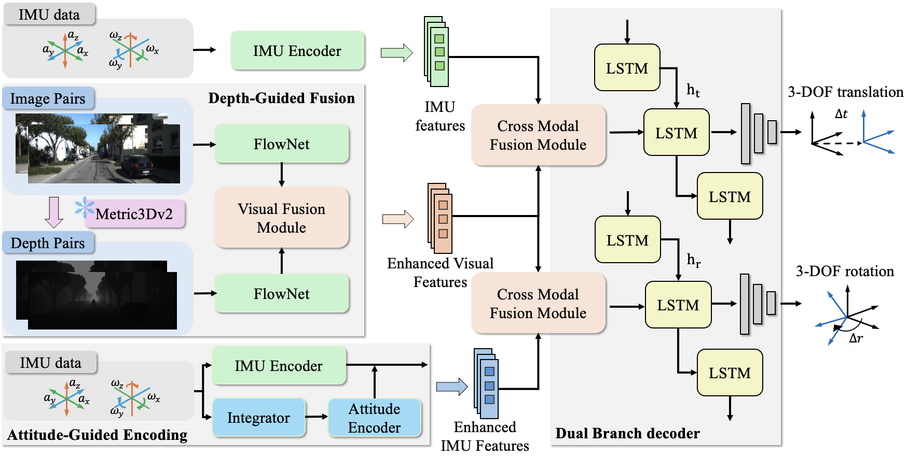
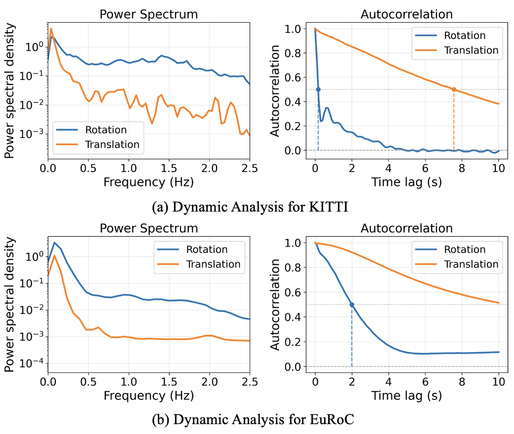
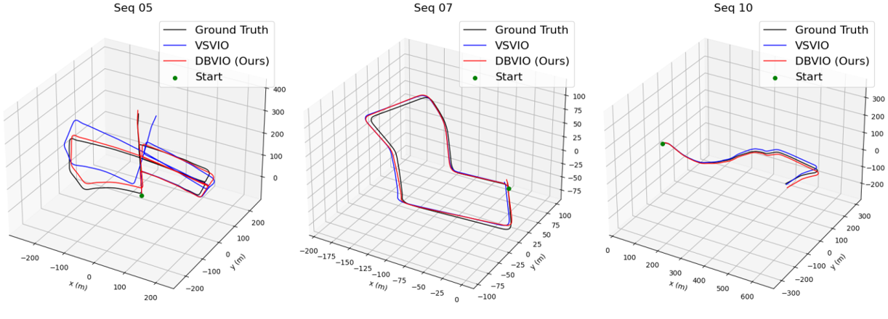

# DB-VIO (arXiv 2026)

<!-- paper-source: https://chengwei920412.github.io/paper_reading/2607.22123_DB_VIO_Dual_Branch_Visual_Inertial_Odometry_with_Enhanced_Visual_Inertial_Representation/technical_report.html -->

> 原文链接：[DB-VIO (arXiv 2026)](https://chengwei920412.github.io/paper_reading/2607.22123_DB_VIO_Dual_Branch_Visual_Inertial_Odometry_with_Enhanced_Visual_Inertial_Representation/technical_report.html)

## 资源 {#_1}

- 中文 PDF：[paper_cn.pdf](https://chengwei920412.github.io/paper_reading/2607.22123_DB_VIO_Dual_Branch_Visual_Inertial_Odometry_with_Enhanced_Visual_Inertial_Representation/paper_cn.pdf)
- 完整中文译文：[paper_cn.md](https://chengwei920412.github.io/paper_reading/2607.22123_DB_VIO_Dual_Branch_Visual_Inertial_Odometry_with_Enhanced_Visual_Inertial_Representation/paper_cn.html)
- arXiv：<https://arxiv.org/abs/2607.22123>

## 核心问题 {#_2}

论文研究基于学习的视觉惯性里程计（VIO）。现有深度 VIO 常把视觉和惯性特征融合成一个统一表示，再用单个循环模型预测完整 6-DoF 位姿。作者认为这有两个问题：单目 RGB 特征缺少显式几何结构，原始 IMU 编码缺少显式姿态积分先验；同时，旋转和平移具有不同时间动力学，用同一个时序模型建模会相互干扰。

DB-VIO 的核心设计是：增强视觉和惯性表示，并把旋转和平移解耦成双分支时间建模。

## 方法拆解 {#_3}

DB-VIO 有三个关键模块：

1. **Depth-Guided Fusion (DGF)**：用 Metric3D 估计相邻图像的相对深度图，再用独立 FlowNet 编码 RGB 对和深度对，融合后得到几何增强视觉特征。
2. **Attitude-Guided Encoding (AGE)**：显式积分陀螺仪角速度，得到姿态序列，再与原始 IMU 输入一起编码，增强旋转相关惯性特征。
3. **Dual-Branch Decoder (DB)**：旋转分支使用视觉特征和 AGE 增强惯性特征，平移分支使用视觉特征和原始惯性特征；两个分支各自用 LSTM 建模时间依赖。

AGE 的关键点是把角速度积分从“让网络隐式学”变成显式几何计算：

\[R_k = R_0 \prod_{i=1}^{k} \exp\!\big( (R_{bc}\,\omega_i^{B})^{\wedge}\, \Delta t \big)\]

然后通过对数映射得到旋转向量：

\[\varphi_k = \log\!\big(R_k\big)^{\vee}\]

这个设计的直觉很明确：旋转积分发生在 \(\mathrm{SO}(3)\) 流形上，不是普通加和；把这个先验显式提供给模型，可减轻神经编码器学习旋转运动学的负担。

## 实验结论 {#_4}

论文先用真值运动做频谱和自相关分析，证明旋转和平移的时间特性确实不同。KITTI 上旋转自相关在约 0.17s 内降到 0.5 以下，而平移能保持约 7.57s；EuRoC 上也显示旋转比平移更快去相关。这为双分支设计提供了数据依据。

在 KITTI 上，DB-VIO 的平均平移误差为 1.77%，平均旋转误差为 6.9°/km，相比 SS-VIO 分别降低 20.6% 和 23.3%。在 EuRoC 上，主版本 DB-VIO 相比 SS-VIO 将相对旋转误差从 185.56 降到 64.55，ATE 从 2.03 降到 1.35；带深度版本进一步把 ATE 降到 1.27。

消融结果显示：

- DGF 主要改善平移和轨迹误差，符合深度线索提供尺度和结构信息的预期。
- DB 对 EuRoC 的贡献很强，说明敏捷 UAV 运动下旋转/平移解耦更重要。
- AGE 主要改善旋转误差，尤其在 EuRoC 上效果明显。

## 复现关注点 {#_5}

复现 DB-VIO 时，几个工程细节会决定结果能否对齐：

- Metric3D 深度估计是否在线运行、是否缓存，会显著影响推理频率。
- IMU 与图像时间同步、插值和每对图像关联的 IMU 样本数必须严格一致。
- AGE 依赖相机-机体外参 \(R_{bc}\)，外参误差会直接影响姿态先验质量。
- 双阶段或三阶段训练流程比较关键，论文不是端到端一次训练所有模块。
- KITTI 和 EuRoC 使用不同损失权重，尤其 EuRoC 的累积损失权重会影响长时程漂移。

## 评价 {#_6}

这篇论文的优点是动机和结构比较清楚：先用运动动力学分析证明旋转和平移异构，再给出双分支架构；同时用 DGF 和 AGE 分别补足视觉和惯性表示缺口。相比单纯堆网络模块，AGE 的几何先验更有解释性。

主要局限是系统依赖较多：Metric3D、FlowNet 编码、跨模态融合、分阶段训练和外参积分都影响最终表现。论文报告的 EuRoC 主版本为了速度不使用深度，而完整版本使用深度但推理降到 14 Hz，这也说明 DGF 的部署成本需要按平台权衡。
