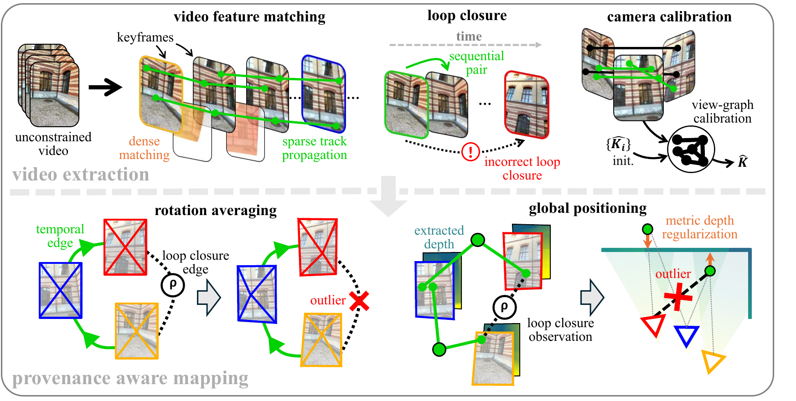
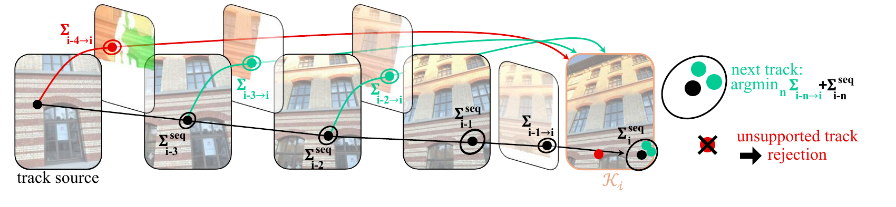
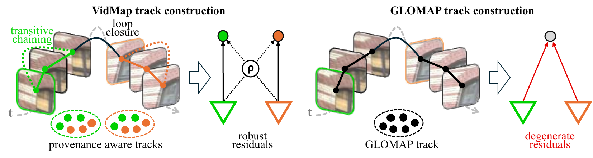
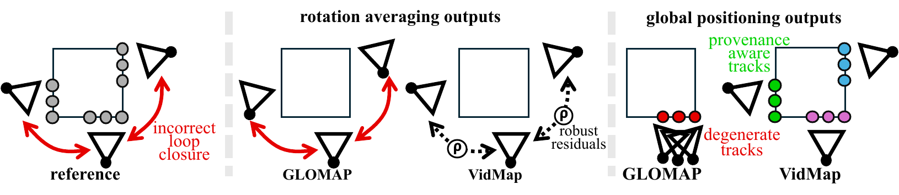
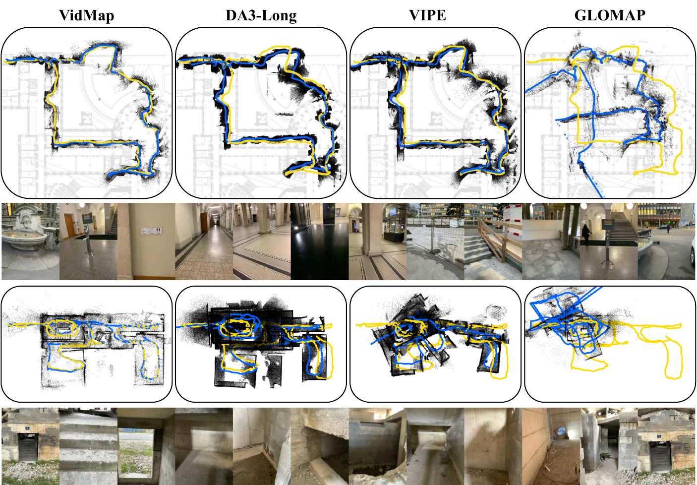
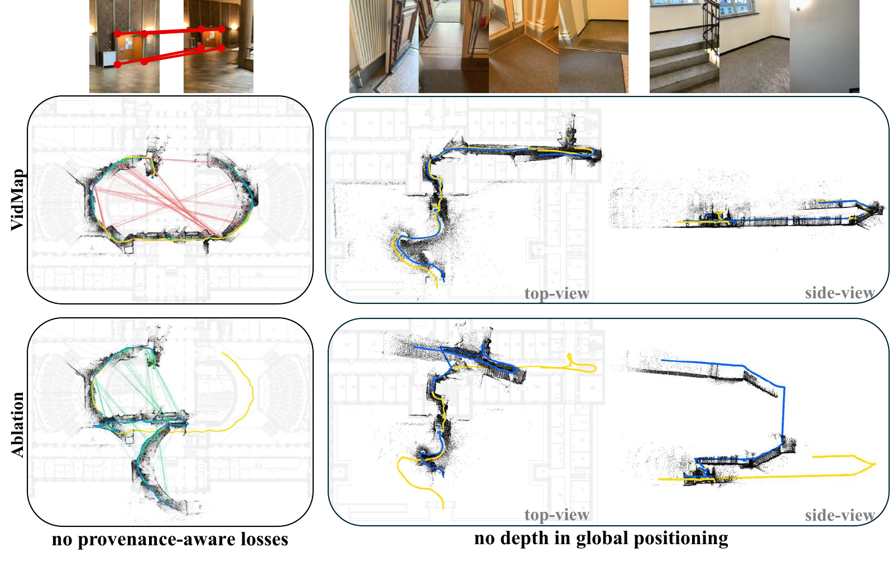
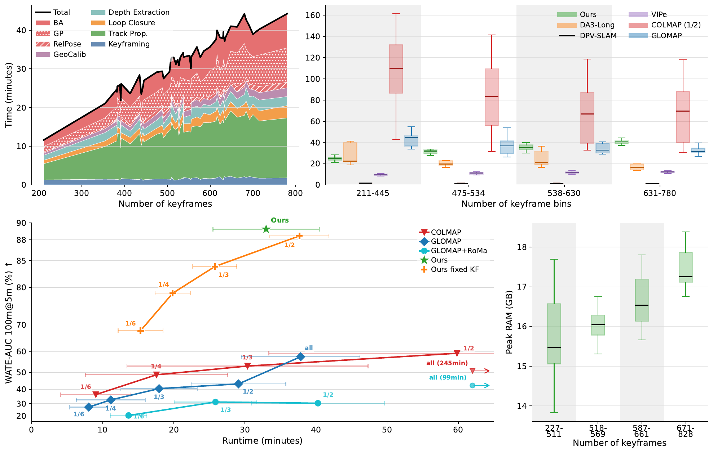

# VidMap (arXiv 2026)

<!-- paper-source: https://chengwei920412.github.io/paper_reading/2607.27194_VidMap_Exploiting_Temporal_Structure_for_Video_Based_Structure_from_Motion/technical_report.html -->

> **arXiv ID**：2607.27194  
> **原文标题**：VidMap: Exploiting Temporal Structure for Video-Based Structure-from-Motion  
> **作者**：Zador Pataki、Paul-Edouard Sarlin、Marc Pollefeys  
> **机构**：ETH Zurich、Google、Microsoft Spatial AI Lab  
> **翻译日期**：2026-08-21

## 论文概览 {#_1}

VidMap面向任意、长时、未标定视频的相机轨迹和稀疏三维结构恢复。论文认为，现有SLAM和SfM各自存在结构性短板：SLAM的因果增量处理容易固化初始化误差，跟踪失败后难以恢复；传统SfM虽可离线全局优化，却忽略视频顺序，容易在重复结构和视觉对称场景中建立错误对应。

VidMap将两者的优势组合起来：使用视频时间顺序建立高可信的连续轨迹，以离线全局SfM统一优化全部观测，并引入度量单目深度和标定先验处理纯旋转、前向运动、窄基线和尺度漂移。代码公开于 <https://github.com/cvg/vidmap>。

### 核心贡献 {#_2}

- 提出非因果的视频SfM框架：利用完整序列后再作几何决策，同时保留视频时间结构。
- 用稠密匹配、滑动窗口多流传播和协方差选择构建长稀疏轨迹，在低纹理区域保持覆盖率并抑制累积漂移。
- 将序列观测与回环闭合（LC）观测的来源标签保留到旋转平均和全局定位（GP），为两类边使用不同鲁棒损失。
- 将带逐图像尺度估计的度量单目深度先验引入GP与光束法平差（BA），约束退化运动并恢复度量尺度。
- 在LaMAR、CroCoDL、ETH3D-SLAM和EuRoC上系统评估已标定与未标定设置，并提供跟踪器、深度先验、尺度和优化策略的消融实验。

## 研究背景与动机 {#_3}

无约束视频常包含快速转动、纯旋转、前向运动、运动模糊、无纹理区域、遮挡、重复结构和未知相机内参。传统系统通常只解决其中一部分：实时SLAM受限于因果决策与紧耦合实现；无序图像SfM无法利用相邻帧天然较少歧义这一条件；端到端学习模型则在长序列上的几何精度、内存扩展和长期一致性方面仍有限。

VidMap的核心判断是：视频顺序不是需要丢弃的附带信息，而应成为数据关联置信度和鲁棒损失设计的第一类变量。

## 方法论 {#_4}

### 整体流程 {#_5}

图：VidMap系统流程。视频感知提取负责关键帧、稠密匹配轨迹、回环闭合、单目深度与焦距先验；全局建图负责旋转平均、全局定位和光束法平差。

给定视频 \(\mathbf{I}=\{I_1,\ldots,I_N\}\)，系统为关键帧集合 \(\mathcal{K}\) 估计相机位姿 \(T_i\in SE(3)\)、内参 \(K_i\) 和稀疏点云 \(\mathbf{X}=\{X_k\}\)。流程分为两个阶段：

1. **视频感知提取**：低分辨率稠密流驱动关键帧选择；高分辨率RoMa v2匹配用于传播轨迹；MegaLoc检索候选回环；Depth Anything 3提供单目深度；GeoCalib与视图图标定估计焦距。
2. **全局建图**：在GLOMAP框架上执行视图图构建、旋转平均、GP和BA，同时加入来源相关损失、深度残差、逐图像尺度及协方差加权。

### 多流轨迹传播 {#_6}

图：每个新关键帧既接收相邻关键帧的序列预测，也接收滑动窗口内更早锚点的直接预测；仅当最小协方差候选与序列预测一致时才采用它。

对于窗口内候选锚点 \(j\)，传播协方差为

\[\Sigma_i^{(j)}=\Sigma_j^{\mathrm{seq}}+\Sigma_{j\to i}.\]

系统选择 \(j^*=\arg\min_j\operatorname{tr}(\Sigma_i^{(j)})\)，但还要求该候选与相邻帧链得到的序列预测一致。这个设计兼顾两点：直接跨帧匹配能减少链式漂移，序列预测则防止较宽基线匹配被视觉混淆误导。

### 来源感知的回环闭合 {#_7}

图：VidMap不通过传递性把LC匹配强行合并进序列轨迹，而是保留独立观测和来源标签。

标准全局SfM把所有对应关系合并为轨迹，错误LC可能把两条原本可靠的序列链合并成不可分离的错误轨迹。VidMap仅用序列边建立轨迹；LC匹配作为带 \(l_{ik}=\text{lc}\) 标签的软观测附着，序列观测标记为 \(l_{ik}=\text{seq}\)。旋转平均对序列边使用Huber损失，对LC边使用更强抑制离群值的Cauchy损失。

图：来源标签使错误LC在旋转平均和GP中被降权，避免对称结构导致姿态与位置解崩溃。

### 深度增强的全局定位 {#_8}

GP联合优化相机中心 \(c_i\)、三维点 \(X_k\) 和逐图像深度尺度 \(s_i\)。目标由方位残差、深度残差和尺度正则项组成：

\[E_{\mathrm{GP}}=\sum_{(i,k)}\left[\rho_{l_{ik}}^{\mathrm{GP}}\!\left((\mathbf e_{ik}^{\mathrm{GP}})^\top(\Sigma_{ik}^{\mathbf v})^{-1}\mathbf e_{ik}^{\mathrm{GP}}\right)+\rho_{l_{ik}}^{\mathrm{depth}}\!\left(\frac{r_{ik}^{\mathrm{depth}}}{\sigma_{ik}}\right)\right]+\sum_i\rho^{\mathrm{scale}}\!\left(\frac{\log s_i}{\sigma_{s,i}}\right).\]

正深度采用对数残差 \(\log(z_{ik}/(s_i m_{ik}))\)，使相对尺度误差得到更自然的度量；点位于相机后方时改用线性残差以保持可优化性。像素定位协方差还会经反投影雅可比传播到三维方位空间。

### 渐进式鲁棒优化 {#_9}

系统不会从随机初始化开始就使用很强的鲁棒损失，否则大残差可能全部被当作离群值而失去梯度。早期GP先检查深度一致性并使用L2；几何收敛后再切换到鲁棒损失。BA同样分阶段收紧重投影筛选和鲁棒阈值，以兼顾大范围收敛与亚厘米级精度。

## 实验与结果 {#_10}

### 实验设置 {#_11}

- **LaMAR**：50段手机视频，包含长轨迹、复杂运动、视觉混淆、无纹理区域和退化视角。
- **CroCoDL**：灾害现场的手机与四足机器人视频，用于考察分布外泛化。
- **ETH3D-SLAM**：55段带高精度真值的室内外短序列。
- **EuRoC**：11段灰度鱼眼无人机序列，含快速六自由度运动和模糊。
- **指标**：ETH3D与EuRoC使用平移误差AUC；LaMAR与CroCoDL使用局部窗口对齐后的W-AUC，以避免全局漂移掩盖局部重建质量。

### 主要结果 {#_12}

图：LaMAR和CroCoDL上的定性对比。

- LaMAR未标定设置下，VidMap在10/25/50/100米和完整轨迹窗口上的W-AUC分别为 **91.9/92.3/89.9/89.3/88.5**；最接近的ViPE为86.6/83.8/80.2/78.1/76.6。
- LaMAR已标定设置下，VidMap完整轨迹W-AUC为 **89.7**，高于ViPE的78.8；未标定与已标定结果非常接近，说明其自标定有效。
- CroCoDL未标定手机序列10米窗口AUC为 **94.0**，机器人序列为 **91.4**；两类序列均明显领先基线，显示较强域外泛化。
- ETH3D-SLAM未标定5厘米阈值AUC为 **51.4**，已标定为 **69.4**；EuRoC已标定5厘米阈值为 **23.0**，与最强基线差距较小，表明灰度鱼眼和运动模糊会削弱学习式深度与标定先验。

### 消融实验 {#_13}

图：来源感知损失和GP深度先验的定性消融。

- 去除GP中的深度先验后，LaMAR完整轨迹W-AUC从 **88.5降至37.7**，说明深度约束是长距离稳健性的核心。
- 不优化逐图像尺度时，完整轨迹W-AUC降至 **39.7**；仅去掉度量尺度但保留相对尺度优化时为74.1，表明“可调整的软度量先验”比固定单目尺度更合理。
- 去除回环闭合边后，LaMAR完整轨迹W-AUC仍有85.5，但ETH3D的5厘米AUC从51.4降至32.9，说明LC对高精度漂移修正很重要。
- 去除来源感知损失后，LaMAR完整轨迹W-AUC降至79.9，并会在强视觉对称场景中发生灾难性失败。

### 效率 {#_14}

图：运行时间、关键帧策略和内存分析。

VidMap是离线系统，计算时间随关键帧数近似线性增长；稠密匹配是最昂贵阶段。基于运动的关键帧选择在降低开销的同时接近稠密关键帧的精度，且长视频的峰值内存仍处于实用范围。各视频或匹配对之间也天然适合并行处理。

## 关键见解 {#_15}

1. **时间顺序应进入优化语义，而不只是决定处理顺序。** VidMap通过来源标签把“相邻帧证据通常更可信”这一事实显式编码进损失函数。
2. **学习先验与显式几何是互补关系。** 稠密匹配和单目深度提高恶劣条件下的覆盖率与可观测性，全局几何优化则提供长序列精度、尺度一致性和可解释的误差建模。
3. **先验应当是可调整的软约束。** 逐图像尺度变量允许系统利用单目度量信息，又不会被单帧深度模型的尺度误差刚性锁死。
4. **鲁棒损失的调度与损失类型同样重要。** 从随机初始化直接强力抑制残差会让退化区域失去梯度，因此需要从宽松到严格的分阶段优化。

## 局限性与未来工作 {#_16}

### 当前局限 {#_17}

- 前向运动时，许多轨迹靠近极点且图像位移很小，现有关键帧准则可能选取过少视图。
- 大量相互一致的错误LC可能共同压过序列约束；Cauchy损失只会降权，不能完全消除其梯度。
- 严重模糊、遮挡、剧烈视角变化或低纹理会终止轨迹，而全局优化无法凭空恢复缺失对应。
- 缺少可靠LC时，极长序列仍会积累长距离漂移。
- 单目深度与标定先验在分布外图像、特殊相机和灰度鱼眼数据上可能失效。
- 纯视觉几何精度仍未达到高质量视觉惯性系统的严格容差。

### 后续方向 {#_18}

- 将IMU、滚动快门和时间同步误差纳入统一全局优化。
- 学习可校准的LC置信度或采用开关约束，使错误LC可被完全关闭，而非仅降权。
- 设计同时考虑视差、极点分布、深度不确定性和轨迹覆盖率的关键帧策略。
- 对深度、焦距与匹配协方差做跨数据集校准，并研究未知相机模型的联合估计。
- 使用分层子地图、稀疏化和分布式优化扩展到小时级或城市级视频。

## 相关方法对比 {#_19}

<table>
<thead>
<tr>
<th>方法类别</th>
<th>核心思想</th>
<th>优势</th>
<th>主要局限</th>
</tr>
</thead>
<tbody>
<tr>
<td>因果式SLAM</td>
<td>逐帧跟踪、局部建图与回环闭合</td>
<td>实时、短序列精度高</td>
<td>早期错误固化，跟踪失败难恢复，通常依赖标定</td>
</tr>
<tr>
<td>全局SfM</td>
<td>对全部图像与观测做全局几何优化</td>
<td>精度高，可联合自标定</td>
<td>忽略视频顺序，视觉对称下易产生错误关联</td>
</tr>
<tr>
<td>前馈三维模型</td>
<td>直接预测位姿、内参和稠密结构</td>
<td>稀疏视图和低重叠下稳健、速度快</td>
<td>长序列一致性、精度与扩展性有限</td>
</tr>
<tr>
<td><strong>VidMap</strong></td>
<td>视频感知稠密轨迹 + 来源感知全局SfM + 度量深度先验</td>
<td>未标定长视频上稳健且精确</td>
<td>仍依赖学习先验和可靠LC，暂非实时系统</td>
</tr>
</tbody>
</table>

## 评价 {#_20}

论文最有价值之处不是简单堆叠深度模型、匹配器和GLOMAP，而是重新定义了观测来源在全局SfM中的角色，并用实验表明来源标签、深度尺度变量和优化调度都不可替代。实验覆盖传统短序列、长轨迹、灾害现场域外数据以及已标定/未标定两种设置，证据链较完整。

需要谨慎看待的是，系统性能依赖多个外部学习组件，复杂度和端到端故障归因都较高；主要结果集中于相机平移误差，尚未充分展示稀疏点云的表面质量、动态物体影响和小时级视频扩展性。论文适合从事SfM、SLAM、视觉定位、三维重建和空间智能数据生产的研究者阅读。

## 术语表 {#_21}

<table>
<thead>
<tr>
<th>英文</th>
<th>中文</th>
</tr>
</thead>
<tbody>
<tr>
<td>Structure-from-Motion (SfM)</td>
<td>运动恢复结构</td>
</tr>
<tr>
<td>Simultaneous Localization and Mapping (SLAM)</td>
<td>同步定位与建图</td>
</tr>
<tr>
<td>Loop Closure (LC)</td>
<td>回环闭合</td>
</tr>
<tr>
<td>Global Positioning (GP)</td>
<td>全局定位</td>
</tr>
<tr>
<td>Bundle Adjustment (BA)</td>
<td>光束法平差</td>
</tr>
<tr>
<td>Rotation Averaging</td>
<td>旋转平均</td>
</tr>
<tr>
<td>Visual Aliasing</td>
<td>视觉混淆</td>
</tr>
<tr>
<td>Metric Monocular Depth Prior</td>
<td>度量单目深度先验</td>
</tr>
<tr>
<td>Provenance-dependent Robust Loss</td>
<td>来源相关鲁棒损失</td>
</tr>
<tr>
<td>Camera Intrinsics</td>
<td>相机内参</td>
</tr>
<tr>
<td>Bearing Residual</td>
<td>方位残差</td>
</tr>
<tr>
<td>Windowed AUC (W-AUC)</td>
<td>窗口化曲线下面积</td>
</tr>
</tbody>
</table>

## 参考资源 {#_22}

- **论文原文**：[arXiv 2607.27194](https://arxiv.org/abs/2607.27194)
- **中文翻译 PDF**：[paper_cn.pdf](https://chengwei920412.github.io/paper_reading/2607.27194_VidMap_Exploiting_Temporal_Structure_for_Video_Based_Structure_from_Motion/paper_cn.pdf)
- **中文 Markdown 译文**：[paper_cn.md](https://chengwei920412.github.io/paper_reading/2607.27194_VidMap_Exploiting_Temporal_Structure_for_Video_Based_Structure_from_Motion/paper_cn.html)
- **代码实现**：[cvg/vidmap](https://github.com/cvg/vidmap)

---

本报告基于论文完整LaTeX源码、补充材料与中文译文整理，实验数值均来自论文表格。
