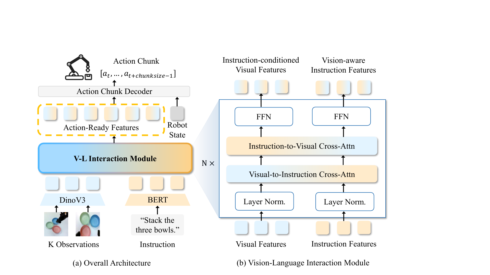
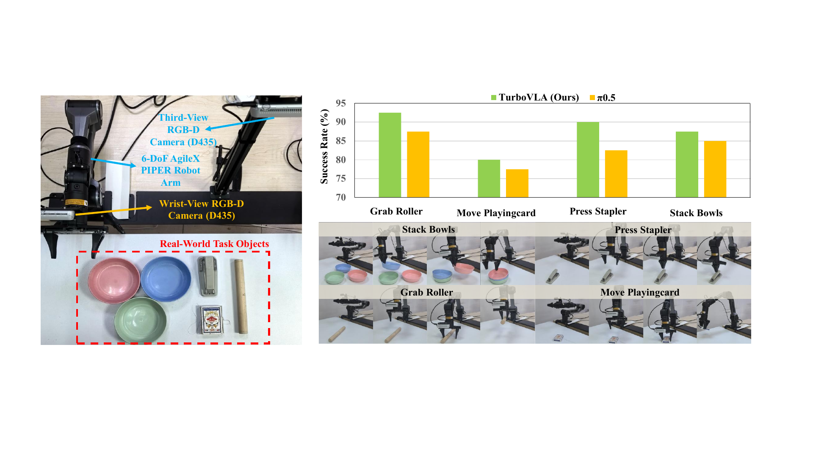

# TurboVLA (arXiv 2026)

<!-- paper-source: https://chengwei920412.github.io/paper_reading/2607.27205_TurboVLA_Real_Time_Vision_Language_Action_Model_at_32_Hz_on_an_RTX_4090_with_1_GB_VRAM/technical_report.html -->

> **arXiv ID**：2607.27205  
> **原文标题**：TurboVLA: Real-Time Vision-Language-Action Model at 32 Hz on an RTX 4090 with < 1 GB VRAM  
> **翻译日期**：2026-08-21

## 论文概览 {#_1}

作者来自华中科技大学。论文面向 VLA 机器人操控，质疑“每次执行动作都必须经过大型语言模型”这一主流设计，并提出直接的 \(V+L\rightarrow A\) 执行路径。TurboVLA 仅含 0.2B 参数，在 RTX 4090 上达到 31.2 ms 策略延迟和 0.9 GB 推理显存，LIBERO 平均成功率为 97.7%。

核心贡献有三点：识别 LLM 核心是实时执行瓶颈；提出轻量文本编码、双向视觉-语言交互与并行动作块解码的架构；在 LIBERO、RoboTwin 2.0 和真实机器人上证明该架构兼顾准确率与部署效率。

## 研究背景与动机 {#_2}

LLM 中心式 VLA 通常遵循 \(V\rightarrow L\rightarrow A\)：视觉特征先投影到 LLM 空间，再与指令联合处理，最后预测动作。LLM 提供开放词汇语义和高层推理，但执行级任务通常已有明确指令，策略的核心需求是让指令选择相关视觉证据并生成动作，而不是开放式语言生成。

现有加速工作多集中于动作端并行解码、量化、剪枝或缓存，却仍保留数十亿参数多模态骨干。TurboVLA 的创新在于直接改变执行表示路径，而非只优化原有路径中的某个环节。

## 方法论 {#_3}

图：TurboVLA 的紧凑模态编码、双向视觉-语言交互与动作块解码流程。

1. BERT 编码完整指令词元，DINOv3 编码多视角图像；二者投影到 256 维共享空间。
2. 六层双向交叉注意力同时生成“视觉感知的指令特征”和“指令条件的视觉特征”。
3. 机器人状态绕过跨模态模块，直接输入 ACT 风格解码器。
4. \(H\) 个可学习动作查询并行生成完整动作块，以专家动作的 \(\ell_1\) 行为克隆损失训练。

这种拆分很关键：视觉-语言模块只负责场景中“看哪里、做什么”，机器人状态和动作解码器负责“当前身体配置下如何执行”。

## 实验与结果 {#_4}

- **LIBERO**：40 项任务、2,000 次回放，DINOv3 ViT-B，12 步 7-DoF 动作块。
- **RoboTwin 2.0**：50 项双臂任务，DINOv3 ViT-L，50 步 14 维关节动作块。
- **真实世界**：AgileX Piper 上四项任务，每项 65 条示范、40 次评估。
- **效率测量**：RTX 4090，批量大小 1，从多模态输入到动作块输出。

主要结果：LIBERO 平均成功率 97.7%，参数量 0.2B、延迟 31.2 ms、显存 0.9 GB；\(\pi_{0.5}\) 为 96.9%、3.4B、93.6 ms、12.8 GB。RoboTwin 2.0 上 TurboVLA 达到 60.2%，高于 \(\pi_{0.5}\) 的 57.0%。真实世界四项任务成功率为 92.5%、80%、90% 和 87.5%，均优于同协议下的 \(\pi_{0.5}\)。

图：真实 AgileX Piper 平台、任务物体、成功率与定性执行示例。

消融表明，移除语言使平均成功率从 97.7% 降至 70.8%，尤其 LIBERO-Goal 从 97.4% 降至 11.6%；任务 ID 嵌入达到 95.4%，说明自然语言不只是闭集标签。双向交互达到 97.7%，优于直接拼接的 95.2% 和两种单向交互的 96.1%/96.5%。最优交互深度为 \(N=6\)，最优动作时域为 \(H=12\)。

## 关键见解 {#_5}

论文最重要的结论并非“BERT 比 LLM 更快”，而是执行层的表示接口可以与规划层解耦。明确指令下的低层闭环控制需要语义条件化，但不一定需要通用生成能力。这个观点适合构建分层机器人系统：LLM 低频负责规划与重规划，TurboVLA 类策略高频负责视觉反馈下的动作执行。

另一个实践启示是，应同时报告成功率、端到端延迟和完整策略峰值显存。只报告解码器速度或参数量无法反映真实部署瓶颈。

## 局限性与未来工作 {#_6}

论文明确承认 TurboVLA 主要处理具体执行级指令，不适合开放式任务分解、复杂语义推理和高层规划。实验虽覆盖仿真单臂、仿真双臂和四项真实任务，但真实世界任务数量与场景变化仍有限；尚未验证长时间持续运行、动态干扰、跨机器人迁移和开放词汇新物体。

后续方向包括：以 LLM 作为低频规划器、TurboVLA 作为高频执行器；在更大规模跨具身数据上预训练紧凑交互模块；加入不确定性估计和失败恢复；在边缘 GPU 上评估功耗、热约束与长期稳定性。

## 相关工作对比 {#_7}

<table>
<thead>
<tr>
<th>方法类别</th>
<th>核心思想</th>
<th>优势</th>
<th>局限</th>
</tr>
</thead>
<tbody>
<tr>
<td>LLM 中心式 VLA</td>
<td>多模态输入经大型语言骨干生成执行表示</td>
<td>语义与推理能力强</td>
<td>延迟、显存、参数量高</td>
</tr>
<tr>
<td>动作端加速 VLA</td>
<td>保留大骨干，改用并行动作专家或高效采样</td>
<td>降低动作生成成本</td>
<td>骨干仍是主要瓶颈</td>
</tr>
<tr>
<td>轻量/压缩 VLA</td>
<td>小模型、量化、剪枝、蒸馏</td>
<td>易于部署</td>
<td>可能损失能力，路径仍以 LLM 为中心</td>
</tr>
<tr>
<td><strong>TurboVLA</strong></td>
<td>轻量文本与视觉编码器直接双向交互，再并行解码动作块</td>
<td>速度快、显存低、成功率高</td>
<td>高层规划与复杂推理能力有限</td>
</tr>
</tbody>
</table>

## 评价 {#_8}

**优点：** 问题定义清楚，架构改动直接且有原则性；效率指标采用完整在线策略、相同 GPU 和批量大小测量；消融覆盖语言必要性、文本骨干、交互方向、深度和动作时域；真实机器人结果支持工程价值。

**可改进之处：** 缺少多硬件平台的延迟与能耗数据；真实任务规模较小；初始化使用定位预训练特征增强权重，其贡献未单独消融；与分层 LLM 规划器结合仍停留在未来工作。

推荐给研究 VLA、机器人模仿学习、多模态融合、实时控制和边缘部署的读者。

## 附录 {#_9}

关键计算路径为：

\[(V_n^\ell,L_n^\ell)=\operatorname{FusionLayer}_{\ell}(V_n^{\ell-1},L_n^{\ell-1}),\qquad Z_n^{vl}=[V_n^N;L_n^N],\]

\[\hat{\mathbf{A}}_n=D_\theta\!\left(Q_a,[Z_n^{vl};Z_n^s]\right)\in\mathbb{R}^{H\times d_a}.\]

术语：VLA（视觉-语言-动作）、LLM（大语言模型）、Action Chunk（动作块）、Bidirectional Cross-Attention（双向交叉注意力）、Execution-Level Control（执行级控制）、Inference VRAM（推理显存）。

### 参考资源 {#_10}

- 原文：<https://arxiv.org/abs/2607.27205>
- 中文 PDF：[paper_cn.pdf](https://chengwei920412.github.io/paper_reading/2607.27205_TurboVLA_Real_Time_Vision_Language_Action_Model_at_32_Hz_on_an_RTX_4090_with_1_GB_VRAM/paper_cn.pdf)
- 完整中文 Markdown：[paper_cn.md](https://chengwei920412.github.io/paper_reading/2607.27205_TurboVLA_Real_Time_Vision_Language_Action_Model_at_32_Hz_on_an_RTX_4090_with_1_GB_VRAM/paper_cn.html)
- 代码：<https://github.com/H-EmbodVis/TurboVLA>
- 项目主页：<https://H-EmbodVis.github.io/TurboVLA>
