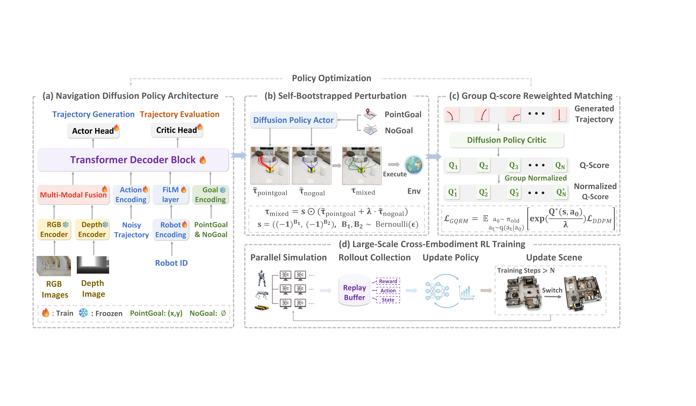
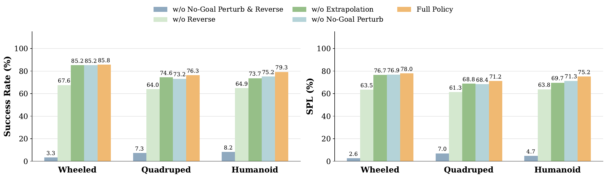

# X-NavDP (arXiv 2026)

<!-- paper-source: https://chengwei920412.github.io/paper_reading/2607.28560_X_NavDP_Generalizing_Navigation_Diffusion_Policy_to_Novel_Behavior_and_Embodiments_with_Group_Q_score_Reweighted_Matching/technical_report.html -->

> 原文链接：[X-NavDP (arXiv 2026)](https://chengwei920412.github.io/paper_reading/2607.28560_X_NavDP_Generalizing_Navigation_Diffusion_Policy_to_Novel_Behavior_and_Embodiments_with_Group_Q_score_Reweighted_Matching/technical_report.html)

> **arXiv ID**: 2607.28560  
> **原文标题**: X-NavDP: Generalizing Navigation Diffusion Policy to Novel Behavior and Embodiments with Group Q-score Reweighted Matching  
> **翻译日期**: 2026-08-01

## 论文概览 {#_1}

本文研究如何通过在线强化学习后训练提升预训练导航扩散策略。核心问题是：现有 NavDP 类方法依赖 oracle 全局规划器生成的专家轨迹，部署时机器人只能看到局部观测，且不同机器人具身形态的动力学约束不同，因此纯模仿学习策略在死胡同逃逸、长障碍物绕行和跨机器人迁移时表现受限。

主要贡献包括：

- 提出 X-NavDP，一个面向视觉导航扩散策略的 RL 后训练框架。
- 提出 GQRM（组 Q 分数重加权匹配），在同一状态的候选轨迹组内归一化 Q 分数，使困难状态也能产生有效策略改进信号。
- 使用目标条件轨迹与目标无关轨迹的自举式扰动，生成后退、横移、绕行等结构化探索行为。
- 通过具身形态调制和 RTC 闭环引导，提高跨轮式、四足、人形机器人的泛化与时间一致性。

图：X-NavDP 后训练流水线。

## 方法要点 {#_2}

X-NavDP 以预训练 NavDP 为基础。策略输入局部视觉观测、导航目标和具身形态信息，输出 \(H\) 步未来航点组成的轨迹片段。执行端采用分层控制：扩散策略给出短时域轨迹，MPC 转换为底盘速度命令，低层运动控制器执行。

GQRM 的关键是把策略更新从“跨 batch 的全局 Q 加权”改为“同状态候选组内的相对 Q 加权”。对于状态 \(s\) 下候选轨迹 \(a_0\)，先计算组均值 \(\bar Q_G(s)\) 和组标准差 \(\sigma_G(s)\)，再得到裁剪后的组归一化值 \(\widetilde Q_G(s,a_0)\)。策略网络使用 \(\exp(\widetilde Q_G/\lambda)\) 作为重加权分数匹配权重。这样即使某个困难状态下所有候选的绝对回报都低，局部较好的候选仍会被强化。

## 实验结果 {#_3}

仿真评估覆盖 GRScenes-100 中的 40 个留出室内场景，真实部署覆盖实验室、大厅和办公室。X-NavDP 在仿真中将总体 SR 从 61.20% 提升到 84.28%，SPL 从 58.95% 提升到 77.19%；在真实困难案例中，成功率从 10% 提升到 65%。

图：定性轨迹对比，微调后策略学到恢复、绕行和更安全路径选择。

消融实验显示，同状态组归一化、自举式扰动、轨迹反向和 RTC 引导均有贡献。其中移除目标无关扰动与反向探索会导致训练几乎坍缩，说明探索质量是预训练导航扩散策略 RL 后训练的核心瓶颈。

图：探索策略消融。

## 局限性 {#_4}

当前方法仍依赖短期时间上下文，长时域记忆不足会影响复杂绕行任务。它还假设每种机器人具身形态已有可用的低层运动控制器。真实世界实验虽包含多个环境，但仍需要在更多场景、感知条件和机器人平台上验证。

## 参考资源 {#_5}

- **论文原文**: [arXiv](https://arxiv.org/abs/2607.28560)
- **中文翻译 PDF**: [paper_cn.pdf](https://chengwei920412.github.io/paper_reading/2607.28560_X_NavDP_Generalizing_Navigation_Diffusion_Policy_to_Novel_Behavior_and_Embodiments_with_Group_Q_score_Reweighted_Matching/paper_cn.pdf)
- **中文 Markdown 译文**: [paper_cn.md](https://chengwei920412.github.io/paper_reading/2607.28560_X_NavDP_Generalizing_Navigation_Diffusion_Policy_to_Novel_Behavior_and_Embodiments_with_Group_Q_score_Reweighted_Matching/paper_cn.html)
- **项目主页/代码**: [X-NavDP project page](https://yty-sky.github.io/x-navdp-project-page/)
