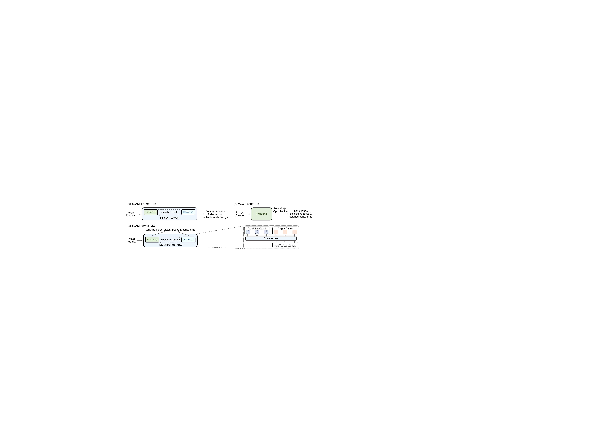
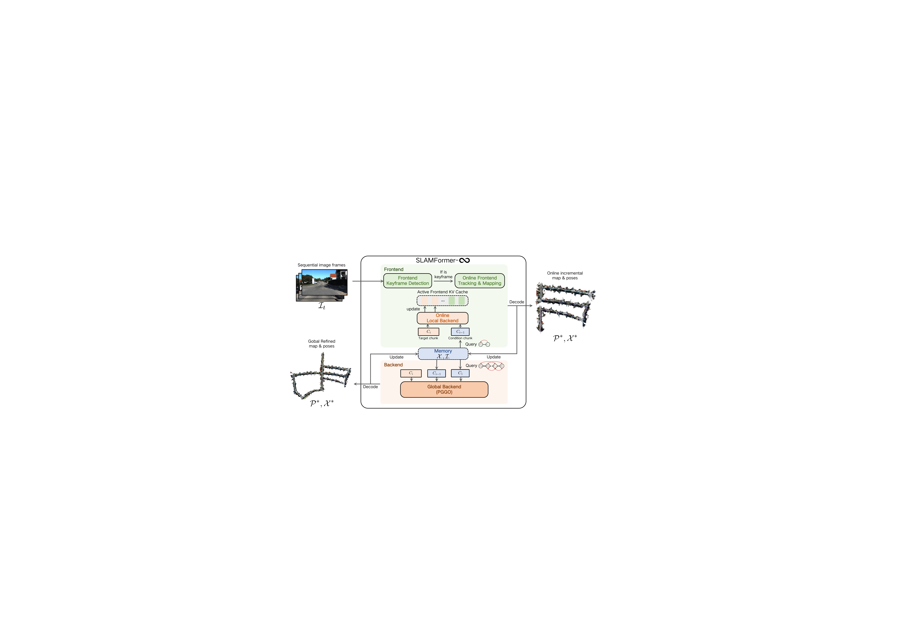
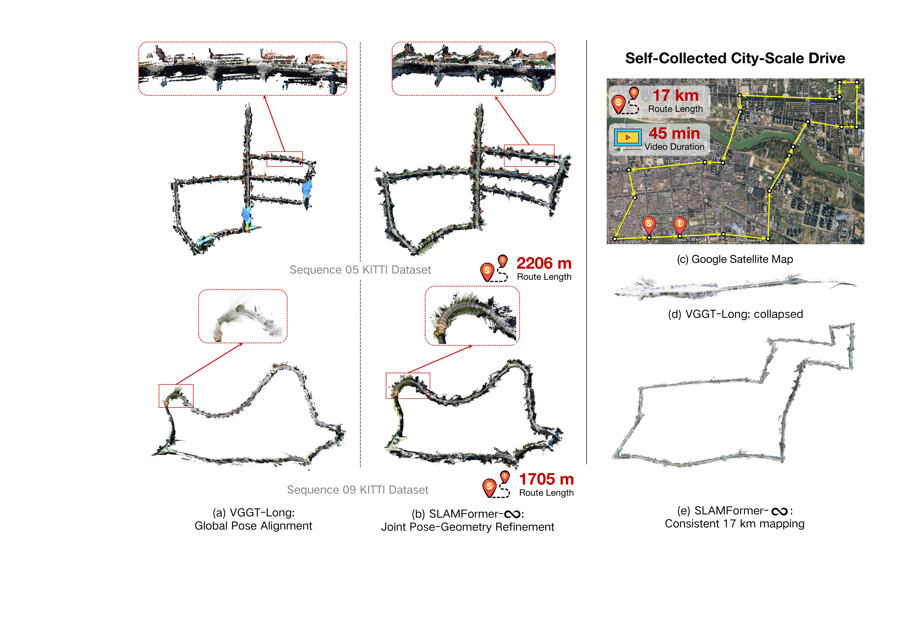

# SLAMFormer Infinity (arXiv 2026)

<!-- paper-source: https://chengwei920412.github.io/paper_reading/2608.03429_SLAMFormer_Infinity_Infinite_SLAM_Transformer_for_Unbounded_Frontend_and_Backend_Processing/technical_report.html -->

论文：SLAMFormer-\(\infty\): Infinite SLAM Transformer for Unbounded Frontend and Backend Processing

原文：https://arxiv.org/abs/2608.03429

交付文件：[paper_cn.pdf](https://chengwei920412.github.io/paper_reading/2608.03429_SLAMFormer_Infinity_Infinite_SLAM_Transformer_for_Unbounded_Frontend_and_Backend_Processing/paper_cn.pdf)，[paper_cn.md](https://chengwei920412.github.io/paper_reading/2608.03429_SLAMFormer_Infinity_Infinite_SLAM_Transformer_for_Unbounded_Frontend_and_Backend_Processing/paper_cn.html)

## 核心问题 {#_1}

现有基于 Transformer 的单目 SLAM 面临两类限制：SLAM-Former 等端到端模型受训练轨迹长度和分布约束；VGGT-Long 等长序列系统主要做位姿级全局对齐，稠密几何往往没有被联合细化。结果是长距离场景中轨迹可被拉齐，但局部几何仍可能破碎或错位。

## 方法要点 {#_2}

SLAMFormer-\(\infty\) 的核心是用记忆条件定义局部坐标系，使 Transformer 在有界上下文中处理无界长序列。

系统由两个关键部分组成：

1. 条件化前端：处理流式 RGB 输入，维护关键帧和局部跟踪。
2. PGGO 后端：在位姿-几何图上迭代联合细化相机位姿和点图，而不是只优化位姿。

## 主要结果 {#_3}

在 KITTI 完整序列上，SLAMFormer-\(\infty\) 将 VGGT-Long 的平均 ATE RMSE 从 \(26.358\)m 降至 \(23.011\)m；在 Waymo 上从 \(1.996\)m 降至 \(1.813\)m。重建方面，Waymo 平均准确率、完整率和 Chamfer 距离也优于 VGGT-Long。

## 工程启示 {#_4}

该论文的价值在于把“长序列可扩展性”和“位姿-几何联合优化”放进同一个 Transformer 框架中。对工程复现而言，关键风险点不在 Transformer 本身，而在图连接质量、回环检测触发、关键帧管理和 PGGO 初始化。论文也明确指出 PGGO 依赖预定义图，图连通性并非从数据学习得到，这是当前主要局限。

## 结论 {#_5}

SLAMFormer-\(\infty\) 提供了一条把几何 Transformer 扩展到无界长 SLAM 的路径：前端保持局部高效，后端用记忆锚和 PGGO 进行长距离联合位姿-几何细化。该方向尤其适合大规模室外稠密单目 SLAM 和城市尺度重建。
