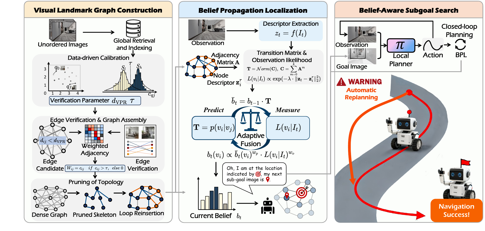
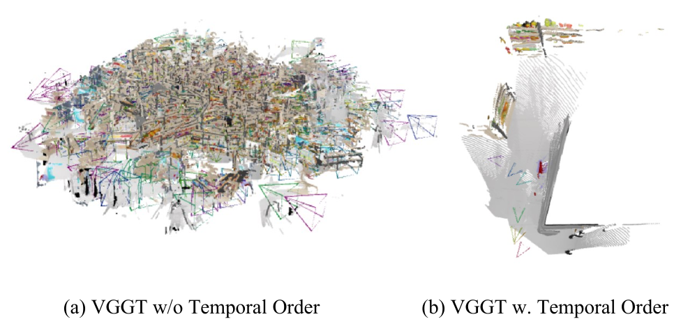
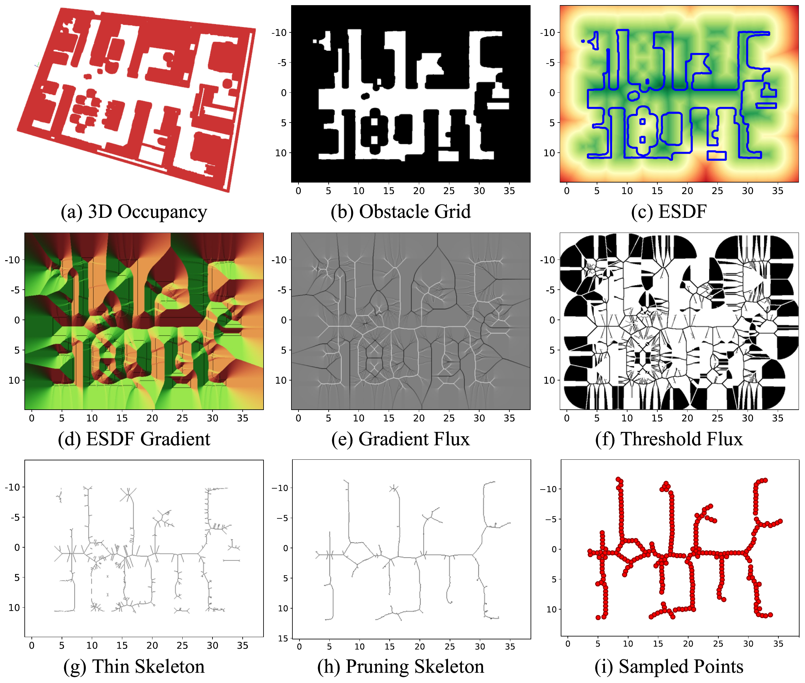
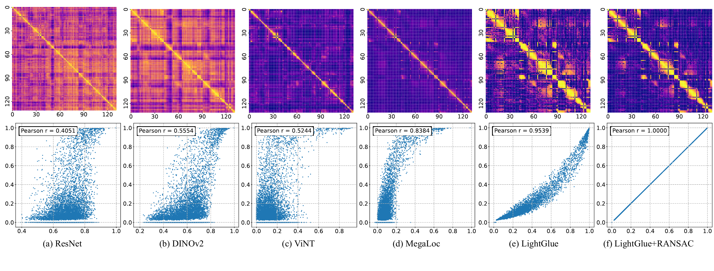
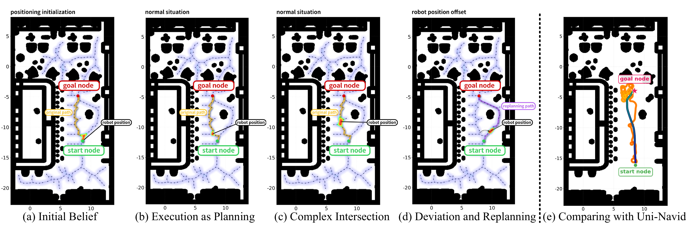
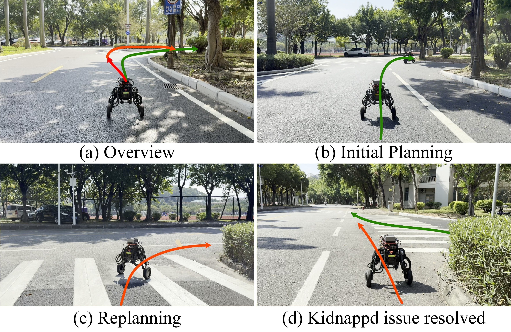

# ULVN (arXiv 2026)

<!-- paper-source: https://chengwei920412.github.io/paper_reading/2608.06833_Unordered_Landmark_Visual_Navigation/technical_report.html -->

> 原文链接：[ULVN (arXiv 2026)](https://chengwei920412.github.io/paper_reading/2608.06833_Unordered_Landmark_Visual_Navigation/technical_report.html)

> **arXiv ID**: 2608.06833
> **原文标题**: Unordered Landmark Visual Navigation
> **翻译日期**: 2026-08-28

---

## 📋 论文概览 {#_2}

### 基本信息 {#_3}

- **作者**: Hao Ren, Junzhe Zhu, Yihan Li, Zetong Bi, Le Zheng, Zhi Li, Yiqing Yuan, Zhaoliang Wan, Dizhe Zhang, Lu Qi, Hui Cheng（通讯作者）
- **机构**: 中山大学（中国广州）；Insta360 研究院（中国深圳）
- **发表时间**: 2026 年 8 月（arXiv 预印本，ECCV 模板）
- **领域**: 具身智能、视觉导航、拓扑建图、视觉定位

### 核心贡献 {#_4}

本文提出 **ULVN**（Unordered Landmark Visual Navigation），一个仅依赖 **无序 RGB 图像集合** 的图像目标导航框架，完全不使用里程计、深度、激光雷达与时序先验。四项主要贡献：

1. **统一框架**：把建图、定位、规划三者协同设计，从系统层面抑制误差累积，而非各自单独优化。
2. **RAVEL**：从无序图像构建拓扑图的两阶段流程——一次性数据驱动阈值标定 + 最大生成森林（MSF）骨架 + 强回环重插入。
3. **BPL**：把传统一维时序贝叶斯滤波扩展到任意二维图，通过熵自适应融合实现无里程计全局定位。
4. **BASS + 基准**：基于置信度的最宽路径规划与偏离触发重规划；公开仿真与真机数据集、数据采集流程与评测指标。



图：ULVN 总体流程。左：无序图像 → 标定检索 + 几何验证 + 剪枝 → 拓扑图；中：观测嵌入 + 观测似然 + 转移矩阵 <span class="paper-math">\(\mathbf{T}\)</span> → 自适应融合更新节点置信度；右：由置信度选取下一地标并闭环执行，置信度偏移触发重规划。

---

## 🎯 研究背景与动机 {#_5}

### 问题定义 {#_6}

图像目标导航（Image-Goal Navigation）：给定一张目标图像 <span class="paper-math">\(I_g\)</span>，智能体需从当前位置自主移动到该图像对应的位置。本文把输入约束到最弱的形式：

- 地图来源只有 **无序图像集合** <span class="paper-math">\(\mathcal{L}=\{I_i\}_{i=1}^{N}\)</span>（"图像袋"，Bag-of-Images），无拍摄顺序、无时间戳；
- 运行时只有 **单目 RGB** 观测 <span class="paper-math">\(I_t\)</span>；
- **无里程计、无深度、无激光雷达、无时序先验**。

这一设定对应真实的部署场景：从房产列表照片、众包图像、历史巡检图库直接部署机器人，而不需要先人工遥控采一遍连续视频。

### 现有方法的局限性 {#_7}

论文识别出两类隐含假设，二者都在真实场景中难以成立：


<table>
<thead>
<tr>
<th>假设</th>
<th>依赖它的方法</th>
<th>去掉后的后果</th>
</tr>
</thead>
<tbody>
<tr>
<td><strong>时序有序视频流</strong></td>
<td>ViNT、PlaceNav、GNM、NoMaD 等（隐式一维地标链）</td>
<td>学到的转移关系失效；相似地点无法区分；拓扑连接噪声大；动作选择振荡</td>
</tr>
<tr>
<td><strong>辅助传感（深度/LiDAR/里程计）</strong></td>
<td>TopoNav、RoboHop 等</td>
<td>尺度与视角歧义无法消解；累积漂移增大；仅凭 RGB 难以闭环校正</td>
</tr>
</tbody>
</table>


论文进一步指出，即便使用先进的三维重建基础模型（如 VGGT）也无法救场——VGGT 在无序图像上的位姿估计显著退化（见下图对比 (a) vs (b)），这正是论文把路线定为"纯拓扑、放弃度量重建"的直接依据。



图：VGGT 在无时序顺序（a）与有时序顺序（b）下的重建对比。基础模型对输入顺序高度敏感。

### 本文的创新点 {#_8}

核心问题（论文原话的中文表述）：**能否构建一个纯 RGB 的导航框架，仅使用无序图像即可实现可靠的闭环导航，而不依赖里程计、深度或时序先验？**

ULVN 的回答思路是把"缺失的时序先验"用"图结构先验"替代：

- 时序链 → **二维拓扑图**（含分支、交叉口、回环）；
- 时序距离（Temporal Distance）→ **VPR 描述符距离 + 几何内点数**；
- 序列滤波 → **图邻接导出的多跳转移矩阵 + 熵自适应贝叶斯融合**。

---

## 🔬 方法论 {#_9}

### 整体架构 {#_10}

三个紧密耦合的模块，串成"建图 → 定位 → 规划"闭环：

```
无序图像 L = {I_1..I_N}
        │
        ▼  RAVEL（§3.1）
   拓扑图 G_pruned = (V, E, W)      W_ij = 已验证局部特征内点数
        │
        ▼  BPL（§3.2）      ← 实时观测 I_t
   置信度分布 b_t over V           MAP 节点 v̂_t
        │
        ▼  BASS（§3.3）     ← 目标图像 I_g
   最宽路径 P* → 子目标 I_sub → 局部规划器（ViNT / NoMaD）→ 速度指令
        │
        └── 偏离检测（图距离 > D_thres = 3）→ 动态重规划
```

**关键设计选择**：边权 <span class="paper-math">\(W_{ij}\)</span> 不是几何距离，而是**已验证的局部特征内点数**。这使得"视觉重叠"直接成为"空间邻近性"的代理量，且同一个量同时服务于三个模块——建图时作剪枝依据、规划时作路径置信度、定位时作转移结构。

### 关键技术 {#_11}

#### 1) RAVEL：一次性阈值标定（本文最实用的工程贡献） {#1-ravel}

经典流程中 RANSAC 内点阈值 <span class="paper-math">\(\tau\)</span> 与检索半径 <span class="paper-math">\(d_{\text{VPR}}\)</span> 是需要逐场景手调的固定常数。RAVEL 改为从场景自身统计中导出：

1. 取首张图 <span class="paper-math">\(q_0\)</span>，检索其**最远**有效邻居 <span class="paper-math">\(q_f = \arg\max_{j}\|\mathbf{z}_{q_0}-\mathbf{z}_j\|_2^2\)</span>，两个锚点覆盖"视觉相似"与"视觉差异"两端；
2. 两锚点与库内所有图像穷举匹配，收集 <span class="paper-math">\((c_{qj}, d_{qj})\)</span> = (内点数, 描述符距离)；
3. 对汇集的内点数做 **2-means** 聚类，得高置信簇 <span class="paper-math">\(S_h\)</span> 与次高簇 <span class="paper-math">\(S_l\)</span>；
4. 阈值取两簇边界中点：


<div class="paper-math">\[\tau = \frac{1}{2}\big(\min(S_h) + \max(S_l)\big), \qquad d_{\text{VPR}} = \max_{(q,j) \in S_h} \|\mathbf{z}_q - \mathbf{z}_j\|_2\]</div>


附录的统计验证了这一设计的必要性：<span class="paper-math">\(\tau\)</span> 在 GRScenes 上极差达 <span class="paper-math">\(490.00\)</span>、均值 <span class="paper-math">\(\mu=205.40\)</span>。任何固定阈值都必然在纹理贫乏区漏检、在重复纹理区误检。

#### 2) RAVEL：MSF 骨架 + 强回环重插入 {#2-ravelmsf}

几何验证后的图仍然稠密含噪。两步剪枝：

- **MSF（Kruskal）**：最大化 <span class="paper-math">\(\sum_{(i,j)\in\mathcal{E}_{\text{MSF}}} W_{ij}\)</span>，把目标从"逐边判断"升级为"全局结构一致"。这是论文中精确率/召回率同时改善的关键——单纯提高局部阈值只能牺牲召回换精确率。
- **强回环重插入**：MSF 消除所有环，但真实环境有真环（矩形走廊、环形通道）。将全部边权 <span class="paper-math">\(k\)</span>-means 聚为 <span class="paper-math">\(k=10\)</span> 簇，动态阈值 <span class="paper-math">\(\tau_{\text{add}}\)</span> 取两个最高质心簇内最小权重（实现中界为 <span class="paper-math">\(1.5\tau\)</span>），仅恢复 <span class="paper-math">\(W_{ij} &gt; \tau_{\text{add}}\)</span> 的边。

#### 3) BPL：图上的贝叶斯滤波 {#3-bpl}

**预测步**——用邻接矩阵的幂和建模"两次更新之间机器人可能走了几步"：


<div class="paper-math">\[\mathbf{C} = \sum_{m=0}^{K} \mathbf{A}^m, \quad K=3, \ \mathbf{A}^0=\mathbf{I}; \qquad \mathbf{T}_{ij} = \frac{\mathbf{C}_{ij}}{\sum_{j&#x27;}\mathbf{C}_{ij&#x27;}}; \qquad \bar{b}_t = b_{t-1}\cdot\mathbf{T}\]</div>


这一步替代了里程计的作用：无法测量位移，就把概率质量按图结构向 <span class="paper-math">\(K\)</span> 跳邻域扩散，让它在交叉口自然分叉、在回环处自然汇聚。

**校正步**——熵自适应融合（论文自称的核心贡献）：


<div class="paper-math">\[H_n(b_{t-1}) = -\frac{1}{\log|\mathcal{V}|}\sum_{v_i} b_{t-1}(v_i)\log b_{t-1}(v_i)\]</div>


<div class="paper-math">\[b_t(v_i) \propto \bar{b}_t(v_i)^{w_p}\cdot L(v_i|I_t)^{w_o}\]</div>


直觉很清晰：**熵低（自信）就多信预测，熵高（迷失）就多信观测**。当感知严重退化使观测似然趋于平坦时，滤波器自动倒向拓扑预测，靠多跳空间先验"滑过"暂时的视觉中断。乘性（对数空间加权求和）融合比加性更尖锐，能压掉那些转移模型与视觉证据都不支持的节点。

> ⚠️ **正文与附录的权重定义不一致**（见后文批判性评价）：正文给出 <span class="paper-math">\(w_p = 1 - H_n\)</span>、<span class="paper-math">\(w_o = H_n\)</span>；附录给出三段分段线性函数（<span class="paper-math">\(\eta&lt;0.3\)</span> 时 <span class="paper-math">\(w_p=0.6\)</span>，<span class="paper-math">\(0.3\le\eta\le0.7\)</span> 时 <span class="paper-math">\(w_p = 0.6-0.75(\eta-0.3)\)</span>，<span class="paper-math">\(\eta&gt;0.7\)</span> 时 <span class="paper-math">\(w_p=0.3\)</span>）。两者在 <span class="paper-math">\(\eta\)</span> 的取值趋势上一致（熵越高越信观测），但函数形式与值域（附录限制在 <span class="paper-math">\([0.3, 0.6]\)</span>）完全不同。类似地，<span class="paper-math">\(\lambda\)</span> 在正文方法节为 <span class="paper-math">\(5\)</span>、实现细节为 <span class="paper-math">\(10\)</span>、附录为分位数自适应公式 <span class="paper-math">\(\lambda = \ln(\delta)/(q_{0.975}(\mathbf{d})-q_{0.025}(\mathbf{d}))\)</span>。

#### 4) BASS：最宽路径（Max-Min）规划 {#4-bassmax-min}

关键洞察：**一条视觉导航路径的鲁棒性由其最弱的一环决定**。因此路径置信度不取边权之和，而取最小值：


<div class="paper-math">\[\mathrm{conf}(\mathcal{P}) = \min_{(v_i,v_j)\in\mathcal{P}} W_{ij}, \qquad \mathcal{P}^* = \arg\max_{\mathcal{P}} \mathrm{conf}(\mathcal{P})\]</div>


用 Dijkstra 变体求解。这保证子目标序列 <span class="paper-math">\((v_s, v_1, \dots, v_g)\)</span> 每一跳都有最强的图像到图像局部控制成功概率——直接对齐了下游局部规划器的实际能力边界。

执行时 BPL 持续更新 <span class="paper-math">\(b_t\)</span>；若 MAP 节点脱离 <span class="paper-math">\(\mathcal{P}^*\)</span>，或到当前子目标的图距离超过 <span class="paper-math">\(D_{\text{thres}}=3\)</span>，则从 <span class="paper-math">\(v_t\)</span> 到 <span class="paper-math">\(v_g\)</span> 重规划。置信度在目标节点上超过 <span class="paper-math">\(0.5\)</span> 即判成功。

### 算法流程 {#_12}

论文给出 5 个伪代码（算法 1–2 数据采集，3 RAVEL，4 BPL，5 BASS）。BASS 主循环最能体现闭环结构：

```
初始化：b_0 ← BPL(初始观测)；v_goal ← argmax P(v|I_goal)；P ← GlobalPlan(G, v_curr, v_goal)
while 未到达 v_goal:
    b_t ← BPL(b_{t-1}, o_t)
    if max_{v∈P} b_t(v) < τ_threshold or IsDeviated(b_t, P):   # 偏离检测
        P ← GlobalPlan(G, argmax_v b_t(v), v_goal)             # 重规划
    k* ← argmax_k { b_t(v_k) | v_k ∈ P }                       # 路径上定位
    v_sub ← P[min(k*+Δ, |P|)]                                  # 前视选择
    执行 LocalPlanner(v_sub, b_t)
```

**真值数据采集流程**（附录 B，本文可复现性的重要部分）：三维占据栅格 → 高度切片 <span class="paper-math">\([0.2, 1.2]\,\mathrm{m}\)</span> 压平为二维可通行栅格（<span class="paper-math">\(0.05\,\mathrm{m}\)</span> 分辨率）→ ESDF → 梯度通量提取中轴 → 形态学细化（Zhang-Suen / Guo-Hall）+ 剪枝（<span class="paper-math">\(L_{\min}=15\)</span> px）→ 沿骨架均匀采样（步长 <span class="paper-math">\(0.5\,\mathrm{m}\)</span>）+ NMS（<span class="paper-math">\(r=0.5\,\mathrm{m}\)</span>）→ 测地距离 <span class="paper-math">\(&lt; 1\,\mathrm{m}\)</span> 连边 → 每节点渲染多视角 RGB。



图：数据采集流程的骨架提取九步。(a) 三维占据 → (b) 二维障碍栅格 → (c) ESDF → (d) 梯度 → (e) 梯度通量 → (f) 阈值化中轴 → (g) 细化 → (h) 剪枝 → (i) 图像采集节点。

---

## 📊 实验与结果 {#_13}

### 实验设置 {#_14}

- **数据集**:
- **GRScenes**（NVIDIA Isaac Sim，主战场）：10 个场景，家居/商业各 5 个；共 3,594 张 <span class="paper-math">\(1920\times1080\)</span> 图像；每节点采样 2 张。
- **CARLA**：单独隔离验证 RAVEL 与 BPL 的感知条件敏感性。
- **真机定位泛化**：RECON、SCAND、GoStanford、SACSoN 四个真实机器人轨迹数据集。
- **真机部署**：Diablo 轮式机器人 + Azure Kinect + NVIDIA Jetson Orin。
- **评估指标**:
- 建图：Precision / Recall / F1 / Accuracy（对真值骨架连通性）；描述符相似度与几何内点的皮尔逊 <span class="paper-math">\(r\)</span>。
- 定位：MAP 估计命中最近拓扑节点的准确率。
- 导航：Habitat ImageNav 标准指标 SR / SPL / 平均碰撞次数。
- **对比方法**: ResNet-50、DINOv2、MegaLoc、CosPlace、VGGT、ViNT、PlaceNav、JIST（表示与定位）；Uni-Navid、UniGoal（端到端导航）；ViNT / NoMaD（作为 ULVN 的局部规划器）。
- **实现**: 全局描述符 MegaLoc（L2 归一化）+ FAISS 索引；几何验证 LightGlue + RANSAC；MSF 用 Kruskal；标定失败时回退 <span class="paper-math">\(\tau_{\text{default}}=15\)</span>、<span class="paper-math">\(d_{\text{VPR,default}}=1.7\)</span>。

### 主要结果 {#_15}

**① VPR 是必需的，而非可选的**（图 4）。这是全文最干净的一个实证结论：通用特征（ResNet、DINOv2）与时序距离（ViNT）与真值几何内点只有弱且非线性的相关；只有 VPR 训练的 MegaLoc 呈现强线性相关，才能在不丢弃有效邻居的前提下筛掉候选。



图：各全局描述符（a ResNet / b DINOv2 / c ViNT 时序距离 / d MegaLoc）与 LightGlue+RANSAC 真值几何分数的亲和度矩阵（上排）与相关性图（下排）。

**② 建图：F1 从 ~0.60 提升到 0.7365**（表 1）。检索类基线暴露出精确率-召回率的死结：Top-<span class="paper-math">\(k\)</span> 调大则召回涨、精确率崩。


<table>
<thead>
<tr>
<th>方法</th>
<th>P</th>
<th>R</th>
<th>F1</th>
<th>Acc.</th>
</tr>
</thead>
<tbody>
<tr>
<td>VGGT</td>
<td>0.1599</td>
<td>0.1659</td>
<td>0.1629</td>
<td>0.9931</td>
</tr>
<tr>
<td>Top-<span class="paper-math">\(k\)</span> ANN</td>
<td>0.1245</td>
<td><strong>0.9121</strong></td>
<td>0.2156</td>
<td>0.9584</td>
</tr>
<tr>
<td>PlaceNav top 2</td>
<td>0.5262</td>
<td>0.7113</td>
<td>0.6043</td>
<td>0.9948</td>
</tr>
<tr>
<td>PlaceNav top 5</td>
<td>0.2699</td>
<td>0.7655</td>
<td>0.3731</td>
<td>0.9853</td>
</tr>
<tr>
<td>ViNT top 2</td>
<td>0.5201</td>
<td>0.6775</td>
<td>0.5815</td>
<td>0.9946</td>
</tr>
<tr>
<td>ViNT top 5</td>
<td>0.2660</td>
<td><strong>0.8246</strong></td>
<td>0.3806</td>
<td>0.9816</td>
</tr>
<tr>
<td><strong>RAVEL（本文）</strong></td>
<td><strong>0.7104</strong></td>
<td>0.7656</td>
<td><strong>0.7365</strong></td>
<td><strong>0.9970</strong></td>
</tr>
</tbody>
</table>


值得注意的是 **VGGT 的 F1 仅 0.1629**——重建基础模型在无序输入下几乎无法给出可用连通性，这为"放弃度量重建"提供了最直接的量化支撑。

**③ 定位：95.49% 总体、93.99% 困难路径**（表 4）。困难路径（长路径、大转角、起终点低重叠）上 ViNT 的一维时序距离崩到 70.50%，而 BPL 只从 95.49% 掉到 93.99%，几乎持平。这个 gap（BPL -1.5% vs ViNT -16.1%）是"二维图 vs 一维链"的最强证据。


<table>
<thead>
<tr>
<th>场景</th>
<th>指标</th>
<th>本文</th>
<th>MegaLoc</th>
<th>ViNT</th>
<th>JIST</th>
</tr>
</thead>
<tbody>
<tr>
<td>全部</td>
<td>Acc.(%)</td>
<td><strong>95.49</strong></td>
<td>91.09</td>
<td>86.58</td>
<td>84.94</td>
</tr>
<tr>
<td>困难路径</td>
<td>Acc.(%)</td>
<td><strong>93.99</strong></td>
<td>89.03</td>
<td><strong>70.50</strong></td>
<td>82.25</td>
</tr>
</tbody>
</table>


**④ 跨数据集定位鲁棒性：0.930 ± 0.040**（表 5，四个真实数据集平均）。


<table>
<thead>
<tr>
<th>条件</th>
<th>MegaLoc</th>
<th>JIST</th>
<th>ViNT</th>
<th>BPL（本文）</th>
</tr>
</thead>
<tbody>
<tr>
<td>旋转</td>
<td>0.913 ± 0.104</td>
<td>0.722 ± 0.066</td>
<td>0.895 ± 0.044</td>
<td><strong>0.966 ± 0.020</strong></td>
</tr>
<tr>
<td>旋转 + 高斯</td>
<td>0.743 ± 0.088</td>
<td>0.452 ± 0.177</td>
<td>0.885 ± 0.045</td>
<td><strong>0.914 ± 0.038</strong></td>
</tr>
<tr>
<td>旋转 + 泊松</td>
<td>0.717 ± 0.114</td>
<td>0.445 ± 0.176</td>
<td>0.888 ± 0.037</td>
<td><strong>0.896 ± 0.036</strong></td>
</tr>
<tr>
<td>旋转 + 裁剪</td>
<td>0.855 ± 0.151</td>
<td>0.525 ± 0.076</td>
<td>0.640 ± 0.096</td>
<td><strong>0.945 ± 0.027</strong></td>
</tr>
<tr>
<td><strong>平均</strong></td>
<td>0.807 ± 0.133</td>
<td>0.536 ± 0.167</td>
<td>0.827 ± 0.124</td>
<td><strong>0.930 ± 0.040</strong></td>
</tr>
</tbody>
</table>


除了均值最高，**标准差也最小（0.040 vs 0.124~0.167）**——这比均值更有说服力，说明熵自适应融合真的在起"兜底"作用。注意 ViNT 在"旋转+裁剪"下从 ~0.89 崩到 0.640，而 MegaLoc 在噪声下崩、在裁剪下反而尚可，两类基线的失效模式互补，BPL 则两者都稳。

**⑤ 导航：SR 71.9%，SPL 大幅领先**（表 7）。


<table>
<thead>
<tr>
<th>方法</th>
<th>SR (%)</th>
<th>平均碰撞</th>
<th>平均 SPL</th>
</tr>
</thead>
<tbody>
<tr>
<td>Uni-Navid</td>
<td>32.0</td>
<td>1.96</td>
<td>0.2391</td>
</tr>
<tr>
<td>UniGoal</td>
<td>61.6</td>
<td>0.88</td>
<td>0.3176</td>
</tr>
<tr>
<td>ULVN+ViNT-A</td>
<td>31.0</td>
<td>1.13</td>
<td>0.812</td>
</tr>
<tr>
<td>ULVN+NoMaD-A</td>
<td>54.3</td>
<td>0.94</td>
<td>0.7458</td>
</tr>
<tr>
<td>ULVN+ViNT w. <span class="paper-math">\(d_{temp}\)</span></td>
<td>59.6</td>
<td>0.88</td>
<td>0.7752</td>
</tr>
<tr>
<td>ULVN+ViNT</td>
<td>68.1</td>
<td>0.76</td>
<td><strong>0.8398</strong></td>
</tr>
<tr>
<td><strong>ULVN+NoMaD</strong></td>
<td><strong>71.9</strong></td>
<td><strong>0.42</strong></td>
<td>0.7978</td>
</tr>
</tbody>
</table>


SPL 的差距（0.80~0.84 vs 0.24~0.32）比 SR 的差距更醒目：拓扑图带来的不只是"更常成功"，而是**路径效率的量级提升**——端到端反应式模型即使成功也在绕远和振荡。



图：重规划过程可视化及与 Uni-Navid 的轨迹对比（e）。Uni-Navid 纯反应式导航出现严重振荡。

**⑥ 真机验证**（图 6）。Diablo 机器人在物理扰动偏离路径后，BPL 把置信度收敛到离线路节点，拓扑距离超阈值触发 BASS 实时重规划并成功到达。附录还展示了"绑架机器人"（Kidnapped Robot）场景的重定位恢复——这是全局定位（而非增量跟踪）方案独有的能力。



图：真机案例。(a) 总览 (b) 初始规划 (c) 偏离后重规划 (d) 绑架机器人场景经重定位与重规划解决。

### 消融实验 {#_16}

**RAVEL 组件消融**（表 2）——最能说明 MSF 作用机理的一组数字：


<table>
<thead>
<tr>
<th>方法</th>
<th>P</th>
<th>R</th>
<th>F1</th>
<th>Acc.</th>
</tr>
</thead>
<tbody>
<tr>
<td>Top-<span class="paper-math">\(k\)</span> ANN</td>
<td>0.1245</td>
<td><strong>0.9121</strong></td>
<td>0.2156</td>
<td>0.9584</td>
</tr>
<tr>
<td>RAVEL w/o (MSF, AVP <span class="paper-math">\(\tau\)</span>)</td>
<td>0.3676</td>
<td>0.7177</td>
<td>0.4496</td>
<td>0.9898</td>
</tr>
<tr>
<td>RAVEL w/o MSF</td>
<td>0.6910</td>
<td>0.4220</td>
<td>0.5157</td>
<td>0.9956</td>
</tr>
<tr>
<td><strong>RAVEL（完整）</strong></td>
<td><strong>0.7104</strong></td>
<td>0.7656</td>
<td><strong>0.7365</strong></td>
<td><strong>0.9970</strong></td>
</tr>
</tbody>
</table>


关键读法：**w/o MSF 的精确率已达 0.6910（接近完整版 0.7104），但召回率只有 0.4220**。也就是说自适应阈值负责精确率、MSF 负责召回率——纯局部的边拒绝会把图切碎，MSF 通过全局结构约束把碎片重新缝成统一骨架。附录进一步细分：家居场景移除 MSF 使召回率从 0.7625 崩到 0.3521（不规则通路更依赖结构缝合）；商业场景同时移除 MSF 与 AVP 使精确率跌至 0.2728（重复纹理更依赖自适应剪枝）。两类场景的主导失效因素不同，这是一个有信息量的观察。

**BPL 消融**（表 6）：


<table>
<thead>
<tr>
<th><span class="paper-math">\(k\)</span></th>
<th>1</th>
<th>2</th>
<th>3</th>
<th>4</th>
<th>5</th>
<th>1</th>
</tr>
</thead>
<tbody>
<tr>
<td>自适应融合</td>
<td>✓</td>
<td>✓</td>
<td>✓</td>
<td>✓</td>
<td>✓</td>
<td>✗</td>
</tr>
<tr>
<td>Acc. (%)</td>
<td>95.49</td>
<td>94.47</td>
<td>93.65</td>
<td>92.42</td>
<td>92.73</td>
<td><strong>90.57</strong></td>
</tr>
</tbody>
</table>


- 传播深度 <span class="paper-math">\(k\)</span> 影响温和（95.49% → 92.73%），过深会过平滑置信度。
- **关闭熵自适应融合：95.49% → 90.57%（-4.92%）**，是单项影响最大的因素。论文由此论断"结构扩散有帮助，但按不确定性动态加权才是消解视觉歧义的关键"。

> ⚠️ 表 6 的 <span class="paper-math">\(k\)</span> 列显示最优值在 <span class="paper-math">\(k=1\)</span>（95.49%），但正文文字称"在 2–3 跳附近达到峰值"，且方法节固定 <span class="paper-math">\(K=3\)</span>。表与文字不一致。

**噪声鲁棒性**（表 3）：在亮度/色偏/对比度/低光高斯噪声 + 方向性运动模糊下，RAVEL 的 F1 仅降 **6.56%**，而 CosPlace top 2 降 10.29%、ViNT top 5 降 18.43%。几何验证 + MSF 结构约束共同阻止了受污染图像形成虚假边。

---

## 💡 关键见解 {#_17}

### 理论分析 {#_18}

**1. 图结构可以替代时序先验，但替代物必须是"可达性"而非"相似性"。**
论文的核心机制是 <span class="paper-math">\(\mathbf{C} = \sum_{m=0}^{K}\mathbf{A}^m\)</span>。这一步的意义值得强调：在标准贝叶斯滤波中，转移模型 <span class="paper-math">\(p(x_t|x_{t-1})\)</span> 由运动模型（里程计）给出；去掉里程计后，ULVN 用"图上 <span class="paper-math">\(K\)</span> 跳内可达"这一**纯拓扑约束**作为运动模型的最弱可用替代。它不知道机器人走了多远，但知道机器人**不可能**跳到非邻域节点——这个负向约束足以抑制感知混淆。这也解释了为什么 <span class="paper-math">\(K\)</span> 的敏感性不高：<span class="paper-math">\(K\)</span> 只控制约束的松紧，不控制约束的方向。

**2. Max-Min 路径目标与下游控制器能力对齐。**
<span class="paper-math">\(\mathrm{conf}(\mathcal{P}) = \min W_{ij}\)</span> 的选择不是数学上的偏好，而是对"局部规划器是逐跳执行的、一跳失败整条路径就失败"这一事实的直接编码。若用 <span class="paper-math">\(\sum W_{ij}\)</span> 或平均值，会选出"总体不错但有一个薄弱环节"的路径，而这恰恰是最易失败的路径。这是一个把系统约束写进目标函数的好例子。

**3. 熵自适应融合本质是"退化时切换信息源"。**
<span class="paper-math">\(w_p = f(H_n)\)</span> 让滤波器在观测似然平坦（信息量低）时自动降低观测权重。表 5 中标准差从 0.124~0.167 降到 0.040，正是这一机制的直接指标：它不提升最好情况，而是抬高最坏情况的下界。

**4. 精确率与召回率的矛盾要在不同抽象层级上解决。**
表 2 揭示的模式具有一般性：局部阈值调整只能在 P-R 曲线上滑动（w/o MSF：P 高 R 低；Top-<span class="paper-math">\(k\)</span> ANN：R 高 P 低），无法把曲线整体推外。只有引入**跨边的全局约束**（MSF 的生成森林结构）才能同时改善两者。这一思路可迁移到其他图构建任务。

### 实践启示 {#_19}

- **部署成本的实质性下降**：从"必须遥控采一遍连续视频"降到"扔一堆照片进去"。对多楼层、多房间的大场景，这是运维成本的量级差异。
- **一次性标定值得推广**：<span class="paper-math">\(\tau\)</span> 极差 490、<span class="paper-math">\(\mu=205.40\)</span> 的统计说明手调阈值在跨场景部署中是不可行的。用两个锚点探测 + 2-means 得到阈值，代价是 <span class="paper-math">\(O(2N)\)</span> 次几何验证，换来免调参——这个交换在实际系统中很划算。
- **模块化优于端到端（在此设定下）**：ULVN 可自由替换局部规划器（ViNT / NoMaD），SR 从 68.1% 到 71.9%。而端到端模型的 SPL 卡在 0.24~0.32 无法通过换模块改善。
- **时序距离的正确定位**：表 7 给出了一个细致结论——移除时序距离**训练**损失（-A）严重掉点（ViNT 68.1% → 31.0%），但用时序距离替换 BPL 做**执行时定位**也掉点（68.1% → 59.6%）。时序距离是好的辅助训练信号，不是好的全局定位量。这个区分对后续工作有直接指导意义。
- **失败瓶颈已转移到局部控制**：定位 ~95% 但导航 ~72%，论文明确归因于局部规划器的障碍感知与轨迹振荡。这意味着继续优化拓扑层的边际收益有限。

---

## 🔍 局限性与未来工作 {#_20}

### 当前局限 {#_21}

**论文自陈的局限**：
1. **纹理贫乏 / 大面积开阔环境**仍会引入歧义（附录 C 明确承认，归因于单目图像的本质局限）。
2. **定位-导航 24 个百分点的落差**由局部规划器的物理局限造成：障碍感知有限、轨迹生成振荡。
3. 隐含前提：**图像库必须具备充分视觉重叠**（方法节开篇假设）。图像太稀疏时 RAVEL 无法建出连通图。

**审阅角度的补充局限**：

1. **参数定义在正文与附录间不一致**（前文已标注）：融合权重 <span class="paper-math">\(w_p\)</span>（线性 vs 三段分段线性）、<span class="paper-math">\(\lambda\)</span>（5 / 10 / 分位数自适应）、最优 <span class="paper-math">\(k\)</span>（表 6 显示 1，文字称 2–3）。这些不影响主要结论的方向，但会实质影响复现——复现者无法确定该实现哪一版。附录的分段线性版把 <span class="paper-math">\(w_p\)</span> 限制在 <span class="paper-math">\([0.3, 0.6]\)</span>，与正文"严格和为 1 且可取遍 <span class="paper-math">\([0, 1]\)</span>"的表述行为差异明显。
2. **绝对性能仍不足以支撑无人值守部署**：71.9% SR 意味着约每 3.5 次任务失败 1 次。
3. **主实验集中在仿真**：GRScenes 10 个场景是主战场；真机部分是单机器人的定性案例展示（图 6），没有真机 SR/SPL 的定量统计。四个真实数据集只用于**定位**评测，不涉及闭环导航。
4. **锚点选择的鲁棒性论证不够充分**：标定依赖 <span class="paper-math">\(q_0\)</span>（论文正文说"首张图像"，算法 3 伪代码说"随机"）与 <span class="paper-math">\(q_f\)</span>。若 <span class="paper-math">\(q_0\)</span> 恰好落在纹理极差或孤立区域，<span class="paper-math">\(S_h\)</span> 可能失效并回退到默认值。附录有敏感性分析（图 10），但未报告"回退到默认值的频率"及其对最终 F1 的影响。
5. **BASS 复杂度分析与实现不符**：附录称子目标选择需"为每个节点计算期望信息增益与置信度熵"，<span class="paper-math">\(O(N)\)</span>；但算法 5 与正文描述的实际机制是"在路径 <span class="paper-math">\(P\)</span> 上取 argmax + 前视偏移"，不涉及信息增益。这段复杂度分析看起来是从信息寻求式探索的模板中残留的。
6. **缺少计算开销报告**：建图阶段需 <span class="paper-math">\(O(|候选对|)\)</span> 次 LightGlue + RANSAC，3,594 张图的实际建图耗时、在 Jetson Orin 上 BPL 每步的推理延迟均未报告。对实时部署这是关键数据。
7. **<span class="paper-math">\(D_{\text{thres}}=3\)</span>、<span class="paper-math">\(\Delta\)</span>（前视窗口）、<span class="paper-math">\(\tau_{threshold}\)</span> 等阈值未做敏感性分析**，<span class="paper-math">\(\Delta\)</span> 的具体取值甚至未给出。
8. **动态环境未涉及**：拓扑图是离线静态构建的。家具移动、行人、光照日夜变化对已建图的影响没有实验。

### 未来方向 {#_22}

1. **补齐局部控制这块短板**：既然瓶颈已明确在局部规划器，把带避障的 MPC 或更强的视觉伺服策略接入 ULVN，是最高性价比的下一步——预期能把 24 个百分点的落差压缩相当一部分。
2. **在线增量建图**：当前是离线一次性建图。让机器人在执行中把新观测增量插入 <span class="paper-math">\(\mathcal{G}\)</span>（新节点 + 重新计算局部 MSF），既能修补稀疏区域，也能应对环境变化。
3. **语义增强边权**：<span class="paper-math">\(W_{ij}\)</span> 目前是纯几何内点数。融入语义一致性（门、走廊、房间边界）有望缓解纹理贫乏区的歧义——这正是论文承认的失效场景。
4. **置信度感知的探索**：BASS 目前只做"路径遍历"（论文明确区分于"信息寻求式探索"）。当置信度熵持续偏高时主动执行降熵动作（转向信息量大的视角），可提升绑架恢复的速度。
5. **多机器人共享拓扑图**：无序图像输入天然适合众包——多台机器人（或用户手机拍照）贡献图像，共同维护一张拓扑图。
6. **打通参数定义并公开实现**：统一 <span class="paper-math">\(w_p\)</span>、<span class="paper-math">\(\lambda\)</span>、<span class="paper-math">\(k\)</span> 的定义，公开 RAVEL 标定与 BPL 的参考实现，是这项工作发挥影响力的前提。
7. **在真机上做定量导航评测**：把仿真的 SR/SPL 协议搬到真机多场景多轨迹，才能真正支撑"sim-to-real 可行"的主张。

---

## 📚 相关工作对比 {#_23}


<table>
<thead>
<tr>
<th>方法</th>
<th>核心思想</th>
<th>优势</th>
<th>劣势</th>
</tr>
</thead>
<tbody>
<tr>
<td><strong>ViNT / NoMaD / GNM</strong></td>
<td>时序有序视频训练的视觉基础模型，用时序距离（Temporal Distance）度量视图间"远近"，形成一维地标链</td>
<td>局部控制能力强（本文正是拿它们当局部规划器）；泛化性好</td>
<td>隐含一维拓扑假设，交叉口/分支/回环处失效（困难路径定位 70.50%）；需时序有序数据；时序距离与测地距离相关性弱</td>
</tr>
<tr>
<td><strong>PlaceNav / 基于 VPR 的子目标选择</strong></td>
<td>把子目标选择重构为 VPR 检索问题，替代昂贵的时序距离评估</td>
<td>高效、对光照视角鲁棒；不需逐候选跑网络</td>
<td>仍隐式保留一维拓扑；单帧检索无时序/结构平滑，噪声下崩（MegaLoc 噪声条件降近 30%）</td>
</tr>
<tr>
<td><strong>JIST（序列平滑）</strong></td>
<td>在 VPR 检索上叠加序列级平滑</td>
<td>缓解单帧抖动</td>
<td>强依赖序列连续性，无序/退化条件下最脆弱（平均 0.536）</td>
</tr>
<tr>
<td><strong>VGGT 等重建基础模型</strong></td>
<td>端到端前馈三维重建与位姿估计</td>
<td>有序输入下几何精度高</td>
<td>对输入顺序高度敏感，无序图像上建图 F1 仅 0.1629</td>
</tr>
<tr>
<td><strong>Uni-Navid / UniGoal（端到端）</strong></td>
<td>视频-语言-动作模型直接从自我中心观测输出动作</td>
<td>无需显式建图；支持语言指令</td>
<td>纯反应式、短视，轨迹严重振荡（SPL 0.24~0.32，碰撞 0.88~1.96）；无全局结构记忆</td>
</tr>
<tr>
<td><strong>经典拓扑 SLAM（FAB-MAP / SeqSLAM）</strong></td>
<td>外观 VPR + 概率推断消解感知混淆</td>
<td>计算轻、有原则的概率框架</td>
<td>依赖手调阈值（RANSAC 内点等），跨场景不稳定；无闭环导航策略</td>
</tr>
<tr>
<td><strong>TopoNav / RoboHop</strong></td>
<td>拓扑导航 + 深度/LiDAR 辅助稳定定位</td>
<td>定位稳定</td>
<td>依赖辅助传感，纯 RGB 场景不适用</td>
</tr>
<tr>
<td><strong>本文 ULVN</strong></td>
<td>无序图像 → 一次性标定 + 几何验证 + MSF 骨架（RAVEL）→ 图上多跳转移 + 熵自适应融合（BPL）→ Max-Min 最宽路径 + 偏离重规划（BASS）</td>
<td>唯一在"无序 + 纯 RGB + 无里程计"下闭环工作；F1 0.7365 / 定位 95.49% / SR 71.9% 均为最优；SPL 0.80+ 远超端到端；免逐场景调参；支持绑架恢复；局部规划器可插拔</td>
<td>纹理贫乏/开阔区仍歧义；SR 71.9% 未达无人值守水准；正文与附录参数定义不一致；真机仅定性案例；未报告计算开销；静态离线建图</td>
</tr>
</tbody>
</table>


---

## 🎓 个人评价 {#_24}

### 优点 {#_25}

1. **问题设定的价值高于技术新颖度**。"无序图像袋 + 纯 RGB + 无里程计"这个设定，去掉的两个假设恰好是最贵的两个（采集有序数据的人力、辅助传感器的硬件成本）。论文用 VGGT F1=0.1629 证明这个设定确实"新且难"，而不是自造难题。
2. **系统级思维贯彻得比较彻底**。边权 <span class="paper-math">\(W_{ij}\)</span>（内点数）这一个量同时服务建图剪枝、路径置信度、转移结构，三个模块共享同一套语义。摘要说的"统一系统优化视角"不是包装，在设计上确实成立。
3. **消融做到了机理层面**。表 2 中"w/o MSF：P 0.6910 / R 0.4220"这一组数字清楚地把功劳分给了两个不同组件（阈值管精确率、MSF 管召回率），而不是笼统地"去掉每个都掉点"。附录再按家居/商业细分出两类场景的主导失效因素不同，这类分析在同类论文中不多见。
4. **鲁棒性证据以方差而非均值为主**。表 5 中 BPL 标准差 0.040 vs 基线 0.124~0.167，比单纯的均值领先更有说服力，也更贴合"熵自适应融合是为了兜住最坏情况"这一设计初衷。
5. **免调参的一次性标定是真实的工程价值**。<span class="paper-math">\(\tau\)</span> 极差 490 的统计是对"固定阈值不可行"最有力的论证，而两锚点 + 2-means 的方案简单到可以直接复用到其他 VPR + 几何验证的流程中。
6. **对"时序距离"的定位给出了细致而反直觉的结论**：作训练信号有用（移除掉 37 个点），作执行时定位有害（替换 BPL 掉 8.5 个点）。这个区分单独就有参考价值。
7. **数据采集流程公开且描述完整**（ESDF → 中轴 → 骨架 → 采样，参数齐全），真值连通性的构造方式透明，这对基准的可信度很重要。

### 可改进之处 {#_26}

1. **参数定义的内部矛盾是最需要修正的问题**。<span class="paper-math">\(w_p\)</span>、<span class="paper-math">\(\lambda\)</span>、最优 <span class="paper-math">\(k\)</span> 三处正文与附录冲突（详见"当前局限"第 4 点）。这不会改变结论方向，但会让复现者无从下手；对一篇同时发布数据集与基准、声称支持"可复现研究"的论文，这是不应有的疏漏。
2. **附录部分段落有模板残留痕迹**。BASS 复杂度分析提到的"期望信息增益"与实际算法（路径上 argmax + 前视）无关；"确保机器人始终朝环境中信息量最大的位置前进"这类表述与正文明确的"聚焦高效路径遍历，区别于信息寻求式探索"直接矛盾。附录 D/E 的行文风格也明显比正文松散。
3. **真机验证的份量与"sim-to-real"的主张不匹配**。结论宣称"大量仿真到真实的评测"，但真机只有单机器人的定性案例（图 6）与两组场景可视化，没有任何真机 SR/SPL 数字。四个真实数据集只测定位、不测闭环导航。这个 gap 应当在措辞上收敛，或补足实验。
4. **缺计算开销这一节**。3,594 张图的建图耗时、几何验证次数、Jetson Orin 上 BPL 每步延迟——对一个声称可实际部署的系统，这些数字的缺失是明显的空白。
5. **锚点选择的失效分析不完整**。标定回退到默认值（<span class="paper-math">\(\tau=15\)</span>、<span class="paper-math">\(d_{\text{VPR}}=1.7\)</span>）的触发频率及其对 F1 的影响没有报告，而这恰是一次性标定方案最可能出问题的地方。另外 <span class="paper-math">\(q_0\)</span> 到底是"首张"（正文）还是"随机"（算法 3）也需统一。
6. **静态假设未被讨论为局限**。拓扑图离线构建，但家具移动、行人、日夜光照变化在真实部署中必然发生。论文对此没有任何实验或讨论，而这对"无序图像可能来自数月前的房产照片"这一动机场景尤其相关。
7. **BASS 侧的超参数几乎没有敏感性分析**：<span class="paper-math">\(D_{\text{thres}}=3\)</span> 是唯一给出的值，前视窗口 <span class="paper-math">\(\Delta\)</span> 连取值都没写。相比 RAVEL 与 BPL 的细致消融，BASS 的实验支撑最薄弱——而它恰好是直接决定 SR 的模块。

### 推荐阅读对象 {#_27}

- **视觉导航 / 具身智能研究者**：这是"去掉时序先验"这一方向目前较完整的一个系统性尝试，问题设定与方法路线都值得参考。
- **机器人系统工程师**：一次性阈值标定、Max-Min 路径目标、熵自适应融合三个设计都可以单独摘出来用在自己的系统里。
- **VPR / 拓扑 SLAM 方向**：MSF + 强回环重插入解决 P-R 矛盾的思路，比单纯改进描述符或估计器更有借鉴价值。
- **对端到端 VLA 导航持保留态度的读者**：表 7 的 SPL 对比（0.80+ vs 0.24~0.32）是"轻量结构记忆 vs 纯反应式"这一争论中一个有分量的数据点。
- **不适合**：想找新网络架构或新训练方法的读者——本文没有训练任何新模型，全部组件都是已有模型（MegaLoc、LightGlue、ViNT/NoMaD）的组合与经典算法（Kruskal、Dijkstra、贝叶斯滤波）的重新应用。

---

## 📎 附录 {#_28}

### 重要公式 {#_29}

**1. 一次性内点阈值标定（RAVEL 的核心）**


<div class="paper-math">\[\tau = \frac{1}{2}\big(\min(S_h) + \max(S_l)\big), \qquad d_{\text{VPR}} = \max_{(q,j) \in S_h} \|\mathbf{z}_q - \mathbf{z}_j\|_2\]</div>


<span class="paper-math">\(S_h, S_l\)</span> 为两锚点汇集内点数经 2-means 聚类得到的高/次高置信簇。

**2. 边权定义（视觉重叠作为空间邻近性代理）**


<div class="paper-math">\[W_{ij}=W_{ji}= \begin{cases} c_{ij}, &amp; c_{ij} &gt; \tau\\ 0, &amp; \text{其他} \end{cases}\]</div>


<span class="paper-math">\(c_{ij}\)</span> 为 LightGlue + RANSAC 的内点匹配数。

**3. MSF 目标 + 强回环重插入**


<div class="paper-math">\[\mathcal{F} = \arg\max_{\text{spanning forest}} \sum_{(i,j) \in \mathcal{E}_{\text{MSF}}} W_{ij}; \qquad \mathcal{E}_{\text{final}} = \mathcal{E}_{\text{MSF}} \cup \{(i,j): W_{ij} &gt; \tau_{\text{add}}\},\ \tau_{\text{add}} = 1.5\tau\]</div>


**4. 多跳拓扑转移矩阵（无里程计运动模型的替代）**


<div class="paper-math">\[\mathbf{C} = \sum_{m=0}^{K} \mathbf{A}^m,\ \mathbf{A}^0=\mathbf{I},\ K=3; \qquad \mathbf{T}_{ij} = \frac{\mathbf{C}_{ij}}{\sum_{j&#x27;}\mathbf{C}_{ij&#x27;}}; \qquad \bar{b}_t = b_{t-1} \cdot \mathbf{T}\]</div>


**5. 归一化香农熵与熵自适应融合**


<div class="paper-math">\[H_n(b_{t-1}) = -\frac{1}{\log|\mathcal{V}|} \sum_{v_i \in \mathcal{V}} b_{t-1}(v_i) \log b_{t-1}(v_i)\]</div>


<div class="paper-math">\[w_p = 1 - H_n(b_{t-1}),\quad w_o = H_n(b_{t-1}) \qquad \text{(正文版)}\]</div>


<div class="paper-math">\[w_p(\eta) = \begin{cases} 0.6 &amp; \eta &lt; 0.3 \\ 0.6 - 0.75(\eta - 0.3) &amp; 0.3 \le \eta \le 0.7 \\ 0.3 &amp; \eta &gt; 0.7 \end{cases} \qquad \text{(附录版)}\]</div>


**6. 观测似然与后验融合**


<div class="paper-math">\[L(v_i | I_t) = \exp\left(-\lambda \cdot \|\mathbf{z}_t - \mathbf{z}_i^r\|_2^2\right); \qquad b_t(v_i) \propto \bar{b}_t(v_i)^{w_p} \cdot L(v_i | I_t)^{w_o}\]</div>


附录另给自适应 <span class="paper-math">\(\lambda = \ln(\delta) / \big(q_{0.975}(\mathbf{d}) - q_{0.025}(\mathbf{d})\big)\)</span>。

**7. Max-Min 最宽路径（BASS 的规划目标）**


<div class="paper-math">\[\mathrm{conf}(\mathcal{P}) = \min_{(v_i, v_j) \in \mathcal{P}} W_{ij}, \qquad \mathcal{P}^* = \arg\max_{\mathcal{P}} \mathrm{conf}(\mathcal{P})\]</div>


**8. 子目标前视选择**


<div class="paper-math">\[k^* = \arg\max_{k}\, b_t(v_k),\ v_k \in P; \qquad v_{sub} = v_{k^* + \Delta}\]</div>


**9. ESDF 与梯度通量（真值骨架提取）**


<div class="paper-math">\[\mathrm{ESDF}(x,y) = \begin{cases} +d(x,y), &amp; G(x,y)=0\\ -d(x,y), &amp; G(x,y)=1 \end{cases}; \qquad F(x,y) = -\nabla\cdot\left(\frac{\nabla\mathrm{ESDF}}{\|\nabla\mathrm{ESDF}\|}\right)\]</div>


### 术语表 {#_30}


<table>
<thead>
<tr>
<th>英文</th>
<th>中文</th>
<th>说明</th>
</tr>
</thead>
<tbody>
<tr>
<td>Unordered Landmark Visual Navigation (ULVN)</td>
<td>无序地标视觉导航</td>
<td>本文框架总称</td>
</tr>
<tr>
<td>RAVEL (Robust Augmentation and VErification of Landmarks)</td>
<td>地标的鲁棒增强与验证</td>
<td>拓扑图构建模块</td>
</tr>
<tr>
<td>BPL (Belief Propagation Localization)</td>
<td>置信度传播定位</td>
<td>图上贝叶斯滤波定位模块</td>
</tr>
<tr>
<td>BASS (Belief-Aware Subgoal Search)</td>
<td>置信度感知子目标搜索</td>
<td>规划与闭环执行模块</td>
</tr>
<tr>
<td>Image-Goal Navigation</td>
<td>图像目标导航</td>
<td>以目标图像指定终点的导航任务</td>
</tr>
<tr>
<td>Visual Place Recognition (VPR)</td>
<td>视觉位置识别</td>
<td>全局描述符检索相似地点</td>
</tr>
<tr>
<td>Perceptual Aliasing</td>
<td>感知混淆</td>
<td>视觉相似但空间相距很远的位置被误匹配</td>
</tr>
<tr>
<td>Bag-of-Images</td>
<td>图像袋</td>
<td>无时序信号的无序图像集合设定</td>
</tr>
<tr>
<td>Maximum Spanning Forest (MSF)</td>
<td>最大生成森林</td>
<td>最大化总边权的无环骨架，Kruskal 求解</td>
</tr>
<tr>
<td>Strong-Loop Reinsertion</td>
<td>强回环重插入</td>
<td>在 MSF 后恢复高置信环结构</td>
</tr>
<tr>
<td>One-Shot Calibration</td>
<td>一次性标定</td>
<td>两锚点探测 + 2-means 导出阈值</td>
</tr>
<tr>
<td>Adaptive Verification Parameter (AVP)</td>
<td>自适应验证参数</td>
<td>消融实验中指自适应阈值 <span class="paper-math">\(\tau\)</span></td>
</tr>
<tr>
<td>Entropy-Adaptive Fusion</td>
<td>熵自适应融合</td>
<td>按置信度熵动态加权预测与观测</td>
</tr>
<tr>
<td>Maximum A Posteriori (MAP)</td>
<td>最大后验</td>
<td>置信度最大的节点即估计位置</td>
</tr>
<tr>
<td>Widest Path / Max-Min</td>
<td>最宽路径</td>
<td>最大化路径最小边权的规划目标</td>
</tr>
<tr>
<td>Temporal Distance</td>
<td>时序距离</td>
<td>基线方法用于度量视图远近的代理量</td>
</tr>
<tr>
<td>Loop Closure</td>
<td>回环闭合</td>
<td>图中形成环的连接</td>
</tr>
<tr>
<td>Inlier</td>
<td>内点</td>
<td>几何验证中一致的特征匹配</td>
</tr>
<tr>
<td>Euclidean Signed Distance Field (ESDF)</td>
<td>欧氏符号距离场</td>
<td>真值骨架提取的中间表示</td>
</tr>
<tr>
<td>Medial Axis</td>
<td>中轴</td>
<td>自由空间的中心线</td>
</tr>
<tr>
<td>Non-Maximum Suppression (NMS)</td>
<td>非极大值抑制</td>
<td>骨架节点去冗余</td>
</tr>
<tr>
<td>Kidnapped Robot</td>
<td>绑架机器人</td>
<td>机器人被瞬移到未知位置的重定位问题</td>
</tr>
<tr>
<td>Success Rate (SR)</td>
<td>成功率</td>
<td>导航评测指标</td>
</tr>
<tr>
<td>Success weighted by Path Length (SPL)</td>
<td>路径长度加权成功率</td>
<td>兼顾成功与路径效率的指标</td>
</tr>
<tr>
<td>Sim-to-Real</td>
<td>仿真到真实</td>
<td>仿真训练/验证迁移到真机</td>
</tr>
</tbody>
</table>


### 参考资源 {#_31}

- **论文原文**: [arXiv:2608.06833](https://arxiv.org/abs/2608.06833)
- **中文翻译 PDF**: [paper_cn.pdf](https://chengwei920412.github.io/paper_reading/2608.06833_Unordered_Landmark_Visual_Navigation/paper_cn.pdf)
- **中文 Markdown 译文**: [paper_cn.md](https://chengwei920412.github.io/paper_reading/2608.06833_Unordered_Landmark_Visual_Navigation/paper_cn.html)
- **项目主页**: <https://hren20.github.io/ulvn-website>
- **翻译后 LaTeX 源码**: `paper_cn/`（主文件 `main_ECCV.tex`）
- **图片资源**: `assets/`（14 张 PNG）
