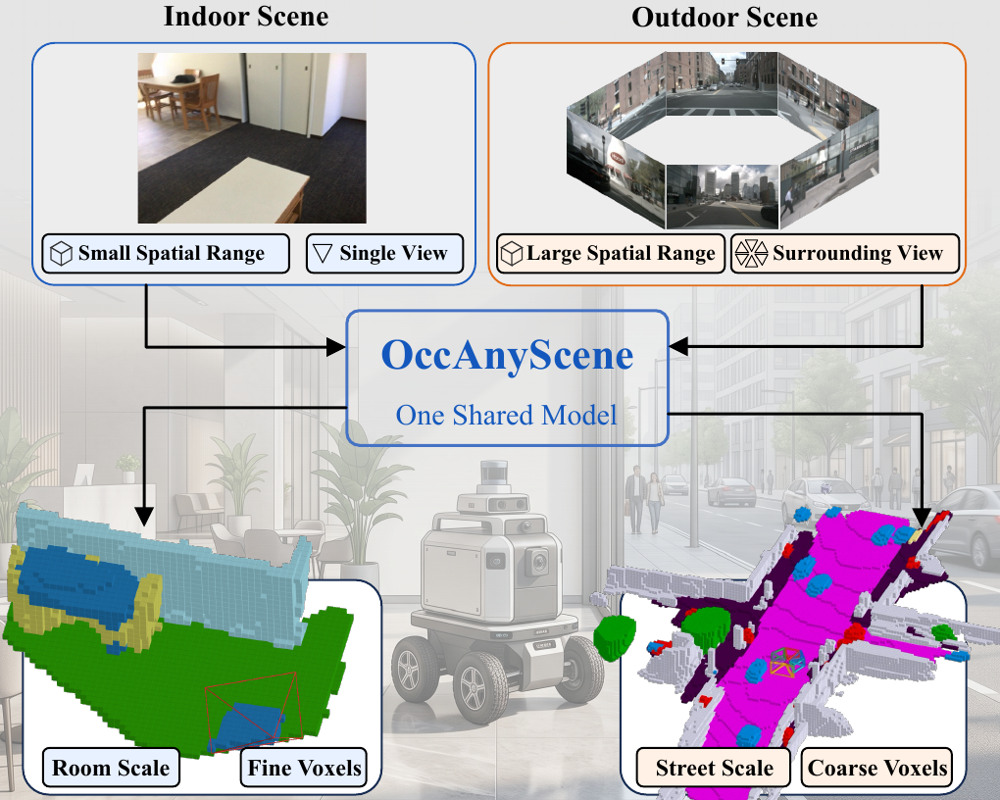
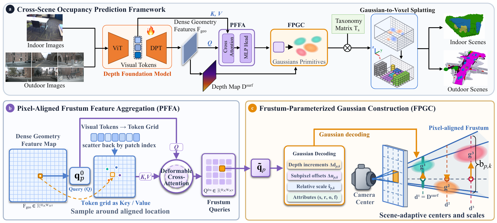
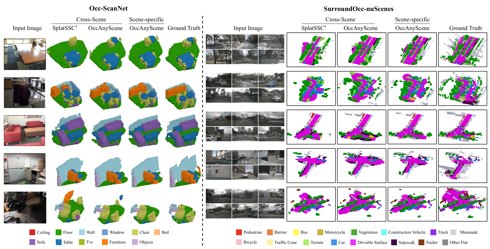
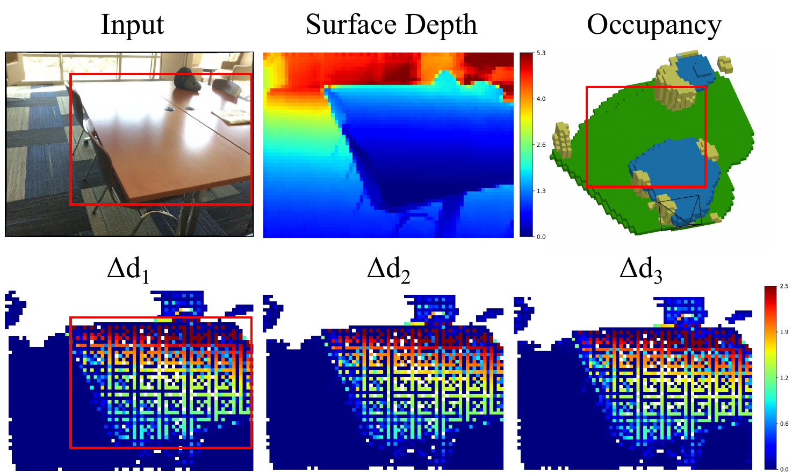
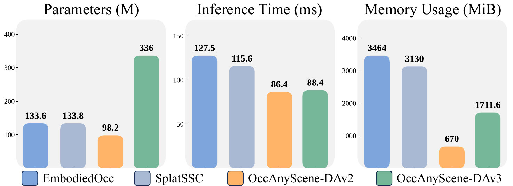

# OccAnyScene (arXiv 2026)

<!-- paper-source: https://chengwei920412.github.io/paper_reading/2608.08696_OccAnyScene_Towards_Unified_Indoor_Outdoor_3D_Occupancy_Prediction/technical_report.html -->

> **arXiv ID**：2608.08696  
> **原文标题**：OccAnyScene: Towards Unified Indoor-Outdoor 3D Occupancy Prediction  
> **翻译日期**：2026-08-21

---

## 📋 论文概览 {#_1}

### 基本信息 {#_2}

- **作者**：Junjie Liu、Wanshui Gan、Zitong Dai、Guiping Cao、Yan Li、Ke Chen、Dongmei Jiang、Xiangyuan Lan、Jianguo Zhang
- **机构**：南方科技大学、上海人工智能实验室、哈尔滨工业大学（深圳）、鹏城实验室
- **发表时间**：2026 年（arXiv 预印本，CVPR 2026 模板）
- **领域**：三维语义占用预测、视觉三维感知、自动驾驶、具身智能

### 核心贡献 {#_3}

1. 提出“跨场景三维语义占用预测”任务：一个模型在各数据集原生相机、空间范围、体素规格和语义体系下联合处理室内与室外场景。
2. 提出以像素视锥为几何基准的 OccAnyScene，并以 PFFA 聚合几何、相机和上下文信息，以 FPGC 构造适应相机与场景尺度的三维高斯。
3. 通过共享连续高斯语义特征、仅保留数据集特定的分类体系矩阵，实现不同输出语义空间之间的统一训练。
4. 在 Occ-ScanNet 和 SurroundOcc-nuScenes 上取得有竞争力的新结果；DAv3 场景特定模型分别达到 59.92% 和 23.06% mIoU，而联合跨场景模型仅下降 0.41 和 0.19 个百分点。

---

## 🎯 研究背景与动机 {#_4}

### 问题定义 {#_5}

传统三维占用模型通常绑定单一数据集：室内模型面向短距离、高分辨率体素和单目图像，自动驾驶模型面向百米范围、较粗体素和环视相机。本文要求同一个模型接收已知内外参的单目或多视角 RGB 图像，并针对场景域 \(s\) 的空间区域 \(\Omega_s\)、体素尺寸 \(v_s\) 与语义类别集合 \(\mathcal{C}_s\) 输出占用标签。

### 现有方法的局限性 {#_6}

- 稠密体素、BEV/TPV 表示将空间范围和分辨率写入表示结构，难以跨域共享。
- 深度引导的高斯提升主要覆盖可见表面；依赖绝对位置偏移和绝对尺度时，室内外的米制范围差异使联合优化不稳定。
- 相同像素在不同焦距和深度处对应的三维覆盖范围不同，固定高斯尺度无法同时适应多种相机几何。
- 不同数据集的语义类别集合不一致，直接共享分类头并不成立。

### 本文的创新点 {#_7}

OccAnyScene 不把像素只视为一条中心射线，而把它对应的有限三维视锥作为基本表示单元。视锥横截面的米制尺寸随深度和相机内参自然变化，可作为跨场景高斯位置与尺度的自适应参照。

图：OccAnyScene 使用单一模型联合学习异构室内外场景。

---

## 🔬 方法论 {#_8}

### 整体架构 {#_9}

图：OccAnyScene 整体架构。深度基础模型产生稠密几何特征与 ViT 视觉 token；PFFA 生成像素视锥查询；FPGC 将每个查询解码为多个高斯；分类体系矩阵把共享语义特征映射到数据集类别，最后将高斯聚合到目标体素网格。

### 关键技术 {#_10}

**1. 像素对齐视锥特征聚合（PFFA）**

PFFA 将稠密几何特征 \(\mathbf{F}_{\mathrm{geo}}(p)\) 与由相机内参得到的射线方向 \(\mathbf{R}(p)\) 投影并相加，形成初始像素查询：

\[\mathbf{q}_p^0=\phi_{\mathrm{geo}}\!\left(\mathbf{F}_{\mathrm{geo}}(p)\right)+\phi_{\mathrm{cam}}\!\left(\mathbf{R}(p)\right).\]

随后以像素归一化坐标为参考位置，对恢复为二维网格的 ViT token 执行可变形交叉注意力，聚合邻域语义与结构线索，用于推理遮挡区域。

**2. 视锥参数化高斯构建（FPGC）**

FPGC 为每个像素视锥预测 \(K\) 组深度增量、亚像素偏移、相对尺度、旋转、不透明度和语义特征。规范相机空间中的深度按真实与规范焦距比恢复为米制表面深度：

\[\mathbf{D}^{\mathrm{surf}}=\mathbf{D}^{\mathrm{can}}\frac{f_{\mathrm{real}}}{f_{\mathrm{can}}}.\]

每个高斯以预测表面为锚点，通过正的表面相对深度增量进入遮挡区域，并以有界亚像素偏移在像素视锥内部横向移动：

\[d_{p,k}=d_p^{\mathrm{surf}}+\Delta d_{p,k},\qquad
\mathbf{u}_{p,k}=\mathbf{u}_p+\Delta\mathbf{u}_{p,k}.\]

尺度不直接以米为单位回归，而以当前深度处像素视锥横截面为参照：

\[b_{p,k}=\eta\frac{1}{2}\left(\frac{d_{p,k}}{f_x}+\frac{d_{p,k}}{f_y}\right),\qquad
\mathbf{s}_{p,k}=b_{p,k}\widehat{\mathbf{s}}_{p,k}.\]

这一无量纲相对尺度参数化把相机焦距、场景深度与空间范围的变化显式纳入几何基准。

**3. 高斯到占用与训练目标**

每个高斯的共享语义特征 \(\mathbf{f}_{p,k}\) 经场景域特定矩阵 \(\mathbf{T}_s\) 映射到类别集合 \(\mathcal{C}_s\)。连续高斯由 SplatSSC 的解耦高斯聚合器投影到目标体素网格。训练使用 Focal、Lovasz-Softmax、Probability Scale Loss 与 Huber 深度损失的端到端联合目标。

### 算法流程 {#_11}

1. 用 DepthAnythingV2/3 编码图像，取得 ViT token、稠密几何特征与规范相机深度。
2. 将像素几何特征与相机射线编码融合，并通过可变形交叉注意力形成视锥查询。
3. 每个视锥查询解码 \(K\) 个高斯的相对参数，利用表面深度与视锥几何还原其三维中心和尺度。
4. 合并所有视角的高斯，通过域特定分类体系矩阵生成语义 logit。
5. 将连续高斯聚合到当前数据集定义的体素网格，并联合优化占用与深度损失。

---

## 📊 实验与结果 {#_12}

### 实验设置 {#_13}

- **数据集**：Occ-ScanNet（室内，单目，47.5K 样本，\(4.8\times4.8\times2.88\) m，0.08 m 体素）；SurroundOcc-nuScenes（室外，六路环视，34.1K 样本，\(100\times100\times8\) m，0.5 m 体素）。
- **评估指标**：几何占用 IoU、语义占用 mIoU。
- **编码器**：默认 DAv2 + ViT-Base，并评估 DAv3 + ViT-Large。
- **共享方式**：除数据集特定的分类体系矩阵外，其余参数全部共享；高斯语义特征维数为 32；默认每个像素视锥解码 \(K=3\) 个高斯。
- **对比方法**：MonoScene、ISO、EmbodiedOcc、GPOcc、SplatSSC、TPVFormer、OccFormer、SurroundOcc、GaussianFormer、GaussianWorld、VG3S、DLWM 等。

### 主要结果 {#_14}

<table>
<thead>
<tr>
<th>模型与设置</th>
<th>Occ-ScanNet IoU</th>
<th>Occ-ScanNet mIoU</th>
<th>nuScenes IoU</th>
<th>nuScenes mIoU</th>
</tr>
</thead>
<tbody>
<tr>
<td>SplatSSC，场景特定</td>
<td>62.83</td>
<td>51.83</td>
<td>32.19</td>
<td>19.05</td>
</tr>
<tr>
<td>SplatSSC，跨场景适配</td>
<td>57.42</td>
<td>46.80</td>
<td>31.24</td>
<td>17.86</td>
</tr>
<tr>
<td>OccAnyScene-DAv2，场景特定</td>
<td>64.98</td>
<td>55.42</td>
<td>33.86</td>
<td>20.46</td>
</tr>
<tr>
<td>OccAnyScene-DAv2，跨场景</td>
<td>64.56</td>
<td>55.46</td>
<td>33.76</td>
<td>20.36</td>
</tr>
<tr>
<td>OccAnyScene-DAv3，场景特定</td>
<td><strong>68.34</strong></td>
<td><strong>59.92</strong></td>
<td><strong>35.97</strong></td>
<td><strong>23.06</strong></td>
</tr>
<tr>
<td>OccAnyScene-DAv3，跨场景</td>
<td>67.96</td>
<td>59.51</td>
<td>35.83</td>
<td>22.87</td>
</tr>
</tbody>
</table>

关键结果不是简单的单数据集最优，而是同一模型在房间尺度和街道尺度之间几乎不损失精度。相比之下，SplatSSC 的跨场景版本在两个数据集上分别损失 5.03 和 1.19 个 mIoU 百分点。

图：室内 Occ-ScanNet 与室外 SurroundOcc-nuScenes 的定性对比。

### 消融实验 {#_15}

- 基线在 Occ-ScanNet/nuScenes 上的 IoU 为 56.43/29.67；仅加入 PFFA 提升有限，仅加入 FPGC 达到 61.11/33.09；二者结合达到 64.56/33.76，说明上下文聚合需要与视锥参数化协同。
- 去除深度增量造成最大的退化：两数据集 IoU 分别下降 5.91 和 2.45 个百分点，验证了超越可见表面的遮挡补全作用。
- 去除视锥相对尺度使 IoU 分别下降 3.03 和 0.73 个百分点；规范相机深度和亚像素偏移也带来稳定收益。
- \(K=1\) 到 \(K=3\) 的收益较小，说明遮挡补全并非主要依赖同一射线形成分离的深度层，而是由相邻像素的高斯协同覆盖。

图：\(K=3\) 时每个高斯的表面相对深度增量；前景遮挡区呈现相邻像素交替移向背景的模式。

### 效率 {#_16}

OccAnyScene-DAv2 包含 98.2M 参数，单张 NVIDIA RTX 4090 上推理耗时 86.4 ms、显存占用 670 MiB；相对 EmbodiedOcc 和 SplatSSC，显存分别降低 80.7% 和 78.6%。DAv3 虽显著增大模型容量，推理耗时仍为 88.4 ms。

图：Occ-ScanNet 上的参数量、推理时间和显存占用对比。

---

## 💡 关键见解 {#_17}

### 理论分析 {#_18}

论文最重要的抽象是“用视锥归一化跨域几何”。绝对米制偏移在房间与道路间分布相差巨大，而 \(d/f\) 恰好刻画一个像素在给定深度处的近似米制宽度。因此，高斯中心以表面深度为锚、尺度以 \(d/f\) 为参照后，网络只需学习相对偏移与无量纲尺度，显著降低跨相机、跨场景联合建模难度。

### 实践启示 {#_19}

- 多数据集统一模型不必强迫输出空间完全一致；共享连续中间表示，再用轻量域特定适配器处理分类体系，是更自然的方案。
- 基础深度模型的几何先验可成为三维占用的强骨干，但必须显式处理相机内参和遮挡区域。
- 若目标是实时部署，连续稀疏高斯比全空间稠密体素更容易兼顾不同范围与分辨率。

---

## 🔍 局限性与未来工作 {#_20}

### 当前局限 {#_21}

1. 跨场景评估只有两个数据集，证明的是两种异构协议的联合学习，而非对任意未见场景的泛化。
2. 数据集特定分类体系矩阵仍要求已知场景域；论文未验证开放词汇类别或自动域识别。
3. \(K=3\) 个高斯往往未形成清晰分离的深度层，说明同一视锥内多高斯的表达能力尚未充分利用。
4. 评价集中于占用精度与效率，缺少校准、不确定性、长尾类别和跨数据集零样本迁移分析。

### 未来方向 {#_22}

- 扩展到更多室内、室外、机器人和自动驾驶数据集，系统研究留一域测试与零样本泛化。
- 将固定分类体系矩阵替换为语言条件化或开放词汇语义适配器。
- 引入时序、多模态或主动视角信息，提高动态场景和严重遮挡下的稳定性。
- 设计促进同一像素视锥内高斯深度分层或多样化的正则项，并研究其是否改善遮挡补全。

---

## 📚 相关工作对比 {#_23}

<table>
<thead>
<tr>
<th>方法</th>
<th>核心思想</th>
<th>优势</th>
<th>劣势</th>
</tr>
</thead>
<tbody>
<tr>
<td>稠密体素 / BEV / TPV</td>
<td>在固定三维或鸟瞰网格中聚合特征</td>
<td>结构规则、下游处理直接</td>
<td>绑定空间范围与分辨率，跨场景共享困难</td>
</tr>
<tr>
<td>深度引导高斯方法</td>
<td>沿像素射线提升高斯并聚合到体素</td>
<td>连续、稀疏、几何自适应</td>
<td>常集中于可见表面，绝对偏移和尺度仍依赖场景</td>
</tr>
<tr>
<td>SplatSSC 跨场景适配</td>
<td>共享高斯模型并添加数据集输出适配器</td>
<td>架构直接，可作为强基线</td>
<td>室内外联合训练精度明显下降</td>
</tr>
<tr>
<td><strong>OccAnyScene</strong></td>
<td>以像素视锥约束高斯位置和尺度，结合 PFFA/FPGC</td>
<td>跨尺度稳定、精度损失小、效率高</td>
<td>当前仅验证两个已知域，未证明开放场景泛化</td>
</tr>
</tbody>
</table>

---

## 🎓 个人评价 {#_24}

### 优点 {#_25}

- 问题设定清楚且具有部署意义，直面室内外模型割裂这一结构性问题。
- 几何参数化简洁：\(d/f\) 视锥尺度参照有明确物理含义，且消融支持其必要性。
- 结果同时覆盖精度、消融、可视化和效率，跨场景模型与场景特定模型的差距很小。

### 可改进之处 {#_26}

- “跨场景”目前仍接近两数据集多任务学习；需要更多数据源、未见域和传感器变化实验来支撑通用性主张。
- 应进一步分析分类体系矩阵的容量、域间语义共享程度及类别冲突。
- 可补充训练成本、输入分辨率、每场景高斯数量和完整超参数，以提高复现透明度。

### 推荐阅读对象 {#_27}

适合研究三维语义占用、3D Gaussian、视觉基础模型、多数据集联合训练、自动驾驶和具身智能感知的读者。

---

## 📎 附录 {#_28}

### 重要公式 {#_29}

最终高斯写为

\[\mathbf{a}_{p,k}=\left[\boldsymbol{\mu}_{p,k},\mathbf{s}_{p,k},\mathbf{r}_{p,k},o_{p,k},\mathbf{f}_{p,k}\right],\]

占用损失与总训练目标为

\[\mathcal{L}_{\mathrm{occ}}=\lambda_{\mathrm{focal}}\mathcal{L}_{\mathrm{focal}}+\lambda_{\mathrm{lov}}\mathcal{L}_{\mathrm{lov}}+\lambda_{\mathrm{scal}}\mathcal{L}_{\mathrm{scal}}^{\mathrm{prob}},\]

\[\mathcal{L}=\mathcal{L}_{\mathrm{occ}}+\lambda_{\mathrm{depth}}\mathcal{L}_{\mathrm{depth}}.\]

### 术语表 {#_30}

<table>
<thead>
<tr>
<th>英文</th>
<th>中文</th>
</tr>
</thead>
<tbody>
<tr>
<td>Cross-Scene 3D Semantic Occupancy Prediction</td>
<td>跨场景三维语义占用预测</td>
</tr>
<tr>
<td>Pixel-Aligned Frustum Feature Aggregation (PFFA)</td>
<td>像素对齐视锥特征聚合</td>
</tr>
<tr>
<td>Frustum-Parameterized Gaussian Construction (FPGC)</td>
<td>视锥参数化高斯构建</td>
</tr>
<tr>
<td>Pixel Frustum</td>
<td>像素视锥</td>
</tr>
<tr>
<td>Surface-Relative Depth Increment</td>
<td>表面相对深度增量</td>
</tr>
<tr>
<td>Canonical Camera</td>
<td>规范相机</td>
</tr>
<tr>
<td>Subpixel Offset</td>
<td>亚像素偏移</td>
</tr>
<tr>
<td>Semantic Taxonomy</td>
<td>语义分类体系</td>
</tr>
</tbody>
</table>

### 参考资源 {#_31}

- **论文原文**：[arXiv 页面](https://arxiv.org/abs/2608.08696)
- **中文翻译 PDF**：[paper_cn.pdf](https://chengwei920412.github.io/paper_reading/2608.08696_OccAnyScene_Towards_Unified_Indoor_Outdoor_3D_Occupancy_Prediction/paper_cn.pdf)
- **中文 Markdown 译文**：[paper_cn.md](https://chengwei920412.github.io/paper_reading/2608.08696_OccAnyScene_Towards_Unified_Indoor_Outdoor_3D_Occupancy_Prediction/paper_cn.html)
- **代码实现**：[GitHub](https://github.com/RoboPerception/OccAnyScene)
- **项目主页**：[OccAnyScene](https://RoboPerception.github.io/OccAnyScene/)

---

**报告生成说明**：本报告基于论文 LaTeX 源码、完整中文译文与生成的中文 PDF 整理，旨在提供结构化总结和技术分析。
