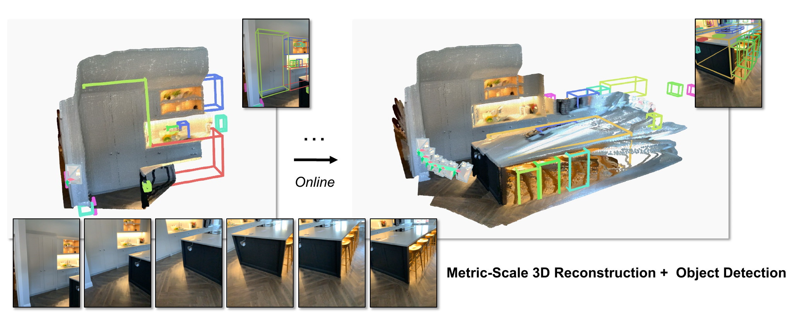
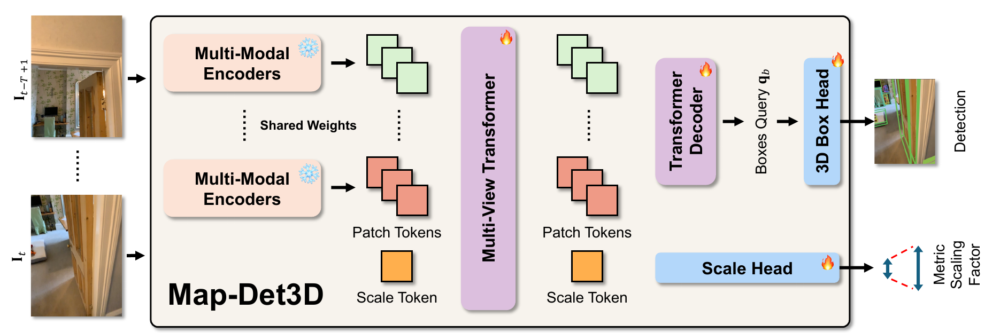
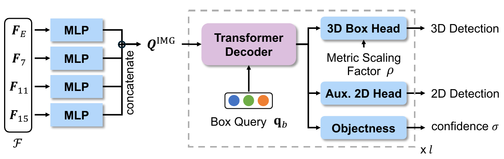
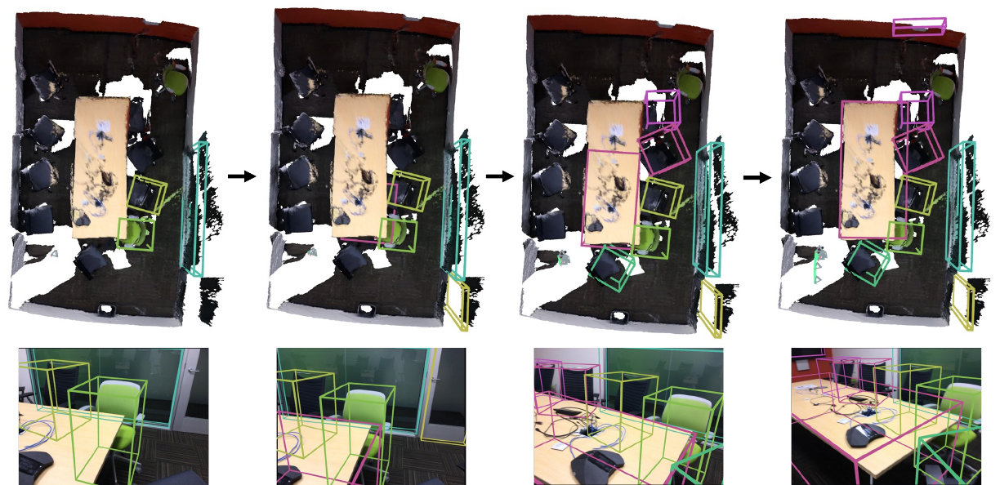

# Map-Det3D (arXiv 2026)

<!-- paper-source: https://chengwei920412.github.io/paper_reading/2608.12179_Map_Det3D_Metric_Feed_Forward_3D_Reconstruction_Prior_for_Multi_view_3D_Object_Detection_from_Streaming_Inputs/technical_report.html -->

> 原文链接：[Map-Det3D (arXiv 2026)](https://chengwei920412.github.io/paper_reading/2608.12179_Map_Det3D_Metric_Feed_Forward_3D_Reconstruction_Prior_for_Multi_view_3D_Object_Detection_from_Streaming_Inputs/technical_report.html)

> **arXiv ID**：2608.12179  
> **原文标题**：Map-Det3D: Metric Feed-Forward 3D Reconstruction Prior for Multi-view 3D Object Detection from Streaming Inputs  
> **翻译日期**：2026-08-21

---

## 📋 论文概览 {#_1}

### 基本信息 {#_2}

- **作者**：Yung-Hsu Yang、Luigi Piccinelli、Samuel Rota Bulò、Sunghwan Hong、Denis Rozumny、Johannes Schönberger、Zuria Bauer、Hermann Blum、Peter Kontschieder、Marc Pollefeys
- **机构**：苏黎世联邦理工学院、Meta Reality Labs Zürich、波恩大学
- **发表时间**：2026 年（arXiv 预印本，ECCV 模板）
- **领域**：三维目标检测、前馈式三维重建、在线多视图感知、单目视频理解

### 核心贡献 {#_3}

1. 提出 Map-Det3D：以度量前馈式三维重建（FF3R）模型 MapAnything 作为检测 Transformer 的几何编码器，直接在重建三维空间中检测目标。
2. 提出尺度不定三维边界框头，在无尺度坐标系中回归中心和尺寸，再利用 FF3R 预测的窗口级尺度因子恢复度量三维边界框。
3. 将短时滑动窗口视作多视图输入，在流式单目视频上执行因果在线检测；相机内参与位姿可作为显式条件增强几何稳定性。
4. 在 CA-1M 域内评估、ScanNet200 零样本评估和 ScanNetV2 逐场景评估上取得强结果，并展示对相机与域变化的稳健迁移。

---

## 🎯 研究背景与动机 {#_4}

### 问题定义 {#_5}

目标是在不使用深度传感器的情况下，从流式 RGB 视频因果输出度量尺度的三维有向边界框。每个时刻使用当前帧及之前若干帧组成滑动窗口；输入可包含完整、部分或缺失的相机内外参，输出当前帧中固定数量的类别无关三维框及置信度。

### 现有方法的局限性 {#_6}

- LiDAR 和 RGB-D 能直接提供三维几何，但成本、功耗和形态限制不适合轻量设备。
- 单目“先二维检测、再提升到三维”的方法需要回归深度、尺寸和姿态；小幅深度误差会显著破坏三维 IoU。
- 从单张图像学习的尺度先验容易受相机内参、自运动和场景统计的域偏移影响。
- 传统离线多视图重建依赖全局优化，难以满足流式感知的因果性和算力约束。
- 通用 FF3R 模型以场景几何为中心，尚未针对目标实例和目标感知特征优化。

### 本文的创新点 {#_7}

Map-Det3D 将“重建后再检测”的串联流程改为“用重建先验驱动检测”：MapAnything 的多视图 token、相机建模和尺度因子直接进入 DETR 风格检测器，不经过二维框到三维框的脆弱提升路径。

图：Map-Det3D 对滑动时间窗口进行前馈式度量三维重建与在线三维目标检测。

---

## 🔬 方法论 {#_8}

### 整体架构 {#_9}

图：Map-Det3D 总体结构。MapAnything 产生多尺度多视图特征和尺度因子，检测 Transformer 生成目标查询，尺度不定三维框头恢复度量边界框。

### 关键技术 {#_10}

**1. 在线问题表述**

时刻 \(t\) 的滑动窗口为

\[\mathcal{W}_t=\{\mathbf{I}_{t-T+1},\ldots,\mathbf{I}_t\}.\]

模型仅输出当前帧的检测。每个框由相机坐标系中的中心 \((x,y,z)\)、物理尺寸 \((w,l,h)\)、旋转 \(R\in\mathrm{SO}(3)\) 和置信度 \(\sigma\) 描述。窗口级尺度因子 \(\rho_t\) 将带波浪号的尺度不定预测转换为度量量。

**2. 度量 FF3R 先验**

MapAnything 的多模态编码器为每个视图生成 patch token，16 层多视图 Transformer 联合处理所有视图和可学习尺度 token。中间层特征经 DPT 解码器形成多尺度特征图 \(\mathcal{F}\)，尺度 token 则由 MLP 解码为 \(\rho_t\)。当相机外参不可用时，骨干网络同时估计位姿。

**3. 检测 Transformer**

多尺度 FF3R 特征被投影到统一维度，形成图像查询。两阶段可变形检测器先从编码器特征中选择得分最高的位置作为初始参考点，再通过多层解码器交替执行可变形交叉注意力、查询自注意力和二维参考框残差更新。

**4. 尺度不定三维边界框头**

图：尺度不定三维框头。几何属性先在无尺度空间中回归，再用 FF3R 尺度因子映射到度量空间。

中心与尺寸通过以下关系恢复：

\[x=\rho\tilde{x},\qquad y=\rho\tilde{y},\qquad z=\rho\exp(\tilde d),\]

\[w=\rho\exp(\tilde s_w),\qquad l=\rho\exp(\tilde s_l),\qquad h=\rho\exp(\tilde s_h).\]

姿态采用连续六维旋转表示，在物体中心形式中回归，再依据预测三维中心方向转换为自我中心形式。因此模型不需要假设所有边界框均与重力方向对齐。

**5. 训练目标**

匈牙利匹配基于辅助二维框。匹配后的查询使用 Focal Loss 监督类别/有效性，使用 \(L_1+\)GIoU 监督二维框。三维几何损失逐属性构造八个三维框角点：当前属性使用预测值，其余属性使用真值，从而分别监督中心、深度、尺寸和旋转，降低属性耦合。

### 算法流程 {#_11}

1. 将当前帧与历史 \(T-1\) 帧组成因果滑动窗口，并可选输入相机内外参。
2. MapAnything 融合多视图几何，输出多尺度特征、尺度因子及必要时的相机位姿。
3. 检测 Transformer 编码多尺度特征，选择初始目标查询并逐层细化。
4. 每层尺度不定三维框头回归三维中心、尺寸、姿态和置信度，以尺度因子恢复度量单位。
5. 仅保留当前帧检测；逐场景评估时再用简单三维 IoU 关联维护在线轨迹记忆。

---

## 📊 实验与结果 {#_12}

### 实验设置 {#_13}

- **训练数据**：CA-1M，超过 40 万个独立三维目标、1,000 余个激光扫描室内场景、3,500 余段手持第一视角视频，约 1,300 万训练帧和 180 万验证帧。
- **零样本数据**：ScanNet200/ScanNetV2；逐帧评估采用 198 个长尾类别对应的 ScanNet200 设置，逐场景评估采用 18 类 ScanNetV2 设置。
- **训练配置**：完整模型训练 100k 步，批量大小 64，16 张 RTX 4090，约 1.5 天；初始学习率 \(10^{-4}\)，余弦退火；多视图 Transformer 和尺度头学习率为主学习率的 \(1/10\)。
- **时序增强**：随机选取 1–5 个视图、宽高比以及 2–10 FPS 采样率；推理默认 \(T=5\)。
- **指标**：类别无关 AP/AR，三维 IoU 阈值为 0.15、0.25、0.50；评估所有真值框，不因可见性或截断而过滤。

### 主要结果 {#_14}

**CA-1M 域内逐帧检测**

<table>
<thead>
<tr>
<th>方法</th>
<th>输入类型</th>
<th>AP\(_{25}\)</th>
<th>AR\(_{25}\)</th>
<th>AP\(_{50}\)</th>
<th>AR\(_{50}\)</th>
</tr>
</thead>
<tbody>
<tr>
<td>ImVoxelNet</td>
<td>离线多视图</td>
<td>10.1</td>
<td>22.8</td>
<td>2.3</td>
<td>6.3</td>
</tr>
<tr>
<td>Cube R-CNN</td>
<td>单目</td>
<td>4.6</td>
<td>20.1</td>
<td>1.0</td>
<td>4.7</td>
</tr>
<tr>
<td>CuTR</td>
<td>单目</td>
<td>13.5</td>
<td>35.4</td>
<td>2.4</td>
<td>12.9</td>
</tr>
<tr>
<td><strong>Map-Det3D</strong></td>
<td>在线多视图</td>
<td><strong>16.9</strong></td>
<td><strong>40.3</strong></td>
<td><strong>3.5</strong></td>
<td><strong>14.8</strong></td>
</tr>
</tbody>
</table>

虽然点云方法 FCAF 的 AP\(_{25}\)/AP\(_{50}\) 仍为 29.3/11.2，但 Map-Det3D 不使用任何度量深度输入，且超过单目与离线多视图 RGB 基线。

**ScanNet200 域外零样本检测**

<table>
<thead>
<tr>
<th>方法</th>
<th>训练数据</th>
<th>AP\(_{15}\)</th>
<th>AP\(_{25}\)</th>
</tr>
</thead>
<tbody>
<tr>
<td>OVMono3D</td>
<td>Omni3D</td>
<td>11.7</td>
<td>5.7</td>
</tr>
<tr>
<td>3D-MOOD</td>
<td>Omni3D</td>
<td>11.2</td>
<td>8.0</td>
</tr>
<tr>
<td>DetAny3D</td>
<td>DA3D</td>
<td>11.7</td>
<td>8.0</td>
</tr>
<tr>
<td>CuTR</td>
<td>CA-1M</td>
<td>4.3</td>
<td>2.1</td>
</tr>
<tr>
<td><strong>Map-Det3D</strong></td>
<td>CA-1M</td>
<td><strong>15.2</strong></td>
<td><strong>9.7</strong></td>
</tr>
</tbody>
</table>

Map-Det3D 与 CuTR 使用相同 CA-1M 训练源却取得明显更高结果，支持性能提升源于架构和 FF3R 先验，而非训练数据差异。

**ScanNetV2 零样本逐场景检测**

Map-Det3D 配合简单在线三维 IoU 关联，在不使用真值深度时达到 AP\(_{15}\)/AP\(_{25}\)/AP\(_{50}\) = 27.6/22.7/6.2；严格阈值下接近依赖深度的 BoxFusion，并在 AP\(_{15}\) 上超过 EmbodiedSAM 与 OnlineAnySeg。

### 消融实验 {#_15}

- 单纯增加多视图输入仅将 AP\(_{15}\) 从 11.7 提升至 11.8，说明通用多视图聚合器不能直接转化为目标检测能力。
- 解冻多视图 Transformer 并结合多视图输入后达到 17.2，表明必须使几何特征具备目标感知能力。
- 加入相机内参条件带来 0.8 AP\(_{15}\)，继续加入相机位姿后达到 17.3，提升 4.7。
- 完整模型联合启用多视图、尺度头/Transformer 微调和相机条件，达到 21.2 AP\(_{15}\)，较基线提升 9.5。
- 直接三维框头在 CA-1M/ScanNet 上分别从 15.6/10.8 提升到 17.3/12.6 AP\(_{15}\)。
- \(T=1,3,5\) 时，AP\(_{15}\) 从 14.0 增至 20.5、21.2；\(T=5\) 在线推理速度为 8.3 FPS、峰值显存 6.4 GB。

图：相机运动逐渐暴露完整桌面，在线关联可用后续更完整的检测框更新轨迹。

---

## 💡 关键见解 {#_16}

### 理论分析 {#_17}

论文把单目三维检测中最不稳定的“绝对尺度回归”拆成两个较容易的问题：检测头只学习与内容相关的相对几何，FF3R 则从多视图相机运动和几何一致性中估计全局尺度因子。通过 \(\rho\) 显式恢复所有长度量，中心和尺寸共享同一尺度参照，避免二维检测误差经深度提升被放大。

第二个关键点是“几何先验并不自动等于目标先验”。冻结 MapAnything 时，多视图输入几乎没有收益；只有微调多视图 Transformer 后，目标中心、边界和时序证据才能进入 FF3R 表示。消融结果因此同时支持预训练几何的价值和任务适配的必要性。

### 实践启示 {#_18}

- 对视频三维感知，短窗口因果多视图推理是离线全局重建与单帧检测之间实用的折中。
- 把相机参数作为可选条件，可让同一模型覆盖已标定、部分标定和未标定输入。
- 无类别检测能更纯粹地检验几何能力，但实际应用仍需语言或类别头赋予语义。
- 逐场景任务未必需要复杂全局优化；当逐帧框足够稳定时，简单三维 IoU 关联已能获得较强结果。

---

## 🔍 局限性与未来工作 {#_19}

### 当前局限 {#_20}

1. 由于算力限制，模型仅在 CA-1M 上训练，目前主要适用于室内场景。
2. 检测结果是类别无关的，未与闭集或开放词汇查询关联。
3. 训练成本较高：完整训练使用 16 张 RTX 4090、批量大小 64、持续约 1.5 天。
4. 虽然不需要深度传感器，但严格三维 IoU 下仍落后于点云方法。
5. 在线逐场景结果依赖简单的贪心三维 IoU 关联，对动态物体、遮挡和轨迹身份切换缺少系统评估。

### 未来方向 {#_21}

- 加入室外、动态和跨设备视频数据，验证大范围场景与快速运动下的尺度稳定性。
- 使用视觉语言模型和 Set-of-Marks 提示，把类别无关检测框映射到开放词汇查询。
- 研究参数高效微调或蒸馏，降低 FF3R 检测适配的训练与推理成本。
- 联合学习检测、相机、尺度和在线关联，并显式建模不确定性。
- 扩展到移动目标和长期记忆，检验滑动窗口之外的时序一致性。

---

## 📚 相关工作对比 {#_22}

<table>
<thead>
<tr>
<th>方法</th>
<th>核心思想</th>
<th>优势</th>
<th>劣势</th>
</tr>
</thead>
<tbody>
<tr>
<td>二维检测后提升</td>
<td>先检测二维框，再回归深度、尺寸和姿态</td>
<td>架构成熟、可利用二维检测器</td>
<td>深度误差放大，尺度先验易受域偏移影响</td>
</tr>
<tr>
<td>点云三维检测</td>
<td>直接在 LiDAR/RGB-D 点云中检测</td>
<td>度量几何准确，严格 IoU 表现强</td>
<td>需要昂贵或高功耗深度传感器</td>
</tr>
<tr>
<td>离线多视图检测</td>
<td>聚合完整视图集合或重建结果</td>
<td>多视图几何稳定</td>
<td>非因果，延迟与计算开销较高</td>
</tr>
<tr>
<td><strong>Map-Det3D</strong></td>
<td>FF3R 几何编码器 + 尺度不定三维框头 + 滑动窗口</td>
<td>仅 RGB、在线、度量尺度、零样本迁移强</td>
<td>当前仅室内训练，类别无关，严格 IoU 仍有差距</td>
</tr>
</tbody>
</table>

---

## 🎓 个人评价 {#_23}

### 优点 {#_24}

- 问题拆解清晰：将跨域脆弱的绝对尺度回归转化为相对框参数与共享尺度因子的组合。
- 方法与 FF3R 能力匹配，既使用多视图 token，也利用相机估计和显式尺度输出。
- 实验覆盖域内、域外零样本、逐帧、逐场景、效率和多项关键消融。
- 与同训练数据的 CuTR 对比有助于排除数据规模带来的混淆。

### 可改进之处 {#_25}

- 需要室外、动态目标、长时间序列和跨相机设备的直接实验。
- 可报告参数量、总 FLOPs、训练能耗以及与 MapAnything 原模型的额外开销。
- 应进一步分析尺度因子误差、相机位姿误差与最终三维框误差之间的传播关系。
- 类别无关设定限制了下游可用性，开放词汇扩展值得作为核心实验而非仅列为未来工作。

### 推荐阅读对象 {#_26}

适合研究单目/多视图三维目标检测、前馈式三维重建、视频三维感知、DETR、具身智能与开放词汇三维理解的读者。

---

## 📎 附录 {#_27}

### 重要公式 {#_28}

检测 Transformer 在各层输出查询和二维参考框：

\[\{(\mathbf{Q}_k,\mathbf{B}^{\mathrm{2D}}_k)\}_{k=0}^{L}=\Phi_{\mathrm{DET}}(\mathcal{F}).\]

三维框头使用尺度因子生成各层度量预测：

\[(\mathbf{B}^{\mathrm{3D}}_k,\boldsymbol{\sigma}_k)=\Phi_{\mathrm{3D}}^k(\mathbf{Q}_k,\rho),\qquad k=0,\ldots,L.\]

### 术语表 {#_29}

<table>
<thead>
<tr>
<th>英文</th>
<th>中文</th>
</tr>
</thead>
<tbody>
<tr>
<td>Feed-Forward 3D Reconstruction (FF3R)</td>
<td>前馈式三维重建</td>
</tr>
<tr>
<td>Metric Reconstruction Prior</td>
<td>度量重建先验</td>
</tr>
<tr>
<td>Multi-view 3D Object Detection</td>
<td>多视图三维目标检测</td>
</tr>
<tr>
<td>Up-to-Scale</td>
<td>尺度不定</td>
</tr>
<tr>
<td>Scale Factor</td>
<td>尺度因子</td>
</tr>
<tr>
<td>2D-to-3D Lifting</td>
<td>二维到三维提升</td>
</tr>
<tr>
<td>Class-Agnostic Detection</td>
<td>类别无关检测</td>
</tr>
<tr>
<td>Detection Transformer</td>
<td>检测 Transformer</td>
</tr>
<tr>
<td>Sliding Window</td>
<td>滑动窗口</td>
</tr>
<tr>
<td>Camera Conditioning</td>
<td>相机条件化</td>
</tr>
</tbody>
</table>

### 参考资源 {#_30}

- **论文原文**：[arXiv 页面](https://arxiv.org/abs/2608.12179)
- **中文翻译 PDF**：[paper_cn.pdf](https://chengwei920412.github.io/paper_reading/2608.12179_Map_Det3D_Metric_Feed_Forward_3D_Reconstruction_Prior_for_Multi_view_3D_Object_Detection_from_Streaming_Inputs/paper_cn.pdf)
- **中文 Markdown 译文**：[paper_cn.md](https://chengwei920412.github.io/paper_reading/2608.12179_Map_Det3D_Metric_Feed_Forward_3D_Reconstruction_Prior_for_Multi_view_3D_Object_Detection_from_Streaming_Inputs/paper_cn.html)
- **代码与项目主页**：[Map-Det3D](https://royyang0714.github.io/Map-Det3D)

---

**报告生成说明**：本报告基于论文 LaTeX 源码、完整中文译文与生成的中文 PDF 整理，旨在提供结构化总结和技术分析。
