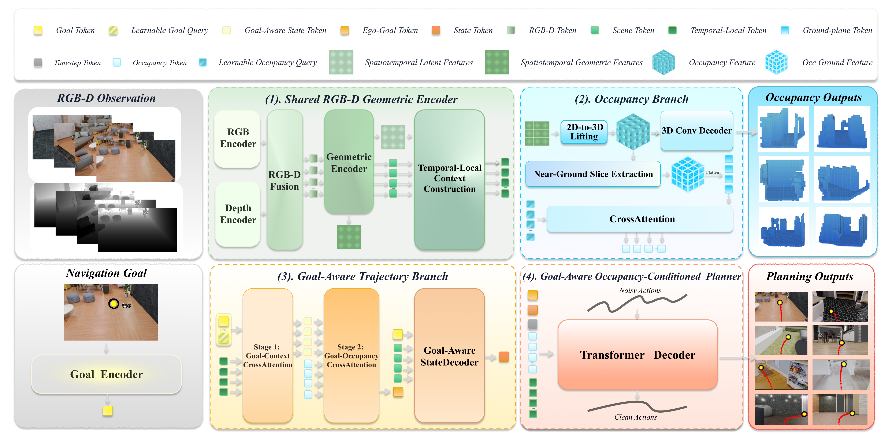

# OccPlanner (arXiv 2026)

<!-- paper-source: https://chengwei920412.github.io/paper_reading/2608.14160_OccPlanner_Goal_Aware_Occupancy_Conditioned_Diffusion_Planner_for_Pixel_Goal_Navigation/technical_report.html -->

> **arXiv ID**：2608.14160  
> **原文标题**：OccPlanner: Goal-Aware Occupancy-Conditioned Diffusion Planner for Pixel-Goal Navigation  
> **翻译日期**：2026-09-15

## 论文概览 {#_1}

论文解决像素目标导航的核心困难：目标像素没有深度和可通行性信息。OccPlanner 以 RGB-D 历史、像素目标和局部三维占据为输入，生成连续、避障的机器人轨迹；L3ROcc 则将单目 RGB 导航视频转为局部占据监督。作者在 InternScenes 进行 6,000 个闭环回合测试，并在 Unitree Go2 上验证零样本迁移及微调适配。

## 方法论 {#_2}

L3ROcc 用 \(\pi^3\) 重建共享三维几何和相机轨迹，再恢复尺度、变换至机器人坐标系并进行体素化。射线行进把空间分为可见占据、已观测空闲和未知三类，因此监督不把遮挡后的未观测区域误当作空闲。

OccPlanner 的 RGB-D 编码器融合 DINOv2 RGB 特征与 Depth Anything V2 深度特征。占据分支预测局部占据体，并将近地面特征压缩成占据词元。轨迹分支以像素目标查询时序上下文，得到中间目标表示后再查询占据词元；这种“先目标--上下文、后目标--占据”的顺序交互产生自我目标表征，最后由条件扩散模型生成未来航点。

图：OccPlanner 的共享编码器、占据分支和双阶段轨迹条件化。

## 实验与结果 {#_3}

训练使用超过 \(200\mathrm{K}\) 条 InternData-N1 轨迹，四张 H100 训练 30 个 epoch。模型输入 8 帧 \(224\times224\) RGB-D 图像，预测 24 个未来航点。测试指标包括 SR、SPL 与 DTG。

长距离（\(5\)--\(8\,\mathrm{m}\)）时，OccPlanner 在家庭、商业、简单拥挤、困难拥挤场景的 SR 分别为 \(69.90\%\)、\(45.17\%\)、\(86.20\%\)、\(84.92\%\)；NavDP 对应为 \(24.98\%\)、\(19.07\%\)、\(19.43\%\)、\(19.77\%\)。拥挤环境中的增益最明显，支持局部占据建模对避障的价值。

消融显示，自我目标推理在单阶段条件化下带来最大的稳定收益；固定自我目标和占据特征后，双阶段交互将困难拥挤场景 SR 从 \(75.55\%\) 提升到 \(84.92\%\)。占据特征在没有显式目标条件交互时收益不稳定；最佳开环 IoU/FDE 也不必然对应最佳闭环导航成功率。

## 关键见解 {#_4}

像素目标的不确定性不是单纯深度估计问题：规划器还需明确识别近地障碍、空闲空间和未知区域。本文将占据预测作为可查询的特征记忆，而非只作为辅助输出；随后使用已融合时序上下文的目标表示去查询该记忆，因而占据特征能随目标位置选择性服务于规划。

## 局限性与未来工作 {#_5}

真实世界实验仅为静态室内环境中的开环定性比较，缺少闭环实体成功率、动态障碍物及长时程任务证据。L3ROcc 的尺度恢复与可见性标注仍依赖上游几何重建质量。后续工作应进行闭环 Go2 部署，纳入动态物体和不确定性估计，并测量跨机器人/跨相机的泛化。

## 个人评价 {#_6}

优点是问题定义清晰，L3ROcc 与规划模型形成数据--模型闭环，且长距离拥挤场景的提升幅度很大。关键不足是现实验证规模较小、没有定量闭环对比；因此目前更适合作为具有强仿真证据和初步真实迁移迹象的技术报告，而不是已充分证实的真实机器人导航方案。

## 参考资源 {#_7}

- **论文原文**：[arXiv:2608.14160](https://arxiv.org/abs/2608.14160)
- **中文翻译 PDF**：[paper_cn.pdf](https://chengwei920412.github.io/paper_reading/2608.14160_OccPlanner_Goal_Aware_Occupancy_Conditioned_Diffusion_Planner_for_Pixel_Goal_Navigation/paper_cn.pdf)
- **中文 Markdown 译文**：[paper_cn.md](https://chengwei920412.github.io/paper_reading/2608.14160_OccPlanner_Goal_Aware_Occupancy_Conditioned_Diffusion_Planner_for_Pixel_Goal_Navigation/paper_cn.html)
