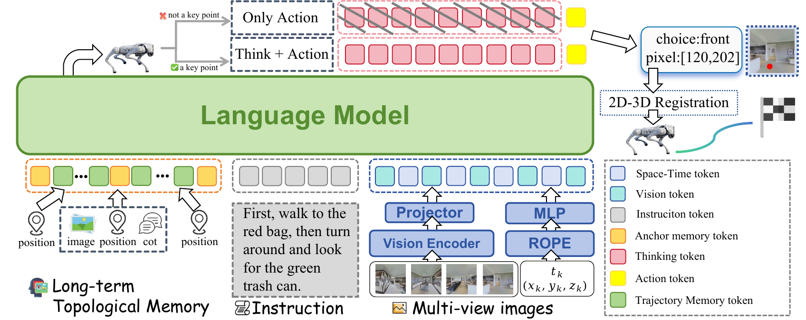
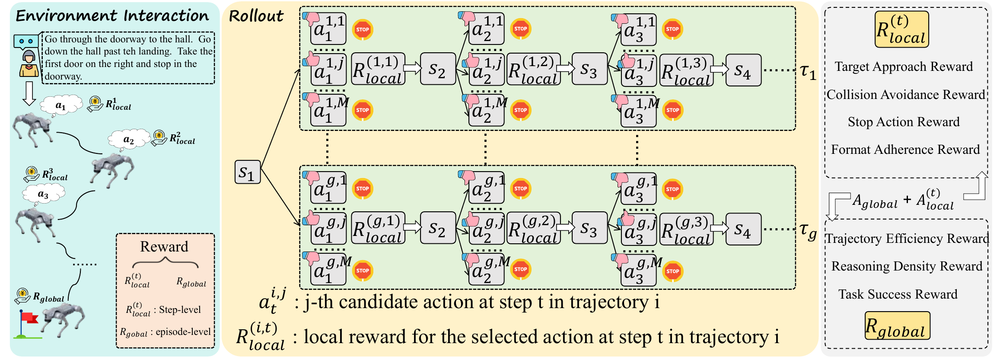
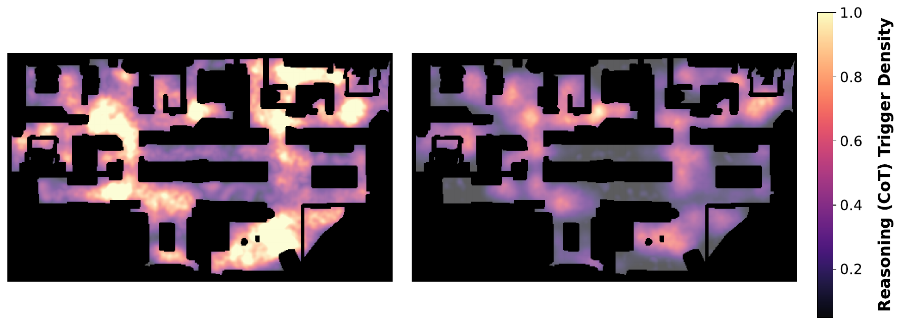
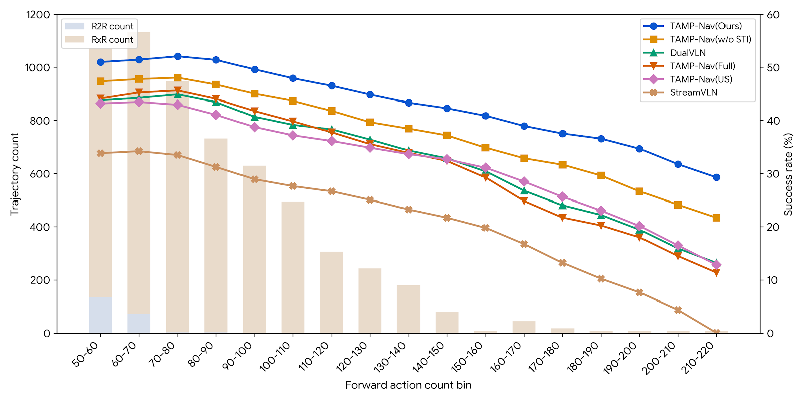
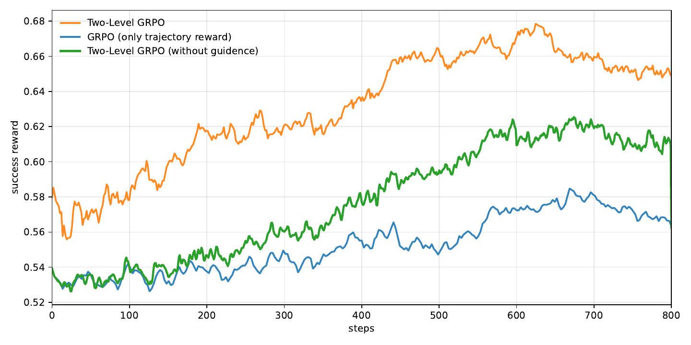
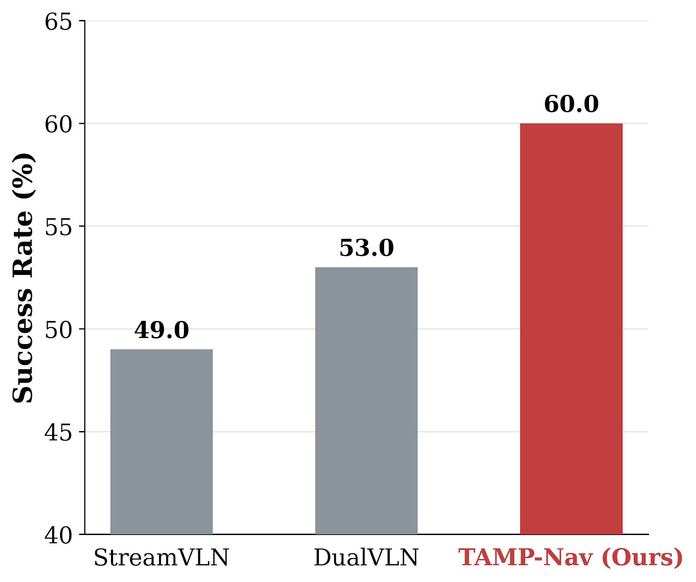

# Embodied Navigator (arXiv 2026)

<!-- paper-source: https://chengwei920412.github.io/paper_reading/2608.17512_Embodied_Navigator_Point_Think_Memorize_and_Align_for_Efficient_Navigation/technical_report.html -->

> 原文链接：[Embodied Navigator (arXiv 2026)](https://chengwei920412.github.io/paper_reading/2608.17512_Embodied_Navigator_Point_Think_Memorize_and_Align_for_Efficient_Navigation/technical_report.html)

> **arXiv ID**: 2608.17512
> **原文标题**: Embodied-Navigator: Point, Think, Memorize, and Align for Efficient Navigation
> **翻译日期**: 2026-09-01

---

## 📋 论文概览 {#_1}

### 基本信息 {#_2}

- **作者**: Hongyan Feng\*, Sunlai Chen\*, Xuanyu Liu\*, Miao Pan, Yangfan Xie, Yuxiang Cui, Zhongxiang Zhou, Rong Xiong, Wenqi Zhang, Jianwei Yin, Yueting Zhuang, Xuhong Zhang†（\* 同等贡献，† 通讯作者）
- **机构**: 浙江大学软件学院（OmniAl Group of ZJU ACES Lab）；浙江人形机器人创新中心有限公司
- **发表时间**: 2026 年 8 月
- **领域**: 具身智能、视觉语言导航（VLN-CE）、视觉语言模型强化学习

### 核心贡献 {#_3}

论文提出 **TAMP-Nav**（Think / Align / Memorize / Point），针对「用 VLM 做具身导航」的三个结构性问题各给出一个对应设计：

1. **Point —— 像素到三维（Pixel-to-3D）动作形式化**：VLM 不再输出原子动作（"左转 30°"）或回归三维坐标，而只在第一人称图像上「指一个像素」，由深度图和相机内参投影为三维路径点，交给经典 SLAM 控制器执行。
2. **Think + Memorize —— 选择性推理与锚点—轨迹记忆（AT-Mem）**：只在关键拓扑节点触发思维链并存为高保真「显式锚点」，其余路径压缩为单 token 的**时空指示符（STI）**。
3. **Align —— 两级 GRPO**：把轨迹级 rollout（G=8）与步级候选 rollout（M=4）的组内相对优势叠加，配合退火引导采样，用稠密奖励替代稀疏终端奖励。

结果：R2R-CE Val-Unseen 66.2% SR / RxR-CE Val-Unseen 65.7% SR（全指标 SOTA），仅用 90k 条轨迹（700k 交互），平均每任务 9 个交互步、16.58s 推理耗时。

---

## 🎯 研究背景与动机 {#_4}

### 问题定义 {#_5}

具身导航要求智能体读懂自然语言指令，在连续环境（VLN-CE）中自主移动到目标。当下主流做法是把预训练 VLM 接入这一闭环，但「VLM 的能力形态」与「导航任务的接口形态」并不匹配。

### 现有方法的局限性 {#_6}

论文明确指出三个瓶颈，并给出量化证据：

<table>
<thead>
<tr>
<th>瓶颈</th>
<th>具体表现</th>
<th>论文给出的证据</th>
</tr>
</thead>
<tbody>
<tr>
<td><strong>动作形式化的几何鸿沟</strong></td>
<td>VLM 在二维图文对上预训练，被迫隐式学习三维几何变换 → 空间幻觉、样本效率低</td>
<td>把 Pixel-to-3D 换成 NavFoM 式度量路径点，SR 直降 <strong>24.8 / 25.2</strong> 个点（表 5）</td>
</tr>
<tr>
<td><strong>推理效率与性能的两难</strong></td>
<td>现有 CoT 导航模型在<strong>每一步或固定间隔</strong>触发推理，延迟线性增长</td>
<td>稠密 CoT 仅比自动触发高 <strong>0.6</strong> 个点 SR，却要 100% vs 26.3% 的 CoT 调用（表 2）</td>
</tr>
<tr>
<td><strong>长时程记忆的信息丢失</strong></td>
<td>全量保留 → 注意力稀释；无差别丢弃/遗忘曲线 → 关键信息丢失；且缺少显式时空坐标</td>
<td>长时程子集上 AT-Mem 49.8% vs 完整历史 42.4% vs 均匀采样 40.5%（表 4）</td>
</tr>
</tbody>
</table>

### 本文的创新点 {#_7}

关键洞察是：**不要改造 VLM 去适配导航，而是改造导航接口去适配 VLM**。二维指点是 VLM 的原生能力（视觉定位），三维几何是 SLAM 的原生能力（几何计算），两者解耦后各自都在自己的舒适区。同类「解耦」工作要么需要持续异步建三维图（开销大），要么把 VLM 降格为在预计算候选中做多选题（限制探索空间）；本文的像素输出既保留了连续动作空间，又不引入额外建图开销。

---

## 🔬 方法论 {#_8}

### 整体架构 {#_9}

图 1：TAMP-Nav 架构。视觉—文本输入 → 锚点—轨迹记忆压缩长时程历史 → 关键节点自主触发推理 → 选择最优相机视角并预测二维像素 → 投影至三维交由 SLAM 执行 → 两级 GRPO 优化策略。

每个导航步的闭环为四步：**整合记忆 → 决定是否推理 → 指点像素 → SLAM 执行**。

### 关键技术 {#_10}

**(1) Pixel-to-3D 动作形式化**

智能体接收四路第一人称观测 \(V_t = \{v_{t,1},\dots,v_{t,4}\}\) 覆盖 \(360^{\circ}\)，先选最优视角 \(v_{t,i}\)，再输出二维像素 \(a_t=(u,v)\)，投影为局部三维点：

\[P_t = D_{t,i}(u, v) \cdot K^{-1} [u, v, 1]^T\]

仿真中深度用真值，真机中用 RGB-D 相机。由于导航是闭环过程，单步深度噪声可被后续观测部分修正——这是该设计能容忍传感器误差的结构性原因。

**(2) 时空指示符（STI）**

把位姿与时间压成一个 token：

\[E_{STI}(t, x, y, yaw) = \text{MLP} \Big( \big[ \text{RoPE}_{2D}(x, y) ; \text{RoPE}_{1D}(t) ; \text{RoPE}_{2D}(\sin(yaw), \cos(yaw)) \big] \Big)\]

用 \((\sin yaw, \cos yaw)\) 而非标量 \(yaw\)，避免 \(0^\circ/360^\circ\) 边界不连续。

**(3) 锚点—轨迹记忆（AT-Mem）**

异构双组件设计，本质是**按信息价值差异化分配存储预算**：

- **显式锚点**（触发 CoT 的关键节点）存三元组 \(A_k = \langle M_{STI}^{(k)}, M_{vis}^{(k)}, M_{state}^{(k)} \rangle\)——时空坐标 + 高保真视觉特征（支持像素级回环检测）+ CoT 摘要（充当「规划信标」）。
- **轨迹区间**（锚点之间的常规路径）丢弃视觉特征，只留纯时空流 \(T_k = [E_{STI}(t, x_t, y_t, yaw_t) \mid t \in \mathcal{T}]\)。

这样在非关键区间仍保有**全分辨率**运动轨迹（不丢拓扑），而昂贵的视觉开销只花在关键锚点上。

**(4) 两级 GRPO**

图 2：两级 GRPO 范式——轨迹级 rollout 竞争全局导航成功，步级候选 rollout 通过温度采样探索多样的二维视觉空间动作。

- **局部步级奖励**（5 项）：\(R_{local}^{(t)} = \lambda_1 r_{app} + \lambda_2 r_{coll} + \lambda_3 r_{stop} + \lambda_4 r_{rea} + \lambda_5 r_{fmt}\)，权重 \(0.5/0.2/0.8/0.5/0.2\)。
- **全局轨迹奖励**（3 项）：\(R_{global} = \omega_1 r_{suc} + \omega_2 r_{spl} + \omega_3 r_{den}\)，权重 \(3.0/1.0/1.0\)。
- **优势叠加**：两者各自 Z-score 标准化到 \(\mathcal{N}(0,1)\) 后相加，\(A_S^{(t)} = A_{global} + A_{local}^{(t)}\)——先归一化再相加是让两个尺度不同的信号可比的关键。
- **退火引导采样**：早期按局部奖励加权候选选择概率，\(\beta_k = \beta_0\alpha^k\)（\(\beta_0=2.0\), \(\alpha=0.99\)），随训练衰减至均匀采样。

其中**推理价值奖励**是整篇论文最精巧的一处设计：

\[r_{rea}^{(t)} = h_t \cdot \big(r_{app}^{(t)} - \bar{r}_{app}^{(t)}\big)\]

\(h_t\in\{0,1\}\) 是 CoT 指示量，\(\bar{r}_{app}^{(t)}\) 是 M 个候选的平均接近奖励。**只有当「思考后的决策」优于「不思考的局部平均」时才给正奖励**，否则思考本身就是净损失。这正是「按需推理」能力涌现的直接来源。

### 算法流程 {#_11}

CoT 监督数据（MultiNav-CoT，90k 轨迹，源自 VLN-CE）的关键节点挖掘分三步：

1. **重要性打分**：\(S(t) = S_{sem}(t) + S_{vis}(t)\)，前者为 CLIP 图文相似度，后者为相邻帧特征差异（\(1-\cos\)），二者均在轨迹内 Min-Max 归一化以保证贡献均衡。
2. **距离贪心过滤**：按分数降序取前 30%，迭代选取并剔除与已选节点空间距离 \(&lt; D_{min}=2\) 的候选。
3. **时间补插**：相邻节点空间间隔 \(&gt; D_{max}=6\) 时，插入其间最高分帧以保拓扑连通。

CoT 文本本身由 **Gemini 2.5 Flash** 分四阶段生成（任务阶段定位 → 当前观测分析 → 未来动作推理 → 融合润色），拆分子任务以降低单次查询的认知负荷、抑制幻觉。

---

## 📊 实验与结果 {#_12}

### 实验设置 {#_13}

- **数据集**: R2R-CE、RxR-CE（VLN-CE）val-unseen；长时程子集 5927 条（专家路径 > 12.5 米，即 > 50 次原子前进）；真机 5 类场景 × 4 指令 × 5 重复 = 100 次有效试验/方法
- **评估指标**: SR、OSR/OS、SPL、nDTW、NE
- **对比方法**: StreamVLN、DualVLN、NavFoM、NaVILA、UniNaVid、NaVid、MapNav、VLN-R1，以及 ETPNav / ScaleVLN / GridMM 等航点图方法
- **训练资源**: 8× A800 80GB；SFT ≈160 GPU 小时，GRPO ≈600 GPU 小时；基座 Qwen2.5-VL-7B；上下文 4096 token

### 主要结果 {#_14}

表 1：R2R-CE 与 RxR-CE validation unseen 主结果（节选关键行，完整表见译文）

<table>
<thead>
<tr>
<th>方法</th>
<th>R2R NE↓</th>
<th>R2R OS↑</th>
<th>R2R SR↑</th>
<th>R2R SPL↑</th>
<th>RxR NE↓</th>
<th>RxR SR↑</th>
<th>RxR SPL↑</th>
<th>RxR nDTW↑</th>
</tr>
</thead>
<tbody>
<tr>
<td>NaVILA</td>
<td>5.22</td>
<td>62.5</td>
<td>54.0</td>
<td>49.0</td>
<td>6.77</td>
<td>49.3</td>
<td>44.0</td>
<td>58.8</td>
</tr>
<tr>
<td>StreamVLN</td>
<td>4.98</td>
<td>64.2</td>
<td>56.9</td>
<td>51.9</td>
<td>6.22</td>
<td>52.9</td>
<td>46.0</td>
<td>61.9</td>
</tr>
<tr>
<td>NavFoM</td>
<td>4.61</td>
<td>72.1</td>
<td>61.7</td>
<td>55.3</td>
<td>4.74</td>
<td>64.4</td>
<td>56.2</td>
<td>65.8</td>
</tr>
<tr>
<td>DualVLN</td>
<td>4.05</td>
<td>70.7</td>
<td>64.3</td>
<td>58.5</td>
<td>4.58</td>
<td>61.4</td>
<td>51.8</td>
<td>70.0</td>
</tr>
<tr>
<td>TAMP-Nav（仅 SFT）</td>
<td>4.88</td>
<td>62.0</td>
<td>55.7</td>
<td>50.3</td>
<td>6.10</td>
<td>52.4</td>
<td>46.2</td>
<td>62.1</td>
</tr>
<tr>
<td><strong>TAMP-Nav</strong></td>
<td><strong>3.85</strong></td>
<td><strong>74.5</strong></td>
<td><strong>66.2</strong></td>
<td><strong>58.8</strong></td>
<td><strong>4.32</strong></td>
<td><strong>65.7</strong></td>
<td><strong>56.9</strong></td>
<td><strong>72.4</strong></td>
</tr>
</tbody>
</table>

三个值得注意的数字关系：

- **RL 的贡献量级**：SFT-only 55.7% → 完整 66.2%，强化学习贡献 **+10.5** 个点，超过任何单一架构组件。
- **效率优势**：90k 轨迹 vs DualVLN 763k / NavFoM 3.37M 交互；9 步/轨迹 vs 约 30 步；16.58s vs StreamVLN 37.47s / DualVLN 41.46s。
- **长时程稳健性**：长时程子集 SR 49.8% vs DualVLN 41.9% / StreamVLN 30.9%——差距（+7.9 / +18.9）明显大于标准划分上的差距（+1.9 / +9.3），说明记忆机制的收益随时程放大。

表 2：干预分析（R2R-CE Val-Unseen）——按需推理的核心证据

<table>
<thead>
<tr>
<th>策略</th>
<th>CoT 占比</th>
<th>SR</th>
</tr>
</thead>
<tbody>
<tr>
<td>稠密 CoT</td>
<td>100%</td>
<td>66.8%</td>
</tr>
<tr>
<td>固定间隔 (1/3)</td>
<td>36.2%</td>
<td>60.1%</td>
</tr>
<tr>
<td><strong>自动（本文）</strong></td>
<td><strong>26.3%</strong></td>
<td><strong>66.2%</strong></td>
</tr>
</tbody>
</table>

**这是全文最有说服力的一张表**：自动触发用比固定间隔**更少**的 CoT（26.3% < 36.2%）拿到**高 6.1 个点**的 SR。这排除了「性能提升只是因为推理量」的解释——**触发时机本身**才是有效变量。

图 3：推理（CoT）触发的空间热力图，SFT 模型（左）vs RL 对齐后的 TAMP-Nav（右）。RL 后推理集中于十字路口、门口与目标物附近；直行走廊的推理步占比从 38% 降至 11%。

图 4：长时程性能分布。柱状为各长度箱轨迹数，曲线为各方法 SR。150–160 动作箱内 TAMP-Nav 约 40% vs StreamVLN 约 20%；完整版与 w/o STI 的差距在 >120 动作后持续扩大。

### 消融实验 {#_15}

表 5（受控逐组件消融，匹配预算）给出的增益分解——**每一块都只改一个组件，其余固定**，这是论文实验设计上最扎实的部分：

<table>
<thead>
<tr>
<th>分块</th>
<th>变化</th>
<th>R2R SR 增益</th>
<th>RxR SR 增益</th>
</tr>
</thead>
<tbody>
<tr>
<td><strong>动作</strong></td>
<td>NavFoM 式度量路径点 → Pixel-to-3D</td>
<td><strong>+24.8</strong></td>
<td><strong>+25.2</strong></td>
</tr>
<tr>
<td><strong>GRPO</strong></td>
<td>仅轨迹级优势 → 加入局部优势</td>
<td>+4.1</td>
<td>+4.2</td>
</tr>
<tr>
<td><strong>GRPO</strong></td>
<td>再加入退火引导采样</td>
<td>+2.8</td>
<td>+3.1</td>
</tr>
<tr>
<td><strong>记忆</strong></td>
<td>完整历史 → 完整 AT-Mem</td>
<td>+4.3</td>
<td>+4.6</td>
</tr>
<tr>
<td><strong>记忆</strong></td>
<td>AT-Mem 去 STI → 完整 AT-Mem</td>
<td>+2.6</td>
<td>+3.3</td>
</tr>
<tr>
<td><strong>推理</strong></td>
<td>稠密 CoT → 自动（CoT 调用 −73.7%）</td>
<td>−0.6</td>
<td>−0.4</td>
</tr>
</tbody>
</table>

动作空间的 +24.8/+25.2 远超其他组件，明确指出**动作形式化是最主要的性能来源**，其余设计是在此基础上的叠加优化。

表 6（CoT 监督来源）揭示一个反直觉结论：

<table>
<thead>
<tr>
<th>SFT 监督</th>
<th>R2R SR</th>
<th>相对「仅动作」</th>
</tr>
</thead>
<tbody>
<tr>
<td>仅动作（无 CoT）</td>
<td>50.6</td>
<td>—</td>
</tr>
<tr>
<td>Qwen2.5-VL-7B CoT</td>
<td>49.4</td>
<td><strong>−1.2</strong></td>
</tr>
<tr>
<td>GLM-4.5V-108B CoT</td>
<td>54.4</td>
<td>+3.8</td>
</tr>
<tr>
<td>Gemini 2.5 Flash CoT</td>
<td>55.7</td>
<td>+5.1</td>
</tr>
</tbody>
</table>

**用小模型自产 CoT 比完全不用 CoT 更差**。作者检查标注后归因于空间矛盾、任务阶段误判、推理与路径点不一致。人工评估（各 200 条、两名标注者、四个维度）显示 Gemini / GLM 通过率 94.0% / 91.5%——强开源教师与闭源教师差距仅 1.3/1.2 SR 点，说明该流程不强依赖闭源模型。

图 5：不同 GRPO 配置的成功奖励学习曲线（800 步）。仅轨迹奖励收敛于 0.59 且不稳定；加局部优势 → 0.64；再加退火引导采样 → 0.68 且收敛更快。

表 3：深度噪声鲁棒性（乘性高斯噪声 \(\epsilon \sim \mathcal{N}(1,\sigma^2)\)）

<table>
<thead>
<tr>
<th>噪声 \(\sigma\)</th>
<th>0</th>
<th>0.05</th>
<th>0.1</th>
<th>0.2</th>
</tr>
</thead>
<tbody>
<tr>
<td>SR (%)</td>
<td><strong>66.2</strong></td>
<td>65.9</td>
<td>65.3</td>
<td>63.4</td>
</tr>
<tr>
<td>\(\Delta\) SR</td>
<td>-</td>
<td>-0.3</td>
<td>-0.9</td>
<td>-2.8</td>
</tr>
</tbody>
</table>

**真机部署**：Unitree Go2 四足 + 4× 环形 RGB-D（各约 \(100^\circ\) FoV）+ Hesai XT16 LiDAR；FastLIO 做自运动估计，FAR Planner 做局部规划避障。零真机微调下 SR **60.0%**，优于 StreamVLN 49.0% 与 DualVLN 53.0%。评估协议相当严格：高层请求限 5s、底层执行限 30s，须自主停在目标 1.5m 内；只有确认机械/设备故障才判无效重做，感知/决策/定位/规划/控制/停止的任何问题都算失败。

图 6：真实世界实验成功率对比。

---

## 💡 关键见解 {#_16}

### 理论分析 {#_17}

**1. 「能力—接口对齐」比「能力扩展」更划算。** 论文最强的实证信号（+24.8 SR）来自换动作空间而非加参数、加数据。VLM 的二维视觉定位能力是预训练直接给的，三维几何变换却要从零学；把后者外包给 SLAM，相当于把学习任务从「学几何 + 学语义」缩减为「学语义」。这解释了为何 90k 轨迹就够——省下的样本效率正是没花在学几何上的那部分。

**2. 稠密奖励解决的是信用分配，不是奖励量级。** 仅轨迹奖励收敛在 0.59 且不稳定，问题不在奖励小，而在长时程下终端信号无法归因到具体的中间推理或空间决策。局部步级优势提供的是**归因通路**（+0.05 → 0.64），退火引导采样提供的是**早期样本质量**（+0.04 → 0.68），两者解决的是不同问题。

**3. 元认知能力可以被奖励塑形直接诱导出来。** \(r_{rea}^{(t)} = h_t(r_{app}^{(t)} - \bar{r}_{app}^{(t)})\) 把「该不该思考」变成一个可微分优化的问题：思考若不产生超过局部均值的决策增益就得不到奖励。配合全局的推理密度奖励（\(r&gt;0.6\) 时归零），直行走廊的推理占比从 38% 掉到 11%。**这不是被规则约束出来的稀疏，而是被奖励结构筛选出来的稀疏**——图 3 的空间分布（路口/门口/目标附近）正是这一点的直接可视化证据。

**4. 记忆的正确抽象是「异构」而非「压缩率」。** 传统做法在「保留多少帧」这一个维度上权衡；AT-Mem 的做法是**按信息类型分离**：语义信息（视觉特征 + CoT）只在锚点保留，拓扑信息（位姿 + 时间）全程以 1 token/步保留。图 4 显示 w/o STI 的差距随时程扩大，说明拓扑连通性是长时程导航的独立瓶颈，不能靠视觉锚点代偿。

### 实践启示 {#_18}

- **想用 VLM 做具身任务时，先审视动作空间是否与预训练模态对齐**——这可能是比换更大模型更高杠杆的改动。
- **蒸馏 CoT 时教师模型质量存在硬门槛**：表 6 显示低质 CoT 是**负资产**（−1.2 SR）。若无强教师可用，宁可只做动作监督。
- **推理稀疏化不宜用固定间隔**：固定 1/3 用了更多算力却更差（60.1 vs 66.2），学习触发时机才是关键。
- **Pixel-to-3D 的真机迁移成本很低**：仿真真值深度 → RGB-D 相机深度，接口不变；零微调 60% SR 说明该形式化本身具有 sim-to-real 友好性。

---

## 🔍 局限性与未来工作 {#_19}

### 当前局限 {#_20}

作者的局限性陈述较为坦诚，可分为四类：

<table>
<thead>
<tr>
<th>类别</th>
<th>具体内容</th>
</tr>
</thead>
<tbody>
<tr>
<td><strong>传感器/系统依赖</strong></td>
<td>Pixel-to-3D、STI 编码、坐标变换全依赖深度；底层依赖可靠 SLAM。受控实验仅测到 \(\sigma=0.2\)（−2.8 SR），严重深度误差、里程计/SLAM 漂移、定位失败、高动态环境的退化幅度未知</td>
</tr>
<tr>
<td><strong>RL 依赖特权信号</strong></td>
<td>进度、成功、SPL、碰撞均来自仿真器特权查询（如 Habitat 的最近障碍距离）；不支持真机在线 RL，因为真机 rollout 太慢且在线算完整奖励需终点标注/人类反馈/可靠学习式验证器。物理部署仅限冻结策略零样本迁移</td>
</tr>
<tr>
<td><strong>关键节点启发式的适用范围</strong></td>
<td>挖掘依据语义相似度 + 视觉变化。决策点视觉不显著、或指令风格显著偏离 R2R-CE/RxR-CE 时可能欠选，需额外样本或可学习触发准则</td>
</tr>
<tr>
<td><strong>表示与超参的固定假设</strong></td>
<td>STI 只编码平面 \((x,y)\) + 朝向，<strong>不含高度，无法显式区分楼层</strong>（任务进度描述只能部分代偿）；推理密度奖励的 0.4/0.6 阈值为固定值，换域需重调</td>
</tr>
</tbody>
</table>

补充几点作者未强调但值得注意的：

- **训练域单一**：全部训练在 VLN-CE（Matterport3D 室内），真机测试含 20 次户外试验，但户外/室内的分项成功率未拆分报告。
- **STI 的 UMAP 验证是间接证据**：附录 E 用有监督降维 + HSV 配色说明位姿可从嵌入恢复，这验证的是「编码器保留了信息」，不等于「VLM 有效利用了这些信息」——后者的因果证据来自 w/o STI 消融（−2.6/−3.3）。
- **真机对比的边界**：三种方法「保留各自推荐的感知与底层控制机制」，因此 60.0% vs 53.0% 比较的是完整系统而非孤立的策略模型，SLAM 栈差异可能贡献了部分差距。

### 未来方向 {#_21}

1. **STI 扩展至完整三维位姿**：加入高度维以支持多层建筑与不平地形——这是作者点明的最直接改进。
2. **可学习的推理触发准则**：用学习式判别器替代语义/视觉启发式挖掘，摆脱对 R2R-CE 风格指令的隐式依赖。
3. **真机在线 RL**：核心障碍是奖励获取。可能路径是训练一个学习式验证器（learned verifier）来近似成功/进度信号，替代仿真器特权查询。
4. **推理密度阈值自适应**：把 0.4/0.6 从超参变为随任务复杂度自调的量。
5. **超越 VLN-CE 的任务泛化**：作者结论中明确提到扩展至更广泛具身任务与动态环境；结合 Pixel-to-3D 的通用性，移动操作（mobile manipulation）是自然的下一站。
6. **深度退化的系统性研究**：当前只测乘性高斯噪声；缺失区域、反光/透明表面、SLAM 漂移累积等真实失效模式更值得压力测试。

---

## 📚 相关工作对比 {#_22}

<table>
<thead>
<tr>
<th>方法</th>
<th>核心思想</th>
<th>优势</th>
<th>劣势</th>
</tr>
</thead>
<tbody>
<tr>
<td><strong>NaVid / NaVILA / StreamVLN</strong></td>
<td>VLM 输出预定义文本原子动作（"左转 30°"）</td>
<td>接口简单，端到端</td>
<td>动作离散僵化，交互步数多（约 30 步）；无显式推理；记忆压缩丢关键细节</td>
</tr>
<tr>
<td><strong>NavFoM / DualVLN</strong></td>
<td>回归连续三维空间坐标 / 双系统解耦</td>
<td>精度高，DualVLN 达 64.3 SR</td>
<td>强迫二维原生 VLM 学三维变换 → 几何幻觉；样本消耗大（763k 轨迹 / 3.37M 交互）</td>
</tr>
<tr>
<td><strong>ImagineNav 系 / DreamNav</strong></td>
<td>预计算可通行轨迹或扩散生成未来观测，VLM 做多选</td>
<td>绕开三维回归</td>
<td>额外计算开销大；探索被限制在预定义启发式候选内</td>
</tr>
<tr>
<td><strong>NavCoT / LLM-Planner / SPAN</strong></td>
<td>每步或固定间隔触发 CoT</td>
<td>高层规划质量提升</td>
<td>推理延迟线性增长；固定调度无法适配场景复杂度</td>
</tr>
<tr>
<td><strong>VLingNav</strong></td>
<td>自适应推理</td>
<td>已意识到按需推理问题</td>
<td>依赖粗粒度标注；缺乏系统性注入元认知的方法</td>
</tr>
<tr>
<td><strong>VLN-R1 / 轨迹级 GRPO</strong></td>
<td>用 RL 缓解模仿学习协变量偏移</td>
<td>摆脱纯监督</td>
<td>两极：极稀疏轨迹奖励 → 信用分配难；严格专家动作匹配 → 限制探索</td>
</tr>
<tr>
<td><strong>本文 TAMP-Nav</strong></td>
<td>二维指点 + 关键节点稀疏推理 + 异构记忆 + 两级稠密奖励 GRPO</td>
<td>全指标 SOTA；样本效率高（90k）；推理快（9 步 / 16.58s）；长时程稳健；零微调真机 60% SR</td>
<td>依赖深度与 SLAM；RL 需仿真器特权信号，不支持真机在线学习；STI 无高度维不能区分楼层；训练域局限于 VLN-CE</td>
</tr>
</tbody>
</table>

---

## 🎓 个人评价 {#_23}

### 优点 {#_24}

1. **问题诊断与方案设计一一对应，逻辑闭合。** 三个瓶颈 → 三个组件 → 三组消融分别验证，没有「顺手加的模块」。表 5 的分块设计（每块只变一个组件，其余固定，同预算）在 VLN 论文中属于规范性较好的一档。
2. **最有价值的发现是「触发时机 > 推理总量」。** 表 2 用「更少 CoT + 更高 SR」直接排除了算力解释，这个对照组设计得很聪明。
3. **推理价值奖励的构造干净。** 用 M 个候选的均值作局部基线，让「思考的价值」成为可优化量，而不是靠人工规则规定何时思考。
4. **效率数据完整且诚实。** 同时报告轨迹数、交互数、平均步数、单任务耗时四个维度，并给出 GPU 小时（160 + 600），可复现性评估的信息是充分的。
5. **真机评估协议罕见地严格。** 明确区分「失败」与「无效」，只有机械/设备故障才重做；感知、决策、定位、规划、控制、停止的任何问题都计失败。这在真机导航论文中并不常见。
6. **负面结果照实报告。** 表 6 里「小模型 CoT 比无 CoT 更差」（−1.2 SR）对作者的方法叙事无益，但被保留并作了归因分析。

### 可改进之处 {#_25}

1. **RL 增益（+10.5 SR）与架构增益的界限有些模糊。** 主表只有「仅 SFT」与「完整」两档，而完整版同时含 RL 和最终记忆配置。若能给出「SFT + 完整 AT-Mem，无 RL」一档，读者才能干净地分离 RL 与记忆的贡献。
2. **深度鲁棒性实验的覆盖偏窄。** 只测乘性高斯噪声至 \(\sigma=0.2\)，且「不可通行点吸附到最近有效点」这一处理本身提供了额外保护。真实深度失效（缺失、反光、透明面）与 SLAM 漂移累积未测，而这些恰是真机部署的主要风险。
3. **真机对比的归因不够干净。** 各方法保留自己的感知与底层控制栈，因此 60.0% vs 53.0% 中有多少来自策略、多少来自 SLAM/规划器差异，无法分离。若能做一组共享底层栈的对照会更有力。
4. **户外结果未拆分。** 100 次试验含 20 次户外，但室内/室外分项 SR 缺失。户外场景对深度相机与 SLAM 的挑战显著不同，这个拆分本应报告。
5. **STI 的机制解释与验证之间有间隙。** 附录 E 的 UMAP + HSV 可视化说明「嵌入可还原位姿」，但 VLM 是否真的利用了这些几何信息，只能由 w/o STI 消融间接支持。若有注意力分析会更完整。
6. **命名不一致。** 标题用 Embodied-Navigator，正文通篇用 TAMP-Nav；且 TAMP 展开为 Think/Align/Memorize/Point，与标题副题 Point/Think/Memorize/Align 的顺序不一致，摘要中的对应顺序也与首字母缩写不匹配。属于表述层面的瑕疵，但会影响检索与引用。
7. **关键节点挖掘的 30% 上界是硬编码的。** Argsort 取前 30% 是启发式选择，未见对该比例的敏感性分析——而它直接决定了 CoT 监督的稀疏度上界。

### 推荐阅读对象 {#_26}

- **具身导航 / VLN 研究者**：Pixel-to-3D 是近期该方向最值得关注的动作空间设计之一，消融证据充分。
- **VLM 强化学习方向**：两级 GRPO（轨迹级 + 步级优势叠加、退火引导采样、推理价值奖励）是一套完整可迁移的稠密奖励设计。
- **关注高效推理 / 自适应 CoT 的研究者**：表 2 与图 3 是「按需推理」能被 RL 诱导出来的清晰实证。
- **机器人系统工程师**：附录 D 的解耦架构（远程 VLM + FastLIO + FAR Planner）与严格评估协议有直接工程参考价值。
- **不适合**：只想了解 VLN 领域概况的读者——本文假定读者已熟悉 VLN-CE 指标体系与 GRPO。

---

## 📎 附录 {#_27}

### 重要公式 {#_28}

**Pixel-to-3D 投影**

\[P_t = D_{t,i}(u, v) \cdot K^{-1} [u, v, 1]^T\]

**时空指示符（STI）编码**

\[E_{STI}(t, x, y, yaw) = \text{MLP} \Big( \big[ \text{RoPE}_{2D}(x, y) ; \text{RoPE}_{1D}(t) ; \text{RoPE}_{2D}(\sin(yaw), \cos(yaw)) \big] \Big)\]

**显式锚点与轨迹区间**

\[A_k = \langle M_{STI}^{(k)}, M_{vis}^{(k)}, M_{state}^{(k)} \rangle, \qquad T_k = [E_{STI}(t, x_t, y_t, yaw_t) \mid t \in \mathcal{T}]\]

**推理价值奖励（本文最核心的奖励设计）**

\[r_{rea}^{(t)} = h_t \cdot \big(r_{app}^{(t)} - \bar{r}_{app}^{(t)}\big), \qquad \bar{r}_{app}^{(t)} = \frac{1}{M}\sum_{j=1}^M r_{app}^{(t, j)}\]

**推理密度奖励（抑制过度思考）**

\[r_{den} = \begin{cases}
1.0 - r, &amp; 0 \le r \le 0.4 \\
0.6 - 3.0(r - 0.4), &amp; 0.4 &lt; r \le 0.6 \\
0.0, &amp; r &gt; 0.6
\end{cases}\]

**退火引导采样**

\[P_{select}(a_i) = \frac{\exp \left( \beta_k \cdot R_{local}^{(t)}(a_i) \right)}{\sum_{j=1}^M \exp \left( \beta_k \cdot R_{local}^{(t)}(a_j) \right)}, \qquad \beta_k = \beta_0 \cdot \alpha^k\]

**叠加优势**

\[A_S^{(t)} = A_{global} + A_{local}^{(t)}\]

**token 级 GRPO 目标**

\[\begin{aligned}
L_{GRPO}(\theta) = \mathbb{E}\Bigg[\frac{1}{G}\sum_{g=1}^{G} \sum_{t=1}^{T_g} \frac{1}{K} \sum_{k=1}^{K} \bigg( &amp;\min\Big(\rho_{g,t,k} A_{S}^{(g,t)}, \text{clip}(\rho_{g,t,k}, 1-\epsilon, 1+\epsilon)A_{S}^{(g,t)}\Big) \\
&amp;- \beta D_{KL}\big(\pi_{\theta}(\cdot|C_{g,t}, y_{&lt;k}) \,||\, \pi_{ref}(\cdot|C_{g,t}, y_{&lt;k})\big)\bigg)\Bigg]
\end{aligned}\]

**关键节点重要性得分**

\[S(t) = S_{sem}(t) + S_{vis}(t)\]

### 术语表 {#_29}

<table>
<thead>
<tr>
<th>英文</th>
<th>中文</th>
<th>说明</th>
</tr>
</thead>
<tbody>
<tr>
<td>Embodied Navigation</td>
<td>具身导航</td>
<td>智能体依自然语言指令在真实/仿真环境中移动</td>
</tr>
<tr>
<td>Pixel-to-3D Action Formulation</td>
<td>像素到三维动作形式化</td>
<td>VLM 输出二维像素，投影为三维路径点（<em>Point</em>）</td>
</tr>
<tr>
<td>Selective Reasoning</td>
<td>选择性推理</td>
<td>仅在关键节点触发 CoT（<em>Think</em>）</td>
</tr>
<tr>
<td>Anchor-Trajectory Memory (AT-Mem)</td>
<td>锚点—轨迹记忆</td>
<td>显式锚点 + 时空指示符的异构记忆（<em>Memorize</em>）</td>
</tr>
<tr>
<td>Explicit Anchor</td>
<td>显式锚点</td>
<td>触发 CoT 的决策节点，存 STI + 视觉特征 + CoT</td>
</tr>
<tr>
<td>Space-Time Indicator (STI)</td>
<td>时空指示符</td>
<td>单 token 编码 \((x,y,yaw,t)\) 的轻量记忆单元</td>
</tr>
<tr>
<td>Two-Level GRPO</td>
<td>两级 GRPO</td>
<td>轨迹级与步级组内相对优势叠加（<em>Align</em>）</td>
</tr>
<tr>
<td>Group Relative Policy Optimization</td>
<td>组相对策略优化</td>
<td>组内相对优势替代价值网络的 RL 算法</td>
</tr>
<tr>
<td>Chain-of-Thought (CoT)</td>
<td>思维链</td>
<td>显式中间推理文本</td>
</tr>
<tr>
<td>annealed guided sampling</td>
<td>退火引导采样</td>
<td>早期按局部奖励加权候选选择，随训练衰减至均匀</td>
</tr>
<tr>
<td>Reasoning-on-Demand</td>
<td>按需推理</td>
<td>依状态自主决定是否推理的涌现能力</td>
</tr>
<tr>
<td>Expert-Forcing</td>
<td>专家强制</td>
<td>训练时强制匹配专家动作</td>
</tr>
<tr>
<td>attention dilution</td>
<td>注意力稀释</td>
<td>上下文过长导致注意力分散、关键信息被淹没</td>
</tr>
<tr>
<td>SR / OSR / SPL / nDTW / NE</td>
<td>成功率 / Oracle 成功率 / 路径长度加权成功率 / 归一化动态时间规整 / 导航误差</td>
<td>VLN 标准指标</td>
</tr>
<tr>
<td>rollout</td>
<td>rollout</td>
<td>策略与环境交互产生的完整轨迹（保留原文）</td>
</tr>
<tr>
<td>sim-to-real</td>
<td>仿真到现实</td>
<td>仿真训练策略迁移至物理机器人</td>
</tr>
<tr>
<td>covariate shift</td>
<td>协变量偏移</td>
<td>模仿学习中训练与执行状态分布不一致</td>
</tr>
</tbody>
</table>

### 参考资源 {#_30}

- **论文原文**: [arXiv:2608.17512](https://arxiv.org/abs/2608.17512)
- **中文翻译 PDF**: [paper_cn.pdf](https://chengwei920412.github.io/paper_reading/2608.17512_Embodied_Navigator_Point_Think_Memorize_and_Align_for_Efficient_Navigation/paper_cn.pdf)
- **中文 Markdown 译文**: [paper_cn.md](https://chengwei920412.github.io/paper_reading/2608.17512_Embodied_Navigator_Point_Think_Memorize_and_Align_for_Efficient_Navigation/paper_cn.html)
- **代码实现**: [ZJU-OmniAI/Embodied-Omni](https://github.com/ZJU-OmniAI/Embodied-Omni)
- **项目主页**: 未提供（见上方 GitHub 仓库）
