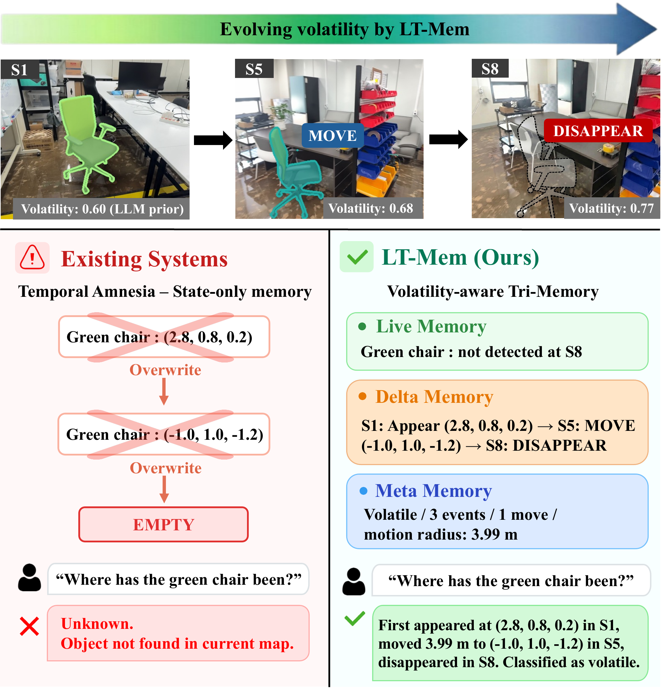
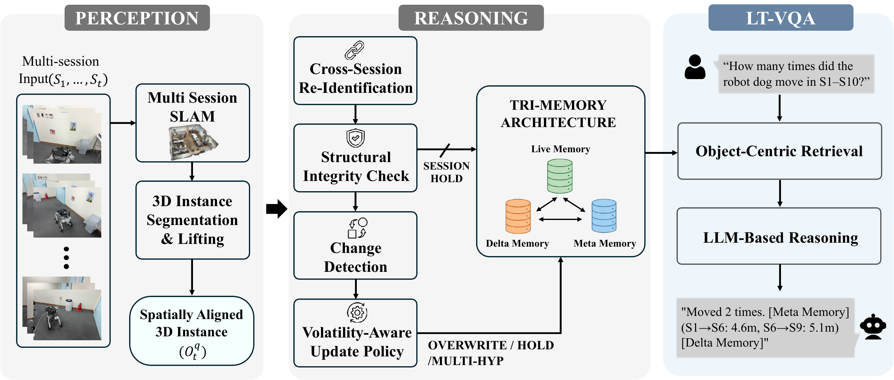
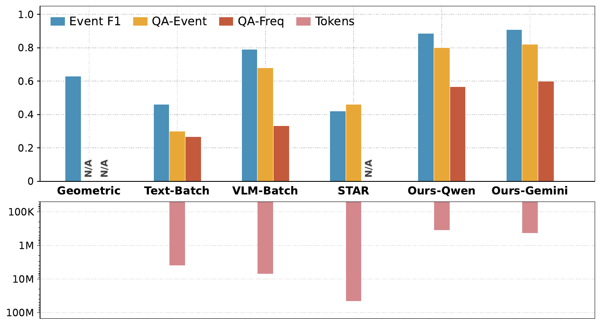

# LT-Mem (arXiv 2026)

<!-- paper-source: https://chengwei920412.github.io/paper_reading/2608.19059_LT_Mem_Volatility_Aware_Spatio_Temporal_Memory_for_Lifelong_Scene_Understanding/technical_report.html -->

> **arXiv ID**：2608.19059  
> **原文标题**：LT-Mem: Volatility-Aware Spatio-Temporal Memory for Lifelong Scene Understanding  
> **翻译日期**：2026-10-05

---

## 📋 论文概览 {#_1}

### 基本信息 {#_2}

- **作者**：Yumin Lee、Hyoseok Ju、Giseop Kim
- **机构**：韩国大邱庆北科学技术院（DGIST）机器人与机电一体化工程系
- **会议**：IROS 2026；项目页标注为 Best Paper / Best Student Paper Award Finalist
- **领域**：机器人学、终身建图、三维场景理解、长期记忆、时序视觉问答

### 一句话概括 {#_3}

LT-Mem 将跨会话对齐的实例级三维观测转化为带身份、事件和统计信息的结构化记忆，并依据每个对象随时间变化的“波动性”选择覆盖、保留或多假设更新，从而避免长期地图只保存最新状态而丢失对象历史的“时间失忆”。

### 核心贡献 {#_4}

1. 提出波动性感知的记忆演化框架 LT-Mem，将多会话空间对齐、跨会话对象身份维持、变化检测与记忆更新组织为统一流程。
2. 提出三元记忆（Tri-Memory）：实时记忆保存当前状态，增量记忆保存带时间戳的事件，元记忆保存波动性与变化频率等长期统计。
3. 构建 LT-VQA 数据集与评估套件，联合提供全局对齐的多会话几何、持久对象身份、事件级状态转移标注和带会话索引的时序问答。
4. 在事件检测、事件问答和频率问答上超过对比方法，同时将累计语言模型 token 消耗降低至视觉批处理基线的一个数量级以内。

图 1：LT-Mem 的核心概念。多次重访中的对象观测被解释为事件，并分别写入实时记忆、增量记忆和元记忆；更新规则随对象波动性自适应。

---

## 🎯 研究背景与动机 {#_5}

### 问题定义 {#_6}

机器人在同一环境中长期运行时，会多次重访同一区域。对象可能移动、首次出现、消失、重新出现，也可能因为遮挡或配准误差而暂时未被观测到。传统地图通常追求“当前状态正确”，却不一定能回答以下纵向问题：

- 某个对象在哪个会话首次出现？
- 机器狗从会话 1 到会话 10 移动了多少次？
- 白色椅子现在在哪里，此前又出现在哪里？
- 两个指定会话中的对象是否位于同一位置？

这类问题不仅要求多会话几何对齐，还要求同一物理对象在不同会话中保持持久身份，并显式保存状态转移历史。

### 现有方法的局限性 {#_7}

- **几何中心的终身建图**通常通过删除、修正或重建过时元素维持最新地图。对象从 A 移至 B 时，旧状态往往被覆盖，难以还原完整历史。
- **语义场景记忆**能够保存图像嵌入、三维语义对象或场景图，但经常按单会话处理，或默认采用最新观测，缺少显式的跨会话身份关联。
- **原始记录检索**保留视频帧或描述，却需要在每次查询时重新组合历史；随着部署时间增加，计算量和 token 成本持续增长，而且难以可靠完成精确计数。
- **感知能力增强并不等于记忆更新问题得到解决**。即使重建和分割更准确，系统仍需判断冲突观测应覆盖、暂缓还是并存。

论文将“系统性丢失对象状态历史、因而无法回答纵向查询”的现象称为**时间失忆（temporal amnesia）**。

### 本文的创新点 {#_8}

LT-Mem 的关键不只是“保存更多内容”，而是把记忆更新变成一个有证据、带身份、可审计的状态演化过程：

- 用多会话同步定位与建图建立统一空间坐标系；
- 用五类结构化证据进行跨会话重识别，仅在歧义情形下调用受约束的 LLM；
- 用对象特定的波动性估计调节运动容差和更新策略；
- 将当前状态、事件历史和长期统计分开存储，避免单一地图表示承担互相冲突的功能。

---

## 🔬 方法论 {#_9}

### 整体架构 {#_10}

系统由两层组成。

**感知层**负责回答“看到了什么、位于哪里”：它将各会话对齐至统一坐标系，对对象进行实例分割和三维提升，输出对象质心、体积与视觉嵌入。

**推理层**负责回答“它是否仍是同一个对象、发生了什么、该如何更新”：它依次执行跨会话重识别、结构完整性检查、变化检测、波动性更新和记忆写入。

最终输出进入三元记忆：

<table>
<thead>
<tr>
<th>记忆组件</th>
<th>保存内容</th>
<th>典型查询</th>
</tr>
</thead>
<tbody>
<tr>
<td>实时记忆（Live Memory）</td>
<td>当前已确认状态及必要的竞争位置假设</td>
<td>“绿色椅子现在在哪里？”</td>
</tr>
<tr>
<td>增量记忆（Delta Memory）</td>
<td>带会话索引和度量上下文的事件日志</td>
<td>“剪刀首次出现是什么时候？”</td>
</tr>
<tr>
<td>元记忆（Meta Memory）</td>
<td>波动性、变化频率、场景级计数等长期统计</td>
<td>“哪个对象移动最频繁？”</td>
</tr>
</tbody>
</table>

图 2：LT-Mem 系统流程。左侧完成多会话对齐和三维实例提取，中部执行身份匹配、完整性检查、变化检测与波动性感知更新，右侧通过以对象为中心的检索访问三元记忆。

### 关键技术 {#_11}

#### 1. 多会话感知与三维实例观测 {#1}

LT-Mem 基于 MASt3R-SLAM 从单目视频估计相机位姿和稠密点图，并借助 MR.ScaleMaster 的 \(\mathrm{Sim}(3)\) 锚节点估计各会话尺度。会话内里程计边与会话间回环边在 g2o 中联合优化，得到全局一致轨迹。

对会话 \(S_t\) 中的对象 \(q\)，系统维护观测：

\[o_t^q = \left(\mathbf{c}_t^q,\; v_t^q,\; \mathbf{f}_t^q\right),\]

其中 \(\mathbf{c}_t^q\) 为三维质心，\(v_t^q\) 为体积，\(\mathbf{f}_t^q\) 为从 SAM3 分割区域提取的视觉嵌入。同一会话中的碎片化检测通过空间一致性与点云聚类合并。

#### 2. 跨会话重识别 {#2}

候选轨迹首先通过持久向量库中的嵌入检索预筛选，每次取余弦相似度最高的 \(k=5\) 个候选。最终置信度由五类归一化证据加权得到：

<table>
<thead>
<tr>
<th>证据</th>
<th>含义</th>
<th>权重</th>
</tr>
</thead>
<tbody>
<tr>
<td>\(E_1\)</td>
<td>空间邻近性</td>
<td>0.05</td>
</tr>
<tr>
<td>\(E_2\)</td>
<td>时序连续性</td>
<td>0.20</td>
</tr>
<tr>
<td>\(E_3\)</td>
<td>特征相似度</td>
<td>0.45</td>
</tr>
<tr>
<td>\(E_4\)</td>
<td>运动一致性</td>
<td>0.15</td>
</tr>
<tr>
<td>\(E_5\)</td>
<td>遮挡处理</td>
<td>0.15</td>
</tr>
</tbody>
</table>

首次观测、类别不匹配等简单情况由确定性规则处理。只有存在歧义的跨会话关联才交给受约束的 LLM 裁决器，且输出只能是 `match`、`new-track` 或 `hold`。LLM 不修改证据评分，仅对预计算的结构化输入做最终消歧。

#### 3. 结构完整性检查与变化检测 {#3}

系统将当前会话中的结构锚点质心与实时记忆中的注册位置比较，并计算平均锚点位移 \(\bar d_{\mathrm{anchor}}\)。若其超过 \(\tau_{\mathrm{align}}=0.3\,\mathrm{m}\)，则触发会话级 `hold`：跳过该会话的全部更新，同时将对齐失败写入事件日志。

对通过检查的观测，变化检测不采用单一距离阈值，而按优先级综合考虑对齐质量、旧位置处的缺失证据和波动性条件化的运动容差。

#### 4. 波动性感知记忆更新 {#4}

对象波动性 \(V_t\in[0,1]\) 通过归一化证据累积更新：

\[V_t =
\frac{P(E_t \mid V_{t-1})V_{t-1}}
{P(E_t \mid V_{t-1})V_{t-1}+P(E_t \mid 1-V_{t-1})(1-V_{t-1})}.\]

\(E_t\) 属于 `none`、`move`、`appear`、`disappear` 或 `re-appear`。似然被设为关于 \(V\) 的固定单调函数，并非学习所得；例如对象越易变化，发生 `move` 的似然越高。初始先验 \(V_0\) 由一次基于语义标签的 LLM 查询给出，之后随跨会话证据更新。实验表明，即使初始先验有偏，波动性也会在数个会话内收敛。

更新策略有三种动作：

1. `hold`：置信度低或可能遮挡时保留旧状态；
2. `overwrite`：确认变化后写入新状态；
3. `multi-hypothesis`：歧义尚未消除时并行维护少量位置假设，并在连续会话证据形成足够裕量后晋升主假设、合并竞争假设。

### 算法流程 {#_12}

1. 对每个新会话执行单目三维重建，并通过跨会话回环与 \(\mathrm{Sim}(3)\) 锚节点对齐至全局坐标系。
2. 对关键帧运行 SAM3，形成对象级三维观测并合并会话内碎片。
3. 通过向量检索、五类证据和必要时的受约束 LLM 完成跨会话身份关联。
4. 用结构锚点检查全局配准；失败则冻结该会话更新并记录失败事件。
5. 根据位移、缺失证据和对象波动性判断状态转移。
6. 更新 \(V_t\)，选择 `hold`、`overwrite` 或 `multi-hypothesis`。
7. 将当前状态写入实时记忆，将事件写入增量记忆，将频率和波动性写入元记忆。
8. 查询时按问题类型路由至对应记忆；位移和频率等度量问题直接在事件日志与统计信息上做确定性计算。

---

## 📊 实验与结果 {#_13}

### 实验设置 {#_14}

- **数据集**：LT-VQA，包括室内环境 `Lab-S`、`Lab-L` 和室外环境 `Parking Lot`。三个环境各录制 10 个会话；两个室内环境各跟踪 10 个对象。室内数据用于实例历史跟踪，停车场数据用于跨日期和时段的空间统计。
- **采集设备**：`Lab-L` 与 `Parking Lot` 使用 iPhone 15 Pro，`Lab-S` 使用 iPhone 17 Pro，均为单目 RGB 视频。
- **计算平台**：NVIDIA RTX 5070 Ti GPU，64 GB RAM。
- **语言模型**：主要比较使用 Gemini 2.5 Pro；LT-Mem 另报告轻量本地模型 Qwen2.5-3B。对象检索使用 BGE-small-en-v1.5 与 ChromaDB，检索本身不调用 LLM。
- **评估指标**：Event F1 衡量对象级状态转移检测；QA-Event 衡量事件历史问答的严格精确匹配；QA-Freq 衡量基于元记忆统计的频率问答。
- **对比方法**：Geometric Only、Text-Batch、VLM-Batch 与 STAR。前三者分别代表距离阈值几何更新、逐帧文本摘要和全时段视觉批处理；STAR 代表对原始视觉与描述记录进行迭代检索的智能体式记忆方案。

### 主要结果 {#_15}

`Lab-S` 与 `Lab-L` 合并结果如下，数值均来自论文主结果表：

<table>
<thead>
<tr>
<th>方法</th>
<th>Event F1 ↑</th>
<th>QA-Event ↑</th>
<th>QA-Freq ↑</th>
<th>Tokens ↓</th>
</tr>
</thead>
<tbody>
<tr>
<td>Geometric Only</td>
<td>0.630</td>
<td>N/A</td>
<td>N/A</td>
<td>--</td>
</tr>
<tr>
<td>Text-Batch</td>
<td>0.460</td>
<td>0.300</td>
<td>0.267</td>
<td>3,973K</td>
</tr>
<tr>
<td>VLM-Batch</td>
<td>0.790</td>
<td>0.680</td>
<td>0.333</td>
<td>7,114K</td>
</tr>
<tr>
<td>STAR</td>
<td>0.420</td>
<td>0.460</td>
<td>N/A</td>
<td>45,859K</td>
</tr>
<tr>
<td><strong>LT-Mem（Qwen2.5）</strong></td>
<td><strong>0.885</strong></td>
<td><strong>0.800</strong></td>
<td><strong>0.567</strong></td>
<td><strong>352K</strong></td>
</tr>
<tr>
<td><strong>LT-Mem（Gemini 2.5）</strong></td>
<td><strong>0.910</strong></td>
<td><strong>0.820</strong></td>
<td><strong>0.600</strong></td>
<td><strong>438K</strong></td>
</tr>
</tbody>
</table>

STAR 输出自由文本，因此其 QA-Event 以关键词匹配计分；其他方法采用严格精确匹配。token 数为整个评估集上的累计运行时消耗，感知阶段的分割与特征提取属于一次性离线成本。Gemini 2.5 Pro 与 Qwen2.5-3B 使用各自原生 tokenizer，二者绝对 token 数不宜直接横向等同，但均显著低于反复输入原始图像或视觉记录的基线。

图 3：LT-VQA 主要结果。LT-Mem 在三项指标上取得最高分，同时显著减少累计 LLM/VLM token 消耗。

结果揭示三点：

1. 纯几何基线能够检测部分变化，但没有事件日志，因此无法回答历史和频率问题。
2. VLM-Batch 拥有完整视觉上下文，Event F1 仍低于 LT-Mem，且 token 消耗约为 LT-Mem（Gemini 2.5）的 16.2 倍。
3. Qwen2.5-3B 版本仍取得 0.885/0.800/0.567，说明主要收益来自结构化记忆设计，而不是单纯依赖更强的语言模型。

### 消融实验 {#_16}

<table>
<thead>
<tr>
<th>配置</th>
<th>Event F1 ↑</th>
<th>QA-Event ↑</th>
<th>QA-Freq ↑</th>
</tr>
</thead>
<tbody>
<tr>
<td>w/o Re-ID</td>
<td>0.140</td>
<td>0.120</td>
<td>0.070</td>
</tr>
<tr>
<td>w/o Volatility</td>
<td>0.615</td>
<td>0.640</td>
<td>0.130</td>
</tr>
<tr>
<td><strong>LT-Mem Full</strong></td>
<td><strong>0.910</strong></td>
<td><strong>0.820</strong></td>
<td><strong>0.600</strong></td>
</tr>
</tbody>
</table>

- **移除跨会话重识别**后，三项指标降至 0.140/0.120/0.070，接近整体失效。这表明持久身份是增量记忆记录连续事件、元记忆累计有效统计的前提。
- **移除波动性建模**、改用固定阈值后，结果降至 0.615/0.640/0.130。固定阈值无法适配不同对象的动态特性，误事件会进一步污染频率统计，因此 QA-Freq 降幅尤为明显。
- 所有实验中平均锚点位移均未超过门控阈值，没有会话被拒绝。这说明当前数据上的全局配准足够准确，但也意味着结构完整性检查在严重失配下的恢复能力尚未被充分验证。

### 空间统计结果 {#_17}

`Parking Lot` 不跟踪特定对象的完整身份历史，而是将各会话的停车占用数量汇总至元记忆。系统可通过对存储统计的确定性查找回答“何时更容易找到车位”等问题，不需要再次调用模型做开放式推断。论文对此部分主要提供定性示例，未报告与主任务同等规模的定量对比。

---

## 💡 关键见解 {#_18}

### 方法层面的发现 {#_19}

1. **对象身份比语言模型容量更关键。** 没有跨会话重识别，后续事件与统计均失去连续载体；更大的模型无法补回已经断裂的对象历史。
2. **波动性应由长期证据更新，而非固定为类别属性。** 同类对象在不同场景中的移动规律可能完全不同；在线更新的 \(V_t\) 能逐步纠正不准确的语义先验。
3. **三元记忆是推理输出的自然分解。** 当前状态、事件日志和长期统计具有不同更新频率与查询方式，强行压入单一地图会重新造成历史丢失。
4. **结构化中间表示兼顾准确率与可扩展性。** 感知阶段将视觉流压缩为对象状态和事件，之后的每会话推理成本不随帧数增长；部署时间越长，相比反复输入历史帧的优势越明显。
5. **度量查询应尽量确定性执行。** 位移、事件次数与占用统计直接从事件日志计算，可减少语言模型幻觉并保留审计路径。

### 实践启示 {#_20}

- 长期机器人系统不应只维护一张“最新地图”，还应将事件日志视为一等数据结构。
- 语言模型最适合处理低频歧义，而不是承担每次观测的身份关联、数值计算和历史计数。
- 对易移动对象和稳定地标采用相同更新阈值会产生系统性错误；对象级自适应阈值更适合长期部署。
- 记忆系统需要失败门控。当全局坐标系不可信时，“暂不更新并记录失败”通常比将错误观测永久写入历史更安全。

---

## 🔍 局限性与未来工作 {#_21}

### 当前局限 {#_22}

1. **数据规模有限。** LT-VQA 仅覆盖两个室内环境和一个室外环境，每个环境 10 个会话，尚不足以证明跨建筑、跨城市、跨季节和超长期部署中的泛化能力。
2. **相似对象下的重识别仍困难。** 多个对象具有相似外观和空间上下文时，持久身份可能发生混淆，这是论文明确指出的核心挑战。
3. **结构门控缺少失败压力测试。** 实验中没有会话因配准问题被拒绝，因而尚不清楚系统面对严重尺度漂移、错误回环或大范围场景重构时的表现。
4. **波动性模型依赖人工设定的单调似然。** 当前 \(P(E_t\mid V)\) 不通过数据学习，证据权重与 \(0.3\,\mathrm{m}\) 门限也为固定设置，跨场景校准能力有待验证。
5. **空间统计主要是定性评估。** 停车场任务缺少系统性的数值指标与强基线，无法判断统计记忆在漏检、重复计数和密集遮挡下的误差。
6. **对比范围存在设计边界。** Khronos、ConceptGraphs、ReMEmbR 等现有系统本身不输出对象事件日志，论文采用的是隔离核心范式的受控基线，而非对所有完整系统进行同构改造后的直接比较。
7. **token 数跨模型并非完全同尺度。** Gemini 与 Qwen 使用不同 tokenizer；论文的效率结论对视觉基线非常明显，但两个 LT-Mem 版本之间的绝对 token 数不应被解释为严格的模型无关成本。

### 未来方向 {#_23}

- 将 LT-VQA 扩展到更长时间跨度、更多地点、天气和照明条件，并加入大量同类相似实例及真实遮挡。
- 注入可控尺度漂移、错误回环和锚点失效，定量评估结构完整性门控与故障恢复。
- 学习或在线校准事件似然、证据权重和运动门限，同时输出置信区间，避免固定超参数在跨域时失效。
- 融合深度、激光雷达、触觉或交互信息，在纯视觉证据不足时主动验证对象身份。
- 为元记忆引入定量的空间统计基准，评估计数误差、趋势检测、异常发现和查询校准度。
- 研究有界记忆下的日志压缩、摘要与遗忘策略，在保留可审计历史的同时控制长期存储成本。
- 将被动观察扩展为主动感知：当多假设长期无法消除时，让机器人选择新的观测位置或执行验证动作。

---

## 📚 相关工作对比 {#_24}

<table>
<thead>
<tr>
<th>方法类别</th>
<th>核心思想</th>
<th>优势</th>
<th>局限</th>
</tr>
</thead>
<tbody>
<tr>
<td>LT-mapper 等几何终身建图</td>
<td>检测地图与新观测差异，删除或修正过时元素</td>
<td>几何一致性强，适合维护当前地图</td>
<td>通常覆盖旧状态，不保留对象级事件历史</td>
</tr>
<tr>
<td>Khronos</td>
<td>构建稠密时空度量—语义地图</td>
<td>同时表达短期动态与长期场景变化</td>
<td>缺少保持对象身份的逐对象事件日志</td>
</tr>
<tr>
<td>ConceptGraphs 等对象语义地图</td>
<td>将基础模型特征写入三维对象或场景图</td>
<td>语义丰富、开放词汇检索能力强</td>
<td>多为单会话或最新状态表示，跨会话身份和状态转移不足</td>
</tr>
<tr>
<td>ReMEmbR / STAR 类检索记忆</td>
<td>保存观测、描述或原始视觉记录，查询时检索</td>
<td>可保留丰富原始上下文</td>
<td>历史组合与精确计数困难，查询成本随记录规模增长</td>
</tr>
<tr>
<td><strong>LT-Mem</strong></td>
<td>波动性感知更新与三元结构化记忆</td>
<td>同时保留当前状态、事件历史和统计；可审计且 token 高效</td>
<td>依赖可靠配准与重识别，验证场景数量有限</td>
</tr>
</tbody>
</table>

---

## 🎓 综合评价 {#_25}

### 优点 {#_26}

- 问题定义清晰：将“时间失忆”从笼统的长期记忆问题落实到持久身份、状态转移和纵向查询。
- 系统设计闭环完整：从几何对齐、实例观测到事件写入和查询路由，各模块职责明确。
- 消融结论具有解释力：重识别和波动性分别对应“历史是否连续”和“更新是否适应对象动态”，指标下降与设计逻辑一致。
- 工程取舍合理：让确定性模块负责大多数关联和数值查询，仅让 LLM 处理歧义，兼顾效率、稳定性和可审计性。
- 同时报告精度与累计 token，体现了长期部署中容易被忽视的推理成本。

### 可改进之处 {#_27}

- 需要更大规模公开数据、跨域测试和长于 10 个会话的真实部署验证。
- 应补充身份切换率、轨迹完整度、校准误差和端到端运行时间等指标，以更全面衡量长期记忆质量。
- 可加入对配准错误和同类实例混淆的系统性扰动实验，而不只在正常运行数据上验证。
- 空间统计任务应增加明确的定量指标和对比方法，使元记忆的场景级能力得到独立验证。

### 推荐阅读对象 {#_28}

本论文适合研究长期自主机器人、多会话 SLAM、语义地图、开放词汇三维感知、具身智能记忆和时序视觉问答的读者，也适合希望以结构化状态替代反复输入长视频上下文的工程团队。

---

## 📎 附录 {#_29}

### 重要公式与变量 {#_30}

<table>
<thead>
<tr>
<th>符号</th>
<th>含义</th>
</tr>
</thead>
<tbody>
<tr>
<td>\(S_t\)</td>
<td>第 \(t\) 个独立建图会话</td>
</tr>
<tr>
<td>\(o_t^q\)</td>
<td>会话 \(t\) 中对象 \(q\) 的三维观测</td>
</tr>
<tr>
<td>\(\mathbf{c}_t^q\)</td>
<td>对象质心</td>
</tr>
<tr>
<td>\(v_t^q\)</td>
<td>对象体积</td>
</tr>
<tr>
<td>\(\mathbf{f}_t^q\)</td>
<td>对象视觉嵌入</td>
</tr>
<tr>
<td>\(\mathcal{M}^q\)</td>
<td>对象 \(q\) 的持久记忆</td>
</tr>
<tr>
<td>\(V_t\)</td>
<td>对象在会话 \(t\) 的波动性评分</td>
</tr>
<tr>
<td>\(E_t\)</td>
<td>本次状态转移事件</td>
</tr>
<tr>
<td>\(\tau_{\mathrm{align}}\)</td>
<td>结构完整性检查的对齐门限，实验中为 \(0.3\,\mathrm{m}\)</td>
</tr>
</tbody>
</table>

### 术语表 {#_31}

<table>
<thead>
<tr>
<th>英文术语</th>
<th>中文译法</th>
<th>含义</th>
</tr>
</thead>
<tbody>
<tr>
<td>volatility-aware</td>
<td>波动性感知</td>
<td>根据对象变化倾向自适应调整更新策略</td>
</tr>
<tr>
<td>spatio-temporal memory</td>
<td>时空记忆</td>
<td>同时表达对象空间状态与时间演化的记忆</td>
</tr>
<tr>
<td>lifelong scene understanding</td>
<td>终身场景理解</td>
<td>在长期重复访问中持续维护可用场景知识</td>
</tr>
<tr>
<td>temporal amnesia</td>
<td>时间失忆</td>
<td>最新状态覆盖历史，导致纵向查询不可回答</td>
</tr>
<tr>
<td>multi-session</td>
<td>多会话</td>
<td>不同时刻独立采集或建图的多次访问</td>
</tr>
<tr>
<td>cross-session re-identification</td>
<td>跨会话重识别</td>
<td>判断不同会话观测是否属于同一物理对象</td>
</tr>
<tr>
<td>persistent identity</td>
<td>持久身份</td>
<td>对象在多个会话中保持一致的身份标识</td>
</tr>
<tr>
<td>structural integrity check</td>
<td>结构完整性检查</td>
<td>在更新记忆前用结构锚点验证全局对齐</td>
</tr>
<tr>
<td>volatility-conditioned</td>
<td>波动性条件化</td>
<td>以对象波动性调节阈值或决策</td>
</tr>
<tr>
<td>multi-hypothesis</td>
<td>多假设</td>
<td>暂时保留多个相互竞争的状态解释</td>
</tr>
<tr>
<td>evidence scoring</td>
<td>证据评分</td>
<td>融合空间、时间、外观、运动与遮挡线索</td>
</tr>
<tr>
<td>state transition</td>
<td>状态转移</td>
<td><code>move</code>、<code>appear</code>、<code>disappear</code>、<code>re-appear</code> 或 <code>none</code> 事件</td>
</tr>
<tr>
<td>Live Memory</td>
<td>实时记忆</td>
<td>保存当前已确认状态</td>
</tr>
<tr>
<td>Delta Memory</td>
<td>增量记忆</td>
<td>保存带时间戳的对象事件日志</td>
</tr>
<tr>
<td>Meta Memory</td>
<td>元记忆</td>
<td>保存波动性、频率和聚合统计</td>
</tr>
<tr>
<td>temporal QA</td>
<td>时序问答</td>
<td>针对事件发生时间、顺序或频率的问答</td>
</tr>
<tr>
<td>instance history</td>
<td>实例历史</td>
<td>单个对象跨会话的状态与事件序列</td>
</tr>
<tr>
<td>spatial statistics</td>
<td>空间统计</td>
<td>对占用、数量或分布进行跨会话聚合</td>
</tr>
</tbody>
</table>

### 参考资源 {#_32}

- **论文原文**：[arXiv:2608.19059](https://arxiv.org/abs/2608.19059)
- **中文翻译 PDF**：[paper_cn.pdf](https://chengwei920412.github.io/paper_reading/2608.19059_LT_Mem_Volatility_Aware_Spatio_Temporal_Memory_for_Lifelong_Scene_Understanding/paper_cn.pdf)
- **中文 Markdown 译文**：[paper_cn.md](https://chengwei920412.github.io/paper_reading/2608.19059_LT_Mem_Volatility_Aware_Spatio_Temporal_Memory_for_Lifelong_Scene_Understanding/paper_cn.html)
- **项目主页**：[LT-Mem Project](https://lt-mem.github.io/)
- **代码实现**：待发布（项目页标注 Code TBD）
