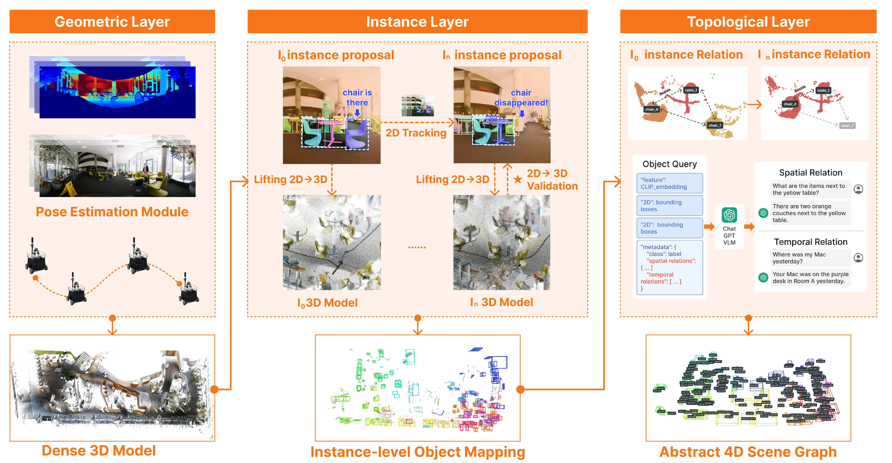
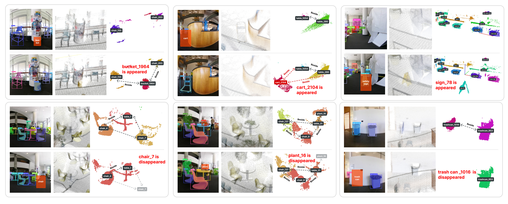
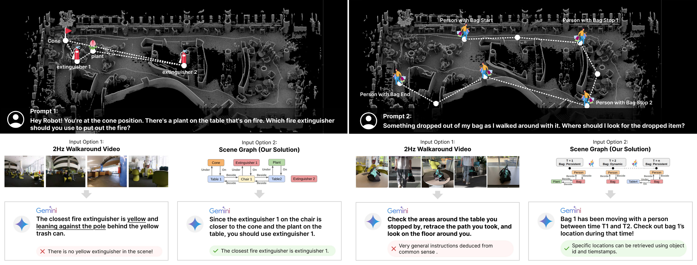
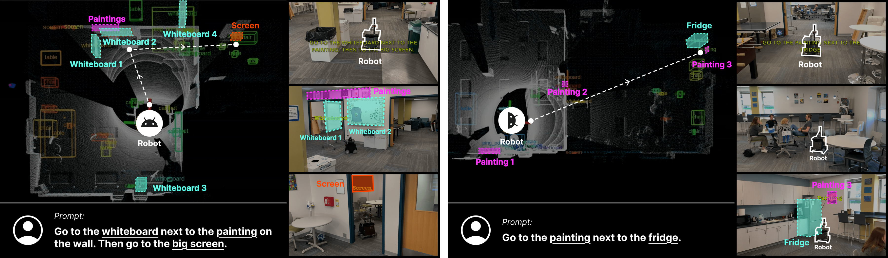

# SuperMap (arXiv 2026)

<!-- paper-source: https://chengwei920412.github.io/paper_reading/2608.22896_SuperMap_A_Spatio_Temporal_SLAM_System_for_Visual_Language_Navigation/technical_report.html -->

> **arXiv ID**：2608.22896  
> **原文标题**：SuperMap: A Spatio-Temporal SLAM System for Visual-Language Navigation  
> **翻译日期**：2026-09-22

---

## 📋 论文概览 {#_1}

### 基本信息 {#_2}

- **作者**：Shibo Zhao、Guofei Chen、Honghao Zhu、Zhiheng Li、Changwei Yao、Nader Zantout、Seungchan Kim、Wenshan Wang、Ji Zhang、Sebastian Scherer
- **机构**：卡内基梅隆大学机器人研究所（The Robotics Institute, Carnegie Mellon University）
- **发布时间**：2026 年 8 月
- **领域**：机器人感知、语义 SLAM、开放词汇建图、场景图、视觉-语言导航

### 一句话总结 {#_3}

SuperMap 将高频几何 SLAM、异步开放词汇感知、二维—三维实例跟踪、概率一致性更新和四维场景图组合为一套在线系统，使机器人能够持续维护“什么物体在何处、何时出现或消失、与哪些物体存在何种关系”的可查询世界模型，并直接用该模型执行语言指令。

### 核心贡献 {#_4}

1. 提出实时、开放词汇、实例级的时空语义 SLAM 系统，同时处理短期运动与长期环境变化。
2. 以三维投影补偿二维跟踪状态，通过几何一致性和语义一致性联合维护实例身份、移除陈旧地图内容。
3. 将物体地图抽象为同时包含空间边和时间边的四维场景图，为视觉-语言模型提供紧凑、结构化且可追溯的查询接口。
4. 在 ScanNet、长期动态室内场景和真实机器人视觉-语言导航任务上验证系统，并给出模块消融、运行频率和内存分析。

图：SuperMap 的三级表示。几何层负责位姿与稠密三维模型，实例层维护物体身份和变化，拓扑层生成可供 VLM 查询的四维场景图。

---

## 🎯 研究背景与动机 {#_5}

### 问题定义 {#_6}

传统 SLAM 主要回答“机器人在哪里、环境几何是什么”，但人类给机器人的指令通常涉及对象、关系和历史，例如“去白板旁边的显示器”或“回到之前靠近植物的椅子”。系统因而需要在连续观测中同时估计位姿、建立实例级地图，并记录对象随时间的出现、消失与移动。

论文把场景表示为由物体节点和时空关系边构成的场景图。给定当前观测 \(Q_t=\{C_t,D_t\}\) 与上一时刻地图 \(\mathcal{M}_{t-1}\)，目标是联合估计当前位姿 \(P_t\)、实例身份 \(\mathcal{I}_t\) 和新地图 \(\mathcal{M}_t\)：

\[P(\mathcal{I}_t,\mathcal{M}_t,P_t\mid\mathcal{M}_{t-1},Q_t).\]

论文将其分解为三项：几何位姿估计、时空实例关联和在线地图更新：

\[\begin{aligned}
&amp;P(\mathcal{I}_t,\mathcal{M}_t,P_t\mid\mathcal{M}_{t-1},Q_t) \\
&amp;=P(P_t\mid\mathcal{M}_{t-1},Q_t)\,
P(\mathcal{I}_t\mid\mathcal{M}_{t-1},Q_t,P_t)\,
P(\mathcal{M}_t\mid\mathcal{M}_{t-1},Q_t,P_t,\mathcal{I}_t).
\end{aligned}\]

### 现有方法的局限性 {#_7}

- 静态开放词汇建图方法往往需要完整扫描和离线处理，难以适配在线机器人闭环。
- 语义 SLAM 常使用封闭类别，并偏重类别级标签，无法稳定维护开放词汇实例身份。
- 动态 SLAM 多关注人或车辆的短期运动，较少处理物体被移走、重新放置或新加入等长期变化。
- 直接把逐帧基础模型输出写入地图会积累漏检、视角依赖标签和身份漂移，产生陈旧语义。
- 原始视频或点云对 VLM 而言输入昂贵，且缺少显式、可查询的历史关系。

### 本文的创新点 {#_8}

关键思想不是再设计一个单帧分割器，而是在地图层建立“持续校验”的实例维护机制：二维跟踪用于短期连续性，三维地图与当前位姿用于补偿相机自运动，深度残差判断旧地图点是否仍被当前观测支持，贝叶斯融合则抑制语义标签的瞬时波动。最终，历史不是一串视频帧，而是可遍历的时间边和带时间戳状态。

---

## 🔬 方法论 {#_9}

### 整体架构 {#_10}

SuperMap 接收同步 RGB、深度或 LiDAR、IMU 数据，包含三层：

1. **几何层**：以 SuperOdometry 为后端估计 \(SE(3)\) 位姿并构建彩色稠密三维地图。
2. **实例层**：使用 GroundingDINO 与 SAM2 获得开放词汇二维检测和掩码，通过二维—三维关联、几何校验及语义融合更新实例地图。
3. **拓扑层**：将对象节点、空间谓词和跨时刻身份连接组织为四维场景图，并序列化为 VLM 可理解的结构化文本。

### 三维运动补偿的实例跟踪 {#_11}

每条轨迹的混合状态由图像质心、边界框尺度和图像平面速度组成：

\[\mathbf{S}_i(t)=[\mathbf{c}_i(t)^\top,\mathbf{s}_i(t)^\top,\dot{\mathbf{c}}_i(t)^\top]^\top.\]

标准二维跟踪器在机器人快速转动或平移时容易把相机自运动误认为物体运动。SuperMap 使用当前位姿把地图中实例的三维质心 \(\mathbf{X}_i\) 投影回图像，得到跟踪先验：

\[\hat{\mathbf{c}}_i(t)=\pi(\mathbf{K}P_t^{-1}\mathbf{X}_i).\]

这个先验用于补偿卡尔曼滤波状态，使轨迹在大视角变化、短时遮挡和检测间歇时仍能保持同一身份。

### 几何一致性更新 {#_12}

对上一时刻地图点 \(\mathbf{X}_k\)，系统比较其投影深度 \(d_{proj}\) 与当前传感器深度 \(D(\mathbf{u})\)：

\[\Delta d=d_{proj}-D(\mathbf{u}).\]

当 \(|\Delta d|\le\tau_\epsilon\) 时，点仍可观测；点位于当前表面之后时视为被遮挡；点位于当前表面之前且没有传感器支持时，可能对应已移动或消失的对象。地图占据状态用对数几率递归更新：

\[L(o_k\mid Q_{1:t})=L(o_k\mid Q_{1:t-1})+\operatorname{logit}(P(o_k\mid Q_t)).\]

这让系统能够逐步降低动态或陈旧点的置信度，而不是因一次漏检立即删除对象。

### 贝叶斯语义融合 {#_13}

每个实例维护标签类别分布 \(P(L_j=c)\)。给定开放词汇检测器的新观测 \(z_t\)，按贝叶斯规则更新：

\[P(L_j=c\mid z_{1:t})=\eta\,P(z_t\mid L_j=c)P(L_j=c\mid z_{1:t-1}).\]

几何可见性决定哪些旧对象应接受本帧语义校验，语义后验则抑制瞬时误分类。几何与语义联合检查解决了“没有检测到”究竟源于遮挡、模型漏检，还是物体确实消失的问题。

### 四维场景图与导航接口 {#_14}

场景图写作 \(\mathcal{G}=(\mathcal{V},\mathcal{E}_s,\mathcal{E}_t)\)：节点是实例，\(\mathcal{E}_s\) 表示 `on`、`beside`、`under` 等空间关系，\(\mathcal{E}_t\) 连接同一对象在不同时刻的状态。局部子图被序列化为实例 ID、标签、三维质心、空间边和时间边。VLM 必须在 `<answer></answer>` 中返回目标实例 ID，解析器再从地图取出其三维质心作为导航航点，从而把自由形式语言输出约束为可执行动作。

---

## 📊 实验与结果 {#_15}

### 实验设置 {#_16}

- **平台**：麦克纳姆轮移动机器人，Livox Mid-360 LiDAR 与 360° 全景相机。
- **板载计算**：Intel i9-14900H CPU、NVIDIA RTX 4090 Laptop GPU（16 GB VRAM）。
- **感知模型**：GroundingDINO 开放词汇检测、SAM2 实例分割。
- **数据与任务**：ScanNet 类别级和实例级语义评测；30 m × 20 m 室内区域、持续约 10 分钟的长期变化实验；真实机器人零样本语言导航。
- **主要指标**：mIoU、频率加权 mIoU、准确率、实例 mAP、出现/消失事件召回率、消融中的精确率/召回率/F1、模块运行频率与内存。

### ScanNet 类别级结果 {#scannet}

<table>
<thead>
<tr>
<th>方法</th>
<th>表示方式</th>
<th>无背景 mIoU</th>
<th>无背景 f-mIoU</th>
<th>无背景 Acc</th>
<th>含背景 mIoU</th>
<th>含背景 f-mIoU</th>
<th>含背景 Acc</th>
</tr>
</thead>
<tbody>
<tr>
<td>RayFronts</td>
<td>点特征</td>
<td><strong>41.29</strong></td>
<td><strong>46.42</strong></td>
<td><strong>56.76</strong></td>
<td><strong>32.29</strong></td>
<td><strong>39.04</strong></td>
<td><strong>49.15</strong></td>
</tr>
<tr>
<td>ConceptGraphs</td>
<td>物体级</td>
<td>21.62</td>
<td>24.32</td>
<td>31.05</td>
<td>20.83</td>
<td>23.61</td>
<td>35.80</td>
</tr>
<tr>
<td>HOV-SG</td>
<td>物体级</td>
<td>26.79</td>
<td>36.05</td>
<td>35.17</td>
<td>23.48</td>
<td>28.92</td>
<td><strong>38.52</strong></td>
</tr>
<tr>
<td><strong>SuperMap</strong></td>
<td>物体级</td>
<td><strong>27.42</strong></td>
<td><strong>43.50</strong></td>
<td><strong>55.48</strong></td>
<td>22.61</td>
<td><strong>29.10</strong></td>
<td>33.00</td>
</tr>
</tbody>
</table>

SuperMap 的无背景准确率为 55.48%，比点特征方法 RayFronts 低 1.28 个百分点，但明显优于列出的其他物体级方法。结果说明其优势主要在“在线、实例级和时空维护”的综合能力，而不是所有类别级指标上都达到最优。

### ScanNet 实例级结果 {#scannet_1}

SuperMap 在论文报告的五类对象上均显著超过 HOV-SG 与 ConceptGraphs。例如椅子类别的 \(mAP_{50}/mAP_{25}\) 为 63.76/74.72，窗户为 42.20/67.92，冰箱为 62.50/62.50；HOV-SG 对应类别多为个位数或零。沙发的 \(mAP_{25}\) 达到 83.35，但门类别的 \(mAP_{50}\) 只有 10.00，说明小型离散对象的实例关联较强，边界模糊或大结构仍有改进空间。

### 长期变化检测 {#_17}

图：三类新增对象与三类消失对象的长期变化；系统在更新地图内容的同时维持周边静态物体的身份。

<table>
<thead>
<tr>
<th>任务</th>
<th>方法</th>
<th>桶</th>
<th>推车</th>
<th>标志牌</th>
<th>植物</th>
<th>垃圾桶</th>
<th>椅子</th>
</tr>
</thead>
<tbody>
<tr>
<td>对象检测召回</td>
<td>DualMap</td>
<td>0.000</td>
<td>0.000</td>
<td>0.000</td>
<td>0.000</td>
<td>0.310</td>
<td>0.000</td>
</tr>
<tr>
<td>对象检测召回</td>
<td><strong>SuperMap</strong></td>
<td><strong>1.000</strong></td>
<td><strong>0.262</strong></td>
<td><strong>0.583</strong></td>
<td><strong>0.755</strong></td>
<td><strong>0.434</strong></td>
<td><strong>1.000</strong></td>
</tr>
<tr>
<td>变化检测召回</td>
<td>DualMap</td>
<td>0.553</td>
<td>0.527</td>
<td>0.507</td>
<td>0.561</td>
<td>0.642</td>
<td>0.449</td>
</tr>
<tr>
<td>变化检测召回</td>
<td><strong>SuperMap</strong></td>
<td><strong>1.000</strong></td>
<td><strong>0.622</strong></td>
<td><strong>0.790</strong></td>
<td><strong>0.865</strong></td>
<td><strong>0.679</strong></td>
<td><strong>1.000</strong></td>
</tr>
</tbody>
</table>

SuperMap 在六类事件上都优于 DualMap，但推车的对象检测召回仅 0.262、垃圾桶仅 0.434，表明系统并未完全解决开放词汇检测和长期可见性问题。论文没有给出 Khronos 的有效数值，理由是其潜在语义推理导致丢帧和掩码质量下降。

### 消融实验 {#_18}

<table>
<thead>
<tr>
<th>配置</th>
<th>精确率</th>
<th>召回率</th>
<th>F1</th>
</tr>
</thead>
<tbody>
<tr>
<td>去除二维跟踪器</td>
<td>0.7787</td>
<td>0.4595</td>
<td>0.5780</td>
</tr>
<tr>
<td>去除语义融合</td>
<td>0.7929</td>
<td>0.3870</td>
<td>0.5201</td>
</tr>
<tr>
<td>去除几何一致性更新</td>
<td>0.8189</td>
<td>0.4448</td>
<td>0.5764</td>
</tr>
<tr>
<td><strong>完整系统</strong></td>
<td><strong>0.8677</strong></td>
<td><strong>0.4955</strong></td>
<td><strong>0.6308</strong></td>
</tr>
</tbody>
</table>

完整系统的 F1 比最弱的“去除语义融合”高 0.1107。三个模块均有贡献，其中语义融合对召回率影响最大，说明单帧开放词汇预测的波动确实需要跨帧后验更新。

### 场景图推理与视觉-语言导航 {#-}

图：与直接输入 2 Hz 漫游视频相比，结构化场景图能利用明确的空间距离和带时间戳轨迹回答灭火器选择与遗失物查找问题。

论文使用 Gemini 2.0 Flash 比较场景图和原始视频输入。空间任务中，图结构可直接区分特定灭火器与锥桶、植物的相对关系；时间任务中，时间边可追溯手提袋的历史轨迹。展示结果支持“结构化表示更容易被正确查询”的主张，但论文没有报告大规模问答准确率、统计显著性或不同 VLM 的对比，因此这部分更接近代表性案例验证。

图：基于场景图的在线视觉-语言导航；机器人利用相对空间关系区分外观相似的白板，并定位冰箱旁的画作。

### 运行频率 {#_19}

<table>
<thead>
<tr>
<th>模块</th>
<th>更新频率</th>
</tr>
</thead>
<tbody>
<tr>
<td>位姿估计</td>
<td>10 Hz</td>
</tr>
<tr>
<td>稠密三维建图与三维框更新</td>
<td>3 Hz</td>
</tr>
<tr>
<td>二维实例分割</td>
<td>1 Hz</td>
</tr>
<tr>
<td>四维场景图更新</td>
<td>5 Hz</td>
</tr>
</tbody>
</table>

不同模块采用异步频率，避免最昂贵的开放词汇分割阻塞高频几何状态估计。补充材料报告：SuperMap 在 ScanNet 评测上的平均内存为 2030.09 MB、峰值内存为 2184.86 MB、每帧建图时间为 0.3604 s；HOV-SG 为 8755.86/10226.66 MB 与 8.623 s，ConceptGraphs 为 859.86/886.18 MB 与 0.092 s。SuperMap 的资源开销处于二者之间，但提供了明显更强的实例级分割结果。

---

## 💡 关键见解 {#_20}

### 理论与系统层面的启示 {#_21}

1. **动态地图更新需要“可见性”作为中间变量。** 仅凭“本帧未检测到”不能判断物体消失；深度几何先判断物体是否本应可见，再让语义观测更新后验，更符合传感过程。
2. **三维地图不仅是输出，也是跟踪器的先验。** 将已建图实例投影回当前帧，可把机器人自运动从图像运动中分离，提升大视角变化下的身份连续性。
3. **场景图承担感知与行动之间的接口契约。** VLM 不直接输出任意坐标，而是返回地图中已有的实例 ID，再由确定性模块取出三维航点，降低幻觉直接进入控制链路的风险。
4. **异步多频架构是实时性的关键。** 几何、分割和图更新无需同频运行；系统用稳定地图吸收低频且间歇的语义观测。

### 实践启示 {#_22}

- 若机器人任务依赖长期对象记忆，单纯保存最近一帧语义图不够，应显式保存对象身份、置信度和时间关系。
- 在算力受限平台上，可优先保持位姿估计高频运行，将开放词汇检测作为低频异步更新。
- 工程实现应让 VLM 只做关系推理与目标选择，把坐标查询、可达性和控制交给确定性模块。
- 变化检测评估应同时报告“存在时检测成功”和“不存在时正确移除”，避免从未检测到某物体却在消失阶段获得虚高分数。

---

## 🔍 局限性与未来工作 {#_23}

### 当前局限 {#_24}

1. **高动态对象仍然困难。** 现有混合状态主要补偿相机运动，对快速、非线性运动对象的模型仍较弱。
2. **开放词汇并非完全无先验。** 二维检测依赖预定义对象提示词列表，尚不能自动发现未知对象类别。
3. **语义前端构成瓶颈。** 二维实例分割只有 1 Hz，短暂出现或快速移动的物体可能被漏掉。
4. **定量范围有限。** 长期变化实验只有六个目标对象，消融场景包含 41 个标注对象；场景图推理主要以案例展示，尚不足以证明跨环境、跨 VLM 的普适性。
5. **类别级精度并非整体最优。** SuperMap 在含背景的 ScanNet 指标上落后部分基线，说明实例持续性与类别分割精度之间仍有权衡。
6. **系统依赖准确位姿和标定。** 三维投影补偿、深度一致性与空间关系都受 SLAM 漂移、深度噪声和外参误差影响，论文没有系统量化这些误差的传播。

### 未来方向 {#_25}

- 引入面向高动态对象的 tracking-by-detection、分割跟踪或学习型运动模型。
- 结合开放世界对象发现与自动提示生成，摆脱人工类别提示列表。
- 将存在置信度、标签置信度和关系置信度统一到可校准的概率图模型中。
- 增加跨天、跨楼层和更大规模环境的长期部署，评估回环、地图压缩与身份重激活。
- 建立大规模时空问答和语言导航基准，报告成功率、路径效率、问答准确率、延迟与 token 成本。
- 研究地图不确定性向 VLM 和规划器的显式传递，使系统在证据不足时能够拒答或主动探索。

---

## 📚 相关工作对比 {#_26}

<table>
<thead>
<tr>
<th>方法</th>
<th>核心思想</th>
<th>优势</th>
<th>局限</th>
</tr>
</thead>
<tbody>
<tr>
<td>ConceptGraphs / HOV-SG</td>
<td>离线重建后，以 SAM/CLIP 构建开放词汇对象图</td>
<td>开放词汇查询和对象级结构</td>
<td>依赖完整扫描，构建较慢，缺少在线长期变化维护</td>
</tr>
<tr>
<td>Kimera</td>
<td>实时语义 SLAM 与三维场景图</td>
<td>几何—语义一体化、实时</td>
<td>封闭类别，实例级开放词汇能力有限</td>
</tr>
<tr>
<td>Khronos</td>
<td>面向短期和长期动态的时空地图</td>
<td>显式考虑长期变化</td>
<td>封闭类别，实例跟踪和实时性受限</td>
</tr>
<tr>
<td>DualMap</td>
<td>动态环境下的双地图更新</td>
<td>具备变化建模能力</td>
<td>本文实验中对象检测不稳定，影响后续变化判断</td>
</tr>
<tr>
<td><strong>SuperMap</strong></td>
<td>三维辅助二维跟踪、几何/语义概率更新、四维场景图</td>
<td>在线、开放词汇、实例级、可直接支持语言导航</td>
<td>动态跟踪、自动对象发现和大规模定量验证仍不足</td>
</tr>
</tbody>
</table>

---

## 🎓 综合评价 {#_27}

### 优点 {#_28}

- 问题设置贴近长期自主机器人需求，把位姿、实例身份、地图维护和语言行动连成完整闭环。
- 方法的各个模块都有明确职责，三维投影补偿与“先几何可见性、后语义校验”的设计合理且易于复现。
- 实验不仅报告语义精度，还覆盖变化检测、模块消融、板载频率、内存和导航案例，工程证据较完整。
- 场景图返回实例 ID、确定性模块生成坐标的接口设计，有助于限制 VLM 幻觉对控制系统的影响。

### 可改进之处 {#_29}

- 需要更大规模的长期变化基准，以及针对重复实例、严重遮挡、位姿漂移和提示词缺失的压力测试。
- 应给出场景图问答与导航的统计结果，而不只展示成功案例。
- 论文应进一步说明存在置信度与标签置信度的具体参数、阈值、校准方式，以及不同传感器噪声下的敏感性。
- “开放词汇”能力仍依赖预设提示词，表述上应与真正的开放世界发现区分。

### 推荐阅读对象 {#_30}

适合从事语义 SLAM、动态场景建图、开放词汇三维感知、具身智能记忆、场景图推理和视觉-语言导航的研究者与工程师。尤其适合作为“如何把基础模型感知接入长期在线机器人系统”的系统设计案例。

---

## 📎 附录 {#_31}

### 术语表 {#_32}

<table>
<thead>
<tr>
<th>英文</th>
<th>中文</th>
</tr>
</thead>
<tbody>
<tr>
<td>Spatio-Temporal SLAM</td>
<td>时空同步定位与建图（时空 SLAM）</td>
</tr>
<tr>
<td>Open-Vocabulary Perception</td>
<td>开放词汇感知</td>
</tr>
<tr>
<td>Instance Association</td>
<td>实例关联</td>
</tr>
<tr>
<td>3D-Aware Instance Tracking</td>
<td>三维感知实例跟踪</td>
</tr>
<tr>
<td>Motion Compensation</td>
<td>运动补偿</td>
</tr>
<tr>
<td>Geometric Consistency</td>
<td>几何一致性</td>
</tr>
<tr>
<td>Bayesian Semantic Fusion</td>
<td>贝叶斯语义融合</td>
</tr>
<tr>
<td>Existence Confidence</td>
<td>存在置信度</td>
</tr>
<tr>
<td>Label Confidence</td>
<td>标签置信度</td>
</tr>
<tr>
<td>4D Scene Graph</td>
<td>四维场景图</td>
</tr>
<tr>
<td>Grounded Reasoning</td>
<td>指代定位推理</td>
</tr>
<tr>
<td>Visual-Language Navigation (VLN)</td>
<td>视觉-语言导航（VLN）</td>
</tr>
</tbody>
</table>

### 参考资源 {#_33}

- **论文原文**：[arXiv:2608.22896](https://arxiv.org/abs/2608.22896)
- **中文翻译 PDF**：[paper_cn.pdf](https://chengwei920412.github.io/paper_reading/2608.22896_SuperMap_A_Spatio_Temporal_SLAM_System_for_Visual_Language_Navigation/paper_cn.pdf)
- **中文 Markdown 译文**：[paper_cn.md](https://chengwei920412.github.io/paper_reading/2608.22896_SuperMap_A_Spatio_Temporal_SLAM_System_for_Visual_Language_Navigation/paper_cn.html)
- **项目主页与开源入口**：[SuperMap](https://superodometry.com/supermap)
