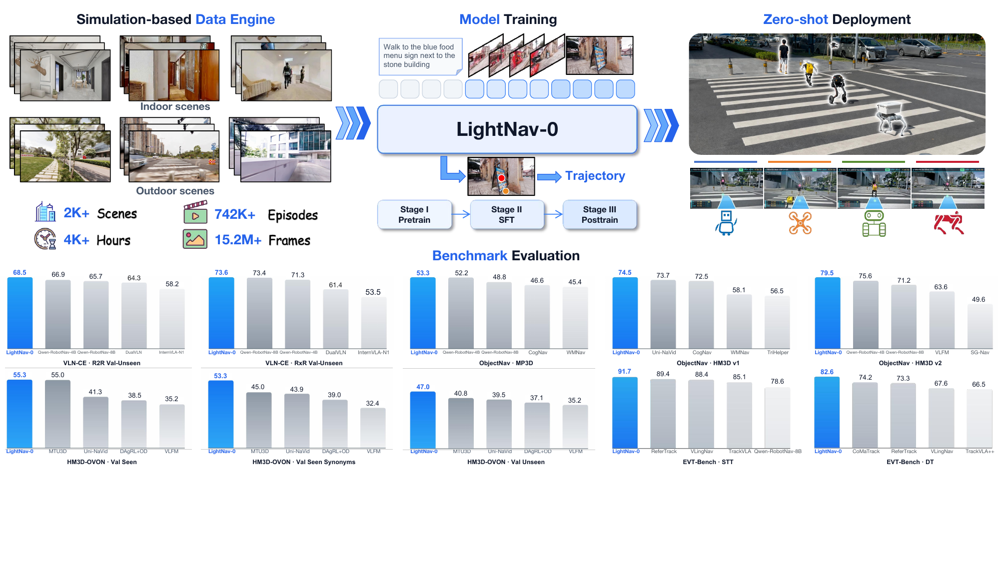
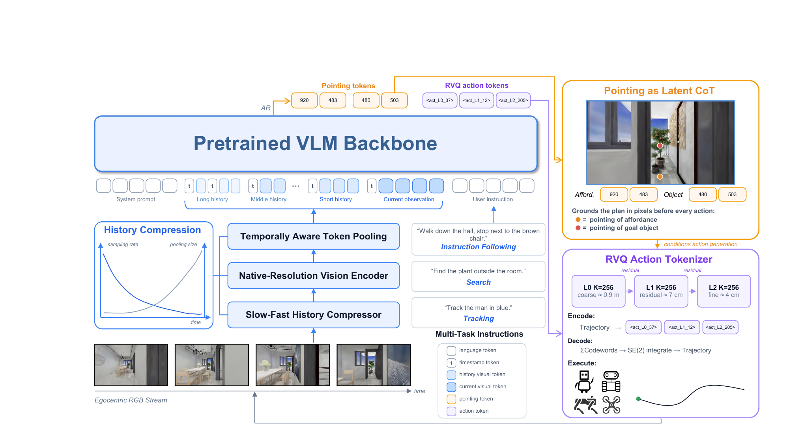
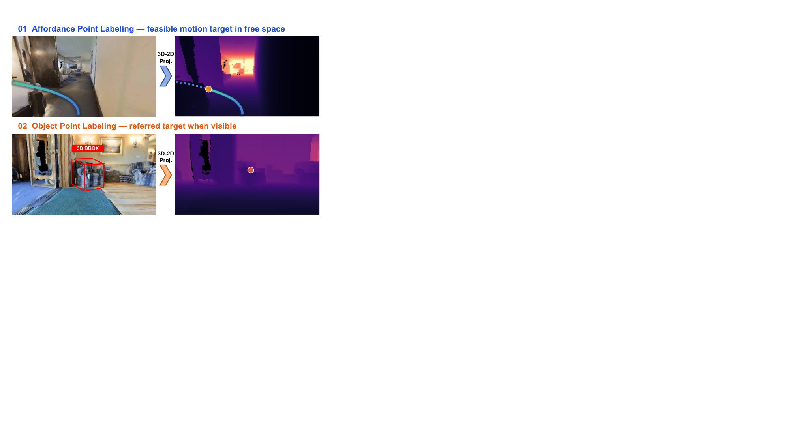
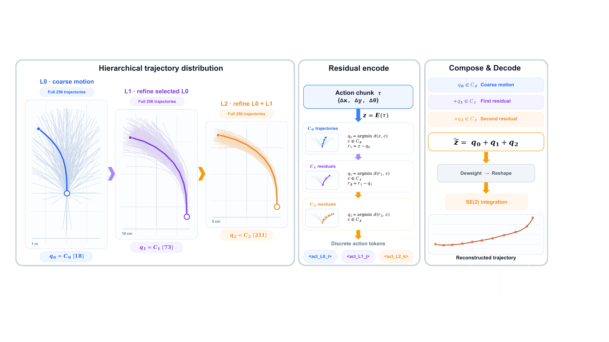

# LightNav-0 (arXiv 2026)

<!-- paper-source: https://chengwei920412.github.io/paper_reading/2608.30935_LightNav_0_Eliciting_VLM_Spatial_Intelligence_for_Generalist_Embodied_Navigation/technical_report.html -->

> **arXiv ID**：2608.30935  
> **原文标题**：LightNav-0: Eliciting VLM Spatial Intelligence for Generalist Embodied Navigation  
> **翻译日期**：2026-09-02

---

## 📋 论文概览 {#_1}

### 基本信息 {#_2}

- **作者**：Light Origins Team
- **机构**：Light Origins
- **发表时间**：2026 年 8 月（arXiv）
- **领域**：具身智能、视觉语言模型、通用导航、机器人学习

### 核心贡献 {#_3}

LightNav-0 的目标不是再设计一种任务专用导航器，而是证明一个 4B 级紧凑视觉语言模型（Vision-Language Model, VLM）可以作为跨任务、跨环境、跨机器人本体的统一导航骨干网络。论文的主要贡献包括：

1. 用双通道指点把“空间意图”与机器人具体动作空间解耦：可供性点表示局部可行方向，物体点表示目标物体或目标位置。
2. 用三层残差向量量化（Residual Vector Quantization, RVQ）将未来 10 个 \(\mathrm{SE}(2)\) 路径点压缩成 3 个自回归动作 token，在保持连续轨迹精度的同时获得精确的逐 token 概率。
3. 通过时序感知视觉历史压缩，在固定 token 预算内同时保存近期几何细节和长期上下文。
4. 建立“具身推理中期训练—监督微调—在线强化学习”的三阶段训练流程，并统一指令跟随、物体目标导航和具身视觉跟踪。
5. 在 10 个公开导航仿真设置上取得最强单目成功率，并用同一检查点零样本部署到人形、四足、空中和轮式机器人。

图：LightNav-0 的任务覆盖、训练规模、仿真结果与跨本体部署概览。

---

## 🎯 研究背景与动机 {#_4}

### 问题定义 {#_5}

具身导航要求策略把语言或视觉目标、第一视角观测和历史轨迹转化为可执行动作。不同任务的目标形式差异很大：VLN 要遵循自然语言路线，ObjectNav 要搜索指定类别，EVT 要持续跟踪动态目标；不同机器人又拥有不同运动学和控制接口。论文试图学习统一策略：只使用单目 RGB 和自然语言目标，不借助任务标识、全景相机、深度、显式地图或任务专用动作头，也能跨任务和本体输出精确轨迹。

### 现有方法的局限性 {#_6}

- 模块化系统依赖感知、建图、规划和控制之间的手工接口，任务或传感器变化时迁移困难。
- 许多 VLA 导航模型仍使用全景观测、路径点预测器、扩散/流匹配动作专家或本体专用头，没有充分复用 VLM 原生空间能力。
- 离散原子动作便于自回归训练与强化学习，但运动分辨率低；连续动作头更精确，却难以直接获得动作概率。
- 完整视频历史会造成视觉 token 无界增长，而过度压缩又会丢失近期避障所需的细节。

### 本文的创新点 {#_7}

论文把“指点”视为连接 VLM 空间先验与机器人控制的中间语言。指点发生在二维图像网格中，不依赖任务或机器人；轨迹则经 RVQ 解码为本体无关的几何路径点，最终由底层控制器适配具体平台。这一分层使高层模型可以保持不变，同时把平台差异限制在轨迹执行层。

---

## 🔬 方法论 {#_8}

### 整体架构 {#_9}

在决策时刻 \(t\)，模型接收指令 \(\mathcal{I}\) 与第一视角 RGB 历史 \(\mathcal{O}_{1:t}\)，依次生成：

1. 可供性点 token \(\langle\mathrm{apos}_{i_t^a}\rangle\)；
2. 物体点 token \(\langle\mathrm{opos}_{i_t^o}\rangle\)；
3. 三个 RVQ 动作 token \(\langle\mathrm{act\_L0}\rangle\)、\(\langle\mathrm{act\_L1}\rangle\)、\(\langle\mathrm{act\_L2}\rangle\)。

完整输出序列为：

\[\mathbf{y}_t=[\langle\mathrm{apos}_{i_t^a}\rangle,\langle\mathrm{opos}_{i_t^o}\rangle,\langle\mathrm{act\_L0}_{k_{0,t}}\rangle,\langle\mathrm{act\_L1}_{k_{1,t}}\rangle,\langle\mathrm{act\_L2}_{k_{2,t}}\rangle].\]

所有输出都由 Qwen3-VL-4B-Instruct 原有语言模型头生成，没有额外导航预测头。

图：LightNav-0 统一的视觉历史、双通道指点与 RVQ 轨迹生成流程。

### 关键技术 {#_10}

#### 1. 时序感知视觉历史压缩 {#1}

历史帧的采样率随时龄 \(\Delta T_i\) 指数衰减：

\[f_s(i)=f_s^{\max}\exp\!\left(-\frac{\Delta T_i}{\tau_s}\right).\]

更久远的帧还使用更大的网格池化步长。这样，当前观测保留高分辨率，长期历史以更稀疏、更粗粒度的 token 存储。压缩发生在视觉 Transformer 之后，因此可兼容原生分辨率和变长输入。

#### 2. 双通道指点 {#2}

当前图像被划分为 \(H_g\times W_g\) 网格，归一化坐标 \((u,v)\) 被量化为一个网格索引：

\[i(\mathbf p)=\min\{H_g-1,\lfloor H_gv\rfloor\}W_g+\min\{W_g-1,\lfloor W_gu\rfloor\}.\]

可供性点负责“往哪里走”，物体点负责“目标在哪里”。两个通道使用不同 token 族，避免同一像素位置在运动意图和目标接地之间产生语义混淆。消融结果显示，这不是单纯的可视化附件，而是影响控制性能的关键推理接口。

图：可供性点和物体点的自动投影与标注方式。

#### 3. 分层 RVQ 动作 tokenizer {#3-rvq-tokenizer}

未来 10 个 \(\mathrm{SE}(2)\) 路径点组成 \(\mathbf z_t\in\mathbb R^{10\times3}\)。三层 256 条目码本逐层量化轨迹及其残差：

\[k_\ell=\arg\min_k d_J(\mathbf r^{(\ell)},\mathbf e_k^{(\ell)}),\qquad
\mathbf r^{(\ell+1)}=\mathbf r^{(\ell)}-\mathbf e_{k_\ell}^{(\ell)}.\]

使用前 \(L\) 层时，重构轨迹为：

\[\hat{\mathbf z}_t^{(L)}=\sum_{\ell=0}^{L-1}\mathbf e_{k_\ell}^{(\ell)},\qquad L\in\{1,2,3\}.\]

任意非空 token 前缀都能解码为可执行轨迹，因此部署时可以按时延预算提前停止。完整三层只需 3 个 token，却对应最多 \(256^3\) 个码字组合，论文报告平均位移误差为 \(0.72\,\mathrm{cm}\)；单层 \(K=4096\) 的 VADv2 式词表误差为 \(2.48\,\mathrm{cm}\)。

图：粗粒度码字与两层残差码字逐级修正轨迹。

### 算法流程 {#_11}

1. 对导航数据自动生成可供性点、物体点和未来轨迹监督。
2. 用 36 个数据源开展 ER 中期训练，强化指点、空间 VQA、视频推理和多图对应能力。
3. 将 16 个导航数据源与 33 个辅助 ER/VQA 数据源联合用于 SFT，并通过 DAgger 缓解离线示范与策略访问状态之间的分布偏移。
4. 在在线仿真中执行多 episode rollout，根据任务构造终局可验证奖励。
5. 用群体相对目标更新同一个自回归策略；动作 token 的对数概率可直接用于策略梯度，无需 critic 或扩散过程重构。
6. 推理时解码双通道指点和三个 RVQ token，恢复 10 个路径点并交给底层轨迹跟随器。

---

## 📊 实验与结果 {#_12}

### 实验设置 {#_13}

- **数据规模**：超过 2K 个场景、4K 小时具身轨迹；ER 中期训练使用 36 个数据源。
- **任务**：VLN、闭集与开放词汇 ObjectNav、EVT、空间指点与 VQA。
- **导航基准**：R2R、RxR、MP3D、HM3D v1/v2、HM3D-OVON、INSIGHT-Bench、EVT-Bench 等 10 个公开设置。
- **主要指标**：导航误差（NE）、成功率（SR）、路径长度加权成功率（SPL）、跟踪率（TR）和碰撞率（CR）。
- **传感配置**：LightNav-0 仅使用单视角 RGB；对比表明确标注了其他方法的全景、深度与里程计输入。

### 主要结果 {#_14}

<table>
<thead>
<tr>
<th>任务/设置</th>
<th>LightNav-0 结果</th>
<th>关键信息</th>
</tr>
</thead>
<tbody>
<tr>
<td>R2R Val-Unseen</td>
<td>SR 68.5 / SPL 62.8</td>
<td>最强单目 SR</td>
</tr>
<tr>
<td>RxR Val-Unseen</td>
<td>SR 73.6 / SPL 64.5</td>
<td>最强单目 SR</td>
</tr>
<tr>
<td>MP3D ObjectNav</td>
<td>SR 53.3 / SPL 21.2</td>
<td>最强单目结果</td>
</tr>
<tr>
<td>HM3D v1 ObjectNav</td>
<td>SR 74.5 / SPL 43.9</td>
<td>最强单目结果</td>
</tr>
<tr>
<td>HM3D v2 ObjectNav</td>
<td>SR 79.5 / SPL 43.7</td>
<td>最强单目结果</td>
</tr>
<tr>
<td>HM3D-OVON 未见类别</td>
<td>SR 47.0 / SPL 24.1</td>
<td>开放词汇泛化</td>
</tr>
<tr>
<td>EVT 单目标跟踪</td>
<td>SR 91.7</td>
<td>高于 ReferTrack 2.3 点</td>
</tr>
<tr>
<td>EVT 干扰跟踪</td>
<td>SR 82.6 / CR 4.62</td>
<td>SR 高于最佳单目基线 9.3 点</td>
</tr>
<tr>
<td>INSIGHT-Bench</td>
<td>SR 43.66（479/1,097）</td>
<td>各指令类型均领先开源基线</td>
</tr>
</tbody>
</table>

LightNav-ER 在 8 个具身推理基准上的宏平均为 67.4，高于 Qwen3-VL-4B 的 63.1 和 8B Molmo2-ER 的 62.8。该结果说明中期训练不仅针对某一个导航指标，还改善了指点、空间指代、可供性和具身问答等基础能力。

### 消融实验 {#_15}

- **ER 初始化**：8 个导航设置的平均 SR 从 60.8 提升到 63.1，平均 SPL 从 39.0 提升到 40.0；全部 8 个设置的 SR 都有改善。
- **双通道指点**：平均 SR 从 54.7 提升到 63.1（+8.4），平均 SPL 从 34.3 提升到 40.0（+5.7）；所有评测设置均受益。
- **模型规模**：2B 扩展到 4B 明显改善 R2R 和 RxR，但 8B 没有稳定超过 4B，表明容量不是当前唯一瓶颈。
- **数据与环境规模**：增加数据量产生单调但逐渐饱和的收益；增加训练环境覆盖带来的提升更稳定、更大。

---

## 💡 关键见解 {#_16}

### 理论分析 {#_17}

LightNav-0 最有价值的抽象是把导航决策拆成“空间意图—几何轨迹—本体控制”三层。图像网格指点是 VLM 熟悉的离散空间，RVQ token 是语言模型可直接建模的离散动作空间，\(\mathrm{SE}(2)\) 路径点又是不同移动机器人都能消费的连续几何接口。每一层都选择了与其上游、下游最匹配的表示，因此统一性不是通过强行共享最终控制命令实现的。

RVQ 还解决了连续控制与策略梯度之间的接口矛盾。扩散或流匹配策略通常要把生成过程重新解释为 MDP 才能计算策略更新；LightNav-0 的动作本来就是三个分类 token，精确对数概率可以直接获得。残差码本再逐级补偿粗量化误差，使离散化没有严重牺牲几何精度。

### 实践启示 {#_18}

- 对通用机器人策略，跨本体共享的中间几何表示可能比共享底层控制命令更稳健。
- 在长时程视觉任务中，应按信息时效分配 token，而不是对所有历史帧统一降采样。
- 环境多样性可能比单纯增加同类轨迹数量或参数规模更值得优先投入。
- 可解释的中间输出若同时参与训练并对下游动作形成因果条件，通常比事后可视化更有实际价值。

---

## 🔍 局限性与未来工作 {#_19}

### 当前局限 {#_20}

1. 真实世界结果主要是定性 rollout，缺少跨平台统一的成功率、路径效率、碰撞率和时延统计。
2. 模型只有单一决策通路，高频避障与低频语义规划共享同一 VLM 推理周期，可能限制高速或安全关键场景。
3. 双通道指点把三维意图投影到二维图像平面；目标被遮挡、超出视野或需要复杂三维拓扑推理时，二维表示的信息容量有限。
4. 论文报告 8B 模型没有稳定超过 4B，但尚未完全分离数据配方、优化超参数与模型容量的影响。
5. 强化学习主要依赖终局可验证奖励，长 episode 中的信用分配仍可能稀疏。
6. 互联网规模视频预训练、极端户外条件、长期自主运行和系统安全尚未得到充分验证。

### 未来方向 {#_21}

- 构建双系统架构：轻量反应策略处理高频避障与轨迹修正，VLM 负责低频语义决策和长时程规划。
- 在大规模互联网视频与机器人视频上预训练，以扩展开放世界概念、运动和交互覆盖。
- 把二维指点与显式三维记忆、占据表示或拓扑图结合，增强遮挡和长时程回溯能力。
- 研究可学习的自适应 RVQ 深度，让策略按场景难度决定生成 1、2 或 3 个动作 token。
- 建立统一的跨本体物理评测协议，定量测量成功率、碰撞、安全停机、延迟和能耗。

---

## 📚 相关工作对比 {#_22}

<table>
<thead>
<tr>
<th>方法类别</th>
<th>核心思想</th>
<th>优势</th>
<th>局限</th>
</tr>
</thead>
<tbody>
<tr>
<td>模块化导航</td>
<td>串接感知、建图、规划和控制</td>
<td>可解释、可独立调试</td>
<td>手工接口多，跨任务迁移困难</td>
</tr>
<tr>
<td>路径点/拓扑方法</td>
<td>在全景图或地图上预测中间目标</td>
<td>VLN 性能强</td>
<td>常依赖全景、深度或显式地图</td>
</tr>
<tr>
<td>扩散/流匹配动作头</td>
<td>独立连续动作专家生成平滑轨迹</td>
<td>连续控制精度高</td>
<td>动作概率与 RL 更新复杂，增加专用模块</td>
</tr>
<tr>
<td>原子离散动作</td>
<td>自回归生成前进、转向等 token</td>
<td>接口简单，易做 RL</td>
<td>运动量化粗糙、序列较长</td>
</tr>
<tr>
<td><strong>LightNav-0</strong></td>
<td>双通道指点 + 三层 RVQ 轨迹 token</td>
<td>单目、统一、精确，直接支持 token 级 RL</td>
<td>二维指点容量与真实世界量化评测仍有限</td>
</tr>
</tbody>
</table>

---

## 🎓 个人评价 {#_23}

### 优点 {#_24}

- 问题设定清楚：不仅追求多任务，还同时约束单目输入、紧凑参数量和无任务专用头。
- 表示设计形成闭环：指点复用 VLM 空间先验，RVQ 连接自回归建模与连续控制，底层轨迹跟随器完成本体适配。
- 实验覆盖广，包含基础空间能力、三类导航任务、开放词汇划分、消融、扩展性和物理部署。
- 消融结果有解释力，尤其双通道指点带来的平均 SR +8.4，直接支持论文的核心设计判断。
- 对结果边界的表述较克制，例如区分成功率领先与其他跟踪指标未全面领先。

### 可改进之处 {#_25}

- 增加真实机器人上的定量对比和失败案例分类，会显著增强“跨本体泛化”的证据强度。
- 报告端到端控制频率、视觉编码耗时、内存占用和不同 RVQ 提前退出深度的真实性能曲线。
- 加入仅可供性点、仅物体点、交换通道或共享 token 族等更细粒度消融，以厘清两个通道各自的贡献。
- 对 4B 优于 8B 的现象进行多随机种子和等计算预算实验，避免把训练未饱和误判为规模饱和。

### 推荐阅读对象 {#_26}

适合关注通用具身导航、VLM/VLA 动作表示、视觉 token 压缩、机器人强化学习和跨本体部署的研究者与工程师。尤其值得正在权衡“离散动作便于训练”与“连续动作需要精度”这一矛盾的团队参考。

---

## 📎 附录 {#_27}

### 重要公式 {#_28}

统一自回归训练目标为：

\[\mathcal L_{\mathrm{CE}}=-\sum_{j\in\mathcal M}\log p_\theta(y_j\mid\mathbf x,y_{&lt;j}).\]

轨迹码本距离同时考虑位置误差与累积朝向误差：

\[d_{\mathrm{traj}}(\mathbf z,\hat{\mathbf z})=\operatorname{ADE}(\mathbf z,\hat{\mathbf z})+\lambda\left|\Delta\theta(\mathbf z)-\Delta\theta(\hat{\mathbf z})\right|,\]

其中实验取 \(\lambda=0.3\)。

### 术语表 {#_29}

<table>
<thead>
<tr>
<th>英文</th>
<th>中文</th>
<th>说明</th>
</tr>
</thead>
<tbody>
<tr>
<td>Generalist Embodied Navigation</td>
<td>通用具身导航</td>
<td>跨任务、环境和机器人本体的导航</td>
</tr>
<tr>
<td>Dual-Channel Pointing</td>
<td>双通道指点</td>
<td>可供性点与物体点组成的空间接口</td>
</tr>
<tr>
<td>Affordance Point</td>
<td>可供性点</td>
<td>表示局部可行方向或自由空间落点</td>
</tr>
<tr>
<td>Object Point</td>
<td>物体点</td>
<td>表示目标物体或目标位置</td>
</tr>
<tr>
<td>Residual Vector Quantization, RVQ</td>
<td>残差向量量化</td>
<td>用多层码本逐级量化轨迹及残差</td>
</tr>
<tr>
<td>Embodied Reasoning, ER</td>
<td>具身推理</td>
<td>支撑导航的空间、时序与接地能力</td>
</tr>
<tr>
<td>Supervised Fine-Tuning, SFT</td>
<td>监督微调</td>
<td>用导航与辅助任务监督对齐模型</td>
</tr>
<tr>
<td>Group Relative Policy Optimization, GRPO</td>
<td>群体相对策略优化</td>
<td>以组内相对优势进行无 critic 更新</td>
</tr>
<tr>
<td>Success Rate, SR</td>
<td>成功率</td>
<td>episode 成功比例</td>
</tr>
<tr>
<td>Success weighted by Path Length, SPL</td>
<td>路径长度加权成功率</td>
<td>同时衡量成功与路径效率</td>
</tr>
</tbody>
</table>

### 参考资源 {#_30}

- **论文原文**：[arXiv](https://arxiv.org/abs/2608.30935)
- **中文翻译 PDF**：[paper_cn.pdf](https://chengwei920412.github.io/paper_reading/2608.30935_LightNav_0_Eliciting_VLM_Spatial_Intelligence_for_Generalist_Embodied_Navigation/paper_cn.pdf)
- **中文 Markdown 译文**：[paper_cn.md](https://chengwei920412.github.io/paper_reading/2608.30935_LightNav_0_Eliciting_VLM_Spatial_Intelligence_for_Generalist_Embodied_Navigation/paper_cn.html)
- **代码实现**：[LightNav-0 GitHub](https://github.com/lightorigins/LightNav-0)
- **项目主页**：[LightNav-0](https://www.lightorigins.com/en/blog/lightnav-0)
- **模型与资源**：[Hugging Face](https://huggingface.co/LightOriginsHQ/LightNav-0)
