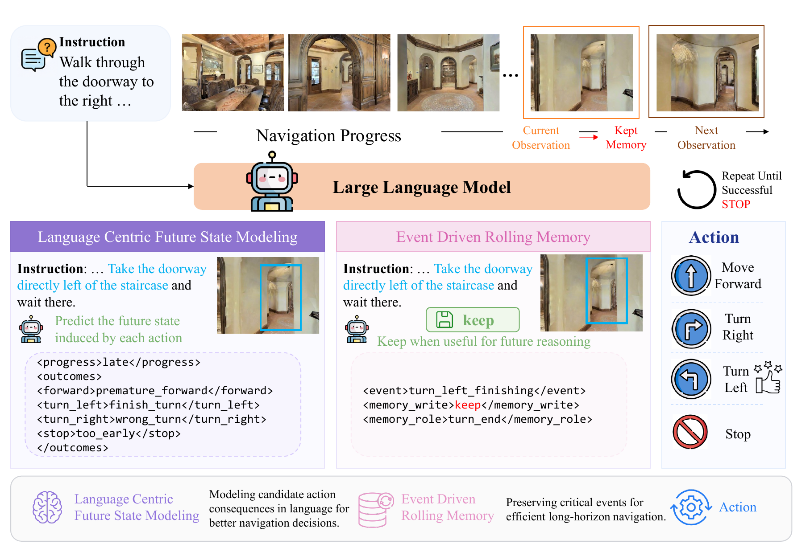
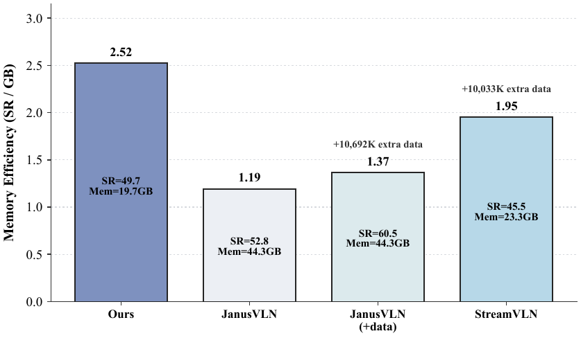
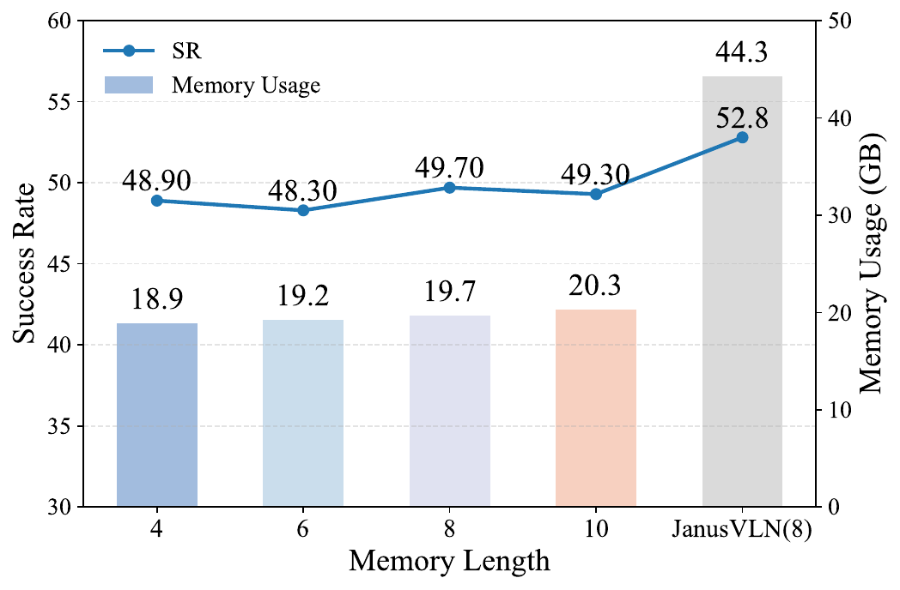

# LookStep (EMNLP 2026)

<!-- paper-source: https://chengwei920412.github.io/paper_reading/2609.02350_LookStep_Efficient_Vision_Language_Navigation_with_Linguistic_Foresight_and_Event_Driven_Memory/technical_report.html -->

> 原文链接：[LookStep (EMNLP 2026)](https://chengwei920412.github.io/paper_reading/2609.02350_LookStep_Efficient_Vision_Language_Navigation_with_Linguistic_Foresight_and_Event_Driven_Memory/technical_report.html)

> **arXiv ID**：2609.02350  
> **原文标题**：LookStep: Efficient Vision-Language Navigation with Linguistic Foresight and Event Driven Memory  
> **翻译日期**：2026-09-22

---

## 📋 论文概览 {#_1}

### 基本信息 {#_2}

- **作者**：Kun-Yang Yu、Yingzhe Li、Hongyu Xu、Shi-Yu Tian、Zhi Zhou、Yang Chen、Ming Yang、Sheng Wang、Qing Yu、Lan-Zhe Guo、Yu-Feng Li
- **机构**：南京大学新型软件技术全国重点实验室、南京大学人工智能学院、TermiTech、南京大学智能科学与技术学院
- **发表时间**：2026 年 9 月，arXiv v2；EMNLP 2026 Main 接收
- **领域**：视觉-语言导航、具身智能、多模态大语言模型

### 核心贡献 {#_3}

1. 提出端到端视觉-语言导航框架 **LookStep**，仅使用单目 RGB 观测，不依赖显式认知地图、深度、里程计或外部三维建模工具。
2. 提出语言中心未来状态建模（Language Centric Future State Modeling，LFS），在输出最终动作前预测当前导航进度及每个候选动作的短期结果，把单一动作模仿扩展为有结构的轨迹级监督。
3. 提出事件驱动滚动记忆（Event Driven Rolling Memory，EDRM），让模型自行判断当前观测是否应写入容量受限的记忆，并为其分配语义角色。
4. 给出预言机层面的信息论动机，并在 R2R-CE、RxR-CE、真实场景和跨数据集实验中验证性能、显存与推理效率。

---

## 🎯 研究背景与动机 {#_4}

### 问题定义 {#_5}

连续环境中的视觉-语言导航要求智能体根据自然语言指令和当前第一视角 RGB 图像，反复从 `MOVE`、`TURN_LEFT`、`TURN_RIGHT`、`STOP` 中选择动作，直至抵达指令描述的目标位置。难点在于长期指令对齐、空间状态跟踪、关键历史证据保留以及正确停止。

### 现有方法的局限性 {#_6}

- 下一步动作预测通常只监督一个专家动作，训练信号稀疏，因而高度依赖大规模轨迹数据。
- 文本认知地图难以完整保存方向关系和细粒度视觉变化；直接堆叠历史帧又会增加显存与计算开销。
- 固定窗口、均匀采样或启发式采样可能保留冗余画面，同时漏掉转向、目标接近等关键事件。
- 外部深度或三维工具能增强空间推理，却提高系统复杂度和部署成本。

### 本文的创新点 {#_7}

LookStep 把“如何充分利用每条专家轨迹”和“如何在有限容量中保存真正有用的历史”统一到同一个自回归序列中。LFS 让模型先显式比较候选动作的可能后果，再生成最终动作；EDRM 则把记忆维护变为由语义事件触发的在线状态更新。二者共享标准下一 token 训练目标，无需额外损失或手工记忆规则。

---

## 🔬 方法论 {#_8}

### 整体架构 {#_9}

图：LookStep 整体结构。LFS 以语言标签预测候选动作后果，EDRM 选择应长期保存的关键观测，随后模型输出动作。

给定指令 \(I\)、历史观测 \(O_{t-1}\) 和当前观测 \(x_t\)，模型一次性生成未来状态预测 \(\mathcal{P}_t\)、记忆管理状态 \(\mathcal{M}_t\) 与下一动作 \(a_{t+1}\)：

\[(\mathcal{P}_t,\mathcal{M}_t,a_{t+1}) = f_\theta(I,O_{t-1},x_t).\]

### 关键技术 {#_10}

**1. 语言中心未来状态建模（LFS）**

未来状态变量由当前粗粒度导航进度 \(p_t\) 和各候选动作的短期结果 \(F_t\) 组成：

\[\mathcal{P}_t=\{p_t,F_t\}.\]

模型通过 `<Progress>` 与 `<Outcome>` 等结构化标签表达这些状态。与预测高维未来图像或连续几何状态相比，离散语言标签的训练与推理成本更低，同时为动作选择提供可检查的中间依据。

**2. 事件驱动滚动记忆（EDRM）**

记忆管理状态包含写入决策 \(W_t\) 与语义角色 \(R_t\)：

\[\mathcal{M}_t=\{W_t,R_t\}.\]

当 \(W_t=\text{keep}\) 时，当前图像及其记忆角色写入先进先出队列；当 \(W_t=\text{drop}\) 时，图像只保留在短期上下文。角色标签用于区分起始视图、转向开始、转向结束、转向后对齐、接近目标和停止证据等事件。

**3. 统一自回归训练**

训练目标把导航进度、候选动作结果、记忆写入、记忆角色和专家动作组织为单个结构化序列。若其 token 为 \(w_1^\star,\ldots,w_{K_t}^\star\)，优化目标为：

\[\mathcal{L}(\theta)=-\mathbb{E}_{(X_t,\mathcal{T}_t^\star)\sim\mathcal{D}}\sum_{k=1}^{K_t}\log P_\theta(w_k^\star\mid X_t,w_{&lt;k}^\star).\]

所有辅助标签均可由专家轨迹自动构造，不需新增人工标注。

### 算法流程 {#_11}

1. 输入自然语言指令、当前 RGB 图像、近期观测和 EDRM 长期记忆。
2. 生成当前导航进度，以及前进、左转、右转和停止等候选动作的结果标签。
3. 生成当前观测的记忆写入决策与语义角色；若写入且队列已满，则移除最早条目。
4. 在上述结构化中间状态之后输出最终动作，执行后读取新观测并重复。

---

## 📊 实验与结果 {#_12}

### 实验设置 {#_13}

- **数据集**：R2R-CE、RxR-CE；另在 HM3D-OVON 子集和真实工作空间中测试泛化。
- **评估指标**：导航误差（NE）、预言机成功率（OS）、成功率（SR）、路径长度加权成功率（SPL）。
- **骨干模型**：Qwen3-VL 8B。
- **训练设置**：仅使用 R2R-CE 与 RxR-CE 专家轨迹训练 1 个 epoch；默认记忆长度为 8；论文报告约 1000 A100 PCIe GPU 小时。
- **对比方法**：NaVid、Uni-NaVid、NaVILA、StreamVLN、JanusVLN、MapNav 及多种传统 VLN-CE 方法。

### 主要结果 {#_14}

<table>
<thead>
<tr>
<th>数据集</th>
<th>NE ↓</th>
<th>OS ↑</th>
<th>SR ↑</th>
<th>SPL ↑</th>
</tr>
</thead>
<tbody>
<tr>
<td>R2R-CE Val-Unseen</td>
<td>5.34</td>
<td>55.9</td>
<td><strong>49.7</strong></td>
<td><strong>45.3</strong></td>
</tr>
<tr>
<td>RxR-CE Val-Unseen</td>
<td>6.89</td>
<td>—</td>
<td><strong>46.9</strong></td>
<td><strong>39.9</strong></td>
</tr>
</tbody>
</table>

LookStep 在不使用外部训练数据和辅助空间模块的条件下，于 R2R-CE Val-Unseen 达到 49.7% SR。它低于使用 VGGT 的 JanusVLN 的 52.8% SR，但峰值显存不足 24 GB、单步推理约 59 ms；论文报告 JanusVLN 约需 44.3 GB 和 194 ms。该结果体现了约 3 个百分点成功率差距与显著资源节省之间的明确权衡。

图：R2R 上不同方法的数据量、成功率与记忆效率对比。

图：不同记忆长度下的 R2R 成功率、显存与效率结果。

### 消融实验 {#_15}

<table>
<thead>
<tr>
<th>配置</th>
<th>NE ↓</th>
<th>OS ↑</th>
<th>SR ↑</th>
<th>SPL ↑</th>
</tr>
</thead>
<tbody>
<tr>
<td>完整 LookStep</td>
<td><strong>5.34</strong></td>
<td>55.9</td>
<td><strong>49.7</strong></td>
<td><strong>45.3</strong></td>
</tr>
<tr>
<td>不使用 LFS</td>
<td>5.39</td>
<td>52.8</td>
<td>46.9</td>
<td>42.4</td>
</tr>
<tr>
<td>不使用 EDRM（不重训）</td>
<td>6.64</td>
<td><strong>70.9</strong></td>
<td>37.4</td>
<td>22.1</td>
</tr>
</tbody>
</table>

移除 LFS 后 SR 下降 2.8 个百分点，说明候选动作后果监督确实改善动作选择。用均匀历史采样替代 EDRM 后，SR 降低 12.3 个百分点、SPL 降低 23.2 个百分点；OS 却上升，表明模型仍可能经过目标附近，但缺少关键事件记忆时难以准确停止。

只使用 R2R 训练时，SR 从 49.7% 降至 40.3%，说明跨数据集轨迹仍对泛化有明显贡献。在 HM3D-OVON 子集上，LookStep 获得 38.0% SR、26.9% SPL，优于论文列出的 VLFM 与 DAgRL+OD。

---

## 💡 关键见解 {#_16}

### 理论分析 {#_17}

论文比较直接动作预测与使用预言机未来状态标签的贝叶斯最优对数风险：

\[\mathcal{R}_{\mathrm{base}}^\star-\mathcal{R}_{\mathrm{oracle\text{-}fsm}}^\star=I(a_{t+1}^\star;F_t^\star\mid X_t)\ge 0.\]

该等式说明：只要未来状态标签在给定当前上下文后仍包含与专家动作有关的信息，显式条件化就能降低预言机层面的动作不确定性。但实际推理使用模型生成的 \(\hat F_t\)，而非真实 \(F_t^\star\)。论文进一步给出：

\[\epsilon_{\mathrm{actual\text{-}fsm}}\le\epsilon_{\mathrm{oracle\text{-}fsm}}+\delta,\]

其中 \(\delta\) 表示会改变最终动作的中间状态生成误差。因此，理论部分更准确地说是设计动机和充分条件，而非对实际模型无条件优于直接预测的证明。

### 实践启示 {#_18}

- 在轨迹数据有限时，为每一步构造多个与决策有关的中间标签，可能比单纯扩大动作模仿数据更划算。
- 长期记忆的关键不只是容量，而是写入策略；基于事件的选择对停止判断尤其重要。
- 单目 RGB 加语言推理能在较低显存上取得有竞争力的 VLN 性能，适合边缘设备或机器人本体部署。
- 结构化语言状态增强可解释性，但其可靠性仍依赖标签规则和模型对标签的准确生成。

---

## 🔍 局限性与未来工作 {#_19}

### 当前局限 {#_20}

1. 训练只覆盖 R2R-CE 与 RxR-CE，未结合 DAgger 等在线数据聚合策略，与更大规模系统仍有性能差距。
2. 理论优势建立在预言机未来状态标签之上；实际生成误差可能抵消该优势。
3. EDRM 消融采用“不重训”的替换方式，难以完全分离训练分布变化与记忆机制本身的影响。
4. 未来状态和记忆角色依赖预定义标签集，面对开放世界中未覆盖的事件类型时可能受限。
5. 真实世界实验展示了定性结果，但规模与量化覆盖仍有限。

### 未来方向 {#_21}

- 与 DAgger、在线强化学习或测试时适应结合，检验结构化中间监督能否继续受益于交互数据。
- 学习可扩展或层级化的状态与记忆标签，减少人工规则对新环境的约束。
- 对中间标签进行校准和不确定性估计，在未来状态置信度低时回退到保守策略。
- 在更长任务、更动态场景和真实机器人平台上进行大规模定量评估。
- 设计“重训后的均匀采样”“同等 token 预算”“同等延迟”等受控实验，更精确地区分 LFS 与 EDRM 的独立贡献。

---

## 📚 相关工作对比 {#_22}

<table>
<thead>
<tr>
<th>方法</th>
<th>核心思想</th>
<th>优势</th>
<th>劣势</th>
</tr>
</thead>
<tbody>
<tr>
<td>StreamVLN</td>
<td>慢—快上下文建模与流式动作生成</td>
<td>有界上下文、适合连续输入</td>
<td>依赖大量外部数据，历史选择不以语义事件为核心</td>
</tr>
<tr>
<td>JanusVLN</td>
<td>双隐式记忆并结合 VGGT 空间先验</td>
<td>R2R-CE 性能更高、空间推理强</td>
<td>外部三维模块带来更高显存和延迟</td>
</tr>
<tr>
<td>MapNav</td>
<td>维护文本化认知地图</td>
<td>状态表述直观</td>
<td>文本地图可能丢失方向与细粒度视觉信息</td>
</tr>
<tr>
<td><strong>LookStep</strong></td>
<td>语言未来状态监督 + 事件驱动滚动记忆</td>
<td>数据和显存效率较高、结构统一、无需外部空间工具</td>
<td>标签集受限，实际未来状态生成存在误差，绝对性能仍低于更重型方案</td>
</tr>
</tbody>
</table>

---

## 🎓 个人评价 {#_23}

### 优点 {#_24}

- 把数据效率与记忆效率放进同一生成框架，问题设定清晰，工程实现也相对简洁。
- 消融结果显示 EDRM 对最终成功与路径效率影响显著，且效率对比提供了实际部署所需的信息。
- 论文主动区分预言机理论动机与实际生成过程，避免把互信息恒等式误写成无条件性能保证。
- 不依赖额外空间工具，在单目 RGB 输入下取得有竞争力的结果，适合资源受限设备。

### 可改进之处 {#_25}

- 应增加与参数量、训练 token、外部数据量严格匹配的直接动作预测基线。
- EDRM 的关键消融若能重训，并报告每种角色的混淆矩阵与错误传播，会更有说服力。
- 真实世界部分需要更多场景、重复试验和失败类型统计。
- 训练成本仍约为 1000 A100 GPU 小时，“数据高效”不等同于总体训练便宜，论文可进一步报告能耗和墙钟时间。

### 推荐阅读对象 {#_26}

适合关注视觉-语言导航、具身多模态模型、长上下文压缩、机器人边缘部署，以及“用结构化语言中间状态替代显式三维模块”的研究者和工程师。

---

## 📎 附录 {#_27}

### 重要公式 {#_28}

统一训练目标与预言机风险差是理解论文的两个关键公式：前者解释如何把五类监督压入同一序列，后者说明未来状态标签为何可能降低动作不确定性。实际系统是否获益，则取决于中间状态错误 \(\delta\) 是否小于预言机优势所提供的误差余量。

### 术语表 {#_29}

<table>
<thead>
<tr>
<th>英文</th>
<th>中文</th>
</tr>
</thead>
<tbody>
<tr>
<td>Vision-Language Navigation (VLN)</td>
<td>视觉-语言导航</td>
</tr>
<tr>
<td>Multimodal Large Language Model (MLLM)</td>
<td>多模态大语言模型</td>
</tr>
<tr>
<td>Language Centric Future State Modeling (LFS)</td>
<td>语言中心未来状态建模</td>
</tr>
<tr>
<td>Event Driven Rolling Memory (EDRM)</td>
<td>事件驱动滚动记忆</td>
</tr>
<tr>
<td>Success Rate (SR)</td>
<td>成功率</td>
</tr>
<tr>
<td>Success weighted by Path Length (SPL)</td>
<td>路径长度加权成功率</td>
</tr>
<tr>
<td>Navigation Error (NE)</td>
<td>导航误差</td>
</tr>
<tr>
<td>Oracle Success Rate (OS)</td>
<td>预言机成功率</td>
</tr>
</tbody>
</table>

### 参考资源 {#_30}

- **论文原文**：[arXiv](https://arxiv.org/abs/2609.02350)
- **中文翻译 PDF**：[paper_cn.pdf](https://chengwei920412.github.io/paper_reading/2609.02350_LookStep_Efficient_Vision_Language_Navigation_with_Linguistic_Foresight_and_Event_Driven_Memory/paper_cn.pdf)
- **中文 Markdown 译文**：[paper_cn.md](https://chengwei920412.github.io/paper_reading/2609.02350_LookStep_Efficient_Vision_Language_Navigation_with_Linguistic_Foresight_and_Event_Driven_Memory/paper_cn.html)
- **代码实现**：[LookStep GitHub](https://github.com/kunyang-YU/LookStep)
- **项目主页**：[LookStep Project Page](https://kunyang-yu.github.io/LookStep/)
