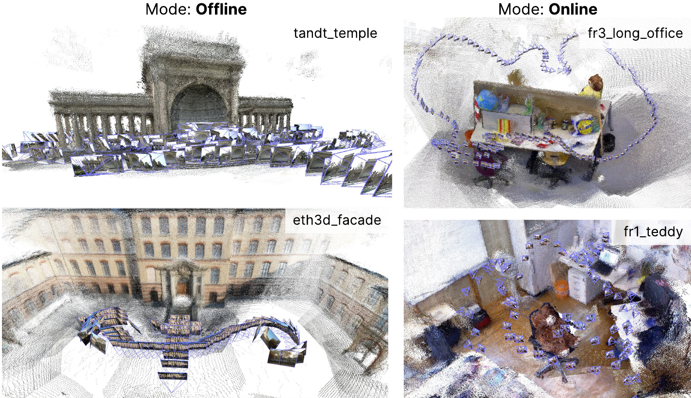
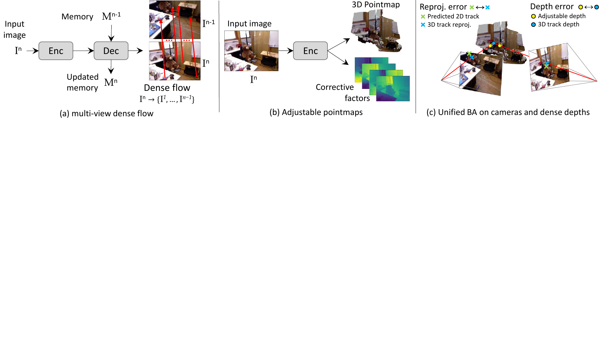
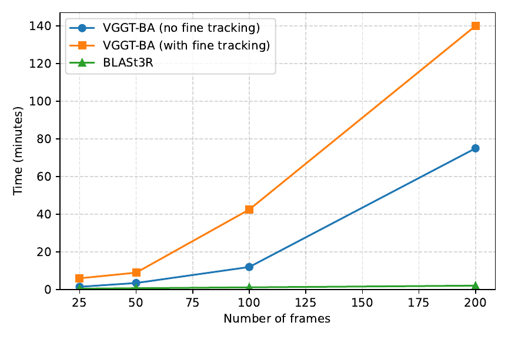

# BLASt3R (arXiv 2026)

<!-- paper-source: https://chengwei920412.github.io/paper_reading/2609.05210_BLASt3R_Bundle_Adjustment_of_Any_Image_Set_with_Multi_View_Matching_and_Monocular_Priors/technical_report.html -->

> 原文链接：[BLASt3R (arXiv 2026)](https://chengwei920412.github.io/paper_reading/2609.05210_BLASt3R_Bundle_Adjustment_of_Any_Image_Set_with_Multi_View_Matching_and_Monocular_Priors/technical_report.html)

> **arXiv ID**：2609.05210v1  
> **原文标题**：BLASt3R: Bundle Adjustment of Any Image Set with Multi-View Matching and Monocular Priors  
> **作者**：Vincent Leroy、Philippe Weinzaepfel、Lojze Zust、Yohann Cabon、Jérôme Revaud  
> **机构**：NAVER LABS Europe  
> **领域**：多视图三维重建、Structure-from-Motion（SfM）、视觉 SLAM（VSLAM）

---

## 📋 论文概览 {#_1}

BLASt3R 要解决的是一个常被分割处理的问题：既能从无序照片集合进行离线 SfM，又能从持续到来的视频帧进行在线 VSLAM。经典 SfM 在大规模、无序集合上准确，但在弱纹理、宽基线或光照困难时可能脆弱；依赖时序连续性的 VSLAM 则不适合无序输入。端到端前馈式 3D 方法较快、较稳健，却通常不如显式几何优化精确。已有混合方案把学习先验与 BA 结合，但稠密多视图匹配的代价常限制其在线可用性。

本文提出的 BLASt3R 是一个混合重建系统：以可流式的粗到细多视图匹配建立长时轨迹，以单目网络输出可在优化中调整的点图，再将相机、三维轨迹和深度参数放入同一个正则化 BA 中联合优化。作者在离线与在线设置中使用同一条处理链和同一组超参数；实验采用未标定设置，除 TUM-RGBD 的相机标定/未标定对照外，不向系统提供相机标定信息。

### 核心贡献 {#_2}

- 提出覆盖离线 SfM 和在线 VSLAM 的统一混合框架。
- 设计带记忆的多视图匹配器，将可流式前馈式 3D 的记忆机制扩展到像素级匹配；通过粗到细筛选避免昂贵的全像素、全视图比较。
- 提出可调单目点图，并用其初始化和正则化 BA，使深度能随多视图观测而校正。
- 实现 GPU 上的二阶 BA 求解，使大规模图像集与长视频序列的优化可行。

图 1：论文给出的离线与在线重建示例，以及 ETH3D 上的精度—速度关系示意。

---

## 🎯 研究背景与问题定义 {#_3}

输入为 \(N\) 张未知位姿图像 \(\{I^n\}_{n=1}^N\)。目标是恢复每张图像的内参 \(K^n\)、外参 \(P^n\) 与稠密深度图 \(D^n\)。论文采用方形像素、主点在图像中心的针孔模型，用单一焦距 \(f^n\) 参数化 \(K^n\)；外参 \(P^n \in SE(3)\) 表示世界到相机的刚体变换。输入可来自同一相机视频，也可来自不同相机拍摄的众包无序照片。

挑战在于：BA 依赖匹配和初始化，远离最优解时会陷入局部极小值；仅由两张图像构成的对应也容易不稳定。若在多视图中对所有像素做两两匹配，训练和推理都难以承受。BLASt3R 的设计因而同时针对三件事：低成本建立可靠的长轨迹、提供可优化的深度先验，以及将它们与相机几何一起收敛。

---

## 🔬 方法论 {#_4}

### 整体架构 {#_5}

系统由三部分串联：

1. **多视图匹配网络**：对当前查询图像读取之前图像的记忆 token，先产生 patch 级候选，再只在候选 patch 对内计算像素级匹配，输出稠密光流并聚合为跨帧轨迹。
2. **单目可调点图网络**：每张图像预测 raymap 与多通道对数深度；其中首通道给出初始化，其余通道提供可由 BA 调整的校正自由度。
3. **统一 BA**：联合更新焦距、相机位姿、轨迹三维点和每张图的深度组合系数；误差同时包含二维重投影与对数深度一致性。

图 2：BLASt3R 的三段式流程：多视图匹配、可调单目点图与广义 BA。

### 多视图匹配：先缩小候选，再做像素级搜索 {#_6}

对第 \(n\) 张图像，编码器把图像转为 ViT patch token；此前图像的 token 被存入记忆库。粗解码器通过 cross-attention 让当前 query token 读取记忆，并以归一化投影 token 的余弦相似度计算 patch 对的得分：

\[\operatorname{sim}^{c}(q,p)=
\frac{H_p^\top H_q}{\lVert H_p\rVert\lVert H_q\rVert}.\]

超过可学习阈值 \(\tau_c\) 的 patch 对进入集合 \(\mathcal P\)。细匹配器只在 \(\mathcal P\) 上开放 cross-attention，并把每个 patch 还原为像素描述子；像素匹配从候选 patch 内的余弦相似度最大者得到。粗、细阶段都按分类任务训练，并分别设置“空 patch”或“空像素”类别，其相似度阈值 \(\tau_c\)、\(\tau_f\) 由训练学习。测试时，系统将 patch 内光流合为图像级光流，并以贪心的非极大值抑制方式选取轨迹点。

### 可调点图：将单一深度先验扩展为低维可变形表示 {#_7}

单目网络预测 raymap \(R^n\) 与对数深度通道 \(F_1^n\)，首先形成点图 \(X^n=R^n\exp(F_1^n)\)。为了让优化吸收跨视图冲突，论文额外预测 \(m-1\) 个校正深度通道，并定义：

\[Y^n(f,\alpha,\beta)=\tilde R^n\exp\left[\alpha F^n+\beta\right].\]

其中 \(\tilde R^n\) 由当前焦距的针孔内参生成，\(F^n\in\mathbb R^m\) 为多通道深度，\(\alpha\in\mathbb R^m\) 和 \(\beta\) 是 BA 为每张图估计的系数。这保留了稠密点图的表达能力，却只向优化器暴露少量深度自由度。训练中，raymap、首深度通道和多通道线性组合分别受监督；组合深度的 \(\ell_1\) 目标以 10 步 IRLS 近似求解，且不向 \(\alpha,\beta\) 反传梯度。

### 统一 BA 与 GPU 求解 {#ba-gpu}

记第 \(t\) 条轨迹的三维点为 \(x_t\)，它在图像 \(n\) 的观测为 \(y_t^n\)。BLASt3R 最小化带鲁棒核 \(\rho\) 的目标：

\[\mathcal L_{\mathrm{reproj}}=
\min_{K,P,x,\alpha}\sum_{t}\sum_{n\in\mathcal V_t}
\rho\!\left(\operatorname{error}(y_t^n,K_nP_nx_t)\right).\]

残差前两维是传统像素重投影差，第三维为 \(\omega f^n(\alpha_nF_t^n+\beta_n-\log((x_n^t)_z))\)。因此 \(\omega=0\) 时退化为常规二维 BA，\(\omega&gt;0\) 时以对数深度正则约束几何；焦距因子使其量纲接近像素误差。优化采用阻尼 Levenberg--Marquardt：对相机位姿作 \(SE(3)\) 最小更新，对三维点应用 Schur 补消元，并在 GPU 上使用预条件共轭梯度求解约化系统。附录说明该实现避免构造大规模稠密矩阵，所有线性代数在 PyTorch 中执行；实验中轨迹数上限设为 100k。

---

## 📊 实验与结果 {#_8}

### 实验设置 {#_9}

- **训练数据**：Habitat、BlendedMVS、MegaDepth、Mapfree、Co3Dv2、DL3DV、ScanNet++、Virtual KITTI、Infinigen Indoors、WildRGBD、HyperSim、ARKitScenes、MegaScenes、TartanAir 与自有数据。匹配网络先在 \(224\times224\)、10 视图训练，再在 512 像素、多宽高比、13 视图训练；单目网络以 DINOv3 编码器初始化。
- **在线基准**：TUM-RGBD 与 ETH3D-SLAM；指标为经 \(\mathrm{SIM}(3)\) 对齐后的绝对轨迹误差（ATE）RMSE，单位 cm。
- **离线基准**：ETH3D-MVS、Tanks\&Temples、Co3Dv2、Re10K；主要使用 mAA@30、RRA@15 与 RTA@15。
- **稠密重建/深度**：按 \(\pi^3\) 协议在 7-Scenes、ETH3D 上测 Accuracy、Completeness、Normal Consistency 的均值和中位数；按 MoGe 协议在 11 个深度数据集上测相对误差与 \(\delta_1\)。

### 主要结果 {#_10}

- 在 ETH3D-SLAM 的主文子集上，BLASt3R 的 ATE RMSE 均低于 2 cm；作者称其在全部序列上达到最优结果。
- ETH3D-MVS 的 mAA@30 为 98.5%，采用 COLMAP-BA 的消融版本为 98.8%；论文列出的 VGGT-BA 为 88.4%，MASt3R-SfM 为 81.5%。
- Tanks\&Temples 的 25/50/100/200 视图测试中，BLASt3R 使用本文 BA 的 mAA@30 分别为 73.8/75.9/75.5/76.1；使用 COLMAP-BA 的对应数值为 74.7/76.7/77.2/77.2。原文报告 VGGT 在超过 200 帧时显存不足。
- 在 Co3Dv2/Re10K 的 10 随机帧设置中，本文 BA 的 RRA@15 为 96.6，RTA@15 为 92.8，Co3Dv2 mAA(30) 为 88.2，Re10K mAA(30) 为 85.2。
- 稠密点图结果中，BLASt3R 在 ETH3D 的 Accuracy/Completeness/Normal Consistency 的均值为 0.069/0.017/0.881，优于表中 VGGT 与 \(\pi^3\) 的相应 Accuracy；在 7-Scenes 上 Accuracy 中位数为 0.008，与 VGGT 同值。

图 3：附录在 80GB H100 上比较 BLASt3R 与 VGGT-BA 的运行时间；图中旨在展示随图像数增长的可扩展性差异。

### 消融结论 {#_11}

单目深度实验中，\(m=1\) 的预测作为稳健初始化；\(m=16\) 时允许选择最佳线性组合，论文明确将其视为可调深度表示能力的 oracle 性能上界。点图消融显示，多深度通道相对单通道在重建准确性上约有 30--40% 的一致提升。替换为标准 COLMAP BA 时，ETH3D 与 Tanks\&Temples 表现更好；相反，在稀疏视图或纯平移等退化设置（如 Co3Dv2、Re10K 和部分在线序列）中，带深度正则的 BA 更有优势。这说明深度项并非在每类数据上都必然优于传统 BA。

---

## 💡 关键见解与相关工作定位 {#_12}

<table>
<thead>
<tr>
<th>方法类别</th>
<th>核心思路</th>
<th>典型优势</th>
<th>典型限制</th>
</tr>
</thead>
<tbody>
<tr>
<td>传统 SfM / BA</td>
<td>特征匹配、几何验证、三角化与 BA</td>
<td>大型无序集合上精确且可扩展</td>
<td>对纹理、基线和初始化敏感；标准流程不面向实时流式处理</td>
</tr>
<tr>
<td>前馈式 3D</td>
<td>网络直接回归点图、相机或几何</td>
<td>快、对困难外观较稳健</td>
<td>通常低于优化式 SfM 的精度</td>
</tr>
<tr>
<td>既有混合方法</td>
<td>学习匹配或点图用于初始化/正则化几何优化</td>
<td>结合学习先验与 BA 精度</td>
<td>稠密匹配和多视图计算成本可能妨碍在线使用</td>
</tr>
<tr>
<td><strong>BLASt3R</strong></td>
<td>记忆式粗到细匹配 + 可调深度 + 正则化 BA</td>
<td>一套框架覆盖在线与离线；以检索和候选筛选控制代价</td>
<td>由多个学习、检索和优化环节构成，部署与复现依赖各环节质量</td>
</tr>
</tbody>
</table>

实践上，BLASt3R 把“单目深度是否准确”改写为“单目预测是否提供足够好的低维校正基”。这使先验不是固定几何，而是可被跨视图证据修正的参数化表示。另一方面，检索将每帧的记忆匹配对象限制为实践中的 40 帧；附录还以 30 个 core 帧和 10 个近邻构成该集合。论文据此分析推理和 BA 相对图像数具有线性复杂度，但这一结论依赖每帧检索数与 PCG 迭代数保持受限这一前提。

---

## 🔍 局限性与未来工作 {#_13}

### 当前局限 {#_14}

- 作者报告所有实验使用 80GB 显存的 A100 或 H100；更小显存、边缘设备或实时功耗约束下的吞吐量和精度尚未在论文中量化。
- 系统包含检索、匹配、单目先验与二阶优化。论文展示整体结果，但未给出这些模块在跨域、低算力或检索失败情况下的系统性鲁棒性分解。
- 多通道深度的 \(m=16\) 深度评测使用与真值的最优线性组合，作者将其定义为 oracle 上界；该数字不能直接视为测试时无需真值即可达到的单目预测性能。
- 在 ETH3D 和 Tanks\&Temples 上，替换为 COLMAP BA 的消融更优，表明统一的深度正则项仍存在与数据几何条件相关的取舍。

### 后续方向 {#_15}

- 在资源受限 GPU、移动设备和更长视频上报告端到端延迟、显存与能耗。
- 研究检索候选数、轨迹采样上限与 BA 精度之间的自适应调度，尤其针对回环、快速运动和低重叠输入。
- 分析深度正则权重 \(\omega\)、深度通道数 \(m\) 在不同基线、纯旋转和纯平移场景中的选择策略。
- 将已知内参、位姿或深度先验的利用方式与未标定统一配置进行更细致的公平对照。

---

## 🎓 评价与推荐阅读对象 {#_16}

**优点**：论文将匹配、深度与 BA 的接口写得清楚：匹配器解决轨迹来源，可调点图限定优化自由度，BA 则将它们统一为几何目标。补充材料还给出 Schur 补、PCG、阻尼 LM 和轨迹裁剪等工程细节，因此“GPU 加速”不只是结论性描述。实验覆盖在线轨迹、离线位姿、稠密点图和单目深度，并明确展示了标准 BA 与正则化 BA 的互有胜负。

**可改进之处**：以论文所给证据，尚难判断其在小显存硬件、数据分布显著变化时的稳定性；对各模块失效模式的定量分析也可以更充分。性能主张中应特别区分最终系统结果、COLMAP-BA 消融结果与带真值对齐的 oracle 深度结果。

**适合读者**：从事 SfM、VSLAM、神经几何、稠密匹配、可微优化或大规模三维重建的研究者与工程师；尤其适合希望理解如何把学习式先验接入传统 BA 的读者。

---

## 📎 术语与公式速查 {#_17}

<table>
<thead>
<tr>
<th>术语</th>
<th>含义</th>
</tr>
</thead>
<tbody>
<tr>
<td>Bundle Adjustment（BA）</td>
<td>联合优化相机参数与三维结构的非线性最小二乘问题。</td>
</tr>
<tr>
<td>pointmap</td>
<td>对每个像素给出相机坐标系中三维位置的稠密映射。</td>
</tr>
<tr>
<td>长轨迹（track）</td>
<td>同一三维点在多张图像中的对应观测集合。</td>
</tr>
<tr>
<td>可调点图</td>
<td>由多个深度通道及其可优化组合系数生成的点图。</td>
</tr>
<tr>
<td>Schur 补</td>
<td>BA 中先消去大量三维点变量、只求解相机/深度变量的经典技巧。</td>
</tr>
<tr>
<td>ATE RMSE</td>
<td>绝对轨迹误差的均方根；本文以 cm 报告。</td>
</tr>
<tr>
<td>mAA@30</td>
<td>旋转与平移角误差阈值为 30° 时的平均准确率指标。</td>
</tr>
</tbody>
</table>

## 参考资源 {#_18}

- **论文原文**：[arXiv](https://arxiv.org/abs/2609.05210v1)
- **项目主页**：[NAVER LABS Europe — BLASt3R](https://europe.naverlabs.com/blast3r)
- **中文翻译 PDF**：[paper_cn.pdf](https://chengwei920412.github.io/paper_reading/2609.05210_BLASt3R_Bundle_Adjustment_of_Any_Image_Set_with_Multi_View_Matching_and_Monocular_Priors/paper_cn.pdf)
- **中文 Markdown 译文**：[paper_cn.md](https://chengwei920412.github.io/paper_reading/2609.05210_BLASt3R_Bundle_Adjustment_of_Any_Image_Set_with_Multi_View_Matching_and_Monocular_Priors/paper_cn.html)
