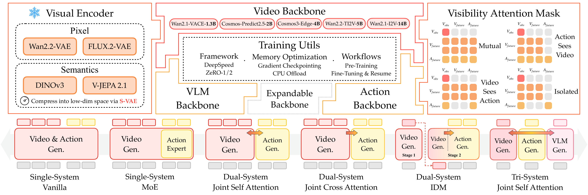
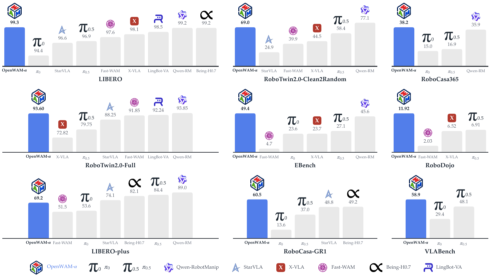

# OpenWAM (arXiv 2026)

<!-- paper-source: https://chengwei920412.github.io/paper_reading/2609.07398_OpenWAM_An_Open_Modular_Exploration_Towards_Systematic_World_Action_Model_Pretraining/technical_report.html -->

> **arXiv ID**：2609.07398  
> **原文标题**：OpenWAM: An Open, Modular Exploration Towards Systematic World--Action Model Pretraining  
> **翻译日期**：2026-09-14

## 论文概览 {#_1}

OpenWAM 是面向世界--动作模型（WAM）的开放研究栈。论文的目标不是提出单个不可拆分的策略，而是把编码器、视频/动作骨干、注意力信息流、训练、部署和评测分离，使 WAM 的设计假设可以被逐项验证。最终的 OpenWAM-\(\alpha\) 在约 6,400 小时（5.185 亿帧）数据上预训练。

## 方法论 {#_2}

模型由 \(C(\mathcal{E},\mathcal{S},\mathcal{M})\) 组合：\(\mathcal{E}\) 产生视觉潜变量，\(\mathcal{S}\) 包含世界流和动作流，\(\mathcal{M}\) 指定 token 的可见关系。视频流预测未来视觉潜变量，动作流预测动作块；二者通过可控的跨流注意力连接。统一运行时把相同的模型接口贯穿训练、推理、策略服务器和基准评测。

图：可组合的 OpenWAM-Infra 模型接口。

## 主要发现 {#_3}

1. 上游知识的迁移依赖足够强的视频生成骨干以及紧凑、信息丰富的潜空间。
2. 协同需要专门动作容量、显式的世界到动作信息流；同步去噪优于异步调度。
3. 具身预训练主要改善 OOD 泛化。机器人轨迹增强动作可执行性，第一人称视频扩大世界覆盖，二者联合训练整体最优。
4. OpenWAM-\(\alpha\) 在八个仿真基准和单臂、双臂、灵巧手真实机器人实验中保持强竞争力；EBench 表现领先。

## 实验解读 {#_4}

评测涵盖 LIBERO、LIBERO-Plus、VLABench、RoboTwin2.0、RoboDojo、RoboCasa365、EBench 和 RoboCasa-GR1。WAM 的视频潜变量监督提供额外训练信号，因此通常更好地拟合 ID 数据；在 OOD 场景，长时程预测的误差累积会成为负担，VLA 往往有优势。LIBERO-Plus 的相机、噪声扰动尤其揭示了像素潜变量的脆弱性，以及单臂数据覆盖不足的影响。

图：OpenWAM-\(\alpha\) 的仿真基准比较。

## 评价 {#_5}

优点是实验变量拆分清晰、基础设施与评测开放、结论直接落到可用预训练配方。局限是结论仍高度依赖大规模数据和具体基准；像素级未来预测对视觉扰动敏感；统一动作空间未必完整表达不同平台的运动学差异。下一步可探索鲁棒表征、融合 VLA/WAM 的混合模型、更多样的跨具身数据及安全开放世界评测。

## 术语表 {#_6}

<table>
<thead>
<tr>
<th>术语</th>
<th>含义</th>
</tr>
</thead>
<tbody>
<tr>
<td>WAM</td>
<td>联合建模未来世界状态和动作的生成式策略模型。</td>
</tr>
<tr>
<td>VLA</td>
<td>从视觉--语言预训练继承语义知识的动作模型。</td>
</tr>
<tr>
<td>ID / OOD</td>
<td>分布内 / 分布外评测。</td>
</tr>
<tr>
<td>同步去噪</td>
<td>世界流和动作流以相同进度共同完成去噪。</td>
</tr>
</tbody>
</table>

## 参考资源 {#_7}

- [arXiv 原文](https://arxiv.org/abs/2609.07398)
- [中文翻译 PDF](https://chengwei920412.github.io/paper_reading/2609.07398_OpenWAM_An_Open_Modular_Exploration_Towards_Systematic_World_Action_Model_Pretraining/paper_cn.pdf)
- [中文 Markdown 译文](https://chengwei920412.github.io/paper_reading/2609.07398_OpenWAM_An_Open_Modular_Exploration_Towards_Systematic_World_Action_Model_Pretraining/paper_cn.html)
- [代码实现](https://github.com/OpenWAM-Official/OpenWAM)
- [项目主页](https://openwam-official.github.io/)
