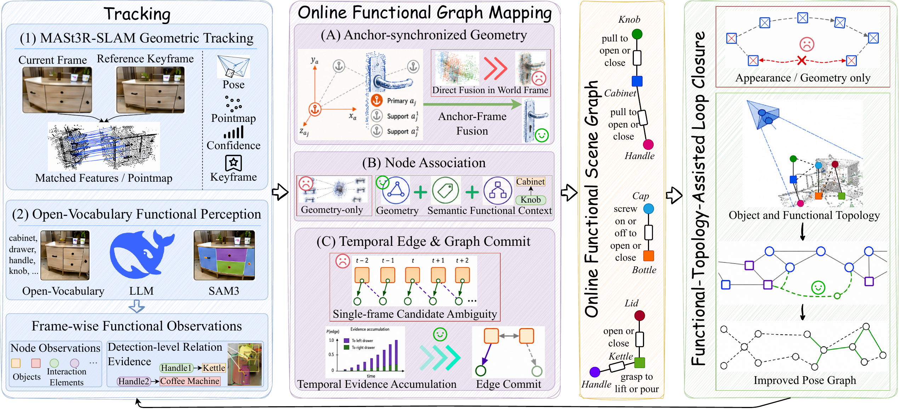
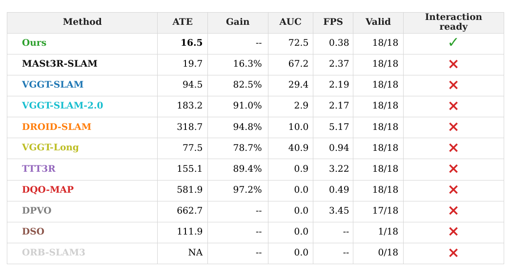
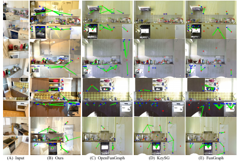
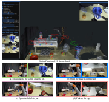
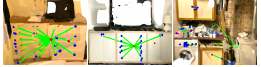

# Functional SLAM (arXiv 2026)

<!-- paper-source: https://chengwei920412.github.io/paper_reading/2609.07497_Functional_SLAM_Interaction_Aware_Mapping_with_Online_Functional_Scene_Graphs/technical_report.html -->

> 原文链接：[Functional SLAM (arXiv 2026)](https://chengwei920412.github.io/paper_reading/2609.07497_Functional_SLAM_Interaction_Aware_Mapping_with_Online_Functional_Scene_Graphs/technical_report.html)

> **arXiv ID**：2609.07497  
> **原文标题**：Functional-SLAM: Interaction-Aware Mapping with Online Functional Scene Graphs  
> **翻译日期**：2026-09-17

---

## 📋 论文概览 {#_1}

### 基本信息 {#_2}

- **作者**：Xinggang Hu、Chenyangguang Zhang、Zihan Zhu、Ruida Zhang、Xiangkui Zhang、Xiangyang Ji
- **机构**：清华大学、大连理工大学、苏黎世联邦理工学院
- **提交时间**：2026-09-07
- **领域**：机器人学、视觉 SLAM、三维场景理解、具身交互

### 核心贡献 {#_3}

1. 提出 Functional-SLAM，把功能场景图从离线三维理解结果提升为随 SLAM 持续更新的在线地图状态。地图不仅记录物体的位置和类别，还表示“哪个交互元素以何种方式作用于哪个物体”。
2. 以锚关键帧局部坐标维护节点几何，使节点可随后端位姿优化同步更新；再结合几何、开放词汇语义和历史功能归属完成跨帧节点关联。
3. 使用时序关系后验累积多帧证据，只有当支持度和竞争关系稳定后才提交功能边，从而抑制遮挡、重叠和单帧误判。
4. 将在线功能图作为结构化地图记忆，通过物体拓扑和功能拓扑补充视觉检索遗漏的闭环候选，并继续使用几何验证保证闭环约束的可靠性。

---

## 🎯 研究背景与动机 {#_4}

### 问题定义 {#_5}

几何 SLAM 能回答“相机在哪里、场景表面在哪里”，语义或物体级 SLAM 能进一步回答“这里有什么物体”，但机器人执行精细任务还需要知道“哪里可操作、操作后会影响哪个物体”。例如，“拿起水壶倒水”需要定位水壶、把手，以及“抓住把手可提起或倾倒水壶”的功能关系。

现有功能场景图方法通常依赖已知位姿、深度输入或完整离线重建，先获得稳定几何再统一推理。真实机器人却要在未知环境中边探索、边定位、边建图，并在任务到达时立即交互。论文因此研究：如何在位姿持续变化、观测局部且含噪的在线 SLAM 过程中，稳定维护细粒度功能节点和功能关系，并让这些结构反过来帮助定位。

### 现有方法的局限性 {#_6}

- 小型交互元素（把手、旋钮、按钮）尺度小、外观相似且三维点稀疏，对位姿漂移和重建误差极其敏感。
- 后端优化会持续修正历史关键帧位姿；若把节点几何固定在旧世界坐标中，其投影、位置和相对关系会逐渐与最新 SLAM 状态不一致。
- 单帧中存在遮挡、局部重叠和邻近候选竞争，容易把交互元素错误归属给附近物体。
- 纯视觉闭环在外观重复、纹理退化或视角变化较大时容易漏检或混淆。

### 本文的创新点 {#_7}

Functional-SLAM 把功能图维护与 SLAM 状态更新耦合起来：节点几何依附于锚关键帧，节点身份由功能上下文约束，边由多帧关系证据稳定化；所得功能拓扑再作为闭环检索的补充线索。这形成“位姿帮助功能建图，功能图反哺位姿优化”的闭环。

---

## 🔬 方法论 {#_8}

### 整体架构 {#_9}

图：Functional-SLAM 整体流程，包括跟踪、在线功能图建图与功能拓扑辅助闭环。

给定连续 RGB 图像 \(\{I_t\}_{t=1}^{N}\)，系统以 MASt3R-SLAM 作为几何骨干，同时维护在线功能图

\[G_t=(U_t,O_t,R_t),\]

其中 \(U_t\) 为机器人可操作的交互元素，\(O_t\) 为场景物体，\(R_t\) 为二者之间的功能关系。开放词汇感知把每帧图像转换为功能观测；在线建图模块在最新优化位姿下递归融合观测；闭环模块合并视觉、物体拓扑和功能拓扑候选。

### 关键技术 {#_10}

#### 1. 帧级功能观测 {#1}

系统复用 MASt3R-SLAM 的位姿、点图、置信度图和关键帧判定。开放词汇标签与基于 DeepSeek 的推理给出场景相关目标，SAM3 完成定位和分割。每个检测记录标签 \(\ell_i^t\)、角色 \(r_i^t\)、二维框 \(b_i^t\)、掩码 \(m_i^t\)、置信度 \(s_i^t\) 和反投影三维支持 \(P_i^t\)。

物体观测 \(n_o^t\) 与交互元素观测 \(n_u^t\) 的单帧关系支持度为

\[\eta_{ou}^t=\delta_{ou}^t\min(s_o^t,s_u^t)\frac{|m_u^t\cap m_o^t|}{|m_u^t|},\]

其中 \(\delta_{ou}^t\) 是功能结构门控。该量融合检测置信度和掩码覆盖，但仍只是局部、含噪的检测级证据。

#### 2. 基于锚关键帧的位姿同步几何 {#2}

每个稳定功能节点 \(v_j\) 绑定锚关键帧 \(a_j\)，规范几何保存在锚关键帧局部坐标，而非固化到世界坐标。系统按视图完整性、检测置信度、有效三维点置信度、可见面积和点数选择候选锚；候选还需通过跨帧支持和世界几何一致性验证才能晋升。读取节点时，再用锚关键帧的最新优化位姿动态恢复世界几何，因此后端更新不会让节点停留在过期坐标中。

#### 3. 功能上下文约束节点关联 {#3}

当前观测 \(n_i^t\) 与历史节点 \(v_j\) 的匹配分数为

\[S_{ij}^t=\phi_{\mathrm{geo}}(n_i^t,v_j)+\phi_{\mathrm{sem}}(n_i^t,v_j)+\phi_{\mathrm{ctx}}(n_i^t,v_j,B_t).\]

\(\phi_{\mathrm{geo}}\) 衡量投影重叠、三维中心距离和尺度自适应门控，\(\phi_{\mathrm{sem}}\) 衡量开放词汇标签与历史语义统计的一致性，\(\phi_{\mathrm{ctx}}\) 使用当前关系证据和稳定历史归属排斥冲突候选。系统按节点角色分别匹配，并用匈牙利算法求一对一关联。

#### 4. 时序功能边后验与图提交 {#4}

节点关联把检测级关系提升到持久节点对。对物体节点 \(v_o\) 与交互元素节点 \(v_u\)，当前帧支持取映射到该节点对的最高置信关系：

\[u_t(v_o\leftarrow v_u)=\max\{\eta_{ou}^t\mid \pi_t(n_o^t)=v_o,\ \pi_t(n_u^t)=v_u\}.\]

随后累积历史支持

\[r_t(v_o\leftarrow v_u)=\sum_{s\le t}u_s(v_o\leftarrow v_u),\qquad
v_o^\star=\arg\max_{v_o\in O(v_u)}r_t(v_o\leftarrow v_u).\]

只有候选拥有足够多帧支持、近期最优对象选择稳定且对竞争候选有足够优势时，关系才写入图中；每个交互元素只保留最可靠归属。

#### 5. 功能拓扑辅助闭环 {#5}

系统为关键帧构建由稳定节点及其两个最近邻组成的局部图元集合 \(\Gamma_k\)。图元匹配同时考察节点语义兼容性与归一化边长形状一致性，得到物体拓扑分数

\[S_G(k,k&#x27;)=\frac{1}{|\Gamma_k|}\sum_{g\in\Gamma_k}w(g,h_g).\]

再以已提交功能关系的保留率 \(S_F\) 增强它：

\[S_{FT}(k,k&#x27;)=S_G(k,k&#x27;)\bigl(1+S_F(k,k&#x27;)\bigr).\]

候选满足 \(S_G&gt;\tau_G\) 或 \(S_{FT}&gt;\tau_{FT}\) 后进入 Top-\(K\)，与 MASt3R-SLAM 的视觉候选合并，并统一接受因子图几何验证。功能拓扑只扩展召回，不绕过几何校验。

### 算法流程 {#_11}

1. 跟踪当前帧并取得位姿、点图、置信度与关键帧决策。
2. 运行开放词汇感知和 SAM3，形成节点观测与检测级关系证据。
3. 在锚关键帧坐标中验证并融合节点几何，按几何、语义和功能上下文完成一对一关联。
4. 将单帧关系映射到持久节点对，累积多帧后验并提交稳定功能边。
5. 从在线图提取局部拓扑签名，补充视觉闭环候选；通过几何验证后加入后端优化。
6. 后端位姿更新后，节点通过锚关键帧最新位姿同步读出，进入下一轮递归更新。

---

## 📊 实验与结果 {#_12}

### 实验设置 {#_13}

- **数据集**：SceneFun3D、FunGraph3D；各选择 18 个包含有效物体、交互元素与功能关系的连续片段。
- **硬件**：单张 NVIDIA RTX 3090 GPU。
- **定位指标**：绝对轨迹误差均方根（ATE RMSE）。
- **功能图指标**：节点 R@3/R@10、关系三元组 R@5/R@10。
- **定位基线**：DSO、ORB-SLAM3、DPVO、DQO-MAP、TTT3R、DROID-SLAM、VGGT-SLAM、VGGT-SLAM-2.0、VGGT-Long、MASt3R-SLAM。
- **功能图基线**：OpenFunGraph、FunGraph、KeySG；基于 LLM 的方法统一使用 DeepSeek-V4-Flash。

图：定位结果汇总。

### 主要结果 {#_14}

- FunGraph3D 上，Functional-SLAM 相比最强定位基线 MASt3R-SLAM 将 ATE RMSE 降低 **16.3%**。SceneFun3D 的纹理更丰富且闭环较少，方法保持与几何骨干相当的定位精度，平均 ATE RMSE 为 **33.25 mm**。
- FunGraph3D、本文方法位姿设置下，整体节点达到 **R@3 64.55 / R@10 67.14**，整体三元组达到 **R@5 41.10 / R@10 43.84**，显著高于相同位姿下的三个离线基线。
- SceneFun3D、本文方法位姿设置下，整体节点为 **25.39 / 26.33**，整体三元组为 **9.65 / 10.09**。该数据集位姿漂移更严重，指标低于部分使用真值位姿的离线方法，但在相同估计位姿条件下仍为最佳。
- 原始系统运行速度为 **0.38 FPS**，高于 OpenFunGraph 的 0.02 FPS、FunGraph 的 0.06 FPS 和 KeySG 的 0.05 FPS。

图：功能场景图定性对比；Functional-SLAM 对小交互元素和复杂归属关系的恢复更完整。

### 消融实验 {#_15}

<table>
<thead>
<tr>
<th>配置</th>
<th>ATE RMSE</th>
<th>节点 R@3</th>
<th>节点 R@10</th>
<th>三元组 R@5</th>
<th>三元组 R@10</th>
</tr>
</thead>
<tbody>
<tr>
<td>去除节点稳定化</td>
<td>19.0</td>
<td>52.11</td>
<td>54.93</td>
<td>25.68</td>
<td>29.45</td>
</tr>
<tr>
<td>去除时序边后验</td>
<td>17.9</td>
<td>64.08</td>
<td>66.67</td>
<td>31.51</td>
<td>35.27</td>
</tr>
<tr>
<td>去除功能闭环</td>
<td>19.7</td>
<td>61.74</td>
<td>64.32</td>
<td>35.96</td>
<td>38.36</td>
</tr>
<tr>
<td><strong>完整方法</strong></td>
<td><strong>16.5</strong></td>
<td><strong>64.55</strong></td>
<td><strong>67.14</strong></td>
<td><strong>41.10</strong></td>
<td><strong>43.84</strong></td>
</tr>
</tbody>
</table>

节点稳定化对关联和三元组召回影响最大；时序边后验主要提升关系可靠性；功能闭环同时改善 ATE 和依赖位姿的图质量。三项设计作用不同，实验支持论文提出的“几何同步—身份稳定—关系稳定—定位反馈”链条。

### 运行时优化与真实机器人验证 {#_16}

附录将功能感知和图更新降采样到关键帧，并把 SAM3 输入分辨率从 1008 降至 672。FunGraph3D 平均速度达到 **1.027 FPS**，约为未优化版本的 **2.45 倍**；在 6kitchen/video0 上从 0.377 FPS 提升到 0.920 FPS。对应 ATE RMSE 仅从 16.495 mm 增至 17.579 mm。主要收益来自语义感知（2040.06 降至 514.23 ms/帧）和节点关联（117.66 降至 22.30 ms/帧）。

真实机器人实验使用 KUKA LBR iiwa 14 R820、Robotiq 2F-140 夹爪与腕载 ZED 2i，相机只提供 RGB 图像。基于大语言模型的查询接口将自然语言指令转为功能图约束，执行“查询—探索—执行”：若图中已有目标功能链，直接返回三维位姿；否则继续探索并增量补图，结构一旦完整便触发操作。论文展示了提起水壶、打开右侧抽屉、打开罐盖和拿起杯子等连续任务。

图：基于在线三维功能场景图的真实机器人多步操作示例。

---

## 💡 关键见解 {#_17}

### 理论分析 {#_18}

Functional-SLAM 的核心并不是增加一个独立语义模块，而是改变地图状态的定义。几何 SLAM 的状态主要由位姿与几何组成；本文将持久功能节点和时序稳定关系纳入在线状态，并让它们随位姿优化共同演化。锚关键帧局部坐标提供了一个重要不变量：后端改变世界位姿时，节点规范几何无需反复重建，只需通过最新锚位姿重新读出。

时序关系后验把“当前帧看起来像属于某物体”与“跨多帧稳定属于某物体”区分开。它适合解决功能边特有的互斥归属问题，但并不是完整概率图模型；当前实现更接近累积支持加提交规则。

### 实践启示 {#_19}

- 对在线语义地图，存储坐标系的选择可能与感知模型精度同样重要。把小目标固化在易漂移的世界坐标中，会放大后端优化造成的不一致。
- 功能关系可作为比外观更稳定的地点线索，但应作为候选召回器，并保留独立几何验证，避免语义误差直接污染位姿图。
- 无需逐帧运行昂贵语义模型。关键帧级感知与图更新能以很小的精度代价显著提高吞吐率，更符合机器人部署需求。

---

## 🔍 局限性与未来工作 {#_20}

### 当前局限 {#_21}

1. **依赖视觉跟踪与开放词汇感知**：大帧间间隔、弱纹理和严重运动模糊会同时破坏位姿与功能图。
2. **小元素三维关联仍是瓶颈**：即使关系语义预测正确，只要把手或按钮的三维框过小、点云稀疏或与真值重叠不足，严格三元组指标仍判为错误。
3. **未显式建模操作引起的状态变化**：当前主要面向静态或准静态探索，不能完整处理门打开、抽屉拉出、开关状态变化或物体搬移后的动态图更新。
4. **实时性仍有限**：优化后约 1 FPS，尚不足以覆盖所有高速交互场景；功能感知、图维护和闭环检索仍有明显计算开销。
5. **评估范围有限**：主实验从两个数据集中各裁剪 18 个片段；真实机器人演示证明可行性，但尚未形成大规模任务成功率评估。

图：大位姿漂移与局部重建不稳定导致的代表性失败案例。

### 未来方向 {#_22}

- 引入显式状态变量与操作事件，使功能图能处理开关、开闭、抽拉和物体迁移等动态变化。
- 将节点关联与位姿估计放入更紧耦合的联合优化框架，让功能节点既受位姿约束，也成为可优化的长期地标。
- 使用不确定性校准替代固定提交阈值，并对节点、边和闭环候选统一传播置信度。
- 研究更轻量的开放词汇检测/分割与异步执行，将功能建图提升到交互所需帧率。
- 扩展真实机器人评估，报告任务成功率、探索时长、查询命中率以及场景变化后的恢复能力。

---

## 📚 相关工作对比 {#_23}

<table>
<thead>
<tr>
<th>方法</th>
<th>核心思想</th>
<th>优势</th>
<th>局限</th>
</tr>
</thead>
<tbody>
<tr>
<td>OpenFunGraph</td>
<td>从已定位 RGB-D 序列离线构建开放词汇功能图</td>
<td>功能图定义清晰，关系推理能力强</td>
<td>依赖稳定融合和离线处理，对估计位姿敏感</td>
</tr>
<tr>
<td>FunGraph</td>
<td>扩展功能元素与关系建模</td>
<td>功能节点和边较丰富</td>
<td>缺少随在线位姿优化同步的持久节点维护</td>
</tr>
<tr>
<td>KeySG</td>
<td>构建任务相关的功能/关键场景结构</td>
<td>强调任务相关信息</td>
<td>在线估计位姿下易发生跨帧身份混淆</td>
</tr>
<tr>
<td><strong>Functional-SLAM</strong></td>
<td>在线维护功能图，并用功能拓扑辅助闭环</td>
<td>同时改善在线功能建图、效率与定位</td>
<td>仍受严重位姿漂移、小元素稀疏几何和动态状态影响</td>
</tr>
</tbody>
</table>

---

## 🎓 个人评价 {#_24}

### 优点 {#_25}

- 问题设定清楚且重要：把功能图从离线理解结果变成可立即查询的在线机器人地图。
- 三个核心模块分别对应在线功能建图的主要误差来源，设计链条完整，消融结果也能区分各自贡献。
- 没有让语义/功能候选直接进入后端，而是保留几何验证，系统安全边界较合理。
- 附录包含运行时优化、统一 SAM3 前端、参数敏感性、失败案例和真实操作验证，工程信息较充分。

### 可改进之处 {#_26}

- 关系后验目前是累积支持和启发式提交，尚缺少对感知误差相关性、遗忘和场景变化的系统建模。
- 定位改进集中在 FunGraph3D；SceneFun3D 闭环较少，因此定位收益有限。需要更丰富的长序列和跨房间回环评估。
- 离线基线与在线方法的计算预算、感知调用频率和输入条件仍有差异；统一前端实验有所缓解，但尚不能完全排除系统级配置影响。
- 真实操作实验应进一步提供重复试验、失败率和基线对比，而不仅是成功案例展示。

### 推荐阅读对象 {#_27}

适合研究视觉 SLAM、开放词汇三维建图、场景图、具身智能和机器人操作的读者。对希望把语义地图用于实际在线任务的工程人员而言，锚关键帧几何、时序边提交和关键帧级推理三项设计尤其值得参考。

---

## 📎 附录 {#_28}

### 重要公式 {#_29}

- 单帧关系支持：\(\eta_{ou}^t=\delta_{ou}^t\min(s_o^t,s_u^t)|m_u^t\cap m_o^t|/|m_u^t|\)。
- 节点匹配：\(S_{ij}^t=\phi_{\mathrm{geo}}+\phi_{\mathrm{sem}}+\phi_{\mathrm{ctx}}\)。
- 多帧关系支持：\(r_t(v_o\leftarrow v_u)=\sum_{s\le t}u_s(v_o\leftarrow v_u)\)。
- 功能拓扑闭环分数：\(S_{FT}=S_G(1+S_F)\)。

### 术语表 {#_30}

<table>
<thead>
<tr>
<th>英文</th>
<th>中文</th>
</tr>
</thead>
<tbody>
<tr>
<td>Functional Scene Graph</td>
<td>功能场景图</td>
</tr>
<tr>
<td>Interaction Element / Unit</td>
<td>交互元素 / 交互单元</td>
</tr>
<tr>
<td>Anchor Keyframe</td>
<td>锚关键帧</td>
</tr>
<tr>
<td>Persistent Node</td>
<td>持久节点</td>
</tr>
<tr>
<td>Functional-Context-Constrained Node Association</td>
<td>功能上下文约束节点关联</td>
</tr>
<tr>
<td>Temporal Relation Posterior</td>
<td>时序关系后验</td>
</tr>
<tr>
<td>Graph Commitment</td>
<td>图提交</td>
</tr>
<tr>
<td>Functional-Topology-Assisted Loop Closure</td>
<td>功能拓扑辅助闭环</td>
</tr>
<tr>
<td>Pointmap</td>
<td>点图</td>
</tr>
<tr>
<td>Ground-Truth Pose</td>
<td>真值位姿</td>
</tr>
</tbody>
</table>

### 参考资源 {#_31}

- **论文原文**：[arXiv:2609.07497](https://arxiv.org/abs/2609.07497)
- **中文翻译 PDF**：[paper_cn.pdf](https://chengwei920412.github.io/paper_reading/2609.07497_Functional_SLAM_Interaction_Aware_Mapping_with_Online_Functional_Scene_Graphs/paper_cn.pdf)
- **中文 Markdown 译文**：[paper_cn.md](https://chengwei920412.github.io/paper_reading/2609.07497_Functional_SLAM_Interaction_Aware_Mapping_with_Online_Functional_Scene_Graphs/paper_cn.html)
- **代码实现**：[Functional-SLAM-CoRL_2026](https://github.com/Hbelief1998/Functional-SLAM-CoRL_2026)
- **项目主页**：论文未提供独立项目页
