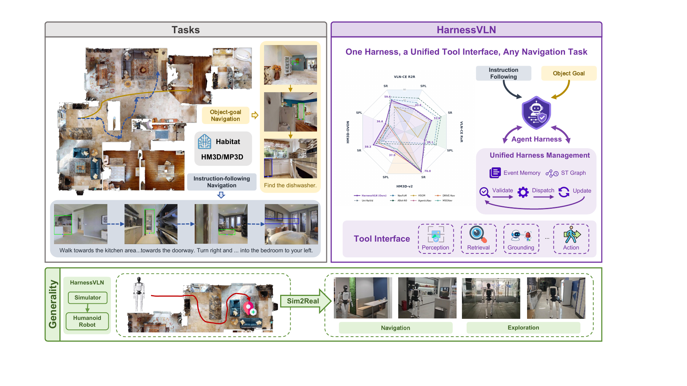
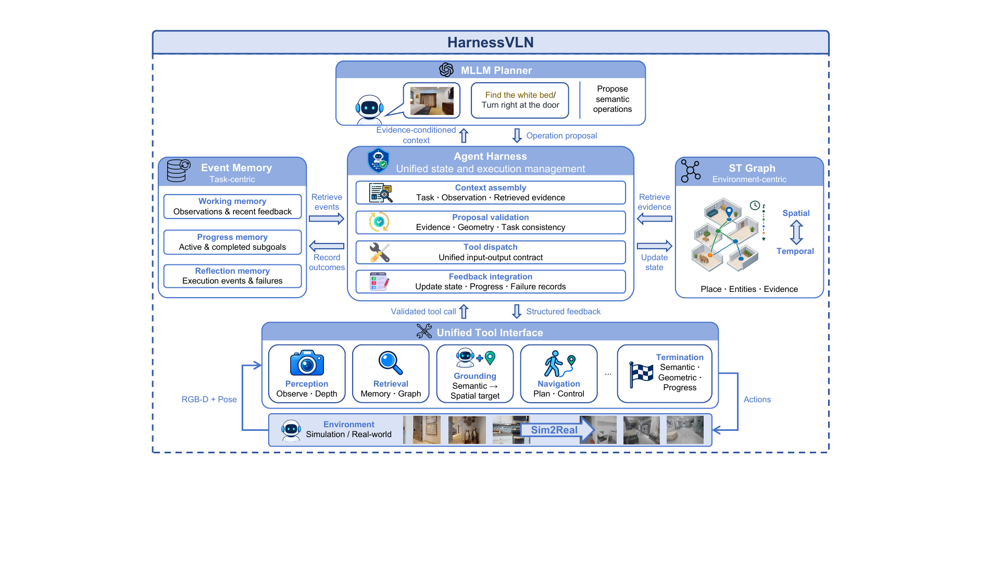
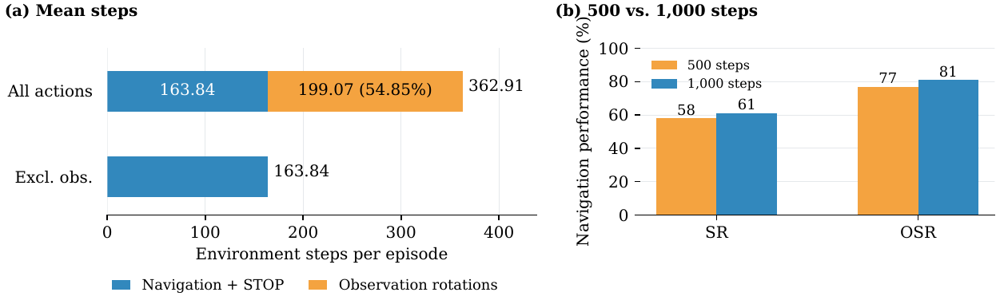

# HarnessVLN (arXiv 2026)

<!-- paper-source: https://chengwei920412.github.io/paper_reading/2609.15195_HarnessVLN_Unifying_Training_Free_Embodied_Navigation_through_an_Agent_Harness/technical_report.html -->

> **arXiv ID**：2609.15195  
> **原文标题**：HarnessVLN: Unifying Training-Free Embodied Navigation through an Agent Harness  
> **翻译日期**：2026-10-08

---

## 📋 论文概览 {#_1}

### 基本信息 {#_2}

- **作者**：Yang Chen、Lirong Che、Zhenyu Huang、Wenbo Fu、Chuang Wang、Xu Cao、Daqi Liu、Yuzhe Yang、Jian Su、Lan-Zhe Guo
- **机构**：南京大学、智元机器人、清华大学
- **发表时间**：2026 年 9 月（arXiv）
- **领域**：机器人学、具身智能、视觉语言导航、智能体系统

### 核心贡献 {#_3}

HarnessVLN 将指令跟随导航与目标物体导航纳入同一套免训练运行时。它不重新训练导航策略，而是在 MLLM 与感知、记忆、地图、控制工具之间加入智能体编排框架，对模型提议进行证据、几何和任务进度验证。核心技术贡献包括：统一工具接口；由工作、进度与反思记忆构成的分层事件记忆；持久化时空图；结构化执行反馈；以及基于语义、几何和进度三重条件的停止验证。

图：HarnessVLN 以同一编排框架支持多种导航任务、仿真环境与真实人形机器人部署。

---

## 🎯 研究背景与动机 {#_4}

### 问题定义 {#_5}

具身导航需要把语言指令或目标类别落实到空间观测，并将高层规划转化为可执行运动。MLLM 虽具备较强语义推理能力，但“看见目标”“提出动作”和“完成任务”之间并不等价：观测可能过时，候选目标可能不可达，执行可能失败，停止位置也可能不满足基准判据。

### 现有方法的局限性 {#_6}

- 依赖训练的方法通常需要任务专用示范或轨迹数据，迁移到新任务与新环境时需追加训练。
- 既有免训练方法多采用任务专用流水线，感知、规划、定位、执行与失败处理之间缺少统一状态和责任边界。
- MLLM 的高层提议若未经过几何可行性、证据时效性和子目标一致性验证，容易造成错误累积。
- 仅由模型置信度决定停止，无法区分“视觉上像目标”“空间上已接近”和“任务真正完成”。

### 本文的创新点 {#_7}

本文把导航问题重新表述为运行时编排问题：MLLM 只提出语义操作，编排框架负责组装上下文、验证提议、调度工具、整合反馈和决定是否允许停止。指令跟随与 ObjectNav 只需使用不同的任务进度表示与完成准则，其余协议保持一致。

---

## 🔬 方法论 {#_8}

### 整体架构 {#_9}

图：共享运行时连接 MLLM 规划器、分层事件记忆、时空图和八类工具，形成“上下文组装—提议验证—工具执行—反馈更新”的闭环。

决策步 \(t\) 的状态为：

\[\mathcal{S}_t = \bigl(x,\omega_t,p_t,z_t,\mathcal{M}_t,\mathcal{G}_t\bigr),\]

其中 \(x\) 是任务描述，\(\omega_t\) 是与位姿对齐的 RGB-D 观测与局部地图，\(p_t\) 是智能体位姿，\(z_t\) 是任务进度，\(\mathcal{M}_t\) 是分层事件记忆，\(\mathcal{G}_t\) 是持久化时空图。

### 关键技术 {#_10}

1. **统一工具接口**：提供 `observe`、`observe_panorama`、`retrieve_memory`、`ground_target`、`query_depth`、`navigate_to`、`backtrack` 和 `request_stop` 八个工具，将异构能力封装为共同的输入输出约定。
2. **分层事件记忆**：工作记忆保留下一步决策所需短期上下文；进度记忆显式记录子目标的待处理、进行中、已完成和受阻状态；反思记忆保存失败与工具反馈的完整事件轨迹。
3. **持久化时空图**：地点节点、实体节点和带类型的空间关系共同保存可复用空间证据；`ObservedFrom` 记录观测来源，`Contains` 编码地点—实体关系，`NavigableTo` 表示可导航拓扑。
4. **失败感知检索**：节点得分综合语义相关性、时效性、空间显著性和历史失败惩罚，使旧失败能影响恢复，但不会永久封锁某条分支。
5. **验证式执行与终止**：动作提议必须有证据支持、几何可达、符合当前子目标且不违背适用失败历史；停止还必须同时通过语义、几何和进度验证。

停止判据为：

\[F_{\mathrm{stop}} = F_{\mathrm{semantic}} \land F_{\mathrm{geometric}} \land F_{\mathrm{progress}}.\]

### 算法流程 {#_11}

每轮先检查观测与位姿是否一致，随后记录事件并更新时空图；从任务进度中取得当前子目标，检索最相关地点、实体与失败证据，组装 MLLM 上下文。模型提出工具调用后，编排框架验证参数与目标，再调度工具。工具返回到达、碰撞、不可达、无进展等结构化状态，用于更新记忆、图和下一轮决策。

---

## 📊 实验与结果 {#_12}

### 实验设置 {#_13}

- **数据集**：VLN-CE R2R、RxR、HM3D-v2 ObjectNav、HM3D-OVON
- **评估指标**：SR、SPL、OSR、nDTW、NE
- **基础模型**：指令跟随采用 GPT-5.5，目标物体导航采用 GPT-5.6-luna
- **感知与执行工具**：GroundingDINO、SAM、FMM、NavDP
- **输入配置**：640×480 RGB-D，水平视场角 79°；默认最多 500 个环境步

### 主要结果 {#_14}

<table>
<thead>
<tr>
<th>基准</th>
<th>SR</th>
<th>SPL</th>
<th>关键比较</th>
</tr>
</thead>
<tbody>
<tr>
<td>R2R val-unseen</td>
<td>59.6%</td>
<td>43.6%</td>
<td>SR 比 HSGM 高 11.7 个百分点</td>
</tr>
<tr>
<td>RxR val-unseen</td>
<td>51.4%</td>
<td>38.1%</td>
<td>SR 比 HSGM 高 9.6 个百分点</td>
</tr>
<tr>
<td>HM3D-v2</td>
<td>76.0%</td>
<td>37.9%</td>
<td>免训练 SR 最高，比 MSGNav 高 1.6 个百分点</td>
</tr>
<tr>
<td>HM3D-OVON</td>
<td>59.3%</td>
<td>36.6%</td>
<td>SR/SPL 均为表中最高，分别比 DRIVE-Nav 高 9.1/4.0 个百分点</td>
</tr>
</tbody>
</table>

在 R2R Rand100 的同模型比较中，HarnessVLN 的 SR 为 58.0%、OSR 为 77.0%，分别比 AgenticNav-GPT-5.5 高 3.0 和 12.0 个百分点，同时将 NE 从 5.19 m 降至 4.24 m。这说明提升并非只来自更强基础模型，运行时编排与验证本身具有贡献。

### 消融实验 {#_15}

<table>
<thead>
<tr>
<th>配置</th>
<th>R2R SR</th>
<th>R2R SPL</th>
<th>HM3D-OVON SR</th>
<th>HM3D-OVON SPL</th>
</tr>
</thead>
<tbody>
<tr>
<td>基础智能体</td>
<td>43.0</td>
<td>24.3</td>
<td>45.0</td>
<td>32.0</td>
</tr>
<tr>
<td>+ 分层事件记忆</td>
<td>50.0</td>
<td>30.9</td>
<td>52.0</td>
<td>32.4</td>
</tr>
<tr>
<td>+ 时空图</td>
<td>56.0</td>
<td>32.4</td>
<td>53.0</td>
<td>34.2</td>
</tr>
<tr>
<td>+ 停止验证</td>
<td>58.0</td>
<td>35.9</td>
<td>55.0</td>
<td>33.0</td>
</tr>
</tbody>
</table>

事件记忆在两个任务上均带来 7 个百分点 SR 增益；时空图对 R2R 的作用更明显，而停止验证继续带来 2 个百分点 SR 增益。HM3D-OVON 中加入停止验证后 SR 上升但 SPL 从 34.2 降至 33.0，表明更可靠的任务完成并不必然提高路径效率。

图：全景观测旋转占 1,000 步诊断运行全部动作的 54.85%；扩大步数预算提高 SR 与 OSR，但 SPL 和 nDTW 略降。

---

## 💡 关键见解 {#_16}

### 理论分析 {#_17}

论文的核心并非提出新的端到端导航策略，而是将 MLLM 的不确定语义提议置于一个可验证、可追溯的状态机中。事件记忆按任务组织“发生了什么”，时空图按环境组织“在哪里、何时观察到什么”；两者分工避免把完整历史反复塞入模型上下文。停止验证进一步把模型的 `STOP` 从动作改为请求，使任务终止成为受约束的系统决策。

### 实践启示 {#_18}

- 在机器人智能体中，模型能力之外的运行时治理能够显著影响成功率。
- 工具返回值应是结构化状态，而不是仅报告“调用完成”，这样执行失败才能进入下一轮决策。
- 任务进度与空间证据应分开建模，再通过引用关联，以兼顾可追溯性和检索效率。
- 同一高层协议可适配不同导航任务，但任务专用进度变量与终止条件仍不可省略。

---

## 🔍 局限性与未来工作 {#_19}

### 当前局限 {#_20}

1. 编排与验证规则由人工预定义，尚未随环境交互自动进化。
2. 全景观测成本高：诊断实验中旋转占全部动作的 54.85%，明显拖累路径效率。
3. OSR 与 SR 仍有差距，尤其在 HM3D-OVON 上，说明发现目标后可靠终止仍是瓶颈。
4. 几何停止检查与基准测地距离判据并不等价；论文展示的失败案例说明传感器邻近不一定意味着基准成功。
5. 真实世界实验主要用于可行性展示，尚未给出大规模、统计充分的真实机器人评测。

### 未来方向 {#_21}

- 从交互日志中学习或自适应更新验证规则、失败权重和工具调度策略。
- 用主动感知策略减少全景旋转次数，并联合优化任务成功率与路径效率。
- 引入更强的不确定性估计与多视角几何一致性，提高开放词汇目标的停止可靠性。
- 扩展到动态环境、长期任务、多楼层与跨机器人平台，并进行更大规模真实世界评测。

---

## 📚 相关工作对比 {#_22}

<table>
<thead>
<tr>
<th>方法</th>
<th>核心思想</th>
<th>优势</th>
<th>劣势</th>
</tr>
</thead>
<tbody>
<tr>
<td>训练型统一策略（Uni-NaVid、NavFoM）</td>
<td>以大规模轨迹数据学习跨任务导航策略</td>
<td>推理链路紧凑，特定分布上性能强</td>
<td>依赖导航训练数据，迁移成本高</td>
</tr>
<tr>
<td>免训练任务流水线（VLFM、HSGM、MSGNav）</td>
<td>组合预训练模型、地图和探索模块</td>
<td>无须任务专用训练，模块可替换</td>
<td>状态、失败和停止验证常分散在任务专用流程中</td>
</tr>
<tr>
<td>AgenticNav / Uni-LaViRA</td>
<td>将动作、记忆或回溯暴露为智能体工具</td>
<td>强化工具调用和高层推理</td>
<td>通用空间证据与跨子目标失败关联仍有限</td>
</tr>
<tr>
<td><strong>HarnessVLN</strong></td>
<td>统一工具接口、分层事件记忆、时空图与验证式执行</td>
<td>同一协议覆盖两类导航，失败可追溯，停止受证据约束</td>
<td>人工编排较强，观测开销与真实世界评测规模仍受限</td>
</tr>
</tbody>
</table>

---

## 🎓 个人评价 {#_23}

### 优点 {#_24}

- 问题定位准确：把“语义推理强但执行不可靠”拆解为证据、进度和反馈协调问题。
- 系统边界清晰：MLLM 提议、编排框架验证、执行器控制，各模块责任明确。
- 同时覆盖指令跟随与 ObjectNav，并给出同模型比较、组件消融、步数预算分析和真实机器人部署。
- 失败事件既保留完整上下文，又通过轻量引用进入时空图，工程上具有可扩展性。

### 可改进之处 {#_25}

- 需要更明确的运行成本报告，包括每回合 MLLM 调用次数、延迟、token 与算力成本。
- 消融为累积式设计，无法完全分离组件间交互；可增加全因子或移除式消融。
- 真实世界部分应报告任务数、成功率、失败类型分布和重复试验方差。
- 项目页展示的部分结果与论文源文件数值不同，后续版本应明确实验版本与数据更新关系。

### 推荐阅读对象 {#_26}

适合研究具身智能、视觉语言导航、机器人智能体、工具调用、长期记忆与运行时安全验证的研究者和工程师；对构建无需端到端重新训练、但要求执行可追溯的机器人系统尤其有参考价值。

---

## 📎 附录 {#_27}

### 重要公式 {#_28}

时空图地点检索分数：

\[s(v_i \mid g_t)=R(v_i,g_t)+\lambda_{\mathrm{rec}}C(v_i)+\lambda_{\mathrm{sal}}A(v_i)-\lambda_{\mathrm{fail}}P(v_i,g_t).\]

\(R\)、\(C\)、\(A\) 分别表示语义相关性、时效性与空间显著性，\(P\) 表示对当前子目标仍适用的历史失败惩罚。

### 术语表 {#_29}

<table>
<thead>
<tr>
<th>英文</th>
<th>中文</th>
</tr>
</thead>
<tbody>
<tr>
<td>Agent Harness</td>
<td>智能体编排框架</td>
</tr>
<tr>
<td>Embodied Navigation</td>
<td>具身导航</td>
</tr>
<tr>
<td>Instruction-Following Navigation</td>
<td>指令跟随导航</td>
</tr>
<tr>
<td>Object-Goal Navigation / ObjectNav</td>
<td>目标物体导航</td>
</tr>
<tr>
<td>Hierarchical Event Memory</td>
<td>分层事件记忆</td>
</tr>
<tr>
<td>Spatiotemporal Graph / ST Graph</td>
<td>时空图</td>
</tr>
<tr>
<td>Navigation Executor</td>
<td>导航执行器</td>
</tr>
<tr>
<td>Proposal Validation</td>
<td>提议验证</td>
</tr>
<tr>
<td>Stop Validation</td>
<td>停止验证</td>
</tr>
<tr>
<td>Success Rate / SR</td>
<td>成功率</td>
</tr>
<tr>
<td>Success weighted by Path Length / SPL</td>
<td>按路径长度加权的成功率</td>
</tr>
<tr>
<td>Oracle Success Rate / OSR</td>
<td>预言机成功率</td>
</tr>
</tbody>
</table>

### 参考资源 {#_30}

- **论文原文**：[arXiv 2609.15195](https://arxiv.org/abs/2609.15195)
- **中文翻译 PDF**：[paper_cn.pdf](https://chengwei920412.github.io/paper_reading/2609.15195_HarnessVLN_Unifying_Training_Free_Embodied_Navigation_through_an_Agent_Harness/paper_cn.pdf)
- **中文 Markdown 译文**：[paper_cn.md](https://chengwei920412.github.io/paper_reading/2609.15195_HarnessVLN_Unifying_Training_Free_Embodied_Navigation_through_an_Agent_Harness/paper_cn.html)
- **代码实现**：[AgibotGeneral/harnessvln](https://github.com/AgibotGeneral/harnessvln/tree/main)
- **项目主页**：[HarnessVLN](https://agibot-harnessvln.netlify.app/)
