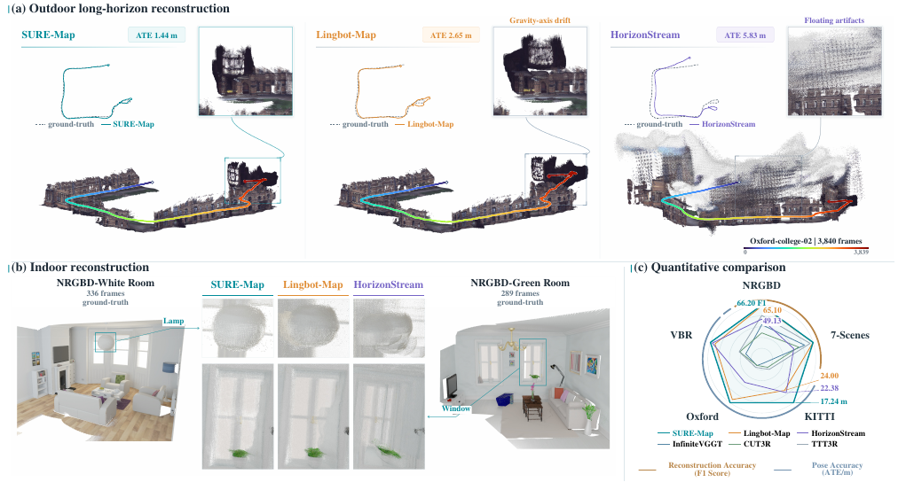
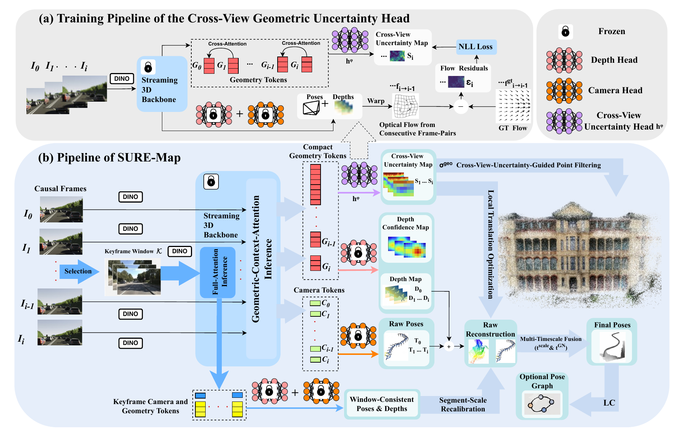
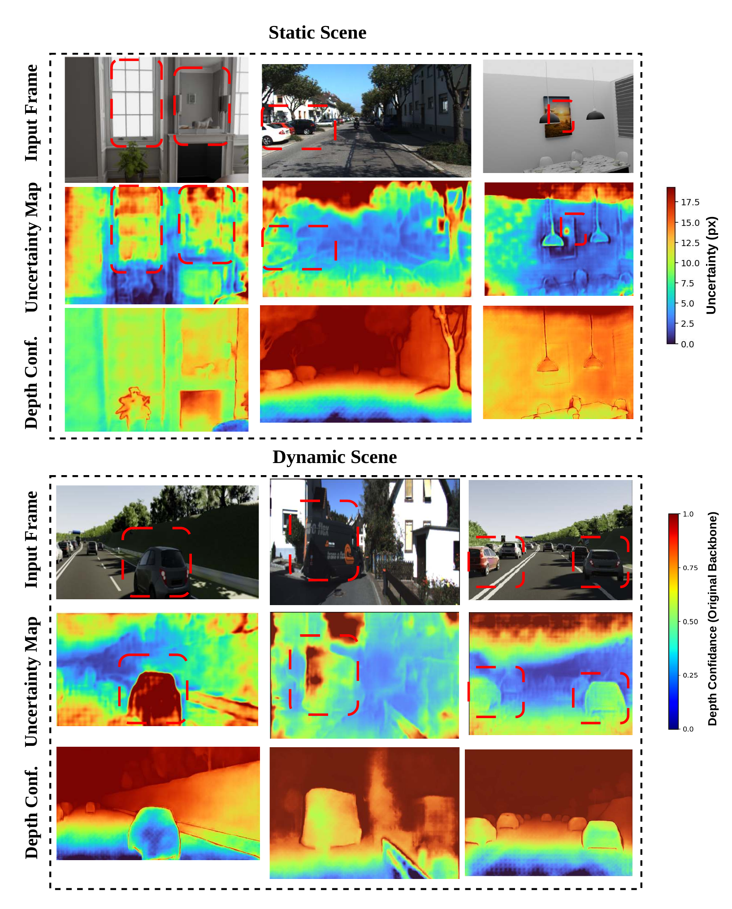
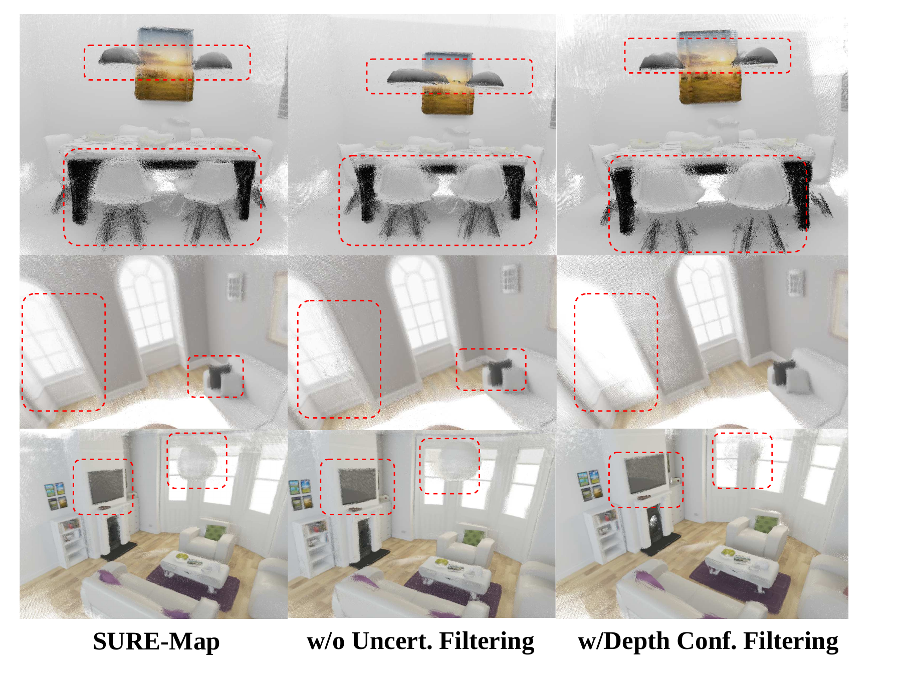

# SURE-Map (arXiv 2026)

<!-- paper-source: https://chengwei920412.github.io/paper_reading/2609.15795_SURE_Map_Self_Correcting_Streaming_Geometric_Foundation_Models/technical_report.html -->

> 原文链接：[SURE-Map (arXiv 2026)](https://chengwei920412.github.io/paper_reading/2609.15795_SURE_Map_Self_Correcting_Streaming_Geometric_Foundation_Models/technical_report.html)

> **arXiv ID**：2609.15795  
> **原文标题**：SURE-Map: Self-Correcting Streaming Geometric Foundation Models  
> **翻译日期**：2026-09-28

---

## 📋 论文概览 {#_1}

### 基本信息 {#_2}

- **作者**：Mingkai Liu、Hao Zhao、Xingxing Zuo
- **机构**：穆罕默德·本·扎耶德人工智能大学（MBZUAI）、北京大学、清华大学
- **发表时间**：2026 年 9 月（arXiv 预印本）
- **领域**：流式三维重建、视觉 SLAM、几何基础模型、不确定性估计

### 核心贡献 {#_3}

1. 提出自校正流式重建框架 SURE-Map，使模型能够在线发现并修复自身的局部几何错误。
2. 用“位姿与深度共同诱导的跨视角像素对应是否一致”定义跨视角几何不确定性，而非沿用单视角深度置信度。
3. 将连续帧局部校正与稀疏关键帧窗口尺度校准结合，在不引入持续重型后端优化的前提下抑制长轨迹尺度漂移。
4. 在 KITTI、Oxford Spires 和 VBR 上把无回环闭合时的平均 ATE-RMSE 分别降至 17.24、4.74 和 28.58 m；加入回环闭合后进一步降至 15.17、4.63 和 22.12 m。

图：SURE-Map 在室内稠密重建与室外长轨迹上的总体效果。

---

## 🎯 研究背景与动机 {#_4}

### 问题定义 {#_5}

流式几何基础模型必须在帧到达时立即输出位姿与稠密深度，无法像离线模型那样使用未来帧和完整序列上下文。动态物体、弱纹理、重复结构与几何退化会使隐式数据关联失效，先造成局部点云伪影和位姿误差，再在长序列中累积为分段尺度漂移。

### 现有方法的局限性 {#_6}

- 经典 SLAM 或混合系统依赖束调整、位姿图优化等迭代后端，准确但计算开销较高。
- 离线前馈模型通过完整序列或重叠块获得长程上下文，但不满足严格因果在线要求。
- 现有流式模型虽然内存和延迟可控，却缺少显式的错误检测与跨时间尺度校正机制。
- 单视角深度置信度主要衡量某一帧自身的几何可靠性，不能直接反映位姿与深度组合后是否产生正确的跨视角对应。

### 本文的创新点 {#_7}

SURE-Map 把“自校正”拆成两个互补层次：短时间尺度上，以跨视角几何不确定性筛除不可靠点并加权局部平移优化；长时间尺度上，周期性调用稀疏关键帧窗口的全注意力推理，估计片段尺度并重校准近期轨迹。

---

## 🔬 方法论 {#_8}

### 整体架构 {#_9}

图：训练阶段以诱导光流和真值光流的残差监督不确定性头；推理阶段将不确定性用于点云滤波与平移优化，并以关键帧窗口提供尺度校准。

系统包含三条关键路径：

1. 流式主干为当前帧输出相机位姿、深度、内参与几何词元。
2. 跨视角不确定性头根据相邻帧几何词元预测水平和垂直方向的光流对数方差。
3. 多时间尺度模块一方面连续执行低延迟几何上下文注意力，另一方面稀疏执行关键帧全注意力，以较长程证据校准尺度。

### 关键技术 {#_10}

**1. 位姿—深度诱导光流**

将当前帧像素按预测深度反投影到三维，再用相对位姿变换到前一相机坐标系并重新投影，即可得到不显式运行光流网络的后向光流：

\[\mathbf{f}_{i\rightarrow i-1}(\mathbf{u})
=\pi\!\left(\mathbf{K}_{i-1}\mathbf{p}^{\mathrm{prev}}\right)-\mathbf{u}.\]

**2. 残差监督的不确定性学习**

预测头输出二维对角协方差 \(\boldsymbol{\Sigma}_i(\mathbf{u})\)，并以诱导光流与真值光流的残差训练：

\[\ell_i(\mathbf{u})=
\boldsymbol{\epsilon}_i^\top\boldsymbol{\Sigma}_i^{-1}\boldsymbol{\epsilon}_i
+\log\det\boldsymbol{\Sigma}_i.\]

第一项促使大残差区域获得较大不确定性，第二项防止模型无条件增大方差。

**3. 不确定性加权的局部平移优化**

作者固定旋转，只优化相邻帧平移，以降低旋转误差在长序列中的乘性累积风险。把像素空间协方差经一阶雅可比传播到点到平面残差后，求解：

\[\mathbf{t}^{\mathrm{GN}}_i=
\arg\min_{\mathbf{t}}
\sum_{\mathbf{u}\in\Omega_i^g}
\frac{r_i(\mathbf{u};\mathbf{t})^2}{\sigma_{r,i}^2(\mathbf{u})}.\]

**4. 稀疏关键帧窗口尺度校准**

关键帧窗口全注意力输出的深度先与流式深度做逆深度拟合，再比较两套位姿中的相对平移长度，取有效帧对比值的中位数作为尺度线索 \(\phi\)。最终平移在尺度校准估计和局部高斯—牛顿估计之间加权融合。

### 算法流程 {#_11}

1. 新帧到达后，流式主干执行连续帧推理，输出位姿、深度和几何词元。
2. 不确定性头预测跨视角协方差，并把高不确定性像素从稠密点云中滤除。
3. 将协方差传播到点到平面残差，以固定次数的高斯—牛顿迭代校正局部平移。
4. 根据固定步长与光流阈值维护关键帧窗口。
5. 周期性执行窗口全注意力推理，估计尺度线索并校准近期轨迹段。
6. 可选地用 DINOv2 特征检索回环，将回环约束加入位姿图优化。

---

## 📊 实验与结果 {#_12}

### 实验设置 {#_13}

- **训练数据集**：TartanAir，仅训练跨视角几何不确定性头；LingBot-Map 主干冻结。
- **轨迹数据集**：KITTI、Oxford Spires、VBR。
- **稠密重建数据集**：Neural RGB-D、7-Scenes。
- **训练配置**：8–24 帧片段，分辨率 \(518\times392\)，AdamW，学习率 \(10^{-4}\)，20k 次迭代。
- **评估指标**：轨迹采用 \(\mathrm{Sim}(3)\) 对齐后的 ATE-RMSE；稠密重建采用 Accuracy、Completeness、Chamfer Distance 和阈值 0.05 m 的 F1。
- **对比方法**：COLMAP、DROID-SLAM、DPVO、VGGT-Long、LoGeR、Scal3R、CUT3R、TTT3R、Stream3R、StreamVGGT、InfiniteVGGT、LongStream、LingBot-Map、HorizonStream 等。

### 主要结果 {#_14}

<table>
<thead>
<tr>
<th>方法</th>
<th>KITTI ATE ↓</th>
<th>Oxford ATE ↓</th>
<th>VBR ATE ↓</th>
</tr>
</thead>
<tbody>
<tr>
<td>LingBot-Map</td>
<td>24.00</td>
<td>5.11</td>
<td>31.37</td>
</tr>
<tr>
<td>HorizonStream</td>
<td>22.38</td>
<td>8.87</td>
<td>29.68</td>
</tr>
<tr>
<td>SURE-Map</td>
<td><strong>17.24</strong></td>
<td><strong>4.74</strong></td>
<td><strong>28.58</strong></td>
</tr>
<tr>
<td>SURE-Map + LC</td>
<td><strong>15.17</strong></td>
<td><strong>4.63</strong></td>
<td><strong>22.12</strong></td>
</tr>
</tbody>
</table>

SURE-Map 在三个长时程基准上均优于其流式主干 LingBot-Map。无 LC 时，KITTI 的平均 ATE 相对降低约 28.2%，Oxford Spires 降低约 7.2%，VBR 降低约 8.9%。加入 LC 后，VBR 改善最明显，说明在线局部/尺度校正与全局回环约束具有互补性。

稠密重建方面，SURE-Map 在 Neural RGB-D 上将准确度从 LingBot-Map 的 0.074 m 改善到 0.067 m，F1 从 65.10 提升到 66.20；在 7-Scenes 上 F1 从 81.77 提升到 81.93。

### 消融实验 {#_15}

<table>
<thead>
<tr>
<th>变体</th>
<th>Oxford</th>
<th>KITTI</th>
<th>VBR</th>
</tr>
</thead>
<tbody>
<tr>
<td>完整 SURE-Map + LC</td>
<td><strong>4.63</strong></td>
<td><strong>15.17</strong></td>
<td><strong>22.12</strong></td>
</tr>
<tr>
<td>去除 LC</td>
<td>4.74</td>
<td>17.24</td>
<td>28.58</td>
</tr>
<tr>
<td>再去除不确定性加权优化</td>
<td>4.91</td>
<td>17.57</td>
<td>29.96</td>
</tr>
<tr>
<td>再去除尺度重校准</td>
<td>5.11</td>
<td>24.00</td>
<td>31.37</td>
</tr>
</tbody>
</table>

尺度重校准是长轨迹改善的主要来源；不确定性加权优化带来较小但稳定的额外收益；LC 对 VBR 等回访结构明显的数据尤其有效。

图：跨视角几何不确定性更集中于动态或对应歧义区域，而深度置信度更受距离影响。

图：不确定性滤波能移除不可靠点，同时较好保留有效场景结构。

---

## 💡 关键见解 {#_16}

### 理论分析 {#_17}

论文最重要的建模转变，是把置信度的对象从“单帧深度是否可信”改为“位姿和深度共同决定的跨帧对应是否可信”。这使不确定性与下游几何约束直接对齐：同一预测既能用于点云筛选，也能经雅可比传播后成为局部优化权重。

多时间尺度设计则承认两个误差源具有不同动态：局部观测歧义需要逐帧快速处理，缓慢累积的尺度误差需要更长时间跨度的证据。若只做前者，长轨迹仍会漂移；若持续做后者，又会失去流式效率。

### 实践启示 {#_18}

- 对流式感知系统，可靠性估计应尽量针对最终几何约束，而非只针对中间预测量。
- 固定旋转、优先校正平移是一种保守但稳健的工程选择，可避免错误旋转在长链条中迅速放大。
- 稀疏调用高成本全注意力，比在每帧都运行全局优化更符合在线系统的延迟预算。
- 不确定性头可在冻结主干的条件下单独训练，降低迁移与部署成本。

---

## 🔍 局限性与未来工作 {#_19}

### 当前局限 {#_20}

1. 论文的补充材料指出，系统尚不能自动判断序列是否以退化几何为主；KITTI 上的不确定性感知稳定性检查仍需手工启用。
2. 对本身尺度已经稳定的序列，细化过程可能轻微扰动原始精度。
3. 跨视角不确定性目前主要用于相邻帧优化和点云滤波，尚未深入用于关键帧调度、稠密融合或全局优化。
4. 实验主要以冻结的 LingBot-Map 为主干，跨不同流式基础模型的可迁移性仍需进一步验证。
5. 每帧增加 15–30 ms 开销；在 KITTI 04 上吞吐量从 11.68 FPS 降至 9.17 FPS，虽仍可流式运行，但会影响资源受限设备。

### 未来方向 {#_21}

- 根据几何退化程度自动启用或调节局部优化与稳定性门控。
- 用预测不确定性驱动关键帧选择、窗口更新频率和回环候选排序。
- 将协方差进一步纳入稠密融合与全局位姿图，形成端到端一致的不确定性传播。
- 在更多主干、相机模型和真实机器人平台上验证跨域泛化与实时性能。

---

## 📚 相关工作对比 {#_22}

<table>
<thead>
<tr>
<th>方法</th>
<th>核心思想</th>
<th>优势</th>
<th>局限</th>
</tr>
</thead>
<tbody>
<tr>
<td>经典 SLAM / 混合系统</td>
<td>显式匹配、束调整、位姿图优化</td>
<td>全局一致性强、可解释</td>
<td>后端开销高</td>
</tr>
<tr>
<td>离线前馈方法</td>
<td>完整序列或重叠块联合推理</td>
<td>长程上下文充分</td>
<td>非因果、依赖未来帧</td>
</tr>
<tr>
<td>LingBot-Map / HorizonStream</td>
<td>紧凑状态或长程证据传播</td>
<td>内存可控、在线运行</td>
<td>缺少显式错误检测，仍有尺度漂移</td>
</tr>
<tr>
<td><strong>SURE-Map</strong></td>
<td>跨视角不确定性 + 多时间尺度校正</td>
<td>局部误差与长程尺度漂移同时处理</td>
<td>仍需周期性全注意力，部分门控依赖人工设置</td>
</tr>
</tbody>
</table>

---

## 🎓 个人评价 {#_23}

### 优点 {#_24}

- 问题拆解清晰：局部几何失效和长程尺度漂移分别对应两类校正机制。
- 不确定性的监督目标与下游几何约束高度一致，设计自然且复用性强。
- 保留流式前馈框架的主体，只增加轻量预测头和稀疏校准，工程落地路径明确。
- 报告了跨室内/室外、短程几何/长程轨迹的多组实验，并给出关键消融。

### 可改进之处 {#_25}

- 应更系统地报告关键帧窗口大小、更新周期、光流阈值等超参数的敏感性。
- 可增加失败案例与不确定性校准指标，例如误差—不确定性相关性、NLL 或可靠性图。
- 需要区分性能提升来自更长上下文、尺度估计本身还是特定主干的归纳偏置。
- 若能给出移动端或嵌入式平台的显存、功耗与延迟分解，实时性结论会更完整。

### 推荐阅读对象 {#_26}

适合从事视觉 SLAM、在线三维重建、几何基础模型、机器人感知、不确定性估计和长视频建图的研究者与工程师阅读。

---

## 📎 附录 {#_27}

### 重要公式 {#_28}

- 诱导光流：\(\mathbf{f}_{i\rightarrow i-1}(\mathbf{u})=\pi(\mathbf{K}_{i-1}\mathbf{p}^{\mathrm{prev}})-\mathbf{u}\)。
- 几何不确定性标量：\(\sigma_i^{\mathrm{geo}}=\sqrt{\operatorname{tr}(\boldsymbol{\Sigma}_i)}\)。
- 不确定性加权局部平移：\(\min_{\mathbf{t}}\sum r_i^2/\sigma_{r,i}^2\)。
- 片段尺度线索：关键帧窗口与流式相对平移长度比值的中位数。

### 术语表 {#_29}

<table>
<thead>
<tr>
<th>英文</th>
<th>中文</th>
</tr>
</thead>
<tbody>
<tr>
<td>Streaming Geometric Foundation Model</td>
<td>流式几何基础模型</td>
</tr>
<tr>
<td>Cross-View Geometric Uncertainty</td>
<td>跨视角几何不确定性</td>
</tr>
<tr>
<td>Pose-Depth-Induced Optical Flow</td>
<td>位姿—深度诱导光流</td>
</tr>
<tr>
<td>Multi-Timescale Self-Correction</td>
<td>多时间尺度自校正</td>
</tr>
<tr>
<td>Consecutive-Frame Inference</td>
<td>连续帧推理</td>
</tr>
<tr>
<td>Keyframe-Window Inference</td>
<td>关键帧窗口推理</td>
</tr>
<tr>
<td>Geometry-Context-Attention</td>
<td>几何上下文注意力</td>
</tr>
<tr>
<td>Full-Attention</td>
<td>全注意力</td>
</tr>
<tr>
<td>Scale Recalibration</td>
<td>尺度重校准</td>
</tr>
<tr>
<td>Point-to-Plane Residual</td>
<td>点到平面残差</td>
</tr>
</tbody>
</table>

### 参考资源 {#_30}

- **论文原文**：[arXiv:2609.15795](https://arxiv.org/abs/2609.15795)
- **中文翻译 PDF**：[paper_cn.pdf](https://chengwei920412.github.io/paper_reading/2609.15795_SURE_Map_Self_Correcting_Streaming_Geometric_Foundation_Models/paper_cn.pdf)
- **中文 Markdown 译文**：[paper_cn.md](https://chengwei920412.github.io/paper_reading/2609.15795_SURE_Map_Self_Correcting_Streaming_Geometric_Foundation_Models/paper_cn.html)
- **项目主页**：[SURE-Map](https://mingkai-liu.github.io/projects/sure-map/)
- **代码实现**：论文正文未单独给出代码仓库链接，请以项目主页后续公开信息为准。
