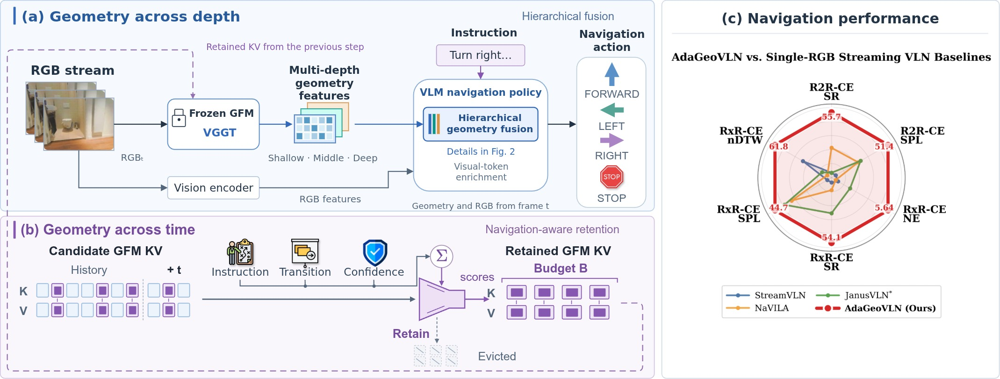
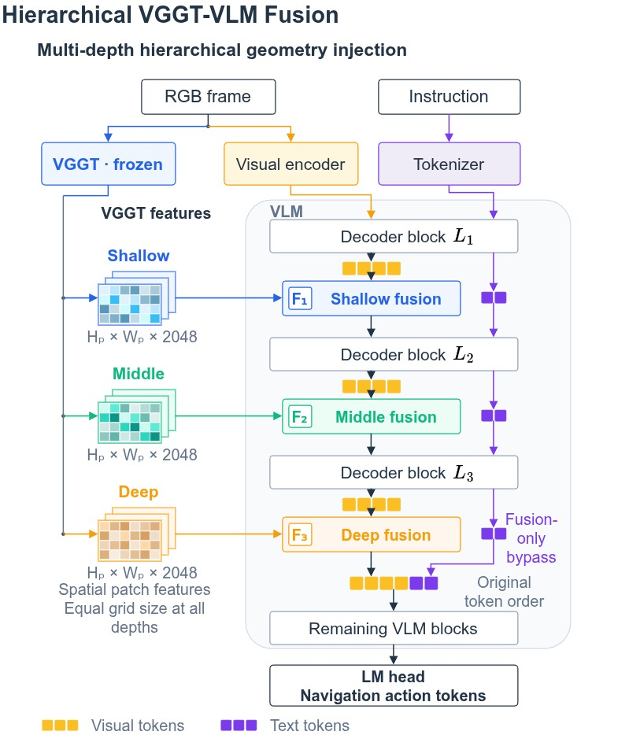
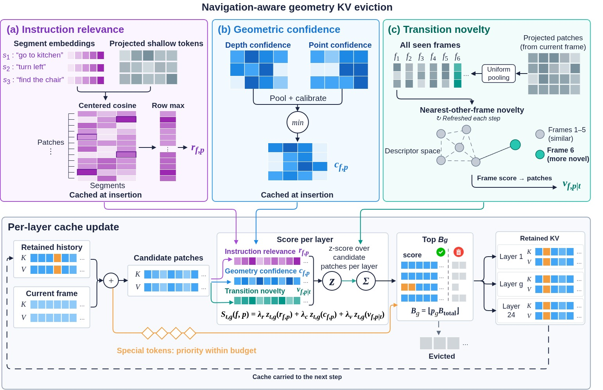
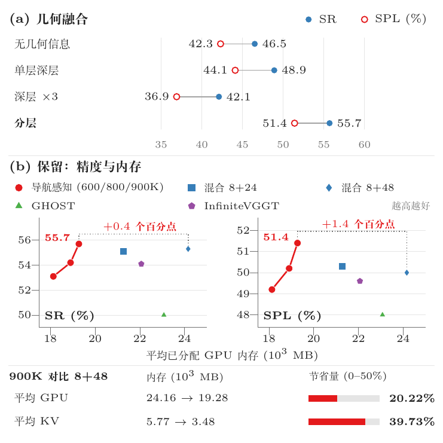
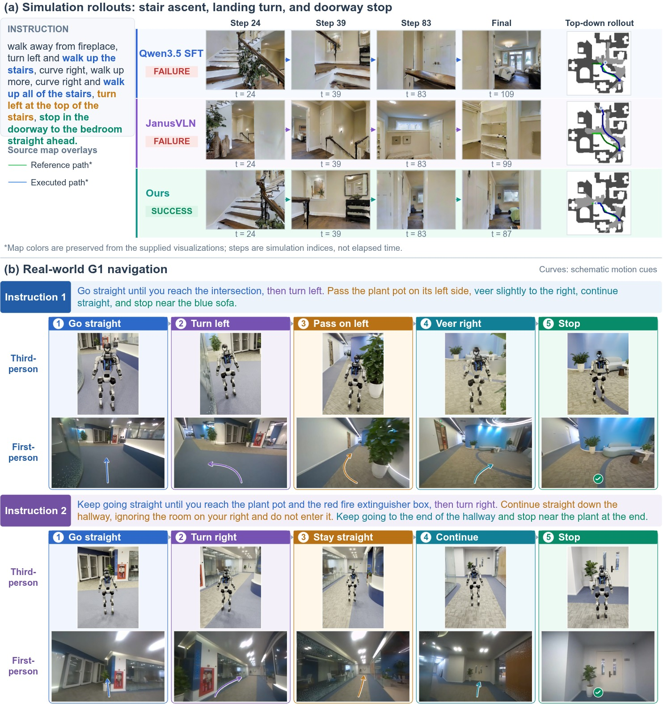

# AdaGeoVLN (arXiv 2026)

<!-- paper-source: https://chengwei920412.github.io/paper_reading/2609.18789_AdaGeoVLN_Selective_Geometry_Across_Representation_Depth_and_Navigation_Time_for_Vision_Language_Navigation/technical_report.html -->

> **arXiv ID**：2609.18789  
> **原文标题**：AdaGeoVLN: Selective Geometry Across Representation Depth and Navigation Time for Vision-Language Navigation  
> **翻译日期**：2026-09-20

---

## 📋 论文概览 {#_1}

### 基本信息 {#_2}

- **作者**：Quan-Dung Pham、Anh Dao、Danh Vinh Le、Nguyen Viet Tri Pham、The-Anh Nguyen、Zhirui Dai、Yiyu Chen、Tuyen P. Le、Truong Nguyen、Quan Nguyen
- **机构**：VinMotion；加州大学圣迭戈分校；南加州大学
- **发表状态**：arXiv v1，2026-09-16 提交
- **领域**：机器人学、视觉—语言导航、具身智能、几何基础模型

### 核心贡献 {#_3}

1. 提出分层 GFM–VLM 融合：不再只把 VGGT 的末端特征反复注入导航策略，而是将第 11、17、23 层表征依次连接到 Qwen3.5-4B 的前三个解码器层。
2. 提出导航感知的 VGGT KV 保留机制：在固定预算内，联合指令相关性、几何置信度和转移新颖度选择历史几何状态。
3. 在 R2R-CE、RxR-CE 未见验证集上验证方法，并在 Unitree G1 人形机器人上完成室内部署演示。

图：AdaGeoVLN 总体思路。左侧是跨表征深度的几何选择，中间是跨导航时间的历史状态选择，右侧是主要基准结果。

---

## 🎯 研究背景与动机 {#_4}

### 问题定义 {#_5}

视觉—语言导航（VLN）要求智能体根据自然语言指令，在连续、未见环境中处理单目 RGB 观测并输出动作。仅靠视觉语义匹配难以稳定处理视点变化、路线几何和跨时刻空间关系。VGGT 等几何基础模型（GFM）提供了强几何先验，但仍有两个接口问题：导航策略应该读取 GFM 的哪些层，以及有限内存下应该保留哪些历史几何状态。

### 现有方法的局限性 {#_6}

- **只使用末端几何特征**：默认最后一层足以概括所有几何信息，可能丢失浅层和中层的互补表征。
- **按时近性保留历史**：初始窗口加滑动窗口等规则把“新”近似为“有用”，无法直接判断观测是否对应指令地标、可靠几何或关键路线转折。
- **历史缓存持续增长**：完整保留 VGGT 全局注意力 KV 会使内存随轨迹长度增长，不适合长时程流式导航。

### 本文的创新点 {#_7}

论文把“选择什么几何信息”分解成两个正交维度：

- **表征深度**：让策略依次访问 VGGT 的不同深度，而非增加同一末端特征的注入次数。
- **导航时间**：依据导航效用保留历史 KV，而非只看观测的新旧。

这个分解使消融实验能够分别回答“收益来自多次融合，还是来自多深度信息”以及“在相似内存占用下，内容选择是否优于时间窗口”。

---

## 🔬 方法论 {#_8}

### 整体架构 {#_9}

在导航步骤 \(t\)，策略根据指令 \(\mathcal{L}\)、观测历史 \(I_{1:t}\) 和几何侧记忆 \(\mathcal{M}_t\) 预测动作：

\[a_t \sim \pi_\theta(a_t\mid \mathcal{L}, I_{1:t}, \mathcal{M}_t).\]

Qwen3.5-4B 是可训练的导航策略骨干，VGGT 是冻结的几何基础模型。AdaGeoVLN 一方面把 VGGT 多层表征注入 Qwen 解码器，另一方面压缩 VGGT 自身的全局注意力历史缓存。

### 关键技术一：分层几何融合 {#_10}

图：VGGT 第 11、17、23 层分别连接到 Qwen3.5-4B 的 \(L_0\)、\(L_1\)、\(L_2\)。

深度映射为：

\[(G_t^{11},G_t^{17},G_t^{23})\longrightarrow(L_0,L_1,L_2).\]

每个 VGGT 空间位置先经 RMSNorm，再将 \(2\times2\) 邻域拼成 8192 维词元。深度专用适配器 \(\Phi_m\) 映射到 Qwen 的 2560 维隐空间，门控网络 \(\Gamma_m\) 为每个词元输出标量权重：

\[\Delta_t^m=s_m\left[\sigma\!\left(\Gamma_m(Z_t^m)\right)\Phi_m(Z_t^m)\right].\]

随后只在图像词元位置执行残差注入：

\[H_{t,\mathrm{img}}^{k,+}=H_{t,\mathrm{img}}^k+\Delta_t^m,
\quad(m,k)\in\{(11,0),(17,1),(23,2)\}.\]

这样既不直接覆盖文本词元，又允许几何信息经过后续解码器层继续传播。

### 关键技术二：导航感知几何记忆 {#_11}

图：指令相关性、几何置信度和转移新颖度共同决定 VGGT 全局注意力 KV 的保留顺序。

对第 \(g\) 个全局注意力层，候选集合由上一步保留状态和当前 KV 组成：

\[\mathcal{C}_t^g=M_{t-1}^g\cup(K_t^g,V_t^g).\]

三个评分信号分别刻画：

1. **指令相关性 \(r_{f,p}\)**：将指令按标点和导航顺序词切分，用 Qwen 输入嵌入表示子目标，再比较浅层几何词元与各子目标的最大余弦相似度。
2. **几何置信度 \(c_{f,p}\)**：池化 VGGT 深度和点图置信度，并取二者最小值，要求两个预测头都可靠。
3. **转移新颖度 \(\nu_{f\mid t}\)**：比较当前帧描述子与所有其他已观测帧，最近邻也不相似时得分更高，以减少冗余视点。

三种信号在每层候选词元上分别做 z 分数归一化，再线性相加：

\[S_{t,g}(f,p)=\lambda_r z_{t,g}(r_{f,p})+\lambda_c z_{t,g}(c_{f,p})+\lambda_\nu z_{t,g}(\nu_{f,p\mid t}).\]

总预算依据 GHOST 的逐层输入—输出相似度离线分配到 VGGT 的 24 个全局注意力层，各层独立执行 TopK。选择发生在当前 VGGT 前向计算之后，因此保留结果影响的是下一次观测的几何上下文，而不是当前帧表征。

### 算法流程 {#_12}

1. 输入当前 RGB 帧和导航指令，VGGT 计算几何表征与全局注意力 KV。
2. 取 VGGT 第 11、17、23 层状态，完成归一化、空间分组、投影和门控。
3. 将三个几何更新依次注入 Qwen 的前三个解码器层，输出导航动作。
4. 计算所有候选历史词元的指令、置信度和新颖度分数。
5. 按逐层预算执行 TopK，得到下一时刻使用的几何记忆。

---

## 📊 实验与结果 {#_13}

### 实验设置 {#_14}

- **数据集**：R2R-CE Val-Unseen（1,839 个回合）、RxR-CE Val-Unseen（3,669 个回合）
- **训练**：联合使用 R2R/RxR 训练集，约 100 小时，8 张 NVIDIA H100；训练全部 Qwen3.5 参数和几何融合模块，冻结 VGGT
- **输入**：单 RGB 流；不使用全景观测、里程计或深度输入
- **指标**：成功率（SR）、路径长度加权成功率（SPL）、导航误差（NE）、预言成功率（OS）、归一化动态时间规整（nDTW）

### 主要结果 {#_15}

<table>
<thead>
<tr>
<th>基准</th>
<th>方法</th>
<th>NE↓</th>
<th>OS↑</th>
<th>SR↑</th>
<th>SPL↑</th>
<th>nDTW↑</th>
</tr>
</thead>
<tbody>
<tr>
<td>R2R-CE</td>
<td>JanusVLN*</td>
<td><strong>5.17</strong></td>
<td>58.0</td>
<td>52.8</td>
<td>49.2</td>
<td>—</td>
</tr>
<tr>
<td>R2R-CE</td>
<td><strong>AdaGeoVLN</strong></td>
<td>5.27</td>
<td><strong>60.7</strong></td>
<td><strong>55.7</strong></td>
<td><strong>51.4</strong></td>
<td>—</td>
</tr>
<tr>
<td>RxR-CE</td>
<td>JanusVLN*</td>
<td>6.46</td>
<td>—</td>
<td>51.4</td>
<td>44.3</td>
<td>59.1</td>
</tr>
<tr>
<td>RxR-CE</td>
<td><strong>AdaGeoVLN</strong></td>
<td><strong>5.64</strong></td>
<td>—</td>
<td><strong>54.1</strong></td>
<td><strong>44.7</strong></td>
<td><strong>61.8</strong></td>
</tr>
</tbody>
</table>

在 R2R-CE 上，AdaGeoVLN 相对 JanusVLN\* 的 SR/SPL 分别提高 2.9/2.2 个百分点；在 RxR-CE 上，SR 提高 2.7 个百分点，NE 降低 0.82 米。跨方法比较仍需注意不同工作的传感器与外部训练数据假设。

### 表征深度消融 {#_16}

<table>
<thead>
<tr>
<th>几何配置</th>
<th>SR↑</th>
<th>SPL↑</th>
<th>OS↑</th>
<th>NE↓</th>
</tr>
</thead>
<tbody>
<tr>
<td>无几何</td>
<td>46.5</td>
<td>42.3</td>
<td>56.0</td>
<td><strong>5.19</strong></td>
</tr>
<tr>
<td>单次末端 \(G^{23}\rightarrow L_2\)</td>
<td>48.9</td>
<td>44.1</td>
<td>56.0</td>
<td>5.28</td>
</tr>
<tr>
<td>末端特征重复三次</td>
<td>42.1</td>
<td>36.9</td>
<td>56.7</td>
<td>6.64</td>
</tr>
<tr>
<td><strong>分层 \(G^{11/17/23}\)</strong></td>
<td><strong>55.7</strong></td>
<td><strong>51.4</strong></td>
<td><strong>60.7</strong></td>
<td>5.27</td>
</tr>
</tbody>
</table>

分层融合比无几何策略提高 9.2 SR 和 9.1 SPL，比融合位置完全相同的“末端特征重复三次”提高 13.6 SR 和 14.5 SPL。这说明主要收益来自表征深度的多样性，而不是单纯增加注入次数。与此同时，无几何策略的 NE 略低，表明成功率和终点误差并非完全一致。

### 内存策略与预算消融 {#_17}

图：几何融合消融，以及成功率/路径效率与平均 GPU 内存的关系。

在 900K 聚合层词元预算下，导航感知保留达到 55.7 SR、51.4 SPL，平均 GFM-KV 内存为 3475.92 MB。相对 Hybrid Incremental（8+48），SR/SPL 提高 0.4/1.4 个百分点，同时 GFM-KV 和总分配 GPU 内存分别减少 39.73% 和 20.22%。预算从 600K 增至 900K 时，SR 从 53.1 提升至 55.7，SPL 从 49.2 提升至 51.4，显示出清晰的精度—内存折中。

逐一移除评分信号会使性能下降：移除几何置信度的 SR 降幅最大（2.1 个百分点），其次是指令相关性（1.5）和转移新颖度（1.4）；各设置的 KV 内存仅相差约 0.20 MB，因此差异主要来自选择质量。

### 实体机器人演示 {#_18}

图：上半部分为 R2R-CE 仿真路线，下半部分为 Unitree G1 室内导航序列。

实体系统使用 Unitree G1、ZED X Mini、Jetson AGX Orin 和远程 RTX A6000 工作站。两个室内试验覆盖按地标转向、从指定一侧经过植物、忽略无关门口和在目标附近停止，说明同一几何推理框架可以从仿真迁移到真实执行链路。

---

## 💡 关键见解 {#_19}

### 理论与方法层面 {#_20}

- GFM 的最后一层并不是导航任务的充分统计量；中间层可能保留末层难以恢复的几何线索。
- KV 压缩不仅是系统优化，还会改变后续几何推理可访问的证据，因此保留策略本身属于模型设计的一部分。
- 逐层预算与逐层归一化承认不同全局注意力层具有不同分数分布和历史需求，优于在所有层上使用同一个全局阈值。

### 实践启示 {#_21}

- 若计算预算允许，可优先比较“多层特征”与“同一层多次注入”，避免把融合频率收益误判为层级表征收益。
- 内存评估应同时报告专用 KV 占用和进程总分配显存；只报告词元预算或总显存都不足以定位收益来源。
- 本方法保留的是 VGGT 缓存；Qwen/VLM 缓存和用于融合的 CPU 特征缓冲区是独立组件，工程复现时不能混为一谈。

---

## 🔍 局限性与未来工作 {#_22}

### 当前局限 {#_23}

1. 三个保留信号使用相同权重，逐一移除消融只能证明各信号有用，不能证明等权组合最优。
2. 多深度只测试了 VGGT 的 11/17/23 层与 Qwen 前三层的一种映射，尚未系统搜索层组合、注入位置或动态路由。
3. 主结论基于两个 VLN-CE 基准的 Val-Unseen 划分，未报告多随机种子方差、置信区间或统计显著性。
4. 实体部署是两个室内试验的定性展示，尚不足以衡量真实世界中的成功率、延迟、网络中断鲁棒性或跨建筑泛化。
5. VGGT 仍需完整处理当前帧，保留机制主要压缩历史 KV，并不等价于降低所有几何计算成本。

### 未来方向 {#_24}

- 学习或在线调整 \(\lambda_r,\lambda_c,\lambda_\nu\)，并研究不同导航阶段的动态权重。
- 用可学习路由替代固定的 11/17/23 层映射，让任务和观测决定需要的表征深度。
- 将 TopK 扩展为分层、多样性约束或子模选择，避免高分词元集中于同一帧或同一局部区域。
- 在更长轨迹、多楼层、动态障碍和弱网络条件下开展真实机器人定量评估。
- 联合优化当前帧计算、历史 KV 和 CPU 特征缓冲区，形成端到端的延迟—内存—成功率 Pareto 前沿。

---

## 📚 相关工作对比 {#_25}

<table>
<thead>
<tr>
<th>方法</th>
<th>核心思想</th>
<th>优势</th>
<th>局限</th>
</tr>
</thead>
<tbody>
<tr>
<td>StreamVLN</td>
<td>维护紧凑的流式上下文</td>
<td>面向在线视频式导航</td>
<td>不直接研究 GFM 多深度与几何 KV 选择</td>
</tr>
<tr>
<td>JanusVLN</td>
<td>固定大小的空间几何与视觉语义双隐式记忆</td>
<td>显式区分语义与空间记忆</td>
<td>保留主要依赖初始窗口和滑动窗口</td>
</tr>
<tr>
<td>GHOST</td>
<td>按几何层级进行在线流式词元淘汰</td>
<td>为逐层预算提供依据</td>
<td>目标主要是高效 3D 重建，不含导航指令信号</td>
</tr>
<tr>
<td>InfiniteVGGT</td>
<td>面向无尽视觉流的固定预算 VGGT</td>
<td>支持长视频几何处理</td>
<td>不专门针对 VLN 的指令条件效用</td>
</tr>
<tr>
<td><strong>AdaGeoVLN</strong></td>
<td>多深度融合 + 指令/置信度/新颖度驱动的 KV 保留</td>
<td>同时处理表征深度与导航时间</td>
<td>固定层映射、等权评分，实体评估规模有限</td>
</tr>
</tbody>
</table>

---

## 🎓 综合评价 {#_26}

### 优点 {#_27}

- 问题拆分清晰，表征深度和导航时间分别对应可验证的机制。
- “末端特征重复三次”是关键对照，排除了单纯增加交互次数的解释。
- 内存实验同时给出 GFM-KV 和总分配 GPU 内存，便于工程判断。
- 仿真定量结果、消融和人形机器人部署构成较完整的证据链。

### 可改进之处 {#_28}

- 增加层选择、融合位置、门控形式和评分权重的系统消融。
- 报告端到端动作频率、单步延迟、显存峰值以及不同轨迹长度下的复杂度曲线。
- 使用多种 GFM/VLM 骨干验证结论是否独立于 VGGT 与 Qwen3.5-4B。
- 扩大真实机器人测试规模并报告失败类型，而不只展示成功序列。

### 推荐阅读对象 {#_29}

适合关注 VLN、具身智能、视觉几何基础模型、Transformer KV 缓存压缩，以及人形机器人导航系统的研究者和工程师。

---

## 📎 附录 {#_30}

### 术语表 {#_31}

<table>
<thead>
<tr>
<th>英文</th>
<th>中文</th>
</tr>
</thead>
<tbody>
<tr>
<td>Vision-Language Navigation (VLN)</td>
<td>视觉—语言导航</td>
</tr>
<tr>
<td>Geometry Foundation Model (GFM)</td>
<td>几何基础模型</td>
</tr>
<tr>
<td>Hierarchical Geometry Fusion</td>
<td>分层几何融合</td>
</tr>
<tr>
<td>Navigation-Aware Retention</td>
<td>导航感知保留</td>
</tr>
<tr>
<td>Global-Attention KV Cache</td>
<td>全局注意力键值缓存</td>
</tr>
<tr>
<td>Instruction Relevance</td>
<td>指令相关性</td>
</tr>
<tr>
<td>Geometric Confidence</td>
<td>几何置信度</td>
</tr>
<tr>
<td>Transition Novelty</td>
<td>转移新颖度</td>
</tr>
<tr>
<td>Retention Budget</td>
<td>保留预算</td>
</tr>
</tbody>
</table>

### 参考资源 {#_32}

- **论文原文**：[arXiv 2609.18789](https://arxiv.org/abs/2609.18789)
- **中文翻译 PDF**：[paper_cn.pdf](https://chengwei920412.github.io/paper_reading/2609.18789_AdaGeoVLN_Selective_Geometry_Across_Representation_Depth_and_Navigation_Time_for_Vision_Language_Navigation/paper_cn.pdf)
- **中文 Markdown 译文**：[paper_cn.md](https://chengwei920412.github.io/paper_reading/2609.18789_AdaGeoVLN_Selective_Geometry_Across_Representation_Depth_and_Navigation_Time_for_Vision_Language_Navigation/paper_cn.html)
- **项目主页**：[AdaGeoVLN](https://humanoid-research.github.io/adageovln/)
- **代码实现**：作者说明将在论文接收后发布
