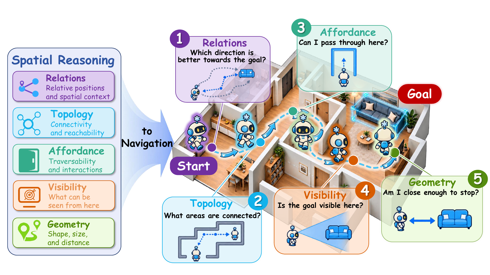
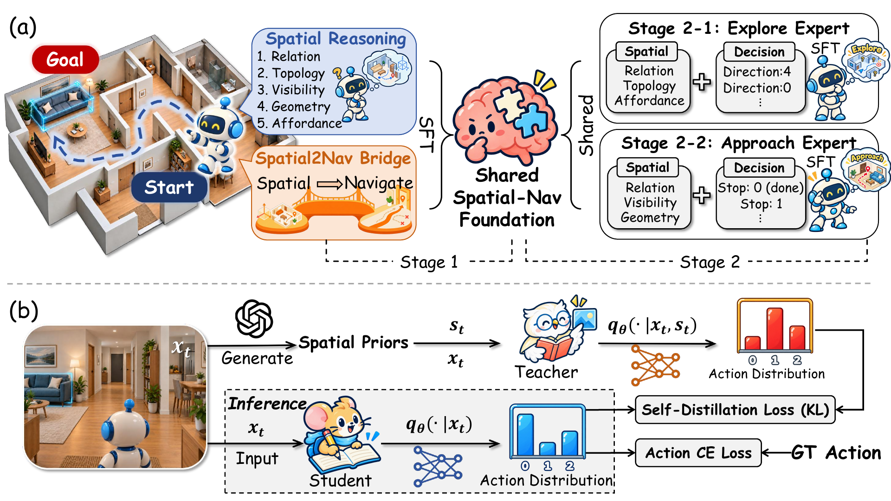
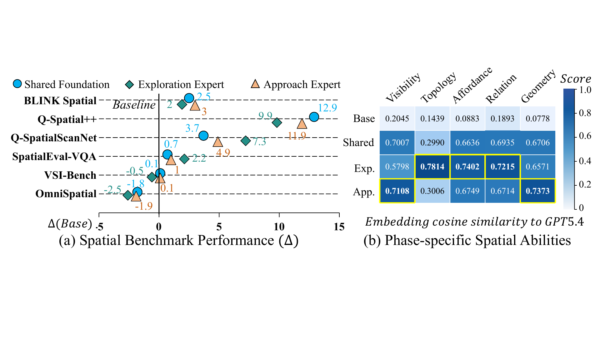

# Spatial-Nav-100K (arXiv 2026)

<!-- paper-source: https://chengwei920412.github.io/paper_reading/2609.29934_Beyond_Spatial_Benchmarks_From_Spatial_Reasoning_to_Navigation/technical_report.html -->

> **arXiv ID**：2609.29934  
> **原文标题**：Beyond Spatial Benchmarks: From Spatial Reasoning to Navigation  
> **翻译日期**：2026-10-08

---

## 📋 论文概览 {#_2}

### 基本信息 {#_3}

- **作者**：Xun Huang、Shijia Zhao、Rongsheng Qu、Jiayuan Li、Xin Lu、Weixin Li、Chenglu Wen、Cheng Wang
- **机构**：厦门大学、中关村学院、北京航空航天大学、北京理工大学、中国科学院大学
- **发表时间**：2026 年（arXiv 预印本）
- **领域**：具身智能、目标物体导航、视觉语言模型、空间推理、知识蒸馏

### 核心贡献 {#_4}

1. 系统检验“空间推理基准上的高分能否迁移到导航”，发现五类基准导向空间推理专用模型在四种导航设置中均不如各自基础模型，说明离线问答能力不能直接代表长时程决策能力。
2. 通过受控诊断实验总结出三条有效条件：空间证据必须与导航目标耦合；探索与接近阶段需要不同空间能力；空间监督应作为并行学习目标，而不应在推理时串行生成后再据此决策。
3. 构建 **Spatial-Nav-100K**，包含 112,886 条分阶段监督记录，覆盖导航决策、空间推理与 Spatial2Nav Bridge。
4. 提出两阶段空间—导航微调和 **Spatial-NPD**。前者先学习共享基础、再进行阶段专门化；后者将带空间先验的教师动作偏好蒸馏到无需显式推理的学生策略。
5. 8B 模型仅用约 45 个 A100 GPU 小时完成策略训练，在 HM3D-v0.2、HM3D-v0.1、未见 MP3D 上分别达到 77.4/35.4、60.2/30.5、47.9/20.6 的 SR/SPL，每个动作步延迟为 148 ms。

图：目标导向导航在不同阶段依赖关系、拓扑、可通行性、可见性与几何等不同空间能力。

---

## 🎯 研究背景与动机 {#_5}

### 问题定义 {#_6}

现有空间推理基准通常要求模型根据单张或多张图像回答距离、方位、视角变化或三维结构问题。ObjectNav 则要求智能体在未知环境中持续行动，寻找指定类别的目标物体。论文关注的核心不是“模型能否回答空间问题”，而是“这种能力能否稳定改善长时程导航决策”。

### 现有方法的局限性 {#_7}

- 基准任务多为孤立问答，答案生成后交互立即结束，与连续导航的目标和反馈结构不一致。
- 既有导航方法往往统一注入几何、拓扑或场景图信息，没有区分探索与接近阶段对空间能力的不同需求。
- 在每一步显式生成思维链或空间解释会增加延迟，并可能把幻觉或中间错误传播到动作。
- 单一空间训练配方难以同时兼顾“去哪里探索”和“何时停止”两类决策。

### 本文的创新点 {#_8}

论文先做诊断、再据诊断结论设计训练方法。其关键转变是：不把空间推理作为部署时必须生成的中间文本，而把它视为训练阶段的辅助监督与教师侧先验，使最终策略直接输出动作。

---

## 🔬 方法论 {#_9}

### 整体架构 {#_10}

每个决策回合包含两个分支：接近策略先判断 `Stop` 或 `Continue`；若继续，则探索策略从深度候选生成器提供的可通行候选中选择下一步。高层策略分解为：

\[\pi(a_t\mid s_t)=
\begin{cases}
p^{\mathrm{A}}(\text{Stop}\mid x_t^{\mathrm{A}}), &amp; a_t=\text{Stop},\\
p^{\mathrm{A}}(\text{Continue}\mid x_t^{\mathrm{A}})\,p^{\mathrm{E}}(a_t\mid x_t^{\mathrm{E}}), &amp; a_t\in\mathcal{C}_t.
\end{cases}\]

这种分解允许探索与接近分支接受独立、阶段匹配的监督。

图：两阶段微调与 Spatial-NPD。空间先验只在教师侧训练时可见，部署学生仅依据导航观测直接决策。

### 关键技术 {#_11}

**1. Spatial-Nav-100K**

数据集精确包含 112,886 条监督记录：阶段 1 为 40,000 条，探索阶段为 58,000 条，接近阶段为 14,886 条。记录类型包括导航决策、空间推理和不含动作标签的 Spatial2Nav Bridge。标注来自 HM3D 训练场景；自动有效率为 99.93%，500 条人工抽样的平均审核分数为 98.3%。

**2. 两阶段空间—导航微调**

阶段 1 联合训练导航决策与空间监督，得到共享基础：

\[\mathcal{L}_{\mathrm{F}}=
\lambda_{\mathrm{dec}}\,\mathbb{E}[\ell_{\theta}(y\mid x)]
+\lambda_{\mathrm{sp}}\,\mathbb{E}[\ell_{\theta}(s\mid x)].\]

阶段 2 从共享基础出发，分别训练探索和接近专用模型。探索强调关系、拓扑和可通行性；接近强调可见性、几何和关系。空间目标与动作目标始终作为独立序列，动作预测不依赖生成的空间文本。

**3. Spatial-NPD**

冻结教师额外接收与状态对齐的空间先验，学生只接收导航上下文。蒸馏在当前合法动作集合上进行：

\[\mathcal{L}_{\mathrm{KD}}^b=\tau^2\,\mathbb{E}\left[\operatorname{KL}\!\left(q_T^b(\cdot\mid x_t^b,r_t)\,\Vert\,p_S^b(\cdot\mid x_t^b)\right)\right].\]

学生总目标为：

\[\mathcal{L}_{\mathrm{NPD}}^b=\mathcal{L}_{\mathrm{dec}}^b+\lambda_{\mathrm{KD}}\mathcal{L}_{\mathrm{KD}}^b.\]

这使空间信息影响动作偏好，但不进入部署时的显式推理链。

### 算法流程 {#_12}

1. 在 HM3D 训练场景中采样跨场景、阶段和目标类别的导航状态。
2. 生成导航决策、空间证据与 Spatial2Nav Bridge 标注，并执行模式校验、视觉证据检查和人工审核。
3. 在 Qwen3-VL-8B-Instruct 或 InternVL3-8B 上用 LoRA 训练共享空间—导航基础。
4. 从共享基础分别训练探索和接近分支，并为每个分支分配阶段相关空间能力。
5. 用对齐空间先验条件化冻结教师，在合法动作集合上产生软偏好；学生联合优化直接动作损失和 KL 蒸馏损失。
6. 部署时仅保留学生策略；空间先验、空间文本和教师模型均不参与推理。

---

## 📊 实验与结果 {#_13}

### 实验设置 {#_14}

- **数据集**：HM3D-v0.2（1,000 回合）、HM3D-v0.1（2,000 回合）、MP3D（2,195 回合）
- **评估指标**：成功率（SR）、路径长度加权成功率（SPL）；诊断实验还使用 SAE 等阶段相关指标
- **模型**：Qwen3-VL-8B-Instruct、InternVL3-8B
- **输入与控制**：最多 500 个 Habitat 步，\(1920\times1080\) RGB-D，1 m 成功半径；策略接收 RGB、目标类别和候选叠加图，不接收模拟器特权状态、显式地图、图或规划
- **统计方式**：主要结果为四次独立训练运行的平均值

### 主要结果 {#_15}

<table>
<thead>
<tr>
<th>数据集</th>
<th>SR</th>
<th>SPL</th>
</tr>
</thead>
<tbody>
<tr>
<td>HM3D-v0.2</td>
<td>77.4</td>
<td>35.4</td>
</tr>
<tr>
<td>HM3D-v0.1</td>
<td>60.2</td>
<td>30.5</td>
</tr>
<tr>
<td>MP3D（训练未见）</td>
<td>47.9</td>
<td>20.6</td>
</tr>
</tbody>
</table>

在 HM3D-v0.2 上，方法超过表中所有比较系统的 SR；在 HM3D-v0.1 上达到最高 SR；在 MP3D 上取得很有竞争力的 SR/SPL，且训练数据中不含 MP3D 场景。论文并未宣称在所有单项指标上全面最优：例如 ApexNav 的 HM3D-v0.2 SPL 更高，Uni-Navid 的 SPL 也略高，但这些方法使用闭源模型、显式结构或显著更多训练算力。

### 消融实验 {#_16}

<table>
<thead>
<tr>
<th>训练变体</th>
<th>SR</th>
<th>SPL</th>
</tr>
</thead>
<tbody>
<tr>
<td>原始 Qwen3-VL-8B</td>
<td>59.2</td>
<td>22.1</td>
</tr>
<tr>
<td>+ 决策—空间 SFT</td>
<td>63.7</td>
<td>26.5</td>
</tr>
<tr>
<td>+ 阶段专用模型</td>
<td>68.7</td>
<td>28.1</td>
</tr>
<tr>
<td>+ 共享基础</td>
<td>74.5</td>
<td>32.9</td>
</tr>
<tr>
<td>+ Spatial-NPD</td>
<td><strong>77.4</strong></td>
<td><strong>35.4</strong></td>
</tr>
</tbody>
</table>

每个新增组件至少提升 2.9 个 SR 点。对齐先验相对打乱先验，在 HM3D-v0.2、HM3D-v0.1 和 MP3D 上分别提升 2.4/2.8、2.0/1.6、3.2/3.1 个 SR/SPL 点，说明收益来自状态匹配的空间信息，而非蒸馏本身的通用正则化作用。

跨架构实验中，InternVL3-8B 在 HM3D-v0.2 上由 44.6/12.4 提升至 71.7/34.6，表明该流程并不依赖单一 VLM 家族。逐步 CoT 则把 SR/SPL 降至 69.4/22.7，并将延迟从 148 ms 增至 929 ms，直接支持“训练时使用空间监督、推理时不显式生成空间文本”的设计。

图：导航耦合监督向通用空间基准的迁移，以及共享基础与阶段专用模型的能力分化。

---

## 💡 关键见解 {#_17}

### 理论分析 {#_18}

论文最重要的结论是“能力存在”与“能力可用于决策”并不等价。空间基准训练改变了模型回答问题的分布，却没有保证这些表征与导航目标、阶段或合法动作对齐。Spatial-NPD 将这一缺口具体化为动作分布上的知识迁移：教师利用空间先验改变合法动作的相对偏好，学生学习这种偏好而不复制解释文本。

阶段分解同样具有因果意义。探索的瓶颈是到达目标区域，因而关系、拓扑和可通行性更重要；接近的瓶颈是识别目标并在正确时机停止，因而可见性和几何更重要。将同一空间模型用于两个阶段会增加过早停止，说明“更多空间能力”不一定更好，能力必须与接口和阶段匹配。

### 实践启示 {#_19}

- 为具身策略增加推理能力时，应优先验证其是否改善动作，而不只检查问答分数。
- 可把昂贵的空间解释保留在数据构建或教师侧，再蒸馏为轻量动作偏好。
- 对多阶段任务，先学习共享表征、再按阶段专门化，通常比把全部监督一次性混合更稳健。
- 打乱先验是必要控制组，可区分“信息对齐收益”和“额外蒸馏正则化收益”。

---

## 🔍 局限性与未来工作 {#_20}

### 当前局限 {#_21}

- 实验仅覆盖模拟 ObjectNav，依赖固定 RGB-D 候选生成器和底层控制器；尚未验证学习式候选生成、连续控制、操作或真实机器人。
- 模拟环境未覆盖真实世界的外观变化、传感噪声、运动不确定性和交互复杂性。
- 空间标注、Spatial-NPD 先验和探索决策提议来自单一标注模型。自动筛选与人工审核不能完全消除模型特定偏差。
- 主要比较包含不同输入、结构、模型和训练预算，横向 SOTA 对比并非完全同条件；论文用内部消融弥补了这一问题，但外部公平比较仍有限。
- 固定候选生成器可能掩盖了感知和低层规划错误，方法在端到端具身系统中的净收益仍需验证。

### 未来方向 {#_22}

1. 在真实机器人、连续控制和噪声传感设置中验证阶段化空间监督。
2. 比较多个教师模型，量化不同空间能力上的标注一致性与偏差传播。
3. 将 Spatial-NPD 扩展到指令跟随导航、具身问答和操作任务。
4. 联合学习候选生成、空间表征与低层控制，检验方法是否能在更少手工接口下保持收益。
5. 研究无需外部大模型标注的自监督空间先验，以及更严格的成本—收益评估。

---

## 📚 相关工作对比 {#_23}

<table>
<thead>
<tr>
<th>方法类别</th>
<th>核心思想</th>
<th>优势</th>
<th>局限</th>
</tr>
</thead>
<tbody>
<tr>
<td>基准导向空间专用模型</td>
<td>在离线空间问答基准上专门化</td>
<td>空间问答分数高，训练目标清晰</td>
<td>不能直接迁移到长时程导航</td>
</tr>
<tr>
<td>显式结构导航</td>
<td>维护地图、场景图或规划结构</td>
<td>可解释、可积累环境信息</td>
<td>系统复杂，常依赖闭源模型或持续推理</td>
</tr>
<tr>
<td>推理时 CoT</td>
<td>每步生成空间解释后再决策</td>
<td>显式呈现中间推理</td>
<td>延迟高，错误与幻觉会传播到动作</td>
</tr>
<tr>
<td><strong>本文方法</strong></td>
<td>目标耦合、阶段化空间监督，并以 Spatial-NPD 蒸馏动作偏好</td>
<td>推理无需显式空间文本，精度—延迟权衡好，跨 VLM 架构有效</td>
<td>仍依赖固定候选接口与单一标注模型</td>
</tr>
</tbody>
</table>

---

## 🎓 个人评价 {#_24}

### 优点 {#_25}

- 研究问题明确，先用受控实验否定直觉假设，再由诊断结论推导方法，论证链条完整。
- 通过目标条件、阶段能力、并行/串行接口三组实验，把“空间推理有用”细化为可操作的设计原则。
- 同时报告准确率、路径效率、延迟、训练算力、标注量和审核质量，工程信息较充分。
- 对齐先验与打乱先验、无 NPD、跨架构和逐步 CoT 等控制组能排除若干简单替代解释。

### 可改进之处 {#_26}

- 可加入不同候选生成器、不同传感配置和真实机器人实验，验证结论是否依赖当前接口。
- 可用多个教师或人工标注子集训练，分离标注模型能力、数据规模和方法设计的贡献。
- 应进一步报告空间能力标签之间的混淆、失败类型及置信区间，并提供同预算基线。
- MP3D 的跨数据集结果很有价值，但仍属于模拟室内场景；更广泛的域外环境能增强泛化论证。

### 推荐阅读对象 {#_27}

适合从事具身智能、视觉语言动作模型、ObjectNav、推理蒸馏和训练数据设计的研究者。对希望把大模型推理能力落地为低延迟控制策略的工程团队也很有参考价值。

---

## 📎 附录 {#_28}

### 重要公式 {#_29}

- **策略分解**：先判定停止/继续，再在继续条件下选择探索候选。
- **共享基础损失**：导航决策损失与空间监督损失的加权和。
- **阶段专用损失**：分支决策损失加分支空间监督损失，并对接近阶段的动作不平衡加权。
- **Spatial-NPD 损失**：直接动作损失加合法动作集合上的温度缩放 KL 蒸馏损失。

### 术语表 {#_30}

<table>
<thead>
<tr>
<th>英文</th>
<th>中文</th>
</tr>
</thead>
<tbody>
<tr>
<td>Spatial Reasoning</td>
<td>空间推理</td>
</tr>
<tr>
<td>Object Goal Navigation (ObjectNav)</td>
<td>目标物体导航</td>
</tr>
<tr>
<td>Benchmark-oriented Spatial Specialization</td>
<td>基准导向的空间专门化</td>
</tr>
<tr>
<td>Navigation Phase</td>
<td>导航阶段</td>
</tr>
<tr>
<td>Relation</td>
<td>关系</td>
</tr>
<tr>
<td>Topology</td>
<td>拓扑</td>
</tr>
<tr>
<td>Affordance</td>
<td>可通行性</td>
</tr>
<tr>
<td>Visibility</td>
<td>可见性</td>
</tr>
<tr>
<td>Geometry</td>
<td>几何</td>
</tr>
<tr>
<td>Shared Spatial-Navigation Foundation</td>
<td>空间—导航共享基础</td>
</tr>
<tr>
<td>Navigation Preference Distillation</td>
<td>导航偏好蒸馏</td>
</tr>
<tr>
<td>Success Rate (SR)</td>
<td>成功率</td>
</tr>
<tr>
<td>Success weighted by Path Length (SPL)</td>
<td>路径长度加权成功率</td>
</tr>
</tbody>
</table>

### 参考资源 {#_31}

- **论文原文**：[arXiv 链接](https://arxiv.org/abs/2609.29934)
- **中文翻译 PDF**：[paper_cn.pdf](https://chengwei920412.github.io/paper_reading/2609.29934_Beyond_Spatial_Benchmarks_From_Spatial_Reasoning_to_Navigation/paper_cn.pdf)
- **中文 Markdown 译文**：[paper_cn.md](https://chengwei920412.github.io/paper_reading/2609.29934_Beyond_Spatial_Benchmarks_From_Spatial_Reasoning_to_Navigation/paper_cn.html)
- **代码实现**：[Spatial-Nav](https://github.com/ylwhxht/Spatial-Nav)
- **项目主页**：论文未单独提供
