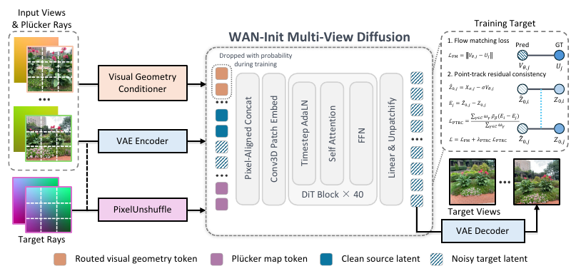
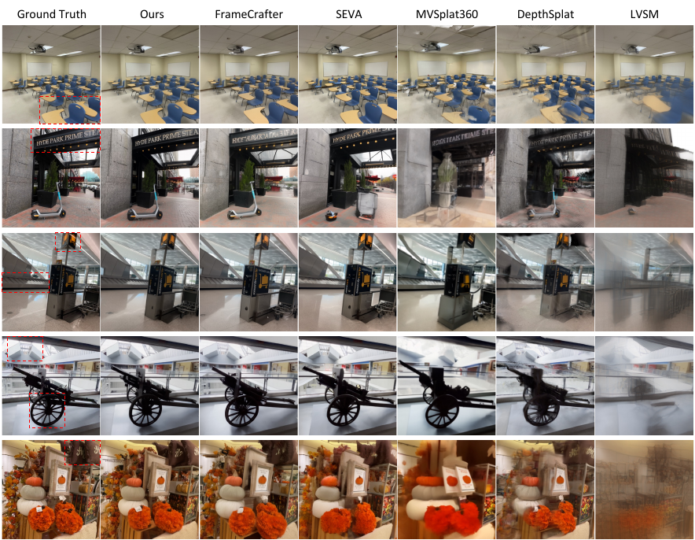
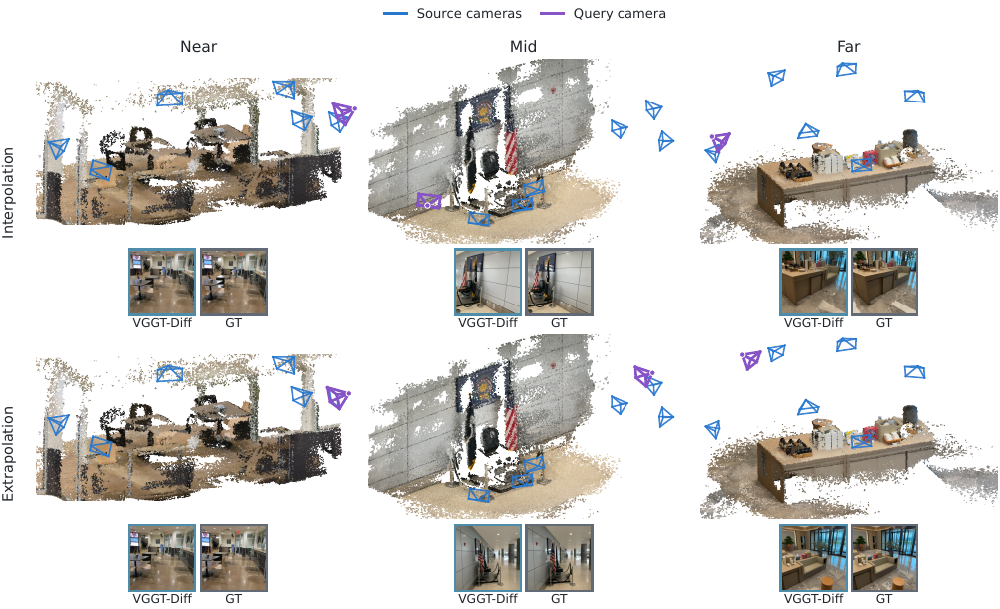
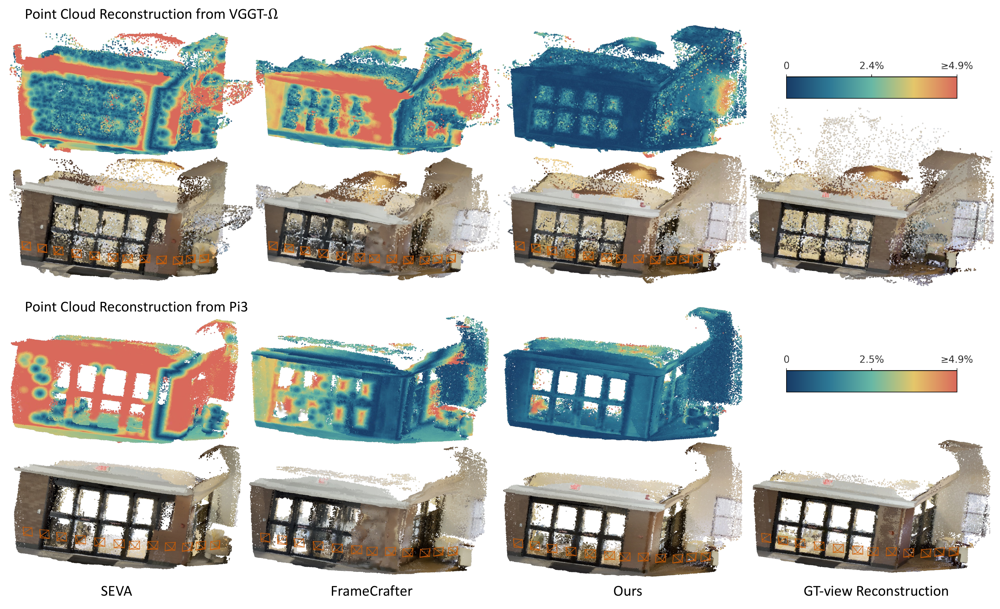

# VGGT-Diff (arXiv 2026)

<!-- paper-source: https://chengwei920412.github.io/paper_reading/2609.33253_Visual_Geometry_Meets_Diffusion_for_Sparse_View_Novel_View_Synthesis/technical_report.html -->

> 原文链接：[VGGT-Diff (arXiv 2026)](https://chengwei920412.github.io/paper_reading/2609.33253_Visual_Geometry_Meets_Diffusion_for_Sparse_View_Novel_View_Synthesis/technical_report.html)

> **arXiv ID**：2609.33253  
> **原文标题**：Visual Geometry Meets Diffusion for Sparse-View Novel View Synthesis  
> **翻译日期**：2026-10-05

---

## 📋 论文概览 {#_2}

### 基本信息 {#_3}

- **方法名称**：VGGT-Diff
- **作者**：Kangjie Chen、Xiangyu Li、Dongbin Zhang、Chaoda Zheng、Shijia Chen、Jinhao Deng、Hongbin Lin、Choo Sin Wai、Minqi Wang、Minghao Yang、Dake Zhong、Guorui Song、Yu Zhang、Xianming Liu、Boyang Wang
- **机构**：小鹏汽车、香港中文大学、清华大学
- **论文时间**：2026 年
- **研究领域**：稀疏视图新视图合成（NVS）、多视图几何、视频扩散模型、三维视觉
- **核心目标**：从 6 张带位姿的源图像生成一个或多个指定相机视角，在保留已观测几何和外观的同时，利用生成先验合理补全未观测区域。

### 一句话总结 {#_4}

VGGT-Diff 将 VGGT-\(\Omega\) 的三维点、置信度和视觉特征“路由”到查询视图，以显式几何约束预训练 Wan 视频扩散模型，并通过点轨迹残差一致性约束联合生成视图，使结果同时具备较强的单视图保真度与跨视图几何一致性。

### 三项核心贡献 {#_5}

1. **几何路由生成**：提出置信度感知的视觉几何路由器（Visual Geometry Router，VGR），把 VGGT-\(\Omega\) 的源视图视觉特征和三维点投影为查询视图对齐条件。VGR 以硬 z-buffer 路由作为清晰的硬锚点，并用前表面/次表面分层证据进行残差细化。
2. **几何约束的一致性**：提出点轨迹残差一致性（Point-Track Residual Consistency，PTRC）。它不直接强迫不同视图的 RGB、VAE 潜变量或速度相同，而是沿可靠三维点轨迹对齐各视图相对于自身监督目标的预测残差。
3. **稳健几何条件**：训练时随机保留、衰减或丢弃几何条件，避免模型过度相信稀疏视图重建中的错误；同一训练机制还提供推理时的几何先验 CFG，用于在去噪早期选择性增强查询视图几何。

---

## 🎯 研究背景与问题 {#_6}

### 问题定义 {#_7}

给定 \(M\) 张源图像及其内外参，目标是为 \(N\) 个指定查询相机生成图像。困难不只在于“生成看起来合理的画面”，还在于同时满足三类约束：

- **场景忠实性**：源图像中已经出现的物体、纹理、文字与布局不能被生成先验随意改写。
- **未观测区域补全**：稀疏输入无法覆盖所有表面，模型必须对新暴露区域进行合理生成。
- **多视图一致性**：同一物理点在多个查询视图中的几何位置和局部内容应相互兼容，而不是逐视图独立漂移。

### 两类现有范式的矛盾 {#_8}

**重建式方法**（NeRF、Gaussian Splatting、前馈三维重建）显式表示几何，因此在观测充分处通常较忠实；但当视角变化较大、目标区域未被源视图覆盖时，确定性重建严重欠约束，容易产生斑块、拉伸或附近颜色复制。

**扩散式方法**具备强大的图像或视频生成先验，能补全未观测内容；但源视图到查询视图的对应关系往往仅通过 RGB 和相机条件隐式学习。在宽基线插值/外推中，生成先验可能覆盖几何证据，造成结构漂移、遮挡顺序错误和跨视图不一致。

本文的关键立场是：**恢复的几何不应被当作完整、绝对可靠的场景表示，而应作为带不确定性的证据，用于路由视觉信息并约束扩散过程。**

---

## 🔬 方法论 {#_9}

### 整体架构 {#_10}

VGGT-Diff 以 Wan2.1-I2V-14B 为视频扩散先验，并冻结 VAE 与 VGGT-\(\Omega\)。整体输入由四部分组成：

1. 带噪查询潜变量与扩散状态；
2. 干净源图像潜变量，查询槽为空，避免泄露查询 RGB；
3. 每个源/查询像素对应的 Plücker 射线图；
4. 由 VGR 构建的源视图特征与查询视图对齐的几何条件。

这些信号在通道维拼接，经扩展输入投影映射到 Wan 的词元空间。多个源视图和查询视图放入同一个 DiT 序列，保留空间位置编码，但去除视图轴的时间顺序，因为输入本质上是相机观测集合而非视频时间线。查询槽联合去噪，最后独立解码。

图：VGGT-Diff 整体流程。VGGT-\(\Omega\) 提供带三维点和置信度的视觉特征，VGR 将其路由至查询视图；流匹配负责逐视图保真度，PTRC 负责跨视图残差一致性。

### 相机条件多视图扩散 {#_11}

训练采用 Wan 的线性流匹配。冻结 VAE 将源视图与查询视图编码为干净潜变量，模型仅在查询槽上计算流匹配损失。查询图像只用于监督，绝不作为条件输入。联合 DiT 允许不同查询槽直接交换信息，因此一个视图中较明确的结构或外观线索可以帮助其他目标视图。

相机坐标规范仅由源相机定义；改变查询相机数量或子集不会改变条件坐标系。这一点使同一检查点可以执行独立 \(6\) 对 \(1\) 推理，也可以联合生成多目标视图。

### 视觉几何路由器（VGR） {#vgr}

VGR 的输入不是单纯的深度图或点渲染 RGB，而是 VGGT-\(\Omega\) 输出的三元组：视觉特征、对应三维点、置信度。轻量级适配器先把视觉特征变换到扩散条件空间；三维点和相机参数决定特征送到查询网格的哪个位置，置信度决定其贡献强度。

#### 1. 特征关联与投影 {#1}

源视图特征保留原生像素对应关系，直接重采样到扩散网格。查询视图没有这种原生对应关系，因此把三维点通过查询相机投影到目标网格。传递的是携带外观信息的特征，而不是预渲染 RGB 或仅有几何坐标的条件。

#### 2. 硬锚点路由 {#2}

每个投影特征先分配到最近的查询网格单元。硬 z-buffer 保留接近最近有效深度的特征，并按 VGGT-\(\Omega\) 置信度求平均，形成 \(\mathbf{G}_j^{\mathrm{hard}}\)。它边界清晰、计算简单，是主要几何条件。

#### 3. 分层残差细化 {#3}

硬 z-buffer 在遮挡边界附近较脆弱：很小的深度、位姿或亚像素投影误差就可能把被选特征切换到另一表面。若对所有投影特征直接软聚合，又会混合前景与背景。VGR 因而分别构造置信度加权的前表面和次表面假设，并将二者与支撑数、置信度、相对深度间隔等统计量送入零初始化的残差细化器。最终条件为“硬锚点 + 学习到的修正”；没有几何支撑的位置主要交给扩散先验补全。

这种设计把几何的作用限制在“有证据的区域”，同时保留生成模型处理空洞和未知区域的能力。

### 点轨迹残差一致性（PTRC） {#ptrc}

逐视图流匹配只能保证每张生成图像接近各自 GT，不能保证剩余误差在不同视图中对应同一三维场景。直接匹配 RGB、VAE 潜变量或速度也不理想，因为光照、可见性和局部上下文会随视角合理变化。

PTRC 先从当前速度预测恢复干净潜变量，再计算它相对本视图 GT 潜变量的残差。随后复用 VGGT-\(\Omega\) 三维点，在成对查询视图中建立轨迹；只有同时落在两个视图内、位于相机前方并通过 z-buffer 可见性测试的点才参与约束。损失使用置信度加权 Smooth-L1 对齐同一物理点的残差。

其重要区别是：**PTRC 对齐“应被消除的错误”，而不是强迫不同视角的正确内容相同。** 二次区间精确处理小差异，线性区间和轨迹置信度共同抑制不可靠匹配的影响。

### 几何条件正则化与几何先验 CFG {#cfg}

稀疏观测恢复的几何不可避免地存在空洞、错深度和遮挡错误。训练时对路由几何采用三种状态：丢弃概率 \(0.10\)、弱化概率 \(0.20\)、完整条件概率 \(0.70\)。源图像潜变量、相机射线、扩散状态和时间步保持不变，因此模型学习的是“几何证据不可靠时如何退回生成先验”，而不是无条件生成。

推理时，完全条件分支 \(\mathbf{V}_{\mathrm{G}}\) 保留所有路由几何；参考分支 \(\mathbf{V}_{\mathrm{ref}}\) 只移除查询槽的稠密路由几何，同时保留源对齐几何、全局 VGGT-\(\Omega\) 上下文、图像潜变量、射线和时间步。正式配置使用 50 个去噪步骤、初始引导尺度 2.0，并在前 \(60\%\) 轨迹内平滑衰减到 1；其后不再引导。

### 训练与推理流程 {#_12}

1. 用冻结的 VGGT-\(\Omega\) 从 6 个源视图提取视觉特征、三维点与置信度。
2. 直接保留源特征对齐关系，并用查询相机将三维点投影到查询网格。
3. 通过硬锚点与分层残差细化构建 VGR 条件。
4. 将带噪查询潜变量、干净源潜变量、Plücker 射线和路由几何送入 Wan DiT。
5. 对查询槽计算流匹配损失；利用可靠三维点轨迹计算 PTRC。
6. 训练时随机正则化几何条件；推理时可选用几何先验 CFG。
7. 联合去噪一个或多个查询槽，再分别经 VAE 解码。

---

## 📊 实验与结果 {#_13}

### 训练设置 {#_14}

- **训练数据**：DL3DV-10K 的 1K 场景划分；剔除 1 个不可用场景及与 140 场景 benchmark 重叠的 19 个场景后，共 980 个训练场景。
- **初始化**：Wan2.1-I2V-14B；冻结 VAE 与 VGGT-\(\Omega\)，训练 Wan DiT、扩展输入投影、视觉特征适配器和 VGR。
- **分辨率与轮数**：先以 \(192\times336\) 训练 147 轮，再以 \(480\times832\) 训练 60 轮；BF16，全局批量大小 8。
- **多目标课程**：每个样本固定 6 个源视图，目标数量 \(N\) 从 \(\{1,2,4\}\) 扩展至 \(\{4,8,12,16\}\)。
- **学习率**：Wan DiT 两阶段分别为 \(10^{-5}\) 和 \(5\times10^{-6}\)；新增模块均为 \(10^{-4}\)。
- **损失权重**：\(\lambda_{\mathrm{PTRC}}=0.1\)。

### 评估设置 {#_15}

- **主基准**：6,188 个 DL3DV-Benchmark 目标视图。
- **零样本迁移**：Mip-NeRF 360。
- **输入协议**：所有方法使用相同 6 个源视图与目标相机；主图像指标按独立 \(6\) 对 \(1\) 推理评估。
- **输出协议**：原生输出缩放或中心裁剪到 \(480\times480\)；VGGT-Diff 使用 50 个流采样步。
- **指标**：PSNR、SSIM、LPIPS-AlexNet、DreamSim；额外诊断使用 LPIPS-VGG、Chamfer-L1、F-score@1% 与 F-score@2%。
- **几何评估器**：冻结的 VGGT-\(\Omega\) 作为主要探针，训练和条件中从未使用的 Pi3 作为独立检验。
- **对比方法**：AnySplat、E-RayZer、LVSM、DepthSplat、EscherNet、Aether、MVSplat360、SEVA、FrameCrafter，以及位姿诊断中的 GEN3C。

### 主结果 {#_16}

<table>
<thead>
<tr>
<th>数据集</th>
<th>方法</th>
<th>PSNR ↑</th>
<th>SSIM ↑</th>
<th>LPIPS ↓</th>
<th>DreamSim ↓</th>
</tr>
</thead>
<tbody>
<tr>
<td>DL3DV</td>
<td>FrameCrafter</td>
<td>17.180</td>
<td>0.445</td>
<td>0.223</td>
<td>0.066</td>
</tr>
<tr>
<td>DL3DV</td>
<td>DepthSplat</td>
<td>17.284</td>
<td><strong>0.566</strong></td>
<td>0.307</td>
<td>0.158</td>
</tr>
<tr>
<td>DL3DV</td>
<td><strong>VGGT-Diff</strong></td>
<td><strong>18.104</strong></td>
<td>0.508</td>
<td><strong>0.222</strong></td>
<td><strong>0.062</strong></td>
</tr>
<tr>
<td>Mip-NeRF 360</td>
<td>FrameCrafter</td>
<td>15.640</td>
<td>0.279</td>
<td>0.365</td>
<td>0.111</td>
</tr>
<tr>
<td>Mip-NeRF 360</td>
<td>E-RayZer</td>
<td><strong>16.560</strong></td>
<td>0.343</td>
<td>0.621</td>
<td>0.340</td>
</tr>
<tr>
<td>Mip-NeRF 360</td>
<td><strong>VGGT-Diff</strong></td>
<td>16.296</td>
<td>0.317</td>
<td><strong>0.315</strong></td>
<td><strong>0.091</strong></td>
</tr>
</tbody>
</table>

在 DL3DV 上，VGGT-Diff 的 PSNR、LPIPS 和 DreamSim 排名第一，SSIM 排名第二。相较使用相同 Wan2.1-I2V-14B 先验、相近训练规模的 FrameCrafter，PSNR 提升 \(0.924\) dB，SSIM 提升 \(0.063\)。在零样本 Mip-NeRF 360 上，VGGT-Diff 的 LPIPS 和 DreamSim 排名第一，PSNR 排名第二；E-RayZer 虽有更高 PSNR，但 LPIPS 与 DreamSim 明显更差，说明其像素指标增益伴随感知质量损失。

图：DL3DV 定性比较。VGGT-Diff 更好地匹配目标相机，同时保留细小结构、可读文字、物体身份与遮挡顺序；若干基线出现模糊、结构畸变或内容漂移。

### 不同位姿难度 {#_17}

作者将 192 个目标视图按插值/外推与近/中/远分为 6 组，每组 32 个样例。VGGT-Diff 在 6 组中的 5 组取得最高 PSNR，仅在近距离插值上以 \(0.020\) dB 落后 SEVA。相较 FrameCrafter，各组领先 \(0.582\)–\(1.228\) dB，其中 5 组超过 \(0.9\) dB。这说明收益并非集中在容易的邻近视角，而是覆盖宽基线插值与外推。

图：位姿难度方案与代表性预测。行区分插值和外推，列从近到远增加位姿新颖度；蓝色视锥为源相机，紫色视锥为查询相机。

### 消融实验 {#_18}

<table>
<thead>
<tr>
<th>配置</th>
<th>PSNR ↑</th>
<th>SSIM ↑</th>
<th>LPIPS-VGG ↓</th>
<th>相对完整无 CFG 检查点的解释</th>
</tr>
</thead>
<tbody>
<tr>
<td>不含 VGGT-\(\Omega\) 先验</td>
<td>17.294</td>
<td>0.501</td>
<td>0.357</td>
<td>最大退化：PSNR \(-1.730\) dB、SSIM \(-0.056\)、LPIPS \(+0.056\)</td>
</tr>
<tr>
<td>使用点渲染 RGB 替代路由特征</td>
<td>18.553</td>
<td>0.536</td>
<td>0.316</td>
<td>PSNR \(-0.471\) dB；携带外观信息的特征优于不完整 RGB 渲染</td>
</tr>
<tr>
<td>不含 PTRC</td>
<td>18.586</td>
<td>0.530</td>
<td>0.312</td>
<td>PSNR \(-0.438\) dB、SSIM \(-0.027\)；单组件中 SSIM 降幅最大</td>
</tr>
<tr>
<td>不含分层残差细化</td>
<td>18.895</td>
<td>0.548</td>
<td>0.303</td>
<td>PSNR \(-0.129\) dB；硬锚点贡献主体收益，分层细化修正歧义位置</td>
</tr>
<tr>
<td>不含条件正则化</td>
<td>18.722</td>
<td>0.538</td>
<td>0.309</td>
<td>PSNR \(-0.302\) dB、SSIM \(-0.019\)、LPIPS \(+0.008\)</td>
</tr>
<tr>
<td>完整方法，不含 CFG</td>
<td>19.024</td>
<td>0.557</td>
<td>0.301</td>
<td>受控参考检查点</td>
</tr>
<tr>
<td>完整方法，使用几何先验 CFG</td>
<td><strong>19.139</strong></td>
<td><strong>0.563</strong></td>
<td><strong>0.296</strong></td>
<td>PSNR \(+0.115\) dB、SSIM \(+0.006\)、LPIPS \(-0.005\)</td>
</tr>
</tbody>
</table>

消融给出三点结论：

1. 相机射线与 Wan 先验不能替代显式视觉几何；移除所有 VGGT-\(\Omega\) 组件造成最大退化。
2. VGR 的价值不仅来自投影坐标，路由的深层视觉特征确实比点渲染 RGB 包含更丰富的外观证据。
3. 条件正则化是稳健性增益的主要来源，推理时 CFG 是较小但稳定的互补改进，而不是替代训练正则化。

### 联合多目标生成 {#_19}

附录将一次联合生成 8 个目标与 8 次独立 \(6\) 对 \(1\) 推理严格对齐比较：52 个场景、416 个目标、相同检查点、源/目标相机、随机种子、逐视图噪声和 50 步采样器。独立模式无法访问其他目标相机、潜变量或预测。

<table>
<thead>
<tr>
<th>模式</th>
<th>PSNR ↑</th>
<th>SSIM ↑</th>
<th>LPIPS-VGG ↓</th>
<th>Chamfer ↓</th>
<th>F@1% ↑</th>
<th>F@2% ↑</th>
</tr>
</thead>
<tbody>
<tr>
<td>联合-8</td>
<td><strong>17.6401</strong></td>
<td><strong>0.4787</strong></td>
<td><strong>0.3568</strong></td>
<td><strong>0.0483</strong></td>
<td><strong>0.3438</strong></td>
<td><strong>0.5341</strong></td>
</tr>
<tr>
<td>独立-8</td>
<td>17.1784</td>
<td>0.4453</td>
<td>0.3744</td>
<td>0.0741</td>
<td>0.2432</td>
<td>0.4047</td>
</tr>
</tbody>
</table>

联合生成使 PSNR 提升 \(0.462\) dB、SSIM 提升 \(0.0334\)、LPIPS-VGG 降低 \(0.0176\)、归一化 Chamfer-L1 降低 \(0.0259\)，F-score@1% 与 F-score@2% 分别提高 \(0.1006\) 和 \(0.1294\)。六项指标的场景自助法 95% 置信区间均不包含零，表明联合槽位确实交换了有效上下文，而不只是把独立预测批量执行。

### 点云重建与跨视图一致性 {#_20}

在 52 个 DL3DV 场景中，各方法从相同 6 个源视图联合生成 8 个目标视图，再分别由冻结的 VGGT-\(\Omega\) 和 Pi3 重建点云。参考点云也由同一重建器从 GT 目标视图得到，因此指标衡量的是**相对一致性与可重建性**，不是相对于真实扫描的绝对三维精度。

相较 FrameCrafter，VGGT-Diff 在 VGGT-\(\Omega\) 评估下将 Chamfer-L1 从 \(0.1000\) 降至 \(0.0733\)，降低 \(26.7\%\)；在 Pi3 下从 \(0.1404\) 降至 \(0.1174\)，降低 \(16.4\%\)。VGGT-\(\Omega\)/Pi3 下的 F-score@1% 分别提高 \(11.45/9.49\) 个百分点，F-score@2% 分别提高 \(12.48/11.41\) 个百分点。两个结构不同的重建器均给出相同排序，降低了因复用 VGGT-\(\Omega\) 而产生评估器偏差的可能性。

图：由联合生成视图重建的点云。上、下部分分别采用 VGGT-\(\Omega\) 与 Pi3；VGGT-Diff 的高误差区域和错位点更少，立面及共享布局更连贯。

---

## 💡 关键见解 {#_21}

### 1. 几何最适合充当“路由规则”，而非不可违背的完整重建 {#1_1}

若把稀疏重建结果直接作为最终场景表示，空洞与错误会限制未观测区域生成；若完全依赖扩散先验，已观测结构又可能被改写。VGR 的折中是：用三维点决定视觉证据送往何处，用置信度决定其强度，用扩散先验负责没有支撑的位置。

### 2. 跨视图约束应作用于错误，而非视图相关内容 {#2_1}

同一三维点在不同视图中的像素、潜变量或流目标并不必然相同。PTRC 先扣除每个视图自身的正确目标，再要求剩余误差一致，从而避免把合理的视角依赖外观误判为不一致。附录的受控比较显示，相对残差形式在 6 个位姿分箱的每项指标上均优于原始速度一致性，PSNR 增益为 \(0.460\)–\(1.305\) dB。

### 3. 联合生成的价值可以通过三维可重建性检验 {#3_1}

单图指标无法判断多张结果是否来自同一场景。联合-8 实验和双重建器点云评估共同表明，跨查询槽的信息交换不仅改善逐图指标，也产生更易被独立几何模型重建的视图集合。

### 4. 数据效率来自强先验与显式对应关系的互补 {#4}

主模型仅用约 1K 场景训练，却在 DL3DV 上取得三个第一和一个第二，并优于使用相同 Wan 先验的 FrameCrafter。这支持一种工程策略：与其让扩散模型从有限数据重新学习几何，不如复用视觉几何基础模型，把训练容量集中于几何—生成先验之间的接口。

---

## 🔍 局限性与未来方向 {#_22}

### 当前局限 {#_23}

- **依赖几何基础模型质量**：VGR 和 PTRC 均使用 VGGT-\(\Omega\) 点与置信度。尽管条件正则化、z-buffer 和鲁棒损失缓解错误，系统仍可能受严重错深度、位姿误差与不可见区域错误影响。
- **遮挡建模仍较简化**：当前使用硬锚点加前/次表面两层细化，无法完整表达多层透明、复杂细结构或连续可见性分布。
- **计算和显存成本较高**：骨干为 14B 参数 Wan；联合目标数增加时，DiT 序列长度与注意力成本上升。长轨迹仍需要更高效的联合去噪或分块策略。
- **训练域相对集中**：主模型使用 980 个 DL3DV 场景，域外验证主要为 Mip-NeRF 360。对极端室外环境、非典型相机、低质图像及真实动态内容的覆盖仍有限。
- **几何指标并非绝对精度**：点云参考由 GT 图像经过模型重建得到，而非真实三维扫描；其结果适合比较相对跨视图一致性，但不能证明绝对几何准确。
- **主要面向静态场景**：三维点轨迹假设跨视图存在静态对应关系，尚未显式处理运动物体、形变和时变遮挡。

### 未来方向 {#_24}

1. **自适应多层特征融合**：融合 VGGT-\(\Omega\) 中间层的细粒度外观与深层的全局几何上下文。
2. **参数高效几何适配**：用保持几何的目标或分阶段训练调整 VGGT-\(\Omega\)，避免直接联合优化破坏预训练表示与冻结几何头之间的协调。
3. **更丰富的不确定性与可见性模型**：从两层路由扩展到多层遮挡分布，并显式校准几何不确定性。
4. **长轨迹高效生成**：研究内存高效联合去噪、分块生成及跨块一致性，使共享上下文扩展到更多目标和更长相机轨迹。
5. **动态与非刚性场景**：把静态三维点轨迹扩展为时空对应关系，处理运动物体、非刚性形变和时变遮挡。
6. **绝对三维评测**：在带真实扫描或可靠几何真值的数据上验证点云精度，区分视觉一致性、可重建性与物理几何准确性。

---

## 📚 方法对比 {#_25}

<table>
<thead>
<tr>
<th>方法类别/代表方法</th>
<th>核心思想</th>
<th>优势</th>
<th>主要不足</th>
</tr>
</thead>
<tbody>
<tr>
<td>NeRF、Gaussian Splatting、DepthSplat、AnySplat</td>
<td>显式或隐式重建场景后渲染查询视图</td>
<td>已观测区域几何忠实，可直接渲染多视图</td>
<td>稀疏输入下未观测区域欠约束，容易产生空洞、拉伸或复制伪影</td>
</tr>
<tr>
<td>LVSM、RayZer、SVSM</td>
<td>用 Transformer 直接学习视图合成，减弱显式三维归纳偏置</td>
<td>前馈、统一、可扩展</td>
<td>对宽基线和未观测内容的生成能力仍受数据与隐式几何学习限制</td>
</tr>
<tr>
<td>SEVA、FrameCrafter</td>
<td>利用图像/视频扩散先验完成新视图生成</td>
<td>未观测内容生成能力强，感知质量较好</td>
<td>源到查询对应关系多为隐式，可能出现几何漂移与跨视图不一致</td>
</tr>
<tr>
<td>MVSplat360、GeoNVS 等几何引导扩散</td>
<td>将重建结果或几何条件接入扩散模型</td>
<td>兼顾一定几何约束与生成能力</td>
<td>若几何被视为完整重建或普通输入通道，错误可能直接传播，且未必充分利用外观特征</td>
</tr>
<tr>
<td><strong>VGGT-Diff</strong></td>
<td>将视觉几何特征按三维点与置信度路由到查询视图，并用 PTRC 约束跨视图残差</td>
<td>显式对应、未知区域可生成、联合多视图一致性强；1K 场景下数据效率较高</td>
<td>依赖 VGGT-\(\Omega\) 质量；14B 骨干成本高；当前路由与动态场景建模仍有限</td>
</tr>
</tbody>
</table>

---

## 🎓 综合评价 {#_26}

### 优点 {#_27}

- **问题拆解准确**：论文没有把几何与生成视为二选一，而是明确区分“有观测证据的位置”和“需要先验补全的位置”。
- **接口设计合理**：视觉特征、三维点与置信度各司其职；点不作为普通数值通道，而用于决定特征的空间路由。
- **PTRC 约束克制**：对齐残差而非原始预测，既利用三维对应关系，又保留合理的视图相关外观。
- **实验证据较完整**：除主图像指标外，还包含位姿分层、组件消融、联合与独立生成、双重建器点云比较及置信区间分析。
- **受控比较有说服力**：与 FrameCrafter 共享 Wan 骨干和相近训练规模，较好隔离了几何路由带来的增益。

### 可改进之处 {#_28}

- 主表仍存在指标分歧：DepthSplat 在 DL3DV SSIM 上更高，E-RayZer 在 Mip-NeRF 360 PSNR 上更高。论文可以更深入分析像素保真度与感知质量之间的权衡，以及几何路由为何更明显改善某些指标。
- 点云评估虽使用 Pi3 排除共享骨干偏差，但参考仍来自图像重建而非真实扫描；增加带几何真值的数据会使一致性结论更强。
- 对计算效率、显存占用、不同联合目标数的复杂度和延迟报告仍不够系统，尤其是 14B 骨干的部署成本。
- 训练分布主要来自 DL3DV，尚需更广泛的跨域、极端稀疏、位姿噪声和动态场景测试。
- 几何置信度的校准程度、VGR 对系统性错误几何的敏感性，以及前/次表面阈值的鲁棒性可进一步定量研究。

### 推荐阅读对象 {#_29}

- 研究新视图合成、视频扩散与多视图生成的研究者；
- 研究 VGGT、DUSt3R、MASt3R 等视觉几何基础模型下游应用的研究者；
- 关注生成模型三维一致性、跨视图损失设计和稀疏视图重建的工程团队；
- 希望理解“显式几何证据 + 大规模生成先验”组合方式的三维视觉读者。

---

## 📎 关键公式与术语 {#_30}

### 1. 任务定义 {#1_2}

\[\mathcal{S}=\left\{\left(\mathbf{I}_i^{\mathrm{s}},\mathbf{K}_i^{\mathrm{s}},\mathbf{T}_i^{\mathrm{s}}\right)\right\}_{i=1}^{M},\qquad
\mathcal{Q}=\left\{\left(\mathbf{K}_j^{\mathrm{q}},\mathbf{T}_j^{\mathrm{q}}\right)\right\}_{j=1}^{N}.\]

\(\mathcal{S}\) 是带图像、内参和外参的源视图集合，\(\mathcal{Q}\) 是指定查询相机集合，输出为 \(\{\widehat{\mathbf{I}}_j^{\mathrm{q}}\}_{j=1}^{N}\)。

### 2. 线性流匹配 {#2_2}

\[\mathbf{X}_{\sigma}=(1-\sigma)\mathbf{Z}_{0}+\sigma\boldsymbol{\epsilon},\qquad
\mathbf{U}=\boldsymbol{\epsilon}-\mathbf{Z}_{0},\qquad
\mathcal{L}_{\mathrm{FM}}=\frac{1}{N}\sum_{j=1}^{N}\left\lVert\mathbf{V}_{\theta,j}-\mathbf{U}_{j}\right\rVert_2^2.\]

\(\mathbf{X}_\sigma\) 是时刻 \(\sigma\) 的扩散状态，\(\mathbf{V}_{\theta,j}\) 是第 \(j\) 个查询槽的速度预测。该损失只作用于查询槽。

### 3. 查询视图投影 {#3_2}

\[\mathbf{x}_{nj}^{\mathrm{c}}=\mathbf{R}_j\mathbf{p}_n+\mathbf{t}_j,\qquad
\mathbf{u}_{nj}=\left(f_{x,j}\frac{x_{nj}^{\mathrm{c}}}{z_{nj}^{\mathrm{c}}}+c_{x,j},\ f_{y,j}\frac{y_{nj}^{\mathrm{c}}}{z_{nj}^{\mathrm{c}}}+c_{y,j}\right)^{\top}.\]

三维点 \(\mathbf{p}_n\) 先变换到查询相机坐标，再投影到查询网格；其关联视觉特征 \(\mathbf{f}_n\) 被路由到该位置。

### 4. 置信度与可见性加权的分层聚合 {#4_1}

\[w_{nq}^{\ell}=\widetilde c_n\,k(u_n-q_x)\,k(v_n-q_y)\,\nu_{nq}^{\ell},\qquad
\mathbf{G}_{q}^{\ell}=\frac{\sum_{n\in\mathcal{A}_{q}^{\ell}}w_{nq}^{\ell}\mathbf{f}_n}{\sum_{n\in\mathcal{A}_{q}^{\ell}}w_{nq}^{\ell}+\varepsilon},\qquad
k(t)=[1-|t|]_+.\]

\(\widetilde c_n\) 是归一化几何置信度，\(k\) 提供双线性支撑，\(\nu_{nq}^{\ell}\) 编码相对深度可见性。VGR 分别构建前表面与次表面聚合。

### 5. 硬锚点与分层残差细化 {#5}

\[\mathbf{G}_j=\mathbf{G}_j^{\mathrm{hard}}+\mathcal{R}\!\left(\mathbf{G}_j^{\mathrm{front}},\mathbf{G}_j^{\mathrm{back}},\mathbf{S}_j\right).\]

零初始化的 \(\mathcal{R}\) 只学习由分层证据支持的修正，因此训练初期等价于清晰的硬几何路由。

### 6. PTRC {#6-ptrc}

\[\widehat{\mathbf{Z}}_{0,j}=\mathbf{X}_{\sigma,j}-\sigma\mathbf{V}_{\theta,j},\qquad
\mathbf{E}_j=\widehat{\mathbf{Z}}_{0,j}-\mathbf{Z}_{0,j}.\]

\[\mathcal{L}_{\mathrm{PTRC}}=
\frac{\sum_{\gamma\in\mathcal{C}}w_\gamma\,\bar\rho_\beta(\Delta\mathbf{E}_\gamma)}{\sum_{\gamma\in\mathcal{C}}w_\gamma},\qquad
\rho_\beta(x)=
\begin{cases}
x^2/(2\beta), &amp; |x|&lt;\beta,\\
|x|-\beta/2, &amp; |x|\geq\beta.
\end{cases}\]

\(\Delta\mathbf{E}_\gamma\) 是同一三维点轨迹在两查询视图中的残差差值；\(w_\gamma\) 是轨迹置信度。PTRC 使用 Smooth-L1，在小误差区域精确对齐，同时限制异常轨迹影响。

### 7. 总损失与几何先验 CFG {#7-cfg}

\[\mathcal{L}=\mathcal{L}_{\mathrm{FM}}+\lambda_{\mathrm{PTRC}}\mathcal{L}_{\mathrm{PTRC}},\qquad \lambda_{\mathrm{PTRC}}=0.1.\]

\[\mathbf{V}_{\mathrm{GeoCFG}}=\mathbf{V}_{\mathrm{ref}}+s_{\mathrm{g}}^{\mathrm{eff}}(u_{\mathrm{den}})\left(\mathbf{V}_{\mathrm{G}}-\mathbf{V}_{\mathrm{ref}}\right),\]

\[s_{\mathrm{g}}^{\mathrm{eff}}(u)=1+(s_{\mathrm{g}}-1)\cos^2\!\left[\frac{\pi}{2}\min\!\left(\frac{u}{0.6},1\right)\right].\]

引导尺度在去噪轨迹前 \(60\%\) 从 2 平滑衰减到 1，随后失效；参考分支仍保留定义场景的源视图信息。

### 术语表 {#_31}

<table>
<thead>
<tr>
<th>术语</th>
<th>中文</th>
<th>含义</th>
</tr>
</thead>
<tbody>
<tr>
<td>Novel View Synthesis (NVS)</td>
<td>新视图合成</td>
<td>从已有视图生成指定新相机视角的图像</td>
</tr>
<tr>
<td>Source View</td>
<td>源视图</td>
<td>作为观测输入、带已知相机参数的图像</td>
</tr>
<tr>
<td>Query View</td>
<td>查询视图</td>
<td>由指定相机参数定义、需要合成的目标视图</td>
</tr>
<tr>
<td>Visual Geometry Router (VGR)</td>
<td>视觉几何路由器</td>
<td>根据三维点、投影和置信度把源视觉特征送到查询网格</td>
</tr>
<tr>
<td>Point-Track Residual Consistency (PTRC)</td>
<td>点轨迹残差一致性</td>
<td>沿可靠三维点轨迹对齐不同查询视图的预测残差</td>
</tr>
<tr>
<td>Flow Matching</td>
<td>流匹配</td>
<td>学习从噪声状态到干净潜变量的速度场目标</td>
</tr>
<tr>
<td>Geometry-Prior CFG</td>
<td>几何先验 CFG</td>
<td>对完全几何条件分支与查询几何移除分支进行引导组合</td>
</tr>
<tr>
<td>Hard Anchor</td>
<td>硬锚点</td>
<td>由硬 z-buffer 和置信度聚合得到的主要查询几何条件</td>
</tr>
<tr>
<td>Layered Residual Refinement</td>
<td>分层残差细化</td>
<td>利用前/次表面假设修正硬锚点的轻量模块</td>
</tr>
<tr>
<td>Occlusion</td>
<td>遮挡</td>
<td>表面在特定视角中被其他表面挡住的可见性关系</td>
</tr>
<tr>
<td>Plücker Ray</td>
<td>Plücker 射线</td>
<td>编码相机像素射线的几何表示</td>
</tr>
<tr>
<td>Chamfer-L1</td>
<td>Chamfer-L1 距离</td>
<td>衡量两组点云最近邻几何差异的指标，越低越好</td>
</tr>
<tr>
<td>F-score@1% / F-score@2%</td>
<td>点云 F 分数</td>
<td>在指定归一化距离阈值内综合点云精确率与召回率，越高越好</td>
</tr>
</tbody>
</table>

### 参考资源 {#_32}

- **论文原文**：[arXiv:2609.33253](https://arxiv.org/abs/2609.33253)
- **中文翻译 PDF**：[paper_cn.pdf](https://chengwei920412.github.io/paper_reading/2609.33253_Visual_Geometry_Meets_Diffusion_for_Sparse_View_Novel_View_Synthesis/paper_cn.pdf)
- **中文 Markdown 译文**：[paper_cn.md](https://chengwei920412.github.io/paper_reading/2609.33253_Visual_Geometry_Meets_Diffusion_for_Sparse_View_Novel_View_Synthesis/paper_cn.html)
- **代码实现**：[VGGT-Diff GitHub](https://github.com/chenkangjie1123/VGGT-Diff)
