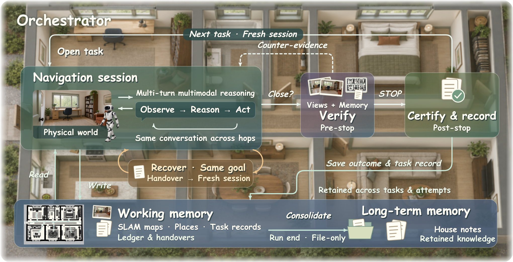
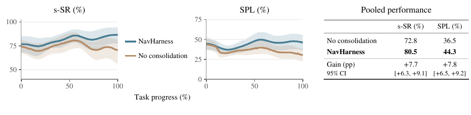

# NavHarness (arXiv 2026)

<!-- paper-source: https://chengwei920412.github.io/paper_reading/2609.34276_NavHarness_Towards_Lifelong_Embodied_Navigation/technical_report.html -->

> **arXiv ID**：2609.34276  
> **原文标题**：NavHarness: Towards Lifelong Embodied Navigation  
> **翻译日期**：2026-10-08

## 📋 论文概览 {#_1}

### 基本信息 {#_2}

- **作者**：Xunyi Zhao、Jian Zhou、Sihao Lin、Gengze Zhou、Zerui Li、Xinyu Yan、Jiajun Liu、Anton van den Hengel、Qi Wu
- **机构**：阿德莱德大学、AIML 负责任人工智能研究中心、CSIRO Data61
- **发布时间**：2026-09-28
- **领域**：具身智能、视觉语言导航、长期记忆、智能体执行框架

### 核心贡献 {#_3}

NavHarness 将记忆读取、核验、修订和跨会话传递直接纳入导航控制循环，无须针对导航进行额外训练。其主要贡献包括：

1. 提出一套面向连续任务的具身执行框架，使全新推理会话可以继承地图、任务记录和房屋知识。
2. 用结构化恢复交接记录连接同一任务的多次尝试，并通过停止前验证和停止后认证降低错误完成声明的影响。
3. 在 GOAT-Bench 和 IR2R-CE 上，以 SLAM 估计位姿取得最先进结果，并通过组件干预、连续部署和案例研究分析性能来源。
4. 证明运行结束时的记忆整合在保留地图和详细任务记录之外仍有独立价值。

## 🎯 研究背景与动机 {#_4}

### 问题定义 {#_5}

单次具身导航任务可以依靠多轮视觉语言推理完成，但终身导航要求机器人连续执行多个目标：每项任务从上一任务终点开始，地图和搜索记录不断增长，新观察还可能与旧记录冲突。核心问题不是“是否保存经验”，而是如何让后续会话有选择地读取、核验、修订并复用经验。

### 现有方法的局限性 {#_6}

- 单任务会话在任务切换后丢失搜索证据，容易重复探索。
- 仅保存地图无法表达“哪些区域已经检查”“某次搜索为何失败”等过程信息。
- 普通摘要会遗漏排除证据、未决选项和不确定性，恢复效果弱于结构化交接记录。
- 坐标系漂移、错误完成认证和过度概括的规则可能把错误写入长期记忆。

### 本文的创新点 {#_7}

本文把记忆视为控制循环中的可操作状态，而不是一次性检索库。导航会话会在行动过程中读取文件、比较当前观察、更新标记并记录修正；外层编排器则负责会话边界、恢复、验证、认证和整合。

## 🔬 方法论 {#_8}

### 整体架构 {#_9}

图：NavHarness 执行流程。编排器管理导航会话、持久记忆、恢复与任务闭合。

系统包含三层记忆：

- **活动上下文**：当前尝试中的目标、推理、观察和已检索信息。
- **工作记忆**：跨任务和尝试保留的占据地图、地点标记、任务台账、交接记录与恢复记录。
- **长期记忆**：经整合形成的房屋概览、房间笔记、索引与导航技能。

这些层级并非彼此隔离：同一地图可从当前运行的工作记忆转为后续运行可复用的房屋记忆。

### 关键技术 {#_10}

1. **会话编排**：每个任务开启新会话，同一任务可通过恢复开启新尝试；所有尝试共享任务预算。
2. **结构化交接**：任务交接记录保存目标、搜索位置、结果证据和未完成搜索；恢复记录强调排除证据、可靠地标与剩余选项。
3. **空间记忆**：ORB-SLAM3 提供 RGB-D 位姿估计，建图器维护占据栅格、楼层、地点标记与照片。
4. **完成检查**：停止前验证可将一次相反裁决返回当前会话；停止后认证记录最终结论，但不修改环境分数。
5. **运行结束整合**：独立会话将详细任务日志提炼为房屋笔记，并保留来源引用与未决问题。

### 算法流程 {#_11}

对每个目标，编排器准备可用记忆引用并开启导航会话；会话以“观察—推理—工具调用—记忆访问”循环推进。若搜索停滞，则写入恢复记录并在剩余预算内开启全新会话；若请求闭合，则先写入任务交接记录并执行验证。任务结束后更新台账，运行结束时再进行长期记忆整合。

## 📊 实验与结果 {#_12}

### 实验设置 {#_13}

- **数据集**：GOAT-Bench 验证集未见划分的 2,669 个子任务、360 个 episode、36 个场景；IR2R-CE 的 36 条 tour、1,824 个任务、11 个场景。
- **推理核心**：Qwen3.8-27B、GPT-4o、Opus 5、GPT-6 Astra。
- **指标**：单任务成功率 s-SR、整条任务序列成功率 e-SR、路径效率 SPL、轨迹相似度 t-nDTW。
- **关键对照**：独立会话、单会话、移除地图/台账/恢复/验证/认证、普通摘要、固定记忆访问、关闭运行结束整合。

### 主要结果 {#_14}

<table>
<thead>
<tr>
<th>设置</th>
<th>GOAT-Bench s-SR</th>
<th>SPL</th>
<th>e-SR</th>
</tr>
</thead>
<tbody>
<tr>
<td>GPT-6 Astra 独立会话</td>
<td>65.1</td>
<td>40.1</td>
<td>13.6</td>
</tr>
<tr>
<td><strong>GPT-6 Astra + NavHarness</strong></td>
<td><strong>83.7</strong></td>
<td><strong>62.3</strong></td>
<td><strong>36.9</strong></td>
</tr>
<tr>
<td>GPT-4o 独立会话</td>
<td>43.5</td>
<td>30.2</td>
<td>6.4</td>
</tr>
<tr>
<td>GPT-4o + NavHarness</td>
<td>78.3</td>
<td>57.1</td>
<td>26.9</td>
</tr>
<tr>
<td>Qwen3.8-27B 独立会话</td>
<td>41.4</td>
<td>27.5</td>
<td>3.1</td>
</tr>
<tr>
<td>Qwen3.8-27B + NavHarness</td>
<td>71.7</td>
<td>48.2</td>
<td>14.4</td>
</tr>
</tbody>
</table>

NavHarness 相对同骨干独立会话的 GOAT-Bench s-SR 增益分别为：Qwen3.8-27B +30.3、GPT-4o +34.8、Opus 5 +22.6、GPT-6 Astra +18.6 个百分点。GPT-6 Astra 在 IR2R-CE 上达到 85.9% s-SR 和 76.1 SPL。

### 消融实验 {#_15}

- 关闭全部跨任务记忆后，s-SR 从 81.5% 降至 66.8%，下降 14.7 个百分点。
- 替换恢复记录造成 13.0 个百分点损失；完全关闭恢复造成 10.4 个百分点损失。
- 移除持久地图与地点标记损失 12.6 个百分点，移除台账损失 9.7 个百分点。
- 普通等长摘要仅达到 73.2% s-SR，而完整结构化交接达到 81.5%。
- 在 36 所房屋的持续部署中，运行结束整合将汇总 s-SR 从 72.8% 提升至 80.5%，SPL 从 36.5 提升至 44.3。

图：36 所房屋持续部署中的性能进展。

## 💡 关键见解 {#_16}

### 理论与机制分析 {#_17}

最重要的结论是：经验的组织与使用方式和经验本身同样重要。结构化交接记录明确区分“已经搜索”与“有证据排除”，因此比同长度普通摘要更适合恢复。长期整合则把重复出现的路线、房间描述、失败模式和未决问题组织为可检索知识。

案例分析还表明，记忆使用必须是条件化的。标记可能因 SLAM 坐标系重置而在度量上失效，但地标描述仍然有用；一条旧规则可能与当前目标图像矛盾，但同一笔记中的房间信息仍可保留。系统需要复用记忆的一部分，同时拒绝或修订另一部分。

### 实践启示 {#_18}

- 长时程智能体应保存过程证据，而不只是最终成功/失败标签。
- 恢复应继承外部状态和剩余预算，但不继承已经陷入局部循环的对话。
- 摘要必须保存适用条件和信息来源，否则正确补救方法可能因错误原因被过度泛化。
- 验证器输出同样会犯错，不能把认证结果无条件视为长期事实。

## 🔍 局限性与未来工作 {#_19}

### 当前局限 {#_20}

1. 实验均在静态仿真环境中进行，尚未覆盖真实机器人通信、避障、传感器噪声和独立轨迹测量。
2. 系统平均每任务需要约 38--45 个模型轮次，推理和工具调用延迟较高。
3. 当前空间表示不能处理物体移动、时间变化或可操作物体状态；SLAM 闭环修正也不会回写既有占据栅格。
4. 错误验证结果可能传播进房屋笔记，笔记的副本也未必同步修订。
5. Qwen3.5-4B 与 9B 在多轮多模态导航中表现较弱，说明执行框架仍依赖具备足够推理能力的核心模型。

### 未来方向 {#_21}

- 在动态真实环境中评估长期记忆修订与物体变化检测。
- 采用更快的本地控制器负责短时 rollout，让大模型聚焦目标、记忆和任务边界。
- 引入稠密 3D/4D、变化感知空间记忆，并保持与文本证据的来源对齐。
- 设计可扩展的长期记忆检索与冲突解决策略，避免房屋档案随部署时长增长而过载。
- 对判别器标签进行独立验证，并利用完整过程记录开展长时程后训练或过程监督。

## 📚 相关工作对比 {#_22}

<table>
<thead>
<tr>
<th>方法</th>
<th>核心思想</th>
<th>优势</th>
<th>局限</th>
</tr>
</thead>
<tbody>
<tr>
<td>3D-Mem / GSMem</td>
<td>保存三维场景与可渲染空间记忆</td>
<td>强空间表征与视觉回溯</td>
<td>通常依赖专门感知、渲染或规划模块</td>
</tr>
<tr>
<td>MemoryExplorer</td>
<td>学习主动记忆检索策略</td>
<td>可针对探索优化访问行为</td>
<td>需要训练，工具交互轮次有限</td>
</tr>
<tr>
<td>SSMG-Nav</td>
<td>用语义骨架图保存长期场景知识</td>
<td>结构化空间关联</td>
<td>重点是场景记忆，而非跨会话证据交接</td>
</tr>
<tr>
<td><strong>NavHarness</strong></td>
<td>在通用多轮会话中联合地图、任务记录、验证、恢复与整合</td>
<td>无需导航专门训练；跨任务、跨尝试复用证据</td>
<td>推理成本较高；依赖外部记忆质量和判别器可靠性</td>
</tr>
</tbody>
</table>

## 🎓 评价 {#_23}

### 优点 {#_24}

- 同骨干对照、组件干预和多房屋持续部署形成了较完整的证据链。
- 不只报告最终分数，还利用任务日志解释记忆如何改变具体决策。
- 明确暴露错误记忆、坐标系漂移和错误认证等失败模式，分析较为诚实。
- 训练无关设计使框架可替换不同推理核心和空间后端。

### 可改进之处 {#_25}

- “完整系统”同时改变地图、恢复、验证和记忆组织，部分主结果难以归因到单一机制。
- 大量案例分析是行为解释而非随机化效应估计，不能直接推断总体发生频率。
- 仍需真实机器人、动态环境和更长部署周期验证系统稳定性。

### 推荐阅读对象 {#_26}

适合研究具身智能、视觉语言导航、长期记忆、智能体执行框架、上下文工程和多会话代理系统的读者。

## 📎 附录 {#_27}

### 重要公式 {#_28}

任务闭合时的状态可写为：

\[X_k=(C_k,M_k,L_k,D_h), \qquad M_k=(\{G^{(f)}\}_f,\mathcal P_k,\Gamma_k), \qquad L_k=(r_1,\ldots,r_k),\]

其中 \(C_k\) 为活动上下文，\(G^{(f)}\) 为占据栅格，\(\mathcal P_k\) 为地点与视图，\(\Gamma_k\) 为地点图，\(L_k\) 为任务记录，\(D_h\) 为房屋笔记。

### 术语表 {#_29}

<table>
<thead>
<tr>
<th>英文</th>
<th>中文</th>
</tr>
</thead>
<tbody>
<tr>
<td>Embodied Harness</td>
<td>具身执行框架</td>
</tr>
<tr>
<td>Lifelong Navigation</td>
<td>终身导航</td>
</tr>
<tr>
<td>Working Memory</td>
<td>工作记忆</td>
</tr>
<tr>
<td>House Notes</td>
<td>房屋笔记</td>
</tr>
<tr>
<td>Handover</td>
<td>交接记录</td>
</tr>
<tr>
<td>Recovery</td>
<td>恢复</td>
</tr>
<tr>
<td>Task Closure</td>
<td>任务闭合</td>
</tr>
<tr>
<td>Consolidation</td>
<td>整合</td>
</tr>
<tr>
<td>Ledger</td>
<td>台账</td>
</tr>
<tr>
<td>Pre-Stop Verification</td>
<td>停止前验证</td>
</tr>
<tr>
<td>Post-Stop Certification</td>
<td>停止后认证</td>
</tr>
</tbody>
</table>

### 参考资源 {#_30}

- **论文原文**：[arXiv](https://arxiv.org/abs/2609.34276)
- **中文翻译 PDF**：[paper_cn.pdf](https://chengwei920412.github.io/paper_reading/2609.34276_NavHarness_Towards_Lifelong_Embodied_Navigation/paper_cn.pdf)
- **中文 Markdown 译文**：[paper_cn.md](https://chengwei920412.github.io/paper_reading/2609.34276_NavHarness_Towards_Lifelong_Embodied_Navigation/paper_cn.html)
- **代码实现**：[NavHarness GitHub](https://github.com/billzhao1030/NavHarness)
- **项目主页**：[NavHarness Project Page](https://billzhao1030.github.io)
