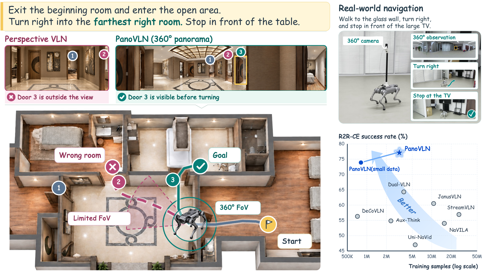
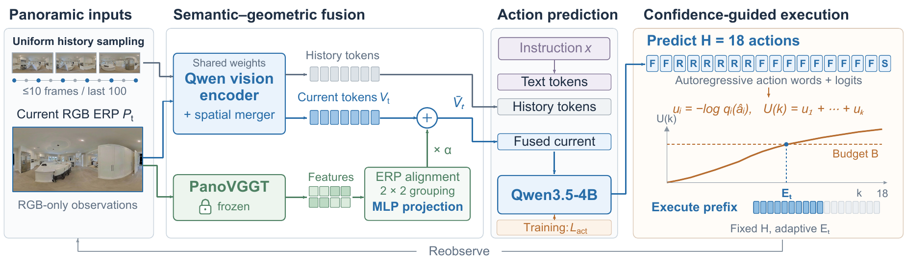
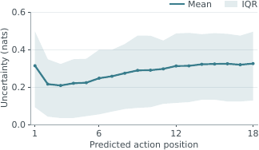
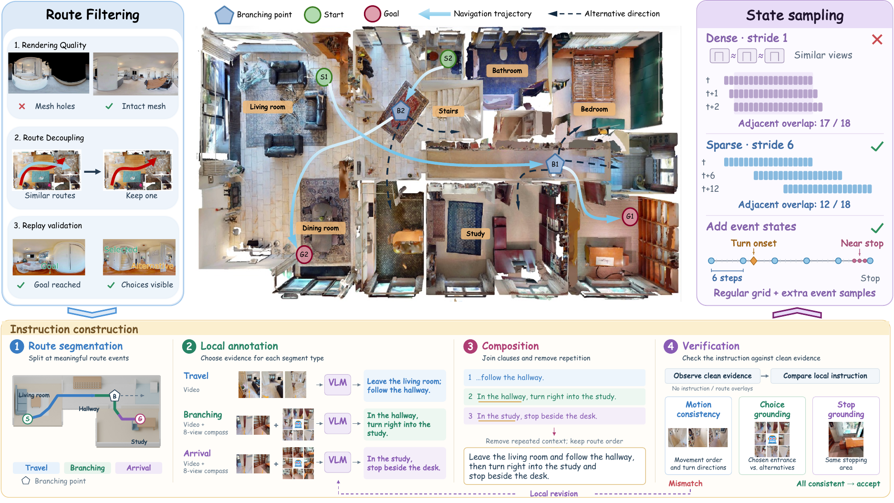
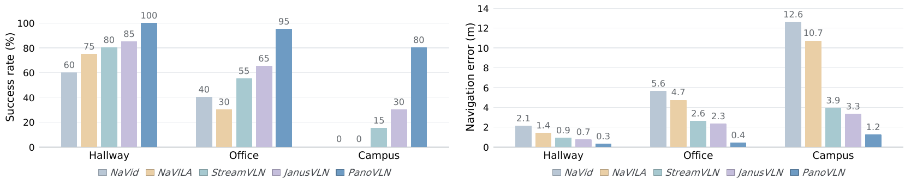
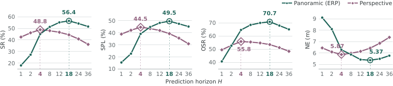

# PanoVLN (arXiv 2026)

<!-- paper-source: https://chengwei920412.github.io/paper_reading/2609.34759_PanoVLN_Towards_Effective_Panoramic_Vision_and_Language_Navigation/technical_report.html -->

> **arXiv ID**：2609.34759  
> **原文标题**：PanoVLN: Towards Effective Panoramic Vision-and-Language Navigation  
> **翻译日期**：2026-10-06

---

## 📋 论文概览 {#_1}

### 基本信息 {#_2}

- **作者**：Zhen Wang、Changpeng Wang、Zhe Liu、Zhangyang Qi、Yuxiang Lu、Zimo Zeng、Donglian Qi、Xi Chen
- **机构**：浙江大学、香港大学
- **发表时间**：2026 年 9 月（arXiv 预印本，采用 ICLR 2027 论文模板）
- **领域**：具身智能、视觉—语言导航、全景视觉、多模态大模型

### 核心贡献 {#_3}

PanoVLN 研究一个看似简单、实则容易失效的问题：将透视相机输入换成 \(360^\circ\) 全景图后，导航策略为何没有自然变强？论文给出的答案是，全景图只有与训练目标、执行策略、数据分布和视觉表征协同设计时，才能真正发挥宽视野优势。

主要贡献包括：

1. 使用更长的动作序列监督，让训练目标覆盖全景图中已经可见的路线分岔及其后续移动。
2. 提出置信度引导执行（Confidence-Guided Execution，CGE），依据动作不确定性自适应决定重新观测前执行多少步。
3. 构建 98K 条决策密集轨迹，覆盖 800 个 HM3D 场景，并在转弯点与停止点附近加强采样。
4. 在固定视觉 token 预算下，将 VLM 语义特征与 PanoVGGT 几何特征按全景区域对齐融合。
5. 在 R2R-CE、RxR-CE 和真实四足机器人实验中，同时提高导航成功率与执行效率。

---

## 🎯 研究背景与动机 {#_4}

### 问题定义 {#_5}

视觉—语言导航（Vision-and-Language Navigation，VLN）要求智能体根据自然语言指令和视觉观测，在未知环境中输出 `forward`、`left`、`right`、`stop` 等低层动作。透视图像视场有限：路线转向后，目标通道可能落在当前画面之外；全景图则能一次呈现四周通道、地标和备选路线。

然而，将透视图直接替换成等距柱状全景图（Equirectangular Panorama，ERP）并不能稳定提升性能。原因并非信息不足，而是学习目标和执行方式没有要求模型利用新增信息。

### 现有方法的局限性 {#_6}

- **短动作目标与宽视野不匹配**：不同路线在起始数步可能拥有相同动作，短时域监督无法奖励模型识别远处的分岔线索。
- **固定执行长度缺乏状态适应性**：长序列越往后越不可靠；固定短前缀会频繁调用策略，固定长前缀又容易累计错误。
- **训练数据决策密度不足**：现有轨迹包含大量重复的直行状态，真正决定路线切换和停止的状态较稀少。
- **仅靠语义特征难以表达全景空间关系**：识别“门”“走廊”仍不足以判断它们在球面视野中的相对方向与连通关系。

### 本文的创新点 {#_7}

PanoVLN 的关键不是单一模块，而是将“看得更广”落实为四个相互配合的设计：长时域监督教会模型利用远处路线信息，CGE控制可信执行范围，决策中心数据强化分岔与终止状态，几何融合补充跨方向空间结构。

图：全景观测让智能体在转向前看到透视视野之外的目标通道，并在仿真和真实环境中提升成功率。

---

## 🔬 方法论 {#_8}

### 整体架构 {#_9}

在步骤 \(t\)，模型接收语言指令 \(x\)、当前 ERP \(P_t\) 和采样得到的全景历史 \(\mathcal{P}_{&lt;t}\)。Qwen3.5-4B 视觉编码器提取语义特征；冻结的 PanoVGGT 从当前 RGB 全景图提取几何特征。两类特征按 ERP 区域对齐后进行残差融合，再由语言模型自回归预测长度为 \(H=18\) 的动作序列。CGE 根据各位置动作的不确定性选择可信前缀执行。

图：PanoVLN 整体流程。当前与历史全景图共享视觉 token 预算，几何特征增强当前 token，CGE 决定动作前缀长度。

### 关键技术 {#_10}

**1. 长动作序列监督**

训练目标包含后续 \(H\) 个专家动作，轨迹结束后的空位用 `stop` 填充。采用教师强制最小化平均动作负对数似然：

\[\mathcal{L}_{\mathrm{act}}=-\frac{1}{H}\sum_{i=1}^{H}\log p_\theta\left(a_{t,i}^{*}\mid\mathcal{O}_t,\mathbf{A}_{t,&lt;i}^{*}\right).\]

长目标不仅包含到达分岔点前的共同动作，还包含具体选择及后续移动，因此会把全景图中的区分性线索纳入监督。

**2. 置信度引导执行**

对动作位置 \(i\)，将 logit \(z_{t,i}(a)\) 归一化为 \(q_{t,i}(a)\)，以预测动作的负对数概率作为不确定性：

\[q_{t,i}(a)=\frac{\exp z_{t,i}(a)}{\sum_{b\in\mathcal{A}}\exp z_{t,i}(b)},\qquad
u_{t,i}=-\log q_{t,i}(\hat a_{t,i}).\]

定义累计不确定性 \(U_t(k)=\sum_{i=1}^{k}u_{t,i}\)，则执行长度为：

\[E_t=\max\left\{k\in\{1,\ldots,H\}:k\le E_{\min}\ \text{or}\ U_t(k)\le B\right\}.\]

默认配置为 \(B=1.2\)、\(E_{\min}=4\)。这使模型在高置信度时连续运动，在不确定性变大时尽早重新观测。

图：动作不确定性会随预测位置和策略调用而变化，支持采用自适应而非固定执行长度。

**3. 决策中心数据构建**

论文在 800 个 HM3D 场景中构建 98K 条轨迹，筛选包含频繁路径分岔的路线。Qwen3.8-27B 根据第一人称路线视频和八视角罗盘图生成指令，再通过运动一致性、路径选择指称与终点指称三类检查验证。训练状态采用步长 6 的网格采样，并额外加入连续转弯起点和接近终止点的状态。

图：路线构建、指令生成与验证、决策状态采样组成的数据流程。

**4. 几何感知视觉表征**

当前 ERP 获得较多视觉 token，历史帧使用较粗粒度表示。在不增加 token 数量的前提下，将 PanoVGGT 几何特征 \(G_t\) 投影至 VLM token 空间并残差融合：

\[\bar V_t=V_t+\alpha f_\psi(G_t),\qquad \alpha=0.2.\]

几何编码器保持冻结，只训练 VLM 与投影层。

### 算法流程 {#_11}

1. 输入语言指令、当前 ERP 和至多 10 帧历史全景观测。
2. 提取当前与历史图像的语义 token，并从当前 ERP 提取 PanoVGGT 几何特征。
3. 将几何特征按对应 ERP 区域对齐、分组、投影并融合进当前视觉 token。
4. 自回归预测 18 个动作及每个位置的动作分布。
5. 累加预测动作的不确定性，依据 CGE 选择至少 4 步的可信前缀。
6. 执行前缀；若未输出 `stop`，获取新观测并重新规划。

---

## 📊 实验与结果 {#_12}

### 实验设置 {#_13}

- **数据集**：R2R-CE、RxR-CE 未见验证集；真实世界 Hallway、Office、Campus 三类环境
- **仿真平台**：Matterport3D 场景与 Habitat
- **真实平台**：Unitree Go2、离地 1.5 m 的 Insta360 X5、远程 RTX 3090
- **评估指标**：导航误差（NE）、预言成功率（OS）、成功率（SR）、路径长度加权成功率（SPL）、归一化动态时间规整（nDTW）
- **对比方法**：CMA、ETPNav、ScaleVLN、NaVid、NaVILA、StreamVLN、JanusVLN、DualVLN、AwareVLN、CorrectNav 等

### 主要结果 {#_14}

<table>
<thead>
<tr>
<th>方法</th>
<th>R2R-CE SR↑</th>
<th>R2R-CE SPL↑</th>
<th>RxR-CE SR↑</th>
<th>RxR-CE SPL↑</th>
</tr>
</thead>
<tbody>
<tr>
<td>CorrectNav</td>
<td>65.1</td>
<td>62.3</td>
<td>69.3</td>
<td>63.3</td>
</tr>
<tr>
<td>PanoVLN（受限数据）</td>
<td>73.9</td>
<td>67.9</td>
<td>74.1</td>
<td>63.9</td>
</tr>
<tr>
<td><strong>PanoVLN</strong></td>
<td><strong>77.3</strong></td>
<td><strong>70.6</strong></td>
<td><strong>78.0</strong></td>
<td><strong>65.9</strong></td>
</tr>
</tbody>
</table>

PanoVLN 的 SR 相对此前最佳结果在 R2R-CE 和 RxR-CE 上分别提高 11.9 与 8.7 个百分点。受限数据版本同样领先对应比较组，说明改进并非完全依赖额外构建数据。

真实世界实验中，PanoVLN 的平均导航时间为 86.4 s、速度为 25.7 cm/s、等待时间占比为 13.6%、暂停 5.4 次、策略调用 7.4 次。与 StreamVLN 的 117.8 s 和 34.3 次调用相比，长序列预测与 CGE 显著减少了重规划开销；其单次推理延迟并非最低，整体效率仍然最好。

图：Hallway、Office 和 Campus 上的真实世界成功率与导航误差对比。

### 消融实验 {#_15}

- **预测时域**：透视策略在 \(H=4\) 附近达到峰值，全景策略则偏好 \(H=18\)，验证了“监督长度应匹配可见路线范围”的假设。
- **状态采样**：决策感知采样将 R2R-CE 的 SR 从 56.4 提升至 62.8，SPL 从 49.5 提升至 57.2；OS 基本持平，说明主要改善来自更可靠的停止与路线切换。
- **执行策略**：CGE 在 R2R-CE 上达到 SR 66.6、SPL 61.5，在 RxR-CE 上达到 SR 66.5、SPL 56.4，优于所有固定长度和随机长度策略。
- **几何编码器**：PanoVGGT 在两个基准上分别达到 SR 68.6 和 67.1；UniK3D、DA\(^2\)、DAP 的效果不一致，说明与 ERP 结构匹配的全景几何特征更适合此任务。
- **训练数据**：改写 ScaleVLN 指令可带来增益，而同时改进路线决策密度与指令质量的完整流程在各训练规模下表现最好。

图：全景策略在较长预测时域下超过透视策略。

---

## 💡 关键见解 {#_16}

### 理论分析 {#_17}

这项工作的核心可概括为“可见信息—监督范围—执行范围”的一致性：

- ERP 扩大的是当前可见路线范围；若目标序列在路线分岔前结束，额外信息不会影响损失。
- 延长监督时域后，模型必须利用全景中的远处线索区分动作目标。
- 预测时域延长会引入不确定性，因此执行范围不能机械地等于监督范围；CGE 将二者解耦。
- 几何融合不增加 token 数量，而是提高每个当前视觉 token 对空间布局的表达能力。

这种设计比“增加输入信息即可提高性能”的直觉更完整：信息只有进入训练信号并被执行策略正确消费，才会转化为行为收益。

### 实践启示 {#_18}

- 对具身策略，感知范围扩大后应同步检查目标时域和动作执行机制。
- 训练样本数量之外，决策状态密度和指令可判别性是更直接的数据质量指标。
- 降低每次推理延迟并非唯一的系统优化方向；减少策略调用次数可获得更大的端到端收益。
- 冻结专用几何编码器并进行轻量残差融合，是兼顾空间能力与训练成本的工程方案。

---

## 🔍 局限性与未来工作 {#_19}

### 当前局限 {#_20}

1. 真实世界评估使用 20 组共享指令—路线对，规模仍小于仿真测试，尚不足以覆盖动态障碍、照明剧变和长期运行故障。
2. 观测来自单个全景相机，方法未显式处理运动模糊、镜头污染、遮挡或全景拼接伪影。
3. CGE 以模型自身概率作为置信度来源，若概率未校准，可能在分布外环境中过度自信。
4. 额外 PanoVGGT 编码器增加显存和计算开销；论文报告约 12 GB GPU 显存，但没有系统比较功耗与嵌入式部署成本。
5. 决策中心数据构建依赖大模型生成与多阶段验证，数据生成成本及不同语言、不同文化地标描述下的鲁棒性仍待研究。
6. 论文主要比较低层离散动作策略；对连续控制、动态重规划和多人环境的适用性尚未验证。

### 未来方向 {#_21}

- 对 CGE 进行温度缩放、保序校准或风险约束，使不确定性预算具备更稳定的跨场景含义。
- 将长时域动作预测扩展为分层路线片段或可变长度技能，减少离散动作序列的冗余。
- 引入动态障碍预测和闭环安全控制，在保持低调用频率的同时避免长前缀执行风险。
- 研究轻量全景几何编码器、蒸馏或缓存机制，以适配机载计算平台。
- 扩展多语言指令、室外长距离路线和跨机器人形态评估。

---

## 📚 相关工作对比 {#_22}

<table>
<thead>
<tr>
<th>方法</th>
<th>核心思想</th>
<th>优势</th>
<th>劣势</th>
</tr>
</thead>
<tbody>
<tr>
<td>航点/地图方法（ETPNav、HNR 等）</td>
<td>预测可达航点并维护空间表征</td>
<td>规划结构明确、可利用深度与里程计</td>
<td>依赖多传感器或专用航点模块</td>
</tr>
<tr>
<td>透视 VLM 策略（NaVid、NaVILA、StreamVLN 等）</td>
<td>由 VLM 根据透视观测与历史直接预测动作</td>
<td>架构统一、语义理解强</td>
<td>视场受限，频繁重规划导致等待和停顿</td>
</tr>
<tr>
<td><strong>PanoVLN</strong></td>
<td>全景输入、长时域监督、CGE、决策中心数据和几何融合</td>
<td>RGB-only 条件下成功率高，真实执行连续且调用少</td>
<td>需要全景相机和额外几何编码器，置信度校准仍有限</td>
</tr>
</tbody>
</table>

---

## 🎓 个人评价 {#_23}

### 优点 {#_24}

论文最强之处是问题诊断清晰：它没有把性能提升简单归因于全景输入，而是通过时域、采样、执行和几何消融逐层验证信息为何未被利用。仿真指标与真实系统效率相互呼应，尤其是“单次延迟并非最低，但总时间最佳”的结果，很好地说明了端到端系统指标的重要性。

### 可改进之处 {#_25}

更完整的真实世界统计、置信度校准曲线、失败案例分类和算力—性能曲线会进一步增强结论。当前设计中的多个组件相互耦合，若能报告跨随机种子方差及更细的组合消融，将更有助于判断各模块的独立贡献与稳定性。

### 推荐阅读对象 {#_26}

适合从事视觉—语言导航、具身 VLM、机器人决策、全景视觉、模型不确定性和真实机器人部署的研究者与工程师阅读。对于设计“低频规划、高连续执行”系统的人，CGE 与长时域监督的解耦尤其值得参考。

---

## 📎 附录 {#_27}

### 重要公式 {#_28}

1. 长时域动作监督：

\[\mathcal{L}_{\mathrm{act}}=-\frac{1}{H}\sum_{i=1}^{H}\log p_\theta\left(a_{t,i}^{*}\mid\mathcal{O}_t,\mathbf{A}_{t,&lt;i}^{*}\right).\]

1. 动作不确定性：

\[u_{t,i}=-\log q_{t,i}(\hat a_{t,i}).\]

1. CGE 执行长度：

\[E_t=\max\left\{k:k\le E_{\min}\ \text{or}\ U_t(k)\le B\right\}.\]

1. 几何特征融合：

\[\bar V_t=V_t+\alpha f_\psi(G_t).\]

### 术语表 {#_29}

<table>
<thead>
<tr>
<th>英文</th>
<th>中文</th>
</tr>
</thead>
<tbody>
<tr>
<td>Vision-and-Language Navigation (VLN)</td>
<td>视觉—语言导航</td>
</tr>
<tr>
<td>Vision-Language Model (VLM)</td>
<td>视觉语言模型</td>
</tr>
<tr>
<td>Equirectangular Panorama (ERP)</td>
<td>等距柱状全景图</td>
</tr>
<tr>
<td>Confidence-Guided Execution (CGE)</td>
<td>置信度引导执行</td>
</tr>
<tr>
<td>Prediction Horizon</td>
<td>预测时域</td>
</tr>
<tr>
<td>Decision-Centric Data Construction</td>
<td>决策中心数据构建</td>
</tr>
<tr>
<td>Geometry-Aware Visual Representation</td>
<td>几何感知视觉表征</td>
</tr>
<tr>
<td>Success Rate (SR)</td>
<td>成功率</td>
</tr>
<tr>
<td>Success Weighted by Path Length (SPL)</td>
<td>路径长度加权成功率</td>
</tr>
<tr>
<td>Navigation Error (NE)</td>
<td>导航误差</td>
</tr>
</tbody>
</table>

### 参考资源 {#_30}

- **论文原文**：[arXiv 链接](https://arxiv.org/abs/2609.34759)
- **中文翻译 PDF**：[paper_cn.pdf](https://chengwei920412.github.io/paper_reading/2609.34759_PanoVLN_Towards_Effective_Panoramic_Vision_and_Language_Navigation/paper_cn.pdf)
- **中文 Markdown 译文**：[paper_cn.md](https://chengwei920412.github.io/paper_reading/2609.34759_PanoVLN_Towards_Effective_Panoramic_Vision_and_Language_Navigation/paper_cn.html)
- **代码实现**：论文中未明确给出独立代码仓库
- **项目主页**：[PanoVLN Project](https://wangzhen-w.github.io/PanoVLN/)
