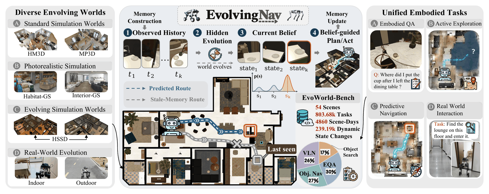
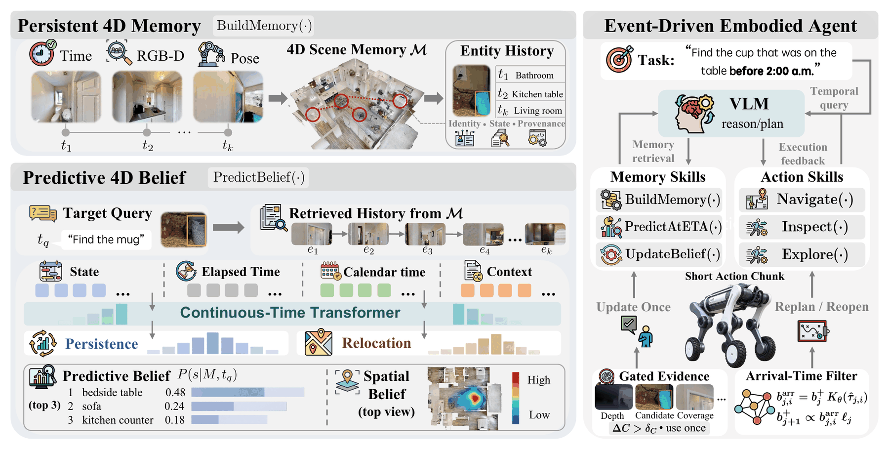
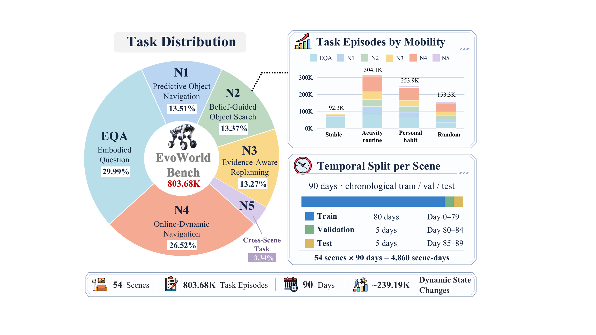
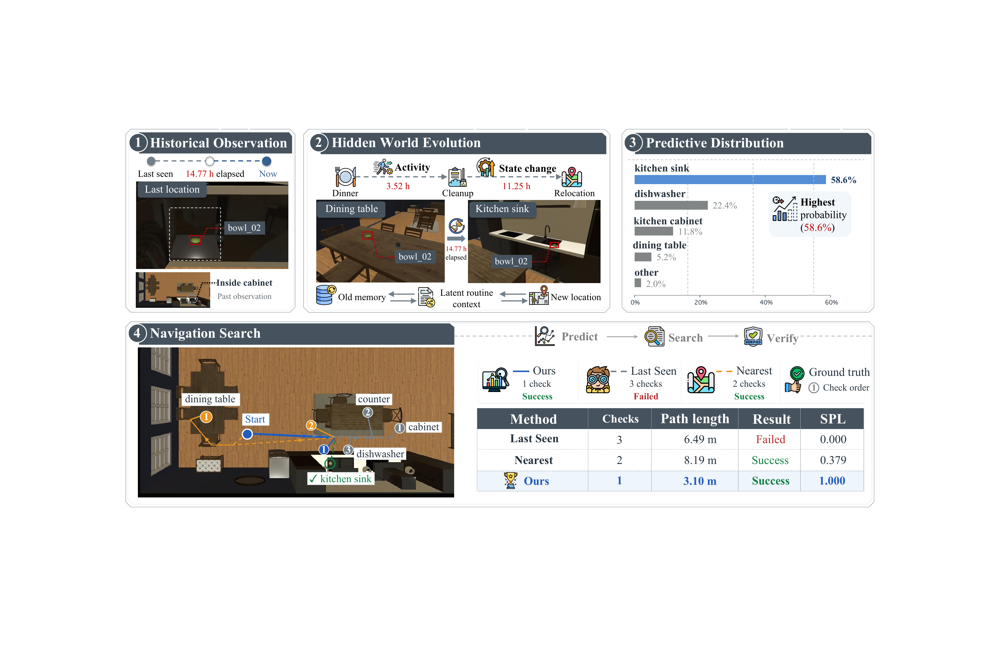
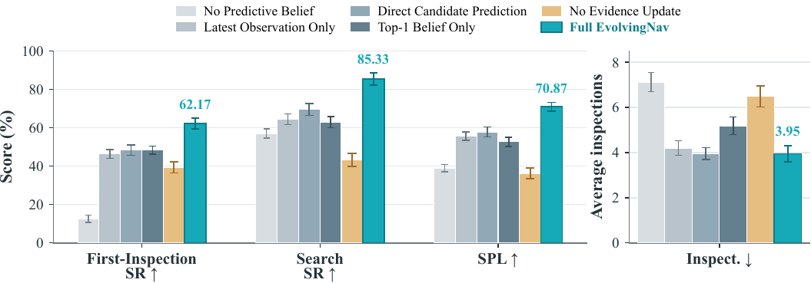

# EvolvingNav (arXiv 2026)

<!-- paper-source: https://chengwei920412.github.io/paper_reading/2609.39166_Beyond_the_Remembered_World_Predictive_4D_Belief_for_Persistent_Navigation_in_Evolving_Worlds/technical_report.html -->

> 原文链接：[EvolvingNav (arXiv 2026)](https://chengwei920412.github.io/paper_reading/2609.39166_Beyond_the_Remembered_World_Predictive_4D_Belief_for_Persistent_Navigation_in_Evolving_Worlds/technical_report.html)

> **arXiv ID**：2609.39166  
> **原文标题**：Beyond the Remembered World: Predictive 4D Belief for Persistent Navigation in Evolving Worlds  
> **翻译日期**：2026年10月6日

## 📋 论文概览 {#_1}

### 基本信息 {#_2}

- **作者**：Mingjian Gao、Zhaocheng Li、Haoyang Huang、Wenqiao Zhang、Yingjie Niu、Hao Zhou、Chao Li、Juncheng Li、Siliang Tang、Yueting Zhuang
- **机构**：浙江大学、加州大学圣地亚哥分校、云深处科技、香港中文大学
- **研究领域**：具身智能、长期空间记忆、动态环境导航、视觉—语言智能体、机器人学习
- **核心问题**：机器人依据历史记忆寻找目标时，目标可能在不可见期间、甚至导航执行期间发生移动。系统既不能把“最后一次看见的位置”当作当前真值，也不能完全抛弃历史从头搜索。

### 核心贡献 {#_3}

1. 提出“演化世界导航”问题：智能体必须根据间歇历史观测推断目标在未来检查时刻的位置，并在执行中持续吸收新证据。
2. 提出 **EvolvingNav**：以持续—迁移分解构造预测式4D信念，显式保留最后观测位置、其他候选位置以及未知位置的概率质量。
3. 设计事件驱动的“预测—观测—重规划”闭环：根据候选点预计到达时间预测目标占用概率，以可见性感知的负证据进行贝叶斯更新，并防止重复计数相关观测。
4. 构建 **EvoWorld-Bench**：包含54个场景、803,680个任务，以配对的静态、规律和随机世界评估时间模式、在线变化、证据恢复与跨场景泛化。

图：EvolvingNav 在演化世界中进行预测式具身推理与行动的总体框架。

## 🎯 研究背景与动机 {#_4}

长期运行的具身智能体会积累对象位置与空间关系，但“历史上正确”并不等于“当前仍正确”。例如，药盒可能在机器人未观察时从床头柜移回橱柜；即便查询开始时预测正确，目标也可能在机器人前往途中再次移动。

现有路线存在三类缺口：仅依赖最后观测容易导航到过期位置；从零开始搜索浪费可用历史；只做查询时刻的状态预测，又无法处理不同候选点的行程时间和执行期间的进一步演化。论文因此要求信念同时回答三个问题：目标现在可能在哪里、机器人抵达某候选点时可能在哪里、一次未检出究竟提供了多强的反证。

## 🔬 方法论 {#_5}

### 持久因果4D记忆 {#4d_1}

系统将RGB-D图像、相机位姿和时间戳注册到共享三维坐标系，通过语义、几何与时间关联实体。世界变化以版本增量追加，而不是覆盖旧记录，因此可在任意查询时刻恢复只包含过去信息的因果记忆。每个目标的历史事件包含对象、候选状态、时间、看见/未看见证据、置信度与可见性。

### 持续—迁移信念 {#_6}

P4D-Nav 将预测拆成两步：先估计目标仍停留在最后观测状态的概率 \(\rho_q\)，再在其他候选位置和 `unknown` 状态之间分配剩余概率。先验为：

\[b_q^-(i)=
\begin{cases}
\rho_q, &amp; i=s_{\mathrm{last}},\\
(1-\rho_q)\pi_q(i), &amp; i\neq s_{\mathrm{last}}.
\end{cases}\]

这种分解不会过早把不确定性压缩成单一目的地，并允许模型表达“目标已经移动，但不在已知候选集内”。历史编码器使用事件语义、证据特征、对数时间间隔、小时与星期等日历特征，适应不规则采样。

### 到达感知的动作选择 {#_7}

当前后验通过学习到的状态转移算子传播到每个候选点的预计到达时间。规划器综合目标到达时的占用概率、新增可见表面带来的检测概率、测地距离、耗时与检查成本：

\[i_j^*=\arg\max_i
\frac{p_{j,i}^{\mathrm{arr}}\widehat q_{j,i}^{\mathrm{new}}}
{d_{j,i}+\lambda_t\widehat\tau_{j,i}+\lambda_{\mathrm{inspect}}}.\]

这使“概率稍低但更近、更容易获得新证据”的候选点也可能优先于远处最高概率点。

### 可见性条件证据更新 {#_8}

未检测到目标并不等于目标不存在。系统根据投影几何、在线深度和视角特征估计检测概率 \(\widehat r_{j,i}\)；只有在候选区域确实被充分看见时，负观测才显著降低该位置概率。贝叶斯更新为：

\[b_j^+(i)=\frac{b_j^-(i)\ell_j(i)}
{\sum_u b_j^-(u)\ell_j(u)}.\]

系统还要求新增表面覆盖超过阈值才使用该证据，避免相邻视频帧被重复计数；随着时间继续推进，先前检查过的位置可以重新获得概率，而不会被永久排除。

图：持久4D记忆、预测式信念与事件驱动具身智能体的闭环。

## 📊 基准、实验与结果 {#_9}

### EvoWorld-Bench {#evoworld-bench}

基准包含54个HSSD场景和90天的时间序列，共4,860个“场景—天”以及803,680个任务。任务覆盖对象搜索、对象导航、视觉—语言导航和具身问答；N1至N5协议分别评估Top-1检查、全分布搜索、证据感知重规划、执行期间动态变化以及跨场景迁移。数据按完整时间序列划分，查询只暴露查询时刻以前的观测，并审计时间泄漏、元数据泄漏、近重复样本和配对世界一致性。

图：EvoWorld-Bench 的任务分布、移动模式与按场景划分的时间切分。

### 实验设置 {#_10}

- **仿真数据**：EvoWorld-Bench N1—N5、FindingDory、GOAT-Bench，以及MP3D、HM3D、Habitat-GS、InteriorGS中的原生任务。
- **真实机器人**：LYNX M20进行每种方法64次配对实验；X30与Lite3各使用32个配对迁移子集。单次任务限时360秒，最多检查3次。
- **控制器**：主实验使用冻结的零样本视觉—语言控制器；另以GPT-4o、GPT-5.5、GPT-5.6-Luna及Qwen2.5-VL-3B/32B做控制器依赖分析。
- **指标**：状态预测采用Top-1、MRR、NLL、ECE与真实状态排名；导航采用SR、SPL、首次检查成功率、恢复成功率、检查次数、距离和时间。

### 主要结果 {#_11}

在EvoWorld-Bench上，EvolvingNav将DynaMem的首次检查成功率从45.33%提升到61.32%，搜索成功率从71.94%提升到86.18%，SPL达到70.15%。在FindingDory上，其HL-SR为53.22%，在列出的方案中最高；在GOAT-Bench上，SR与SPL分别达到35.43%和12.98%。

当目标在执行期间移动时，相较PredictiveGraphs，EvolvingNav的动态成功率提高18.4个百分点，在线恢复成功率提高22.0个百分点；额外行程减少4.8米，成功重访率提高13.7个百分点。真实LYNX M20实验中，搜索成功率为48.4%，相比“Last Seen + Search”的26.6%提高21.8个百分点，同时平均距离从56.2米降至43.8米。

图：预测式搜索、最后观测优先与最近点优先在动态任务中的行为对比。

### 消融实验 {#_12}

去除预测式信念后，首次检查成功率从62.17%跌至12.51%；仅使用最新观测使搜索成功率下降20.91个百分点；只保留Top-1候选使搜索成功率下降22.41个百分点；取消证据更新则下降42.02个百分点，检查次数增至6.48。硬删除未检出候选会恶化所有证据更新指标，而经过校准的贝叶斯更新在真实状态排名、Top-1和ECE上最优。

图：预测信念、完整概率分布与在线证据更新等核心组件的消融结果。

## 💡 关键见解 {#_13}

1. **长期记忆应保存“证据”，而不是保存“真值”**：历史位置需要随时间传播为概率分布，才能描述未观测变化。
2. **预测时间必须与行动时间耦合**：候选点行程不同，统一在查询时刻排序会忽略目标在途中继续移动的可能性。
3. **负证据的价值取决于可见性**：看不见目标只有在“本应看见”时才构成强反证，硬删除会造成不可恢复的错误。
4. **未知状态是必要的概率出口**：没有候选集外质量时，模型会被迫把错误概率分给已知位置，产生虚假的确定性。
5. **收益主要来自可学习的时间结构**：相较最后观测策略，规律世界中的SR增益为22.36个百分点，而随机转移下仅为6.93个百分点；这限定了方法真正擅长的条件。

## 🔍 局限性与未来工作 {#_14}

### 当前局限 {#_15}

- 迁移模型依赖可学习的历史规律；在静态世界中方法落后于Last Seen，在随机转移下也落后于Direct Transformer。
- 候选状态与检查视角的质量仍受地图构建、感知和检测校准影响。
- 目标主要被建模为单对象状态，尚未充分覆盖多对象交互、因果关系和连续变化的任务目标。
- 真实机器人实验规模明显小于仿真基准，且最长任务时间、检查次数和平台范围仍有限。
- 冻结VLM负责高层工具调用，端到端可靠性仍可能受到提示、工具接口和控制器能力影响。

### 未来方向 {#_16}

论文明确提出研究交互对象和持续变化的目标。进一步可探索多对象联合信念、显式人类活动建模、风险敏感规划、主动选择最具信息量的观察位姿，以及在开放词汇感知误差下对不确定性进行联合校准。

## 🎓 综合评价 {#_17}

论文最突出的价值不是单独提高位置预测精度，而是把时间预测、概率信念、机器人行程与具身证据统一到一个可执行闭环中。持续—迁移分解和候选集外质量具有清晰可解释性；配对的静态/规律/随机世界也使“模型是否真正利用时间规律”这一问题能够被直接检验。

需要谨慎解读的是，性能优势并非对所有动态类型都成立。论文自己的对照说明：时间规律可学习时方法最有价值；变化完全随机或世界不变化时，更简单的策略可能更合适。因此，实际部署应先估计环境的可预测性，并允许系统在预测式策略与保守搜索策略之间自适应切换。

## 📎 术语表 {#_18}

<table>
<thead>
<tr>
<th>英文</th>
<th>中文</th>
</tr>
</thead>
<tbody>
<tr>
<td>Evolving-World Navigation</td>
<td>演化世界导航</td>
</tr>
<tr>
<td>Predictive 4D Belief</td>
<td>预测式4D信念</td>
</tr>
<tr>
<td>Persistence–Relocation Belief</td>
<td>持续—迁移信念</td>
</tr>
<tr>
<td>Causal 4D Memory</td>
<td>因果4D记忆</td>
</tr>
<tr>
<td>Event-Driven Filter</td>
<td>事件驱动滤波器</td>
</tr>
<tr>
<td>Arrival-Aware Action Selection</td>
<td>到达感知动作选择</td>
</tr>
<tr>
<td>Visibility-Qualified Measurement Update</td>
<td>可见性条件测量更新</td>
</tr>
<tr>
<td>Evidence Tracking</td>
<td>证据跟踪</td>
</tr>
<tr>
<td>Memory Staleness</td>
<td>记忆陈旧度</td>
</tr>
<tr>
<td>Inspection Budget</td>
<td>检查预算</td>
</tr>
</tbody>
</table>

## 参考资源 {#_19}

- **论文原文**：[arXiv 2609.39166](https://arxiv.org/abs/2609.39166)
- **中文翻译 PDF**：[paper_cn.pdf](https://chengwei920412.github.io/paper_reading/2609.39166_Beyond_the_Remembered_World_Predictive_4D_Belief_for_Persistent_Navigation_in_Evolving_Worlds/paper_cn.pdf)
- **中文 Markdown 译文**：[paper_cn.md](https://chengwei920412.github.io/paper_reading/2609.39166_Beyond_the_Remembered_World_Predictive_4D_Belief_for_Persistent_Navigation_in_Evolving_Worlds/paper_cn.html)
- **项目主页**：[EvolvingNav](https://zju4embodiedai.github.io/EvolvingNav/)
- **代码实现**：[ZJU4EmbodiedAI/EvolvingNav](https://github.com/ZJU4EmbodiedAI/EvolvingNav)
- **交互演示**：[Hugging Face Space](https://huggingface.co/spaces/ZJU4EmbodiedAI/EvolvingNav)
