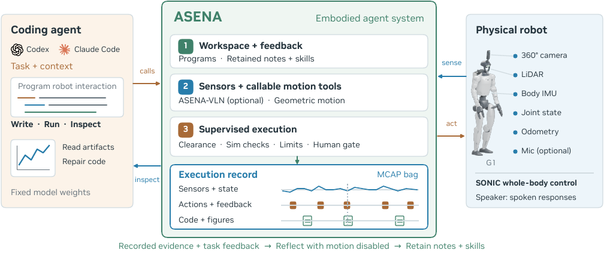
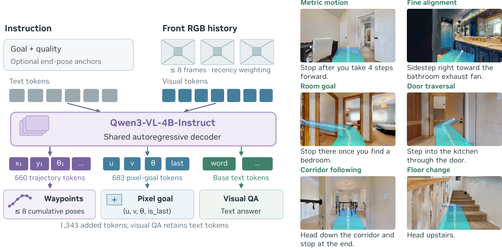
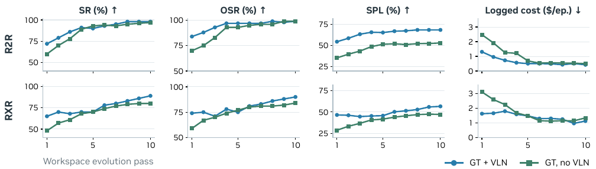
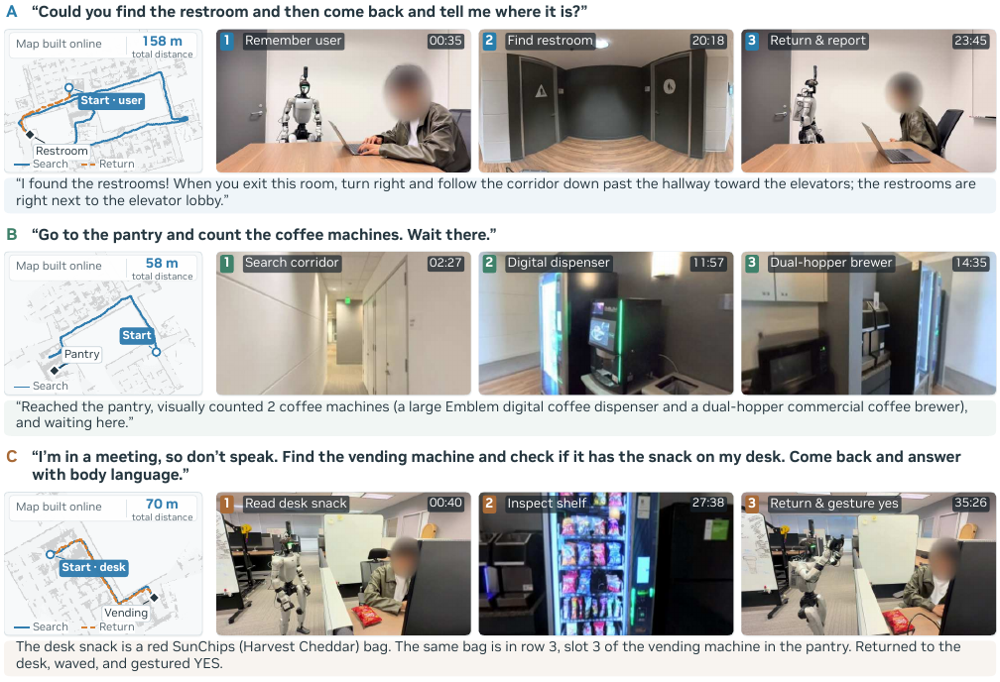

# ASENA-VLN (arXiv 2026)

<!-- paper-source: https://chengwei920412.github.io/paper_reading/2609.39207_ASENA_Self_evolving_Agents_for_Embodied_Navigation/technical_report.html -->

> 原文链接：[ASENA-VLN (arXiv 2026)](https://chengwei920412.github.io/paper_reading/2609.39207_ASENA_Self_evolving_Agents_for_Embodied_Navigation/technical_report.html)

> **arXiv ID**：2609.39207  
> **原文标题**：ASENA: Self-evolving Agents for Embodied Navigation  
> **翻译日期**：2026-10-06

---

## 📋 论文概览 {#_1}

### 基本信息 {#_2}

- **作者**：An-Chieh Cheng、Isabella Liu、Edmund Bu、Johan Bjorck、Hongxu Yin、Zhengyi Luo、Jan Kautz、Linxi “Jim” Fan、Yuke Zhu、Sifei Liu
- **机构**：NVIDIA；加州大学圣迭戈分校
- **领域**：具身智能、视觉语言导航、编程智能体、机器人学习

### 核心贡献 {#_3}

1. 提出 ASENA，将通用编程智能体连接到机器人感知、计算、可视化、仿真、监督执行和持久化工作区，使系统能在模型权重固定时通过修改程序、笔记和技能持续改进。
2. 提出 4B 单目导航策略 ASENA-VLN，以统一解码器同时处理路线跟随、短时域原子导航和视觉问答，并新增由场景几何生成的原子导航训练数据。
3. 在 R2R、RxR、ObjectNav 和具身问答上验证系统；同时在 Unitree G1 上演示无预建地图的搜索、检查、返回和手势交互。

---

## 🎯 研究背景与动机 {#_4}

### 问题定义 {#_5}

导航机器人面对的真实请求通常不是“走到目标点”这么单一。例如，机器人需要寻找自动售货机、检查商品、记住用户位置、返回并给出答案。这要求系统联合规划搜索、感知、计算、记忆、运动和交流，并根据新观测在线修改流程。

### 现有方法的局限性 {#_6}

- 单一学习式导航策略擅长运动，却难以覆盖开放式任务逻辑和新出现的工具组合。
- 纯编程智能体虽然灵活，但会产生大量重复感知—动作交互，且必须解决真实机器人上的执行安全、故障诊断和经验保留问题。
- 常见“训练后部署”范式把改进等同于更新模型权重，较少研究固定模型下工作区、程序和技能库如何演化。

### 本文的创新点 {#_7}

ASENA 把学习式策略降为可选工具，把核心能力建立在可检查的程序、执行记录和持久化工作区之上。系统既能直接以几何工具导航，也能调用 ASENA-VLN 承担低层运动；任务完成后再利用 MCAP 记录中的传感器、动作、代码、反馈和可视化结果修复程序并沉淀技能。

---

## 🔬 方法论 {#_8}

### 整体架构 {#_9}

图：ASENA 将编程智能体、机器人接口、监督执行、持久化工作区与可选导航策略组织为“编写—运行—检查”闭环。

系统由四层组成：

1. **感知与状态接口**：360° 相机、LiDAR、里程计、IMU、关节状态和可选麦克风。
2. **程序化工具层**：几何建图、路径规划、视觉检查、说话、手势和学习式导航。
3. **执行与安全层**：占据地图、间距检查、限速、心跳停止、人工审批，以及手势执行前的 MuJoCo 在线验证。
4. **持久化经验层**：保存笔记、可执行技能和执行记录，在不更新权重的情况下修订工作区。

### ASENA-VLN {#asena-vln}

图：共享视觉语言解码器使用不同词元块输出机体坐标系轨迹、像素目标或文本答案。

ASENA-VLN 使用单目历史观测与语言指令，预测八个机体坐标系航点。训练信号包含：

- R2R、RxR、ScaleVLN 等路线级轨迹；
- ObjectNav 轨迹和像素目标；
- 由几何信息生成的度量移动、转向、相对目标、穿门、走廊跟随和楼层变换等原子任务；
- 视觉问答数据。

部署到 Jetson AGX Thor 时，作者采用 FP8 量化并把输出词表从 152,596 项缩减到 768 项，同时保留全部 660 个轨迹词元。组件延迟总和由 2,806 ms 降至 877 ms，约为 3.20 倍加速。

### 工作区演化 {#_10}

多个工作智能体在私有工作区执行重复任务、保存程序和反思；独立改进智能体汇总轨迹和反馈，更新规范工作区。下一轮从新工作区继续，但模型、策略和控制器权重始终固定。因此，性能提升来自外部可编辑状态，而非参数微调。

---

## 📊 实验与结果 {#_11}

### 实验设置 {#_12}

- **导航数据集**：R2R、RxR、HM3D-v2、HM3D-OVON。
- **具身问答数据集**：HM-EQA、MT-HM3D。
- **指标**：导航误差（NE）、预言成功率（OSR）、成功率（SR）、路径长度加权成功率（SPL）、nDTW、工具调用次数、问答准确率和归一化探索步数。
- **编程后端**：Claude Sonnet 5 与 GPT-6 Astra；导航策略可按实验启用或禁用。

### 主要结果 {#_13}

<table>
<thead>
<tr>
<th>设置</th>
<th>关键结果</th>
</tr>
</thead>
<tbody>
<tr>
<td>ASENA-VLN 独立策略</td>
<td>R2R SR 68.7%，RxR SR 70.2%；R2R NE 3.52，RxR NE 3.90</td>
</tr>
<tr>
<td>ObjectNav 完整系统</td>
<td>HM3D-v2 达到 80.8 SR / 38.1 SPL；HM3D-OVON 未见类别达到 64.9 SR / 38.4 SPL</td>
</tr>
<tr>
<td>Claude Sonnet 5 + VLN</td>
<td>R2R 与 RxR 的 SR 均提高 11 个百分点</td>
</tr>
<tr>
<td>工具调用次数</td>
<td>Claude 后端在 R2R/RxR 分别减少 59.2%/62.5%；GPT-6 Astra 分别减少 46.9%/51.0%</td>
</tr>
<tr>
<td>重复任务工作区演化</td>
<td>十轮后 R2R SR 从 72% 提升到 98%，RxR 从 65% 提升到 89%</td>
</tr>
<tr>
<td>EQA</td>
<td>HM-EQA 最高准确率 81.2%；MT-HM3D 最高准确率 66.5%</td>
</tr>
<tr>
<td>EQA 导航消融</td>
<td>在 132 个 MT-HM3D 问题上，ASENA-VLN 使归一化探索步数中位数降低约 19%，准确率基本不变</td>
</tr>
</tbody>
</table>

### 工作区演化趋势 {#_14}

图：成功率、OSR 和 SPL 随演化轮次总体上升，每轮成本下降；VLN 工具持续改善路径效率。

### 真实机器人演示 {#_15}

图：Unitree G1 在无预建地图环境中完成洗手间寻路、茶水间设备检查和零食比对，并能返回用户位置与合成全身手势。

---

## 💡 关键见解 {#_16}

### 理论与系统层面的含义 {#_17}

本文把“智能体是否学习”从模型权重扩展到持久化外部状态。程序、笔记、技能和执行记录共同构成可演化策略的一部分；在重复任务中，它们能够积累流程知识并降低推理成本。

第二个重要结论是：学习式策略的价值依赖上层编程后端。较弱后端从专用导航策略中获得明显成功率增益，而强后端主要获得交互次数和执行效率收益；在部分 RxR 设置中，强后端启用策略后成功率反而略降。这说明策略调用本身需要良好的任务分解与融合机制。

### 实践启示 {#_18}

- 对真实机器人系统，先把执行、反馈、记录和安全接口做成稳定底座，再让智能体在线编程，可能比端到端训练更容易调试与扩展。
- 专用策略适合封装高频、低层、可批量执行的动作；开放式任务逻辑仍由编程智能体处理。
- 固定模型权重不等于系统能力固定。可版本化的工作区可提供更透明、可回滚的改进路径。

---

## 🔍 局限性与未来工作 {#_19}

### 当前局限 {#_20}

1. 真实机器人任务仍需 10–20 分钟，推理和执行延迟较高。
2. 工作区演化主要在重复任务和固定任务池上验证，跨环境、跨机器人和分布外任务的迁移能力尚不充分。
3. 真实世界部分是少量监督演示，尚不足以形成统计意义上的可靠性结论。
4. 安全机制依赖静态/准静态几何检查、仿真验证和人工审批；动态人群或快速变化场景仍需更强保障。
5. 系统比较涉及不同闭源编程后端，成本、可复现性和模型版本变化会影响结论。

### 未来方向 {#_21}

- 将工作区演化扩展到导航策略训练和工具选择策略，同时保持可审计与可回滚。
- 引入动态障碍预测、形式化约束和运行时安全监控。
- 评估技能跨机器人、跨传感器配置和跨建筑的迁移。
- 将执行记录用于自动测试、回归检测与因果故障诊断，而不仅是文本反思。

---

## 📚 相关工作对比 {#_22}

<table>
<thead>
<tr>
<th>方法类别</th>
<th>核心思想</th>
<th>优势</th>
<th>局限</th>
</tr>
</thead>
<tbody>
<tr>
<td>端到端 VLN 策略</td>
<td>从视觉与语言直接预测动作或轨迹</td>
<td>推理紧凑，路线跟随能力强</td>
<td>难以覆盖开放式任务逻辑与新工具</td>
</tr>
<tr>
<td>Code as Policies / CaP-X</td>
<td>用代码组合感知和控制 API</td>
<td>灵活、可组合</td>
<td>经验保留和实体执行闭环较弱</td>
</tr>
<tr>
<td>Voyager / Reflexion</td>
<td>通过技能库或文本反馈自我改进</td>
<td>无需持续更新模型权重</td>
<td>多数验证不聚焦真实机器人安全执行</td>
</tr>
<tr>
<td><strong>ASENA</strong></td>
<td>编程智能体 + 监督执行 + 持久化工作区 + 可选 VLN</td>
<td>可检查、可修复、能积累技能并支持真实机器人</td>
<td>系统复杂，耗时较长，真实世界统计验证有限</td>
</tr>
</tbody>
</table>

---

## 🎓 评价 {#_23}

### 优点 {#_24}

- 把智能体、学习式导航、执行记录和机器人安全机制整合成完整系统，而不是仅报告单一模型指标。
- 同时评估独立策略、编程后端互补性、工作区演化、EQA 与真实机器人任务，证据链较完整。
- 明确展示了“成功率增益”和“交互成本下降”是两个不同价值维度。
- 附录给出训练数据池、量化延迟、预测一致率和 G1 配置，工程信息较丰富。

### 可改进之处 {#_25}

- 需要更多真实世界任务、失败案例和安全干预统计。
- 工作区演化应增加未见任务/未见场景的独立测试，以区分流程学习与任务记忆。
- 闭源编程模型的消融可进一步控制提示、推理预算和版本差异。
- 建议公开规范工作区的版本历史、自动化评测脚本与机器人接口实现，以提高复现性。

### 推荐阅读对象 {#_26}

适合从事具身智能、机器人基础模型、视觉语言导航、智能体工具使用、机器人安全和长期记忆系统的研究者与工程师。

---

## 📎 附录 {#_27}

### 重要公式与定义 {#_28}

- EQA 名义步数预算：对于面积为 \(A\) 的场景，预算为 \(3\sqrt{A}\)。
- 归一化探索步数：实际消耗步数与名义预算之比。
- 航点输出：策略预测机体坐标系中的 \((x,y,\theta)\) 序列。

### 术语表 {#_29}

<table>
<thead>
<tr>
<th>英文</th>
<th>中文</th>
</tr>
</thead>
<tbody>
<tr>
<td>Embodied Agent</td>
<td>具身智能体</td>
</tr>
<tr>
<td>Coding Agent</td>
<td>编程智能体</td>
</tr>
<tr>
<td>Visual-Language Navigation (VLN)</td>
<td>视觉语言导航</td>
</tr>
<tr>
<td>Persistent Workspace</td>
<td>持久化工作区</td>
</tr>
<tr>
<td>Retained Experience</td>
<td>保留经验</td>
</tr>
<tr>
<td>Atomic Navigation Task</td>
<td>原子导航任务</td>
</tr>
<tr>
<td>Embodied Question Answering (EQA)</td>
<td>具身问答</td>
</tr>
<tr>
<td>Supervised Execution</td>
<td>监督执行</td>
</tr>
</tbody>
</table>

### 参考资源 {#_30}

- **论文原文**：[arXiv](https://arxiv.org/abs/2609.39207)
- **中文翻译 PDF**：[paper_cn.pdf](https://chengwei920412.github.io/paper_reading/2609.39207_ASENA_Self_evolving_Agents_for_Embodied_Navigation/paper_cn.pdf)
- **中文 Markdown 译文**：[paper_cn.md](https://chengwei920412.github.io/paper_reading/2609.39207_ASENA_Self_evolving_Agents_for_Embodied_Navigation/paper_cn.html)
- **项目主页**：[ASENA Project](https://asena-bot.github.io/)
- **代码实现**：论文未提供独立代码仓库链接
