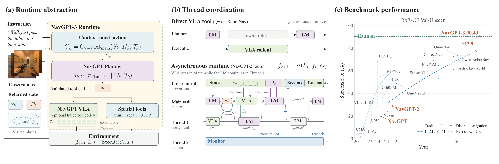
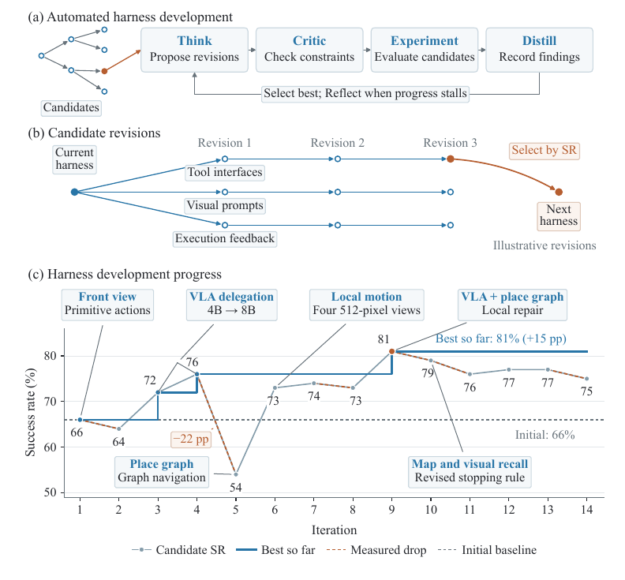
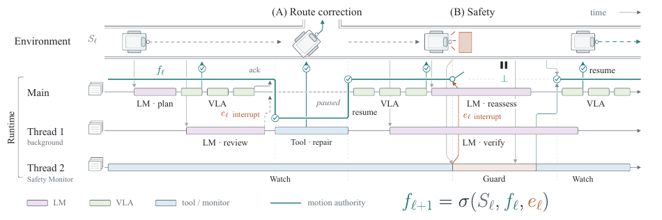
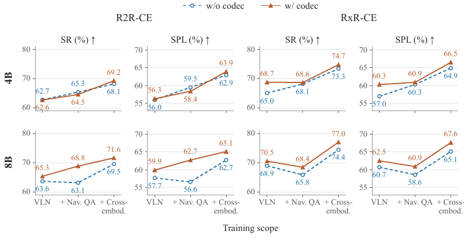

# NavGPT-3 (arXiv 2026)

<!-- paper-source: https://chengwei920412.github.io/paper_reading/2610.10787_NavGPT-3_Harnessing_Context_in_a_Hierarchical_Navigation_Runtime/technical_report.html -->

> 原文链接：[NavGPT-3 (arXiv 2026)](https://chengwei920412.github.io/paper_reading/2610.10787_NavGPT-3_Harnessing_Context_in_a_Hierarchical_Navigation_Runtime/technical_report.html)

> **arXiv ID**：2610.10787  
> **原文标题**：NavGPT-3: Harnessing Context in a Hierarchical Navigation Runtime  
> **翻译日期**：2026年10月11日

---

## 📋 论文概览 {#_1}

### 基本信息 {#_2}

- **作者**：Gengze Zhou、Yicong Hong、Jiazhao Zhang、Xunyi Zhao、Jian Zhou、Zixing Lei、Zun Wang、Chongyang Zhao、Xionghui Chen、Stephen Gould、Anton van den Hengel、Qi Wu
- **机构**：阿德莱德大学 AIML、Metacognition、澳大利亚国立大学、Roblox、北京大学、上海交通大学、北卡罗来纳大学教堂山分校、新南威尔士大学
- **发表时间**：2026年10月（arXiv 预印本）
- **领域**：视觉-语言导航（VLN）/ 具身智能

### 一句话总结 {#_3}

NavGPT-3 将擅长长程推理的规划器与擅长高频控制的 NavGPT VLA 通过一套可检查、可修订的导航执行框架连接起来，并在其上引入类似操作系统的分层运行时，以线程、权限和中断协调推理、行动与安全监控；完整系统在 R2R-CE 上达到 **81.51 SR**，在 RxR-CE 上达到 **90.43 SR / 78.47 nDTW**，后两项与人类跟随者的 **90.4 SR / 77.7 nDTW** 相当。

### 核心贡献 {#_4}

1. **导航执行框架**：统一管理模型上下文、持久路线状态、空间工具、VLA 委派、执行证据、路线修复和显式任务终止，使长时程执行不再是不可检查的黑盒轨迹。
2. **分层导航运行时**：把规划、VLA 执行和安全监控组织为具有独立上下文、工具与权限的逻辑线程，通过运动权限、权限版本、事件优先级和移交规则处理并发与中断。
3. **递归自我改进（RSI）开发流程**：用候选生成、批评、实验、蒸馏和反思组成的树搜索，自动迭代工具定义、视觉提示及执行返回格式；评测时接口固定，不在线修改模型权重。
4. **NavGPT VLA 与大规模混合训练**：以 Qwen3-VL-Instruct 为骨干，统一学习八航点轨迹，在 83 个数据源、11 个数据族组成的 **19.28M** 条有效记录上训练 4B 和 8B 模型。
5. **编解码分配（Codec Allocation）**：借鉴视频 I/P 帧，在固定视觉词元预算下，把更多分辨率分给变化更大的历史视图；消融表明该机制尤其有利于 8B 模型、长路线和跨具身训练。

图1：NavGPT-3 的总体结构、同步工具调用与异步线程协调，以及主要导航结果。

---

## 🎯 研究背景与动机 {#_5}

### 问题定义 {#_6}

具身导航同时要求两种时间尺度截然不同的能力：语言模型需要结合指令、视觉证据和历史状态进行长程推理，而物理机器人需要密集、低延迟且安全的连续控制。若每个动作都调用大型规划器，系统响应慢且成本高；若完全依赖学习得到的 VLA，执行虽快，却难以检查长路线、恢复错误或明确判断整项任务是否完成。

本文研究的核心问题不是简单地把两个模型串联起来，而是设计一套中间接口，使规划器能够：

- 看到经过选择和组织的当前观测、路线证据与空间状态；
- 将较长路线委派给 VLA 高频执行；
- 检查 VLA 返回的路线关键帧、地图和节点；
- 返回已访问地点、执行局部修正或重新委派；
- 在运行时权限约束下决定任务何时真正完成。

### 现有方法的局限性 {#_7}

- **LLM 逐步导航**具有推理与泛化能力，但每次决策通常需要数秒，难以直接承担高频控制。
- **专用 VLA 策略**能够快速输出动作，却容易将整段执行压缩成不可审查的内部状态，缺少显式回溯、验证和任务级终止机制。
- **常规分层系统**往往只强调“规划器调用控制器”，未充分规定上下文归属、共享状态、线程生命周期、运动权限和安全中断。
- **固定视觉预算分配**通常依据时间与相机位置决定图像分辨率，无法判断某幅历史图像是否真正包含新内容。

### 本文的创新点 {#_8}

NavGPT-3 把“具身接口”本身作为主要研究对象：执行框架决定模型能看到什么、能调用什么、能修改哪些状态以及会收到何种执行证据；运行时再决定谁能控制机器人运动。论文由此将模型能力、接口设计与实时控制分开分析，而不是把最终成功率全部归因于某一个模型。

---

## 🔬 方法论 {#_9}

### 整体架构 {#_10}

系统分为三层：

1. **规划器层**：GPT-6 Astra 或 Claude Opus 5 根据执行框架组装的上下文选择工具、检查路线并判断任务是否完成。
2. **执行框架与运行时层**：执行框架维护路线、节点、标注与工具结果；运行时调度主任务、VLA 执行、路线复核和安全监控等逻辑线程，并管理运动权限。
3. **动作与环境层**：NavGPT VLA 根据指令和最多 16 条视觉历史预测八个累积航点，每步只执行第一个；模拟器或机器人落实运动并返回传感与碰撞信息。

一次 VLA 停止只代表当前委派结束，而不是整个导航回合完成。最终任务终止权始终由规划器持有，这使系统可以在 VLA 停止后检查、修复、回溯或再次委派。

### RSI：自动化开发执行框架 {#rsi}

论文把执行框架的递归自我改进形式化为 KDLoop 风格的树搜索。每个候选节点规定系统提示、工具、持久空间状态以及观测和结果的呈现格式；每条边代表一项候选修订。

- **Think**：根据当前接口和累积失败证据提出修改；
- **Critic**：检查接口约束、已知失败和潜在矛盾；
- **Experiment**：实现并在固定开发集上评估通过筛选的候选；
- **Distill**：记录已证实结论、失败修改和未决假设；
- **Reflect**：进展停滞时重新审视整类设计选择。

RSI 在与 Val-Unseen 场景互不重叠的 100 个 R2R-CE 训练回合上，以 SR 为选择信号。开发轨迹从“前视观测 + 原始步进”的 66% SR，依次推进到 4B VLA 委派的 72%、8B VLA 的 76%，并在结合 VLA、空间工具和执行返回后达到 81%。评测阶段接口保持固定，因此这里的“自我改进”是开发期的自动化研究循环，而非部署中的在线学习。

图2：RSI 的研究循环、候选接口分支及开发集成功率演进。

### 分层运行时与运动权限 {#_11}

运行时允许规划器复核与 VLA 执行在时间上重叠，但同一时刻至多只有一个获准操作持有运动权限。每条运动命令携带权限版本；暂停、替换或保护性停止会递增版本，使延迟到达的模型输出和旧队列航点无法重新获得控制权。事件优先级从高到低为：保护性停止与控制环路超时、回合限制、操作自行完成、路线复核请求。

安全监控器可在不等待规划器的情况下撤销运动权限；恢复执行则必须同时满足停止状态已清除、已有最新观测且授予新权限。这个设计把“继续推理”和“允许移动”解耦：即使语言模型仍在运行，机器人也可以立即停止。

图3：路线复核和安全中断中的线程并发、运动权限转移与恢复流程。

### NavGPT VLA 与训练数据 {#navgpt-vla}

NavGPT VLA 从 Qwen3-VL-Instruct 初始化，并加入预测 24 维向量的 MLP 动作头；该向量对应八个 \((x,y,\theta)\) 航点。训练同时包含航点回归和下一词元预测，但两类样本按其监督类型分别掩码。4B 与 8B 模型共享动作格式和训练方案。

完整数据混合由 **83 个数据源、11 个数据族、约 19.28M 条有效记录**组成：65.6% 用于动作回归，34.4% 仅用于下一词元预测；空间推理与视觉定位合计约占 18%，通用视觉语言数据占 8.5%。数据覆盖指令遵循、点目标与物体目标导航、目标跟踪、跨具身导航、户外驾驶、具身问答和视觉定位，并通过单/四视图、不同运动尺度、随机相机参数、偏航状态恢复和少见动作等方式扩大分布覆盖。

### 编解码分配 {#_12}

在总视觉词元预算固定时，位置基线只依据时间新近性和相机方向分配图像分辨率。NavGPT VLA 额外比较同一视角相邻保留图像的 \(64\times64\) RGB 缩略图：首幅图像视为 I 帧，后续图像视为 P 帧，并根据平均绝对像素差获得变化分数。最终权重将位置、新近性、视角方向和视觉变化相乘。

当预算足以让所有图像达到单图像上限时，两种分配规则等价；预算受限时，编解码分配会从低变化视图移出词元，转给变化更明显的视图。该分数刻画的是可观测变化，而非学习得到的语义重要性或光流。

图4：位置分配与编解码分配在不同模型规模和累计训练范围下的对比。

### 算法流程 {#_13}

1. 执行框架收集当前观测、持久路线记录、节点与标注，并依据线程可见性权限构建上下文。
2. 规划器选择观测、VLA 委派、路线检查、回溯/局部修正、语义标注或任务终止等工具。
3. 执行框架验证工具名称、参数、读写范围与当前运行时权限。
4. 若调用 VLA，则在保留的视觉历史上执行编解码分配，预测八个航点并落实第一个，持续至 VLA 停止、单次委派步数上限或回合上限。
5. 执行框架返回路线关键帧、地图、稳定节点和状态；规划器据此继续、修订、重新委派或终止。
6. 并发复核或安全事件通过运行时触发权限移交或撤销；旧版本命令自动失效。

---

## 📊 实验与结果 {#_14}

### 实验设置 {#_15}

- **数据集**：R2R-CE、RxR-CE 完整 Val-Unseen；MP3D 与 HM3D v2 ObjectNav；HM-EQA、MT-HM3D 与 EXPRESS-Bench；固定 100 回合 R2R-CE 子集用于执行框架消融；Unitree Go2 用于实机运行时验证。
- **评估指标**：SR、SPL、nDTW、OSR、NE；问答准确率、归一化步数与路径效率；资源侧统计词元、轮次、成本、推理时间和反应时间。
- **规划器与策略**：GPT-6 Astra/Codex、Claude Opus 5/Claude Code，搭配 4B 或 8B NavGPT VLA。
- **主要对比**：NavFoM、ABot-N0、AstraNav-World、OmniNav、Qwen-RobotNav、Robostral Navigate，以及 ObjectNav/EQA 的对应已发表系统。

### 主要结果 {#_16}

<table>
<thead>
<tr>
<th>系统</th>
<th>R2R-CE SR</th>
<th>RxR-CE SR</th>
<th>RxR-CE nDTW</th>
<th>说明</th>
</tr>
</thead>
<tbody>
<tr>
<td>NavGPT VLA 4B</td>
<td>72.54</td>
<td>76.77</td>
<td>73.33</td>
<td>无规划器执行框架</td>
</tr>
<tr>
<td>NavGPT VLA 8B</td>
<td>74.51</td>
<td>78.19</td>
<td>74.85</td>
<td>独立 VLA 已在 RxR-CE 上领先已发表方法</td>
</tr>
<tr>
<td>NavGPT-3 + Opus 5</td>
<td>79.01</td>
<td>84.80</td>
<td>75.09</td>
<td>完整系统</td>
</tr>
<tr>
<td><strong>NavGPT-3 + GPT-6 Astra</strong></td>
<td><strong>81.51</strong></td>
<td><strong>90.43</strong></td>
<td><strong>78.47</strong></td>
<td>完整系统最佳结果</td>
</tr>
<tr>
<td>英语人类跟随者</td>
<td>—</td>
<td>90.4</td>
<td>77.7</td>
<td>RxR 参照</td>
</tr>
</tbody>
</table>

完整 NavGPT-3 在 RxR-CE 上实现 **90.43 SR / 78.47 nDTW**，与人类的 **90.4 SR / 77.7 nDTW** 相当。需要注意，人类演示沿离散图边移动，而 RxR-CE 系统承担连续运动与避障控制；在相同指令下，论文报告系统平均每回合耗时 1 分 22 秒，人类约需 3 分钟。

接口还显著改变速度和资源使用方式：强规划器可凭空间工具独立获得高 SR，但语言模型每次动作更新需要约 **3–19 s**；将路线执行委派给 NavGPT VLA 后，最短反应时间降至每个策略步 **0.5–1 s（1–2 Hz）**。因此，VLA 的主要价值不仅是提高成功率，更是把慢速推理转化为可用于物理交互的高频动作更新。

跨任务结果也显示接口具备迁移性：在更严格停止条件下的 500 回合 ObjectNav 子集上，NavGPT-3 在 MP3D 达到 59.2 SR / 25.2 SPL，在 HM3D v2 达到 75.3 SR / 40.8 SPL；在具身问答上，HM-EQA、MT-HM3D 和 EXPRESS 的得分分别为 77.38、55.27 和 80.43。

### 消融实验 {#_17}

#### 工具、VLA 与资源开销 {#vla}

- 在 100 回合 R2R-CE 子集上，Astra 仅用基础工具时为 72 SR；加入地图和回溯后达到 83 SR，同时词元数从 325.0k 降至 190.8k。
- Astra 的完整 VLA + 地图 + 回溯配置达到 82 SR，仅使用 155.0k 词元，动作反应时间为 0.78 s。
- Opus 5 在加入 VLA 后，规划器轮次数由 16.75 降至 8.50–11.19，成功率由 73 提升到 76–81，单回合成本由 0.99 美元降至 0.35–0.40 美元。
- VLA 并不保证对所有强规划器都提高 SR：Astra 使用 VLA 后轮次数显著减少，但部分设置的成功率低于其纯工具版本。这说明执行速度、成本与导航精度之间存在真实权衡。

#### 检查频率 {#_18}

每 16 个 VLA 步检查一次可把 SR 从 77 提高到 83、SPL 从 67.51 提高到 77.36，但词元数从 179.2k 激增到 2,319.5k。固定频率监督能提高准确率，却会反复读取累积路线，成本增长远快于性能，因此论文主张现实部署更适合事件触发式复核。

#### 编解码分配 {#_19}

编解码分配在所有 8B 设置中都有收益：三个累计数据范围上，R2R-CE SR 分别提高 1.7、5.7、2.1 个百分点，RxR-CE SR 分别提高 1.6、2.6、2.6 个百分点。4B 模型在 RxR-CE 上也始终受益，但在 R2R-CE 的低多样性训练范围中变化较小甚至略降；加入跨具身数据后，4B 才同时在两个基准上稳定获益。结果支持一个条件性结论：变化感知分配在历史更长、预算更紧和视觉分布更多样时最有效。

#### 数据与模型规模 {#_20}

训练数据从 1.70M 扩大到 **19.28M** 条后，4B/8B 的 R2R-CE SR 分别从 62.6/65.3 提升到 72.54/74.51，RxR-CE SR 从 68.7/70.5 提升到 76.77/78.19。数据扩展的收益大于参数量从 4B 增至 8B；不过每一步同时改变数据量和数据组成，不能把增益归因于单一数据源。

#### Go2 实机运行时 {#go2}

在 Unitree Go2 上，重叠推理与优先级监控组合将路线修订 SR 从顺序排队的 73.3 提高至 83.3，将停止延迟 p95 从 1840 ms 降至 180 ms，并把漏停降至 0/30。该实验表明，线程并发和权限优先级不仅是抽象设计，也能影响真实机器人的恢复速度与安全响应。

---

## 💡 关键见解 {#_21}

### 理论与系统分析 {#_22}

1. **接口会改变模型能力的可实现边界**：同一规划器和同一 VLA，在不同工具、地图、返回格式与上下文组织下可表现出显著不同的准确率、成本和控制频率。
2. **推理能力与动作频率是互补维度**：更强的语言模型可能削弱 VLA 对成功率的边际贡献，但不能消除低延迟动作策略对真实控制的价值。
3. **执行证据是分层协作的关键媒介**：VLA 不是只返回“成功/失败”，而是返回路线图像、状态和可复用节点，使规划器能够检查和修正已发生的物理过程。
4. **运动权限比线程前台状态更严格**：线程可以继续计算和感知，但只有持有有效权限版本的操作才能移动机器人；这为延迟响应、排队航点和安全中断提供了统一约束。
5. **视觉上下文分配应关注信息变化，而非仅关注位置**：在有限预算下，视觉变化可作为简单、无需训练的代理信号，但其收益取决于历史长度、视觉多样性和模型容量。

### 实践启示 {#_23}

- 构建具身智能体时，应把上下文格式、持久状态、工具返回和权限控制视为一等系统组件，而不是提示词外围工程。
- 对真实机器人，慢速规划器适合负责检查、语义判断和异常恢复；快速策略适合承担常规轨迹执行。
- 固定周期调用规划器虽然简单，但成本高；阻塞、偏航、语义不确定性或安全事件驱动的复核更有应用价值。
- 安全停止不应依赖远程语言模型完成推理，而应由低延迟监控器直接撤销运动权限，并要求新感知和新授权后才能恢复。

---

## 🔍 局限性与未来工作 {#_24}

### 当前局限 {#_25}

1. **对闭源托管规划器和脚手架有依赖**：Astra/Codex 与 Opus/Claude Code 的系统指令、内置工具、自动压缩和工具结果格式并不相同，跨规划器结果是完整“模型—脚手架”组合的比较，不能孤立解释为底层模型排名。
2. **消融集规模有限**：执行框架研究主要使用固定的 100 回合 R2R 子集。论文审计发现其指令更短、长度分布更窄，且只覆盖 11 个场景中的 10 个；完整划分主结果缓解了该问题，但细粒度消融仍可能受子集选择影响。
3. **编解码分数不理解语义**：RGB 差分也会响应相机运动与光照变化，不能区分“视觉变化大”和“对当前指令重要”。
4. **数据扩展实验存在混杂因素**：累计训练范围同时改变样本数量和来源构成，无法严格估计每类数据的独立因果贡献。
5. **实机验证范围仍小**：Go2 结果证明了运行时机制的可行性，但场景数、机器人平台和危险类型有限，尚不能替代大规模真实部署与长期安全评估。
6. **响应时间指标需谨慎解释**：0.5–1 s 与 3–19 s 主要反映 VLA 单步或规划器单轮更新时间，并不等同于包含通信、制动和全部物理动态的统一端到端延迟。
7. **完整复现资源尚待发布**：论文承诺公开模型、代码和评测记录，但当前未给出独立代码仓库链接。

### 未来方向 {#_26}

- 设计由阻塞检测、路线偏离、语义置信度和风险等级联合触发的自适应复核策略，在准确率与词元成本之间动态折中。
- 将 RGB 变化扩展为指令相关的语义重要性估计，同时保留整数预算、容量上限和可解释分配约束。
- 在更多机器人、室内外场景、网络条件和长时任务上验证权限版本、抢占、恢复与故障隔离机制。
- 用开源或机载规划器替代部分托管服务，研究端到端延迟、隐私、成本和断网鲁棒性。
- 通过控制数据量、来源和增强方式的正交实验，拆分视觉定位、跨具身数据、问答监督和恢复轨迹各自的贡献。
- 对运行时权限和移交协议开展形式化验证，并将低层控制屏障、碰撞预测和硬件急停纳入统一安全保证。

---

## 📚 相关工作对比 {#_27}

<table>
<thead>
<tr>
<th>方法类别</th>
<th>核心思想</th>
<th>优势</th>
<th>局限</th>
</tr>
</thead>
<tbody>
<tr>
<td>NavGPT / MapGPT 等 LLM 导航</td>
<td>语言模型根据文本或地图观测逐步推理并选择动作</td>
<td>零样本推理强、解释性较好、易使用开放词汇知识</td>
<td>动作更新慢，逐步调用成本高，难直接承担连续控制</td>
</tr>
<tr>
<td>Qwen-RobotNav 等专用 VLA</td>
<td>将视觉语言模型微调为密集动作策略</td>
<td>低延迟、轨迹执行连贯、可端到端训练</td>
<td>路线证据、回溯和任务级完成判断较弱</td>
</tr>
<tr>
<td>NavMCP</td>
<td>跨导航基础模型调用保留轨迹证据，用于具身问答</td>
<td>能积累长期证据并回答问题</td>
<td>主要目标是问答，不以指令路线修订和权限运行时为核心</td>
</tr>
<tr>
<td><strong>NavGPT-3</strong></td>
<td>以执行框架连接规划器与 NavGPT VLA，并用分层运行时控制线程和运动权限</td>
<td>兼顾长程推理、高频执行、路线修复、安全中断和显式终止</td>
<td>系统复杂，依赖接口工程和托管规划器，监督频率与成本仍需权衡</td>
</tr>
</tbody>
</table>

---

## 🎓 个人评价 {#_28}

### 优点 {#_29}

- 论文把长期被视为“胶水代码”的执行框架提升为可形式化、可消融、可复现评测的研究对象。
- 从接口、模型、运行时到实机验证形成完整证据链，既报告准确率，也报告词元、成本、轮次、反应时间和停止延迟。
- 对 VLA 的结论较克制：它稳定降低反应时间和推理轮次，却不保证对每个强规划器都提升 SR。
- 人类对照同时考虑 SR 与 nDTW，而非只凭终点成功宣称“达到人类水平”。
- 编解码分配简单、可解释、无需额外学习，并通过多模型规模和多训练范围消融说明其适用条件。

### 可改进之处 {#_30}

- 应在公开代码后提供一键复现实验清单，明确托管模型版本、脚手架配置、上下文压缩和价格快照。
- 可增加统一硬件与网络条件下的端到端动作延迟，避免把纯推理更新间隔误解为完整机器人响应时间。
- 应扩大真实机器人测试并报告置信区间、失败类别和极端场景，而不仅是有限次数的场景汇总。
- RSI 的搜索预算、候选淘汰标准和开发集过拟合程度可进一步量化。
- 编解码分配可与语义相关性、光流或可学习选择器做等预算对比，以分离“视觉变化”与“任务相关信息”。

### 推荐阅读对象 {#_31}

适合从事 VLN、具身智能体、VLA、机器人系统、智能体执行框架、长上下文管理与安全运行时研究的读者；也适合希望理解“强语言模型如何可靠接入真实控制回路”的工程团队。

---

## 📎 附录 {#_32}

### 重要公式 {#_33}

**1. 规划器工具选择**

\[a_k\sim\pi_{\mathrm{Planner}}(\cdot\mid C_k,\mathcal{T}_k)\]

\(C_k\) 是执行框架构建的上下文，\(\mathcal{T}_k\) 是当前允许使用的工具集合。该式强调：规划器行为不仅由模型决定，也受执行框架提供的上下文与权限边界塑造。

**2. 前台运动资格**

\[\operatorname{eligible}_{\ell}(j,a)=\mathbf{1}\!\left[j=f_\ell\ \land\ a\in\mathcal{P}_j\right]\]

只有前台线程 \(f_\ell\) 且动作属于其许可集合 \(\mathcal{P}_j\) 时，命令才具备运动资格；实际执行还需通过状态、权限版本与保护控制检查。

**3. 编解码变化分数**

\[\delta_{h,v}=\frac{\lVert\operatorname{thumb}(I_{h,v})-\operatorname{thumb}(I_{h-1,v})\rVert_1}{255\cdot3\cdot64^2}\]

\[s^{\mathrm{change}}_{h,v}=\begin{cases}1,&amp;\text{I-frame},\\ \operatorname{clip}(5\delta_{h,v},0.05,1),&amp;\text{P-frame}.\end{cases}\]

最终权重 \(w^{\mathrm{codec}}_{h,v}=w^{\mathrm{pos}}_{h,v}s^{\mathrm{change}}_{h,v}\)，在预算受限时把视觉词元转向变化更明显的图像。

### 术语表 {#_34}

<table>
<thead>
<tr>
<th>术语</th>
<th>含义</th>
</tr>
</thead>
<tbody>
<tr>
<td>执行框架（Harness）</td>
<td>连接规划器、VLA 和环境，负责上下文、状态、工具验证与执行证据的接口层</td>
</tr>
<tr>
<td>规划器（Planner）</td>
<td>解释任务与证据、选择工具、修订路线并决定任务是否完成的推理模型</td>
</tr>
<tr>
<td>NavGPT VLA</td>
<td>根据指令与视觉历史高频预测八航点轨迹的视觉-语言-动作策略</td>
</tr>
<tr>
<td>运动权限</td>
<td>允许某项操作向机器人发出任务运动命令的运行时许可</td>
</tr>
<tr>
<td>权限版本</td>
<td>权限撤销或替换时递增的版本号，用于阻止过期命令恢复控制</td>
</tr>
<tr>
<td>RSI</td>
<td>递归自我改进；开发期自动搜索和验证执行框架修订的流程</td>
</tr>
<tr>
<td>编解码分配</td>
<td>受视频 I/P 帧启发，结合位置与 RGB 变化分配视觉词元预算的方法</td>
</tr>
<tr>
<td>SR</td>
<td>成功率，衡量回合是否在目标附近按规则停止</td>
</tr>
<tr>
<td>SPL</td>
<td>按路径长度加权的成功率</td>
</tr>
<tr>
<td>nDTW</td>
<td>归一化动态时间规整，衡量执行路线与参考路线的相似度</td>
</tr>
</tbody>
</table>

### 参考资源 {#_35}

- **论文原文**：[arXiv 2610.10787](https://arxiv.org/abs/2610.10787)
- **项目主页**：[NavGPT-3](https://metacognitionai.github.io/NavGPT3/)
- **代码实现**：论文称将公开，尚未给出独立仓库链接
- **中文翻译 PDF**：[paper_cn.pdf](https://chengwei920412.github.io/paper_reading/2610.10787_NavGPT-3_Harnessing_Context_in_a_Hierarchical_Navigation_Runtime/paper_cn.pdf)
- **中文 Markdown 译文**：[paper_cn.md](https://chengwei920412.github.io/paper_reading/2610.10787_NavGPT-3_Harnessing_Context_in_a_Hierarchical_Navigation_Runtime/paper_cn.html)
