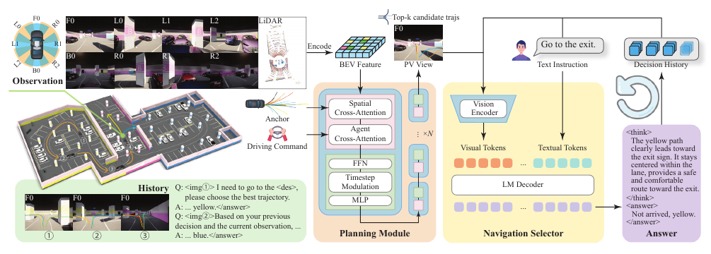

# DriveVLN (CVPR 2026)

<!-- paper-source: https://chengwei920412.github.io/paper_reading/CVPR2026_DriveVLN_Towards_Mapless_Vision_and_Language_Navigation_in_Autonomous_Driving/technical_report.html -->

> 原文链接：[DriveVLN (CVPR 2026)](https://chengwei920412.github.io/paper_reading/CVPR2026_DriveVLN_Towards_Mapless_Vision_and_Language_Navigation_in_Autonomous_Driving/technical_report.html)

> **论文来源**：CVPR 2026  
> **原文标题**：DriveVLN: Towards Mapless Vision-and-Language Navigation in Autonomous Driving  
> **翻译日期**：2026-10-08

---

## 📋 论文概览 {#_1}

### 基本信息 {#_2}

- **作者**：Dongqian Guo、Haoran Wei、Wencheng Han、Runzhou Tao、Zhongying Qiu、Jianfei Yang、Jianbing Shen
- **机构**：澳门大学；重庆安飞智能驾驶有限公司
- **发表时间**：CVPR 2026
- **领域**：自动驾驶、视觉-语言导航、闭环仿真、强化学习

### 核心贡献 {#_3}

论文把视觉-语言导航从“室内机器人依据逐步指令找路”改写为“自动驾驶车辆只根据目的地描述，在没有导航地图的场景中安全到达目标”。为支撑该问题，作者构建了 200 个由真实道路扫描重建的 CARLA 场景、闭环评测协议，以及由轨迹规划器和视觉语言导航选择器组成的基线。基线先在真实单帧数据上监督微调，再在仿真闭环中通过 GRPO 强化学习优化长期路线决策。

---

## 🎯 研究背景与动机 {#_4}

### 问题定义 {#_5}

传统自动驾驶依赖导航地图提供全局路线。室内停车场、地下空间或地图失效区域缺少可靠地图时，车辆即使能够感知和避障，也不知道应该选择哪个岔路才能到达“出口”“充电桩”或“某个停车位”。DriveVLN 只提供目的地级自然语言，如“去出口”，要求车辆结合视觉标志、文字、地标和历史决策完成闭环导航。

### 现有方法的局限性 {#_6}

- 传统自动驾驶基准通常假设具备地图或给定路线，无法评价目的地级语言在无图环境中的作用。
- 传统 VLN 依赖细粒度逐步指令，且多在静态室内图像上评测，不包含真实车辆控制与驾驶安全指标。
- 语言驾驶模型多采用开环问答或场景理解评测，语言推理未必真正参与闭环控制。

### 本文的创新点 {#_7}

1. 将目的地级语言、无图导航和闭环车辆控制统一为 DriveVLN 任务。
2. 构建 Topo2Sim 流程，把真实道路拓扑转换为 CARLA 数字孪生场景，并自动增强文本、标志、车辆和障碍物。
3. 将连续轨迹规划转化为视觉化的离散候选选择问题，使 VLM 不必直接回归控制量。
4. 用局部安全/舒适奖励和全局路线一致性奖励联合训练，显式优化历史依赖的长期导航。

---

## 🔬 方法论 {#_8}

### 整体架构 {#_9}

系统由两部分组成：规划模块根据多相机与 LiDAR 观测生成与目的地无关的可行候选轨迹；导航选择器把候选轨迹以不同颜色投影到前视图，结合目的地指令和历史问答，判断是否到达，并选择对应颜色的轨迹。

### 关键技术 {#_10}

**Topo2Sim。** 从 WGS84 拓扑坐标生成车道中心线、边界、路口连接、停车位、POI 和静态障碍物，再用程序化规则生成标线、标志、车辆和障碍物。此设计把场景几何与外观增强解耦，便于规模化生成。

**候选轨迹动作空间。** DiffusionDrive 以 RGB、LiDAR 和轨迹锚为条件生成候选轨迹，取置信度最高的 \(k\) 条作为离散动作。VLM 只负责在安全可行候选中做目标相关选择，降低直接输出连续控制的难度。

**两阶段训练。** “轨迹铸造”阶段分别训练规划器和选择器的基础能力；“策略淬炼”阶段在闭环仿真中使用强化学习，让选择器利用历史上下文处理当前画面缺少明确导航线索的情况。

### 算法流程 {#_11}

1. 从场景图中采样起点和目的地，计算最短路线作为监督与奖励参照。
2. 规划器生成 \(K\) 条目的地无关候选轨迹。
3. 将候选轨迹按颜色绘制到前视图，连同目的地语言和历史决策输入 VLM。
4. VLM 输出“是否到达 + 轨迹颜色”。
5. 仿真器执行选中轨迹并返回碰撞、轨迹偏差和访问节点。
6. 局部奖励约束安全与舒适，全局奖励约束最短路线前缀一致性、边重叠和最终到达。

---

## 📊 实验与结果 {#_12}

### 实验设置 {#_13}

- **数据集**：200 个 CARLA 数字孪生场景；规划器训练 352,230 帧；选择器监督微调 40,780 帧。
- **评估指标**：驾驶分数（DS）、成功率（SR）、导航误差（NE）、L2 误差、碰撞率。
- **对比方法**：Seed-1.6、GPT-5、Qwen2.5-VL-72B。
- **测试规模**：仿真闭环实验从增强场景中随机采样 20 条预设路线；另在真实量产数据上进行单轮问答评测。

### 主要结果 {#_14}

<table>
<thead>
<tr>
<th>模型</th>
<th>DS ↑</th>
<th>SR ↑</th>
<th>NE ↓</th>
<th>L2 平均 ↓</th>
<th>碰撞率平均 ↓</th>
</tr>
</thead>
<tbody>
<tr>
<td>Seed-1.6</td>
<td>0.60</td>
<td>0.38</td>
<td>0.56</td>
<td>0.316</td>
<td>0.101</td>
</tr>
<tr>
<td>GPT-5</td>
<td>0.48</td>
<td>0.23</td>
<td>0.56</td>
<td>1.550</td>
<td>0.170</td>
</tr>
<tr>
<td>Qwen2.5-VL-72B</td>
<td>0.45</td>
<td>0.21</td>
<td>0.59</td>
<td>1.868</td>
<td>0.240</td>
</tr>
<tr>
<td><strong>DriveVLN</strong></td>
<td><strong>0.67</strong></td>
<td><strong>0.44</strong></td>
<td><strong>0.49</strong></td>
<td><strong>0.283</strong></td>
<td><strong>0.096</strong></td>
</tr>
</tbody>
</table>

DriveVLN 在综合驾驶分数、成功率、导航误差和平均碰撞率上均最佳。不过成功率只有 0.44，说明即使基线已明显优于通用 VLM，任务仍远未解决。

真实数据单轮问答中，DriveVLN 的总体到达检测准确率为 91.40%，轨迹选择准确率为 63.75%。GPT-5 在充电桩到达检测和出入口导航两项上更强，体现通用大模型在长尾语义上的泛化优势。

### 消融实验 {#_15}

<table>
<thead>
<tr>
<th>训练阶段</th>
<th>规划器</th>
<th>DS ↑</th>
<th>SR ↑</th>
<th>NE ↓</th>
<th>L2 ↓</th>
<th>Col ↓</th>
</tr>
</thead>
<tbody>
<tr>
<td>SFT</td>
<td>DiffusionDrive</td>
<td>0.49</td>
<td>0.21</td>
<td>0.53</td>
<td>0.457</td>
<td>0.107</td>
</tr>
<tr>
<td>SFT+RL</td>
<td>DiffusionDrive</td>
<td><strong>0.67</strong></td>
<td><strong>0.44</strong></td>
<td><strong>0.49</strong></td>
<td><strong>0.283</strong></td>
<td><strong>0.096</strong></td>
</tr>
<tr>
<td>SFT</td>
<td>专家轨迹</td>
<td>-</td>
<td>0.23</td>
<td>0.48</td>
<td>-</td>
<td>-</td>
</tr>
<tr>
<td>SFT+RL</td>
<td>专家轨迹</td>
<td>-</td>
<td><strong>0.51</strong></td>
<td><strong>0.42</strong></td>
<td>-</td>
<td>-</td>
</tr>
</tbody>
</table>

强化学习带来的提升显著大于更换规划器的提升，说明长期历史建模和闭环奖励是性能增益的主要来源。专家轨迹比 DiffusionDrive 更接近监督训练分布，成功率进一步升至 0.51，但该设置按构造没有规划误差与碰撞，不能与完整系统的安全指标直接横向比较。

---

## 💡 关键见解 {#_16}

### 理论分析 {#_17}

论文的核心分解很实用：规划器负责“哪些轨迹可安全执行”，VLM 负责“哪条可行轨迹更接近语言目标”。这相当于让连续控制安全边界由专业规划器承担，而把 VLM 的作用限制在离散语义决策层。该设计降低了语言模型直接控制车辆的风险，也使闭环强化学习可在规模较小的离散动作空间内进行。

全局奖励同时使用路线前缀一致性与边重叠率。前者惩罚早期走错岔路，后者对局部偏差更宽容；再加入到达奖励，形成“过程正确 + 最终到达”的组合目标。局部奖励则以轨迹匹配和碰撞门控约束舒适性与安全性。

### 实践启示 {#_18}

- 在真实自动驾驶系统中，语言模型更适合作为高层语义路由器，而非直接输出转向和油门。
- 单帧监督不足以学习无图导航；必须保留历史决策，并通过闭环数据训练错误恢复和长期一致性。
- 将真实采集的拓扑结构转成可随机增强的仿真场景，是降低闭环训练成本的有效路径。

---

## 🔍 局限性与未来工作 {#_19}

### 当前局限 {#_20}

1. 闭环对比仅随机采样 20 条路线，样本量偏小，论文未报告不同随机种子下的方差或置信区间。
2. 场景以停车场类环境为主；道路结构、速度范围与交互复杂度尚不足以代表开放道路无图驾驶。
3. 真实数据评测是离散单轮问答，不是完整真实车辆闭环，因此仿真到现实的控制性能仍未被证明。
4. 所有模型的成功率均低于 0.5，当前基线距离可靠部署仍有明显差距。
5. 论文正文未给出公开代码或项目主页，数据、场景资产和训练配方的可复现性仍需后续材料确认。
6. 原文实现细节把策略淬炼学习率写为 \(1\times10^3\)；该值可能需要作者澄清，复现时不宜直接采用而不核验。

### 未来方向 {#_21}

- 扩展至开放道路、园区、地下通道等更复杂无图环境。
- 引入显式记忆、拓扑地图在线构建与不确定性估计，提高长程导航和错误恢复能力。
- 评测真实车辆闭环、域偏移、恶劣天气、遮挡与交通参与者交互。
- 将语言目标理解、视觉文字识别和安全规划的不确定性纳入统一风险约束。

---

## 📚 相关工作对比 {#_22}

<table>
<thead>
<tr>
<th>方法</th>
<th>核心思想</th>
<th>优势</th>
<th>局限</th>
</tr>
</thead>
<tbody>
<tr>
<td>传统地图导航</td>
<td>依赖 HD 地图与预定义路线规划</td>
<td>路线稳定、工程成熟</td>
<td>地图缺失或失效时不可用</td>
</tr>
<tr>
<td>室内 VLN</td>
<td>依据逐步语言和静态视觉观测选动作</td>
<td>语言监督细致、基准成熟</td>
<td>不含车辆动力学和驾驶安全</td>
</tr>
<tr>
<td>DriveVLM / LMDrive</td>
<td>语言与端到端驾驶或场景推理结合</td>
<td>统一视觉语言理解</td>
<td>通常仍依赖导航地图或开环评测</td>
</tr>
<tr>
<td><strong>DriveVLN</strong></td>
<td>目的地级语言 + 可行轨迹候选 + 闭环选择</td>
<td>面向无图驾驶，联合导航与安全指标</td>
<td>成功率偏低，真实闭环尚未验证</td>
</tr>
</tbody>
</table>

---

## 🎓 综合评价 {#_23}

### 优点 {#_24}

- 问题定义清楚，准确抓住传统 VLN 与自动驾驶之间最关键的监督差异。
- 规划器与 VLM 的模块化分工合理，既利用语言推理能力，又保留传统规划的安全约束。
- 数据生成、训练与闭环评测形成完整链路，不止停留在视觉问答层面。
- 消融表明强化学习和历史上下文确实对长期导航有效。

### 可改进之处 {#_25}

- 扩大闭环路线数量并报告统计显著性。
- 增加更强的记忆基线、显式拓扑建图基线和无语言基线，以更准确定位性能来源。
- 给出真实车辆闭环实验、失败类型分布及安全边界分析。
- 发布场景资产、代码与训练配置，并澄清学习率等实现细节。

### 推荐阅读对象 {#_26}

适合研究自动驾驶 VLM/VLA、视觉-语言导航、CARLA 闭环仿真、语言条件规划与强化学习的读者。对希望把大模型嵌入传统规划栈、又不愿让模型直接承担低层连续控制的工程团队尤其有参考价值。

---

## 📎 附录 {#_27}

### 重要公式 {#_28}

局部奖励：

\[r_t^{local}=(1-Col_t)\exp\left(-\frac{1}{L}\sum_{i=1}^{L}\min\lVert\hat{\mathbf p}_{t,i}-\mathbf p_{t,i}\rVert_2\right).\]

全局奖励：

\[\mathcal R_{global}=\alpha_1S_{prefix}+\alpha_2S_{overlap}+\alpha_3\mathbf 1[arrived].\]

驾驶分数：

\[D=RC\cdot IP.\]

### 术语表 {#_29}

<table>
<thead>
<tr>
<th>英文</th>
<th>中文</th>
</tr>
</thead>
<tbody>
<tr>
<td>Mapless Driving</td>
<td>无图驾驶</td>
</tr>
<tr>
<td>Vision-and-Language Navigation (VLN)</td>
<td>视觉-语言导航</td>
</tr>
<tr>
<td>Navigation Selector</td>
<td>导航选择器</td>
</tr>
<tr>
<td>Planning Module</td>
<td>规划模块</td>
</tr>
<tr>
<td>Trajectory Foundry</td>
<td>轨迹铸造</td>
</tr>
<tr>
<td>Policy Tempering</td>
<td>策略淬炼</td>
</tr>
<tr>
<td>Decision Node</td>
<td>决策节点</td>
</tr>
<tr>
<td>Route Completion</td>
<td>路线完成度</td>
</tr>
<tr>
<td>Infraction Penalty</td>
<td>违规惩罚</td>
</tr>
</tbody>
</table>

### 参考资源 {#_30}

- **论文原文**：[CVF Open Access PDF](https://openaccess.thecvf.com/content/CVPR2026/papers/Guo_DriveVLN_Towards_Mapless_Vision-and_Language_Navigation_in_Autonomous_Driving_CVPR_2026_paper.pdf)
- **中文翻译 PDF**：[paper_cn.pdf](https://chengwei920412.github.io/paper_reading/CVPR2026_DriveVLN_Towards_Mapless_Vision_and_Language_Navigation_in_Autonomous_Driving/paper_cn.pdf)
- **中文 Markdown 译文**：[paper_cn.md](https://chengwei920412.github.io/paper_reading/CVPR2026_DriveVLN_Towards_Mapless_Vision_and_Language_Navigation_in_Autonomous_Driving/paper_cn.html)
- **代码实现**：论文正文未提供
- **项目主页**：论文正文未提供
